# 【哈佛大学】机器学习几何学 ｜ Geometry Of Machine Learning 2025 p07 P07_Alex_Kontorovich-未来数学的形态 -BV14uq3BiEEB_p7-

Thank you so much to the organizers for putting this together and for the kindman invitation so I'm going to talk about the shape of Ma Decom。

 I don't know if you recognize the title of course I'm referring to Orak Coleman。

 the shape of jazz tocom but but let's get into it a little bit if you maybe you don't like jazz but yeah。

 so I don't know if this is I thought of it as a Yogi Bra。

 but I looked it up and apparently Niil's Bor maybe said it or some old Danish proverb that prediction is difficult especially about the future so instead of trying to look forward。

 let's first look backwards， what did people say and there's there was a really interesting meeting in Tel Aviv in 1999 that was published in the proceedings of Gaa in the year 2000。

😊，And it's all all these talks are on YouTube。 Yeah， yeah， all these talks are on YouTube， But the。

 you know， the talks are great， too。 But then there's actually proceedings where you can read。

 you know， the details of what people say。 This visions in mathematics。 And a lot of really。

 really interesting things here。 I， I strongly encourage just in general， I mean， to read this。😊。

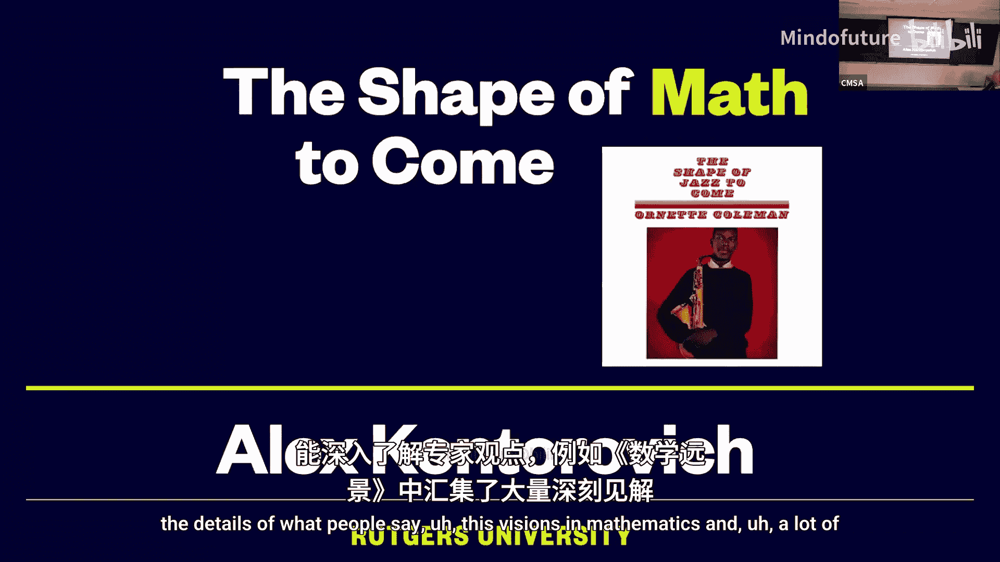

Gomov has some very， I mean， everybody， there's lots of contributions， Eli Ste。Yes sinai， brgan。

 anyway。 So the one that I'm going to focus in on is by Tim goers。

 and the title might not seem like it's something that's about。

The future it's about rough structure and classification and in fact。

 that rough structure and classification he only gets to in section 3 of this paper and it's what we would now call approximate structures so the work that happened in the decade after is exactly what he predicted was going to be happening in in this one article and you know lots of field metal came out of it the greentu theorem and the stronger theorem。

 the inverse theorem for Gawer's norms that there are no nonapprimate n sequences。

 the some product theorem that there are no non-appoximate rings。

 the triple product and maybe building up to Briar Greentu that there are no nonappimate groups in general so I realize this is maybe not well the audience maybe doesn't know all these things so I'm not going to say anything about these at all except to say that the ideas that Gers was talking about in。

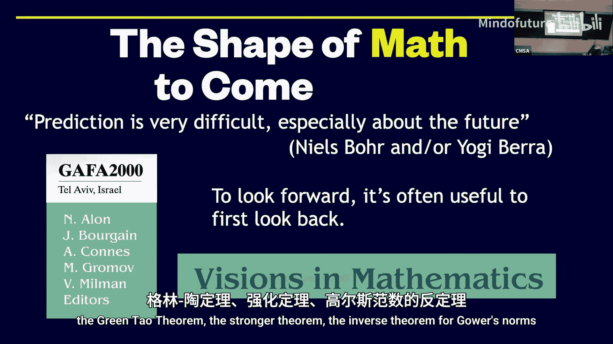

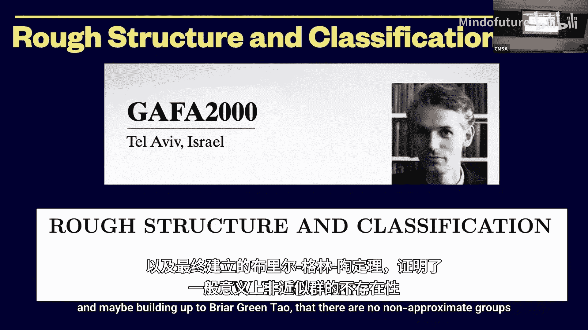

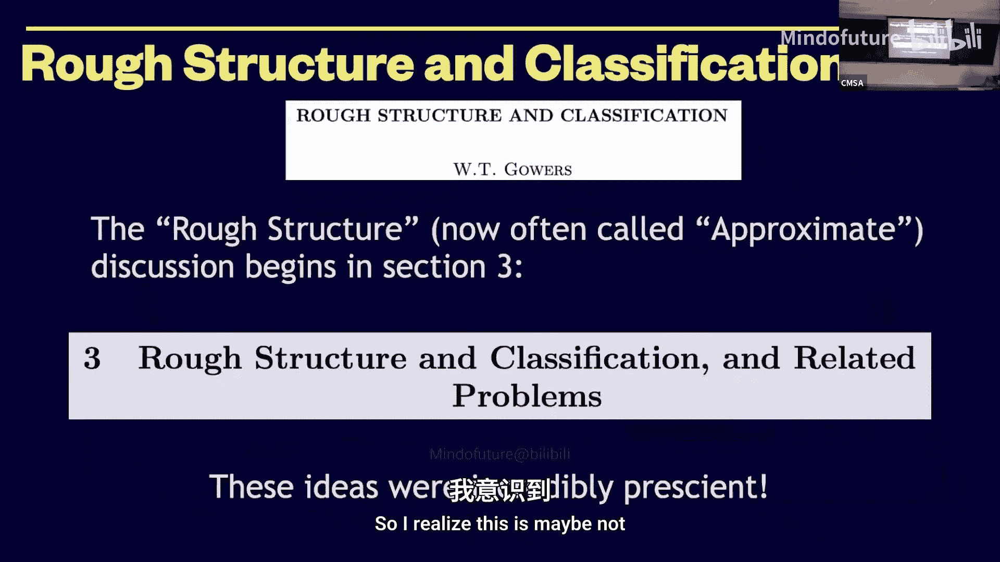

This paper were extremely prescient。Part that I will focus in on is Section 2 of this paper。

 which says， will mathematics exist in the year 2099。 Okay， so this is in the year 1999。

 looking to the millennium or we don't have to look that far ahead。

 Let's just look in the century and。What's that， Will， will people exist。 Yeah， Chapter 1， Okay。

 Chapter one， will people exist。 That's true。 Assing people exist， will mathematics exist。

And so I was going to divide this into four categories of discovery of new mathematics just because you discovered it doesn't mean you really understand it。

 even if you can prove it。 So do we understand mathematics。

 how do we communicate that mathematics to other professional mathematicians and teaching the difference between teaching and communication is teaching is communicating mathematics to people who are new to mathematics as opposed to people who are already professionals。

 And then I realized there I can't actually tell the difference in understanding and communication。

 So these became sort of one category。 I really I think that those are basically synonymous as far as I can tell。

 Okay， so let's let's jump right in with discovery So so I just grabbed a paragraph out of Gaer's paper。

 Let me return to the question of automating mathematics and present and imagine dialogue between a mathematician and computer in two or three decades time so。

キす。Spot on 2025。 And and here's what what the discussion is。

 So the mathematician says is the following true， you know， if you have a positive proportion。

 if you have a subset the positive proportion of the natural numbers do you find a threeter progression and the computer says。

 well， anyway， there's a whole discussion like this。 And this is the early for me， I don't know。

 Maybe there's an earlier form of this where someone really nailed what it will look like to talk to a chatbot 25 years out。

😊。

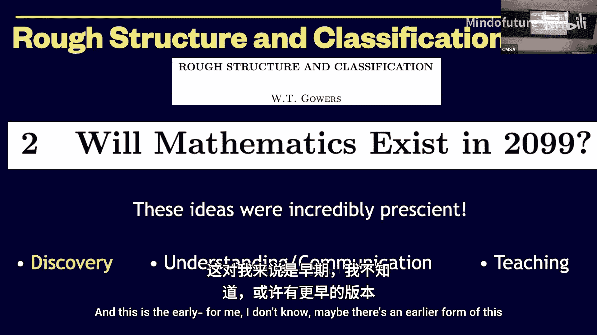

And this is， you know， the earliest prompt engineering that that I could find that's really looks like modern。

 And this is from the year 2000。 Okay， quarter century ago。 let me just continue with this paragraph。

 I've written the dialogue in English。 but it's supposed to be a translation。 It turns out no。

 you can actually talk to it in English。 But it's supposed to be a translation of a more formal language。

 which has not yet been invented。 So again， he's seeing things in the future。 but let me jump back。

 The idea is that the dialogue with the computer。 The computer is helpful。

 but it's not doing anything particularly clever。 So， so let me zoom in a little bit on that。

Let me insult all of your intelligence by saying what I mean by an LM for one second。

 because I want to really define terms and get to the nitty gritty。 It's like in a mat talk。

 I'm going define what the natural numbers are。 just so we're all on the same page。

 So apologies for this。 I think of it as， you know， my mind as an L。

 And I'm reading to the bottom of book。 And I'm flipping I remember they used to be these things。

 He wasn't just you click a button on your iPhone or Kindle。

 You actually turn the page and you fumble。 And your brain can't help。

 There's an LM inside your brain。 and it can't help but autocomplete。

 And so you're reading Harry didn't even know what all the who cruxes were。 Meanwhile。

 he was at a loss to know how to。

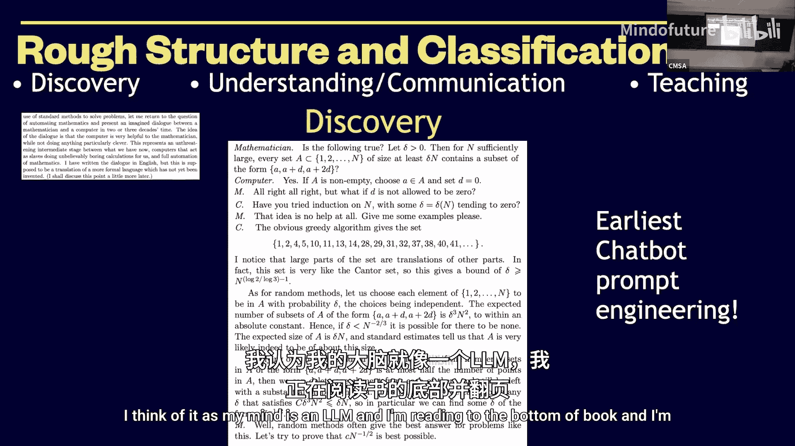

How to what and maybe how to destroy the who cruxes or how to find the who cruxes or how to sandwich。

 maybe sandwich is an next word。 Okay， so then you you ask every human being alive and 20% of them might say destroy and 7% of them might say find and almost nobody would say sandwich。

 and so this is like an LLM to me is a game of family feud survey says except survey is all of written language ever。

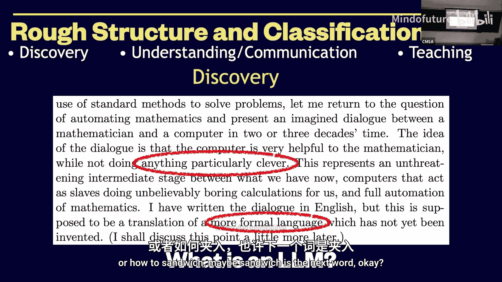

So that's at its core， it's a function just really。

 really abstractly I'm just I'm taking out all of the amazing engineering that goes into the existence of such things Jad。

 yeah'll to be clear so like I think family food is a great example。

 so the contestants are not saying what they think the next word should be they're saying what they think the point the community would say is the next word。

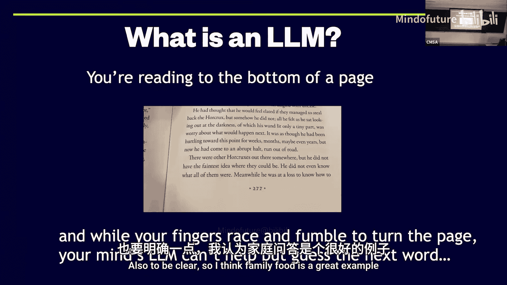

That's right。 That's right。 And what I really want is I want to specify that in LL M。

 a lot of people confuse LLms and chatbos。 And I'm sure I'll say the word LL M when I actually mean a chatbot。

 And L M is just a model。 It's a function from context to distribution of next tokens。😊，Okay。

 as opposed to the choice of the next token。 So what I have in mind for family feud is that the answer。

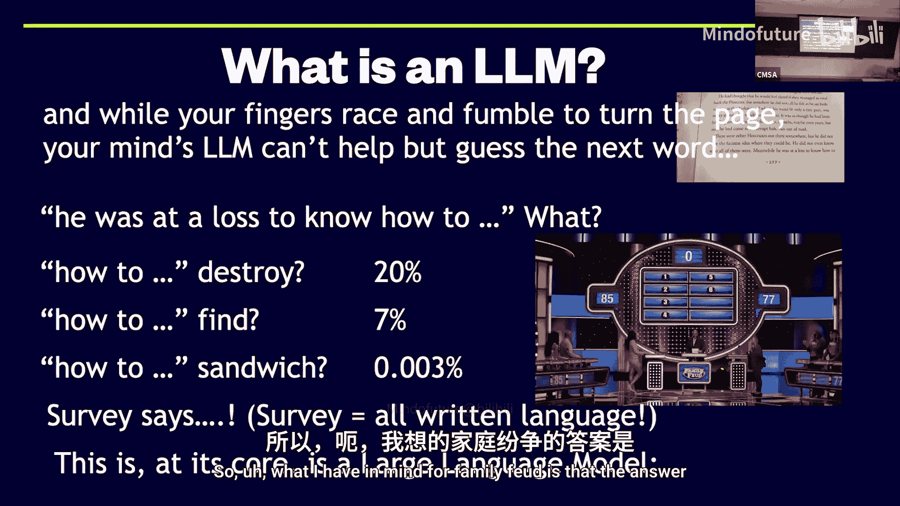

Is the answer board is the LLM， not what the contestant is doing。

The contestant is more like the chatbot。Where the contestant is saying。

 I think this is the most likely next word。Does that make sense。

 So the fact that the answer key has 20% of people saying find and and 7% saying you know destroy or something that would be more of the distribution and then the distribution is the model of language It's a function from context to a distribution of next tokens。

 that's exactly why I want to make this point。 So you're saying the chatbots are the contestant chatbo exactly exactly the chatbot is contestant lives on top of the model and now you have to decide are you going to take the most likely you know that's this is what temperature does you say how much into the distribution do you want to sample。

To make things a little bit more more interesting。So I really want to distinguish the existence of this function。

 however it comes about， however you train it， however the engineering。

 whatever H100 farm you have somewhere that's running。

 whatever GPs and CPU GPs read And and the main point I want to make about chatbot。 So again。

 the chatbot will decide given the context what that next token should be。

 add that next token to the context and just iterate that until the token says stop talking。Right。

 that's just just so that we're all on the same page of what's going on。 And so this chat bot。

 which again， I and many others will confuse with the word LM。Is stochastic。

 stochastic doesn't just mean random。 It's randomness on top of randomness on top of randomness because every time you make a choice of what that word is。

 you add it to the context and you run it again。 And so it really is compounding randomness。

 the way Browning motion compounds randomness after every。😊，Instant of time。Okay， and so。

This stochasticity， I claim， is both its power and weakness。 And。

 and there's a vital difference between stochastic processes and deterministic processes。 There's no。

 if you choose the wrong word in the middle of Ed R and Po poem or in the middle of Ornett Co in jazz cell。

 You know， stick a blue note in there somewhere， you can still have an amazing jazz cell。

 you can still recover and have an incredible product at the end。 If you get a theorem，99% right。

 and there's just one minus sign missinging somewhere in the middle。😊，That's a useless theory。

 you could be completely wrong。 It might be useful。 It might be useful。

 There might be very useful ideas that you can recover， but it might be utterly useless。

 And there was a minus sign at the very beginning that ruins the entire argument。 Okay。

 so theorems are deterministic in a way that poetry and language in general and jazz solos are stochastic。

😊。

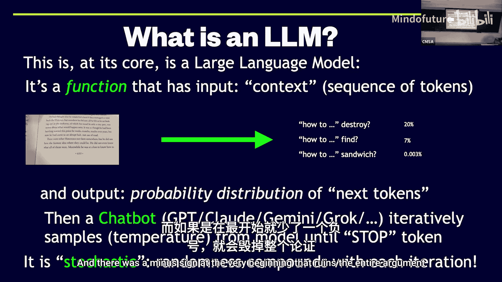

Yeah I want to I want to separate these and this really。

To me feels there's a strong analogy between that and Danny Kanemans， I mean。

's Danny Kaneman popularized this way of thinking about what the human brain seems to have is these two different modes of thought。

 System 1 is system 2， system 1 is if I ask you3 plus 8 you guys aren't count my little ones might be counting on on their fingers。

 But at this point， for you all， it's effortless， whereas okay， maybe for some of you，437 times 82。

 you can answer instantaneously， I would have to get out a piece of paper and do a calculation so system 2 is slow calculating kind of infrequent。

And so。When I do 437 times 82， actually what？Maybe the purpose of school is to start with school math。

 is to start with things that are system two and convert them to processes involving chains of system one。

Right so when I do 432 times 82， I know how to set it up so that I'm doing a whole bunch of system1 processes that are I know what two times seven is。

 I know to put the four there and the one you know I'll save for later and so on。

 And so system two is really a long chain of system 1。Okay，And so if you think about it。

 if we have some process that takes 100 steps where every step， you have a 99% chance of success。

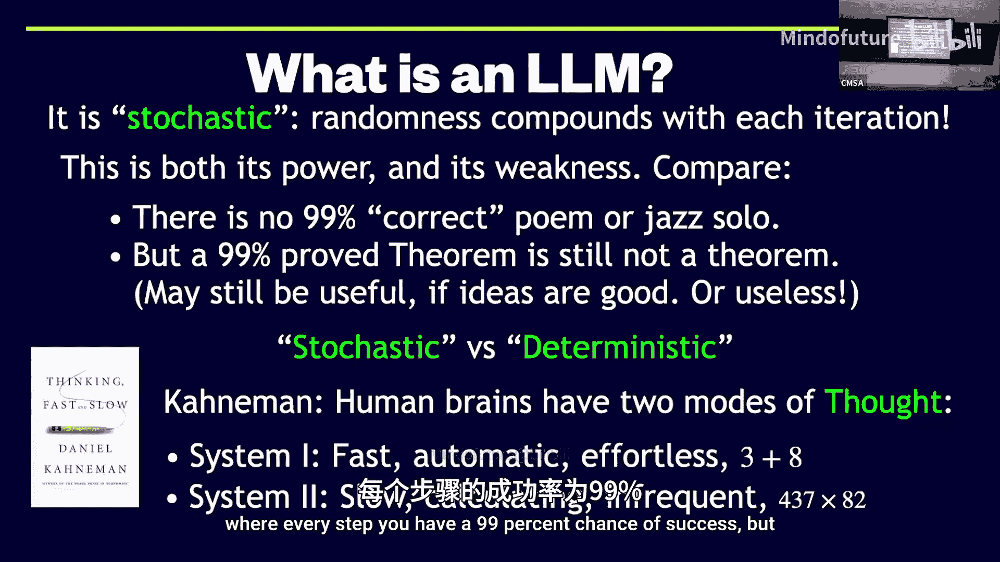

But success requires every single one of them to be right。

 what are the odds you know what probability you have of succeeding in the end。

 and of course it's minus skill okay。So。But chatbots don't have to be pure LLMs， they can use tools。

RightIt's not that you have to answer。 I mean， there are people who try to train chatbots to do multiplication table in language。

 I don't understand why because what what the way that I got this  point。

004 is I ask Claude what is 0。99 to the thousand and it said I'll figure it out。

 but I'm not going to guess in language what it is， I'll write a ja。

 I'll run that ja and that'll give me the answer and there it is。

Right so this is the beauty of tools， Elliot。I don't think there should be a percentage sign though。

No， no， I took two zeros off。I multipplied it by 100， didn't I？Anyway， we。

 we can that we can discuss later。 I think I got it right， but maybe you're not。 Okay。

 so when these chatbots use tools， they can， despite the fact that all they're doing is producing next tokens。

 they can then do deterministic things with those next tokens like run a jascript。

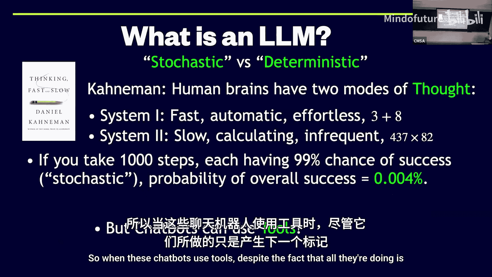

So if you really know you only want to take a thousand0 steps。

 if your model is big enough it's been trained enough data and you lower the temperature enough。

I'm coming to that。 Yeah， that's the bitter lesson is yeah， I'm coming to that。Okay。

 so chatbots can use tools Oh， but let me give you a caveat about using those tools。

 So Deep mind I was at the Institutes on sabbatical last year and Deep Mind stopped by and visited us and they were showing us all kinds of great things and one of the talks was an example where they were using Gemini and they wanted to compute the genus of some curve and Gemini was trained to write the corresponding Sage code。

 they called Sage and it says this is Genus 1 but they know it' Genus 2。Is there a bug and sage。

 how is this happening？And so the way it's happening is that there's a safety feature that turns off call sage and it was turned off。

 And the LM was trained to call sage， but it couldn't。

 So it just pretended that it called sage and answered in natural language。

 whatever it thought the answer was supposed to be。 Okay so so whenever I work in these things。

 I never， I should have taken this jascript for 。99 to the00， run it locally on my machine。

 Go that that answer and not trusted the AI to report it because。

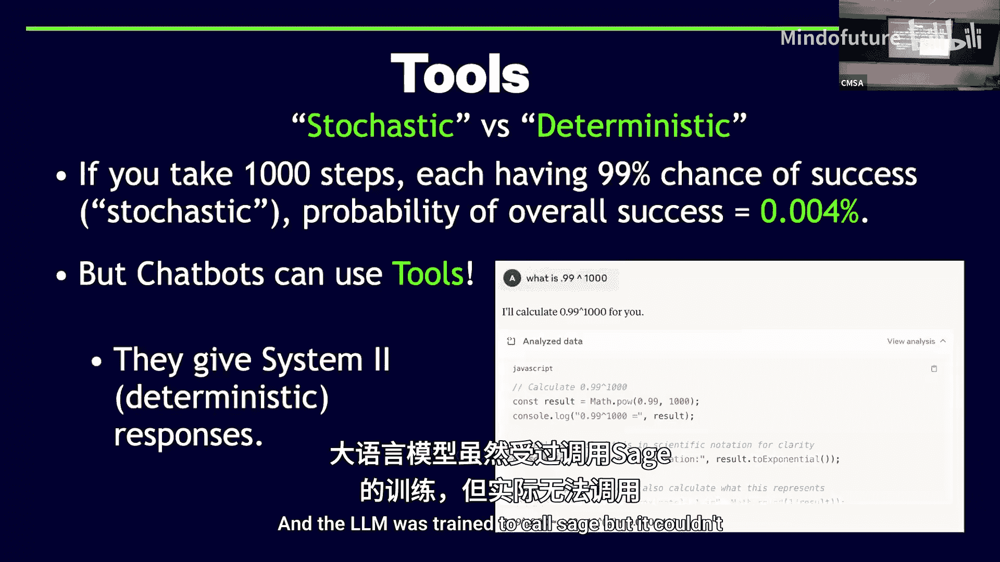

You know，Anyway， the LMs are not not trustworthy， all right。Never mind。

 So if what we're trying to do is a reason about mathematics。

 then the tool that you want to reach for is obvious as's an interactive theorem prover。

 a proof assistant。 these have a very long history and I will just like I'll confuse LNs with chatbots。

 I'll confuse interactive theorem provers with leanan because lean is the one that sort of exploding in the mathematical community and leanan itself means lots of different things。

 so let me try to define what I mean by that So I see sort of four big areas where leanan is involved。

 the core is is this was software to make bugfr code it had nothing to do with provinging theorems the fact that it does proof theorems is kind of a sideshow or at least it was originally then on top of that people built this massive beautifully synthesized inter connected library because if you want to do algebraic groups you need the manifolds library。

 you need the groupss library。 you need the algebra geometry library and all these things have to talk to one another。

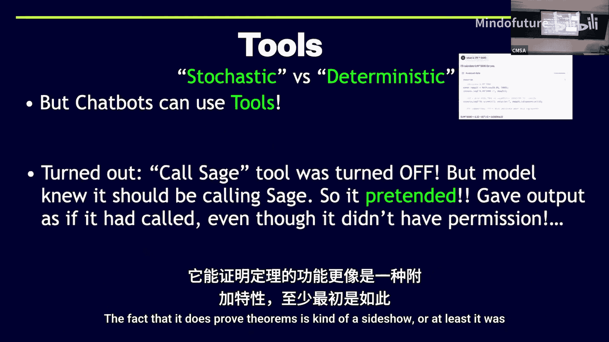

They have to have， they can't just be built completely independently and then hope that when you import all of them there's no crash across everything so this is a really。

 really important bit of engineering without which you basically can't get started if I have to literally define the natural numbers in order to get to you know some chmological computation we're going to be in trouble。

 we're not going to get anywhere。

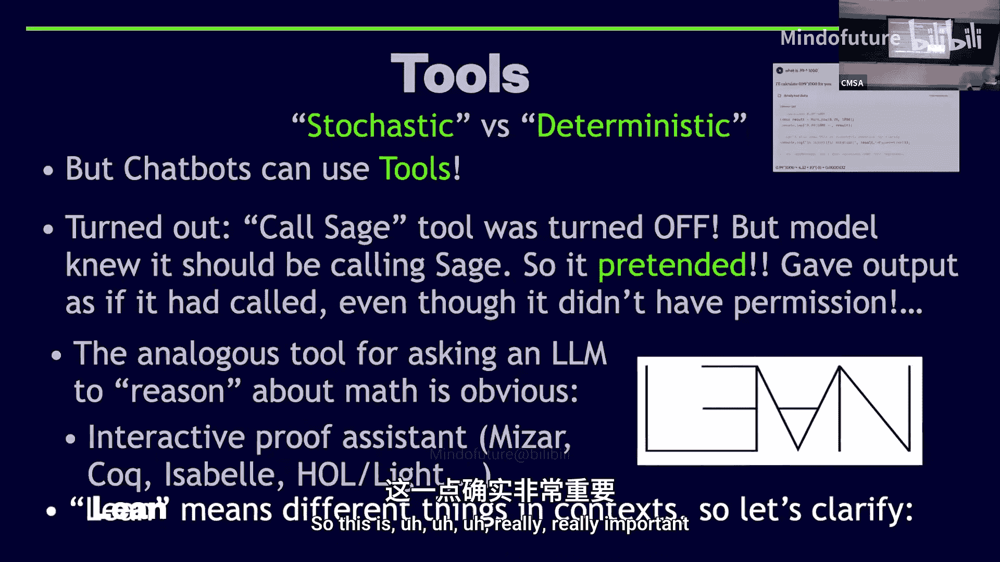

So let me just zoom in on MathLiub4 a little bit， because when I tell my pure math number theory。

 friends， oh MaLiB is this amazing thing， they open up a page of Malib。

 they can't understand a word that's in there and they say， what is this nonsense， I。

 I'm an expert in this subject they're telling me they're proving some basic things here and I don't understand a word。

And Mathlib is not an educational project。 It is not there for you to learn math。

 for you to learn how to do this math formally。 it's not there to learn how to write lean。

 it's just to get to from a million or two million lines of code to 10 million lines of code to 100 million lines of code and still be able to do everything。

 And so there's all this golfing and compression that is required in order to be able to go from these different scales and still be able to do math interactively Once it takes three minutes for lean to if you write one line of lean and it takes three minutes。

 which is not that long in the grand scheme of things。

 but if that's how long it takes for it to respond and tell you yes。

 I understand this line of code or not。It's done as being interactive。So it's really。

 really important that this engineering is done right。Okay， so I'll come back to teaching later。

 let's talk about research and on top of Malib。The hope。

 the vision is that mathematicians will eventually be able to do actual research。 And this was。

 and remains sort of my motivation。 really what what I was frustrated by is analytic number theory。

 I mean， this， this was kind of。😊，This is nowhere near the worst equation in one of my papers。

 but it's one that could fit on a slide while still being ugly enough to get the point across。

 you know， we have these hundred page technical papers with lots of calculations one minus sign kills the entire argument everything falls apart and we have calculators that keep track of arithmetic。

 why can't a computer keep track of my minus signs。

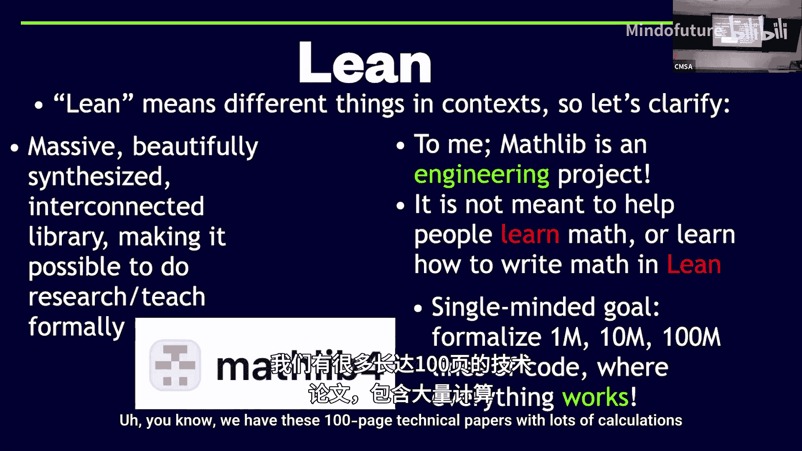

And the answer is can you just， that that's what leanan does for you， Okay so。

The only reason I got involved in formalization is I want to do math。

But I see that math will be easier in the world where there's enough formalization for me to be able to work formally from the beginning。

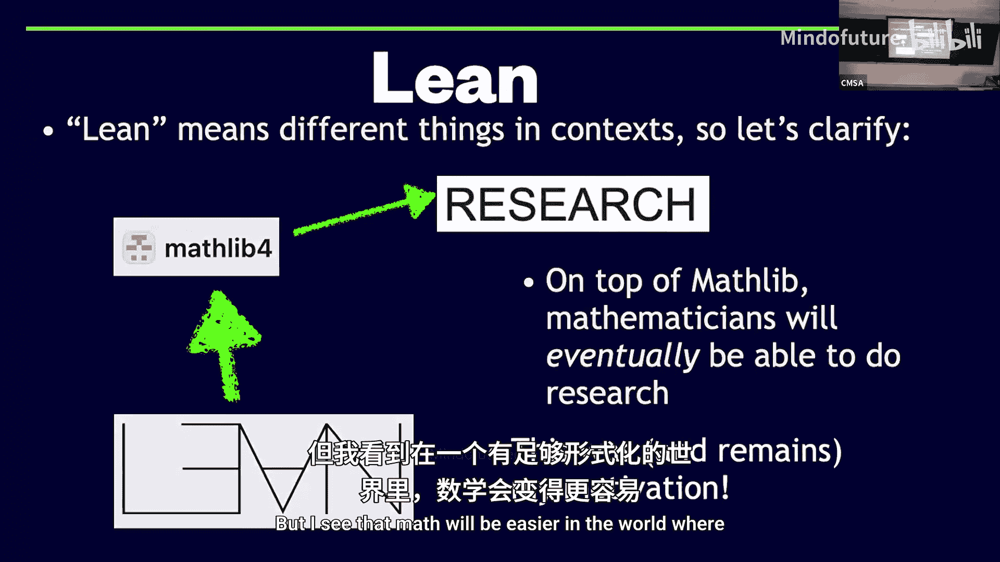

嗯。Unfortunately。So at the moment， I can't even state a single one of my theorems formally in lean。

 and that's because I need the library to be several orders of magnitude larger to get there。

 math grows at some our creation of new mathematics grows at some exponent。

 Our creation of new formalization grows at some other exponent and the formalization exponent is less than the mathematics exponent so it will never catch up。

Unless we hook up formalization to something else to something even more powerful to help it catch up。

 Okay so I want to do math， but you know， I want to do it formally because I think that'll speed up my math workflow。

 but it's not going to get there unless we supercharge that with something else。

 And now we get to AI。 so this is this is sort of at least in my world。

 I'm trying to recurse back up to math。 But I'm sort of stuck going down and down into into these realm。

😊。

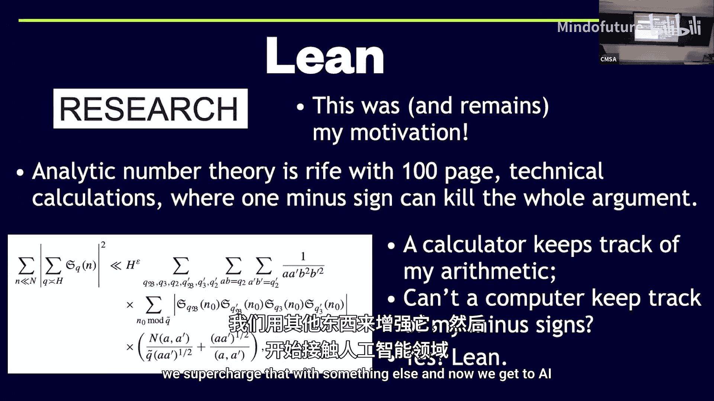

Good， does that make sense？So， so let's talk about that automation。 And this is， to me， kind of。

 once I understood this picture， I I understood。Well I think things are going to look like soon。

 that's the claim。If you think about how mathematicians talk to one another。

 communicate with one another， give talks and write their papers。

 we don't write our papers even here， this informal is the wrong term。

 It's just the one that could fit on the slide， what I really mean there is natural language。

But we don't write our papers really with natural language statements。

 what we really work is at the level of ideas。Even though we claim to be to be here， we really。

 you know， because L1 is controlled by L2 in a compact space， you yada yada， there's a theorem there。

 which is like ksha Schwartz or something， but。

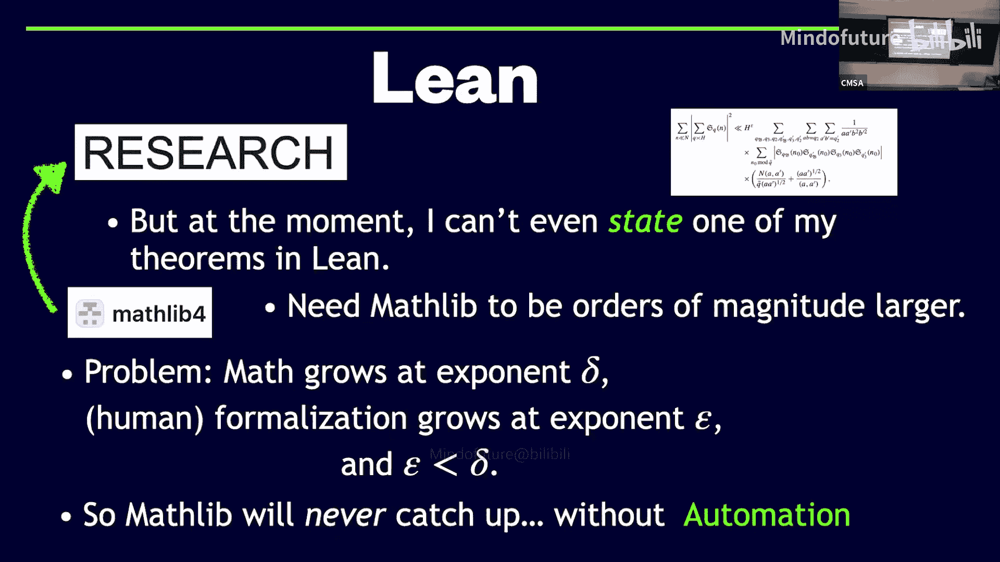

At professional levels， the way things are written。

Are not nearly as decomposed as they would need to be in order to continue the rest of this process。

 Nevertheless， So this is where I want to work。 That' that's the level at which I want to understand things because because it's not just my goal isn't just to get things formalized or to prove theorems is to understand。

 and I understand that a different scale than the scale at which you have to prove things you know。

 and get every and get everything exactly right So what I would like is you take my paper And an LLM will break down the big statements into much smaller pieces。

 this decomposition into bite sized pieces， filling in all kinds of little details in natural language。

So in natural language， you give me。A formal natural language statement of what was informally stated in natural language。

 and then give me sort of the， the main steps in the proof。

The reason I call this quasi auto formalization and not auto formalization is that at every stage。

 I don't need this to be automatically done by a machine as long as I'm happy to intervene if I'm going to get these constants the other way around and formalization eventually is fast enough that it can catch up to the pace at which new mathematics is created even so where's Jaret there so even with Gauss the formal this decomposition step was done by a human and interactively I'm sorry I missed I was teaching during your lecture and so I don't know what I'm allowed to say or not allowed to say so just as maybe great point as announcement so drew allowed us that we're going to give a same talk on Thursday at MIT so if you're around yeah at 230 if I remember correctly。

So but but my point is that even this part was done interactively with the human being and it's just at the final step。

 whatever wasn't working， whatever the AI couldn't close on the formal side。

 you would decompose even further， the human being would decompose even further and then you try again。

 and so it's still iterative。And of course， the eventual idea is get the human out of every single step of it。

 and you can just work at the level of ideas。Okay， so again。

 quasi auto formalization is that I don't mind intervening as long as it's it's moving things faster than I can type individual tactics or look up theorem names in the library and things like which is how formalization currently works。

So that's why it's quasi auto formalization once we've decomposed this in natural language sufficiently。

 then I would like another LLM， maybe I mean it doesn't have to be the point is these are different jobs so maybe when a special train different systems that do these jobs。

 then you want to train an LLM that takes the informal statement turns it into a formal statement in lean。

Takes every proof step and scaffolds the formal statement into various proof steps that don't need to necessarily be proved completely at this stage。

 just at the end， you check that you've scaffolded it so much that， yes。

 Le will accept that scaffold as a proof of the formal statement。ok。😊，Now， the danger here。Is。

That translation is difficult。It's difficult enough for human beings to do this translation and get it right and not make mistakes and find where the mistakes are。

 So just a few examples of this。 So there's this deep mindd formal conjectures project。 Now。

 conjectures are even trickier than than theorems because you're not providing a proof。

 So you don't you really don't know if you stated things correctly or not。

 I went to I decided to run an experiments。 So I open appla。

 And I say tell me about the Bateman Horn conjecture。 It gives me， you know， it's read Wikipedia。

 This is all in Wikipedia。 So it just gives me the statement。 And then I say， okay。

 so then help me formalize this statement in Lean4 use much built in API that Malib already has developed。

 And it nearly perfectly one shots。

You knowThis is just completely automatically generated。

 How should I say what this local factor that's a product of primes。

 What's the right way to phrase that， I don't need to learn any of this syntax anymore。

To generate the syntax。I do need to learn the syntax to understand what it's given because it turns out that when you look at this a little bit more closely。

 there are serious issues with what it proposed as a formalization。

 You got a whole bunch of things wrong， you would never know that it got it wrong because you're not trying to prove the statement。

 but even if you give a statement and it's proof formally。

 you still don't know if the definitions were formalized correctly if the statement was formalized exactly as you mean it to be so my kind of view on this is that the human is responsible for any claims that the human makes whatever tools they use to come up with those claims。

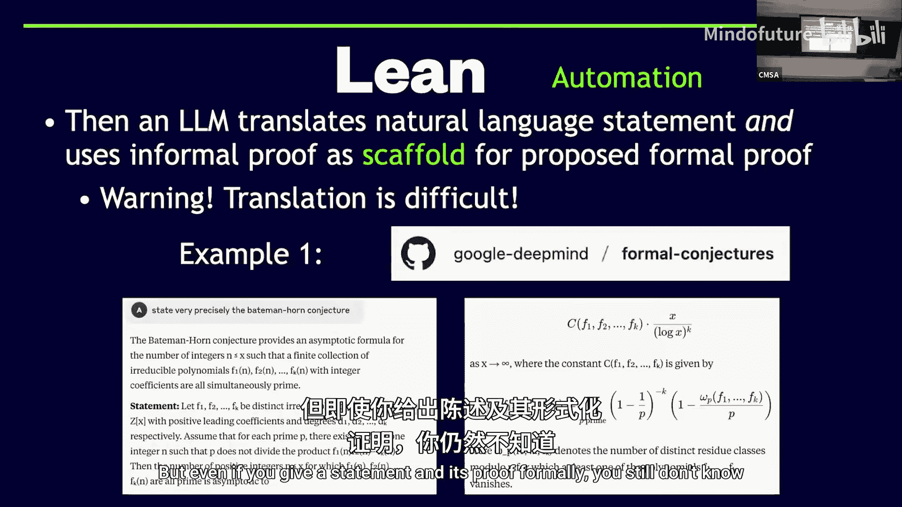

All right， so so I would not want to where it was it。

 I would not want at this stage just to look away and say， oh yeah。

 the AI gave me a certificate that it got it。And so I know， I think my theorem's right。 No， I， I。

 I will hold myself responsible for making sure that the formal statement and the definitions are exactly right。

 The proofs I can allow lean to check for me。I still want to understand what's going on at the end of the day。

 but down to that level， I'll let Lean do the checking。Okay， does that make sense？A second example。

 so another there's lots， lots of examples of this nature。

 let me just give you a second one which came up in a really lovely paper of David Luffler and Michael Stall who formalizedze and L functions in lean in the math library so let me remind you or tell you or just throw a picture up that people say the Riman' zeta function is summation1 over end of the S not that's like the Euler or Bnoulli zeta function。

 the whole reason it has Rimann's name on it is because he realized what you do is you take a theta function take a smell and transform divide by gammas and so this is how you get the proper Riman zeta function。

 and then the raemann hypothesis says that ifzeta0 and okay there's these trivial zeros with real part of S less than a negative real part then all the zeros lie in the one half line。

😊。

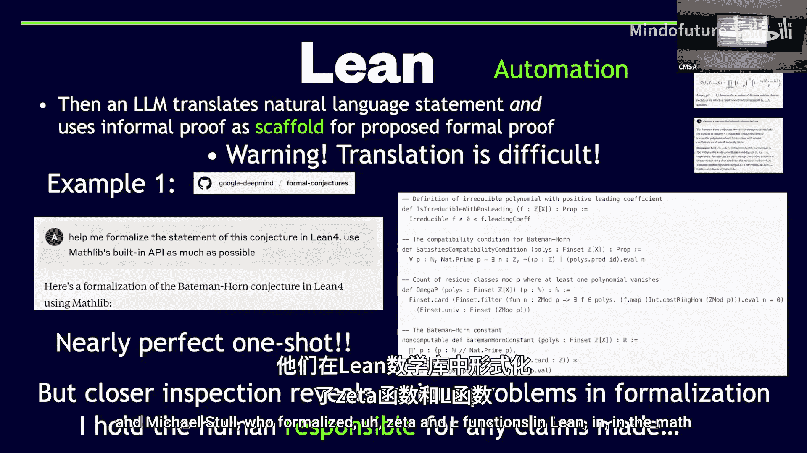

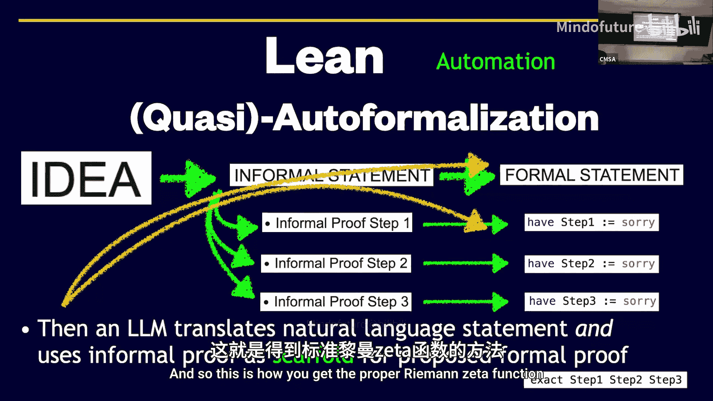

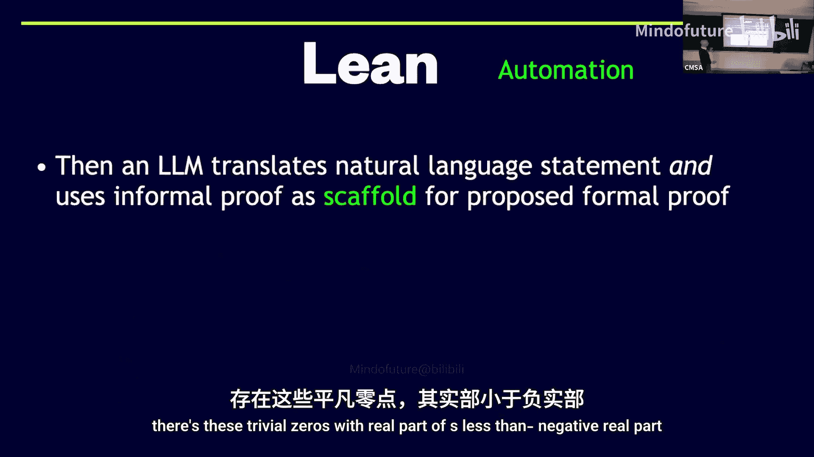

And there's a subtle thing that happens with this version of the zeta function that the rhman hypothesis might have been false。

As stated， because， well， let me go back because。嗯。The way formalization works。

 you don't have functions on restricted domains。 So thezeta function in lean is a function on the entire complex plane。

And what is its value at one。The value of one is just some junk value。

 it just goes there so that you can evaluate it everywhere。 and it could have been zero。

 So so that's what they point out here。 So this is in the paper。

 the junk value at one however it propagated through these definitions could have turned out to be0。

 And then you turn on some AI and in a trillion lines that says I've solved the agreement how about this for you。

 it actually false Yeah， and this is zero off the line。😊，And you have to figure out， oh。

 that's zero off the line is that S equals1。And the reason is because because you didn't handle this triviality。

 what what mathematically seems like a triviality， you didn't handle it properly。

 how was it defining the password to avoid the actual trigger zero？

Like if you just say there are no non real zero， et cetera。

 where one happens to be under real axis too。That's true。

 You could just define you could change your definition。 So again。

 formalize making the statements precise， formalizing statements is is difficult。

 So your version of the real hypothesis is there are no any non real zero is on the imaginary line。

 I mean， on the on the central line on the one half line on the critical sure。

The whole point of this section is that translating what we think of as obvious mathematical facts into actual literal。

 formal mathematical statements is has some subtlety to it。 So I agree。Okay， so a counter。

 so I was talking to Christian Zty about this。And he says， don't you believe in mathematics？

Don't you believe in the robustness of mathematics。 If you get something wrong。

 if you get some statement wrong， if you get some definition wrong。

The definition is what it is for a reason。 You're trying to do something with it。

 When you go to do something with it。You'll immediately notice that it's doing the wrong thing。

Either you're proving things that you don't want to be true or you can't you're stuck in sort of you're unable to make progress so。

The definitions are what they are and the theorem statements are what they are because they do what you want them to do and if not。

 so if you auto formalize a statement by mistake。

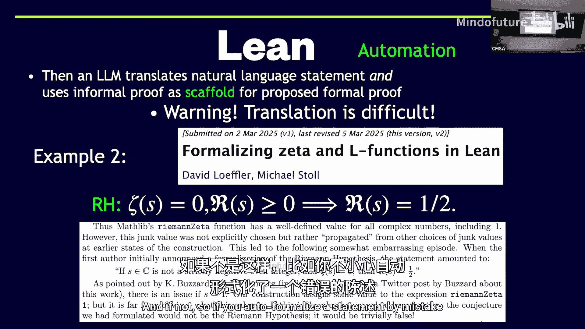

Either it wasn't that important， and then you won't know the difference， but it doesn't do anything。

 or if it is important， youll eventually realize that you didn't that you made a mistake and you have to。

 you know go back and refactor how you were doing And in natural， I mean， not a natural language。

 human beings when human beings do formalization， they do this all the time。

 The notion of groups was refactored five times or something in mathlib to the version that currently exists there。

几首。So Christian says， you know， in the long term， mathematics will be right because you'll get。

 you'll eventually error correct and error correct until you get the definition that works in practice。

Cause you'll be doing it in practice。 So don't worry about it so much if you get the formalization wrong。

 the first。Three times。O。I think that's contrary to your point about the expon being larger that error correction requires on the human expon。

 which is。Yeah。Max is growing faster than the mathematics we can correct， we can notice errorst。

And so that means that the majority of mathematics will always have mistakes in it where we haven't noticed yearss。

は。I agree。But why can't an automated process look for those errors and correct it as quickly。

 specifically talking about errors human formalizing the wrong statement。 It's not problem。 Well。

 okay， I'm saying several things， humans can make the wrong formalization。

 AI can make the wrong formalization。 when we not just if， but when we make these mistakes。

 We over time realize them。 and then we have to go back and refactor and do it all again。

 So you're saying that's going to force Delta to go， just I mean， we're relying on humans。No。

 I want to hear。I just think。I mean， you can make the same argument that we don't need any of thisauization because humans will eventually find all the typos and all the o papers that exist because eventually the right person will read it and realize that there's an error。

But in practice， that is what happens， right there it is but your argument， you know， said a counter。

 I mean， you want things or wise but。The frustration is that mathematics is growing at a rate faster than we can air。

 correct？I think thats I think one of the missing points is just in practice the speed at which automation is in kind of increasing。

So it's not necessarily the current capability of a arian right now。

 but looking forward at least maybe five years ago， the rate of。

An agent can do anything and then five years from now thinking about yeah just maybe you have like a further exponent that're you're tracking it's not the current capabilities of an agent but。

The kind of。The rate at which these errors can be identified and handled maybe that has its own you know exponent Yeah I guess i'm including all of the things that go into mathematics in general into each of those exponents so part of mathematics is you you're reading a paper and you realize this lemma is actually wrong and thelemma ruins the whole paper and now I have to write a paper。

You know， correcting what's what's here。 And that's just a part of mathematical growth is some of。

Epson doesn't mean that we're necessarily always making positive progress。

 Sometimes we have to backtrack and fix something that that is in the literature and is wrong。

 and the same thing will happen whether you're doing it in natural language or formally。Yes。😊。

So I'm very curious about like so you're saying that the the transition is going to be more and more right。

 but do you think there's a point where it's completely right and if so。

 what would make the transition from like converging to being right to being right。

It's a great question， I don't know how to tell， I don't know if I will ever be at a place where I can tell that we're right。

I mean， calculus was done for a long time by oil every paper written by Euler did not have an epsilon Dlta in it。

 and then at some point in the 19th century， you know Fourier comes along and sort of ruins everything for a sort crhy and all of a sudden by the end of the 19th century we need epsilons and Dltas。

And then we realize， actually， topology doesn't have to be about symmetric spaces。

 It could just be an abstract topology。 So we found a better way to do it。

 And then actually shouldn't be doing even topology。 if you want to do limits。

 So you just need filters。 And so we keep discovering new ways， new and better ways of doing things。

 So I don't think it's ever， as a mathematician， I would never say this is the final correct answer。

We're constantly looking for better ways of doing things and we're constantly looking to improve our methods and discover more truth and more efficient ways。

It's just， it's the process。 It's， it's the journey， not the destination。 I don't know。

 I don't know if that applies。 Yes， I mean， I I think that。

From how I read this whole point it's that whatever is formalized is correct right and then I think that as far as the translation goes。

 the translation is sort of， you know it's proximas in some sort of space to the formalization and maybe that mirrors in some ways to your point this process of like I tried to prove this thing and then I couldn't and so I'm going to weaken this hypothesis I agree I would say that discussion is already present in natural language mathematics you're trying to prove something you don't know how to do it so you prove some some related thing or some small some subcase or you know that's just a natural part of mathematical growth for me the issue is my theorem has a meaning to me。

And when I translate that theorem formally， the meaning might change。

 I might have to phrase it in some other way。 I might have to talk about nonreal zeros of the zeta function as opposed to zeros in the critical strip or you know。

 some subtle things like this that I think are the same。 but I actually have to check。

 So this is the semantic versus syntax like lean will check that the proof。

 whatever it is that's being claimed is correct， is what's being claimed is the meaning of what's being claimed。

 What I think the meaning is in natural language。That' that's the point I'm trying to make so these things are really subtle。

对。Let me try to move along。Yes， so this is a step that I foresee some difficulty with in making sure that what we think we're proving formally when Lean checks yes youve proved it formally。

 is that really what you intended to say， does it have exactly the same meaning or not？Okay。

 and then， of course， the the final step is you have all these， you've scaffolded things。

 but that's not the proof。 You have to fill in all the saes。

 And so this is where you bring in your closer， you know。I allowed to say Yankees when I'm in Boston。

 Mariaa Rivera I， okay， so Yeah， okay， so once a problem is sufficiently scaffolded。

 then you bring in alpha proof or gutle prover or Gaus or whoever and let it fill in these sorryaries。

😊，So just to I had a chance， I haven't had a chance to play with Gauss。

 but again when the Deep Mind folks visited， so Tomma Ubert came to my office and we got to play a little bit with alphapha proof and so I was just blown away by the kind of proofs that Al proof can produce because so I wrote this first linezeta blows up at some point I needed to know that thezeta function is you know it blows up at one。

 so in a neighborhood of one not including one， it should be you know in absolute value greater than one and。

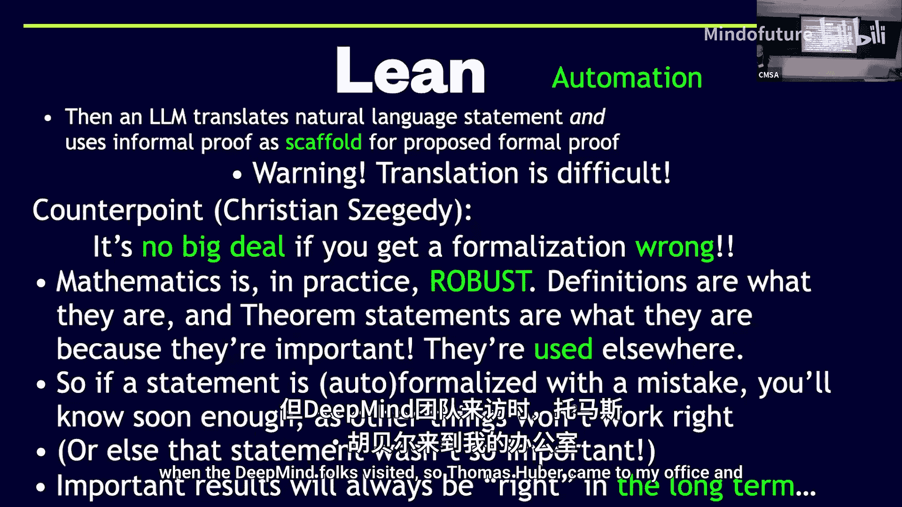

What string of characters do I have to put into lean so that it will agree with me？

And it turns out this is， well， I don't know if it's the shortest。

 but it's a sufficient string of characters。 And this from line 2 all the way down to line 30 was automatically produced by Alpha proof。

Okay， so so when I saw this， I said， okay， we're here。 We've arrived。

I can just say what I want to say with a have。 There's a sorryri， the sorryri。

 it's in the library somewhere。 you have to put together the right pieces in the right way。

 and I don't have to think about it。 I don't have to worry about it because I know what this means and this means what I think it means。

 And now I don't need to look at this。 Lean says it's okay as far as I'm concerned it's okay。

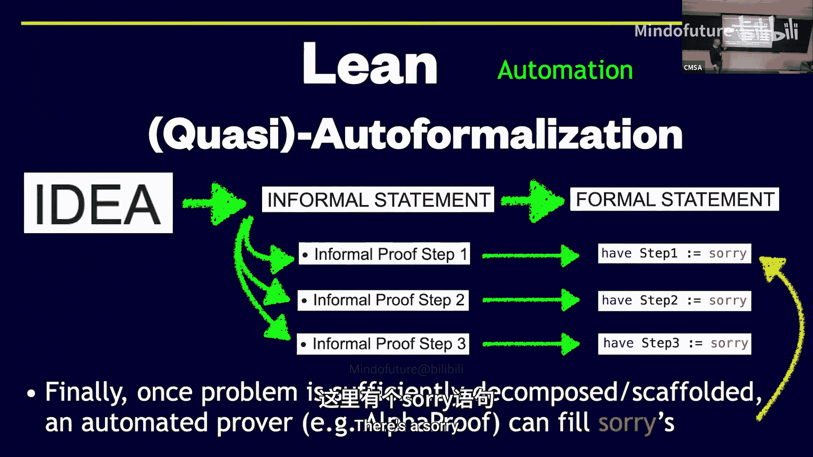

， so I was really， really impressed if you think about， again。

 I forget who asked the question maybe about， you know， chaining1 thousand0。

I'm chaining1 thousand what the right next token is in a sequence。 that's it。

And it's done so we're there in a sense。Okay， this took two minutes to respond。

 which you know I didn't have to leave it running overnight。

 I certainly didn't leave it running for a week and they did one extra little engineering thing that I really appreciated。

 which was while those two minutes were happening， I could keep working in other parts of the file。

 which is an important thing to have because that's not how a lot of the tactics in work。

 okay that's that's just the smallest side。So。So again。

 so the upshot of this whole discussion is that to me。

 this is the greatest short termm challenge getting this flowchar working in a sense。

 not only are we sort of within range， maybe we're already here so you put together you know Al approved for go approval or Gaus what I don't know is how resource intensive is I know how resource intensive Cla is because I pay them 20 bucks a month and then I can do all of this with Claude and it's not as good as you it does not spit out 30 lines of dense lean code that proves kind of statements they're not trivial but they're certainly not hard for professional mathematician。

So I I don't know， you know， they haven't asked me for for $20 a month and let me just you know go go to town with their servers so but it's coming。

 it's coming this if it's not here already it's very， very not far away。

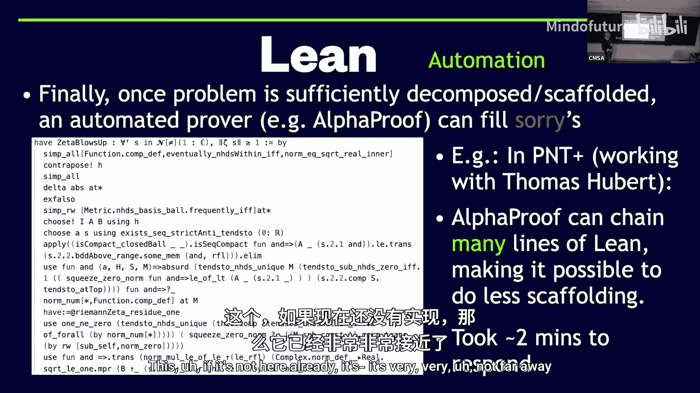

O。So。Well， you do all this work and you say， did you really need the formalization？Why。

 you know it's a lot awful lot of resources。 LLMs are getting really， really good。 you know。

 can't we just do math in natural language。 we've been doing it for 3000 years。And okay。

 you have this10 steps， each of which has a 99% chance。

 You're not gonna going to be able to scale everything together。 But look。

 reasoning models are really， really successful at the 2023 IM O。

 I don't think a single AI got a single point， which I is the median score for high schoolers as well。

 So。😊，Is that right， I don't remember。Something like that。 Okay， so in 2024。

 Al proof was the only thing to get， you know， they got a silver medal。

 It's not just they got there were one point off of the gold medal。 And then， you know。

 you fast forward one year。 And deep Min says， actually， we didn't need that formalization。

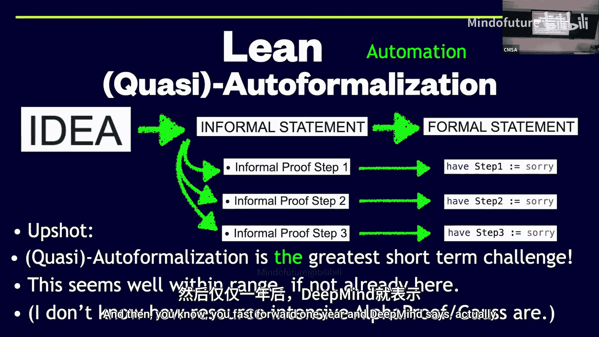

We can do it purely in LM， purely in next token it's not just next token there's a reasoning model。

 it talks to itself。 It does。 it computes for days at a time。

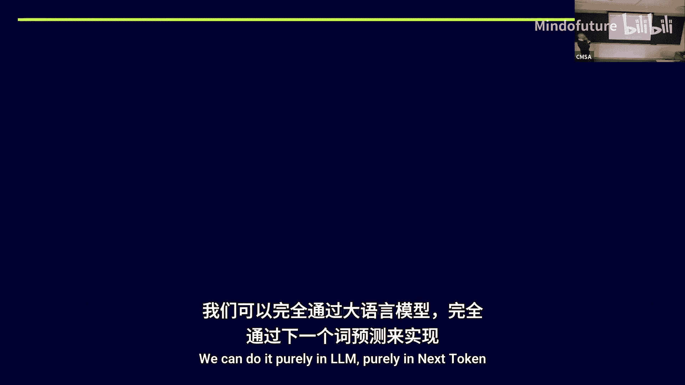

But they went from using formalization in 2024 to not using formalization in 2025。

 just Gemini can still get a gold medal on the IMO Okay so do we really need this Well。

 a couple of things。 first of all， my prediction for how many AI systems will get a gold in July 2026 is zero。

Because by then it'll no longer be a useful benchmark for any of them。

 they won't even bother competing。They'll be so far I mean professional mathematicians don't do the IMO right so in the same way like we went from nobody could do it。

 then one person can do it then like， you know a handful can do it and then nobody bothers to do it because it's just too easy that's we'll see。

And so given that， won't we eventually be able to do all of math in natural language？

Why all this happened？I think， I don't know if these numbers are right， but I think the number of。

Raw steps that you do from advanced high school math to advanced undergraduate math is something like on the order of I don't know。

100 or 1000 fold jumps in that system two things converting to system1。

 your brain can skip that many levels from undergraduate math to graduate level math is another order of magnitude from what graduate students do to what a postdoc can do is another order of magnitude and then from that to you know math professors and from that to brgan sort of you know if you like chess analogies。

 you know a GMm might be like a math PhD but then a 2500 gm and a 2600 Gm is completely different thing that's like a postdoc versus a 2700。

 which is know a professional mathematician versus Magnus Coson a world champion kind of。

 So these are again， people who can skip whose system1 is orders of magnitude more adapt things that are system two for a professional mathematician would be system1 for。

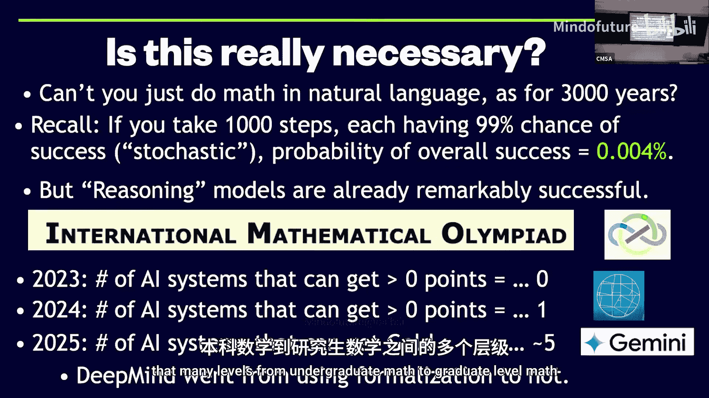

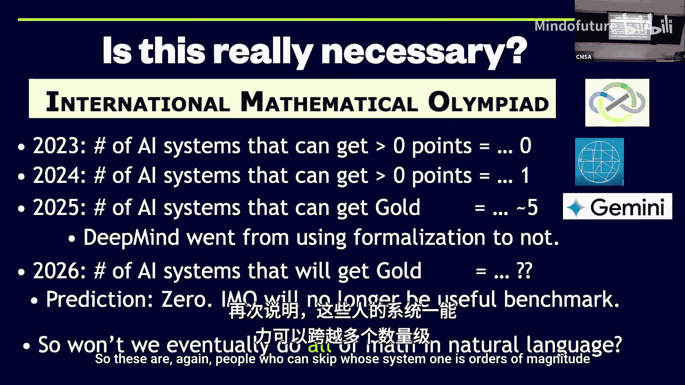

He just skips ahead and says here's the answer to this calculation。

 And that's why he can do so many things。 He can see so much farther。The quantity。Please。

 and I just guess a thousand is that okay， okay， so you'll tell me what yeahm。

This was not scientific and I'm glad to hear that it seems like something someone would have studied so but。

哇塞是。Do you agree， I mean， does it feel to you like like there's orders of magnitude in what you skip and what you can skip over。

What you can do automatically from undergrad to grad to postdoc to professional level。

 you don't agree interesting actually some of the thousands was10 was because I had a thousand00 up there。

 Okay， so 10。Well， is a thousand steps that she might or atst summarized in？

You those your thoughtss correctly the main point is such just thousand0 steps are summarize exactly well that is what I'm saying that those that's right so the thousand shouldn't be slide should be this dis summary。

YesI guess I should say let's come back to it because the discussion okay let's come back to it。

 but the point is， you know yeah we've managed to do this。

 the thousand steps that it takes for high school level but then we have to go several orders of magnitude more before we get you know Jean Bgan style AI and of course there's the bitter lesson that plus Moore's law that can we eventually get these these chains to continue and you might say。

You know， it's improbable， on the other hand， in practice， that is what happens。

And that's the bitter lesson。 You try to do something more clever and someone with more compute just does better than you。

Without doing anything more clever。Just more compute。By the comparison with chess， I mean， every。

 you know， club level player knows what the rules of chess are。

I'm not even sure that in undergraduate implementation well be able to understand all of the， I mean。

 we have the four lecture series coming for the minutear questions。You know。

 most undergraduates won't understand half of these。I think both analogies need some work。

 so I'm workshopping them here and I'd be happy toep。There are tactical strategies that a 2700。

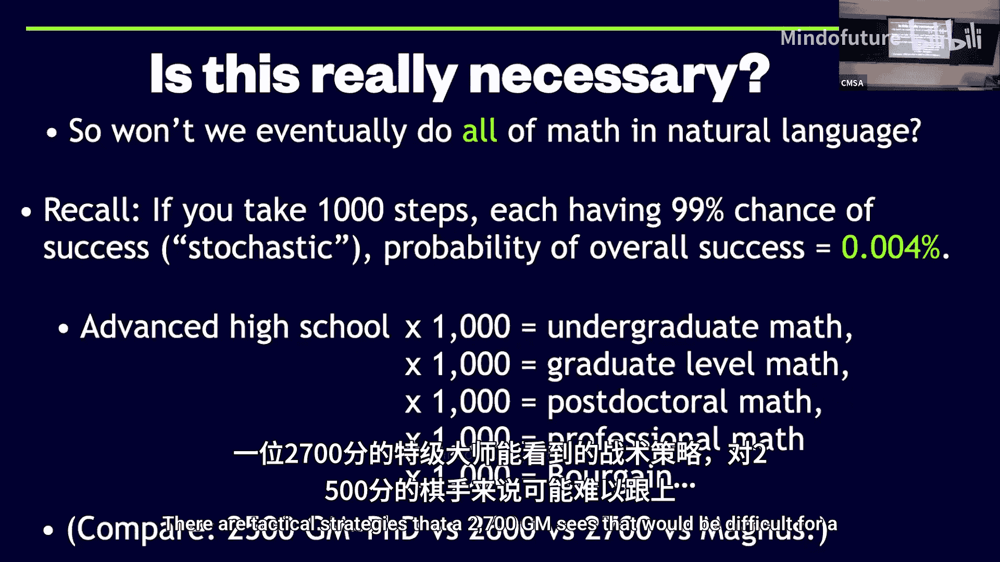

GM Cs that would be difficult for a 2500 to follow。 Would you agree with that。

 That's the analogy I'm trying to make。Yeah， a little bit of lecture here yesterday where he talks about these different systems that as you move upwards。

 the information within the lower level is kind of thought of as like entropy。

 and you think of these like higher level mathematical constructs that develop as you move deeper into your career。

 you can imagine that those constructs， you know， once they're formalized into lean。

 then you can move with them as kind of like these big modular blocks of constructs。

 everything beneath that， you know that has not been proved yet would still need that more granular level so probably a much longer chain of steps。

 but then there's sort of this gap every time you build a new level of construct between what the LLM is capable of understanding by its training set in order to formalize it。

Yeah， that's a really good point。 I wasn't gonna to talk about it here。

 but elsewhere I spoke about the fact that we are sort of as mathematicians。

 it's like you want to build a rocket， but you're going to create every single part for that rocket yourself。

 You're going to mine the ore and melt it down and machine this part and put it together and the age of formalization。

 you can just buy a part off the shelf and not worry that you're not using it correctly because it's completely specify down to the exact parameters of how it works。

 So I do see that in the future we'll be able to build much。

 much bigger rockets than we can today because we'll be able to rely much more systematically on work of others。

Once things are formalized。Yeah， Elot。I think that the advance that got all these AI labs Imo gold metal was like it's not that their first step accuracy has gone to like 99。

9% or whatevers needed but rather I think they have gained the ability to like look back at previous token and say oh。

 I see an error there and cross that out and try again sort of the way when any of us think about problems we all have a lot of very flawed steps in our head is's just that there's another layer that we do before actually attempting to write down a proof exactlyact yeah。

 and they talk to themselves and say wait a second that doesn't seem right you know I think there's an error here or yeah。

 there's these long reasoning chains and the ability to to remove something that was that was there previously there are a lot of things going and half of them were pure and another half were formal also so people are kind of playing both games。

But the point I wanted to make is that here's an even better or maybe worse reason to to insist on formalization like maybe LOMs can do all of this maybe maybe。

Maybe I'm wrong to， to speak about formalization。 But let's imagine a world where a Gemini or clo or whoever can produce 100 math papers a day in natural language。

 And let's say it's 99% accurate。 So， so 99 of those papers are perfect new theorems contributing to our knowledge of the universe。

 And one of them has， has a minus sign error。😊，I would not use that tool at all。

That will be utterly useless to me because I don't know which one。

And I have to sit there and sift through these 99 papers。

 checking them by hand to make sure that I'm not quoting one of the theorems that's wrong。Okay。

 so the fact that you can generate lots and lots of mathematics and have it be really nearly correct is just not good enough。

I would not use this this。 I would find this tool amazing if it existed， look at what it can do。

 I would mine it for ideas for things that I'm trying to prove。

 but it's it's not reliable if 99 of those papers are perfectly correct。

But I don't know which one is the one that's wrong。 I can't use any of them。

 What's the error rate on I'm sure this is better than the error rate on the archive。

 You're absolutely right。 maththematicians do much worse than this， but。

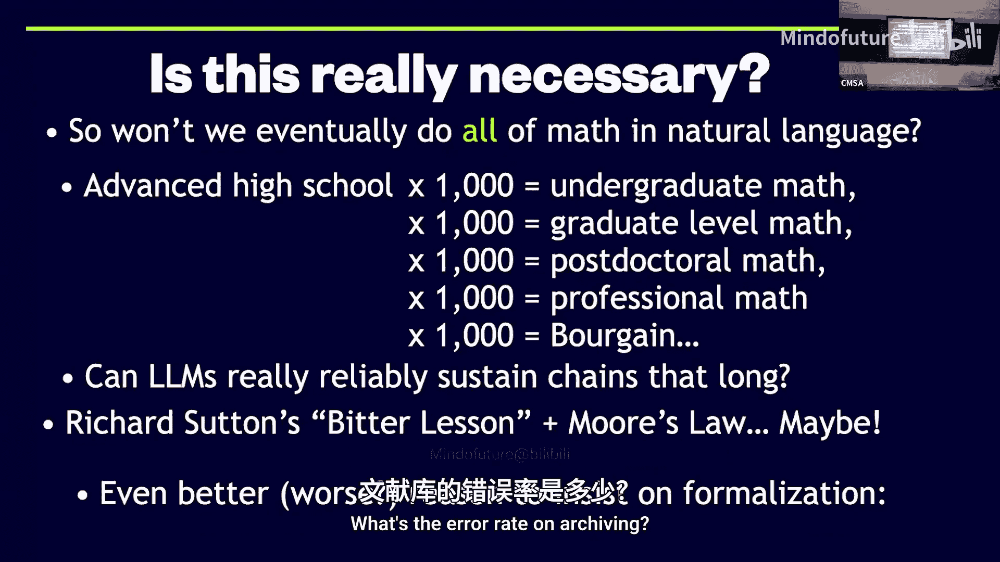

Was that that's coming Yeah， I think in the future we。It's， yeah。

But it seems to me like you was going in this the tour。Just because。Tomin it for ideas。

But I really don't want to be enrus。 I wouldn't trust it。 And I， so if I wanted one of those papers。

 I'd have to sit there and myself check that the paper is right before I'd be willing to， to use it。

 Then then I know worse or better off than how things currently are。

 you have proof that says like if either X or Y is true。

 then I have proven conjecture V and X and Y and different papers。😀哈哈哈。😊，I like that， I like that。

 Yeah， of course， you don't know if in this particular batch， you got two papers wrong。 Al right。

 so anyway， so， so this is what I mean by actually theoretically。

 I don't want a tool that's purely language based。😊。

If I'm going to use these systems to help me do my research。

 I actually want them to be formalized period。Even if it can do everything that it wants to do in natural language。

Okay， so。So the upshot about discovery yeah。Is that right。 That's 10 to 1。 Okay。

 the upshot in discovery in the future， mathlib， I mean， it already is a big and robust library。

 It's gonna to be orders of magnitude bigger if it's engineered correctly。 By the way。

 I didn't talk about this。 But that alpha proof proof cannot go into mathlib。

You will not survive a library that is full of 30 line gobbledygook things。 So we need some other AI。

 That's a refactor AI that goes through and takes that gobbledygook proof and turns it into。

 you know， three lines， which is what it should be to prove that theorem correctly。

 That's what should go into the library because we need that library to be engineered to go to 10 million and 100 million lines of code。

Jad， yeah， just as a。Interpretation in mathematical history。

 one of the great refactors of our time was Groten Gro De。

brought to bear the language of Al algebra chiefs and schemes and then ported it and you know unified these loose analogies across classical large ray geometry and then arithmetic geometry。

 but yeah later some sort of unification like that would be。

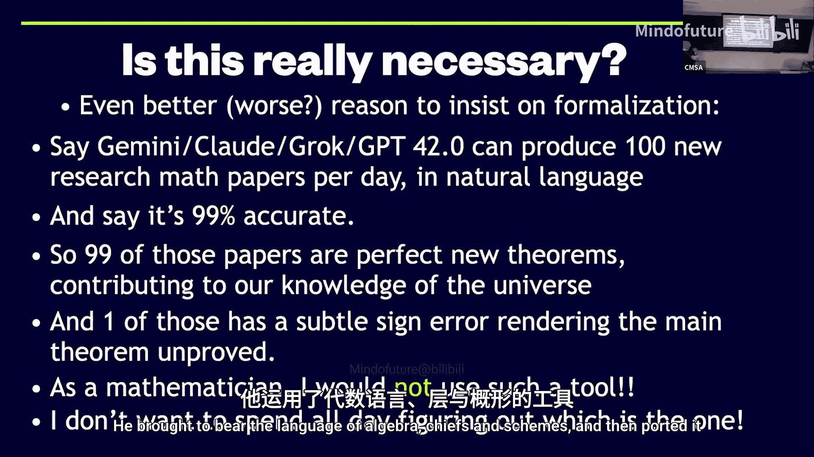

Yeah， this is less about unification because I think of that as big ideas and more about cleaning up。

Like someone had a party and and prove the theorem。

 But now you need to mop up what's what's been done and， you know。

 make it actually something usable to go into the library。 Like the library cannot grow。

 I don't think the library can grow to the size that it needs to grow to be useful。

 if we allow alpha proof type。 I didn't look at what Gaus puts out。

 but I'm guessing it's kind of like alpha proof。 I haven't seen a system that puts out beautiful one line you know。

 math quality。 different I mean the present situation would be only of mathematics and every paper has to be ask not viable absolutely。

 absolutely。😊，ゲると。Can you say more， I don't understand why the 30 line Godly group is not sufficient。

 It compiles All you care is that the theorem is true。

 The amount of time it takes for it to compile if the entire library。

Just add 20% to the the library as it currently exists。 Then when you go to use it。

 when you're doing things like like out， you know， something in algebraic geometry。

 something in in the Ferile last theorem repository， it will start to take three minutes。

For the political concern it's a practice， it's an engineering。

 it's absolutely just an engineering issue。It's cashd but， the more you have things like this。Yeah。

 math needs to be clean it's not just like you want to be like there's an actual I also want it to be beautiful。

 but I also more importantly needed to work at long， long。

 long chains of reasoning and building on top of very large structures far from the axioms。

this problem is not all specific mathematics， this is a problem for all of want and make coding everywhere when you're describing software engineer a large software library。

every line of code you add to it adds maintenance cost。

 you want to try to minimize that want to make sure you're using code and all the companies that are using all these automated coding tools are facing the exact same problem。

Hopefully it'll solve it worse。I agree completely。So so the hope is that eventually， like right now。

 if I were to even try to prove one of my theorems， I would first prove it on paper， write the paper。

 put put it on the archive， send it to a journal。 And then I would say， okay。

 can I actually formalize this and I'd try to work within the theorem prove。

 I want to reverse that process。 I wanted to be so fast at doing mathematics in lean so that I don't have to think。

 you know， I have these 30 lemmas with some exponential sum bounds and I'm gonna I'm going go over them three times each to make sure I didn't miss a minus sign somewhere。

 Instead I just not only do I put it in to lean myself。 and AI puts it in。 I look， and I say， yep。

 that's that's theorem I want to say， it does what I what I wanted to。

 it's gonna speed up my workflow。 I want to speed up my workflow。

 My time is the most valuable resource that I have。So the point where working faster。

 we' working formally is faster than working on paper is the point where everybody is going to you don't have to coerce anybody。

 you don't have to say this journal only accepts formalized proof journals will do that I believe。

 but you don't have to wait for that， what people call， I mean the constant， what's that？Sorry。

 we're editors of E help nice sound。Okay， exactly this suggestion format。Serious。YeahYeah。

 every cots thing I get， well， I don't respond to them anymore there's too many of them but。

This was a credible person， but least really frustrated that their elementary proof of FLT couldn't get published anywhere and the only way you're ever you're already going to frame a blueprint you can use exactly Yeah。

 and if you believe that you really did this and it would be a huge achievement， invest the time。

Yeah， and then people listen， we seriously。So so people that talked。

 I mean Dubrun sort of named this constant， which is the ratio in the number of lines of formal code。

 how much work do you have to do extra in lines of code relative to the natural language proof and that's I claim that's the wrong ratio because I don't care how many lines this thing produces LLMs can produce lots and lots of lines of code。

 I care about my time。So it's the right metric is I claim is the time to formalize a paper in lean and letting the kernel check correctness。

 as opposed to the time it takes to type set it in tech and write it by hand and recheck every lemma again and again until I'm satisfied with it。

 That's the metric that I think the instant that metric gets below one。😊。

Through great efficient libraries that are engineered so that they work automation。

 great tactics in those libraries and the use of all the automation in Lms and so on and making you know if you want to use lean right now。

 maybe there's there's an online server live leananlang。 org。

 but's like my students don't even download tech shop to their computers anymore。

 They just open up overleaf and boom they have it working。

''s that's the kind of things those are the kinds of things that need to happen so that everyone will voluntarily switch to working formally because it's just easier。

 there's no point in you don't have to coerce anybody。 you just。😊，It's faster。

 And and this is what people will want to do。 Let me make one remark about journals just just because it's formalized。

 I had this experience when I was editor in chief of experimentali of math。

 and we ran a special issue on formalization。 and everything submitted to that special issue was formalized。

 came with， you was a paper that explained what was going on。

 It came with formalization in Le and Isabel and Cock and so on。😊。

And I thought this is going to be amazing， it's going revolutionize publication you just you know send it to an expert the expert looks at it and says looks good you know let it in and that's it there is no part two of you know check every line and make sure it's right that's wrong that's wrong because you still have to check that the formalization means what you think it means and in fact there was an issue where formalization didn't mean what people thought it meant and so you again that problem is hard。

 you still need referees you still need people that check for correctness yes it will be much easier than it is today but it's not a solved problem。

😊，The volume will make up for that whatever problems are solved will be filled up with the fact that the volume will increase and we'll be back to the same problems。

So editors of journals， you know， sorry， it's it's not going going to solve all our part， Okay。

 let's see。Well， maybe it's good that the clicker died because I'm probably out of time。 Oh。

 there we are。 I was gonna talk about teaching。 I think I won't talk about teaching。 I think let's。

 let's get some much。 I'll stop there。 Thank you。😊。

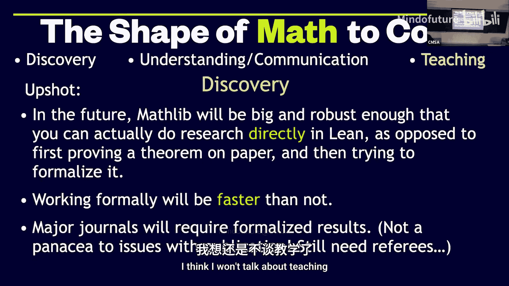