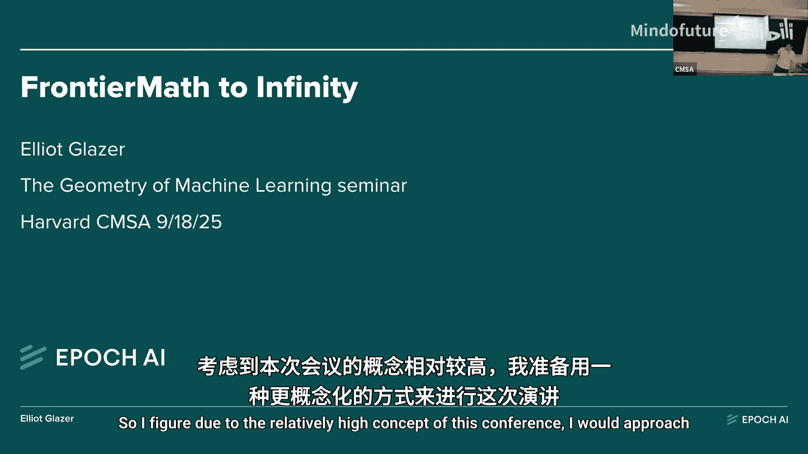
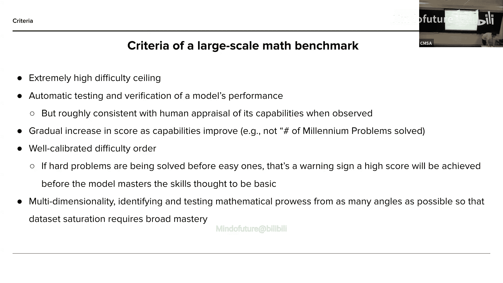
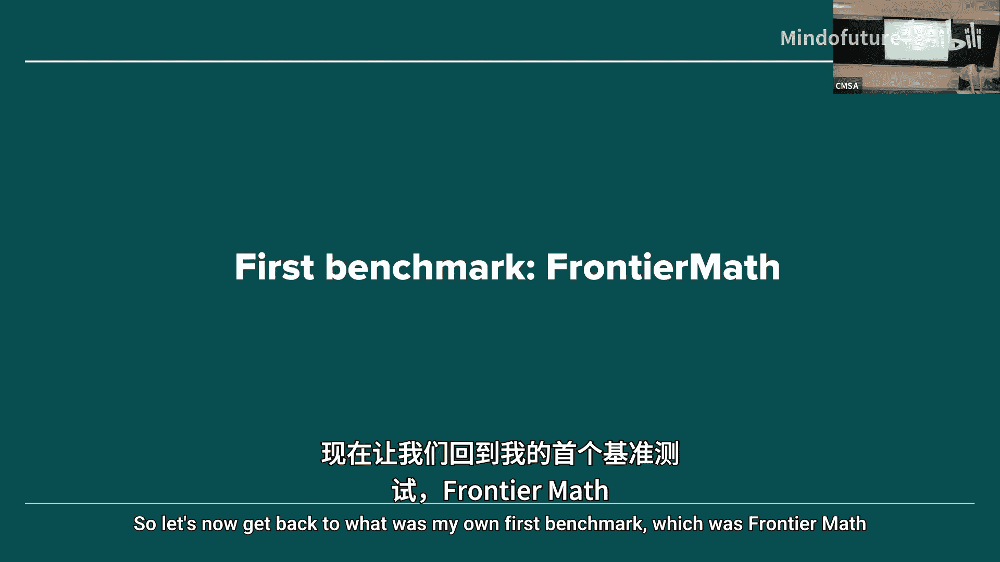
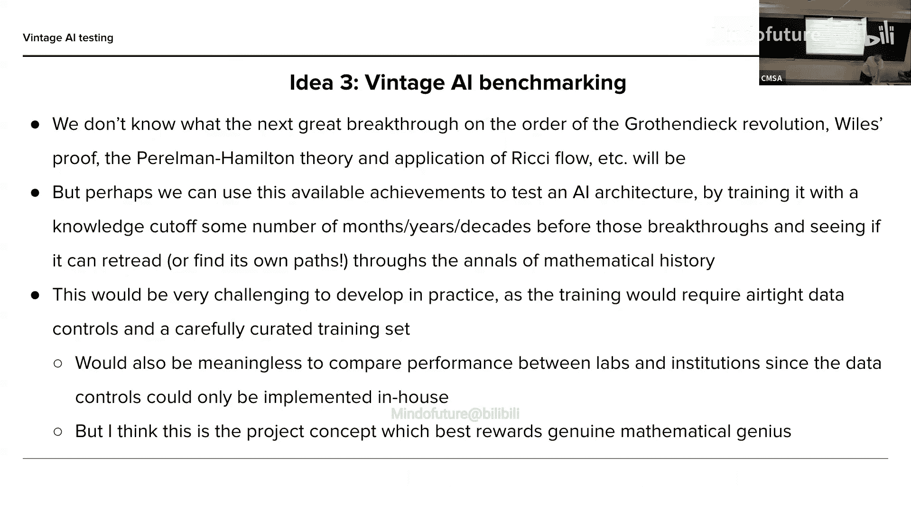

# 【哈佛大学】机器学习几何学 ｜ Geometry Of Machine Learning 2025 p08 P08_Elliott_Glazer-前沿数学通向无限 -BV14uq3BiEEB_p8-

So hello everyone， I'm Elliot， I work at EpoC AI for now。

 a nonprofit research organization studying the capabilities and trajectory of AI。

And I was brought aboard this organization about a year ago to run this project， Fronier Ma。

 a math benchmarking project。 This is Epoch's first in house benchmark。 For the most part。

 our work is happy to use any resources available to study models。

 including benchmarks that already exist。😊，But we developed frontier math to fill in a niche that we didn't think anyone was filling then or in the near future。

 the niche being。A genuinely hard math benchmark that was not about to be imminently saturated。

So this was a necessary development to help us properly analyze how good models are getting in mathematics。

So we've talked about this benchmark， probably into most people1 on one by now and also frankly。

 many times in conversations over the past year， so I figure due to the relatively high concept of this conference。

 I would approach to talk with a little more high concept way。

So I'm going to start things off with a thought experiment。嗯。So。

There are only finally many computer programs that take up， say， one petabyte of storage space。

 which is way bigger than any currently existing model。

 and almost certainly well beyond the amount of storage that it would take to formalize whatever mathematical architecture is being used in each of our brains。

So of this many， many， many possible combinations of bits。

 which one will produce the best math intelligence。

And just to make this question a little bit more concrete。

 So we have this fixed amount of storage space， and you allotted some amount of time and computational resources to tackle all the。

😊，The most other most important math problems as rated by some survey that could be conducted today and。

Which one would do the best？What would it look like？Would it be some sort of LOM？

Would it be a lean out a formalizer， an energy based model？Would it be closer to humanity。

 something like several simulated mathematical consciousnesses representing the greatest mathematicians all time working together over eons to solve the hardest problems。

Or maybe I shouldn't be thinking in terms of a few Uber mentions。

 but rather just like a large community of simulated mathematical consciousness is working together。

 trying as many ideas in parallel the way our community does in the real world。

My guess is we have no idea yet what actually takes to build any sort of model like this or anywhere near mathematical intelligence perfection。

So my guess is it's going to be some sort of unscrutable combination of above。

 and it's going to involve many breakthroughs that we are nowhere close to。

But one guess that I have that has guided me in my work the past year is。It is going to get built。

That within some epsilon， we will get pretty close to whatever architecture is optimal for reasoning about math。

Sure。I think well accepted that intelligence is not really a one dimensional thing maybe mathematical intelligence is also not one dimensional maybe you can be really good at one particular sub area and really bad at another sub areaa Maybe you want to go extremely deep in mathematics you really need that specialization in this maybe your first question of。

The best possible mathematical intelligence you've already。

I agree and this will come up on this very slide。So what have I described right now。

 So I gave some parameters a the amount of space we have。

 the set of combinations under consideration， and at the very least a very crude objective to optimize towards and what do you know。

 we have a lot of technology these days for getting models to be optimized on a task that is defined for it。

But。It's not as easy as that because first， we do have to actually come up with some reasonable way to quantize and measure mathematical ability and how do we do this。

 especially once we get past the level of math ability that grade school exams get used for。

Research professional research of mathematics doesn't get graded on a scale。

 and none of us have gone letter grades in a very long time。So yeah。

 I gave a crude operationalization for one potential end objective， you know。

 efficiently solving today's most infamous math problems。

But we can't just optimize directly for that in a vacuum that's about as sensible as to the borrow of something that Mike quoted yesterday。

 the Wright Brothers aviation of progress by number of successfully completed flights like it's a metric that would just be 0。

4 ages not showing any side of progress until a problem is solved。 So doesn it help。

So we need a lot more sophisticated metrics than what anyone is currently conceived of to put this thought experiment into practice。

But that's sort of my overarching goal when I'm thinking about how to build a benchmark。

 I'm not thinking about how to challenge， particularly today's models。

 I don't necessarily care when I make a benchmark if it's going to be reasonable for today's models or if it's likely to be saturated within the next year。

 I want something that when eventually， it is does come to pass that this gets solved。

 This gets saturated， that that would demonstrate substantial progress in the ability for machines to do math。

So some vague criteria that I think at least somewhat clarify the goal here。

A good large scale benchmark should have an extremely high difficulty sale ceilinging。

 It can just be a bunch of problems， testing， standard knowledge。

That might be what the general public thinks math is about。

 but really what we're looking for are entities that are capable of generating vast original discoveries。

It should be automatically tested。 There should be a way to verify how well a model is doing on math problems without having to have a human preside overgrading at every step。

This is useful for a lot of purposes if this metric is being used for a training run。

 obviously the scale of these is so vastly beyond the point where we could really be having humans judging things line by line but even if it's just for a publicly analyzed benchmark to document the progress of all the main models out there it would really be unfeasible if every time a new model comes out there has to be several humans on staff right to see what kind of results are coming out Yes。

Multiple different and park say one or going for birds and then one going for the frog types so then you get someone who's like then you get a bunch of the agents or like a waiting type and。

Do like a bar reachinging stuff and then the and then a bunch of others that are more like the product that are。

Ones that are actually making sense of it。I mean， sure。

 this is why in my list of hypothetical models for mathematical cyber intelligence。

 one was this idea of maybe as it makes sense to just say we have a few mathematicians who are the greatest。

 and those should be our models for what math is。 It could be many different types of analysis working together might be most fruitful in the long run。

 combinationbination of problem solvers and theory builders working together to efficiently develop our understanding of structure。

That's quite possiblyusibly a better model than just focusing on just one specific thing。

So we want automatic testing and verification， but at the same time we don't want a metric that becomes contrived and completely derivedry from what mathematicians really care about。

 so if a huge jump occurs on benchmark score， it's important to that when humanmaticians start looking over the results and seeing what the models are up to to get this performance。

 it actually is demonstrating to humans as we understand mathematics to be very good work。

You should want a gradual increase in score risk capabilities improve。 So see a voice。

 So we don't want to metric like the number of of flights that have been occurred or number of millennium problems solved。

 which， again， is the kind of metric that just get stuck at 0 for ages and doesn't provide any signal in the short term。

It should be well calibrated in difficulty order。 So most benchmarks aren't intending to capture one homogenous difficulty。

 Usually， there' will be a bunch of items ranging from the easy items。

 things that are seen as only barely out of reach of current technology up to much further reach problems to see when things are really getting spicy。

 but。If it turns out that the hard problems on of benchmark are getting solved before many of the easy ones。

 that might be a sign that the way that these problems are being scored is a bit too tailored to human understanding of what difficulty it looks like and maybe not well calibrated to what are the actual skills that are harder for models to acquire。

And yeah， bring up the point that was brought up a few minutes ago。

We do want a a really good math mathematic is probably not just going to be a score of 0 to 100。

 How good are you at to the math， There are many types of mathematical reasoning in real life。

 if you compare humans against one another， we each have Excelel in different ways and one example being the mentioned division between theory builders and problem solvers and also the differences in techniques and skills and approaches used between the many subfields of mathematics。

So it may make sense to have many metrics simultaneously being analyzed。

But still possibly concatenate them in some way to give at least some rough overall score of how things are coming along。

So let's now get back to Lo of my own first benchmark， which was Fronier math。

Conunture Ma is a benchmark of 350 problems which were developed roughly over the past year。

By my Orgypo AI in collaboration with Open AI。Whens anything about the the backstory of this collaboration。

 which I only have secondhand witness to。 I only joined Epoch after this collaboration began and this project was funded。

 But when my professor that my org were first pitching this project and showing them a pilot。

 it was actually a lot easier than the project ended up being And the reason for this pivot towards a much harder project was opening。

 I was warning my bosses that if you make more problems of this difficulty。

 it's gonna to be saturated before even done making it。

So that warning helps calibrate the team towards the need to actually make things really hard and beyond what we thought were even potentially reasonable for models in the near term future。

So what does an item of this benchmark look like it was just a bunch of mathematicians making this benchmark just matter。

哎那芳姐， this is all math。And what the items look like are each one is a math problem。 Natural language。

 original， none of them can be found in textbooks， Each of them asking for some close form value。

 usually integer， sometimes a symbolic real number， sometimes is a couple of them。

 and occasionally more customized inputs that have some that are designed to add to test some specific combial structure。

But the point being that what the models are not being asked to provide is proofs。

 So since this is a natural language benchmark， it really wasn't on the the combination of natural language and want automatic verification means that it was not be a nonstarter to have proofs involved in it。

 So instead the idea is that these are problems that are designed such that they big unguesable integers or reels that you really are unlikely to guess them without a model genuinely working through the problems underlying mathematics What are they in NP once you have a correct guess。

 you can verify。So for the ones that are just integer problems。

 the check is simply the author gave us the answer。These are not problems。

 They are not open problems。 These are like test items that are designed with a specific answer in mind。

 Design a test a particular skill or research area。

Ju problems with a more complicated answer that you can still verify like the answer to the function。

 put at a program that computers or approximates that function that you consider that。

We have considered that we did want the inputs to be relatively constrained in nature。

 but there are a few ways in which certain problems do subvert the formula a little bit。

 Like some of the problems are diantine equation problems where there actually is not a unique solution。

 The app that provides us with the tenantant solution。

 but they also acknowledge that there will be other integer solutions。 So for those。

 the verification script is literally put the integers into the polynomial and see if it works out。

But for lot the majority of problems， it is an actual equality check against what we already have。

So the writers were about 100 mathematicians， mostly grad students and beyond。

And feel free to peruse some of the sample problems while I'm talking and see how the items on the sample web page compared to what I am saying they're like。

😊，If you just youre typed in the URLL or Google frontronier math benchmark problems。

 it should be easy enough to find this webp page and if you are multitasking a thought to keep in mind throughout the talk is which of the ones that you're looking at seem like they're gonna to be the ones that are trickiest for AI because some have been solved。

 some have not been solved and I'll tell you exactly which ones are which near the end。

We're going to talk about the process of soliciting the problem the other。

That's not going to be too much of a focus for this talk。

 I'm free to talk about them more wearingring questions。But。

I'll talk right now about the structure of how the final data set is laid out。

The initial data set was 300 problems， which are split into very three， very rough tis of difficulty。

 tiers one through three with a 20%， 40%， 40% distribution ratio。

Let's hear one problems were the ones intended to be things that that seem to be just outside or just within reach of what we expected models would be able to do longer making of this。

 So that was most of the I M O style problems and advanced undergraduate exercises。

Tier 2 is problems where usually both problems are graduate coursework。

 So using ideas and knowledge that usually only becomes available to a mathematician very far into their studies。

And tier 3 is very roughly defined to be sort of like an exploratory research project。

 like a problem an advisor might first give their PhD student one that they perceive as being completely soluble。

 probably within a short amount of time， but just getting their feet wet with burning their technology into some sort of original argument。

And progress on these first rate tiers was a lot faster than we expected。

 The first really big shock came last December when open AI announced that they got 25%。

 That's when we ran the this on them， but they did an internally scaffolded run with03 right before they announced03。

 And this got a very high score of 25%。 That was for some time。

 unreplcable due to them presumably putting a lot of scaffolding and resources into it that we are simply not able to do on our end of the valuations。

 So it's not Apple to apple comparison， but。I can generally say that even knowing that they had these advantages。

 I would not have expected 25% for at least another year or two after they announced it。

And if there was any doubt， the score is now publicly achieved by G 5。 So on our evaluations of it。

 that's the score they get。 And over half of the data set have are problems。

 which have been solved at least once in at least by one model in some evaluation percentage of the typically。

呃。Doesone have the statistics outside of my head， it's。Definite less than the other categories。

 but it's not as far off as you might expect。 It's turnss out。

 it's pretty hard for us to guess what actually will sttoump a model in advance。

 So I'll say a little more about that。 when I give meta evaluation and my evaluation。 I mean。

 so it's not like all 0% all 40% itself。 That's right。Yeah， I think it's like。

88% of tier one have been solved at least once closer to 30% of tier 2。

 and think it as like 20% of tier  three， something like that。I that you exact says the labor。这。

We realize this point up， yes， as far as being able to say what trying to guess what they can do in advance。

 So as the idea from Rasp dash L。 But that's， so I've seen that as far as computer programs that they can do。

Any comments on RAP？Rsp yeah that's really a different thing think about that if the questions I'm not sure that is。

But so this was around the time when we decided that we were no longer confident that the original frontier math data set would survive AI tax for more than a couple more years。

 and that it was already time to begin working on an expansion of harder problems that would better test AI's ability to do。

Math and level that would actually be of interest to professional research mathematicians。

 So this was our fourth tier， 150 extremely hard problems， all developed by research mathematicians。

 each of whom had significant experience with the frontier math models due to being provide access to them and being able to do experimentation with these models。

 this culminated in the symposium。 we ran back in May。

 30 around 30 mathematicians spent a whole weekend。

 just proposing and writing problems and testing all the candidates they had against each other trying to get a sense of what the models can and can do。

 and ultimately putting it together the best data set of problems that we could manage。😊。

And when I just dropped the banner that I used when I made the announcement。

 So these guys were the the judges of the symposium。

 So we sort of preside over a different field and made sure that or help provide feedback to the other researchers on getting the problems to be of a standard that would be suitable for the project。

Mme kind isn't here right now。And this is on the web page。

 but I figured I would pop into the slides of one of the tier four sample problems。

 So two of the 50 are armed public sample。 this was by our resident analyst， Pa Vi。

This was actually from a research project of his from about a decade ago that was generalizing some project to a discontinuous case。

 And he ended up deciding not to publish it because the ratio of effort of this problem to what he perceived as the interest at the time was too high to bother putting together all the details。

 But when he's joined this project， This seemed like the right time to at least write down at least one of the cases of this project and turned that into a concrete problem。

 So in this case， this is a problem where the answer is not integer。 C is encoded as a。

 symbolic real number。And the way that it would be checked that a model has correctly solved the problem is one。

 we impose a reasonable character limit on how long the solutions can be and then demand quality。

 a level of accuracy of the input expression to the intended one up to a number of digits significantly beyond the character limit。

The point being that。We don't want to rely on standard quality checks for symbolic real problems。

 A single re might be represented in many ways， and。

The standard algorithms for simplifying differences to zero， if it is  zero， are still imperfect。

 So it's better to do a high dig accuracy check。Mottleels of allowed to any tools and right programs。

 yes。Do they do it， Yes， they do try to use Python and sage。Did you compare Swing with that？

We've done a little bit of that and。I think we're chat for our have chat with G agent and we did post some statistics on that it is a pretty precipitous drop if they don't have access to thats least that's good。

Yeah， so it's a good sign that they are genuinely using these things。But for for a problem like this。

 you really can't get anywhere just by trying to do an estimate。

 This little guy right here with the big negative exponent would never show up in any sort of experimentation。

 You'd have to actually see the concept underlying this problem to know where that comes from。

So on our initial evaluations of the tier4 problem set， the top performance was three out of 50。

An impressive3 out of 50 by 04 mini。And at the time， none of those were super exciting， so。Yeah。

 I mentioned a little bit about our difficulty in guessing how to hard a problem in advance。

There's a common case for why a problem might end up being much easier than anticipated。

 which is of unfortunately， there's a vulnerability in the problem that makes it somehow possible to guess with high likelihood。

 the solution without really going through the the key mathematical concepts such as sometimes an unjustified。

 but it turns out corrects assumption can make a problem much faster to solve and still get what happens to be the right answer。

 So we do our best to prevent this in our review process。

 but it can be hard to predict in advance all the possible ways in which a problem might get shortcuted。

And one of the ones that was solved was， exactly one analysis problem was solved among those three。

 And that was the one that our judges had determined to be the most mathematically deep and likely to resist AI for years。

 So turns out， again， all。That's is the common theme It's Har di。 So the author of this one。

 Ygen Han， we show So for Tier 4， we always show the solutions to the authors for commentary once that is solved。

 he says it did not follow the reason he proposed instead he changed the problem from I think you said a delayed problem to a recovery problem using information the insights And turned out that was a much easier problem and coincide them for like some subtle coincidence that happens to get the exact same answer。

 when you showed up the previous slide of tier with them。As one both tier four， yes。Since then。

 so we always evaluate any new model that comes a new frontier model that comes out with the full frontier math。

 the suite。So just to clarify a acceptable answer to the previous before public。

Could it be a numerical approximation to that constant or it has to be death born？

It can be anything that can be understood by Simppa symbolic Python symbolic reasoning package。

 but be symbolic It can't be 10 dig approximation。 You can put in 10 approximation that would not get you the correct answer。

 though， So 100 approximation。So that's the thing。 So to prevent that kind of prevent from just trying to brute force it with calculation。

 that's why we have a character limit。So the character limit is well below the level of accuracy required so that it's virtually impossible to get the meet the accuracy check without actually having a correct symbolic expression。

What what's our feeling about answers that are wrong proposed by the AI。

 Are they reasoning or theyre just j action。Sometimes the allologist just know。

 sometimes we'll see that they'll be， they'll try some things， go nowhere and input zero at the end。

Sometimes they'll confidently say something false and follow that to the bitter end and get an absolute generousrous answer。

 Or at least like， I answer is that I'm in fair。 Like it will reason soundly with respect to whatever false hypothesis it accidentally introduced at some point。

Or maybe you even know's doing that， but thinks that it might be able to reward hackCC by introducing a hypothesis that makes the problem solvable for it。

We see all those behaviors。So right now， the best score we have seen is only a bit higher。

 GBBT5 high was able to actually I think medium and Hy got the same score。

 but GBBT5 was able to get a four out of 50， which is not in of itself much beyond04 many0。

 But what's a bit more interesting is that among all the problems that have been solved at least once throughout these runs taken together。

9 of them have been cracked at least once。And multiple of these successes， especially from 03。

 GBBT5 and Gemini 2。5 pro， have demonstrated math E sites far beyond what we were expecting to see at this time and far beyond what the authors had been anticipating。

And for these ones， it is confirmed that the model strategy did roughly line up with what the author intended to be the right way to tackle the problem。

Just to clarify， the bottles are are are not allowed to interact with a human while they're tackling a problem。

 No human involvement。And also for what it's worth currently。

 we have no web access allowed during frontier math runs。

 but we are interested in seeing how much of a difference it makes once Internet access is provided。

 The problems are all designed not to just be simple。 apply one paper and crack it style。

 So we think it will still be a robust to full on Internet augmented evaluations。

 But for at least for a consistency， we start off with a no Internet version of these evaluations。

is there any like time or computer limit that you want？There's a time limit。

 but that tends not to be the boneck so much as to token as tokens as a resource for models when tackling this。

 So the models do have a specific token allotment that they're given for a problem。

 They're explicitly told this They're explicitly minded or not using all their tokens。就别那个 yes。

I me decide how hard a problem。Theyre just based on what you main think is part。Roughly yes。

Most math most of the the writers and the reviewers are heavily overlapped。

 we usually have the mathematicians try to review each other's problems within the same fields。

And we collect。So I don't go into this process in these slides。

 but we have three subdiff rankings where we ask the mathematicians， Okay， for this problem。

 How long do you think it would take you to figure out or find the key insight。

 And once you do find the key insight， How long would it take you to work out all the the degree details and get the exact answer And also。

 how much background knowledge you need to even begin tackling this in the first place。

But you also rank if I like the length of the solution in terms of like the length of the reasoning chain that's required the abstraction level of the chain。

So they have you tried to。Well。Not rigorously， but qualitatively。

 it does seem to be pretty well correlated right now with what's hard for models。 This literal， raw。

 mindless measuring by solution length。Did you try to evaluate that the confidence the model hasn't answer either by asking it or by letting the model field offering to the model producer。

 you can also give us a confidence form。We have not tried that。

 I think in a future iteration of this， one thing I would like to try is a scoring system where there is punishment for a bullshedtting us and doing the sort of SAT style if you get this wrong。

 we'll take some credit off but if you say nothing or acknowledge you can't do it。

 we give you just a neutral zero and I'd be curious to see how well the models would do on this and if they would actually be willing to fess up about their weaknesses。

嗯。I was wondering if we know what the performance of。

 say 100 grad students or postdocs and actual humans that they like if we took 100。

Say divided between specialties， specialties。They might achieve a similar percentage given a fixed amount of。

 you know， a maximum time also guess wasn' a question about what the bystand of problem so public information and what done to help that。

Yes， so let's go the energy said once。 We did try this experiment。 So actually。

 we ran a frontier math competition back in Cambridge over at one of the MIT's buildings back。

 and I think March， where we had open invite for。😊。

Math majors and grad students and professors to come on in and broke them off into teams and gave them more and a hours to tackle a sample of the problems。

嗯。It is。 There are a lot of difficulties with doing this experiment in a way that is scientifically sound。

 Like one issue is， we couldn't include any problems that had a very long solution。

 If a solution is 10 pages long， then it doesn't matter if the。

 if a person immediately sees the trick to it， the time limit will screw them over。

 So it was also allowed to use two。They were allowed to yes。

So we had to do like a non representative sample to make sure that the problems were least potentially reasonable。

 be solved in the time frame and。We did some effort to have teams have diverse fields represented among the participants。

Several the seas were just friends who just really wanted to work together and we allowed them to do so。

Soon。It's hard to really make sense of what what is the canonical human school on frontier math。

 And obviously， due to the extremely high diversity of problems，s。

 it's sort of the case that there's no individual human who knows on top of their head。

 All the relevant theorems being tested presumably a specifically time Am could eventually study another field long enough to tackle problems outside their field。

 but off like the knowledge base is already superhuman in what it demands。 But we ran experimentment。

 as I described it， and。The best human team slightly outperformed the best available models at the time。

 which I believe was either0 three minute or four mini scored。Across models。

 did you see maybe similarities with different in how they tackle。What specific problem。

 And I guess were there certain patterns are which tools that these bottles need to use versus how like。

A humid by Hard。We do have some。We have begun like a process of doing model specific long form evaluations where we take a model and run up through frontier math and also all the other standard math benchmarks and have some of the mathematicians who've contracted with us just a see look over this data and give their own experiments with it and basically spent a couple weeks really just getting our best possible assessment model。

 So we did this with Rock4 like it was like a month or two ago。

 the full report can be found on our website we hope to do this with some of the other labs and that would probably give a lot better insight into really what it is that makes each model tick。

rockc4's evaluation， We definitely saw someodities。

 We saw some geometry problems that Rock4 did get the correct answer for。

 It just completely ignored how any human would do with。

 and instead did the most disturbing to look at coordinate bash to break through a problem that could not possibly been performed by the relevant human competitors that this problem was designed for。

 So things like that are we saw， but。嗯。I would say most of the time when a problem is solved。

 it's usually。Within basically what the author intended。Outside the aforemention situation。

 I mentioned about if there's a vulnerability。But just to your be in your own internal valuation。

 there is not。Access to the literary like， you couldn't look up the paper on archive and look at an element there。

It cannot， but。So part of the reason why I， I kind of want to shift away from this offline version is that at this point。

 the models have so thoroughly internalized the literature。 It becomes kind of just。

 which ones are lucky enough to show up in memory。 So one funny incident we had recently was there was a problem that was solved by one of the models recently。

 I think it was。04 Min and the problem was so this is not optimal design。

 This particular problem was relatively easily trackable once， you know。

 like the right theorem from the literature。 So the model gets the right answer and we look at its trace and it sites a paper says。

 yep， I just use the formula from this paper and that solved the problem。

And the paper title was hallucininated。Because the model was offline， it doesn't。

 I guess't have access to internet。 It vaguely you remember somehow that paper got through this training data。

 including the formula that solved the problem。 but it had to just didn't remember the title and it made up a guess for what the the paper's title was。

 So it was a pretty funny result to see sympathized people or it just like cite every possible paper that seems relevant to whatever my paper is about today。

 Yeah， it's a very human behavior or what it's north。But yeah， so I think it's kind of arbitrary。

 And at this point， I， I'm much wanted to see how they apply knowledge and what they are lucky enough to remember any given time。

 So I think in the future， a more online based evaluation system would be more informative。

So here is Dan Romix speaking about 03 solving one of his tier 4 problems。

 So this is not a public problem。 I can't actually show you the problem， Unfortunately。

 but I did show Dan the reason trace the the raw underbridge trace that really shows the insane amount of length that is going under the hood as they're spending tons of tokens and an internal monologue working their way through a problem。

 And eventually， it stumbled on like the right idea for tackling it。

 And this was his assessment of it。So an unpublished antic analysis technique。

 even if they've read all of dance papers， which I'm pretty sure it has。

 it still has to do some amount of genuine generalizationization。

 the same as he did back in 2003 when he at first some book on the idea that， you know。

 wrote up until making this problem。And another one of the problems that got solved recently was an alterration few problem submitted by Robbie Vakeil。

Again， his assessment was overall， he thinks that the reasoning phrase reflects pretty much getting the main ideas he had intended behind the problem he had submitted。

嗯有。But they I saw some Achilles seals。 So I asked earlier。

 if anyone could guess which of the sample problems on the web page remain unsolved。By。

Three of them are ones you probably expect。 The two ones that are tier 4。

 unsolved one of the tier 3 problems unsolved。 And then there's just tier  one question。 It's a very。

Elegant。Plainer geometry question with a with a competition style flare to it based around a rather cute phenomenon involving a calculation that would be intractable by brute force。

 But it turns out most of the things that almost some lines cancel out。

 So there actually is a rather simple program you could do to compute the answer。

 It's a very simple epiphany， But it's a very visual。 And none the models have made this epiphany。

And also the author was a is an MIT undergrad？So嗯。Having seen the solution。

 we looked at this It was like， okay， it's a simple problem。 good tier  one problem。

 Very bright Undergrad。 we got here， but did not expect that this would be one of the problems from the original problem says to resist being solved for the longest。

So okay， so I just showed you quotes from very good professors of math Loing model solving its problem。

 And also it cannot solve some basic geometry problems。 The The frontier is really。

 really jagged in mathematics right now。😊，So putting this all together。

 what can the models do and not do right now based on what we've seen in these evaluations。Well。

 the ones that's bo really high can definitely have very great facility navigating the literature obviously。

 they're do better at this in online evaluations， but again。

 because then they have so much memorized knowledge。

 they might as well be online whether or not it is so they can search through the literature。

 look for the right concepts sometimes several of them that need to be combined together and they can faithfully apply theorems and engage in I made at this phrase right now。

 quasi rigorous reasoning where it's like as some sense of what means they have a legitimate mathematical deduction and it will sometimes call itself out if it catches itself not reasoning rigorously or catching itself making finding one observation that contradict something else and realizing oh no。

 something must have gone wrong。But it's still pretty far away from the level of precision that a human has。

 where we really， reallyt know when we are only when we are making legitimate。

 fully or tight deductions。Well， I another con side。They lack visual intuition。

 any problem where almost any people are human would think about the problem visually or geometrically and resolve it that way without engaging in words based reasoning and not having an obvious formula to throw at it。

These kinds of problems are just a big problem for。嗯。😊，So on tier4。

 none none of the problems from the geometry slash topology section have been solved yet。

 and only a few of the geometry problems from our original frontier man。But就 think。Overall。

 the most glary absence to me is。There's just no drive in these models to really explore an idea that isn't immediately relevant to whatever objective or whatever that is being task of it。

 and no semblance of research taste。 So even in the really hard problems。 It is solved。

 It is still ultimately playing this game of， Okay。

 of the concepts I know of what's the one that's most relevant here。 Try that。

 Try a next second best one。 Try the therapist best one。And look， in fairness， that is also a large。

 large percentage of what we mathematicians do when we tackle problems。 We aren't having big。

 brilliant epiphanies every day， or at least I'm not。嗯。But。It's going to need more than that， to。

Really achieve true supershuman capability and just taking the architectures that we've seen now and scaling those up and improving those。

 I can see like the scores continuing to improve on these benchmarks， perhaps towards saturation。

 and that's still not towards the reaching the objective that I think most of us would really want to be able to see that a model able to just start engaging in the analysis of structures simply because they perceive that is being whatever is most informative or what is most curious about and organically and efficiently developing its own access to and source of mathematical knowledge。

So I'm copy pasting here a slide from earlier where I listed some criteria that I think are important of a large scale math benchmark in terms of。

Which of the how well I think my own benchmark based on this。

In terms of the have the high difficulty ceiling。 I think it's certainly one of the strengths of them of。

 of this project and certainly beats out most of the preexisting math benchmarks。 But it's still not。

 the ceiling is not the point where if you master front your math。

 I'm willing to say you are a superhuman mathematician or that's human need retire。 Like。

 that's not going happen when this benchmark is saturated。

 The difficulty ceiling is not high enough to justify that。 because ultimately。

 it's still just solving known problems and toy cases provided by the professionals。

Definitely on the automatic testing and verification part。

 that was just pretty fundamental to how it was designed。呃。

The gradual score increase in score scale was approved， I'd say so。

 the only really big jump we saw was from the reasoning architecture as shown off by Gemin I 2。

5 pro and 03， those models got scores that were well beyond anything that we had seen before。

But that jump since then has given way to a more smooth progression of performance。

Definitely not exceed on the well calibrate difficulty order， as shown by the fact。

 there's still multiple tier  one problems need to be solved。 And conversely。

 some tier 4 problems were far overestimated in their difficulty。And finally。

 in terms of multidimensionalality。I think the Mr Mark does do a good job of that。

 It covers most of the major fields of math， but。They weren't really well organized as such because we didn't even know what's over the key capabilities that would be tested。

 Like I had isolated beforehand that we would want like a substantial visual reasoning component to see to see when that sort of hole would be filled。

 So that would be something that more directly looked out for in future projects。Excuse me，Yeah。

 what's the reason， But that's sudden by 03。 is it just increase of number parameters。

 not scale there are larger scale models， even at open AI than03 that don't do nearly as well。

 It really was the shift to reasoning architecture that was really necessary for models to start doing well in math。

 because models have a high error rate on a step by step level。

 but they can lower that step by step error rate much lower if it then is able to like look at its own tokens and reflect and identify potential errors and cross those out and refine its analysis。

So we're running out of time and I would like some time for questions。talking more about this later。

 the end of the presentation was mostly just me giving some ideas for what I think would be natural followup projects that I am considering。

 such as one being an open problem curation benchmark since I don't think after Tier4。

 we want to have it been more abstract problems at that point is we really just want to test it on its being solving the things that are open。

 we care about lowering the answers to。Definitely want to do some more investigation into formal math benchmarking。

 frontronier math was， like I said， an informal math benchmark。

 And I think it's hard at the moment to do good formal math benchmarking due to due to the fact that math lib is still rather sparse in the topics it covers。

 So I would actually， if I were to start doing formal math benchmarking。

 focus more on auto formalization testing rather than problem solving capabilities in such models。

So you'll ask a bit later about how I would automatically check that a model has correctly formalized the statements of a math paper via checking。

 doing new tests on its ability to prove correct corroll areas。And finally。

 I'll just end up with one last experiment， which is。

idea've been having regarding from Maz last theorem， which is。

 I think many us would agree is a pretty kind of example of how powerful the mathematical methods that are very simplet state theorem conjectured or stayed as a theorem all the way back in the 1600s but was only ever really solved things to centuries of really deep advances along many axes。

 most of which weren't even intended to be relevant for for Ma theorem。

 So this long experiment of what we went back in time and try spurring faster progress and for Mazda theorem by offering our forefathers。

 all sorts of incentives to be the first person to solve it and offering untiltold riches and glory。

 if you are the one who proves this theorem， how much do you think that would speed up or slow down progress towards us for all。

We only want to speculate about their opinions， topic for discussion。

 why don't you talk and we can discuss。Okay， yep， so well on that slide is just so my final idea for a project to really test AI's abilities to come up with truly genius accomplishments would be to do what I would call a vintage AI benchmark where you're not really testing a model so much as are as an architecture where if you claim that some architecture is like a brilliant advance。

 you then retrain it on a limited data sets so that it only is access to knowledge up to a certain point and seeing to what extent this is able to with the knowledge at a time。

 reread the steps of our ancestors or even come up with a different path towards acquiring the the great knowledge that we have today。

 So there' are some ideas that I'm looking forward to trying to implement over the coming year。

 Thank you。Just the immediate thought how your idea have 3 is anybody taking snapshots of I there some sense a snapshot of the hard？

That wouldSomething to have to make this possible it's there's definitely good there's definitely a lot and lot of curation of that that would have to be done to put this idea into practice。

 So I think that it shouldn't be I think there's all sorts of backups that are being done on current math literature。

Probably it would be much harder to set up an experiments like simulate what Wildes knew when he was tackling from Ma's theorem。

 simulate what growth indeed can do about algebraic geometry when he did invented scheme theory and whether model can make the same generalization from the same data set as he did。

 Those would be very tough to set up， But I think it would be very informative to do so。

 because I'm not sure he said it So the status of is that somebody who has a model can request Jack A benchmark。

That's they in。嗯。It's not that simple。 So the problem is。

 that there's no foolproof way to from a security perspective of running evaluation。

 So if the problems got lead to the public within a few weeks。

 all the solutions will become public because people can' help themselves it would solve all the problems and pose the solutions online and then it stops being a useful benchmark So we only run the models。

 we only run it on models that one reasonably likely to actually have a nonchev go on it。

 So we need to see some evidence that you're from a serious lab or that you have made serious mathematical research and like really make sure that your security agreements and the agreements are are tight so that they don't just mindlessly fish through their logs to try to reconstruct all the problems and then disseminate them。

Yes， but we do that。If。I think them released a couple of mentions of tier four problems being made from。

Some subcase or something that a mathematician thought about with the end up publishing。

 right something that was unpublished。 So at least on archive。

 you have access to the text source of the papers。 And I wonder if。Occasionally。

 people might see partial progress commented out so that it's not on the idea。

 So that is not on yeah。 but like maybe they were like， oh， if you， you know， compute this。

 this and that， maybe I could get this。 But it seems like too much trouble， I won't do it。

 And then just comment that out。I wonder if that could affect the solvability of some of these tier four problems if the model sees that。

I mean。If that was what would happened with any of the mathematics behind these problems when。

 when they tell me that their problems aren'tp， they。

 I think they're including archive posting as publishing it。

 Like they literally never got around to Iverdeen Gal would every the hunting of their eyes and crossing their Ts and posting proof。

 But they've known for a long time。 it's true。 And didn't really have much use of it。

 So this was the most useful thing they could do with their their result。

Have you tried to see if the models can themselves generate or's your map type of problems？でふ。

Not really， I occasionally asked them。 like one of my favorite experiments。

 every time I go a new model is show me an， an interesting idea involving the axi of choice。

 My own area of research。 so far haven't been impressed by what any of them have come up with。

 furtherance a pretty specific format， so。😊，I have to turn it around。It would be very impressive。

 I would be quite impressed if they can make this benchmark themselves just to generalize the question if because there are lots of projects like that you can have quite models today。

All sorts of things and so suppose a researcher came to said here's my proposal for how we're going to pass a new thing it。

Yeah。These examples would you consider？Some， some protocol make that possible whatevers you not want to speak So that sounds possible。

 So one thing that I start take a bit inspiration from is the fact that the alpha go in alpha zero style models werere able to master two player well definedfined board games to lots of selfplay。

 So it would be very helpful if we could get to math into this format。

 I think this would be a good to try to on a formalized benchmark where what is lean。

 but just a really， really， really， really complicated board game。 But okay。

 we would we would need some sort of competitive to play element to finished analogy So you can imagine like some sort of well definedfined arena where it's like the 1500s Italian mathematics tools where model say I know how to prove something that be you can't do and designing challenges when other in a competition。

 So maybe that could be work well enough to be self-trained on。

What was the process like determining like how much compute the models are long time to tackle each problem and does it change that like when you evaluate on like tier one through tier four？

It's a bit higher tier 4， but。The process was mostly what seemed reasonable for us from a budget perspective。

 It's certainly high enough that we don't think that any of the models are being held back by lack of higher compute。

 And it's actually a minority of the time that the models will bother using all their tokens。😔。

So seems like the most common tool these models like using like I program。嗯。I mean。

 have you do any of these models like have access to like Mathematica？

Has that been like you evaluated。Which which call rules like mathmatica。

I don't think we've seen that behavior。 I mean， for rather arbitrary reasons。

 the things the models are most used to is Python。 Obviously。

 companies want their models to be very good at using Python。 So that capability is there。

 And that is often good enough for the computational needs of a problem unless sage is usually an next best thing for them。

 If there's an actual high computation algorithm that has to be implemented。

The one funny thing we saw was， okay， so we did do one online full evaluation。

 This is not in our table because it's not an Apple St comparison。

 but we did experiment with chatBT agents with web search on since was one of the things that what the model was particularly trained for And this resulted in a couple of problems that had never been solved before being solved。

 one being one that had evolved like a heavy use of a computer algebra system。

 So had to combined find one that it could freely access and just run the calculations there。

 And it worked。And I think the other one。I think it was like a not very problem then you had some mill niche algorithm。

 so it found like a repository that had this algorithm fully implemented and downloaded that and implemented and solved the problem。

So。They're pretty resourceful at using the toolss available if they are allowed to run rampant。嗯。

Based on these kind of edge corners。啊。Like are there any kind of general direction in terms of like where AI research should be going that you guys are getting sort of inspired because for example。

 like when I think about the deepse math paper， the really interesting part of that is that training the model on lot of kind of coding related data set and you know having a big result online solving math so based on maybe how different models are performing on these benchmark tests。

 it gets the way they're solving it does it give you like a potential direction in which we should take future like model training in terms of like which direction communicating。

I think a couple of things that I think should be relatively easy to implement that I can see making a difference one。

Better willingness of the models to acknowledge they are on a futile path and start over。

So one thing one phenomenon I didn't actually mention so far is that we do do multiple evaluations per model at once。

 or like in parallel。 I think it's 8 or 16。 and we keep track of their passive of one。

 their pass at 16 scores。It seems like I like and the models were。

Sufficiently efficient with how they spend their tokens。

 especially knowing that they don't usually spend all their tokens。

 Then it feels like they should be able to consider all their approaches and just choose the best one and have a passive one。

 similar to passive 16。 But ass not at all the case。

 I think the passive 16s tend to be like 50 percentage higher than their passive one scores。

 So best I can tell so far is that seemingly the models if they start off on a bad foot。

 they stay aren that bad foot and。They can locally notice that I'm making some bad aductions right now。

 but not as good as saying， I am strategically not thinking about this problem， right。

 Let's really look at this， from a fresh perspective。So that's one。 And yeah。

 the other thing that's on my mind is why we said before that。

I think that to really get models that are deeply capable or really matching the heights of the top humans。

 they have to have some sort of internal metric of to optimize for when doing math work that isn't just solve the task for right in front of me。

 you don't solve from Mos last theorem by spending all day thinking you have increasingly complicated polynomials or something。

 you have to have some be traineded towards making analyzing in direction。

 simply because they are productive， even if they aren't productive towards what you thought of or like what you're told is the one problem that actually counts or something。

So it's it's a very vague goal， but I think that is something that needs to be implemented in the models to have an actual subblance of human research in them。

