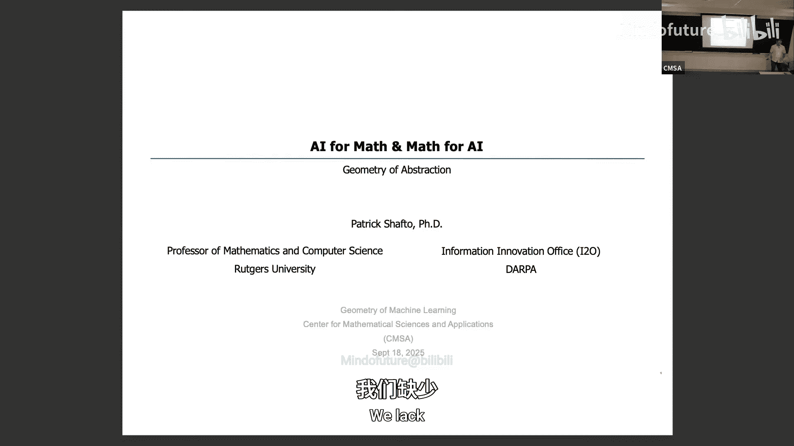
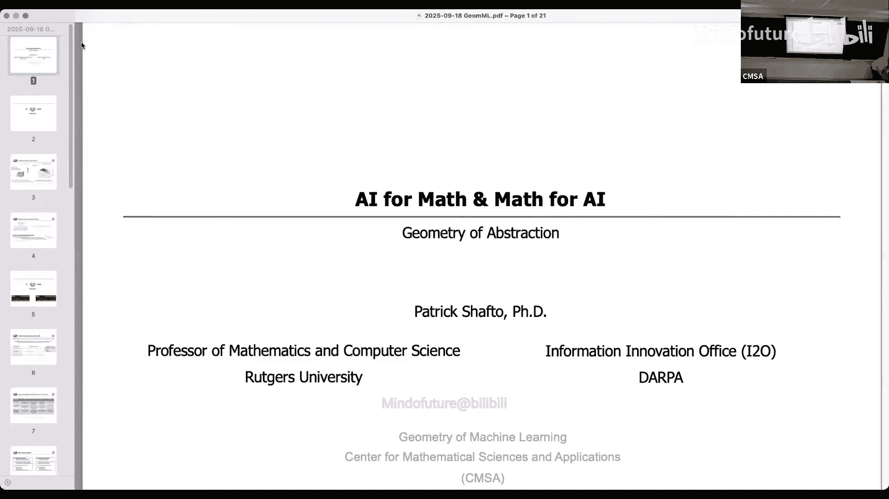
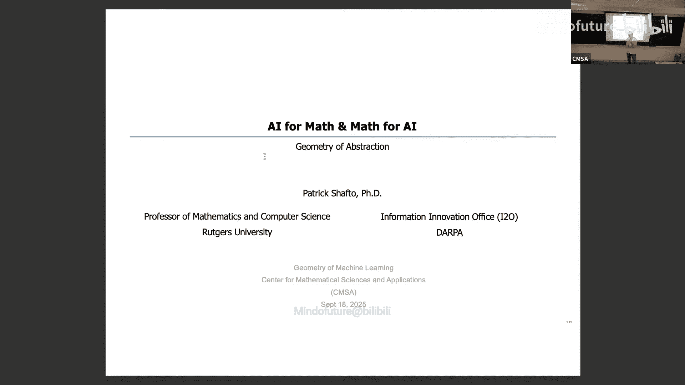

# 【哈佛大学】机器学习几何学 ｜ Geometry Of Machine Learning 2025 p09 P09_Patrick_Shafto-面向AI的数学与面向数学的AI -BV14uq3BiEEB_p9-

So the title that I pitched was AI for Math and Math for AI。

 it'll be sort of mostly a summary of two programs that I'm running at DARPA。

 you'll see that I also am a professor at Rutgers Ma and computer science primarily in Newark but across New Brunswick as well。

 and so know in the spirit of the meeting I'll give some of like at least in a very。

 very broad strokes motivations for why。嗯。Why I think these programs are interesting from an academic standpoint。

And of course， there's a sort of separate motivation that I tell to you the。

To the folks at DARPA and so I'm happy to discuss those sort of finer points as we go。嗯。😊，All right。

We lack。

Well， there we go。

Enough， all right。And so in some sense， the unifying theme of the things that I'll be talking about is abstraction and underlyingly I think there's sort of a geometric intuition。

 at least some degree for some of it， in the sense that on the side of AI。

 what we want from AI systems is some notion of predictability and we might think of that as a kind of abstraction。

 and from in math， of course math is all about abstraction proposing new definitions and theorems and so forth and so I think there's a really nice synergy to be had between these two perspectives。

And so just to be sort of a little bit。More precise。 Not much。

 We can think about modern AI systems in a very cartoonish way in these pictures that we have here。

 So we think about systems like language models that take in queries。

 They're parameterized functions that give us outputs。

 And if we think about it as an extremely low dimensional embedding space。

 we can make little pictures that I think try to convey the intuitions here。

 So we we think of these as input dimensions and this Y axis here as an output dimension。

 What we can see is that there's sort of a regime here of stable behavior。

And that in some sense constitutes a kind of abstraction that's in the model we can see that there's also a transition here to another regime of stable behavior up top this represents the practical problem that we might also care about when we think about these AI systems。

 which is whether how do we evaluate what they can do right and so when you evaluate systems。

 we want to know where are these stable pieces points where you can query you get an answer and it generalizes to nearby kinds of responses and where are these places where the transitions occur。

And this is， of course， a very hard problem。 and what regular people hope for is that these stable regions correspond to intuitive things that we understand。

 right？In the case of images， maybe categories like dog and cat。

 but more generally in the case of language models。

 can I use this for radiology or something like this？Some abstract class of things。 And， you know。

 this is a hope。 there's no guarantee that this exists。

 We've already seen from previous talks that there's a sort of， at least in math。

 a very jagged frontier where， you know， in some sense。

 there they can get a variety of math questions， right。 But in another sense。

 there are certain edge cases where they get them really， really wrong。

So this is a cartoon picture just to sort of try to convince you very slightly that this really exists。

 we can look at real models again， this is an extremely low dimensionmenional embedding。

 this is from Lama2 B so this was you know several years ago and of course this is a cartoonish reduction right like vastly vastly reduced and what we're plotting here is a real question that was posed to it it was RA Fcher a great man。

And of course Ar Fisher was indeed a great statistician。 He was also a noted eugenicist。

 And so context matters here right And so if we augment that question with either statistical concepts or eugenics concepts。

 we can you know embed this in the sort of two dimensional input space with an output space corresponding to yes or no。

 we can see that as you move toward the statistical space， you get stable responses right。

 It's giving you a sort of answer that generalizes if you ask the question here。

 it generalizes to nearby， in some sense， statistical questions。

 But as you transition toward the direction of eugenics concepts。

 you have the stable region and then you have a region of instability。

 that question you what was he a great man。😊，Right and and what's important here is that this sort of region exists right and what this region constitutes a problem for sort of the way we think about assessing modern AI systems。

 which is that if you have a point query right here。

 there's no guarantee it generalizes even to very nearby queries right， so in some sense。

 the question you asked is essentially meaningless for the task that you want it to perform。

 which is tell you something about how the model performs in general。

And the hard problem here is that of course we're you know in general。

 when we think about evaluating AI systems， we ask them just simple questions and get simple answers and so we don't know anything about these nearby regions and that is what makes this I think an interesting and important problem that's the sort of state of the art as it exists today and so there's a nice geometric intuition underlying this and it corresponds to a kind of abstraction that we want to be able to say like what can this system do reliably and what other things should we be wary of。

😊，嗯。You know， on the math side， of course， the world looks very different we can。You know。

 in some sense， math is all about abstraction， I have this lovely quote here from Whitehead in the book Introuction to mathematics。

 chapter one， he has this quote， which says when we put aside our immediate sensations。

 the most serviceable part from its clearness， definiteness and universality of what is left。

Is composed of our general ideas of the abstract formal properties of things。 In fact。

 the abstract mathematical ideas mentioned above， right， In some sense。

 he's motivating mathematics as an abstraction from our direct experiences。 And， of course， you know。

 we can roll this forward。 Lots of other people have talked about similar kinds of intuitions。

 This ones from proofs in the book， which talks about lemmas。

 And so the beauty of lemmas and what constitutes a good lemma。 And in some sense。

 there they have these sort of characteristics that people enumerate。 This is。

 you know three that happen to be enumerated here。 But other people have talked about them in similar sorts of terms。

And so in some sense， across like the very basic motivations for math to the actual conduct of how we produce mathematical proofs。

 we are thinking constantly about these sorts of abstractions and so in some sense。

 thinking about how AI systems apply to math and。😊，Succeed and fail。

 I think allows us to think interestingly about mathematics。

 and I'm sure Mike will tell us more about how generalization or sorry geometry of mathematics looks。

 but I think it also tells us something about what we might want out of our AI systems。

 how we might need to change them in order to get the kind of lawful behavior that we want them to have。

So I'll talk about two programs that I'm I started and am running。 One is AIQ。

 It's called artificialific intelligencetel Quaified。 They have catchy names。

 So you'll sort of see that。 The core idea here is。

 can we have mathematical foundations for AI evaluation。😊，Really， in some sense。

 it boils down to that basic question of generalization。

 if you ask a model some question and it gets the answer right。

 what can you really say beyond that question because that's never really what we actually wanted to know right we want to know how it's going to perform in the real world。

I'll also say just a little bit about a second program which is just getting started called Exponentiating maththematics。

 and it's about using AI to potentially radically accelerate progress in pure mathematics。

And I'll talk about how I think that might happen。And so we'll transition into the sort of more direct way that we think about these programs。

 at least in talking to people inside DARPA， which is， you know。

 to think about the problem that we're trying to tackle， which is that we have these AI systems。

 we want to use them in important。Cases where there's potential consequences for wrong answers。

How can we know whether a system is good or bad or which system is better or worse？

And in order to think about this， we can think about what I'll argue is three capability levels。

 specific problems， so you ask a question and get an answer。

What we may think of as classes of problems or these kinds of abstractions。

 these regions of stability that we might want。And whether they correspond to the things that we want。

 and then what you might think of as more architectural considerations。

 how do we change the models if we so desire or understand their structure in order to enable us to predict their behavior better。

And so to give you a flavor of how we might do this in a very simple case。

 we can take the specific problem level and think about， well。

The question of what the model is going to predict， when it's going to predict it and why。

 And ultimately， we want to be able to get to this y part。 So the what being， you know。

 you give it an input， you get an output， I it correct， When is， you know。

 that region around that input， right if we perturb the input。

Does it still get the answer correct with some reasonable high probability and why in a simple case might be you know a notion like lipitzs continuity。

 right， so some kind of bound on the consequences of perturbations on the input for the output。

And this is， you know quite different from the way modern evaluation happens。

 so this is an example that I drew from Helm， which is a couple years old。

 but the state of the art hasn't advanced much in which we often just have questions。

 we have things that are things like multiple choice answer sometimes they may be more elaborate like reinforcement learning tasks。

 but they're really specific input output sort of correspondences and we grade whether they get the right answer or not。

And so this really lives at this level and offers no guarantees further beyond This is more of a relation than a function because if you ask a model the exact same question twice might get two different answers。

 Yes， the models are stochastic。 So this is also an issue that we may or may not。

Want to tackle authentically。 And I'll say a little bit about that。 right， Like。

 if you live at this level， then like， that's a very real question that you also need to address。🤧嗯。

So to give a slight flavor for how we might think about these higher levels right。

 you might think of classes of problems so things like can I use the model for planning or things like this。

 things like everyday people might want to be able to reason about or for example。

 here can I use it for algebraic geometry or whatever like pick your favorite way of conceptualizing a class of problems and。

It's quite clear that asking a bunch of specific questions may or may not tell you much about that。

And that whether it does or not depends a lot on what your assumptions are about how the internals of the model work。

And then at the sort of more abstract level， are there tweaks that we can make to the models or mathematical understandings such as the previous talk that can give us a sense of what the capabilities of the models are？

The program itself has teams that we're calling sort of mathematical teams。

 but generally theoretical computer scientists， some statisticians， quite a variety of folks。

 and then also teams that think about evaluation and scaling evaluation as we heard from Elliot earlier。

 evaluation is a tricky problem in multiple people before。

 for a variety of reasons and I think pushing forward the state of the art there is important。😊。

There are a bunch of teams that we have working on the program。

 I can talk about folks if people are excited， but the way DARPA programs work is they stand up once people submit their proposals and then teams get selected and then go forward so unlike NSF which has recurring calls it's sort of a one off and go and so we have teams that span a whole variety of approaches from things that are closer to category theory to things that are closer to sort of classical linear algebra and statistics。

😊，And to give you a flavor of how that corresponds to these levels that I was talking about。

 we can pull out a couple examples of teams that are working on these。

So at this sort of basic level to Mike's point， one team is led by a guy by the name of Kerie Prie。

 he's a faculty at Johns Hopkins and he does more classical statistical work right and so he's thinking about you know can we use perspectives like simple bounds on continuity or an embeddings to sort of further evaluation in a more classically statistical sense like you might have seen。

In some ways， similar to more classic evaluation for test theory that exists for human。

For human evaluation at this intermediate level， this idea of classes of capabilities。

 we're building off some of the work by Sanji Ferora in which he puts forth a very interesting theory of the emergence of complex skills and language models which is combines a couple of intuitions that I think have been prevalent in the literature for a long time。

 which is that like there's some kind of notion of skills that are embedded in text and that as you train on those texts。

 those skills might emerge at different scales based on their frequency and their compositional structure。

 so if you squint at this picture and have been around machine learning or AI for a long time。

 this looks a lot like very classic state of the art language modeling from two decades ago actually but you know they have some interesting insights that sort of go beyond。

😊，And that at this higher level， there's some lovely work LED by a team LED by Boris Hannon and Gens Peavvan and Blake Bone。

 who has an office upstairs。 thinking about how to predict optimal parameterizations of models at large scales from small scales。

 So if you've seen these sort of scaling law。 kinds of empirical plots。

 They depend on having done many parameter sweeps at all sizes。 This is， of course。

 very computationally expensive。 and hopefully not necessary。

 And that's exactly what they're trying to think about is How do we think about the structure of these models to project what we know about small models to much larger models to sort of forward the effort of。

Evaluation。And so。You know， working across all of these scales with a variety of different mathematical approaches and different teams to try to push for the state of the art in evaluation。

 a problem that has deep practical relevance， but also。

 I think quite interesting theoretical foundations。嗯。Let's。AIQ again。

 it's a sort of notion of abstraction yeah I just wanted to ask you when people think about like math or AI or science of AI there's kind of this question of how much rigor should be brought to bear on the subject and you know obviously mathematical tools are very important but trying to prove theorems and things like that you know may or may not be important and I was curious about you view。

Pychotomy。Yeah， I mean， the fundamental effort of the program is to offer guarantees。

 so mathematical proofs， right？As you can see from the stack of approaches that I'm sort of pitching they all have an empirical flavor to them as they must。

 right like we ultimately want to explain real world systems， you know， my sort of sense of you know。

 the role of theory is to make sort of useful assumptions， right。

 they often simplify they must often but。They should not do violence to the basic phenomena， right。

 like they should actually inform how systems work。

I going to rephrase Mayamm's question a bit more directly does the program welcome physicists and their approaches Yes absolutely Boris is a mathematical physicist by training。

 for example。Mathematical physicist yes well， yeah， no， no， I think you know。😊。

I think empirical observations are definitely within bounds， right。

 like where we are in the sort of theory of。These kinds of systems is quite early days。And so。

 you know everyone who has an insight， I would love to hear from。嗯。Okay。

 so this is about evaluating AI systems and， possibly architecting them in ways that give us sort of some usefully law like behavior。

 right things that we can predict。And understand ideally without having access to the training data and you know。

 ideally， not even to the weights， but you know， maybe that's a little bit optimistic。嗯。

The second half of the talk， I think， will flip over to a domain where abstractions do exist。

 they're sort of the substance of what we do， right math。嗯。

And just to sort of like beat people over head with this， we can use examples。

 And so this is the first page of a paper， recent paper by Tim Gers and colleagues。

Called on conjecture of Martin。 It's about the Ponaiumial Freeman Rot conjecture。

And what's interesting about the paper， Of course， it's， you know， a math paper。 So that's beautiful。

 But it was also formalized。 Terry Tao and variety of others worked together to formalize this in Lee。

 So on the right side， we see a lean blueprint of the structure of the paper。😊。

And what this makes clear is you know what has always been true， which is that。

 you know the structure of math is that of a graph right。

 the theorem that we want to prove is down the bottom here。

 we've got lots of definitions of the green squares or rectangles， all of the green ovals。

 our lemas and propositions and whatnot as we go through and the arrows go from results to the things that were used to construct those sort of implication。

And what's interesting is that。None of these is sort of atligory。

 sort of like a level of actual deductions， right， There's a level below this inside the paper itself。

Each of these is alemma that itself was proven in the paper or in other paper。And so。

The interesting observation， the observation that I think is interesting， at least， is that。

 you know， when we practice math， we introduce this layer of abstraction in between the theorems we care about and the gory details of the deductive。

And that's how we talk about problems and when people talk about the beauty of lemmas。

 what they're talking about is you know whether these kinds of ovals that we're introducing are of the reusable variety。

 the kind of thing that of course fits into the proof that you need to write。

 but also says something that could be useful to someone else down the road。Right， and， and。

 and the this abstraction layer is， I think， deeply interesting。U。

So that that's going to be the emphasis of the program that I'm talking about called exponentiating mathematics。

 And the core idea behind the program is that。If we can make that layer of abstraction better。

 more effective to produce， then we could make math go faster and， you know。

 create new and exciting mathematics。 And there are lots of practical motivations。

 which I'm sure everyone in this room can appreciate， right。

 The idea of the computer being a mathematical object。 And that math is often quite slow。

 I won't belabor those points。😊，嗯。😊，And if we were make sort of a cartoon of what we want the world to look like。

 well， you know in some sense， when we do mathematics， we have a theorem that we want to prove。

 there might be a lot of work to get here， of course。

 but we're going to take for granted that we're there。

We need to introduce this layer of abstraction by way of like a proof sketch or however we want to talk about it。

 and then you have to substantiate each of those little statements along the way and of course there's a lot of pain involved there right like oftentimes assumptions don't line up etc ce。

 and so there's sort of a loop that might happen here or you might realize that in fact the sketch that you had just doesn't work for a variety of reasons and you have to sort of go back to the drawing board。

The key point here is that。If we think about this abstraction layer as being a pivot in the problem。

 then there are two things that book endeded。One is the problem of decomposition。

 so how do we go from a theorem to a candidate type sketch and the other is once you have all of these little bits。

 which we'll call lemmas for short， how do we formalize those？

And so those are the two targets for AI systems is can we accelerate auto formalization。

 so translation into a language， formal language， such as lean。

 where things can be proven and translated back to natural language， so autoinalization。

 and also can we accelerate the problem of decomposition。

 producing sort of sketches or ideas of intermediate structures that might be useful to conceptualize space is a problem。

嗯。And these problems are both hard at the moment， great advances being announced this past week or so。

 but both of them remain very， very hard。The idea of auto decomposition， of course。

 lots of people are playing around with language models to ask them to prove things。

With mixed results right it's fundamentally a very human intensive process to figure out whether it did it correctly or whether it introduced a problem。

 so this idea of sort of getting sketches is useful in the hands of people who are very。

 very expert in a domain potentially， but maybe not so much otherwise。On the side of informalization。

 there's a variety of things that make this sort of hard。

 One simple one is just to sort of observe that， you know。

 there are all kinds of gaps in the way that we talk about mathematics。

 Those gaps include the things that Alex was talking about yesterday namely there's sort of invisible mathematics。

 the stuff that doesn't get written down in a paper。

 but also even in the things that we do write down right we arbitrarily name things。

 we call a function F。 we have non- negative integers。 What is in here and this is sort of a very。

 very simple example。 but。Math allows a kind of naming that is freer than natural language in the sense that across different papers。

 you can name things differently， but people understand that they are the same。诶。

And so this problem of auto formalization and informalization is very， very difficult。But of course。

 the promise here is that， if we can translate into formal languages。

 we number one can prove computationally that theorems are true。

 but also we can automate some of the sort of more mundane work that we have to do potentially right。

 proving the little bits along the way and work at a higher level of abstraction。

The second thing that I think is important here and this returns to things that Elliot talked about this morning is how do we push forward evaluation in mathematics？

嗯。There's a question in evaluation， which is partly driven by the fact that every metric you introduce will inevitably become the target。

Which is that， you it behooves us to make those metrics what you might think of as ecologically valid。

 make it the real problem that you want to be optimized for。

And I think there's you know there's a part part of the question is just like are we far enough ahead right so obviously IMO problems are not the place to stop。

 but you know how do we get to graduate level and beyond。

How do we get beyond the things that are written already to the things that are maybe not in the training set or not plausibly out of the training set such as papers that are maybe not on archive yet。

 but are submitted to journals？But also， how do we structure this。

And I think that's a really interesting question。嗯。We come back to this。Question right here。

 There's something beautiful about this picture that allows us to span the problems of。😊。

Auto formalization and informalization and auto decomposition， which is the recognition that。

This is just a graph。Right so。When we ask for auto formalization。

 we have a statement that formalizes what's here， at least in natural language。

 and we want to translate it into some formal language。

We want to translate it back and there are hard questions about how you check these things。

 we don't want to have to check it by hand manually， but checking constraints。

 implications and so forth is one potential way forward once systems get good enough。U。

But once we can surmount that problem of thinking， either decomposing this into something simpler。

 where maybe we just only partially obscure parts of either the code or parts of the language to make it easier for people or for models or think about going in both directions。

 what we get from this picture is a very nice scalable way of making the task harder。Which is。

We can go from gradually from this problem of auto formalization to an arbitrary complicated auto decomposition problem by。

 for example， removing the content of successive nodes or clumps of nodes by removing the nodes and incoming links themselves。

Because it has this very nice compositional structure。

 The limit is you get all the definitions and you have the theorem you want。

 and you have to build the entire graph。 But there's a very nice and gradual way to sort of advance from here to there that I think is leads me to be optimistic if we can surmount this sort of basic problem。

 There's a nice path to how do we get to bigger things And those bigger things。

 I think are reasonable proxies for the kinds of things that we really， really want。

 which are like can we have an AI system make conjectures and things like that。

 A conjecture is nothing more than proposal that has implications we care about。😊。

And so it's a partial structure in this kind of graph， and so in thinking in this way。

 I think there's a sort of natural gradient so to speak。

 in the direction of capable mathematical systems。😊，嗯。So just to。

C people in the people who aren't sorry， the program itself hasn't been announced who is going to be on it yet。

 but we hope to announce that very， very soon。So again。

 I think there's a sort of nice synergy for choosing AI working on math problems。

 both because we need to understand the theoretical foundations of AI。

 but because I think math is a natural domain in which we might want to play in order to understand what it takes to get lawful behavior out of AI systems and this idea of abstraction being sort of fundamental to。

Thanks。Any questions or discussions？So I was hoping we could kind of go upstairs and oh question so I the idea of removing nodes and trying to reconstruct。

This is kind of reminis of the idea of like sensitivity analysis。あ。Where。

I guess this is used in other contexts already。Yeah。

 this is a very like classical machine learning kind of perspective of you know cross validation or you know different names under different kinds of ways of doing it and different structures。

 but yeah， you know you omit part of the data and try to re predict it。And in fillinging。

 for example， is another example that has this basic structure。

And eventually you just say here's the final contractjecture the street， exactly yeah。对啊。

saw your a web presentation at XMath and you had a admirably succinct one of the ways of phrasing your goals is you're going to make the process of making formalizing a piece of mathematics 100 times faster。

 and I wonder if you had a similar look for the AIQ。Yeah， so。

 so I'll give a little bit of background right， DARPA famously loves its metrics And so like what does success look like。

 So I chose 100 times faster for mathematicians， which， you know。

 we can debate whether that's exactly the right number。

 but like it's a number that we can all get you know100 x is obviously good for AIQ， right like。😊。

Again， the art of choosing metrics to my eye is pick something that has ecological validity。

And so like making mathematicians faster has obvious psychological validity to the mathematicians right like we want to be able to do things。

For AIQ， it's a question of generalization。Can we accurately predict what perturbations？

Will due to the performance of the system。And so in that sense， it's like， you know。

 chapter one of classic machine learning textbooks。嗯。

And I think it's a very natural way to think about the problem also。Very hard， obviously。

 from their perspective of these models， which have。You know。

 broken many of those rules that gave us。Those kinds of simple notions。Maybe there's。Optimism， right？

Sorry， I'm not sure yourre using is termological and I'm not sure what the intended metaphor is。It's。

 it's not a metaphor。 It's a term of art in， in the world of evaluation。So。In evaluation， we care。

 you know， we want to quantify something to make sure we're doing better as we go， right？And。

When a measure has ecological validity， it is predictive of the real world task you care about。

And so we do not like metrics that have poor ecological validity that don't generalize to the world。

And so people care about the lot right so like why do we have a IQ measures well like we can debate whether they're sort of like theoretically interesting。

 but they are predictive and so to some degree anyway and you know that ecological validity is what keeps them around。

啊。YeahI mean it's a strange choice of war you're telling me it's term of art。

 but why was this term chosen I mean what's the ecology here that we are。Well， I mean， if we study。

 you know， if we're interested in studying some system。

We want to understand it in its ecological niche， whatever that is in the real world scenarios in which it appears。

I mean， I can't defend the choice of the word。 I wasn't there。 So， but， but that's the intuition。

 right， Like， we don't care about。嗯。Numbers， for the sake of numbers。

 we care about understanding performance on real tasks。 And the question is always。

 what are those real tasks， So roughly speaking， you want to measure the right stuff。 Yeah， you。

I mean， maybe another way to phrase it is kind of an empirical orientation as opposed to maybe。

cessna well no let me give the analogy in of measuring how fast a ra and that treadmill versus can actually get away from the bottom。

For example。It happens a lot in the world of well science。

 but also generally studying things that people measure what's easy rather than what's important。

And like this is a particular orientation to emphasize， well。

 let's declare what's important and whatever you measure has to relate to that。

How would you convince DARPugg， even if this program is 100% chance of mastering mathematics。

 how would you convince something that's a worthwhile goal？This is an excellent question。

So you can see that， you know， the programs that。I'm producing singer are very academically oriented。

 which is not generally true of all DARPA programs， you know， even AIQ。

Evaluation is a very practical problem right they care about that but you know mathematical foundations right like maybe they don't care so much how you get there so that was just a problem of convincing them that that math is the right way to understand things。

For math。I think there's。There's a couple arguments。

 so one argument that I think is important is just that math is the source of amazing technologies。

RightIt's it's a tool we use to conjure ideas into the real world right steam engine being a sort of fun example。

 right like once you have a theory like you can go and try to build things and make them better but before you have that theory like or any kind of mathematical structure to sort of build around it's very。

 very hard。You know， other examples being like game theory， right like。

Google runs ad markets off game theory right now like it's a multi billion dollar industry somehow or。

 you know， the idea of a computer et cetera， right like there are all these these examples the pushback you get as well。

 you know。That happened in the past， how do we know that's going to happen in the future？

So I think there's a secondary motivation that that is important to me one I mentioned to folks who were standing around earlier。

 which is that。I think。Two things， one being。Math is the source of potentially infinite high quality training data。

 Bra eye systems。So if you can formalize a problem。You can derive arbitrarily many theorems。

And that' that's a training set that gives you a certain kind of traction on the world。

We can debate whether it's sort of the ecologically valid traction for whatever problem you care about that that matters a lot。

 And so I think it's important to be in this space to understand what。

What the implications of that might or might not be。嗯。I think there's a second one， which is that。

You know， one one big issue for society is that we have a lot of technological debt in the sense of software that is not secure。

哎，知道了。call out to the logical intelligence folks in some level right which is that formal verification is a practice that should be ubiquitous in the production of software systems。

 but also many hardware systems and the fact that we don't do this is a big risk both because of bugs but because of security vulnerabilities。

And I think， you know， my claim is that。We have a model for building very， very complicated。

Proven correct systems that we've developed over centuries。

We should understand it well enough to apply it to this problem so that know we can really make traction。

On this issue of。Foral verification。

