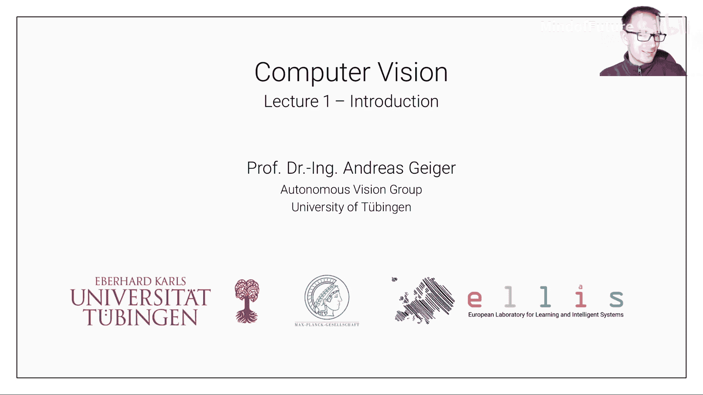
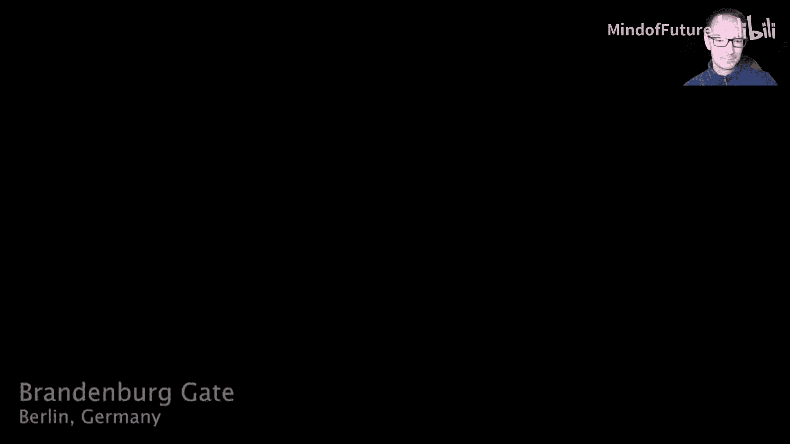
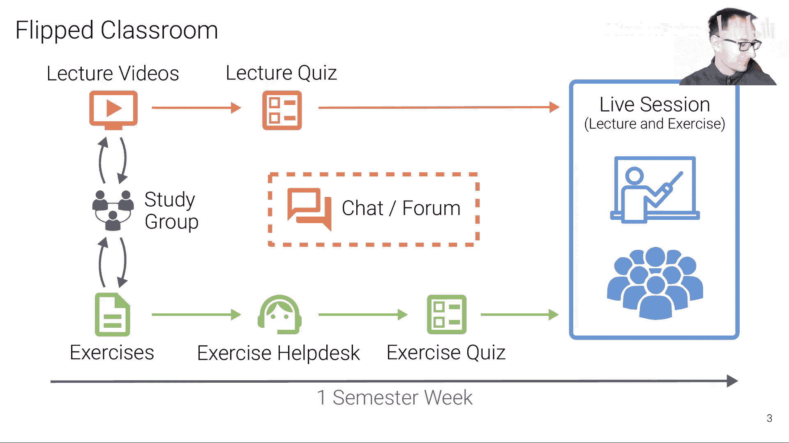

# 【图宾根大学 • 中英】计算机视觉 ML-4360 (Computer Vision) p01 P01 Lecture 1.1 (Introduction - Organization) -BV1S8N1emEef_p1-

Welcome to Computer Vision， a lecture at the University of Tubingham。My name is Andreas Geigga。

 and I am excited to be your lecturer for this course。What is computer vision？Well， simply speaking。

 computer vision is the attempt to replicate the phenomenal perceptual capabilities of humans in a machine。

In other words， we are concerned with converting light into meaning。For example， given a 2D picture。

 we want to detect objects or segment objects in that picture。Or given a collection of images。

We want to reconstruct the 3D structure of the world by just processing and analyzing 2D projections of the 3D world。

That we live in。

To give you a little。Tiser。About this， I want to show you this video here。

That is produced by the work N in the wild neural radiance fields for unconstrained photo collectionions。

 which is exactly about reconstructing the world from an unstructured collection of 2D images。

In this work， we present Nerf in the wild an extension of neural radiance fields or Nerf。

 It can be used on the sort of unstructured and uncontrolled photo collections you might find on the Internet。

Our system takes as input an unconstrained photo collection of some scene， in this case。

 the Brandnenburg G in Berlin and produces as output novel images of that scene where the camera can be moved。

 and also the appearance of the scene could be changed。

Let's start off by just looking at some view synthesis results from our system for the six scenes from the phototourism data that we used in all of our experiments。

You can see that we're able to produce high quality renderings of novel views of these scenes using only unstructured image collections as input。

Isn't that amazing。Let's understand together how this works in the context of this course。

This class is taught as a so called flipped classroom。 What does that mean。Well。

 instead of me presenting the material to you during。le。

Physical presence time will provide to you lecture videos that you watch beforehand。

Before coming into the so called life sessions。Where we will then have a lot of time to discuss。

Interesting or difficult materials。Of that particular lecture。

So we provide lecture videos on YouTube to you before the actual live session and your task is to watch these videos and。

Take down to node questions that you have and bring those into the life session。

We also encourage you to form study groups with your peers to discuss the content。

 the materials beforehand。And to。Motivate。You a little bit。

 we also provide a lecture quiz that serves two purposes。First of all。

It helps you to self assess yourself。And also， you can gain a little bonus for the final exam。

 but also it helps us to understand what the difficult topics are so that we can focus on those mostly in the time that we have during the live sessions。

At the same time， we continuously provide to you assignments in the form of exercises that you work on。

And if you have questions for the exercises or questions for the videos。

 you can post them in the in the chat that we offer。 But for the exercises in particular。

 we also offer a online， weekly online。Som exercise help desk that you can join。

 and we highly highly encourage you to do so。And also， we provide a quiz for the exercise again for。

Self assessment， self motivation， and for us to understand which topics are difficult。

So during a typical week， you watch the videos， you work on the exercises。

 you interact with us and the other students of this class through the chat or your study group。

As well as the exercise help desk。You complete quizzes。

And then we all come together in a lecture hall。And discuss the topic and the difficult topics again。

 and that could be in the form of questions that I might ask to you or questions that you bring into this forum and ask to me。

 or maybe we do some little tasks together。That's all I wanted to say， for now。

I'm very much looking forward to meeting you all。In our first live session。See you there。

