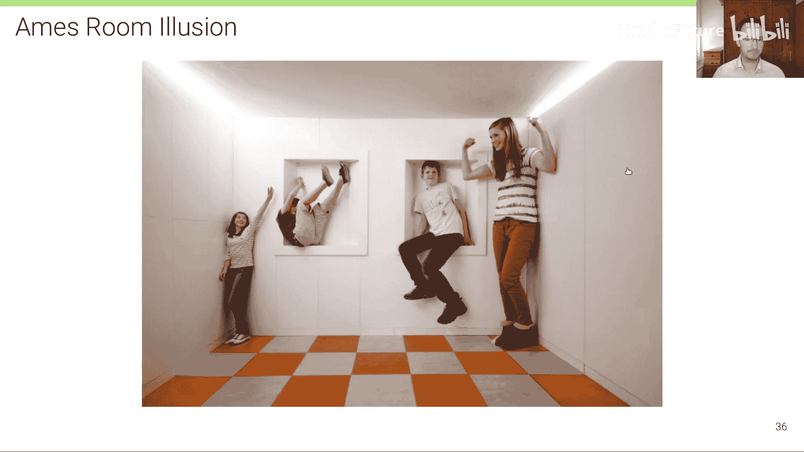
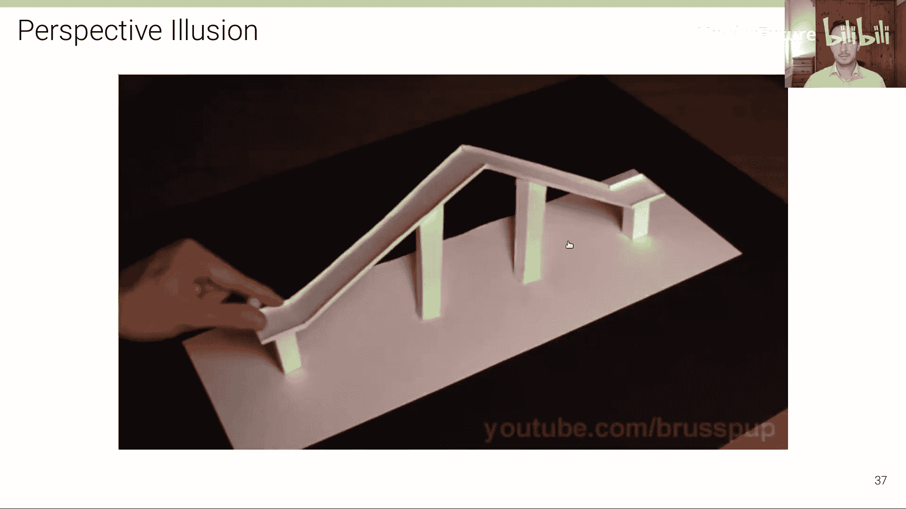
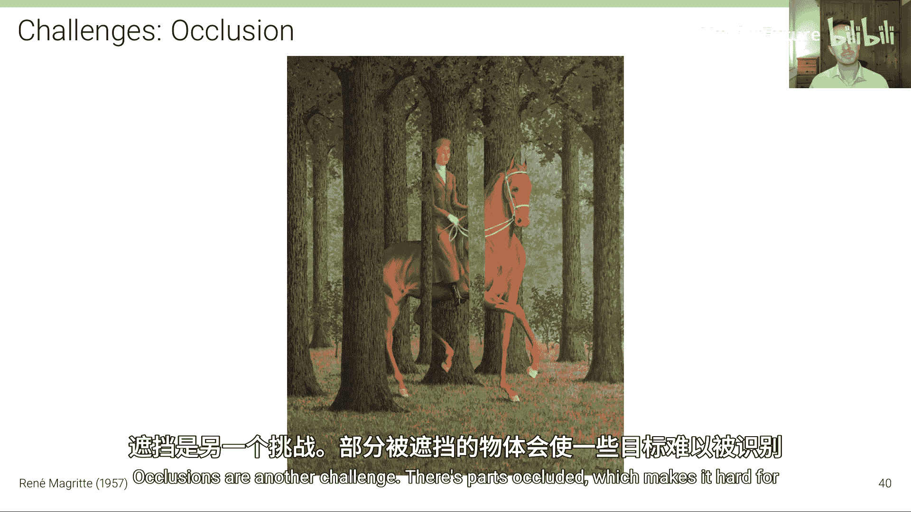
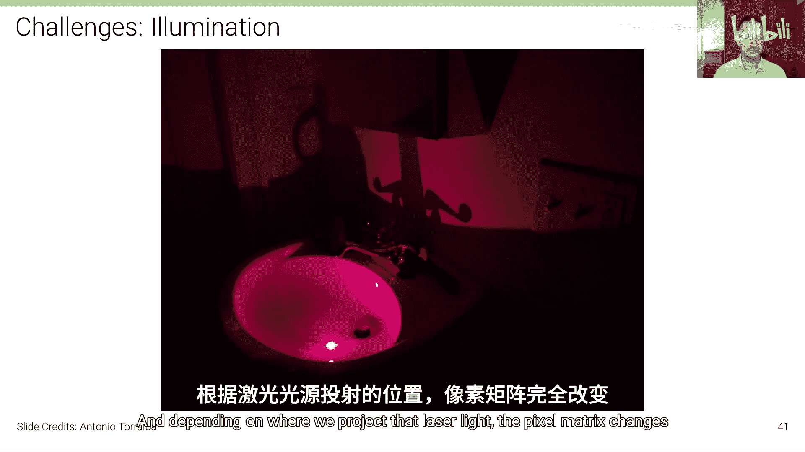
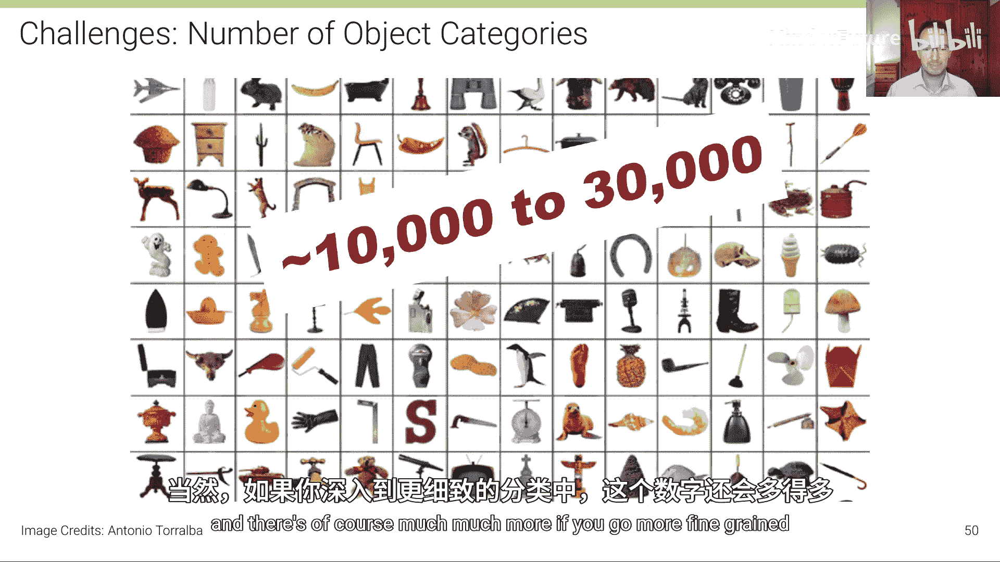

# 【图宾根大学 • 中英】计算机视觉 ML-4360 (Computer Vision) p02 P02 Lecture 1.2 (Introduction - Introduction) -BV1S8N1emEef_p2-

In this second unit， we're going to introduce what computer visionion is and also have a look at some of the challenges involved in this problem。

To put computer vision into context。Let's consider it as part of。

But it is typically considered an aspect of the general field of artificial intelligence。

Artificial intelligence was characterized by John McCarthy。

 one of the pioneers as an attempt to find how to make machines use language。

 form abstractions and concepts， solve kind of problems now reserved for humans。

And improve themselves。 And that， of course， also includes visual perception of the environment。So。

Sub areas of artificial intelligence， include machine learning。Computer vision。

 also computer graphics， natural language processing， robotics， art。Education and more。

 and all of these areas are interlinked， as we will see in this class。

So here is an example on the right， if we want to build a robotic system。

 that robotic system must perceive the world or environment。And must then。Accordingly。

 update its internal representation of the world。In order to make appropriate decisions to minimize some objective。

Now， computer vision can be very generally described as illustrated here by this picture from Antonio to Alba。

As。Converting light into meaning。 and that meaning could be。Geometry。

 reconstructing the scene in terms of geometry。Or in terms of semantics， identifying certain aspects。

That we see。But， really。What computer vision does， what it receives as an input is just a sampling。

 a very specific sampling of the light pattern。 Heres a。Light emitter。

That emits light rays into all directions and these light directions hit a surface point and then they bounce away into multiple directions from that surface。

Then they hit another surface point， and at some point they hit the observer， the I or the。

Digital camera。And so all of these light rays。The entire scene is。That the password through is seen。

Are then sampled at a particular point in time in a particular location。

 a particular direction and a particular wavelength。

And this forms the image that we then have to interpret。

This is one of the most famous books about vision and also computer vision by David Mar。

And what does it right， well， what does it mean to see the plain man's answer and Aristotles 2 would be to know what is where by looking。

This is how computer vision is often defined。 We want a computer to know what is where by looking。

Or in our words to discover from images what is present in the world。

 where things are what actions are taking place to predict and anticipate events in the world。

 So this is more the robotics aspect where we want to perform actions maybe in the world and in order to do actions we need to anticipate what's happening around us。

 we need to make also predictions about the future。

There's numerous computer vision applications and many of these have already commercialized today。

There's applications in robotics， in medicine， and there's applications in structuring。

 photo collections or building 3D models。In self drivingiving， in mobile devices and accessibility。

 just to name a view。And as already mentioned， the field of computer vision has connections to many neighboring fields。

 so for instance， it has connections to neuroscience and biological vision。In particular。

 many computer vision algorithms take inspiration from biological vision。

And biological vision serves as a motivator for developing computer vision algorithms， in fact。

 over 50% of the processing in the human brain is dedicated to visual information。

 signifying the importance。And the difficulty of that task that we have to solve if we want to replicate biological vision with a computer。

Computer vision is also related to computer graphics。In computer graphics。

 given the 3D scene composed of objects， materials， certain semantic pose and motion。

We're concerned with rendering a photoreistic 2D image of Dan scene。Now， in computer vision。

 we are trying to solve the inverse problem。That's why sometimes we are also talking about inverse graphics。

We are just seeing this 2D image where a lot of this information from the original 3D scene has been lost through this projection in process。

 and the only thing that's accessible to us now is a raw pixel matrix and we want to recover these latent factors。

 these underlying factors that are present in the scene。And therefore。

 vision is also an illpost process， an illpost inverse problem where a lot of this information that was originally present in the scene has been lost and has to be recovered。

For example， many 3D scenes yield exactly the same  toD image。

 Think about occlusion if an object is occluded， no matter where it's located。

 the projection into the image looks the same。Or if an image is overexposed。

No matter what the scene in geometry is， it all looks the same。

So these are just two extreme examples， but because this is pervasive in computer vision。

For almost all computer vision problems， we need to integrate additional constraints。

 additional knowledge about the world in order to solve this illpost inverse problem。

 and this is where a lot of researching computer vision goes into these constraints can come from。

Engineered constraints about it can come from first principles about the world can come from also large data sets where this knowledge has been acquired from。

Computer vision is also related to image processing。

Image processing is concerned with low level manipulation of images like color adjustment。

 edge detection， denoising， image warping image morphing， this all happens in 2D。

As we will see in the history part， computer vision has deviated from image processing primarily in the early stages because it was concerned with getting a more holistic scene representation。

 scene understanding in a particular。嗯。Recovering the underlying 3D structure of the world that is not present in these 2D representations that image processing is dealing with。

Image processing is not a focus of this class； there are several classes on image processing that are very relevant and I highly recommend you to take。

 but we are focusing on the computer vision on the more holistic aspects of this problem。There's。

 of course also a relationship to machine learning in that a lot of machine learning tools that have been developed are used。

Everywhere in computer vision today， and they have made computer vision successful。

 also commercially successful they。Provided the basis for computer vision to work in real world applications。

 in particularly in the last 10 or 15 years on the other side。In the other direction。

 computer vision often provides a very。Good motivation， good examples。

 good use cases for machine learning， and has helped tremendously several breakthroughs in machine learning and in other fields of machine learning such as language processing。

嗯。By accelerating the pace of the research。As you know， in the last 10 years。

 deep learning has revolutionized computer vision， but also computer vision has formed the basis for。

Revolutionizing deep learning。Heres see。As an example。

 the progress on this imagenet classification problem where there is a million images with 1。

000 different categories and the goal is to classify each of these images into one category。

And the progress in this problem has somewhat stalled until 2010 until it has been shown for the first time that deep learning can significantly improve on the performance on this problem。

 and you by 2015 we have surpassed human performance on this particular problem while humans are not designed for it's not a very easy task for humans to solve but there was a steep decrease in this is the error rate so calledled top five error rate。

 how often。Like you'll get an error if your prediction。If the correct example。

 the correct class label is not within the top five of your predictions。

 so this number has decreased tremendously since 2011， 2012 now。

 surpassing human level performance and going down further every year。This fact that。

Computer visionion started to work really on relevant problems。

 has also increased attention and accelerated the field here you can see the number of submitted in blue and accepted papers to CVPR。

 one of three top tier conference in our field， you can also see that it's a relatively competitive conference where about only one fourth of these submitted papers is accepted。

But what you can see is that both the submitted and accepted papers have grown in particular over the last 10 years or so to numbers much。

 much larger than the size of the field in the 80s and 90s。So it's very short。

Innovation cycles that we have in this field and a lot of people working on these problems today。

 and this is also reflected in the attendance of， for instance。

 the CVPR conference which is hitting the 10000s now while it was around 1000 when I started doing research in computer visions around 2008 in 2009。

Because some of the。Tasks can now be solved with computer vision。

 There has been a huge industry developing around computer vision。

 where computer vision algorithms are used for all kinds of problems。

 we will see some of them in the third unit of this lecture。

And here's just an example of some of the。Companies that are sponsoring。They're giving money for。

This， you know， for organizing the CPR conference and that also present their latest innovations that also collaborate with。

Research is in the fields。And this is just growing very quickly， due to the。

Success that computer visionion had recently。Now， why is visual perception hard？As in many areas。

 in the beginning。It was underestimated， there's this famous AI memo from Syimo Ppert who proposed in a summer Viion research project with interns to basically solve computer vision over the period of the summer。

What this says here in the abstract is the summer Vision project is an attempt to use our summer workers effectively in the construction of a significant part of a visual system。

 the particular task that was chosen。Partly because it can be segmented into sub problems which will allow individuals to work independently and yet participate in the construction of a system complex enough to be a real landmark。

In the development of pattern recognition。Now。It turns out that we're still working on this problem today because it's not so easy。

 it's not like the problem can be completely separated into these independent subproblems and solving these independent subproble and composing them together will solve the situation。

And also， each individual subprom turned out to be harder than initially expected。Now。

 why is visual perception hard， it feels very easy to humans if we look at how babies grow and learn about interacting with the environment。

 they learn very fast， even at an age of one year they realize how to manipulate devices that are very hard to manipulate for a robot。

Now， one。Key aspect， why visual perception is hard is what I've already mentioned is that while if we as humans look at this picture and immediately in in the order of a few milliseconds。

 obtain an understanding of what's happening in that picture。

What the computer sees is just a pixel matrix。 And we need to interpret this pixel matrix in order to come up with a。

Hypothis about what's happening in that image。And this interpretation is hard。

So one challenge has already been mentioned。If we take a 3D scene and project it into an image。

 and then we want to reconstruct that 3D scene from that image。

 a lot of information has been lost through this projection process。

 so we are dealing with an illpost inverse process where many solutions。

 many 3D solutions are possible for a single 2D image。

So here's this famous workshop metaphorer from Adelson in Pentland。

Where you can look it up here in this paper， I by the way。

 always try to put references to relevant papers as footnotes。

 so whenever you're interested in some topic you can Google the name of the paper that I put in the footnote and most of these papers are freely available on the internet so you willll find them relatively easily。

And I can just encourage to have a look at some of these papers， if you're interested in this area。

 it's good to read up on these papers and get a feeling of how the field works。

So this is an older paper and in this workshop made tougher。

They make the point that in order to explain an image here， this is the image， this is a 2D image。

In terms of reflectance， lighting and shape。A painter。

 a designer and a sculptor will design three different but plausible solutions。

 a painter might just paint that image as it is in 2D。

A light designer might create a set of light sources that project light onto a wall such that the image appears with exactly that contours and shading。

 but is actually。A white wall。And a sculptor might create a sculpture。

That is oriented such that the shading of this picture appears through different inclination relative to the light direction that is coming in。

So there's multiple solutions just to explain this single image， In fact。

 there's infinitely many solutions， and this is what makes this computer vision problem so hard and ill pose。

Here's an example， this is the famous Amessstr illusion which you might have seen。

This is a room that from a particular point， from a particular perspective looks like a real room。

 but actually not it's actually deformed。And through this particular point of view。

 it looks like it would be a real room， but because it's not。

Objects that are in that room look as they were of different sizes。

🎼Here's another example that from a particular point of view looks like it produces a physical phenomenon that's impossible。

 but if you look from a different point of view you see that this is actually just a perspective illusion。

🎼So a single perspective doesn't reveal。🎼Everything that's there in terms of geometry。

 even for humans are actually very good at interpreting。The geometry from a single image。

No。Let's talk about some more challenges。One challenge in， for instance。

 recognizing objects is that depending on the viewpoint。The pixel matrix might dramatically change。

 despite this being the same object。Depending on the viewpoint。The pixels change dramatically。

And you need to recover this invariance。Recovered that this is the same object。

The same holds true for deformation。 There is many objects that are non rigidly deforming。

Giving race to new pixel constellations。And the goal is to be able to interpret that this is still the same object。

Occclusions are another challenge， there's parts occluded。

 which makes it hard for some of the objects to be recognized。

Here's an example of illumination， this is a scene I've taken this slide from also from Antonio to Alba。

 this is a scene that has been illuminated by a particular light source。

Can you recognize what that scene shows？Well， this has been illuminated by a。Laser light。

And depending on where we project that laser light。The pixel matrix。Changes completely。

And also our understanding of that scene changes completely。

 but it's always exactly the same scene pictured under always exactly the same viewpoint。

So there is an intricate interplay between materials and light that give rise to a lot of different images despite showing exactly the same scene。

Here's another example from Janan Kunderrink。Showing the same phenomena。Thats。

It depends on where you put the light source， how the scene appears。Also motion is challenging。

 motion can create blur can make objects harder to recognize， but also we are interested。

 it's a useful cue we are interested in recovering the motion itself。十妇。

Perception and measurement often differ。 And here' are some examples。

 This is a famous example from Edward Adelson。 I put the link to this checker shadow。

Gallery at the bottom。And I ask you to focus on these checkerboard patches that are indicated by A and B。

 If you look at this image。Most people would say， well， it's clear that the。

A field is darker than the B field。But this is a， this is what you perceive。

If you put stripes of the same color next to the A and B fields。

 you will realize that they actually have exactly the same color。So perception and measurement。

Can be quite different。 The measurement is saying you。

 if I take a picture of this with a digital camera saying you this has exactly the same gray value。

 despite you perceive them very differently。The same holds true for occlu contours。

 there's this famous Kinshasa triangle where if you look at this picture。

 despite there is no triangle。Most humans perceive a triangle occlu free circles here。

 and the same holds true for these other objects that are only present because they appear through the contours。

 through looking at the contours holistically， not just a single piece of the segment。

 but holistically at the image recovering what's going on in the scene。Here's another example。

What do you see in this picture？Can you recognize something？Well。

 typically it's hard in the beginning， but if you've seen it it's very easy。

 so there's a do here with a head and two legs and here two legs in the back and this is the。Body。So。

Interpreting this image based on local features alone will not lead you to anywhere。You need to。

 and this is very hard still of course， for computer vision algorithms。

 but humans can do that and humans can interpret based on the larger holistic structure。

 so perception and measurement can be quite different。

Here's another example for slight variation of this。In terms of local ambiguities。

So what you see here in these circles is always exactly the same pixel arrangement as here in this template on the left。

 but depending on why you have it in which image it can mean something very different。

 So here from the context。Locally it's ambiguous but from the context。

 we identify this as a telephone maybe， and here this might be shoes and this might be a car， etc。

So sometimes just from。Loally。AContext is impossible to distinguish what an object is。

 but it becomes very clear if we look at the scene as a whole。

So it's important to interpret scenes as a whole here has another example。

 iss actually a counter example and serves as an illustration for how strong your prior knowledge about scenes is。

What you see here is a person， right？But you also see some objects。

 do you recognize what these objects are？So。If you look at this picture despite being very blurry。

 you can probably recognize there is a。A phone here there's a mouse， a monitor。

 maybe is a printer here in the back。But now if I show you that same image。

Un blurt with the original resolution， you can see that。None of these objects is actually present。

So despite you were very sure here that these are the objects that are present。

 they are actually not present in that image。And this is is a kind of a counter example。

 is that very unlikely for this scene。Probably they have seen such a scene before and that such a scene appears naturally in。

In the distribution of images that you。Observe during your lifetime。

But because you have such a strong prior knowledge。

 you have developed such a good model of the world。

 you have such a strong hypothesis about what these objects are。That you're kind of surprised。

That the objects are not what you think they are。Another challenge is。

The variation in the object itself。One example that's often given is chairs because chairs。

 despite having all the same functionality， is an object that you can sit on。

They look very different。 So now if you want to distinguish chairs from some other object category。

 you need to。Solve the problem that despite all the chairs look different。

 they are part of the same category， you want to categorize all of them as being some suitable objects with a no。

Back rests， et ce。So the intra class variation is a problem。

If you want to separate classes from each other， but you want to classify each element of a class correctly。

That's very challenging。And then also the sheer number of object categories in the world that exist and can be named is very large。

 and that makes this problem very challenging， it's estimated that there is between 10，000 to 30000。

High level object categories。And there's， of course， much， much more if you go more fine grained。

