# 【图宾根大学 • 中英】计算机视觉 ML-4360 (Computer Vision) p03 P03 Lecture 1.3 (Introduction - History of Computer Vision) -BV1S8N1emEef_p3-

This unit is about a brief。Overview over the history of computer vision。Now， of course。

 it's a very shortened。Summary of what has happened over the last 50 years and it's a personalized viewpoint。

 but with this being said， I hope it still can provide you some intuition about where the field has come from and where the field is going to。

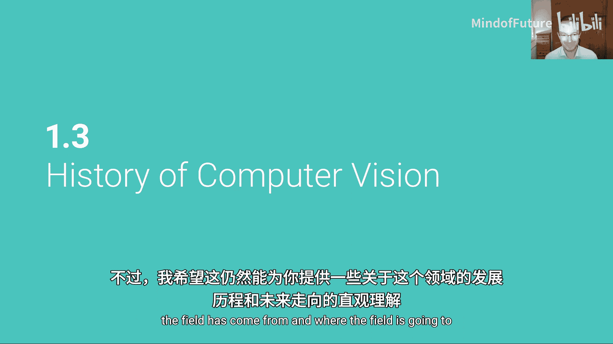

I want to credit in particular。The recent lecture from Lana Lazewick at UIUC。

Computer vision looking back to look forward， where some of the slides have been taken from。

 as well as the。3D Comp visionion past present and future lecture from Steve Ss。

 I link both of them here if you're interested in diving more into these topics and in particular also watching this。

Very good talk from Steve， have a look at that。Now。

 before we start with the last 50 years of computer vision， I just want to give you a very rough。

Prehsterium。Of course。The perception of humans has been investigated before computers have been invented。

 for instance。The prospective projection process has already been described in the 15th century by Leonardo Da Vinci。

Johan Heinri Lambert， after which the Lumerian reflection is named。

 has made important contributions to the area of photoometry。And K Friley cows has contributed to。

A lot of different aspects of science， but in particular。

 relevant to name here is the method of least squares， which is a very。

A useful tool across all of sciences， but in particular also in computer vision is used everywhere。

And then in the 19th century， Charles Festone has looked at the problem of stereopsis and producing stereo images。

 so this has happened all like several hundreds of years before the history that we are looking at。

What you can see here is the so called perspectiveo graph。

 This is a tool that Leonardo da Vinci has developed for。Drawing better。

Pictures of the real world are that adhere better to the actual perspective projection。

That a human observes。And the tool is basically。A focal point where the eye of the observer or the artist is fixated。

And then the picture is drawn on a glass surface， such that。

Points that are drawn correspond to actual freely points in the scene。

 and the prospective effects are taken into account by changing the distance between this glass surface and the focal point。

And what Leonardo da Vinci。Writes about perspective。

As the following perspective is nothing else than the seeing of an object behind a sheet of glass smooth and quite transparent on the surface of which all of the things may be marked that are behind this glass。

 This is this process that I just described， all things transmit their images to the eye by primidal lines and these permits are cut by the set glass。

 the nearer to the eye these are intersected the smaller the image of the cause will appear。

So he had a pretty good understanding of how perspective projection worked。Then， in。The 19th century。

 in particular， 1839。诶。嗯。Technique called the Guerretype has been introduced。

 which was the first publicly available photographic process invented by Louis De Gure。

And it has been widely used in the 1840s and 1850s before。

Our photometric techniques have been invented。And the way this worked here on the right。

 you can see such a camera and the resulting photograph is that a silver plated copper。

Sade was polished。And treat it with some fumes， fumes to make it light sensitive。

And the resulting latent image that was then projected onto that sheet。

Was made visible by fuming it with mercury vapor and removing its sensitive delight by some chemical treatment。

 It was then rinsed dried and sealed behind a glass。 It was very fragile。

 but it LED to pretty astounding photographs at that time already。😊，Another。Important， prehistoric。

Landmark is the great Arc of IndiaA Surve where this was a multi decay project。

To measure the entire Indian subcontinent with scientific precision and was using trigonmetric tools。

In some parts of this process， it was under the leadership of George Everest。

After which the mountain was named and who was responsible for the survey of India。

And what they did is they they did some form of manual bundle adjustment。

 the techniques that you're going to get to know during this class and that we're going to use。

In the context of computers， they have done this manually in order to prove。

Amongst many other things that the Mount Everest is the highest mountain on earth。

So now let's look a bit into the。More recent history of computer vision。If we want to categorize。

 which is quite difficult， I have to admit the different errors of。InThe computer vision research。

 this is what I would propose， there's multiple waves of development。In the 1960s。

 the early approaches which we're going to see in a few slides are approaches that were detecting lines and trying to fit simple geometric blocks to these lines in order to understand the world and for instance to give a robot a understanding of the world such that the robot can act in that world。

 but the limitations became clear very early on one limitation was that low level vision。

Was more difficult than was thought initially。And so this led in the 70s to a surge of interest in low level vision research cumulating in the development of stereo and optical flow and shape from shading in other techniques。

In the 80s。Neural networks became popular again， in particular through the invention of the back propagation algorithm。

 and the first models for self drivingriving have been proposed。Then in the 1990s。

 markcoranum fields， graphical models， which are also part of this lecture have been。

Quite popular in the community， allowing for removing some of the ambiguities in dense ste or multiverse area。

 for example， or in optical flow。Bye。I'm using a global optimization perspective on the problem。

Then in there。嗯。200s， this was the decade of the feature descriptors and feature detectors like Sift。

Which enabled for the first time really large scale structure for motion。

 freely reconstruction and recognition approaches， and then from 2010 onwards。Neural networks。

Have made a real impact， have surpassed the classical techniques that have been there。

In the computer vision community on many important problems and they are the dominating techniques today whenever large data sets are available。

 leading to a very quick growth of the field and also commercialization。So let's start with at 1957。

 the stereo。We can see here on the right is。This is still an analog implementation。

 but it's the first implementation of stereo image correlation。

 given two images and in this case these were photogrammetry images image taken from aerial perspective in order to recover an elevation map。

From the Earth's surface。Given these two images， correlate features in these images。

Such that such a digital elevation map appears。And this was the first machine that was。

This process was done。Mennually until then。But this was the first machine that was automatizing this process through such an analog implementation of a stereo correlator。

 implementing many of the techniques that are still useful and part of the state of the art models today like。

嗯。Image pyramids and course to fine estimation and warping， etc。Then， in。嗯。1958。

 Rosenblt invented the famous perceptron and demonstrated。

With this very simple linear classifier that was trained using the perceptron algorithm。

That it's possible to classify simple patterns， for instance， into male and female。

And there were some nice properties about this algorithm， for instance。

 Novikov proved the convergence of this algorithm， but it was overhyped at the time。

Roosenblood claimed that the perceptron will lead to computers that will walk， talk C， write。

 reproduce。And are conscious of their existence。And this was expected to happen over the course of the next decade。

 but we still don't have machines that can do all of this today。Then。In 1963。

 which is maybe the event that many in the computer vision community consider as the real cornerstone of computer vision。

 Larry Roberts， one of the inventors of the internet actually， but in his PhD。

 he was concerned with image understanding， particular machine perception of three dimensional solids。

And he wanted to understand images such that they are useful for robotic manipulation。

So in contrast to simple pattern recognition。He wanted to interpret images as projections of 3D scenes and recovered the underlying 3D structure of an object from the topological structure of the lines。

The approach proceeded by taking images of simple objects on simple backgrounds， extracting edges。

 then coming up with a 3D model that can be rotated and manipulated and that。

But supposed to be the input for a robotic system in order to interact with the environment。

So one of the motivating factors of computer vision was actually robotics。At some point。

 the community deviated a little bit from robotics and robotics developed its own field and computer vision developed its own field。

Nowadays， these two fields are converging again。To to unified research direction。

 because people have realized that this independent development。

Are insufficient to actually develop robotic systems that work in the real world。Now。

 this was a very simple system， it had many problems。

And the challenges that were present were heavily underestimated。

So it was completely not robust to noise in the input image and it was also only working for such simple scenes with uniformly colored objects and perfect lighting and simple backgrounds。

And one example that's also often given for this underestimation of the challenge of computer vision。

Is this paper or this AI memo from Seuel Pat？Where in。

In 1966 they thought that they can take a couple of interns over the summer and solve computer vision。

 and as we know， I mean computer vision in many aspects has made tremendous progress。

 but it's far from being solved even in terms of the goals that they had at the time。🤧嗯。In 1969。

 Minsky and Poard published a famous book Perceptrons that showed several discouraging results about neural networks。

 and that led to a decline in research on neural networks that only later in the 80s and again in the。

In 2010， reappeared resurfaced， but it significantly it significantly contributed to this decline to the。

Dominance of symbolic AI research in the 70s， which nowadays plays a relatively small role and hasn't led to a lot of success stories。

Compared to what machine learning has led to。In 19170。

Some researchers at MIT developed the copy demo， which was the culmination of this research on BlockWd's perception。

 where they were using such BW's perception algorithm to recover the structure of a simple scene and then have a robot planet builds。

A copy of a set of blocks from another set of blocks。You can see this illustrated here。

 there's the robot arm， there's a set of blocks that should be then formed into an arrangement to replicate another set of blocks。

And this task already involved vision planning and manipulation。But it was realized very。

 very quickly that this approach that was taken the low level edge finding is not robust enough for this task。

 it's very brittle， and so there was a lot of attention created on improving low level vision because it was thought that once low level vision has been solved this task can also be solved。

 but today we know that there is more challenges to it than just solving low level vision。

And that solving low level vision in isolation is also not easy。In 1917。

Horn published a famous technical report in his PhD fesis basically on shape from shading。

On how to recover 3D from a single 2D image。And based not on geometric cues like lines and edge and point features。

But looking at the shading of the surface， you can here for instance。

 see that at the side of the nose， we have much darker callist than on the front of the nose。

And from just the intensity of the cutters。There can be formulated constraints。That if。

 if they are well integrated， leads to a。A elevation map off the surface。However。

 it's a very ill post problem， there's many solutions to it。

 and so the method required a smoothness regular to constrain the problem and we'll see such type of approaches also during the lecture。

In  1978 intrinsic images have been proposed as an intermediate representation。

 the idea was to decompose an image into its different intrinsic components into different 2D layers。

 this is not a 3D representation is a 2D pixel representation， for instance reflectance。

Separate the reflectance from the shading。Or separating the image into motion and geometry。

 that same。Now， this was believed to be useful for many downstream tasks such as object detection。

As object detection of this object here becomes independent of shadows and lighting。

 which makes it more invariant and should help object detection。🤧うんう。

Now this has this intrinsic image。The compositionposition has developed into its own field with many follow up papers on this approach。

In 1980， photometric stereo was developed by Wham。And a paper called photometric method for determining surface orientation from multiple images。

 in contrast to shape from shading。Here， multiple images were used。

With known or unknown light source position， but a point light source position and so in order instead of using heavy smoothness regularization。

Here， in this case。Multiple observations per pixel are available。

 and it can be shown that if you have at least three different observations per pixel。

You can actually reconstruct the surface normal from which you can get you can integrate depth or geometry。

And this has led to many approaches that are also in industrial applications today with unprecedented detail and accuracy。

Now the assumption of the shape from shading approach was。

That the object surface was homogeneous and following a luerian reflectance。In this case。

 also the lumertion and homogeneity assumption were used。

 but they have been later on subsequently relaxed， and so this approach became more powerful。

 it could handle objects that were non lumbertion and that also had texture。In 1981。

 despite the key ideas having been around for more than 100 years。Formerly。

 the essential matrix has been reintroduced by Let Higgins in a paper called a computer algorithm for Reconstructing a scene from two projections。

The essential matrix defines two view geometry。 we have two cameras here。

 This is an left image plane and this is a right image plane。

 and this is a camera center left and right。So the essential matrix defines this geometry as a matrix that maps points。

 for instance， this point here on the left。To a socal Aippolo line here on the right。Such that。

If I have taken these two images at the same point in time。

 or the scene has been kept static during acquisition。

It is sufficient to search along this 1 day line for the correspondence of this point。

In order to being able to triangulate it， to reconstruct the 3D geometry of that point or many points to form a surface。

And so this was really a foundation of the development of stereo techniques。

Has also been shown how this matrix can be。Estimated from a set of 2D correspondences。Which is the。

Extrinsic camera calibration problem。In 1981， the early stereo approaches stereo is a method for extracting depth images from or depth maps from two images。

 just as we humans observe the world with two eyes。

 if you have two images taken from slightly different vantage points， you can also reconstruct 3D。

 using the Epolar geometry as shown on the previous slides。

But early approaches that correlated these features didn't work very well because of all the ambiguities。

 because points in these two images looked similar despite they were not the same 3D points。

So in 1981， additional constraints have been added in particular， they use dynamic programming。

 basically the ViTbi algorithm， to introduce constraints along individual scan lines。

 smoothness constraints， occlusion constraints， etc。

Now this allows for overcoming ambiguities in the stereo matching process。

 but because each scan line was processed independently。

 it led to streaking artifacts between the scan liness。In 1981。

 also the most popular paper on optical flow has been published calledDetermining Opical Flow from Horn and Shank。

 it's the famous Horn and Shank algorithm。Optical flow is an even more challenging problem than stereo。

Because it's a 2D search problem。Optical flow doesn't assume that the scene remains static between the two images have been taken。

 but things can move arbitrarily， and optical flow refers to the pattern of apparent motion of objects。

 surfaces and edges in a visual scene。Here on the right is an example where you can imagine these little arrow indicating the motion of a sphere that's rotating。

🤧And this is actually。There's an actual measurement that has been made。With this algorithm。

Now the goal for optical flow is for every pixel to determine how far that pixel has moved between two frames that happening have been captured。

 for instance。Of。A scene where a sphere is rotating or a car is moving。

and or densely track the pixels in other words between these two frames。

 and it has been investigated already by Gibson in the 1950s who was a psychologist to describe the visual stimulus of animals。

 for instance， when animals are approaching a surface for landing。

 this low level cues are very important。And so Hongnchong provided the first algorithm。

 it was a variational algorithm that integrated these prior constraints。

In a mathematically concise fashion。In order to recover。

Tense optical flow fields now this algorithm had a lot of assumptions and it was subsequently revised relaxing these assumptions and yielding better optical flow algorithms。

 but this is really one of these seminal papers。Also in a similar vein in 1984。

 discrete Mark of random fields have been considered。S。A way of。

Encoding prior knowledge about a problem such as stereo or flow or image denoising。

And the idea is similar to this discretized variational flow formulation， where constraints between。

Neighbouring pixel sites have been introduced， but now in this case it's a discrete formulation。

 and there is a whole variety of inference algorithms that are used nowadays for optimizing such problems such as variational inference。

 sampling， belief propagation graph cuts， and so on。In the 1980s。The 1980s also have been。嗯。

A time where part based models have been or have become popular。For instance， in 1973。

 the famous pictorial structuress model。In 1976， generalized cylinders are in 1986 superquadrics。

 as we can see here on the right。this is our a set of primitives that are periized with just a few parameters。

 these are very basic 3D shape components。That despite being very simple。

 can be composed into quite complex scenes as we see here with very few bits。So very few parameters。

 very small storage， we can create 3D scenes that are semantically meaningful and of course。

 being able to infer such。Part based representations。

Its also useful for downstream tasks such as in robotics。

 where we want to have a good understanding about the geometric relationships of different objects or parts。

Now in the 80s。The first ideas haven't worked so well。

But they have been revised over the last couple of years using deep learning techniques and now start to work much。

 much better than they have been working in the past。In 1986。

 also the V propagation algorithm for training neural networks has been。

Popularized by Ruel Harton and Williams。And it's really the main workhorse of deep learning still today that drives a lot of computer vision applications。

And the key of this algorithm。As we all know is that it is。

It's using dynamic programming or dynamic computation in order to very efficiently compute millions of gradients。

Of a loss function with respect to the parameters of such a deep neural network。

This algorithm has been known already since the 60s。

But this was the time where it was demonstrated to be also empirically successful。

And it's really the main。Algorithm that's used for training deep models today。In various。Forms。

 but this is the algorithm for computing the gradients。In 1986。

 also self driving cars have been demonstrated for the first time， for instance。

 this is a example that has been a car that has been developed by one of the pioneers of self drivingr in Europe and stigmas in the context of a European project called Promes。

It was demonstrated in collaboration with Diler Benence。

And this first vehicle was driving up to 40 kilometers per hour on a highway and then follow up vehicles were driving also up to 150 kilometers hour。

 there was a famous ride from southern Germany to Denmark and Beck。

Now it seemed already at the time self driving wouldn't be very far away still today we don't have self driving vehicles everywhere on the street。

 so it's it's also an indicator for underestimating the difficulties of some of these problems in particular in self driving where。

Acur is important， and where safety is important， and we you have to have models that are just very robust and reliable。

In 88。At CMU。The self driving car Alvin has been developed。

 which was the first self driving car that was using neural networks for self driving。

So instead of these models that we're using more like today self driving vehicles。

 different modules for perception and planning control。

This was a vehicle that was just taking the input image。

 passing it through a neural network and outputting the steering control。

 and it was demonstrated that on somewhat simple scenarios。

 it was able to drive up to 70 miles perph already at the time。

 1988 where also the compute of course was much smaller the available compute。

So now back to Comp visions。In 1992， structure for motion。Has made progress to Mai and Canada。

Publish their famous factorization paper that allowed to estimating the 3D structure from 2D image sequences of static scenes。

With only a single camera and enclosed from solution using singular value decomposition。

At least for the autograph case， and it has later been extended to the projective case。And today。

 these type of optimizations are then done using non nonlinear list squares。

 but this is a very simple method that under certain assumptions。

Can be solved with simple linear algebra。🤧うんうん。嗯。There was also progress on processing point clouds from stereo or lighter or laser scans。

 for instance， the iterative closest point algorithm that was able to register to point clouds by iteratively optimizing a rigid or non rigid transformation。

In this example here that we have this green template and we have this red model and if we run that algorithm on this green template iteratively converges to this red model such as that de point clouds are registered as closely as possible here in blue is this is the fitted template after convergence of this algorithm。

And this is， of course， a useful algorithm if you have 3D scans to build bigger 3D models to estimate relative camera pose for ometry or to localize a robot with respect to a map。

 let's say。In order to integrate。3D information from multiple viewpoints or sensors。

 another important technique that is still used today that has been introduced in 1996 in computer graphics is called volumeotric Fusion by Curs and Levoy。

And it's a technique that considers surfaces implicitly as a。

Zro level set of a field that's defined discretely in space。

And that it aggregates multiple of these observations。 So here， these blue points are。

In front of the surface and the red points are behind of the surface。

 if you have multiple of these observations now， this algorithm basically averages these observations and has certain properties in order to。

F multiple partial views of an object into a coherent 3D object， a larger 3D surface of the scene。

In 1998， there has also been first real progress on multi View stereo。

 This is a seminal work by Fogueras and Caravan。Called complete dense stereo vision using level set methods。

They formulated stereo， not as a matching problem。But as a reconstruction of the images。

 modeling the 3D surface as directly as the level set。AOf an optimization formulation。

And projecting that into all of the input views and trying to minimize the reconstruction error。

 which allows for flexible topologies so many of the ideas that we are。

Still exploiting today were already present in this paper。

 and they had a proper model of visibility and some convergence guarantees。

There were also some other approaches in this。Error。

But that were rather dead ends like voxel coloring or space caring that made assumptions that in reality。

 just don't hold。 And so we're restricted to very。Arificial scenes。

 but this general level set and variational optimization on multi view stereo is something that has survived until the day。

In another example of global optimization in this case， for stereo。

In the context of discrete Markco random fields was the graphra cuts algorithm that has become popular in 1998。

In the paper from Boyikov Adal microferum fields with efficient approximations。

 it was an algorithm that comparably。Fast， comparably efficiently， was able to provide a global。

Solution。嗯。To a optimization problem that included unary and pairwise terms。

 So unary terms are basically per pixel。Observations or correlation measures and pairwise terms encode smoothness constraints between pixels。

 for instance， that it's more likely that two neighboring pixels have the samepar or disparities to inverse depth。

As we'll learn about in the next lecture。Later versions also included specific forms of high order potentials。

And。In comparison to these scanline stereo methods that I've shown previously， this was a real。

Global reasoning method that was reasoning about all the pixels in the image simultaneously。

 not just about individual rows of the image and therefore led to much more consistent results。

In 1998。Convolutional neural networks have been proposed by La K Neal。

 and they are still one of the primary workhors off。Computer vision。

Deep computer vision models today。After more than 20 years。

Convolutional neural networks implement spatial invariance via convolutions and max pooling and through this weight sharing of the kernels。

 they reduce the perimeter space。😊，And at the time， they only got good results on MNT。

 which is this very simple。Numbered recognition data set。And therefore。

 it didn't get too much attention in the computer vision community。

 was more in the machine learning community。And then only in 2010。

 when Alex had demonstrated that these type of models also produce competitive。

Or state of the art results on more challenging data sets that the computer vision community was interested in。

 data sets of natural scenes， basically， then these models were adopted。In 1999。Bls and feather。

Demonstrated their moable model for a single view 3D phase reconstruction。

 they took a repository of 200 laser scans of faces and built a subspace model from that。

That was then subsequently fitted in terms of both geometry and appearance。

To real images with impressive performance at the time。 So these results are。

Really stunning today and also form the basis for some of the most advanced pose。

 human body and pose and shape estimation techniques today。A major landmark in 1999 was also the。

Development of the so called scale imvariant feature transform。

 which is an algorithm for detecting and describing salient local features in an image。

You can see an example here on the left。These little squares are little images。

 little features that have been detected and described in these images and。

There's another picture of the same object， a bit hard to see here。

Where the perspective has been changed。But the same roughly the same features have been detected at the same locations in these two views。

 and since you have now solved the correspondence problem。

 you can use this for tracking and for 3D reconstruction， etc。

So this really enabled many applications， for instance， image stitching。

We will see in the next lecture。Reconstruction， motion estimation， and many more。

One of these demonstrations。Was in 2006 this phototism paper bynaly Ss and Sliki。

Prescented at SGraph， you can already see how computer vision and computer graphics have both contributed to this progress and are intertwined。

The idea in photo tourourism was to take a large scale or to produce a large scale 3D reconstruction from internet photos。

 and the key ingredients here really were the availability of the Sift feature Me and large compute resources and large scale bundle adjustment with a very clever pipeline。

It even led to a product in the end was。The photo tourism。Product by Microsoft。

 which has been discontinued now。It was quite quite attracting a lot of interest at a time where you could take your photo collections。

 sort them in 3D， and then browse them in 3D。Okay。Looking at the scene from novel viewpoints and so on。

In 2007 PMVS patch based multiview stereo has been proposed by fer Ca and Pos。

 this was also a seminal paper on3d reconstruction because for a first time demonstrated reconstructions of various different objects。

At a quality that hasn't been seen before。And also， at a very high degree of robustness。Okay。

So the performance of these 3D reconstruction techniques continued to increase。

Here's one more example of large scale 3D reconstruction。

 was a paper building Rome in a day at ICCV 2009。There was about building a 3D model of landmarks of cities。

 but not from。Images from a single camera where you would know like exactly the parameters of this camera。

 but these were images from unstructured internet photo collection。

 so images were automatically extracted from the internet by searching for say Colloum。

And then the algorithm was run for a few hours or sometimes a few days。

In order to reconstruct these landmarks or entire cities where people have taken photographs of。

And there was a follow up that focused on making this more efficient， running it。

 not on a large CPU cloud， but running it on a single computer。Here's an example of。

What this looks for Rome with 75，000 input images。It is not a dense reconstruction。

 It's a sparse reconstruction。But it's still quite precise。 It contains multiple landmarks。

As there is photos from many different places in Rome， these landmarks are well connected。

So it's possible to optimize all of this jointly。Now this was one of the earliest methods。

The quality of these approaches has。Tremendously improved since then。

And one of the state of the art methods is called coalm， that produces。

Much more dense and much more detailed results than what you can see here。

 but this was the precursor of this。Newer line of methods。In 2011。

 the elect the connect camera has been。Put on the market。

 it was an active light 3D sensing device from Microsoft。

 and there's actually three generations of this camera。 This is the newest version the connect Uher。

That has just been released two years ago。The early versions。

 this is the first version actually failed to commercialize。

 the idea was to use this 3D camera and there was an algorithm that was extracting using machine learning the like was segmenting the image into different body parts and was estimating the human body pose that could be used as a control that was allowing to。

Have the。User of， let's say， games or certain programs interact much more naturally with the computer by being the controller。

 the human being the controller， not having a separate controller。

But it kind of failed and it was discontinued， this first version。

But it was heavily used for robotics and vision research because it was the first sensor that was cheap it was just。

100 or $200， and it allowed compared to the price of other active depth sensing technology that was available at time allowed to navigate。

Robots， indoor robots， for instance。嗯。muchuch more easily compared to other sensors that were available at the same price。

Then in 2009， 2012。The development of imagenet。And。

The capability or the demonstration of neural networks to solve imagenet。

 this classification task much much， much better than classical techniques has really ignited。

Both the area of computer vision and the area of deep learning and led to this increased interest in both areas today。

 so ImNet was this as already mentioned this large data set with a 10 million unnotated images。

 each image has one single class label out of 1000 categories。

And the goal is to classify the correct category。😊。

And Alexnet was the first neural network that significantly advanced the state of the art。

And what they did is they used GPU training， so this was the first effective use of GPU training for neural networks。

 they used a specific architecture， deep neural network architecture， and they used a lot of data。

 demonstrated that deep learning is actually effective also on challenging real world data sets。

It was realized in many sub areas of computer vision that data sets are actually one of the important pieces。

 both to drive progress in computer vision because it allowed people to。

Compare their approaches on a fair and equal basis and evaluate them， rank them on leaderboards。

 but also having these training sets。As a possibility for training algorithms。

 machine learning algorithms such as deep neural networks that had a lot of parameters。Effectively。

AndSo here's a list of a couple of data sets that have been used in various。Image related tasks。

 And this example here， self drivingriving。Now， creating these data sets in particularly annotating these data sets is expensive。

 and therefore there has been also a lot of interest into how can we exploit synthetic data sets where maybe asset creation is also expensive。

But once you have created the assets， you can actually render a lot of scenes and a lot of constellations of objects。

 and this is still a very active research area today。So， here's。

An example with a very simple data set， but it impressively has been demonstrated that even with these simple data sets。

 this might be very useful for learning some tasks。

 so here's a data set with flying chairs on random background images and that has been true that has been used for training。

Deep optical flow methods for optical flow， it's really hard to get ground roof labels because you need to。

No， for every pixel。How far it has moved and that's something that's almost impossible to annotate。

So with these type of data sets。There was a lot of progress despite these images that you see here look very different from the images that the algorithm later was evaluated on。

Because these neural networks are rubber black boxes。

 there was also a search in interest of visualization tech about visualization techniques that allow for visualizing what's going on inside these neural networks and here's one of the early examples by S and Fergus。

See an N features of the shelf， an astounding baseline for recognition。And so they visualized。

Image regions that most strongly activate various neurons at different layers of the network and found that higher levels capture more abstract semantic information and lower layers capture less abstract semantic information and so on。

In 2014， it has also been demonstrated that it's very easy actually， to fool deep neural networks。

 that they are actually not as robust as one might。Might have fought until then。

By just adding a small tiny change， this is magnified here to the input images such that the classifier。

 in this case， an imagenet type classifier。Confuses this image or this image or this image with a very high probability as ostrich。

And this also sparked a whole research area on how to build more robust， deep models。

And on the other hand， how these more robust models can still be attacked。In 2014。

 another important landmark paper was the generative adversarial network paper。

And the variational auto of paper。That allowed for training in an unsupervised fashion models。

 that are able to generate new samples that haven't been seen， but they are still photoreistic。

And even like for example， in this case on faces here， you can see the development over the years。

 on faces， these images that are generated by these methods are really hard to distinguish from real images even for humans。

So there's a lot of active research and image translation， domain adaptation。

 content and scene generation and 3D GNs that has followed up on this seminal paper and I want to show you some results on a method called stylegan that is still considered state of the art for image generation。

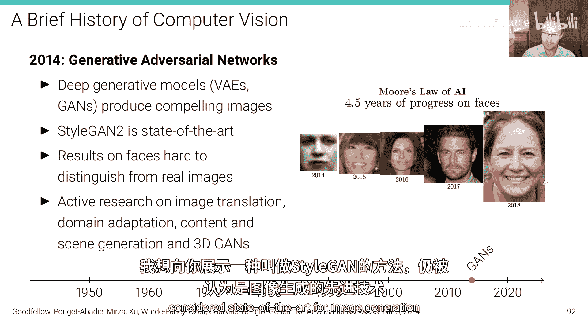

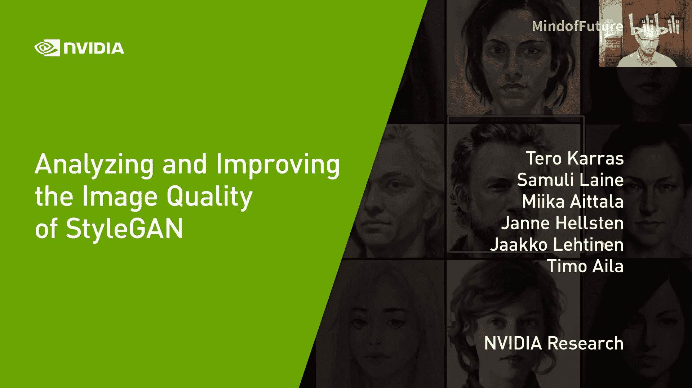

Gands or generative adversarial networks have captured the world's imagination with their ability to create AI generated images of landscapes。

 animals， cars， and people without any human supervision。

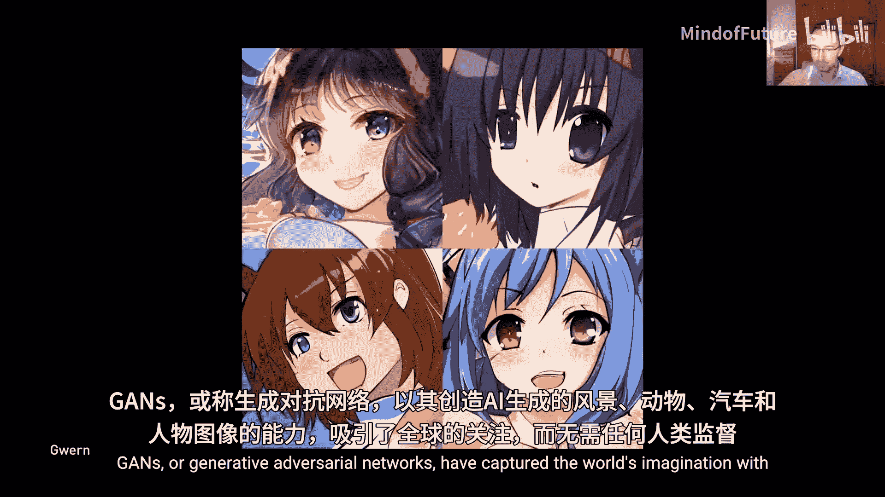

And Vide Stgan2 features redesigned normalization and improved conditioning that delivers a new level of quality and creative control。

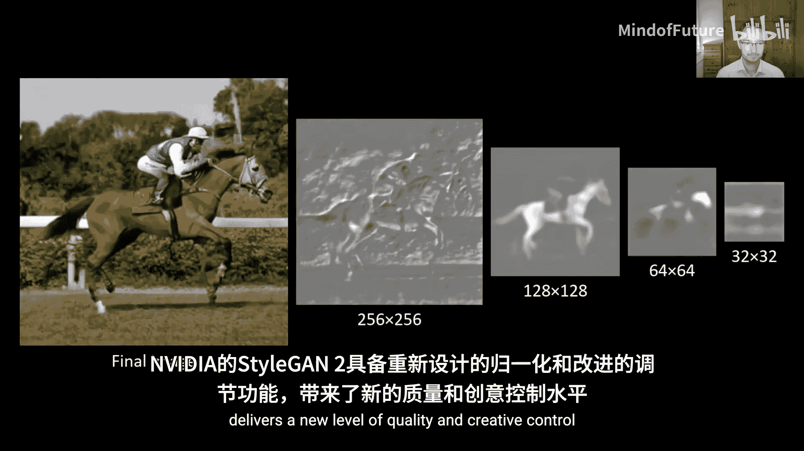

For this demo， we use Trans learning and trained the model on an NviIDdia DGX system using a large data set of unique paintings。

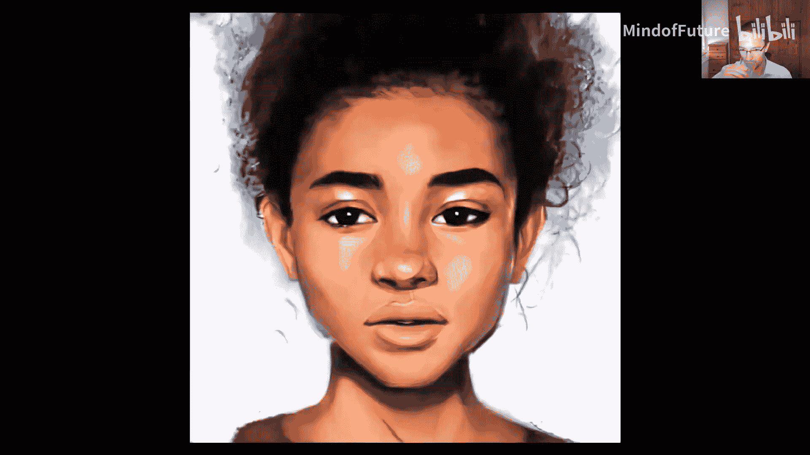

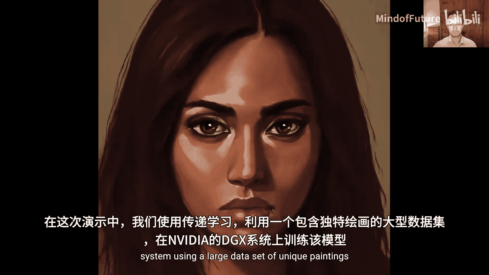

It can produce endless variations of AI generated characters in a seemingly infinite variety of painting styles。

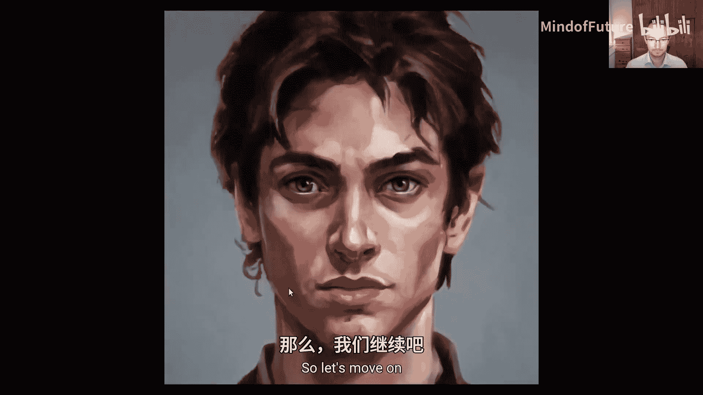

So let's move on as you can see， we're spending a lot of our time on the last 10 years or so。

 which is where a lot of the progress， a lot of the recent progress has happened where a lot of the algorithms started to work。

 one example is also deep phase， this was one of the first models that demonstrated performance in face recognition on par with human face recognition performance。

Or even outperforming humans。And it was made possible by a combination of classical techniques with deep learning。

And that's also maybe one of the messages I want to convey in this intro here that。

Despite we are going to discuss a couple of very old techniques in this。Lecture。

A lot of the old techniques and ideas are still valid and still useful， not all of them。

 but many of them are still valid and useful and rediscovered。

Or reimplemented today in combination with data driven models。Leading to better results。Then。

 another。Another line of research in。round 2010 was concerned with more holistic 3D scene understanding。

 so parsing RGB or RGBDD stands for depth images into holistic 3D scene representations and there were several papers for indoors and outdoors Ive chosen here one paper from our research group。

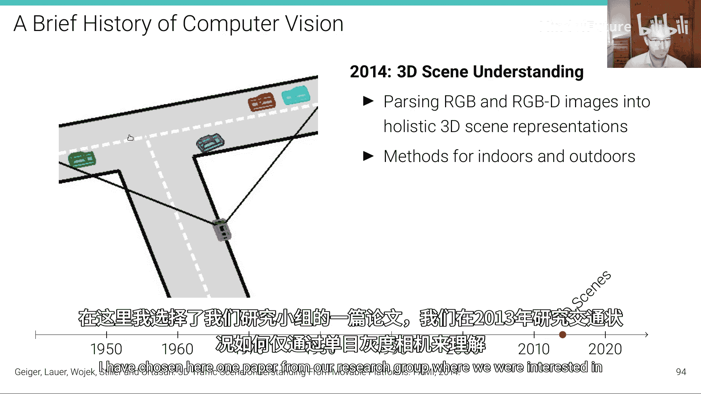

Where we were interested in 2013 in。Understanding how。

A traffic situation looks like just from a monocular gray scale camera。

 you can see on the top the input image with some object detections。

 this was actually not a deep neural network object detector for the classic object detector at the time。

Because there were no deep object detectors available and on the bottom you can see the layout of the intersection and the situation that has been inferred from that。

Monochrome video sequence alone。

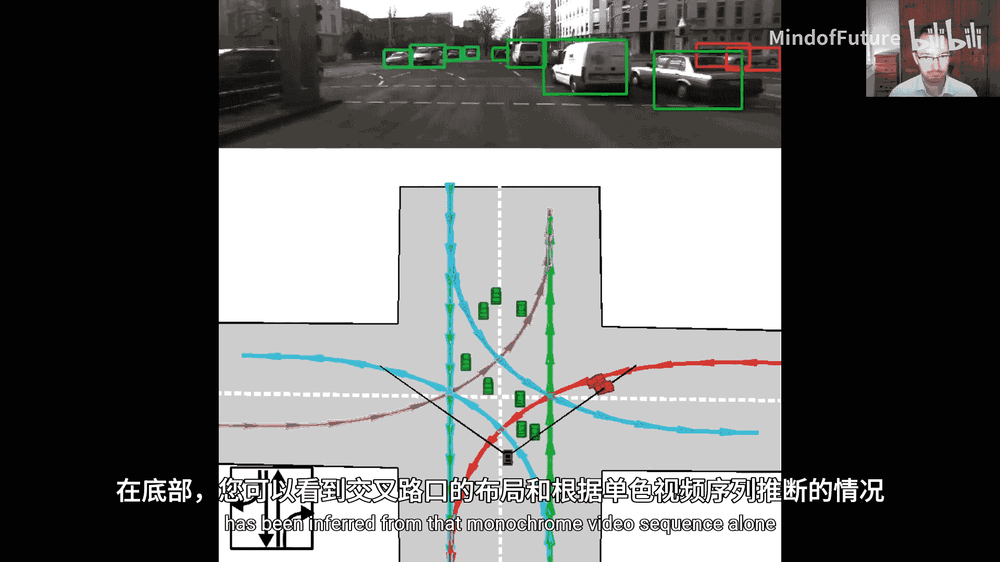

In 2014。There was also an impressive demonstration of 3D scanning techniques that allow now for creating really accurate replicas。

 for instance， of humans， in this case， Paul Dbek's team scanned Obama and this。

Create a 3D presidential portrait that is now exhibited in the Smithsonian Museum。

 and there's a link here。 If you are more interested into this。

 there's a very nice video explanation also of this。Pross howwe， set up the cameras and so on。Then。

 in。2015。Deep Mind has。Publish a paper， how to learn。

Human level control of video games and later also other games。Through deep reinforcement learning。

 there was learning a policy directly from the state， the image to the action。

And there was also injured like a again。Combining computer vision techniques with robotics techniques like reinforcement learning and was one of the first applications of these deep models demonstrating that deep models。

Deep reinforcement learning is also possible despite the sparsity of the reward signal of reinforcement learning。

哎。This is an example here also from Tubingen， a very famous paper from Matthias Pekas group called Image style Transfer using convolutional neural networks。

Where they demonstrated how it is possible with a pre trained neural network to take an image。

 a real image and a painting， and then produce an image。That。

Is demonstrating the content of the real image， but in the style of the painting。

 and there's a really。Nice website where you can try this yourself with your own photographs。

 which is fun， and I encourage you to try out。Then in 2015 or from 2015 on。

Semantics beyond classification of images， but more fine grain and semantic was inferred using deep neural networks。

One of the most famous problems in computer vision is called semantic segmentation。

 and these were the first deep models for semantic segmentation in 2015 I listed a couple of these models that have been developed in this area。

In semantic segmentation， the task is to take an input image like here。

 so these are two different examples。So we take this image and we want to produce a semantic class label not not for the image。

 but for each individual pixel in that image。Okay。And as you can see it' it's quite the results are quite precise。

 quite aligned with the object boundaries。 and today this is an example here。

 this video shows an example from。2016， the results have improved since。But as you can see。

 even in 2016 on this very challenging data， the results that were obtained are quite consistent and quite preciseci。

So it was really demonstrated as semantic segmentation that was very brittle and didn't work very well with classical techniques。

 classical features， and classical machine learning techniques such as support vector machines or structured support vector machines did start to work when using representation learning。

Here's another example， this is one of the still state of the art object detectors and semantic instance segmenters where the goal is now to not assign only the semantic label but also the instance label to each individual pixel it's called mask RCNM。

And at the time， produced the state of the art result on a challenging。Data set called Microsoft。

 Coco common Ob in context。And because things started to work well。

 people have looked at other tasks， so there was a growth in new tasks that have emerged from this。

 so for instance， in 2017。Image captioning was introduced as a new task and also visual question answering。

An image captioning the task is to take an image as an input and produce a sentence for that image。

 and as you can see here， this in some cases works quite well in some cases it gets。

Some produce some weird errors， so people were quite excited by these results。

 but then also quickly realized that these models that have been trained were somehow also adopting the data set bias。

And we're still lacking in a real understanding of the images and in common sense。

Now with the growth of data sets， this has changed a little bit， but it's still a problem。🤧And。

Another important area of research that has developed significantly。

Since the you know 2000s is human shape and post estimation where the goal is。

Given a 3D point cloud or an input， a single input image to produce a 3D model of the person or multiple people in an image。

 and of course this has many important。Applications in human computer interaction or understanding humans better in health etc。

 so there were rich parametric models developed like simple and star here in Tingham。嗯。

That's even allowed for regressing these model parameters from single RGB images alone。

And more recent trends go towards modeling very detailed post dependent deformations and also clothing which can be quite challenging。

So here's an example of a model already a few years， four years ago。

 we can see how let me play it again。So you can see how independently in this case， frame by frame。

 that's why it's chitering a little bit。This parkcour。嗯。A personerson here was tracked and。

The post was estimated for this person。And then， in 216。From 2016 on。

 deep learning has also entered the area of freeD vision。Before that。

 deep learning was successful on classical recognition problems and 2D estimation or 2 and a half D estimation problems。

But then from 20161， people realized we can also apply this model for freeD。

While in the beginning people used box loads and point loads and meshes representations。

 now there's a lot of hype around these implicit neural network based representations and one。

Class of this lecture is also devoted to these type of models。

These allow for predicting entire 3D models， even from a single image as input。

 and they also allow for。Depending on the model for predicting geometry， materials， light and motion。

Good。I want to conclude with a little overview。It's a very incomplete overview， of course。

 of applications and commercial products where we're using computer vision technology in our everyday life。

 there's， for instance， Google's portrait mode for the smartphone。

 which allows us to blur the background very realistically of a portrait。

There is the Skyio or Skydio 2 drone that just came out allows that navigates itself allows to follow a person through complicated terrain without crashing into obstacles。

There's， of course， many companies working on self driving cars。

That haven't fulfilled the promise yet， but there's still a lot of interest and a lot of progress in this area。

There's a growing。In in also virtual reality and augmented reality with new devices like virtual reality glasses。

 but also the Hollolen which is an augmented reality device and it uses a lot of computer vision for tracking the head for detecting objects in the environment and for estimating geometry and localizing itself。

And here on the right is an example where Irish recognition has been used to identify a person 18 years later that otherwise wouldn't have been identified as the same person。

Now this concludes the short historical review。What I want to mention in the end is that there is a lot of challenges that are still unsolved。

 this is an incomplete list， but it gives you an idea of what are the things that people are working on。

It's of course still difficult to get big data sets and particularly annotated data sets。

 so people look into an and self supervised learning algorithms。

 they look also in interactive learning algorithms that more naturally interact with the environment。

AAcur is an important topic and holistic modeling， for instance， for getting self driving cars。

As robust as humans are more robust than humans。Robustness and generalization is an important aspect。

 Inductive biases are important an understanding of the black box neural networks and the mathematics behind is an active research area。

 many of these models in particular in 3D have high memory and computer requirements and so efficiency of these models and new representations are constantly developed and there's many also ethics and legal questions that are currently investigated that are also result of the demand of commercializing some of these ideas into tools that。

Are available to us in our daily lives。

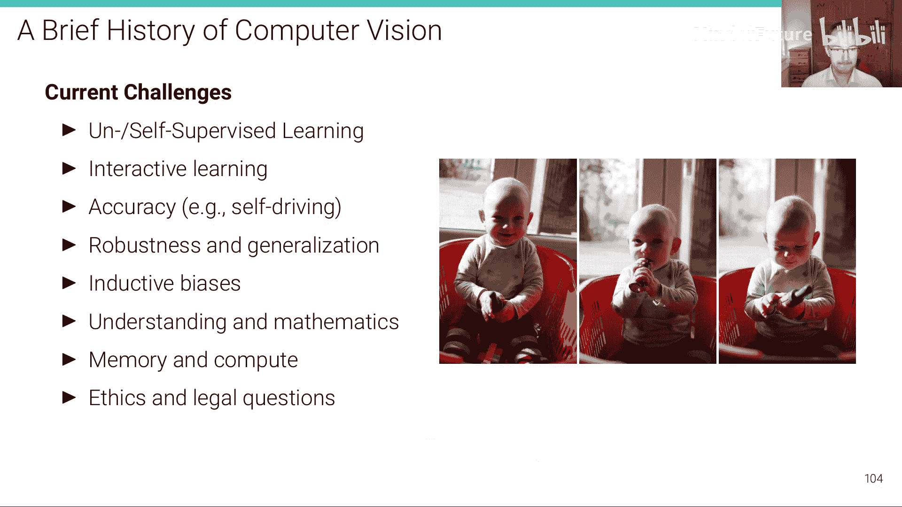

That's it for today。Thanks。