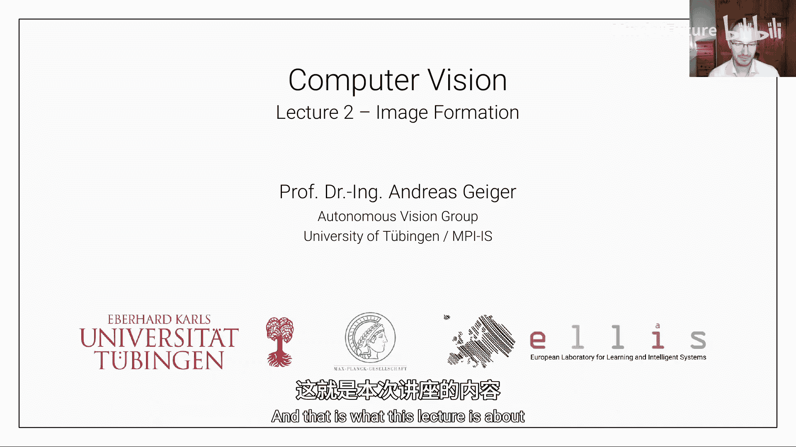
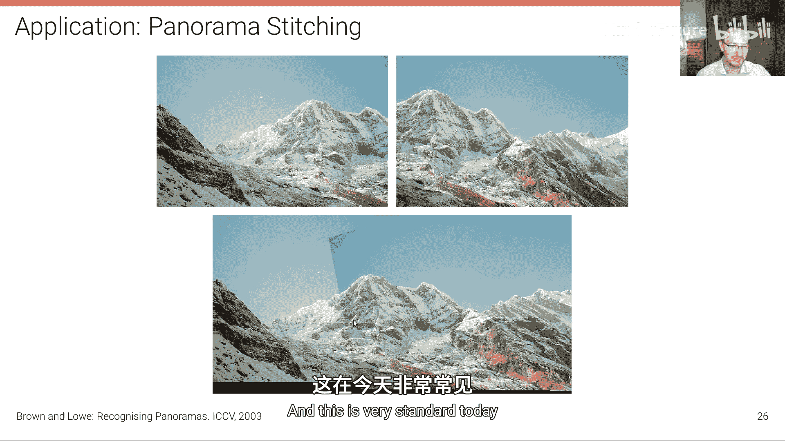

# 【图宾根大学 • 中英】计算机视觉 ML-4360 (Computer Vision) p04 P04 Lecture 2.1 (Image Formation - Primitives and Transformations) -BV1S8N1emEef_p4-

Hello and welcome to the second lecture of this computer vision course。

If we want to build computer vision systems， we first have to gain a good understanding of the image formation process of how a 3D scene is projected onto a 2D image。

And once we have an understanding of this process。We can start developing models。That。Mathematically。

Formalize this process， and that is what this lecture is about。

This lecture is structured into four subunits。 in the first one。

 we will introduce basic primitives and transformations。In conventional， but also in particular。

 in so called homogeneous coordinates， which play a fundamental role for describing。

Objects and projections。In 3D computer vision。In the second unit。We're gonna to discuss the。

Image formation process from a geometric perspective， how。

Geometric features are projected geometrically。Onto the 2D image plane。In the third unit。

 we then move on to the photometric image formation process how light actually changes while traveling from the light source to the camera。

 and then finally we're going to also have a look at how the image is then processed inside the camera and start in the camera。

Let's start with primitives and transformations。

Geometric primitives are the basic building block used to describe 3D shapes。In this unit。

 we will particularly focus on points， lines and planes。

Which are the most fundamental geometric building blocks。Furthermore。

 we will discuss the most basic transformations both in 2D and in 3D space。

This unit particularly covers the topics discussed in the book by Rxslisky chapter 2。1。

And a more exhaustive introduction into multiple view geometry and their fundamentals can be found in the Hartley and Siisismment book。

Let's start with 2D points。2D points can be written in conventional or so called inhomogeneous coordinates。

As a two vector where we have two real scalar numbers。

Real valued scalealar numbers that describe the two coordinates。 For instance。

 the two coordinates in the image domain。Now what we're going to introduce now is an equivalent representation in socal homogeneous coordinates。

 that's why we call these here in homogeneous to contrast to homogeneous coordinates。

In homogeneous coordinates， we are extending the dimensionality of the vector space by one。

For 2D points， that means we have a three dimensional space。But actually。

 this space has a certain meaning。 this three dimensional space is not just a three dimensional space because were removing the element at0。

And called this space P2， the so called projective space。 And this is a very。

Important space that we're going to work a lot with during this。Unit and lecture。As you can see。

 we have augmented this two dimensional vector with a third coordinate that is called W。

And we have also introduced the Tilde symbol。The tilda above the symbol to explicitly denote that this particular coordinate is to be interpreted as a homogeneous coordinate。

And to distinguish this from a conventional inhomogeneous coordinate。

So whenever youre going to see a symbol that carries a tilde on top。

 you know that this is an homogeneous coordinate that's interpreted as an homogeneous coordinate from this projective space that is simply R3 in the two dimensional case。

 it's r3， except for the element at0。Homegeneous vectors differ only by scale。

homomogeneous vector that differ only by scale are considered equivalent。

That's why it's in effectively a two dimensional space， this projective space。

 because we define an equience class by all vectors that are related through a scalar operation。

 so assume there is a vector 111 then the vector 222 is considered equivalent it falls into the same equivalentence class。

That means homogeneous vectors are refined only up to scale。

Why do we introduce such a strange construction？ Well。

 we're going to see very soon that this is very beneficial。

 It allows us to express points at infinity。 It allows us to express intersections of pearl lines。

It allows us to express transformations very easily as condations of multiple transformations。

 and in particular， it also allows us to。Theote。Or to mathematically formalize projective projections。

That are fundamental for3D computer vision。As linear operations。But for now。

 the most important thing that you have to remember is that。

Hmogeneous coordinates are denoted by a tildom， and they are。Representing equivalence class。

With a vectors in a vector space or using a vector space。

 that's one dimensional T larger than the original inhomogeneous coordinates。So in 2D。

 that is a three dimensional space for 3D inhogeneous coordinates。

 that would be a four dimensional space。And then all of the vectors that are related just by a different scaling are considered to be equivalent。

Now， how can we convert between an inhogeneous vector and a homogeneous vector？

An inhogeneous vector is converted to a homogeneous vectors vector。By simply adding a one。

 this is a convention。 if there is a one as the last element。

Then the first two coordinates are considered the inhomogeneous vector of a homogeneous vector。

So here we have an inhomogeneous vector x。And we add。

We concatednate a1 to this two dimensional vector to obtain a three dimensional vector。

And then this is going， this is going to be a。homomogeneous vector。

Well the first two coordinates are。The inhomogeneous part。

And for all vectors that have a one at the end， we call these vectors also the augmented vector X bar。

 So we introduce another symbol that we can put on top of these vectors， which is a bar。

 and this bar denotes that we have a homogeneous vector。 It's also three dimensional vector。

 but it's one particular element of this equivalence class。Which is exactly that element。

That has a one as the last entry， and there's only one such element。

So it's one particular element of all possible homogeneous vectors that are equivalent to each other。

And this is how we define the relationship between the inhomogeneous vector and the homogeneous vector。

Now， this also allows us then to of course， convert in the opposite direction。

As you might have already realized to convert in the opposite direction。

 we simply have to divide by the last element of the homogeneous vector。W Tildom。

Because if you do so， the last element of the vector turns into a1。

 and so we can read off the inhomogeneous vector from the first elements of the vector。

So here's an example we have。嗯。And in homogeneous vector x tilde， we have the last element。

 a w tilde， and we divide this by 1 over tilde， so we get x tilde over W tilde and y tilde over w tilde and w tilde over w tilde。

 which is1 as the last element。And so this is then， as we see an augmented vector。

 because by definition， the last element must be one。

So the inhomogeneous vector is x tilde divided by w tilde and y tilde divided by W tilde。

So we gained or we see the relationship between the homogeneous。

 the inhogeneous and the augmented vector here all in one equation。This one。Special。嗯。

Hmogeneous vector that has a special meaning。 And that's the。

Hmogeneous vector where the last element wtilde is equal to 0。

 and such points are called ideal points or points at infinity。

 and these points can of course not be represented with in homogeneous coordinates。

Because if we have w tilde equal to 0， we would have to divide by0 here， these two elements。

 which would lead to infinity for the x and the y component of the inhomogeneous parts。However。

 this allows us to very conveniently express points that are located at infinity。Even。

Without having to use the infinity symbol， we can simply have a vector。

A homogeneous vector where the last element is 0。And the point that corresponds to that homogeneous vector is a point that lies at infinity。

Here's a visual illustration of this。嗯。Of the relationship between homogeneous and inhogeneous and augmented vectors。

 we have the homogeneous。Cordant system here。嗯。X， Y， and this should actually be a W。

And then we have the homogeneous vector that's represented in a coordinate system。

And we have this plane here。 that is a plane in the X， Y plane of the homogeneous coordinate system。

 but。Translated to a location where set or W actually is equal to1。

And so if we divide this vector here by w tilde， we obtain this point here that is on that plane where the line。

That connects this 3D point。And the homogeneous coordinate system intersects that plane that defines the inhogeneous coordinates。

And at that point， we have the augmented vector with the last element being one。

And you can already see that this model or this projection that we are doing here by division resembles a lot the prospective projection process that we're going to discuss later。

 so it's kind of intuitive that this is a。A useful thing to do， a useful representation to have。

 but well see precisely。What we can do with this is homogeneous representation in the next couple of slides。

Now， given the homogeneous representation of points。

 we can also express lines using 2D lines using homogeneous coordinates。

If we want to express a 2D line using how much in coordinates。We also write L tilda。

 We're always using bold symbols， by the way， to denote。Vectctors， bold。Lower case symbols。

 we use bold uppercase symbols to denote matrices and we use non bold symbols to denote scalrs。

So we have a line。There's a free vector ABC。And。If we multiply that free vector ABC。

And as an inner product with a augmented vector x bar， we obtain this expression here。

AX plus By plus C1 equals 0， which we recognize as the line equation。For all points。

That are located on the line， all points X， Y。If this equation here is0。

 these points are located on the line， this is the definition of a line。

 all points that satisfy this constraint are on the line。And so we can write this in this。嗯。No。

 explicit as is as this explicit expression here。 but we can also simply write this in terms of a inner product between the homogeneous line vector and the。

A homogeneous point， which in this case is a augmented vector。Of course。

 note that it doesn't need to be an augmented vector augmented vector is just one element out of this equivalentence class of homogeneous coordinates so we can scale。

 we can use this line equation holds for any other homogeneous vector because we know that all of these homogeneous vectors that are related by just scaling are the same so we can divide or multiply this equation here on the left hand side and on the right hand side arbitrarily and obtain still a line equation。

We have just chosen here for convenience， the augmented vector X bar because this gives rise to。

Exactly this line equation that we're familiar with。But of course。

 multiplying both sides doesn't change anything。Now for instance。

 what we can do is we can normalize L bar， which is also a multiplication with a scalar such that。

L bar， the line becomes Nx and Y and D。Or ND， which then has a particular geometric meaning。

Where this N。We normalize it in a way such that this n vector is normalized to1。

 and in this case n is just a normal vector perpendicular to the line and D is the distance to the origin of the coordinate system。

Okay。And I have an illustration for this on the next slide。

An exception or a special line is a line at infinity。Which we denote as L tilde infinity。

Whi is the line defined by the vector 001， and this is the line that passes through all the ideal points。

 through all the points at infinity。Now of course， we can't normalize this line such that it is in that representation because we would have to divide by0。

And that makes sense because that line is that infinity， we can' represent it in that normalized way。

Now。To describe some of the properties of what we can do with lines。

 what we introduce is first what we remind ourselves is first the traditional cross product that we know from school between two vectors。

 the cross product is written as if we have one vector A and one vector B A XB。

we can also express this cross product as a skesymmetric matrix and a vector here we can see how this is looking or how this is written mathematically with these two brackets and the x symbol and this skekusymmetricmetric matrix is defined like this such that if we multiply this with the B vector we get the familiar form of a cross product between the vectors A and B where the elements are a1。

 A2 a3 and B1， B2 B3。Another remark here in this course。

 we are using square brackets to distinguish matrices from vectors。 So whenever we have vector。

 I'm trying to write a。A non squared matrix， a non squared bracket。 and whenever we have a matrix。

 I'm trying to write a squared。Brackt to distinguish the two。

 you can see we have one matrix here and a vector here and another vector here。Okay。Good。

Now in homogeneous coordinates， the intersection of two lines。Is given by。A very simple form。

Or as a very simple expression， using this cross product definition here。

 what we have is that this point x tilde， everything in homogeneous coordinates。

I's equal to the first line。Cross product， the second line。A vector。And similarly。

 the line joining two points can be compactly written in homogeneous coordinates as L tilum。

Being equal to the first homogeneous point。Cross product is secondome agene point。

 and here I've used the augmented。Version of an homogeneous vector。

 but this could be replaced by any homogeneous vector， of course again。

The symbol here denotes the cross product。And the proof of this is very easy and is left for the exercise。

So we see already that this homogeneous representation is a very useful representation to express very simple relationships。

That are otherwise harder to express。Here's an example。So here we have two lines。

One line that is characterized by the equation y equals 1 and another line that's characterized by the equation x equal 2。

The line vector for the first line is simply 01 minus1。

 because if we multiply this with the augmented vector x， Y and 1。We obtain why。us1 equals 0。

 or y equals 1。And similar， the line vector for the second line is 1，0 and minus2。

Because we want to express x equals to2。Now， if we take these two line vectors。

And compute the cross product。Which can be also written as this。

Product of this ssymmetric matrix with the second line vector。

 where this ssymmetric matrix is simply specified as。This cross product matrix。

 which I have again written here on the slide on the right。And we multiply these two together。

 then we obtain two， one， and one。Where we see this is or directly。 it's。

 it's not an not an arbitrary homogeneous vector， but in this particular case。

 it's already a augmented vector with the last element being one so we can directly read off。

In homogeneous coordinates 2 and1， and we can verify that 2 and1 is indeed the correct intersection of these two lines。

We can also do the same for two pe lines here we have two parallel lines， 10 and 1 and 10 minus2。

 and if we do the same thing now for these two pe lines， we obtain as the intersection point 0。

 minus1 and0。And this intersection point， as we can see from this homogeneous representation is at infinity as expected。

So these two lines are indeed intersecting at infinity because the last element is0。

 it is an ideal point， the outcome of this operation is an ideal point。

And we can also take the line at infinity。And multiply this with the point at infinity and verify that indeed the inner product between these two is0。

 so the point， in other words， the point at infinity does actually lie on the line at infinity。Okay。

 so we've seen that homogeneous coordinates allow us to express points at infinity and very easily the relationship between lines and points。

We can also represent more complex algebraic objects using homogeneous equations， for instance。

 if we go from linear equations that we had discussed so far to polynomial equations like quadratic equations here in this case we can express con sections so here we have a quadratic expression。

And the solution to this quadtic expression is a con section。

 which is a section of a cone with a plane。 And this gives result to such。Such a。such a。

 such a curve here。And depending on how we orient that plane， which is defined by the Q matrix。

 we get either a simple circle， an ellipse in this 2D space。

 a parabola in this blue 2D space or a hyperbola in this 2D space。

And this is very useful for multiview geometry and camera calibration。

 but we're not going to discuss this in very great detail here in this lecture and there's an entire book written around this。

 which is the Hartley and Sisman book which I recommend to have a look in case you're interested in more details about this type of representations and how they relate to camera calibration。

Now let's move on from 2D points to 3D points。Similarly to 2D points。

 3D points can also be written in homogeneous coordinates Here is an inhogeneous representation of a 3D point。

And here' is the corresponding homogeneous representation of a 3D point。

 where we now have a projective space P3， which is the four dimensional vector space except the element at 0。

So this element will remove。嗯。To because we have to define the direction of the vector。

So w tilda can be0， but not all of the elements of that vector can be zero。

 and that's what's called the projector space。The origin is removed。Now， similar to before， well。

 first of all， similar to before， all homogeneous vectors that are related by scale are。

In the same accruvalence class。And we can condu it between homogeneous and inhogeneous vectors in the same way as before。

 for instance， we can go from a homogeneous vector to an inhogeneous one by dividing by W tilde。

We can also represent 3D planes as homogeneous coordinates。

Where now the plane is represented by a homogeneous vector m tilum， ABCD。

 we have this expression Ax plus By pluscc plus d equals0 that has to be fulfilled for all X。

 YC where，These points are on the plane。And we can。

Equently write dis compactly as this homogeneous constraint。Again。

 we can normalize m tilde so that mtilde， or so that n is a free dimensional vector。

 the olean norm of n is equal to 1， and in this case again n is the normal perpenigula to the plane。

 now not the line but the plane and D is the distance to the origin。

An exception is the plane at infinity， which passes through all ideal points or points at infinity。

 for which w tilde is0。Here's an illustration。I mentioned before that I shown an illustration for lines。

But I omitted that I just directly have the illustration here for planes。

 but it's the same just one dimension higher。 So what we have here is this。Carornate system here。

And we have this plane here， which is at distance D from the coordinate system if this n vector here is normalized to one and then n corresponds to the normal of that plane。

Okay。Now， 3D lines are a little bit less elegant than either 2D lines or 3D planes to express。

One possible representation is to express points on a line as a linear combination of two points P and Q on that line。

As done here， is this convex combination。However， this representation uses six parameters for four degrees of freedom。

 a 3D line has only  four degrees of freedom， and we're using six parameters here which is not ideal。

 there' is alternative representations。嗯。There's multiple alternative representations。

 one is and one minimal representation is the two plane parametermetrict station and another one are the plic coordinates and there's more details on this in Ziski and Haddley and Aismman in chapter 2。

The 3D analog of 2donics are quadric surfaces。So here we have a variety of quadric surfaces that。

Can be expressed as these quadratic equations here with homogeneous coordinates in。

Free dimensional space。So， we have。quadratic expression here and all the points that lie on the surface of this quadrics depending on Q。

 this quadric shape changes， but all the points for a particular Q， all the points。

 let's say in this case in this parabolo case， all the points that lie on the paraboular surface satisfy this expression。

Now these quadrics are useful in the study of multi view geometry again。

 and they also serve as useful modeling primitives for understanding scenes in terms of compact representations。

Here's a simple example from my research group where we have used superquadrics。

 which are a slight generalization of these quadric surfaces in order to represent geometric objects。

In terms of simpler parts。So here you see some meshes。

 you see representations in terms of simple cubos， and then in the bottom in terms of superquadrics。

And this is very useful for understanding the world in terms of simple primitives and can be extracted in a pretty uncivervised fashion。

And allows for shape， abstraction， and also compression。

 we can then compress scenes very compactly and store them very compactly while still preserving the dominant semantic meaning of the scene。

Okay， so let's move on to transformations now。嗯。In this unit。

 we're going to discuss the most important 2D and 3D transformations and we're going to start with 2D transformations。

 and the simplest 2D transformation is clearly a translation where if we have a square here。

 we are simply translating that square to another location in that two dimensional space。

And such a translation is simply given by。Adding a two dimensional vector in in homogeneous coordinates to all the points that we'd like to translate。

 and we can alternatively write this as this homogeneous。Expression here where here on the right。

 we have a free by free matrix in the converting a homogeneous， in this case， an augmented vector。

To the new location by multiplying it with the identity matrix and adding the translation。

Now see that the translation here is added because the last element of this augmented vector is one。

 so we are multiplying one with T， and we have the identity here。

 so we're taking the original point and adding T。So it's a simple 2d translation with two degrees of freedom。

T X and T Y。Now， using such a free by free matrix here instead of this allows us to very easily chain or invert transformations so we can。

Compute the inverse translation by inverting this matrix， and we can。嗯。

Chain multiple translations by multiplying multiple of these matrices together into one matrix that then。

Represents the chained overall transformation。And this is not only true for the simple translation example。

 but for all the other transformations that we are going to see are clearly in similarity aine and projective。

As always， augmented vectors can always be replaced by general homogeneous vectors， x tilde。

The next transformation is the so-called oldion transformation。

 which is a translation and a rotation， so it has three degrees of freedom in 2D space。

 and this can be expressed as Rx plus t in homogeneous coordinates or in homogeneous coordinates by a matrix where in the top left 2 by 2 sub matrixx we have the rotation component R and then in top right we have the translation vector。

 the two dimensional translation vector， and if we multiply this with an augmented vector we see that we obtain this expression。

 Rx plus T。R is a rotation matrix from the special autogonal autonal group， SO2。嗯。

With the properties that r are transpose is equal to the identity。

 so it's auto normalmal and the determinant of r is 1。Elan transformations preserve Euclan distances。

 so if we look at two points that are at a certain distance。After the Occlan transformation。

They are also at the same distance， and this， of course， holds also for the translation。

Because translation is a special case of the earthleton transformation， but it doesn't hold。

 for instance， for the Aine transformation。嗯。So we see already that this is giving us a hierarchy of transformations that we're looking at here。

The next level is theity， the next level in this hierarchy is the similarity transformation。

 which is 2D translation scale 2D rotation plus 2D rotation plus scale。

So it has four degrees of freedom。And it's exactly the same expression as before。

 except that now we have a scale that's multiplied to the rotation before translating the vector。

Again， R is a rotation matrix， now S is an arbitrary scale factor， it's a scalar。

And the similarity transformation preserves not any more distances。

 but at least angles between lines that we have， for instance。

Agonal relationship between these two lines here， which is preserved from the original cube。

 but the scaling has changed and the rotation and the translation。Now。

 going one level up the hierarchy， we have affine transformations。

Wwhich have  six degree of freedom where now the rotation matrix here has been replaced this 2 by 2 matrix with a general arbitrary 2 by2 matrix。

 so we have four degrees of freedom here and two degrees of freedom here。

 but here at the bottom we have a0 vector and a 1。So overall， we have six degrees of freedom。

And we can see an example of an aine transformation or a linear transformation here。

 which is not preserving angles anymore， as you can see， but which is preserving pear lines。

 so if we have two pe lines，Then these remain a parallel with respect to each other after the transformation。

And then finally， the most general transformation that we can define with such a linear homogeneous equation is the so called perspective transformation or homomography and an example is given here now every point。

Can transform every point on this square can transform to a different location that is why we have8 degrees of freedom。

 we can also represent this by the coordinates where every every of these three coordinates of this square transforms to。

But it's only eight degrees of freedom， so all the points that are in between or outside would transform similarly to this transformed corners of the square。

🤧う。And so this can be represented by free matrix， which is a homogeneous matrix。

That is defined only up to scale that is wide as matrix doesn't have 9 degrees of freedom。

 but only 8 degrees of freedom， it's a homogeneous matrix。

 so all the matrices that are scaled relative to each other but are otherwise the same are in the same Macphience class。

So this property， this principle of homo homogeneity doesn't only apply to vectors。

 but of course also applies to matrices。Now this is an equation here that is in terms of a general homogeneous vector。

 and of course we can again obtain the augmented vector by dividing by the last element as we've defined in the beginning。

Persspecpective transformations do not。Maintain。Pearl lines anymore， as you can see。

But they preserve straight lines。 So if a line has been straight in the original。

Before the transformation， then after the transformation it's guaranteed to also be straight。

 it's not bending。It's a linear transformation in homogeneous coordinates。Now。

 we've seen how points can be converted into new points。Using such homogeneous transformations。

But what happens with co vectors lines are co vectors because they are represented by a vector that is used always in combination with a homogeneous coordinate to define a useful principle such as a line equation。

And so what happens with， for instance， lines， how can we transform lines with these homogeneous representations？

While considering any prospective 2D transformation。

What we can do is we can look at the transform 2D line and the transform 2D line equation is simply。

L tilde prime， prime indicates that this is the transformed line transpose times x tilde prime。

Now we know what xtil the prime is because that's。What we have just defined the perspective transformation。

 so we can plug that in here。And then we can。嗯。Multiply these two together or factorize them out and obtain h transpose L prime transpose if we transpose this expression here。

And。This as we recognize is simply the line equation if we say it to 0， this is what we started with。

 this is our assumption that this transpose x tilde is equal to0。

 so this must be the expression of the line before the transformation in homogeneous coordinates。

And now we see that， well， L tilde transpose is this expression transpose。

 which means that L tilde prime， this is the transformed line。Is equal to H。

Tilde transpose to the power of minus1 times L tilde。Therefore。

 we see that the action of a projective transformation on a co vector such as a 2D line or 3D normal can be represented by the transposed inverse of the original matrix that is transforming points。

And can be easily obtained and applied。So here's an overview of 2D transformations。

 we see the hierarchy translation Eclean transformation。

 similarity transformation aine and projective transformation， we see their representation。

We see the degrees of freedom。What they preserve。And here an illustration of what they do。

So we see that these transformations form a nested set of groups。

Wwhich is closed under composition and inversion， so these are defining mathematical groups and they can be interpreted as restricted free by free matrices operating on 2D homogeneous coordinates。

 so this is the least restricted transformation or least restricted group of matrices。

And the more we go up in this hierarchy， the more restrictions we have here。

 the restriction is that the top left of the matrix is an identity matrix。

And while these matrices here are written as two by3。

 we can always add a last line0 and1 to make this into three by free full rank matrices。

The transformations preserve the properties below， which means that， for instance。

 the similarity transformation does not only preserve angles， but also pluralism and straight lines。

And the translation operation does not only preserve orientation。

 but also all of the ever nested transformation properties。

So the translation preserves almost everything except translation and the projective transformation only preserves straight lines。

And the same holds true for 3D transformation， so here's an overview over the equivalent in 3D space where degrees of freedom changes but otherwise is very similar。

Again， these three by four matrices that you see here can always be extended with a fourth row to apply them in homogeneous transforms and to change transformations。

 etc。Now let's go back to the 2Ds。And let's think about how we can actually estimate the parameters of these transformations。

 given some observations。And while this is possible for all the transformations。

 we are going to look here just at the most general transformation， which is the。

Perspective or the homomography transformation。And we already know that this homography has eight degrees of freedom。

 So if we want to estimate this transformation from correspondences between you know。

A representation before and after the transformation between two images， let's say。And we know。

 because each pixel defines。Two constraints， a constraint for the x and the y coordinate。

 we need at least four of these correspondences in order to properly define and estimate the homomography。

So let x denote a set of n2 d to 2 d correspondences。Related by this homomography。

Equation in homogeneous coordinates。Where x tilde is the point， the if point。

Before the transformation and X I tillde prime is the point after the transformation。

And we need at least n equal4， but we can have more。

 we can have an overdetermined system to obtain a better homomography。

As the correspondences vectors are homogeneous， they have the same direction。

 but they differ in magnitude。So we have represented this equation here in homogeneous coordinates。

So now in order to solve it， we cannot just set the left side equal to the right side and solve for this because there is more flexibility in it。

 We have to account for this flexibility and the simplest。That we can do for this。

 we can rewrite this expression， We can rewrite this equation as the cross product between the transform point。

And the point before the transformation multiplied with the transformation matrix。

And that must be equal to0， and the reason for this is that in the cross product。

The cross product of two vectors is0。 if these two vectors are。Pointing in the same direction。

 But it doesn't depend on the length of these two vectors。

 So this is a more convenient expression for us to work with， because we want to。

Want to make sure that it's two vectors。X， tilde and x tilde prime are homogeneous vectors so they can scale arbitrarily。

 so this is the term that we are concerned with。Now using H， little H。

Tilda K transposedse to denote the cave row of H tilde。

 this can be rewritten as a linear equation in H tilde。And this is what this equation looks like。

This is just rewriting this cross product if you multiply this。

 you will see more easily that this corresponds。Now。

 this is nice because now we have a linear system。Where this H vector is the unknowns that we want to solve for。

 and here on the left we have a matrix of like we have this system that we use for solving for H。

So we have in other words， we have a linear system a。H tilde that shall be equal to0。

Now the last two rows are linearly dependent up to scale on the first two and can therefore be dropped。

The last row is linearly dependent up to the scale on the first two rows and can be dropped。

And so typically what people do is just consider these first two rows。

 So we have a three by one vector H1 and a three by one vector H2 tilde and a three by one vector H3 tilde that is multiplied with this row and this row。

 And this is a2 by 9 matrix。 So each of these。Elements here has three columns。And we have two rows。

That means， as expected， we obtain two constraints per point correspondence per I。

Where we can now stack all of these correspondences into a bigger matrix to obtain a determined or overdetermined system that we can use to determine the vector H。

And that contains the elements of the matrix H。So each point correspondence yields two equations and stacking all these equations into a2 n times 9 matrix。

For instance， eight times 9 matrix。A leads to the following constrained least square system。

Where we have H star， this is the solution to that system， is the minimizer。Of dis expression。

Frespect to Age Tilda。And this expression simply says， well， because we want this to be0。

 we want the squared arrow of a H tilde to become as small as possible。嗯。So this is the L2 norm here。

And we want at the same time， we've introduced a constraint。That fixes H tilde。

 the norm of H tilde to 1 as the H matrix that we try to determine is in homogeneous。

 and this is how we。Is homogeneous， This is how we introduce this constraint and constrain this matrix because otherwise way。

 we be unconstrained and only defined up to scale and so we have to constrain。

This matrix to one particular solution out of this equience class。

And we do this using this Lagian formulation where we have this Lagrange multiplier here。

 so this is a standard constraint optimization formulation with Lata。

Times h minus or h squared minus1， where this term here vanishes if the norm of H is exactly equal to1。

 and if we take the gradient of this。嗯。We arrive at this expression here。That that's not true。嗯。

So where what has happened here is only。I've rewritten the。

The expression on the top without the square right so this this is just rewriting it in terms of standard linear algebra。

 so we have H squared is simply h transpose H and Ah squared is h transpose A。Time a H。Okay。Now。

 the solution to this optimization problem is the singular vector corresponding to the smallest single value of a。

In other words， it's the last column of V when decomposing the matrix a as a singular vector decomposition U D v transpose。

And this is very similar to what we have discussed in the deep learning lecture 11。

2 in the context of PCA， except that here we're using a singular value decomposition instead of an eigenvalue decomposition。

 but we could also use an eigenvalue decomposition of the matrix a transpose a。

 which is equivalent to a singular value decomposition of a。Yeah， and why。

 why do we have to use the singular validity composition here， Well。

 we see that this is an eigenvalue problem if we want to。Minimize this expression。

 and we compute the derivative of this expression with respect to H。

 we see that we end up with an eigenvalue problem as in the case of PCA。

 we have Ah equals minus Lada H。And this corresponds to a eigenvalue problem。Good。

The resulting algorithm。It's called。A direct， linear transformation。

So this is a very general algorithm that not only applies to homomography estimation。But in general。

 applies to this estimating and closed form solutions to。

Systems expressed in terms of homogeneous coordinates。

What can we do with this now well and this is also something you're going to do in the exercise。

 we can now define correspondences between two images。

 so we have two images here that are taken from the same viewpoint， that's important。

You may not translate because otherwise the projective geometry doesn't work。

 they must be taken from the same viewpoint， but they can be taken in different directions so you can rotate yourself around your own axis。

And what we want to do now is we want to stitch them together into a panorama as your camera stitches images that you take into panorama。

And for that， we can determine correspondences， for instance。

 we can mark this point on the hill and this point here and maybe this point here。

 well this is not visible actually， so this point here and this point here so we can determine four such correspondences between these two images and then using SVD solve for the matrix a。

As all for the vector H， which defines the。Hmography H。

And then we can warp one of these images into the other image space and combine these two images into a larger panorama of the scene。

 and this is very standard today almost every smartphone has the possibility to create such panoramas from multiple images。

