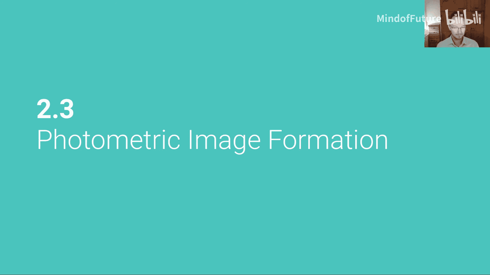
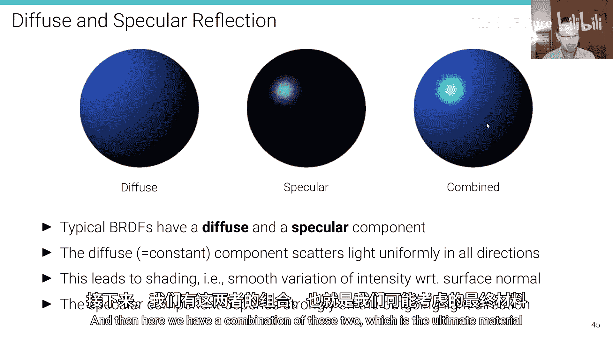
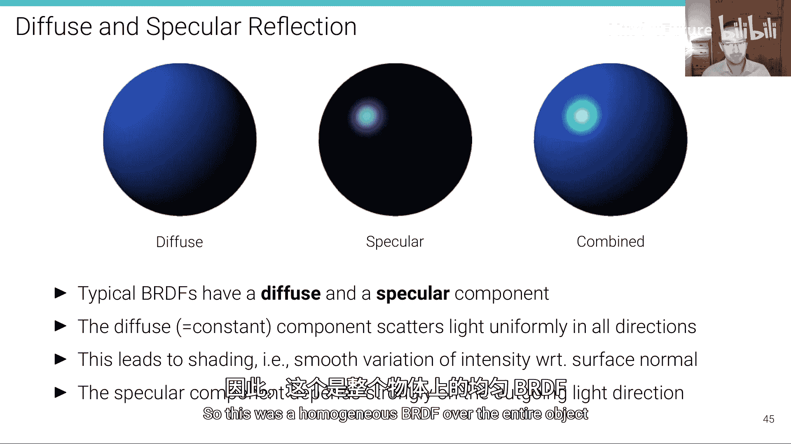
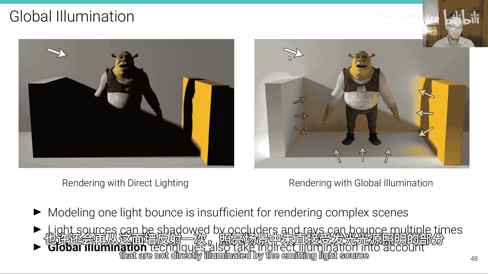
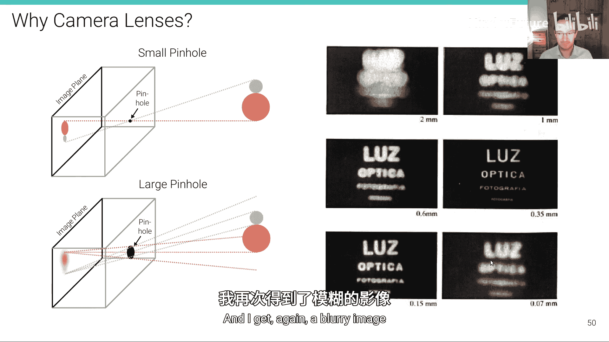
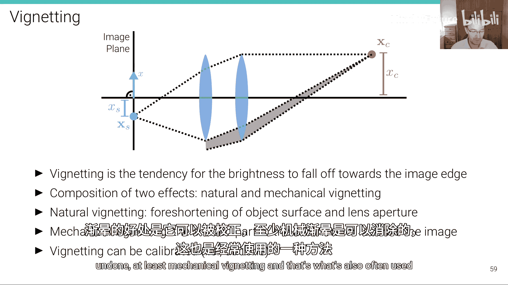
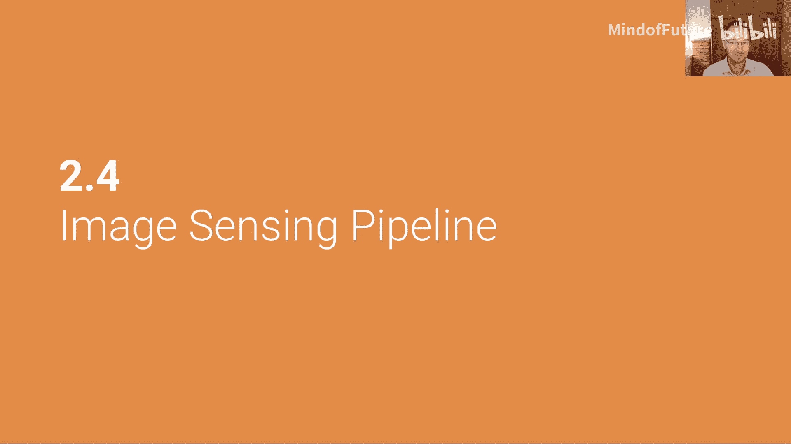

# 【图宾根大学 • 中英】计算机视觉 ML-4360 (Computer Vision) p06 P06 Lecture 2.3 (Image Formation - Photometric Image Formation) -BV1S8N1emEef_p6-

This unit is about the photometric image formation process。

So far we have discussed how individual light rays travel through space。But。

It's also important how actually the light changes once it reaches the sensor plane。

 so now we discuss how an image is formed in terms of pixel intensities and colors。

If we take a picture of a scene。We observe a light field from a very specific vantage point。

 which is the viewpoint of the camera。And the light field is。

A consequence of light travelling through the scene。

 light that has been emitted by some light source， a light bulb or the sun travelling through the scene。

 hitting surfaces， reflecting or reflecting from these surfaces and at some point。

 reaching the cens plane。In order to model the process of how light reflects from a surface。嗯。

The rendering equation is used as a mathematical tool to define this process precisely。

 and this is one of the most basic equations that you will learn about when you take a computer graphics course。

To understand the very basics of this equation， let P be a 3D surface point here， let's assume this。

Is a surface and let V be the viewing direction and are the incoming light directions I have an incoming light here in yellow and the viewing direction in blue。

And furthermore， we have the normal here in with n。At that surface， point P。

The rendering equation then describes how much of the light。It's coming in。

From at this point here that's arriving at this point of a particular wavelength fluda is reflected into the viewing direction。

And in order to measure， because the light that is coming in here is reflecting into multiple directions。

嗯。We have to consider the light that's arriving at this point from all possible or directions on the hemisphere where the light could potentially enter the scene and arrive at this particular surface point。

So what you have here is this upper unit hemisphere。Sigma。And what we are doing is we are going to。

This is the L out is the light that's going out in this direction at surface point P into direction B with a wavelength lambda。

 all of these functions are here are。Conditioned on this wavelength lambda because this equation is true for all wavelengths。

 basically。So for all of these wavelengths， we are integrating over this hemisphere sigma。

And we are integrating this so called bidirectional reflectance distribution function。

 which determines how much light is reflected at point P。

For a given incoming light direction R and a giving outgoing light direction V and a given wavelength Lada。

So we're integrating how much light is arriving here。Over。

 the incoming light directions multiplying this。Bydirectional reflectance， distribution function。

With the corresponding incoming。The intensity of the incoming light at point P from direction R with wavelength floda。

In addition， there is this factor here on the right。

 which is the product between the inner product between the normal and this incoming redirection which models the foreshortenening effects。

You can imagine that if you shine light at the surface at a very shallow angle at a particular point there is less light reflected because the light arrives at a very shallow angle。

 if it arrives exactly perpendicular there is no light reflected。And this is what this term here。

 this shading term here models。Or this atinuation term term here actually model cell。

And then there is an additional term here which is only present if this point also emits light。

 so there could be a light source that's reflecting light arriving from some other light source but also emitting light into a particular direction。

 and so we have to add this term here welling for emitting light sources。Now。

 how do these bidirectional reflectance distribution functions look like。

 well typically they have a diffus in a specular component。

Wwhichch is familiar to you if you look at surfaces。

 some of the surfaces are rather diffuse and some of them are more shiny， mirrorrallike。

 and so this is illustrated here if you have just a purely diffuse surface that means that an incoming light ray is reflected into all directions equally strongly。

But if we have a specular surface。Think about a metallic or a plastic object then there is more light reflected into the direction that is the optimal or the ideal mirror reflection here so this is the the strongest effect here is in the direction of the ideal mirror reflection。

And then it attenuates， it falls off。If you go further away and so here on the right we have the perfect mirror situation where incoming light is exactly mirrored away into one particular direction。

So this is the whole。Spectrum of possible reflectance that we have， and typically surfaces。

Real surfaces are a combination of all of these effects。So the diffuse。

 the constant components get a slide uniform in all directions。

 and this leads to shading that are smooth variations of intensity with respect to the surface normal。

And the speculular component depends strongly on the outgoing light direction。

So here's a simple example with a sphere， we have a sphere of a diffuse material that's reflecting light diffusly。

 but you can see that depending on the surface orientation。

 we have a darker color or a brighter color。Here we have a specular component that is reflecting in the perfect mirror direction more than in other directions。

And then here we have a combination of these two， which is the ultimate material that we might consider here。

And BRDs can actually be quite complex， so this was a homogeneous BDf over the entire object。

 but in practice BDfs are spatially varying every surface point might have a slightly different BDf and BDfs themselves might have very challenging aspects to them very challenging reflectance properties。

 very challenging distributions and there's a whole field about how to estimate these BRDfs and how to get good models for them。

Here's another example for how challenging BDFs can be this is the so-called fresennel effect if you take a picture of a lake or water as here。

 the amount of light that's reflected from a surface depends on the viewing angle you can see that if you look further away you have almost perfect mirror reflection。

 but if you look closer at a steeper angle for respect to the surface normal you see through that surface and so the reflectance model has also to take into account this type of effects。

Now light does not only bounce from surfaces once， but it actually bounces from one surface and might reach not directly the camera。

 but might reach another surface， and it's important to model these effects and that's called global illumination in computer graphics and here's an example so here's a light coming from this direction and this is a rendering without global illumination which looks quite unnatural。

And here on the right， we have the same rendering now with global illumination where this light that's entering the scene here is reflected from this wall and reflected from the ground and maybe reflected another time from this wall and illuminating parts of the scene that are not directly illuminated by the emitting light source。

So this was a very， very short。嗯。ExExursion on。Light and reflectance。Now， let's turn back to cameras。

We have discussed the pinhole camera model， which is actually a good approximation also for real cameras with lenses。

 but why do cameras actually not have just a single pinhole but do have a lens system Well here we see an example from Paul Devik who used a DSsL camera and put a perfect pinhole or created a little pinhole and replaced the lens with their pinhole and took a picture and that you can see here。

As you can see from the picture， it's very very difficult to get a picture sharp and of high quality。

And the reason for this is that there is a trade off here， if you make the pinhole very small。

 then you need extremely long shutter times which lead to motion blur or camera shake blur。

But if you make the pinhole slightly larger， then you're averaging multiple light ray leading to blur。

If you make the pinhole extremely small， you also get the blur effect。

 but that time through diffraction at the surface of this or close to this pinhole。

And here's an example of this， here's an example for a small pinhole that leads to a sharp projection。

 if I increase the pinhole size then I get a blurry projection because now there is multiple rays that are passing through this but there's multiple race for one single point that pass through this pinhole at different locations and that capture the scene that sample the scene at different locations and so I get an average here。

And the same holds true for this point here， which is just an average of these points。

 and so we're getting this blurring effect。So this happens when the pinhole is very large and if I start decreasing the pinhole。

 I have to increase the shutter time because the light arriving at the sensor becomes less and less。

And if I'm decreasing it even further， then it doesn't become sharper anymore because of the refraction effects at the pinhole and I get again a blurry。

image。

So that's the reason why we want to have optics， so on the left is an ideal pinhole model on the right is a camera with a lens。

Cameras use one or multiple lenses to accumulate light on the sensor plane to make the picture。

Brier to create more photons on the sensor plane， but there's a trade off now because。

Only points that are in focus。Of the lens。Arrive at the same 20 pixel locations。

 and if the lens is out of focus， then you also get blur on the image plane。

The good thing about this is that for many applications it's sufficient to model the lens lens cameras with a pinhole model with the simple model that we've discussed in the previous unit。

 and that's great， but to address focus and vineyarding and aberration and all these kinds of。

For the metric effects， we need to actually model the lens more precisely。

So the most basic lens model that we can consider is the socalled fin lens model with a spherical lens。

 meaning that we have this lens here with a shape of a sphere on either side。

That is often used as an approximation for more complex land systems。Okay。

The properties of such a lens is that this lens has a focal point on Ever side。

And that X parallel race pass through the focal point on the other side。

And that race while the center keep their direction。

So here we have an array from a 3D point passing through the center， keeping its direction。

 here we have a array that's parallel to the principal axis。And that is then。嗯。

Refed in that lens in the direction of the focal point and passes through the focal point。

 So all the rays that pass through the focal points。And through the lens。

R then turned parallel to the principal axis， and the same holds true for the other direction as well。

 here have a array that passes through the focal point and it's turned parallel to this axisium。Now。

 what can we do with these properties？We can again use the principle of equal triangles to derive a relationship that's one of the most important lens relationships that we know。

And this is the following here we have the red triangle relationship and the green triangles relationship。

Let's consider the green triangle first。So， here we have。嗯。

Now let's consider the red triangles first， so here we have xs over xc。

 so we have this distance and Xc is this distance， which is the same as this distance here。

So this divided by this must obviously be this distance divided by this distance。

 So x S minus f divided by F and similarly。X S divided by x。See by this distance here。

Must be the same as C as divided by CC， so this is the relationship that's coming from the green triangle。

So if you have these two relationships， then we can。

Substitute one into the other and we arrive finally at this equation。

1 over CS plus 1 over C equals 1 over F。So for a particular lens with a particular。Fcal point lens。

 focal point F。WeWe can determine。For a particular 3D point。for a particular distance to a 3D point。

How far the distance。Of the image plane must be。In order for this point to project sharply onto that image plane。

Or in other words， for a particular 3D point and a particular distance to the image plane。

 we can determine how we have to change the focal length。

Or the lens system such that the point appears sharply。

So here's another illustration of this in the image here on the left is in focus here in this case here。

If this relationship holds。Where F is the focal length of the lens。

And for this distance of the 3D point towards infinity we obtain in this expression here。

 we obtain c as equal f， so lens with focal length f is approximately a pinhole at distance f。

If the image plane is out of focus， this is the example here。

A 3D point projects not to a single point。For example。

 this 3 point here doesn't project to a single point but it projects to a so called circle of confusion。

 we get a little disc on the image plane and if this disc is larger than the pixel size。

 we see blur in the image。And the size of this circle of confusion is， of course。

 determined by the distance of the image plane to the lens and the focal length and the distance of the 3D point。

That's why we have to always make sure that our lens is in focus。

Another way to control the size of the circle of confusion is， of course。

 to change the lens approachch chain that's why。Almost all lenses have an aperture that you can set。

 so here you see a 50 millim lens of a DSR with the aperture。

 which which is just basically a plane with a hole。Fully open， this is an aperture of 1。

4 and here we have the aperture of 8。0， which is pretty much closed。So if you close the aperture。

Then of course， you limit the circle of confusion here by limiting the size or the circle where the ray can actually pass through。

 but you also let less photons pass and you need longer shutter times。

So the aperture limits the amount of light that can reach the image plane and small apertures lead to sharper but more noisy images。

And if you。Have ever worked with manual photography。

You have seen lenses like this where there is a depth of field indicator。

So the range where the image appears sharply is called the depth of field。

And the lens tells you where the image appears sharply， so if you have an aperture of8。

Then you know that if you focus at 10 meters in this case here。

 that your range where the image will appear sharply is from five meters to infinity， roughly。

And this is an example for a tailor lens here on the right。嗯。Now， the aperture。In typical D。

 as large cameras is indicated by so called F number。On the lens。

And the F number is simply defined as the。AL focal length divided by the aperture diameter。

 so if you have an aperture diameter that's very small， D is very small。对。

Then you get an F number that is very large， so if the F number is very large。Let's say 16。

 Then you have a very large depth of fields。 But if you make the aperture。A large。Let's say 2。8。

 then the depth of field is very shallow， you get this depth of field effect。

And this is indicated here， So here we have the same image。

Pictured with three different temperatures， 1。4，4 and 22。

 and you can see how you get different depthpo field effects here， everything is sharp。Here。

The background is not sharp and here only one of these blocks is sharp。

So decreasing the aperture diameter or increasing the F number increases to J。They're fulfilled。

Another effect that plays a role is chromatic aberration。The index of reflection for glass。

 how lenses bend race slightly varies as a function of the wavelength。And therefore。

 different colors are refracted into different directions and therefore simple lenses suffer from chromatic aberration。

 which is the tendency for light of different colors to focus at slightly different distances。

And so we obtain blur and color shift effects， so for instance for this 3D point here。

 we obtain a blur effect because as you can see here。

 the red colors are focused after the image plane and the blue colors are focused in front of the image plane and so we have a little circle of confusion for both colors here。

For this point here， we have an effect of blur and color shift because。

Neither of these red and blue wavelengths is focused on image plane。

And both of them are actually focused or or arrive at the image plane。With a circle of confusion。

 but at different locations on the image plane。And this color shift is something that you can actually observe when you look closely onto images that you have taken in particular in the border regions of wide angle lens images。

To reduce chromatic aberration and other kinds of effects。

 most photographic lenses are combined lenses made of different last elements with different coatings that try to eliminate this effect。

And you can see so here on the left you can see the effect of refraction that light that comes in is reflected into different directions for different colors。

 and you can see on the right a high quality lens compared to a low quality lens where you can clearly see the color shift and the blurring that occurs due to this simple lens that was used。

Another effect that's。Visible for many images that you're looking at is so called vignettetting vigning is the tendency for the brightness to fall off towards the image edge。

And I'm going to show an image on the next slide。Vignetteing is the composition of two effects。

 There is natural and mechanical vigning Natural vigning is the foreshortening of object surfaces and lens per。

Lens aperture。And mechanical vigning the is due to the shaded part of the beam。

 sometimes never reaching the image and we've shaded I mean in here the shaded part in this image。

 so if you look at this beam here and this rays that pass for this part of the first lens surface this is a multi lens system。

They actually never reach the second lens or the image plane。

 and this is the reason why in particular regions at the boundary of the image appear darker than in the center of the image and that's called viigning。

Now， the good thing about vigning is that vigning can be calibrated， it can be undone。

At least mechanical veing。

And that's what's also often used so here you can see an example on the right you can see the original image which shows viigning and on the left you can see the image where the viigning was undone。

