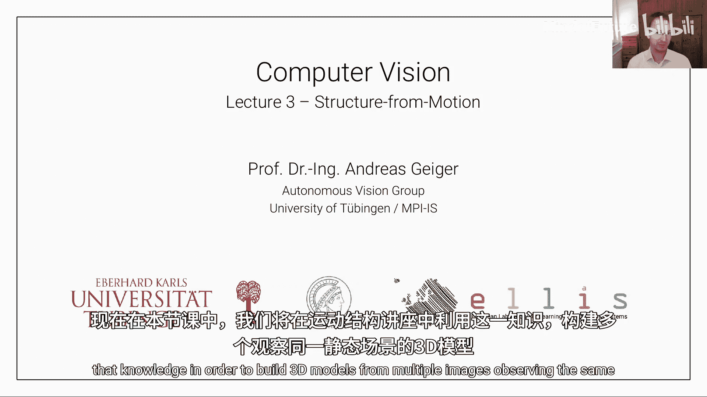
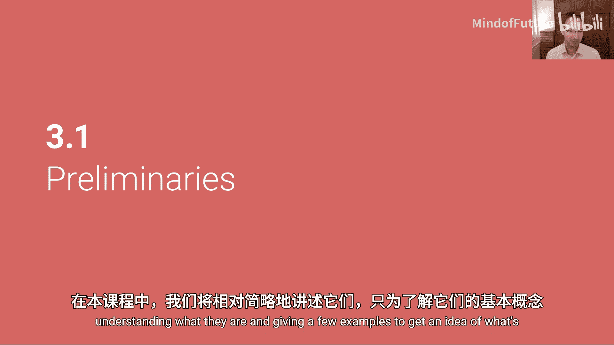
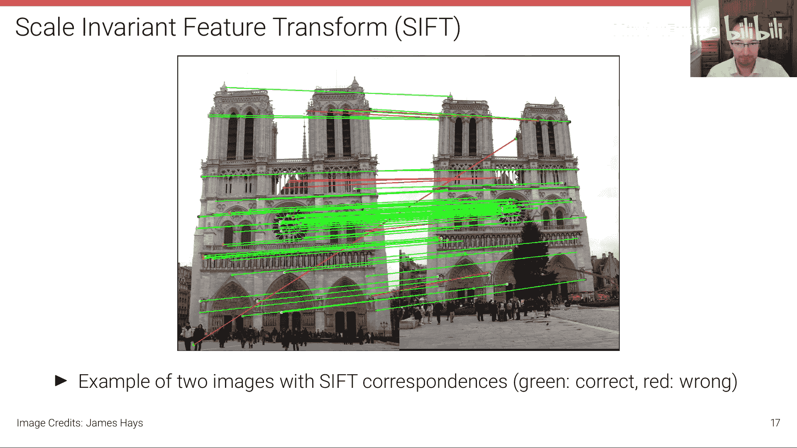

# 【图宾根大学 • 中英】计算机视觉 ML-4360 (Computer Vision) p08 P08 Lecture 3.1 (Structure-from-Motion - Preliminaries) -BV1S8N1emEef_p8-

Hello and welcome to lecture number three of this computer visionion course。

Last time we discussed the image formation process or a 3D point gets projected onto the 2D sensor plane。

Now in this lecture， in the structure for motion lecture。

We're going to utilize that knowledge in order to build 3D models from multiple images observing the same static scene。

This lecture is subdivided into four units。 In the first unit。

 we are briefly going to touch on two preliminaries that are required for building 3D models。

 One is camera calibration how to recover the camera parameters， such as the focal length。

And the other is how to detect and describe features and how to match features。

 point features in particular， across different images that can later then be used for reconstructing these features in 3D。

In unit。3。2。We're going to cover the most basic。Reconstruction form。

 which is two frame structure for motion， we're going to discuss the aippolar geometry and how we can recover the relative camera motion between two frames and also the 3D structure from these two frames。

And then in the last two units， we're going to discuss multi frame structure for motion techniques in particular。

 closed form factorization techniques and their advantages and disadvantages as well as more modern bundle adjustment techniques and in particular also incremental bundle adjustment techniques that are mostly used today。

Good。So， let's start with。

The first unit on preliminaries。 and while。Camera calibration and feature detection could easily fill entire courses on their own。

 We're going to。Treat them relatively shortly in this course。

 just for the sake of understanding what they are and giving a few examples to get an idea。

Of what's happening。So let's start with camera calibration。Emerrac calibration is a fundamental。

Rerequisite。Or most ready reconstruction techniques。

 in particular if you want to obtain a metric reconstruction， you first need to know。

What the camera parameters are in order to know how the rays emanate from the camera center or how the rays are getting projected onto the camera image plane。

The camera calibration is the process of finding the intrinsic and extrinsic parameters of the camera。

And most commonly a known calibration target， such as。

Booy pattern or a checkerboard is used as shown here。 Actually。

 camera calibration was also the first project that I tackled。 the first research project I tackled。

 It's a very fundamental thing。 So that's something that many people get started with。

So how does camera calibration work？A whole variety of techniques。

 But the most fundamental and basic technique and the one that。Most people use。

 and that's also implemented in packages such as Open CV， for example。Is working as follows。

There is a calibration target and most often a checkerboard is used because it's relatively easy to find corners very precisely of the checkerboard。

 And if you know the number of checker planes， then you know the 3D model of the checkerboard you know exactly what is the distance between the corners you can find the corners very precisely in the images and you know how this plane looks in 3D So the only thing you need to determine now is the。

parametersages of the camera， the calibration matrix。

 as well as the pose of the checkerboard in each of the images。

 and this is the optimization problem that you're going to solve。The first。

 you're going to print such a checkboard。And it glue it on a very flat surface。

And then you capture that checkboard in different poses as shown here。

Here's an example of the checkerboard photographed in different poses， you need to make sure that。

The checkerboard is always fully visible so that you can always detect all the corners。

And that is covering the pose space well in order to get enough observations。Enough。

And ambiguous observations in order to obtain a good。Precise calibration。Of your camera。

Now a second step。For each of these images。You're going to detect features in the case of a checkerboard。

 you're going to detect the corners and you're going to try to refine them subpixel accurately and there's various algorithms for finding subpixel accurate corner placement of checkerboards。

Here's an example。And then in the final step， you estimate the camera intrinsics and Xtrins。

And here extrinsics means。Iose。Off the checkerboard with respect to the camera coordinate system。

 because。You're waving this checkerboard in front of the camera， in each image。

 the checkerboard will have a different pose。However。

 this is a feasible optimization problem because the post has only six parameters。

And the intrinsics of the camera are maybe just five or 10 parameters。

 depending on if you utilize distortion coefficients or not。And so overall。

You have much more observations， because each of the。

Corners in the checkerboard gives you two observations， one for the X and one for the Y coordinate。

And you have。Plenty of them per image， they have much more observations still than parameters that you want to estimate and that's why it's possible to do that。

Now， direct nonlinear optimization of all the parameters is done by minimizing the re projection arrow by taking these 3D points of the current estimate and projecting them to the image and comparing the distance to Ocleidean distance inside the image。

With respect to the detections in the image and trying to minimize that。

But you can't just randomly initialize the intrinsic parameters of the camera and the extrins deposits of the checkerboards because you will get or easily trapped in local minima。

So I need a good initialization for all these parameters。

And there's a couple of papers that describe techniques for finding such。

Make good enerizations in closed form。So for instance， there is this technique here at the bottom。

Which is maybe the most popular and most sideed technique from Shang et al。

A flexible new technique for camera calibration published at Diammi 2000。

 so this is for prospective cameras， the most common case。

And it gives you the focal length and the principal point。

By constructing linear systems from the observations that you make now。

 this is only a very coarse and approximate initialization， but it's much better than a random guess。

And so from this inization， you can also derive a good initial estimate for the poses of the checkerboards。

And then this together forms the initialization for the nonlinear optimization process that using some gradient based technique like Leavenbo Markward。

Optimize minimizes the re projection errors and refines all the parameters。

 and typically the closed form solution ignores the distortion parameters。

And then you initialize the distortion parameters to zero。

And then during nonlinear optimization you iteratively add the distortion parameters。

 and so that is a relatively well pose problem so you don't need a good initialization of the distortion parameters for most cameras unless the cameras have a very wide angle lens。

 let's say。Some remarks。There exists a whole variety of calibration techniques that are used in different settings。

And also for different lens models， etc。And these methods differ。Algarrically。

But also in a type of assumptions and calibration targets they use。There's algorithms form 2D。

 3D targets。There is algorithms that use planes， algorithms that use vanishing points， etc。

But the most common technique， the one I've just shown that uses these。

Checkerboards or checkboard like。Patterns。And。If you' like to know more。

There is this very famous matlap toolbox I was used for。

went0 years or so here by Boge the doll that's still available and has a very nice description of all the parameters and how the process exactly works。

 this is now implemented also in OpenC and there is also a chapter in the Sliki book on camera calibration。

But here for them。Pers of this lecture， we're going to keep this part short。

Now let's move on to feature detection and description Now we have calibrated the camera。Now。

 in order to obtain a 3D reconstruction， a 3D model， as sparse 3D model。

 we first need to find points in the images that correspond to each other。

So we need to find salient points。That are distinct。

That can be easily red detectedtected in another image。

But this is what we call point features point features describe the appearance of local salient regions in an image。

In this example here， there is a few cases given where you can see the difference between a salient point and a non salient point。

 so for instance， this point here is very salient because the local appearance is very distinct。

Look at this patch。It's relatively easy to find the patch in the image。However。

 there's regions where it's harder like in in this case here， we have just。

Like this white black transition with almost linear transition。

 And so you can move this patch along that line and maybe you'll find other places in the image where have a similar transition。

 so it's not as ambiguous anymore， and it's not as easy to localize that patch。

And then here in the sky region where the texture， the colors。Are very homogeneous。

 It's very difficult to find a correspondence。So you want to have an algorithm that finds salient。

Locationations in an image。And then describes these salient locations well。

Point features describe the appearance of local， salient regions in an image。

And they can be used to describe and match images taken from different viewpoints。

 They have actually been used。InIn the pretty deep learning era of computer vision。

 a lot also for recognition。You're getting a lot of thealient regions described thealient regions。

 putting them into a bag of words model into an SVM classifier and then classifying。

The image based on these local features。NowOf course， these techniques are not。

lateate of the art anymoremorph for recognition， but they are still very frequently used despite some of the detection systems have been replaced by deep learning。

 but they are still the basic idea and even the basic algorithms we' are discussing are still used for 3D reconstruction methods and they really form the basis of the sparse 3D reconstruction methods covered in this lecture。

嗯。So what are the？Prerequisites。What should these features look like？

The feature should be invariant to perspective effects and illumination。

 because if we take an image of an object， like here， a frontal view。

 and then we take another image of these objects。With a different illumination condition。

Where colors can change and also where you view these objects from a different viewpoint so the perspective changes。

You want to find the same features back right you want to here are some examples of features that have been retrieved from features extracted on the original objects。

You want to find the same feature spec， and you want to find them in a way。

That if you extract a feature vector。That then that feature vector is distinct and only matches to the correct location in the other image。

嗯。And that's what I mean by saying the feature should be invariant to perspective effects and illumination。

They should abstract away from this。But they should be discriminative。

 They should still be very discriminative。 They should say， oh， this is， this is the location。

 I'm sure this is the same location and all the other locations are unlikely。Otherwise。

 I'm not giving you back this feature。So the same point， let's say this point here。

 and this point here， it should be described by such an algorithm。With a。Feature vector。

 that's very similar。 Well if I compare this point and let's say this point here。

 then the feature vector should look very different。

And it's clear that the plain RGB or intensity patches that we would simply extract here from these images will not have this property。

Easy to see that if I just rotate the image by 180 degree， the RGB patch would look very different。

 If I scale the image， the RGB patch would look very different。If I translate。

 it would look very different， so we cannot just use and match these plain RGB intensity patches。

And this is where。Feature detection and description methods come into play。They have had a。

Really a revival in the 1990s and 2000s and have been used。

Throughout almost all areas of computer vision and one of the most popular one is called Sft。

 you might have heard of before it's called Sift because it's a scale invariant feature transform so it's invari not only to rotation or perspective effects。

 but also like scale。And the way this is done is by constructing a scale space。

By it iteratively filtering the image with a Gaussian。 So here this is the original image。

 and then you filter it with a Gaussian filter。Multiple times。

 So these filters get more and more blurred here。 And then once this is blurred beyond a certain point。

 you can also rescale that image because it's so blurry that you can continue at a。

So called next octave at a smaller scale。 you could do this at the original scale as well。

 but it would be wasteful。 So they regular give people scale this down。

So once you have such a scale pyramid。You compute the difference between adjacent blurred images。

 so this is a blurred image and this is a slightly more blurred image and you compute the difference and that's called the difference of Gaussian。

And the interesting property of such difference of Gaussian images is that if you detect Xtreer in these difference of Gaussian images is。

Extre these interest points that we're detecting are blobs in the image， so this is a blob detector。

 Its blobs in the image and finds this at multiple scales in that image because we are doing this difference of cautionusian at all scales at all adjacent scales。

And we' are finding that this extreer by looking at the scales at this difference of gausian scale space at this volume and trying to find maximum and minimum points in that space where maximum minimum means that we have a point。

Where all the other surrounding points， not only at the same scale， spatially。

 but also in terms of the neighboring scales。Are lower for maximum or higher for minimum。

So these are extremetre in scale space。why are difference of Gausians。Blolock detectors。Well。

 let's look at what a difference of Gaussian does here we have two Gausians。

 a green one and a red one。And if we take the difference of these two。

 we get this kind of Mexican hat similar to a lapplian filter here， the blue one。

And this is a 1D example here， of course， so if you imagine our 1D signal。

And you're swiping this blue filter over that signal， and there is a blob。That has the radius of。

 of this here。 So this depends on the scale。 At this scale， we have this particular radius here。

 So we have a blop， a disk or something like。Like like a。Yeah， yeah。

 a step function kind of or two step functions。Where we have one here and zero outside。

Then this filter here will respond。And this is。The same example in 2D space right。

 so this is what this difference of Garian filter looks in 2D space。That is why detects blops。

Because we apply it at multiple scales， it detects blos at multiple scales。So here's an example。

 here we can see such a sift。Sca pyramid， We can see that the images。嗯。Itcomes more and more blurry。

 if we go down。Inms of resolution and scale here。And what's interesting is that now if you look。

 for instance， at the eye and this eye is detected at a particular scale。

 so the value of the center of the eye， which is a blob feature is high at a particular scale。

 but if you look for instance at the I， the value of the tie is low。

 so it's not an extreme at that particular scale， but if I'm now downscale in the image。

And I'm looking here at this scale， for instance， and we see。That's the。The tie is also detected。

 You can get a feeling of。Detecting blobs at multiple scales by looking at。Okay。

 so we have now detected potential interesting points。

 stallient points in the image at multiple scales。And what SiF does then is it looks at these interest points at the respective scale。

 so this feature， thescriptor is also scaled with the scale。And then it looks at all the gradients。

 it computes so will filter the response and computes the gradients from there。

 and then aligns this descriptor， it rotates the descriptor area。

Based on the dominant gradient orientation。 and by that， it becomes rotation invariant。

Now we have a feature that's not only scale but also rotation invariant。

Simply by looking at this gradient histogram。And then rotating it and then。Once we have rotated it。

We compute gradient histograms。In subre， and these formed in the descriptor。

 So here has an example of two by two subre。In。The final version of the subdescriptors they use4 by four subres。

 but here we have two and two horizontal and two vertical regions。So these here。

And we're looking at the gradients inside these regions and building a histogram。Of these gradients。

 So for instance， in in this case here， we have a lot of gradients。

 a lot of gradient directions that point to the。Upright， and so that's why this spin here。

Response highly。 but then to the bottom left， we have only maybe this one here and this one here。

 so we have a less strong response in that direction。

We compute this gradient histograms for the local subreaches and then we concatenate these histograms into a big vector in the case of sift。

 a 128 dimensional feature vector。And the reason why we're looking at these histograms is that these histograms are。

Illummination invariant。 So if you look at the gradients。Then， you。

You get invariant to relative brightness changes and if you look at histograms。

You're not only invariant to the brightness changes， but you're also invariant to slight。

Persspecive transformation such as translation so you can slightly translate or prospectively deform the image。

 but the histogram will not be affected as strongly because it aggregates information of a larger region than a single pixel in a plain RGB feature would be。

That's the intuition why these histograms are useful。

To achieve the properties that we discussed in the beginning。But this was one example。

 maybe the most prominent one， it started a revolution in 3D reconstruction because with Sift it was possible for the first time to match features very robustly。

Across very different viewpoints， even different camera models。But。Following up on Sift。

 there have been a variety of feature detectors and descriptors proposed such as surff。

You serve brisk or fast and many more， and recently also deep learning based funds。However。

 SiF was really seminal due to its invariance and robustness and kind of revolutionized recognition of mission and in particular machine particular matching。

And enable the development of this large scale structure for motion techniques。

That we discussed today。And despite being more than 20 years old， by now。

 a sift is still used today day。 So， for instance， the state of the art。

ItsStruc for motion pipeline that many people use today。

And compared to as a baseline is called coalmap and internally uses a variant end offt bill today。No。

How can we get matches？Using descriptors well。If we have two images and we have detected features in these images。

Then we can use efficiently nearest neighbor search techniques that build a search tree in one of these images to efficiently retrieve。

Or particular query features in the first image， the closest features in some， let's say。

 oclean space， this vector space the second image。 So want to find that 128 dimensional vector that in terms of L 2 distance is closest to that particular feature in the left image for which we want to compute the match。

Yeah。Now， this is not always going to be unambiigous and therefore ambiguous matches are typically filtered。

By computing the ratio of distance from the closest neighbor to the distance of the second closest neighbor。

 So I compute not only。For a particular query match in the first image。

 what is the closest match in the second image based on that distance of the 128 dimensional space。

featureature。But I'm also completing the second best。And if that distance。

Between the first and the second best is。嗯。Small， in other words， if that ratiosure is large。

 second pest is almost the same quality as the first。Then that match is removed because。

It's it's not clear if。Maybe the second best is actually the correct match and they have just been。

That the first is just the first because of noise in the input images for。

And that's what I mean here in the last sentence by a large ratio， 0。

8 indicates that the font match might not be the correct one。

A ratio of one would mean that there is two features in the second image that are。

Exly the same distance。From the query feature。And here's an example。

 so here we have two images captured from the same。The two images of the same object captured。

 but from different viewpoints， you can also see theres。

It's a different day because there is three here in front of。The church and period is not。

You can see that a lot of matches have been retrieved that are correct here in green。

 but there is also some feature correspondences that have been retrieved that are not correct。

 for instance here in this case， there is large ambiguity because a lot of these local structures look very similar to each other。

 it's easy to make a mistake。

But overall， if you have found enough good features then and use these features now。

To estimate the apopolo geometry and the 3D structure， as we're going to discuss next。

