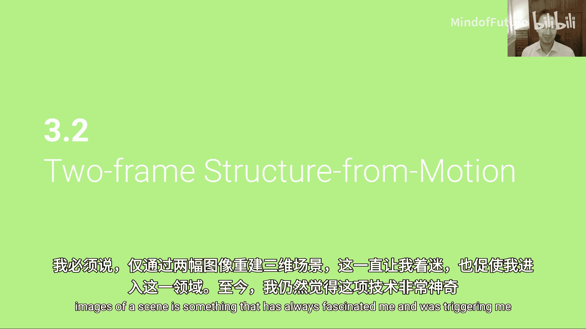
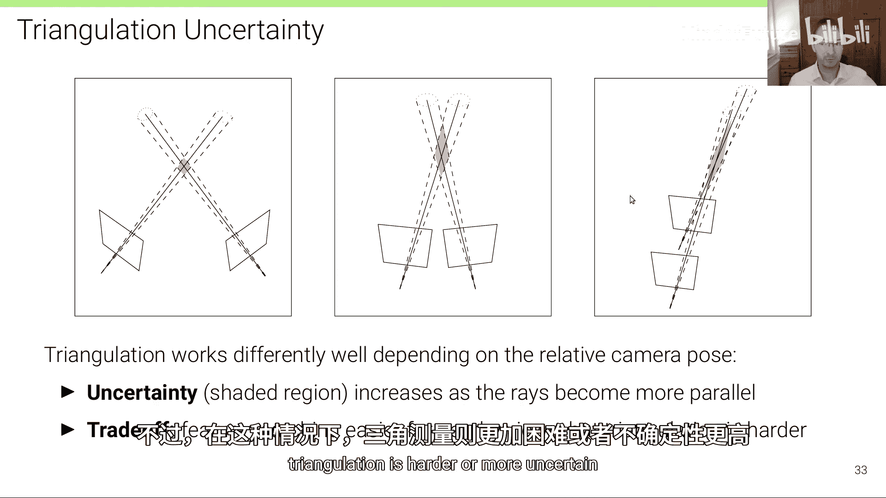

# 【图宾根大学 • 中英】计算机视觉 ML-4360 (Computer Vision) p09 P09 Lecture 3.2 (Structure-from-Motion - Two-frame Structure-from-Motion) -BV1S8N1emEef_p9-

In this unit， we're going to discuss two frame structure for motion。

Which is the most basic setup where we've given them just two images taken from different viewpoints。

 And we want to find。The relative motion between the two cameras。

As well as the location of the 3D points。That correspond to the projections that we observe in the images。

And I have to say that。Being able to reconstruct 3D from just two images to flat images。

Of a scene is something that has always fascinated me and was triggering me to enter that field。

 And I still find it fascinating that is possible to day。

Now， in order to。Through this， we first need to understand so called apolar geometry。Again。

 the goal is to recover。Now， from just two images and detected features and matched features in these two images。

The relative camera pose between these two images or cameras。

And the 3D structure from just these image correspondences that we have detected， for instance。

 using the siif descriptor。From the last unit。And the required relationships。

Are described by the two view apopolo geometry that's illustrated here on the right。O。

So what do we have here， We have two cameras。 This is the camera center of the first camera and the image plane of the first camera。

 camera center of the second camera and the image plane of the second camera。

And the rotation matrix R and the translation vector T denote the relative pose between these two cameras。

And we assume that we have two prospective cameras。

But this is a pretty realistic assumptions that we're having here。Almost all。

Under cameras followed that model。We have removed distortion， we can model them like this。Now。

 a 3D point is projected into the left image onto P X bar1。We're using this augmented vector here。

hich is just。Recap， the homogeneous。Ector will be normalized by the third component such that the x and Y pixel coordinates。

Can can be directly read off from the first two components。

 the first two elements in that background。And similar。

 that 3D point gets projected into the second image。Onto pixel。Expire 2。Now。

 the 3D point and the two camera centers form or span the so called Eippola plane。

Because we have free 3D points， all of them must lie on a single plane that's clear， but because。

The points get projected linearly into the images。 We also know that。The pixels。

 X part 1 and X part 2 lie exactly on the same plane。 All of these five points。

3D point the camera centers and the pixels lie on the so called apipola plane。And now。

One nice property of this Apopola plane is that it we want to now。

 if we have already recovered that Apopolar geometry and we know the Apopolar plane。

Then this restricts the search space when we want to find the correspondence of one particular feature point in the first image。

In the second image。And why is that， Well， if we have such a point X bar one for which we want to find。

The correspondence in the second image， we do not have to search through the entire 2D image domain in order to find that point。

But， we know。From the Apopolar geometry。That that point here must lie on that Apopolar plain。

And in particular， it must lie on the so called Eippolar line。

 That is the intersection of that Eippolar plane with that image plane here。 Second camera。

 And that's indicated here by。Oomegeneous L2。This is the so called apopolar line。

 and that Apopolar line exists also on the other image， if we want to find。

The feature that corresponds to x2 bar in the second image， we want to find that in the first image。

 we need to search only along the Apripola line。L1 in the first image and not everywhere in the first image。

 just on this along this 1 D search space。 And this is， of course。

A significant simplification of the problem of the search problem。

Once we have found the apolo geometry， once we know。The camera， the calibration。

 and also the relative。O was between two cameras。And this is。Use typically across all。

ReD reconstruction techniques。The produced state of the art， bars or dense， 3D reconstructions。

And we're going to cover some of them at the end of this lecture。

We called multifuse stereo techniques， very briefly， just showing some results。

 but we're going to discuss that in more depth in terms of two view dense stereo reconstruction techniques。

In the next lecture and then also as some applications of graphical models， for instance。

 in later lectures。So this is the point of the apopolar geometry once we know the camera。

Elibration matrices and the rotation and the translation。

Then finding correspondences suddenly becomes much easier。

 but in order to recover the apolar geometry， which we're going to discuss next。

We need to find correspondences without knowing the I geometry， of course。 So we need to search。

Ourse feature correspondences across the entire image domain。 We need to solve a harder problem。

In order to find these few parameters of the apopo geometry， there is actually。

The camera calibration is known there is five， three for rotation and two for translation because there is a scale ambiguity left。

So we only need to find these five parameters， and then the search problem becomes suddenly much easier。

And then。It becomes also clear that all these Epolar lines for all possible 3D points pass through a single。

Point in the 2D image planes， which is called the apiol So have one api pole in the left image plane and one api pole in the right image plane。

 and that is exactly where the so called baseline。The connection。Between two camera centers。

 us is through the image plane， and that doesn't need to be on the image plane that can also be at infinity if the cameras are oriented。

In the same direction， but here in this example， they are in the image plane。Both。

So to see that actually all Apopolar lines pass through these two apo poles I have drawn another point here。

 another 3D point， and also the apopolar plane and the apopolar lines and the apopole or this plane here and you can see if I'm moving that 3D point。

 then the projections of course of this 3D point change and the Apopolar lines change。

The Apopo lines always pass through these Apopos that stay fixed。Good。

So now the question is how can we mathematically express that relationship and how can we recover that relationship？

So let's start by assuming that we know the camera matrix of the left camera or the first camera and the second camera。

 AI， which is a free Wi free matrix， and we know that， for instance， through calibration techniques。

But we've discussed in the first unit。Now， if we know that calibration matrix from a 2D pixel coordinate here in augmented vector notation。

 we can find the local ray direction by undoing。What the last step of the。

Image formation process thus， which is the camera calibration matrix application。

 we're just doing the inverse of that。So we have the local re direction in3 display space of that pixel。

X bar， and we call it x tilda here process a homogeneous coordinate。

 but we are not using any any further subscript here just for simplicity。

So this is the local re direction， by just multiplying the pixel with the inverse of the calibration matrix。

 just undoing this last step of the projection。Now， what we have is that this local re direction。

Must be proportional to the 3D point。What's the 3D point。Is on that ray。Just at a different distance。

We're using that symbol here to denote。Proportality。Now。

 what we also know is that this3D point is related。

That3 point with respect to the second camera system represented with respect to the second camera system。

Is related to the 3 to the same 3D point represented in the first camera coordinate system。

 which we deote by x1 here through a richie body transform because were going from this camera coordinate system to this camera coordinate system with this rigidie body transform So this point。

Which is x1 in this coordinate system becomes x 2 in this coordinate system by。

Multiplying it with R and translating it with T， this is this here。Preion。

Now this one here is proportional to。嗯。This expression here。

 because there's only a scaling relationship that we have introduced here。

 so we have changed x1 to x1 tilde， which is the local re direction in the first camera。

And because we have just scaled this， we of course need to apply the same scale here on the right hand side。

 which I just denoted by S。And multiply to T。That's basically the proportion of。

How much we have scaled x til there with respect to x bar1。Now。

 what we can do with this is we can take the cross product of both sides with T。

And obtain the following expression。 If we take the cross product of this side here with T。

 we have this expression here on the left side。And then here on the right。

 if we take the cross product， we have this expression because the last expression is the cross product of T of itself。

Which is zero。そです。Term falls away， no matter what as actually。Now。

 what we can do run is we can take the dot product of both sides。Again， on the left side here with。X。

Tilda to transpose。Which yields the following expression here， you have x tilda t。

X Tilda cross product T， that is a this Q symmetric matrix we've introduced in the previous lecture。

Our extilda one。嗯。And this must be proportional。 So we have swapped these two expressions here left and right to x2 T。

And the cross product is cuisymmetric matrix of T。X til up to， this is this term here。Now。

 on the right hand side here， what we have here is the so called triple product。

It's an inner product and a cross product combined。And what we know from the triple product。

 because it describes the volume of the。Apioid that's represented by the free vectors is that this volume is 0。

 if two of these vectors are the same， this is just a geometric property that you can also look up on Wikipedia。

So if two of these vectors are the same， then this must be zero。

 so the entire expression here on the right hand side is zero。

 and because that's proportional to the left hand side， no matter what that proportionality is。

 the left hand side must also be zero to fulfill this in general。

So we have retrieved this expression here。 We have retrieved an expression for the local re directions。

Relating the local array directions in the first image in the local array direction in the second image through this matrix here。

And this is the so called apopolar constraint。X tilde 2 transpose E。

 this is called the essential matrix， x tilde 1 equals 0。

And the essential matrix is simply this cusymmetric matrix。

From the translation vector multiplied with the rotation matrix。

Of the relative pose between the two cameras。Now， what we see from this expression here is that this is actually also leading to the apopolar lines directly because E maps apoint x1 in image1 to the corresponding apopolar line in image 2。

And so if we take。We take this E and we multiply it with x1 tilde。We obtain a line expression。

 because。XX2 tilde transpose。L tilde 2 is equal to0 because of the equipoboal constraint that we have derived。

This is just if I plug this in here， I get the Apopo constraint， and here I have the line equation。

 and that means I multiply。嗯。to that E on the right hand side， x stillil the  one。

Then I have just the co vector。We called it before the co vector here that together with another point。

 x2。嗯。Equal to 0 represents the line constraint， all points x2 are on the line if multiplied with L or equal to 0。

And similarly， by transposition， we obtain the opposite we retain the apolar line in image 1。

As transossing this expression here。E transpose x 2。

Is the line that Apripola line in the first image plane。And here's the relationship again。

 just visually。牛。Or any point。嗯。X。One in the first image。

 the corresponding apipo line in the second image passes for the so called apipole。

That is what we know from。Just the fact that all of them are on the same Apolar plane。And， therefore。

The Apopole satisfies the following expression。 The Apopole multiplied with the Apopo line。

Because the apole must be on the Apopolar line is equal to zero。

And here's the expression for the apo line， so E2 transpose E theilda x tilde 1 must be equal to 0。

And this must hold true for all possible X1s。So for all possible X1s here。The Epole。

E2 must be on the Apolar line， L2。For this one here and for this one here。

And this gives us a constraint for where that Apool must be located。It follows that。

If this has to hold true for all x1。Then actually this left and side here must be equal to the zero vector。

Otherwise， this couldn't hold true for all X1。So E to transpose。

I the essential matrix is equal to the zero vector。And from this， the expression here。

 we can directly read off that E。Build that too transpose。

 So the apipole in the second image is the left nu space， or in other words， the left single vector。

Forresponding to a single value0 of the essential matrix。And similarly。

We have that the apo in the first image is the right null space。Or in other words。

 the right single of vector if single value0 of essential matrix。It'sJust given here by Russian。有。

Good。So we know how we can extract the apo， for instance from。The essential matrix。

 but how can we recover actually the essential matrix from？第。Image correspondences。Well。

 let's assume we have n image correspondences and sift features in the left image that have been matched to sift features in the right image。

First image matched to features in the red in the second image。Yeah。Now， with these correspondences。

 we can form n homogeneous equations in the nine elements of this essential matrix。Because we have。

Strained here。This constraint here， which gives us exactly one equation for each correspondence。

If we write this in， if we write this out， we get this equation here for each of the correspondences and see that。

Here we have。The elements of the left and the right。Pix coordinates， x1 and x2。X X1 and y 1。

 X 2 and y2。 And we have the elements。 E1，1 is the first element of that essential matrix。

 We have one equation now for each image correspondence。

In terms and you can see it's linear in terms of elements of the essential matrix。

It's a homogeneous equation。Now as。E， the essential matrix is a homogeneous。Mattrix。嗯。

We have to constrain again。As in the case of estimating hographies。The last lecture。

The scale of that matrix， and we can constrain that scale of the matrix to one by again using singular value decomposition。

嗯。And obtained a solution to this system to the constrained system exactly the same way as we did it for the。

A recovery of the homogeneous of the homomography before and you will see that exactly the same trick we're going to apply multiple times also throughout this lecture here。

 so it's a very important trick。Now， one thing to note here is that in this equation。

Some of the terms。Our products of two image measurements and some of them are just products of one image measurement。

And this introduces some asymmetry。And if you have measurement noise。

 this amplifies measurement noise。And to counteract this the normalized eight point algorithm from Hartley。

In a seminal paper called in defenseense of the8 Point algorithm。I recommend reading。

Nmalizes the image。Features。In the 2D image plane， it particularly whitens them to have zero mean and unit variance and then runs the recovery algorithm for the essential matrix。

And then after the recovery， this normalization can be undone in analytic form。

And it turns out if you do that， then you get much more stable results。

 So it's a good idea to always do that。 to first normalize the image coordinates such that they have。

Zero mean and unit variance。And then you do the SVD and afterwards you're undoing this normalization again and you get much more stable results because in practice。

 your SiF correspondences are always going to be contaminated by noise。

And so this effect will be much less strong if you do that。Now， from this essential matrix。

 now we have recovered the essential matrix elements， but how can we recover the。

Rotation and translation from that。Well， to recover the direction T hat of the translation vector to T。

 and we can only recover the direction because。The scale is not uniquely determined。

You can also show that。From the two images alone。Because you can scale the reconstruction and you can scale the translation vector and you still get valid re projectjections into the image planes。

 so there is an ambiguity， you can't measure this。But we can recover the direction which you called he hat。

By multiplying T hat transpose to the essential matrix。

Because we have t had transpose times the sing matrix matrix of T times r， and this is 0。

 the entire expression becomes 0， and therefore。E， first of all。

 therefore the essential matrix is singular， so there's one singular value that's0。

And we obtain T hat as the left singular value associated with the singular value0。

But in practice of course because we have measurement noise。

 singular values will not be exactly zero due to this measurement noise and therefore we choose simply the smallest one if you look at the singular value decomposition one singular value should be very close to0 and the other two are actually quite equal to each other。

And if you see that， then you just pick the one that's closest to zero。

Now the rotation matrix can also be calculated from this expression。

 but it's a bit more complicated and technical and there's multiple solutions so we're not going to cover this in detail in this lecture but。

If you want to know more about it， you can read up on this in this Liey book。Chapter 11。3。

Final remark， the essential matrix has5 degree of freedom。

Because there is free for the rotation and two for the translation as we don't know this absolute scale。

 but just the direction。So in theory， you don't even need eight correspondences。

You can get away with less and there's algorithms for computing this with less correspondences。

 so they are not as simple as just a singular value decomposition as we have done here。

Now there's another important matrix that we're going to quickly cover and that's also covered in this song here that I recommend to watch。

It's the so called fundamental matrix。And that is relevant if the camera calibration is unknown。

 the camera calibration is unknown， we cannot use the local array directions。

 but we have to use the pixel coordinates directly。And therefore， the essential matrix。

Or before becomes this right， We know that the。Local array directions are defined as such。

X1 is equal to a 1。Inverse。X bar1 this expression here and the same for x2 here just transposed。

And so we replace this here and the fundamental matrix then directly relates to pixels。

 not the ray directions， because we don't OK。And the matrix that is relating these two is now called F and not E anymore。

 but it contains E and these two inverse caliberation matrices。

In one single free by free matrix and this is called a fundamental matrix。Like。The essential matrix。

 the fundamental matrix is in absence of noise rank2 and the apiols can be recovered in the same way as before。

 however the intrinsic parameters cannot be directly determined。In other words。

 we obtain only a prospective reconstruction and not a metric one。And that's。

That's not very desirable。But it's still useful in order， for instance。

 to do certain verification tasks for verifying if feature correspondences are actually correct because they lie on the Apola lines。

 you can do that， but you don't get a metric of construction。

 but if you have some additional information like vanishing points。

You know that case constant across time for all the frames you have。

 there's some information about the intrinsics。Then you can actually upgrade the perspective reconstruction to a proper metric one and there's a couple of papers on this topic as well。

So here's an illustration of how the apolar geometry looks like。Independent of。We know it just yeah。

Essential matrix or we know the fundamental matrix。

Here we have the Apopo lines that correspond to each other and you know you can note here that for instance。

 for this point here that is corresponding to this point here。

We have all the correspondences aligned here， all the hypothetical correspondences。

 all the hypothesis are aligned on the Apopola line。

 so we just need to search along the Apopola line to find the corresponding point for this point here。

In case， this would be the correct correspondence。Okay， so now we have recovered the relative。

Of the relationship between the two cameras in terms of their rigid body transform up to scale。

 but we haven't recovered the 3D points location yet。And this is done through triangulation。 Now。

 given these two cameras with intrinsics and Xtrinss。How can we recover the3d geometry？And well。

 that's pretty easy now given these two and given correspondences。

 we can just shoot the rays into3D space and we can see where they intersect。However。

 because these measurements， these sift correspondences are typically noisy。

 this ray might not intersect precisely。And we need to take that into account。

 So we want to recover a point，3D point。That in some sense， is close as to these two races。Okay。So。

 let'。😊，嗯。呃。And let let X hda W denote a 3 d point in homogeneous coordinates。

We could also write x bar because， but because we can't recover X bar。

 were writing X extilda here directly。 And that is related to。The point on the image plane。

 And now we're introducing to to distinguish these two。 We're introducing the S as an index。

 So this is the。To the pixel coordinate and homogeneous coordinates。

 and they are related to this through this 3D projection。As we've introduced in the last lecture。

 this is a projection matrix3 to 2D projection。But this is the equation for projecting this 3D world point xW onto the image of the IF camera。

And as both sides are homogeneous， they have the same direction。

May differ in magnitude and be are applying the same trick as before for estimating hographies。

 if we want to recover now from this relationship。嗯。XW。So to account for this。

 we consider the cross product again， and we know that the cross product is0。

 if these two are the same up to。Some unknown scale factor。

 So this is the constraint that we are concerned with。And now， if you write this out and use。

EIK to denote the K through of the IF camera's projection matrix。

 you obtain a linear equation like this that is linear in the unknown that we want to recover。

 which is the 3D point location in homogeneous coordinates。So con try this out yourself。

Very easy to see that this corresponds。But this this can be derived from this。

So what we have here now is one constraint per。哦。P image I so IST image index。

And because we want to find。And because we have two constraints here。Actually two constraints。

 so this is a zero vector， and we have one constraint for the x coordinate and one for the y coordinate。

But because we have a 3 defect vector to recover， we need two correspondences。

To identify the 3D point。 And that's also clear by looking at this image。 If I just have one camera。

 I can't recover the 3D point。 I need at least one more， but it's， of course。

 better to have more cameras to recover that point more precisely。 So can add as many。Equations。

 you can stack as many equations to this linear system as you like。

 that's just giving you two constraints per kind of four， six，8 or。So stepping N。

With n equal or bigger to two observations of a point， we obtain a big linear system。

 a x til that w equals 0。And as extilda is homogeneous。

 this leads again to a constrained least square problem where again the solution to this problem is the right singular vector corresponding to the smallest singular value of a。

And this is exactly the direct linear transform。We're already familiar with from lecture two for hographies。

 but now for estimating the 3D point location。Some remarks。While DLT often works well in practice。

 it is not invariant to prospective transformations。

 that means that noise is noise in that happens in the image is not taken appropriately into account and therefore the gold standard algorithm。

Is to do something else is to minimize the reproion  error to find the 3D point。

That when projected into the two or more images。Is giving the smallest Olan distance。

In the image plane。 and we can formulate this as such an optimization problem that can be solved using numericalmerical gradient based techniques such as Leavenbo Markwa。

So here we have。This notation denotes XS。I's the projection of the 3D point XW。It was the bar for。

We know an augmented vector， and Xo is the observation with trying to minimize the projection minus the observation。

Disrepency。And we are doing this over all the observations of all the cameras for that particular point。

 and we' are optimizing over that 3D point。 You can see that the point is not having an eye index because it exists only once。

We have。And different observations。 So the projection and。

The observation depend on I because we have different projection matrices and different observations in the different images。

And now this allows us to take measurement noise appropriately into account， for instance。

 if we have。Goaush and measurement noise in the images。

 this is the right model to use if we have different noise models， we can also incorporate them here。

But this is what is typically done。The minimum can also be obtained in closed form as the solution of a six degree polynomial。

ButThis becomes more technical than。More details on this can be found in。

The textbook from Hartley and Siisseman。Section 12。5。Now， triangulation works differently well。

 depending on the relative camera pose。There's some trade off， so here you can see the shaded region。

Denoting the uncertainty。Basically， the area where the 3D point could be located and that increases as the rays become more parallel to each other。

 he said here。If you have this situation， then you have a very small gray region。

 but then in this situation here， you have a very elongated gray region so the uncertainty is very high there is a trade off here because if you have if you're looking at the scene from two different perspectives。

 then feature matching is very hard because the images look very different locally。

But the triangulation will be better and for nearby views。

 it's very easy to match features because the features look similar。

 but triangulation is harder or more uncertain。

