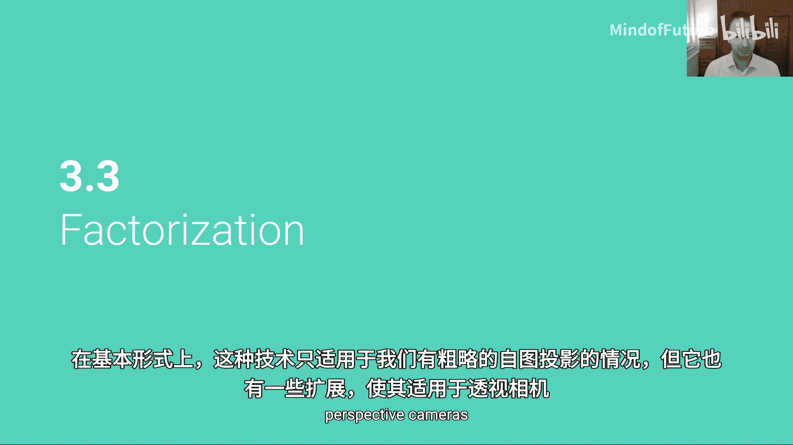
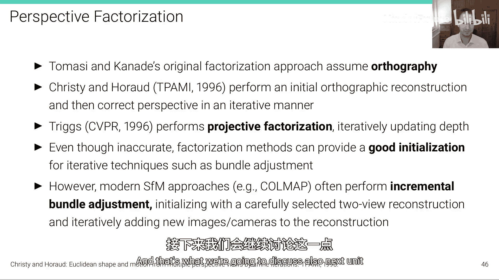

# 【图宾根大学 • 中英】计算机视觉 ML-4360 (Computer Vision) p10 P10 Lecture 3.3 (Structure-from-Motion - Factorization) -BV1S8N1emEef_p10-

So far， we discussed how to。Obtain apolo geometry from two views。But of course。

 it would be ideal to obtain both the camera pose。And the 3 D reconstruction。

 directly by optimizing over many views。Of the scene， in order to minimize。第。

Camera pose and 3D reconstruction arrow。And this is what we're going to cover now in these last two units。

 And the first technique that we are having a look at is so called factorization。

From Tamai and Cannadi introduced a very old technique， but very elegant mathematically。And。

In the basic form， only applying to setups where。And we have a rough。Auttographic projection。

 but there is some extensions of this technique that also work for prospective cameras。

そう。How can we use more than two views for structure for？Let's assume。That。Eegraphphic W。Contains。

These image coordinates。Contains image coordinates for features that are tracked。Plus several frames。

 so here we have n frames or cameras and P are the number of feature points。

Let's say we have 100 features and they are tracked over 10 cameras。

We assume you' are always full tracks， every feature is visible in every camera。

Given these observations。This is illustrated here， right here we have some features and here we have these feature tracks。

And assuming autoographic projection， our goal is now to recover both the camera motion。

And the structure jointly。The structure as the 3D， the set of 3D points corresponding to the tracks that we have observed。

And it turns out that we can do this in closed form solution for this very simplified setup with autograph projection and complete feature tracks。

 and there is some modifications of this algorithm that make it also applicable to prospective projection and alleviate this to reduce this strong assumption of requiring the features being tracked across the entire sequence。

Here's an illustration on the bottom。 we have a sequence of images where we detect and track features。

 for instance， using the。Lift descriptor all by using。

Because can now the feature tracker and we get these this is in the 2D space。

 we get these 2D image trajectories。Of this fear that is rotating here。

And then we are reconstructing both the camera planes。

Of this autoographic cameras and the3D structure。In terms of the three points。

How does this work Well， under autoographic projection， a 3D point maps to a pixel in frame。

There should be I in frame I in the following way。As it's an autoographic projection here。

What we do is we take that 3D point here。And we subtract the。

Tranlation of the em recording system with respect to the world origin。

That this point is expressed in world coordinates。And by doing that。

 we are expressing that point in camera coordinates。So this is basically leading to this vector here。

 Xp minus T。This point here now expressed in this blue。Camera coordinates。

And then we simply need to project that point onto the x's of that coordinate system to get the x and y pixel location。

 so here's an illustration where we are projecting it now onto that plane by taking the projection onto that vector and onto that vector and this gives us the x and the y coordinate or that point。

异议。In。The plane， the image plane of frame eye。Now， without loss of generality。

 we assume that the free de coordinate system is at the center because there is an ambiguity here。

 right we can。I'm always。Define the world coordinate system arbitrarily。

 so we need to define it somehow and redefine it such that the 3 d point cloud。

Here is centred around this world coordinate system to remove that degree of freedom。

This is an assumption that we do。Now， let's。嗯。X I and Y IP denote the 2D location of feature P in frame I。

Centering the features per frame and collecting them yields the so called measurement made。

We are not only centering these points that we want to recover in3D。Remove that ambiguity。

 but we're also centering the points in the image coordinates before actually doing something with them。

 So if this is the image that we observe。Or frame I， we're centering them such that they are0 mean。

 and this is expressed by these two equations here。

And then we are taking these measurements and we're stacking them into a big matrix where now we have the x and the ys。

 these are the two parts of the matrix here and we have it for all frames N and for all points P。

 so's a complete matrix that contains all the measurements。

Remark the tilde denotation here didn't know it's centered。Not homogeneous coordinates。

We're using the same notation here。But this is inconsistent with deep。

Of a lectures where we typically use it for homogeneous coordinates。

Let me repeat the tilled annotation denote itss centered， not homogeneous coordinates。

 Please keep that in mind。 This is only for this unit。Okay， so x tilde。IPR。

The centered x coordinates of point P in image I。闹。うん。😊，As we have this expression from before。

The expression for projecting a 3D point onto the Ive image plane。

The centered image X coordinate is given as follows。 we have x tilde， this is the centered notation。

Which is X I P minus。The mean of all the 2D image。Features that frame。Now we can plug this in here。

 so we have the expression here for XI。And we have this expression here for X IQ。Now。

 let's have a closer look at the second expression。So in the second expression。

 this term here does not depend on Q so we can pull it outside。And we can also。嗯。

Pull UITI outside this expression here， this summation because it also doesn't depend on Q。

 so we get this expression here。Right。闹。嗯。We have on the left hand side here， we have UIT。T i。

A negative， and on the right hand side， we have UI transpose TI positive， so these two terms cancel。

And so we're left with UI Xp minus UI this expression。

 which we can summarize as UI and suppose this expression here。嗯。

And because we have assumed that the 3D points are。Centensed。This expression here is zero。

 so we obtain UIXP。So， in summary。E centered image X coordinates， assuming center 3D coordinates is。

X tilde IP is simply。UI transpose X P， a very similar relation a very simple relationship。

And the same is also true， we obtain a similar equation for the R coordinate。

So we have these two expressions， X I。U axis or the x axis of the。Ive camera coordinate system。

 and this is the V or y axis of the IF camera coordinate system。

 we have the simple linear projections to obtain the centered coordinates。

Now we can collect all of these centered coordinates into a centered measurement matrix W Tilde。

 and we use tilde here for denoting centering not homogeneous coordinates。

And we obtain a very simple linear system， which is w tilde equals rx。

 but w tilde is now dis centered。Image coordinates， so this matrix is the same as this matrix here。

And we have R， which is collecting the。Aes of the。Camera。Orordinate systems。U1， U N， V1， V N。

 and we call this R because these are simply the rotations This can be interpreted as a rotation matrix。

 right this is just the。The rotation of the autoographic MR coordinate system。

 translation doesn't play a role because it's an autograph rejection。 So we just have rotations here。

 and this is。Dis rotationations are formed are span by these spaces vectors。

And here we have the x matrix here on the right， which is collecting simply the 3D points。

We multiply these two together we obtain W tilde， which is exactly corresponding to this element wise expression here on the top。

So we have。It dis normalizedized。Representation and a very simple relationship here。

 a simple linear relationship that we have to solve now。Again， all represents the camera motion。

In our case， causes autoographic test rotation and x to structure。

 and that's why it's called a structure from motion or sometimes structure and motion algorithm because we are trying to recover from the observations W alone R and X together。

Now。Let's have a closer look at R and x R is a2 n times 3 matrix。Because these basis vectors。

That span the camera coordinate systems of three dimensional vectors and they' are stacked here into the rows of this R matrix。

And x is a three times p matrix because we have p points where each of these points is a three dimensional vector。

Therefore， in absence of noise， where this w tilde is exactly the product of R and x。

 we know that the matrix W tilde has at most rank free。And this is an important property。

That we are gonna to use。Because this matrix and this matrix have rank free maximally。Also。

 their product can only have maximally rank free， so it's a rank deficient matrix。However。

 when adding noise， the matrix easily becomes full rank。

So we we have to retrieve this rank free version of the full rank matrix by canceling the noise。Yeah。

So given real observations。We're full rank， W。At let's call a W hat here， first this is observations。

We now have to find a rank free approximation。W tilda your W hat。

And we can do that by finding a matrix W till that is closest to W add。But has only rank free。

 and it's closest to that in terms of the Frbinus norm， which is basically the L2 norm on matrices。

And this can be done also by a singular value decomposition， so it can be be shown that。

Into single veg decomposition of W hat。And you consider the singular vectors corresponding to the top three singular values。

And the other should anyways be small because they are just capturing the noise。

 then you're finding a matrix that's in the Frrobinia sense is closest to the measurement matrix that you have actually。

Observed。没。We do a single validity decomposition of the full rank matrix W hat into U sigma v transpose。

And then。It can obtain a rank free factorization。By take by considering only the。

Singular vectors and the singular values corresponding to the largest free singular of values here in this factorization。

The sigma becomes basically a three by free matrix。

And then we can simply obtain our head as U sigma to the power of one half and。X hat。

 which are estimates then as sigma1 half。The transpose， as if I multiply both together。嗯。I obtain。

U sigma， V transpose。But now because we have done this factorization and erased all the single values and single vectors that are。

Not the top three。We obtain again a rank free factorization。See that sigma is three by free。

BT is3 by P， so were removing all the singular vectors that are not relevant。Unfortunately。

 this decomposition is not unique， as there exists a matrix Q。Pre by free matrix Q such that。

With an arbitrary matrix Q， we obtain the same W hat。

I look at W hat and I have the singular value decomposition here。嗯。Into R hat and X hat。

Then I can also multiply Q to our head and Q our minus1 to x hat and obtain the same W hat。

But I have changed our head and X hat。So another question is， well。

 how do we actually find the right our head and X hat？So to find。This Q。

 that is the right cu that we actually want。 We observe that the rows of R。Are actually unit vector。

And the first half are autogonal to the corresponding second half of R。Remember， our is。

Are the basis factors that span the coordinate systems of this autoographic projection。

And they are autogonal to each other。Which means that if I multiply u with V。

I get0 and I and they are also unit vectors， so if I multiply u with U。

 I get1 and if I multiply v with V， I get1。Right？So that means。That。If I take these vectors R。

And multiplying them together U T Q， U TQ， trans， then that should be one。The fact。

I transpose this expression， I get this expression here。

This is called a metric constraint it's called a metric constraint because。

Where we know that the length of this view vector is one must be one。

 so if we multiply this together here， then this must be one。

And we should choose a queue such that this becomes one。And similar for V。

 and then also we have the cross term u times v， which must be zero， so we want this matrix。

Such that these matrix constraints hold。And this is then our R that we are interested in from all the entire family of ours that we can see。

Poice of cute。So these are the matrix constraints that we want to enforce。

 and this gives a large set of linear equations for the entries in the matrix Q Q transpose。

 as you can see here， it's linear in the entries of the matrix Q Q transpose。

If this is considered as one matrix， and from there。

 the matrix Q can be recovered using standard col decomposition。Because ofs that。

It's a Q Q transpo decomposition problem。We can the all using a standard high。

So now we have obtained。We have obtained the Q and from the Q。

 we can obtain the R and the X that we are actually interested in。 And so this solves our problem。

And here's an overview over the algorithm， summarizing it。We take measurements。W hat。

That are not necessarily。Rannk free， because。Of measurement noise。

 so we compute the SVD of this and keep the top three singular values and vectors。

And then we define our head as。And Xha as these expressions here。We compute。

 then Q and Q transpose from。from this。And from there， we compute Q。And then， our final R。

And our final。There should be X。Are computed by multiplying this with Q。嗯。

Some final remarks on this algorithm， while the advantage of this algorithm is obvious is the closed form solution is super fast。

And it doesn't have any local minima。嗯。And it's determined that's not an advantage that' in general to it's determined up to an arbitrary global rotation because we can always rotate the world coordinate system。

And the cameras as well。The disadvantage is that it requires complete feature tracks。

 if there is a feature that's not detected in one frame or if a feature like leaves the frame because of an occlusion。

 this basic form of the algorithm can't handle this。But。There is solutions for this。

 So the algorithm can be applied to subsets of features and frames， and then propagate。

Use some form of matrix completion iteratively to fill in the missing entries and still operate on the data and actually data that Ive shown you before the ear data has already this problem that not all features are visible in all frames。

 and this has been solved using such a iterative proagation scheme。

And here's another example where this algorithm has been used for a reconstruction of this object here。

 including the hand and then a。ReD model has been returned by meshing the results。

 Remember that these are results from 1992。 So this is one of the very first multi frame reconstruction approach。

 mathematically， very elegant。But assuming autoography and requiring some additional effort。

 if feature tracks are not complete。TheSumurise Tommai and Canad's original factorization approach assume autoography。

 And therefore， there have been a couple of extensions of this algorithm， For instance。

 the one by Christian Hoh， that perform an initial autograph reconstruction and then correct the prospective effects in an iterative manner。

 There's also a。Follow up by tricks that performs project factorization。

 iteratively updating the depth values。Now， even though these algorithms make some assumptions that make them inaccurate。

 vectorization methods can still provide a good initialization for iterative techniques such as bundle adjustment。

 gradient based techniques such as bundle adjustment that minimize the reconstruction error。

 which is kind of the gold standard algorithm， but leading to a nonlinear optimization problem that requires a good initialization。

However， in modern structure for Mo algorithms， like ColMap that we're going to discuss next。嗯。

This is not how it works， it's not like it's using one of these multi frame reconstruction approaches to get a initialization for the entire scene。

 because this it's still very difficult to do for not tiny object like scenes。

 but for very large scenes that we are interested in reconstruction。And in reconstruction。

 and reconstructing。As even though you can do such an iterative procedure。

 it requires that still the majority of features is always visible in all of the frames and in practice this is simply not true if you have very large scale reconstructions。

 an image。Is showing only really a very partial view of the entire free。

Object or scene that you want to reconstruct。 And therefore。

 modern structure of motion approaches work slightly differently。

 They often perform what's called incremental bundle adjustment。

 It initialize with a carefully selected two few reconstruction。As we discussed in the second unit。

And then iteratively add new images to the reconstruction and iteratively growing that reconstruction based on overlap between features detected in new images and features that are detected in images that are already part of the reconstruction。

And that's what we are going to discuss also， next unit。

