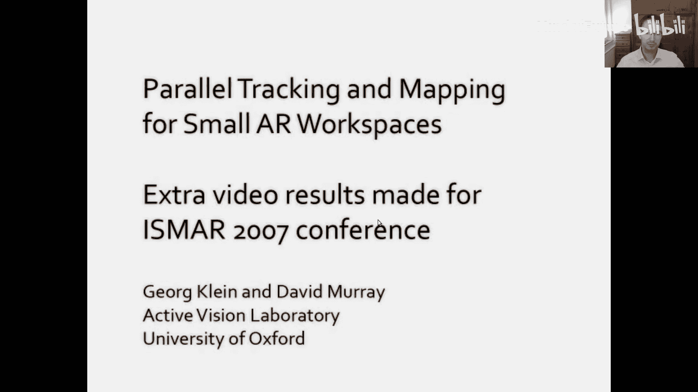
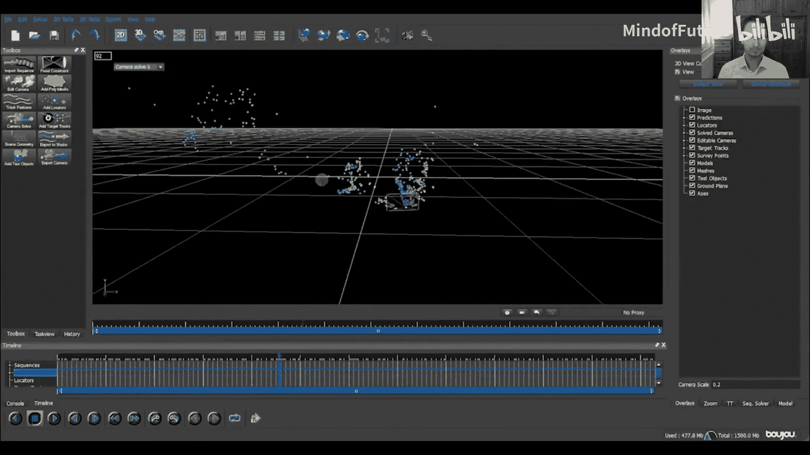

# 【图宾根大学 • 中英】计算机视觉 ML-4360 (Computer Vision) p11 P11 Lecture 3.4 (Structure-from-Motion - Bundle Adjustment) -BV1S8N1emEef_p11-

Let's now move to full bundle adjustment， which is the call standard algorithm。

Because the goal here is to minimize reproion errors where。

The noise can be taken appropriately into account。By optimizing all the 3D point locations。

And the camera poses joint。So here's an example on the left， there is a collection of images。

 very diverse and actually very challenging to match， and from these matches。

 the goal is to recover a free reconstruction as here on the right， well as the camera locations。

And that are indicated by these little triangles here。At the bottom。

The goal of bundle adjustment is to optimize reproion errors。

Which is the distance between the observed features and the projected 3D points in the image plane that say the L2 distance with free to the camera pymages and the 3D point cloud jointly。

And it's called bundle adjustment。3。Historical name。

Because you can think of this as minimizing a bundle of race。Or optimality， the rates are are。

Lines that connecting the 3D points to the images。So， let's。うん、パ。

We a set of pi Is denote the n cameras including their intrinsic and extrinsic parameters。

 we're going to be making a little bit of use here。

 we're going to use pi I to denote the projection of a point of rigy point onto the image plane。

 we use pi as a function， but at the same time we're using pi also as the parameter of that projection like the oak length and so on。

So we have n of those， this is a set of n of these projections。And then let X。W， it is set。

Of 3D points in world coordinates。 That's why we have a little W superscript here。

And we have a P of such points， and these are 3D points。

Let further X S be the image screen observations， and we have one such X。S， as for a screen。

For each camera eye and each 3D point。Now this is not exactly true。

 so this is just how we formulateted， but in practice in bundle adjustment。

 it's very easy to model what wasn't possible before we have observations that are missing。

But for the sake of completeness here， I'm just using subinex IP， but there could be。

Observations that are missing in there doesn't need to be complete， they don't need to be。

An observation for every point in every image。嗯。Stillill index IP。

Now bundle adjustment can be formulated as follows。

It's the problem of minimizing the reproion errors that's the。

Distance between the projected 30 points and the observations in the image。 In this case。

 the L 2 distance。With respect to the camera parameters I， as well as the 3D points set itself。

And the comm parameters here。In bundle adjustment often include the Xtrins。

 because we want to fine tune， the initial estimate of the Xtrins， but often also the intrinsics。

 even the distortion parameters， because if I do this or many， many 30 points。

 I can recover very accurate intrinsics as well if I'm starting with a good initial guess。

So we're having this。Our main problem here is we're trying to find the minimum of this and returning the parameters。

I am Xw that are minimizing this expression here。And this goes over all points and all frames。

It would actually be an I again， W I。Well we have this WIP。Times X， I P。 This is the。

Screen observation in this case。So we're using S now to denote this observation。

 the screen and XW B is the 3 d point that we want to optimize and that's projected onto the image plane using this projection P。

So we use WIP to indicate if a point is actually observed in image I or not。

there might be simply missing observations， but to be mathematically precise。

 we are still including them here but just setting them to zero。But we can， no matter。

Which3 points are observed in which image we can always optimize this problem here。

And pi I of this 3D point is the 3 d to 2D projection of the 3D world point X PW onto the 2D image plane of the IF camera。

So in other words， we have this projection is。The homogeneous screen coordinates。

So these are now the projected 3D points。Divided by the last element。嗯。

To obtain the image coordinates。Where these homogeneous coordinates are simply the 3 d point。

Transform rigidly using IR and TI into the camera coordinate system of the IF camera。

And then project it into the image domain using the I elibration matrix。诶。

So it's a very straightforward way of writing down this optimization problem。

Here's an illustration of this。Bundle adjustment procedure， the quantities that we optimize are R I。

 T， I， KI or all I cameras as well as all the 3D points。

You can see how these 3 d points are projected onto the image plane based on the。嗯。But this despair。

One basically contains the parameters， K1， R1 and E1 in order to be able to project this 3D point first into the camera coordinate system and then onto the image plan。

This is the relationship and here pi 2 comprises。I rotationtation and translation and intrinsic parameters or a camera。

 too。 And so we're adjusting。The location and the distortion and the focal length and the 3D points all here。

Now， what are the challenges of this？This sounds very good。 This is the gold standard algorithm。

 We are optimizing the measurement errors。And the right is the right thing to do in terms of the uncertainties that we have。

Well， one issue is initialization this energy landscape that is spanned by this problem is actually quite non convex。

And a good initialization is therefore crucial， for instance。

Using factorization techniques or this incremental strategy that we're going to discuss。

As initializing all the 3D points and cameras jointly is difficult using factorization。

Due to occlusions， viewpoint differences， outliers in the matching， etc。

In almost all state of the art， large scale reconstruction techniques are incremental unless adjustmentmine is performed。

 that initializes with a carefully selected two view reconstruction and iteratively adds new images and cameras。

And then the second challenge is in optimization。Even millions of features and thousands of cameras。

Tens of thousands of 3D points is a really a large scale optimization problem that's computationally very demanding。

And so very slow。Particular that nonlinear optimization is typically pubbic。

In of complexity in the number of unknowns。 And here we have a lot of unknowns。

 We have all the 3D points。Free coordinates of each 3D point are unknown。We have all the cameras。

 we have a lot of cameras， we have the pose of the camera and the intrinsics of the camera。

 which are all unknown。But luckily， the problem is typically quite sparse because not all 3D points are observed in every camera。

And so we can exploit efficient sparse implementations， for instance。

 provided by the Crus softwareer package。In practice。

 and that leads to significant speed ups and optimizing this。 Still， it。

 it takes hours for large reconstructions。But it's at least it's feasible。

So let's have a look at this incremental structure for motion pipeline。

Giving you an overview here in terms of the famous。

And still very frequently used coal map reconstruction pipeline that's still providing state of the art results on this problem。

And it's a baseline that's frequently used in papers that they're going to be reading。

Here at the bottom I'm providing a link to one of the two papers that are describing the coal map pipeline。

This is a picture that I've taken from that paper。And as you can see。

 on the left is the input on the right is the output。From images to 3D reconstruction and camera。

 and there is basically two stages here in this pipeline。

The first stage is a correspondent search stage， where the goal is to find and match robust 2D features across the images。

And the second is an incremental reconstruction stage where we start with two views and incrementally add cameras。

So that we obtain more and more complete and dense reconstructions。And these stages。Comprised of。Z。

Audio so we do feature extraction here， for instance， corresponding search stage， matching。

 geometric verification， and so forth。And then incremental reconstruction starts by taking by completing a two view initialization and then iteratively adding images。

 triangulating new points。doinging another bundle adjustment， filtering outliers， adding more images。

 triangulating new points， doing bundle adjustment， filtering outliers， adding another image。

 and so on。So let's go over these individual steps in a bit more detail and some of these components we have already talked about。

 so we're going to be brief。The first part is the correspondent search part where we do feature extraction and matching。

We detect features， exc features discussed in the first unit in all input images and extract descriptors and then match them across all images。

And here's a matching graph and as you can see， this is indicating the notess are indicating images and a connection is drawn whenever there is at least one match or significant number of matches between two images。

 you can see that not all of these are connected but there is some clusters， for instance。

 there is cluster here that are night images that are not so much connected to the daytime images because matching is harder between the twomb。

There's some images that show little details that couldn't be matched to a lot of images。

 but are still connected。There could be also images that are not connected at all to this main cluster。

 We're trying to find a cluster and to start to initialize the reconstruction we are looking at。

A point in a cluster that's very densely connected because that gives us a good initial starting point where we can easily grow the reconstruction outsidewards。

So we find overlapping image pairs indicated here by these blue lines and the associated feature correspondences。

 when instance could be that there is like 100 correspondences between these two imagess。So we have。

Just very briefly recap what's happening in the correspondence search。

 What's typically also happening is a geometric verification that's basically。Vifying if。

Features that I found are correct。如。The estimation of the apopolo geometry is discussed。

In the second unit。And then looking if， if the points that are actually reconstructed that are。

The points that are triangulated are。Although feature correspondences are mapping onto the Eippolar alliance or not。

 they are conforming to the Epolar geometry because if theres a lot of feature matches that are not conforming to the Eippolar geometry。

Or that are all lying on a single  prettyD plane， this leads to a deter rate configuration from which。

嗯。The camera poses that are estimated are incorrect。In the second stage。

 this is the reconstruction stage， which starts with the enerization。

 we've already discussed how we can compute two view geometry by estimating the apolar geometry using the essential matrix estimate or the fundamental matrix estimate。

And in these large scale systems， typically what people do is they because if you take images from the internet。

 you don't know exactly the intrinsics of the camera。

 but you can often extract some information about the cameras by the active text of the images and so this is what people often utilize to get at the first estimate of。

metrict reconstruction。Now， given this two view reconstruction。

 we now want to iteratively add more images to it， and the first step we need to do is we need to or a new image that has correspondences to one of these two。

Images of the initial reconstruction， we need to register that new image through these two existing images。

So we find a new image with correspondences to the current set。

 and that means we have correspondences not only between。2D image features。

 but because we have already triangulated the initial reconstruction， the two frame reconstruction。

 we also know the 3 d points。And so what we need to do now is we need to solve a problem where we have a set of 3D points and for a new image features。

It correspond to observations of these 3D points in the image plane。

 and from that we want to estimate the camera。And the camera pose。So let X denote a set of。

And 3D to 2D correspondences where we have the 3D location of these points。

 as well as the 2D observations in that new image， this is the XS 3D points are the Xw。

 and they are related of course， by the projective transformation that we want to find E。Again。

 as before。As the correspondence vectors are homogeneous， they have the same direction。

 but different in magnitude。Therefore， the equation can be expressed by this cross product。

 the same trick that we have used several times now。

 and we can use the direct linear transform to write this as a set of linear equations in the entries of P and because E is a homogeneous matrix。

We need to fix its scale and we can do that using SvD。嗯。

The refine P using SVD using the direct linear transform。Given these 3D to 2D correspondences。Now。

 give pe。iss just a product of the calibration matrix and the rigid body transform。

 and given that k is an upper triangular matrix， both K and R can be easily obtained from this front free by free sub matrix of P using standard Rq factorization。

That's。Acctorizes a free by free matrix into a。Upper triangle matrix and an autoagonal matrix。

So it's done I like we're working for being that。Now， if K is known。

 then we can even estimate P from only three points。

 and that's the so called P E3 P algorithm that we're not discussed here。

 but you will find them is algorithm in the textbooks。

And it's intuitive why we only need three points for this problem， so it's free observations。

 it's a relatively simple problem because。The pose is defined by rotation and translation。

 and so there's only six parameters for a metric os。

And because every observation in the image gives you two constraints， one for x。

 one for the y coordinate， we need three points。But this is an algorithm's that's used across all。

Data of the art structure for motion techniques。In practice， there's of course all outliers。

 the s detector doesn't really work well always and so you need to make sure that these outliers are appropriately rejected。

People typically use something called random sampling consensus or Runnzac， removed these outliers。

 which is basically working by taking a minimal set。

 randomly sampled from the observation set or the correspondent set。

And the minimum set for the B3 P algorithm is free， as with free correspondences。

 we can estimate the pose。We estimate the post from just free correspondences。

And then using this estimated post， we verify how many of the upper correspondences are agreeing with this estimate。

 And if there is a lot of agreement， we do this many times。

 there's a lot of agreement that we keep that solution that has the largest inlayer said。

And then we can do a further refinement using the entire inlier set。 That's what's called ransack。

 random sampling consensus， obtaining a consensus by randomly sampling many minimal solution and checking our。

Sure that there's a lot of agreement from all the other correspondents finding and therefore rejecting the ones that are maybe the 10 or 20% that are incorrect。

Now given the newly registered image， new correspondences can be triangulated， of course。

 right we have now。And apply the triangulation algorithm that we've described before by knowing the pose of all the cameras in the current set。

And we have some new correspondences now， where we can then obtain an initial estimate for the 3D point。

And in ColMAP， a robust triangulation method is proposed that also handles outliers。

And then we apply bundle adjustment as introduced before。

 minimizing the reproionarrow of all observations with respect to all cameras and all free lines。

And since incremental structure for motion only affects the model locally。

 we're adding one image here and there might be some parts of the scene that are really far and not seen from that viewpoint。

Pma performs this bundle adjustment only locally， and then only once in a while does a global bundle adjustment。

 which is very expensive on the entire parameter set。

For solving the sparse large scale optimization problem Com also uses this Ser solver of the package that you can download from internet that has been developed by Google。

And after each bundle adjustment step， observations with large re projection errors and cameras with abnormal field offffuse。

 large distortions can be identified and removed。And this is what Colmoalto does。That's basically it。

 so let's look at some results and applications。So what you see here is one of the first systems for large scale structure from motion from unstructured internet image collections。

 building Rome in a day。And I have shown you this already before in the part。

 history part of this class。You can see that with the system。It's possible to reconstruct。

Even entire cities。And what you see here， the red dots are the camera locations that are used。70。

000 images have been used for this reconstruction。But all of these images have been taken from a different camera have been。

Taking from the internet where people upload these images。

So they are randomly scraped from the internet。Based on E。And then the challenge is， of course， to。

Reject all the ones that are not actually showing the objects of interest and to remove all the outliers during matching。

 And there's a lot of thought going into these pipelines on how to make them robust。

 But this is really， this was really an eye opener for the community demonstrating for the first time that amazing things like this are possible。

 Oh you can see that there's still a lot of noise in this reconstruction。Now this was 2009 in 2016。

 OMap significantly improved their cells。Beyond the previous state of the art models like building Rome in a day。

 So here can see some results from Coap。The structure for motion pipeline。Also on the Rome data set。

And you can see that this reconstruction， if you zoom in。

Is much more precise and much less contaminated by noise and outliers。It still spae。As we are only。

Doing this bundle adjustment over。Over a sparse set of 3D points。 And even that is challenging。

 It's a large scale optimization problem。But we can really recognize the landmark buildings here in this fly through。

This has been done for our cities as well。Tble forward Debrovnik。Now。

 co map also contains a second stage that we didn't have a chance to talk about today。

 but we're going to talk about theial reconstruction techniques。

 We have mentioned it briefly in the beginning that once you have such a reconstruction with the camera poses already。

 then using the aippolar geometry， you can get much denser reconstructions。

 as you only need to search along the apopo alliance。

 and this is what coal map also includes and see that now。On the top。

 this is a baseline method that was the state of the art until then。And see that。At the bottom here。

 the reconstructions that are obtained through this process are now much more dense。

 still a point cloud， but a much denser point cloud than the structure for motion point cloud。

Now the landmarks are really。Very clearly recognizable。

This is a software package comb map that you can try yourself also。

 you can download it from the internet。And it's a Github repository that describes it as the documentation page。

It's quite fun。Now， let's talk about some other applications。

 One application is auto tourism introduced by Svely 2006。

which allows using these structure motion techniques for interactively exploring photo collections in 3D。

 and this was really one of the first systems that did this large scale 3D reconstruction still very noisy。

 but with the purpose of actually aligning photo collections in 3D and giving user a better or interactive flavor of。

Browsing photo collections and was actually later commercialized into a product called Photon。

 which has been is continued now but has been a product for a while by Microsoft。

Searching for a particular image of a well photographed object using conventional tools often results in a large number of images that are not ordered in an intuitive way。

 Finding the exact picture we want can mean browsing through page after page of thumbnails。

 How can we organize such large photo collections in a more intuitive way In this project。

 we present a novel system for registering large sets of photos and exploring them in a 3D browser。

Our system discovers the relative positions of the cameras used to take each photograph。

 Siuates the photos in 3D space and provides intuitive controls for exploring the scene and finding interesting photographs。

Our system takes a collection of photos of the same seen as input。

We first find key points in each of the input images then match key points between each pair of images。

 Next， we run an iterative bundle adjustment procedure to estimate the parameters of each camera and the positions of the observed 3D points。

Once the photos have been registered， they can be browsed using our photo exploration interface。

 Our system provides standard controls for moving around a 3D scene。 In addition。

 when the user selects a photograph， the virtual camera is smoothly brought into alignment with that photo。

 Information about the photograph appears in the information pane on the left。

 Our system provides several intuitive ways to select new photos。 One is to select an object。

 The user can highlight a region of the current photo。

 and the system automatically finds a good photo of the selection and smoothly moves the virtual camera into the new photo During transitions。

 we use a simple plane based morphph to provide context as the camera moves。😊。

A thumbnail pane along the bottom of the screen shows other photos of the selected object。

 When the user moves the mouse over a thumbnail， that photo is displayed in the main view。

 projected onto a plainar approximation to the selected object。Here。

 the user selects a thumbnail to see a different view of the statue。

We also provide tools for viewing the scene at different scales。

 The user can step back from the scene with a zoom out tool。

 This finds photos that display a larger area of the scene。

 The Showmi similar images tool finds images of the scene with scale and orientation similar to that of the current photo。

This is one application。 Another application is， and this is also a system that has been very successful in the community。

 is to。Consider a smaller brick space。But to in real time for robotic applications。

 being able to track that。that workspace and to map it very sparsely。

 but being able to then augment that workspace with virtual effects。

We get this video here this is from 2007。

And see in this。Fol how features are tked over time。 And then you can。Align an object。This。The scene。

 because you know the camera motion and you know the scene geometry。Here's the scene where。

An object is added。On two。Real image for such a。Augmented reality， act。

Here can see the feature points that are detected and mapped in the system for tracking the camera and building the scene model。

Okay。And。The same technology has also revolutionized the movie industry。

There is the technique there is is called match move because。

For real a trajectories now with these techniques， it's possible to recover actually the camera motion of real image sequences and to augment the scene with synthetic objects。

And to create。basicallysically a merger of real photographs of real movies with artificial objects that are synthetically inserted into this imagery。

And for example， in 2002， one of the earliest but still very robust and very highly successful systems that have contributed to this revolution was 2D freeze automatic camera motion trigger called Bujo。

And that won an Emmy awards。So here's an example of how this camera tracker works on a particular video。

🎼就成为你。🎼是你飞你的美。🎼没的来。🎼なら。

So that's all from me today， thank you。