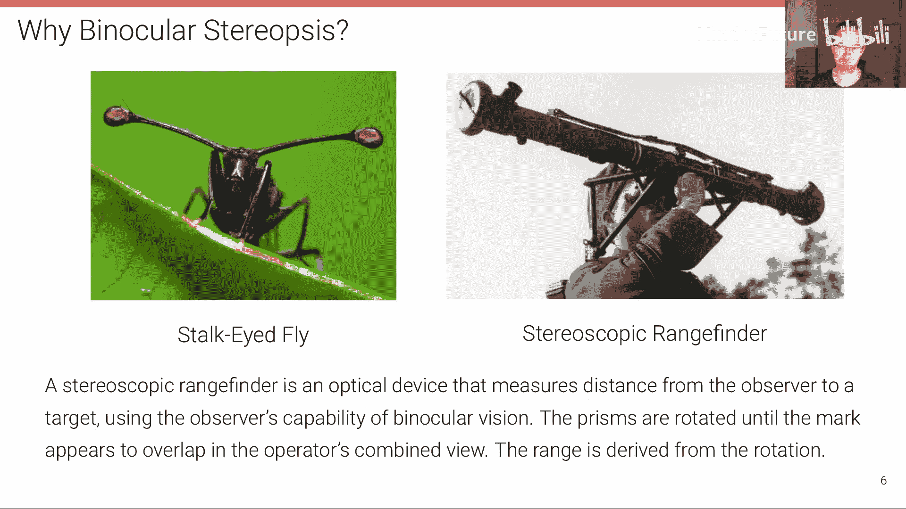
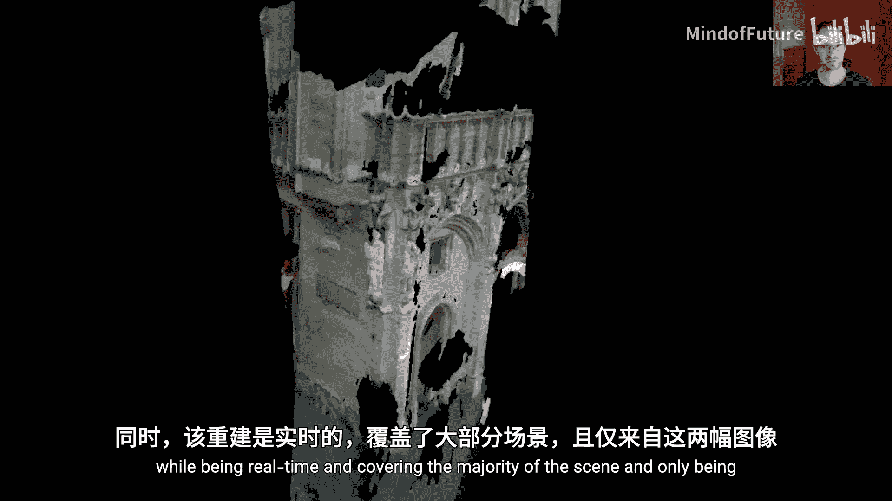
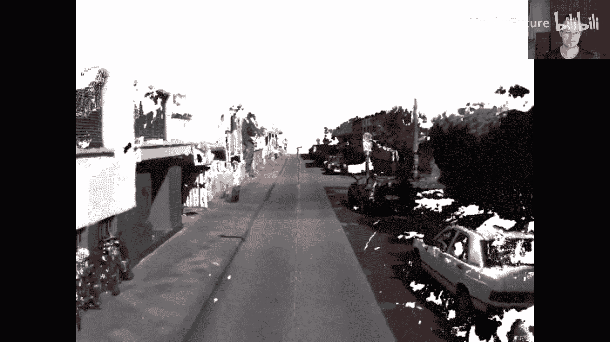
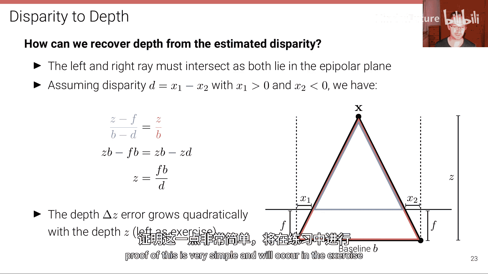

# 【图宾根大学 • 中英】计算机视觉 ML-4360 (Computer Vision) p12 P12 Lecture 4.1 (Stereo Reconstruction - Preliminaries) -BV1S8N1emEef_p12-

Hi and welcome to the fourth lecture of this computer vision course。

Last time we discussed Spe 3D reconstruction techniques。

How to based on sparse correspondences or features。Reconstruct 3D structure。

Srsely from two or more views。The topic of today is dense stereo reconstruction。

 which is how we can obtain a more dense 3D reconstruction。From just two images。

 if the camera intrinsics and the camera extrinsics。The camera poses are already known。

This lecture is。Structured into five units。In the first unit。

 we are going to cover some preliminaries to the following units。

Including how to bring the images into a suitable configuration such that matching is fast and also how to obtain。

Dep from the actual measurements， the so called disparities that we are actually estimating using these stereo algorithms。

In the second unit we are going to discuss the most basic dense stereo matching algorithm called block matching。

 and then we move on to algorithms that use deep neural networks， so called Siamese networks。

We also cover spatial regular， how to overcome some of the ambiguities that are present in this problem。

And finally， cover the more recent end to end learning approaches that require a lot of data but produce state of the odd results today。

Okay， so let's start with the preliminaries。How can we actually recover 3D from an image in general。

 this is， of course， an ill pose problem， but there are several cues。If we look at an image。

 for instance， what we can look at are occlusion cues， if we look at this image here on the right。

 then most of us。Well probably say， well， based on this configuration here， the object。

This vertical object here is in front of this horizontal object in a back。Now， this is。

A mechanism that has been exploited by artists。And you're probably all familiar by the famous Esher paintings。

So this is one cu how to obtain 3D structure from an image。

number queue is parax and that's closer to the stereo problem that we're going to discuss today。

 but it's also something that you can obtain from one image alone where if you look at an image and you see that。

An object is moving relative to another object， for instance， by seeing a。

Mirror reflection of that same object。Then you know that these objects can't be located at the same depth。

So for example， here we have this。Pull with the lamp on top and we have the moonlight。

And so they are clearly displaced here while in the mirror reflection， they are co located。

And this is called perle and this principle is also used in stereo that we're going to discuss today。

 but using two cameras。Another Q is， of course， perspective。

 If you look at an image and we know that some things in that image are。P parallel。

 then we can infer something about the perspective effect and also the depth。

Then one thing that we can also use is so calledled accommodation accommodation means focusing on a target because we do have lenses that are not sharp everywhere。

 we also we as humans need to actually focus on a specific object and if we focus on a specific object。

 then two things happen。One thing is that。We have to adjust the lens。

And in the human eye that's done with muscles， as you can see here。

 there's two different configurations on how the lens in the eye is stretched。

And because there is receptors inside these muscles。

 we can recover a signal on how these muscles are actually what is the state of these muscles。

 and that's also something that goes into， of course。

 the focusing process so we can measure the focus state of the lens。

And the other thing that happens is that。Different areas in the image。

 if focusing on a particular point get blurred differently。So if you look at this point here。

 then maybe the background gets blurred。And now this effect can also be used in an。Artistic manner。

 for instance， in this example where if you see this image and I ask you， is this a real image。

 you will probably tell me， well， it looks like a real image， but。It's more likely to be a toy scene。

 something that you would observe when looking at a toy scenery through a big lens。

And that's true because the lens that you would need in order to create such a depth of field effect as we can see here。

 would be insanely large for a real scene。So this effect here has been synthetically created and it's actually a real image that is sharp everywhere and has been captured with a relatively small approach compared to the scene。

And then finally， what we're going to talk about today is stereopsis where we use the principle of triangulation and take an image of a scene from two different。

Locations from two different viewpoints。 and by observing。Points in the scene move differently far。

By observing this paraax effect。And by knowing the location of the。Cameras。

 we can then triangulate that point in 3D， we can follow this race and see where this rays intersect。

And that gives us the 3D point。Now， why is binocular stereops is a good idea， Well。

 there is some examples in history of。Spies that do not have two eyes。

 Theres some species that have more than two eyes， actually， and there's。

Some very rare cases like here that have only one eye， but in general most。Species have two eyes。

 and so it seems like this is an established system。

 it's the minimal configuration with which we can perceive depth relatively robustly。

And so that's something that we probably also want to exploit if we want to make machines see。

There's also some examples where the principle of stereo perception has been exploited in a special way in a way that。

The so called baseline， which is the distance between the cameras。

 has been artificially enlarged in order to obtain a better depth perception。

AndRemember that when you do triangulation， then the larger， the relative viewpoint。The more precise。

 the more certain the triangulated 3D point is。 And so if you put the cameras further away。

Or if you put the。Fcal points further away， then you will get a better sense of depth and that has been。

The principle has been used by the Id flyly and also by these devices like the stereoscopic rangefiner that has been used in also in the military in order to determine the distance of a target from the observer by adjusting prisms。

In this tube in order to triangulate distance。

Now here in this course， we are going to covering。The estimation of。Depth or equivalently disparity。

 which is inverse depth。 Disparity is the relative displacement that we observe between pixels in the two images that we have captured of the same。

Static scene。嗯。And we're trying to do this as densely as possible。

 so the goal is that for ideally for every pixel that we have。In the input image。

 let's say in this reference left image here。We want to find a depth map that's color coded in this disparity map here on the right hand side。

And as you can see in this case， the scene has not even been captured at the same instance in time。

 but the majority， the large parts of the scene are static and so the majority of the scene can be reconstructed despite the fact that there is some people here moving around。

Now， given that we have reconstructed such a displacement map。

Such a disparity map that we're going to talk about a lot in this lecture。

We can of course also recover the depth because it's basically just the inverse of the disparity as we will see。

 and then we can take all of these pixels for which we have such a depth value obtained。

And we also know the color value because we have the color in the reference image and then we can project this into a 3D point cloud and for this particular example。

 this has been done with a very old stereo algorithm that we have been publishing more than 10 years ago。

It's actually a real time algorithm was already real time in 2010。

We obtain a 3D reconstruction like this， and this is a reconstruction that's relatively dense and comparably precise。

At least at the time。While being real time and covering the majority of the seen。

And only being reconstructed from these two images。So to summarize what is the task。

 what is the goal， we want to construct a dense 3D model from two images of a static scene。

Or a mostly aesthetic scene。Alternatively， we can take two images at the same point in time if we can synchronize the cameras。

For example， in a stereo sensor that's mounted inside a vehicle。

Many modern vehicles have cameras inside and some of them do have stereo cameras。

 these cameras are triggered。嗯。Electronically。Such that they capture the scene exactly at the same point in time。

 and then of course the scene is at that point in time， it's static with respect to the two cameras。

So the pipeline is as follows， we first calibrate the cameras intrinsically and extrinsally as we discussed in the last lecture。

Then we rectify the images given this calibration and what rectification means we're going to discuss today。

It's basically the process of bringing the images into a format that's。

More easy to process using these stereo matching algorithms。And then we compute this displacement。

 this disparity map for the reference image， for every pixel in the reference image we ask， well。

 how much does this pixel have to move how much does this pixel move？

We freeze in order to land on the new location in the right image in the target image。

How much is the pixel displaced between these two image？

Then typically there's a step that removes outliers using some consistency or occlusion test。

And then we can obtain the depth from the disparity using the parameters of the camera。And finally。

 we construct a 3D model， for instance， via a simple。

A concodation of the 3D points that would be the simplest method and meshing them or via more advanced methods such as volumeotric fusion and meshing。

 as we'll discuss them in lecture8。Okay。谢し。Then let's see how such a stereo matching algorithm at a broader level could be integrated into a bigger system into our entire 3D reconstruction pipeline。

 so what do we do here we have a not just two images but a set of input images from which we want to obtain a 3D model。

And then a typical procedure as as follows， we take these images and we compute the camera poses using。

Incremental bundle adjustment， let's say， as we discussed in lecture free。

And then once we have the camera poses and we know which of these views are adjacent to each other。

 we can compute dense correspondences。As we'll discuss in this lecture。For each adjacent few。

Using the apipolar geometry that we know then once the cameras are calibrated。

 and so we get depth maps for each of the images and these are two and a half d representations。

So in order to combine all of these into a 3D model， we can use algorithms such as de Mafusion。

That lead to a coherent 3D model where we can extract a mesh。

That takes into account all the observations that we have made。

So the topic for today is really this part of the pipeline。

 where we assume the camera has been calibrated intrinsically and that also all the camera poses have been estimated precisely。

 which is typically the first step， and then we can go and start and find adjacent views and try to do dense stereo matching across the adjacent views。

If we do this for two images as discussed in this lecture， this is called binocular stereo matching。

 if we do it for more than two views and we'll discuss this later in the lecture。

 this is called multiVi stereo。So。Both options exist。Using only two views is a little less precise。

 of course， is a little bit more ambiguous， but it's typically faster。

 so both problems are heavily researched still in the community。

And then a final model could look like this， this is a very old model that we have produced and it's a model that has been produced by simply stacking all the point clouds together so no sophisticated fusion algorithm。

 but you can already see you can already get a pretty good idea of what the 3D structure should look like and it' grayscale because these book grayscale cameras you can see this little triangles here。

 this red triangles here are the camera poses， illustrate the camera poses that have been used for each of these camera posts we have estimated depth map。

This was done using a stereo camera， and then we have accumulated all the point clouds into a larger 3D reconstruction。

Yeah。

。O。Now。Something that's really important for。Performing dense st reconstruction is that we know the apolar geometry。

 and that's what we have discussed already in the last lecture and let me just recap that with a single slide。

So here on the right is an example of an apolo geometry。

Where we have the Apolar plane that is connecting the 3D point projected onto both of these image planes。

And the 3D point is projected。To the left image plane with a YR camera calibration matrix K1 to the right image plane viaR K2。

And then。Once we have estimated the apopolar geometry。

 which can be expressed by the essential matrix E tilde。Which is a homogeneous matrix。

Image correspondence is expressed in homogeneous coordinates。

Are related by this simple expression here。X2 transpose E x1 equals 0。

Where these xtildas here are the ray directions， where we take the pixel location and multiply with the inverse of the intrinsic calibration matrix k for each of the cameras。

And then one important property of this apopolo geometry is that corresponding that the correspondence of any pixel。

X1。And the first image is located on the Apolar line in the second image and that Apopolar line is given by the essential matrix multiplied with that point in the first image。

Or the viewing direction to be more precise。And then vice versa。

 the correspondence of some0 x2 must be located on the Apopolar line L1。In the first image。

And then also the Apo All intersect at the A poles。

So here's another example where the 3D point has changed。

 we can see how this plane forms a pencil of planes and all of these planes actually pass through the api poles。

 which means that also all the Apool lines pass through the apipos。That's。

What we have discussed last time。Now the most important property of the apopolar geometry that we're going to explore today。

Is the fact that I've just mentioned that if I take a point in the left image。Call it x1。

 and I want to determine where the point is located in 3D space。If I want to triangulate that point。

 and I have to find the correspondence of that point in the right image in order to do so。

Then that correspondence must be located on the Apopola line。

So instead of searching through the entire second image。Domain。

 we just have to search along the Apripool line。Remember that if we don't know the relative camera poses。

We want to estimate the Apopolar geometry。Then we don't know this property。

 so then we really have to do sift matching， for instance。

To all possible feature locations in the right image。

 but now we just need to search along the Apopole line and that's much more efficient so now we can do this densely。

 we can query for every pixel in the left image， all pixels along each of the corresponding apopolar lines in the right image。

And find the best possible pixel。That in some form， as we'll discuss later。

 corresponds best to that pixel that looks most similar to the pixel in the first image。

And this reduces the correspond search problem to this much simpler 1D problem。

So as an example for VGA images， if we wanted to， for that point here。We want to for that pixel here。

 we wanted to find the correspondence in the right image and we wouldn't have such a simplification to a 1D search constraint。

Then we would have to search through all the pixels in the right image which for VGA resolution would correspond to 300。

000 pixels， so we have 300，000 hypotheses that we need to do a comparison to in terms of little image patches。

 let's say。Now if we just have to search along the Apopolar line and let's assume the Apolar line is roughly horizontal。

 then we have roughly 640 pixels only， so a factor of 480 less。Computation， which is significant。

Of course。Now。One important concept that we'll introduce in this unit is image rectification。

What happens if both cameras？Fhaace exactly the same direction， which means that the image planes。

Are lying in the same plane， in the same 3D plane。Nevertheless words， the image planes are coplanar。

What that means is。You can already imagine what's happening then is that the Epos。

 they will not lie inside the image domain anymore， because the baseline obviously can't。

Interssect image planes anymore because the baseline is now parallel。To these two planes。

So what happens is that these a poles。E and E prime D。Or E1 and E2， they go to infinity。

And all the Epopola lines become parallel to each other。And if we do it right。

 they also become horizontal。So they become pearl to each other horizontal。

 so we just have to search our correspondences along image rows。

And this significantly simplifies implementation， we don't have to search across slanted。

 across slanted Apopoar lines in the target image， but we can search along image rows。

Which is much simpler to implement。And that's why rectification is important and rectification is typically applied。

In order to make these stereo matching algorithms， binocular stereo matching algorithms is only working for two images can only do this for two images unless all of the cameras are all of the cameras centers are located on a line。

Otherwise， you can do that for more than two images， but if you have two images。

 then you can exploit this property and that's what almost all binocular stereo matching algorithms do。

Now， this is nice， but it's very difficult to actually manufacture a stereo setup where these cameras are exactly。

Of facingacing the same direction。Because just a slight deviation from that direction。

 which is easy to introduce by just some mechanical slack that is introduced。Its already。

Resulting in a couple of pixels arrow and so matching along Apolar lines will not work anymore because the Apopolar lines are shifted by a few pixels and so the patches will not align anymore and these matching algorithms are very sensitive to that so you need to really make sure that these Apolar lines are really pixel ad or subpixel accurate。

So what can we do if the cameras or the images are not in this required setup？Well。

 the nice thing is that there is a trick， we can actually rewardor these images through a rotation。

That maps both image planes to a common plane parallell to the baseline。In other words。

 we can bring the non rectified setup into a rectified setup and that's called this process is called rectification。

And the nice thing about this is that this for this rotation around the camera center。

 because we're just rotating the。The camera into a new virtual camera around the camera center。

 the optical center， these two points here。We don't need to know the3D structure。Similar to。

Where we have estimated hographies for stitching panoramas by taking pictures from the same location and rotating the camera。

This is also just the homography that we can apply here， a rotation homography。

 so without knowing the3 structure。Which we don't know。

 we can actually warp the images to bring the cameras into this rectified setup。Which is really nice。

So here's an example， so this is the setup from before。

 and now we are rotating these cameras virtually by warping the images such that。The。

Apipos move to infinity and the Apopool lines become perle and horizontal。

So here we have the apopolar line for x1， for example。

 lies on the same image row as x1 in the upper image and the apopolar line of x2 lies on the same image row in the first image。

Now， how does this work？How can we make Apo lines horizontal。

 let's first look at a simplified scenario。For that simplified scenario。

 let's assume that both intrinsic， both calibration matrices and the rotation matrix。UAre equal to。嗯。

The identity matrix。And that's the。Translation。Bector。

Between the two cameras is just a vector in x direction。So from the left camera。

 from the first camera we go。呃，T。miliimeters or meters into the x direction。

 but then the other coordinates， the y and the C coordinates are empty or are0 for that translation vector。

And so in this， what we want to confirm now is that in this simplified setup。

 this is the goal the apopo lines are actually horizontal， this is already directtified setup。

 if this setup would occur， then we would be done。In this for this particular case。

 the essential matrix。Is very simple。Remember， the essential matrix is the。Cross product。Between the。

Or the this symmetric matrix。Corresding to the cross product matrix of the translation vector times the rotation matrix。

And because the rotation is the identity here。This becomes just this skesymmetric matrix and because this vector here is very simple。

 this matrix looks like this， all the entries are0 except for this。X components。Now， S。

The calibration matrices are the identity matrix。Two corresponding points。

In augmented vector notation are related apo by this apopolar constraint remember again from the previous lecture that we had X tilde here and x tilde 1 here。

Because we assume that there is an arbitrary calibration matrix。

 and so we have to compute X tilde by multiplying。X bar with k inverse。In order to get the direction。

 but here we don't need to do that because the calibration matrix is already the identity matrix。

 so it's a very simple setup。So we can directly write X bar here。And otherwise。

 this is simply the apopolar constraint which must be zero Now if we plug in the essential matrix now here。

We obtain this expression here。So here we just multiplied x1 with this matrix and this y1 here indicates。

The Y component。Of the first point。 So this is the second element of that x bar1 vector。

Now we multiply x bar 2， take the inner product with this vector and again。

We denote by y2 now the second element of that vector。So the first element is multiplied with0。

 the second element， which is y 2 gets multiplied with minus t。

 and then the last element of this augmented vector is 1， of course， gets multiplied with。T and y1。

 so we're left with this expression t y1 minus ty2。

 and this expression must be equal to0 because it must satisfy the apopole constraint。

So what we see here is that for this very simplified setup that we have constructed artificially。

Y1 equals y2， So in other words， the two images of the 3D point， the projections of the 3 d point x。

Must lie on the same horizontal line。 They are on the same scan line on the same image row。

Projections of the 3D point are on the same image room。This is the rectified setup。Now， what if this？

Setup is not the case。How can we take an arbitrary setup？And rectified， etc ce。Well。

 in order to rectify an image。We can just rotate， we can compute a rectifying rotation matrix that rotates these cameras virtually such that。

This particular setup here is fulfilled and what do we have to do well we have to of course align the x axis of the camera coordinate system with the translation vector so that must point to the ever camera center or to the Apipo。

In other words。And then。We want to introduce as little distortion as possible to the other two axiss of the new camera coordinate system of this virtual camera coordinate system。

And of course， the camera coordinate system must always be a proper right handed coordinate system to all the。

Coordinate Xs must be perpendicular to each other。With these constraints， we can now calculate。

This rotation matrix， this rotation matrix is simply what we have firmmetized it by the vectors R1 are2 and r3。

 which are the rows of that rotation matrix。嗯。Well。Yes。

 the rows of this matrix where1 is simply pointing into the direction of the translation vector。

 but of course this translation vector magnitude must not be equal to one。

 so we have to normalize it to obtain a proper unit vector。

And then R2 is the cross product of the C of the vector of the C coordinate。

Of the original camera coordinate system with the first vector that we have computed in order to compute the Y coordinate of that camera coordinate system。

And then the third。Cordinate to C coordinate of this new camera coordinate system must be the cross product between the first two。

 because otherwise it wouldn't be perpendicular。Right。嗯。So this is one choice， there's more choices。

 but this is the most this is the simplest and the best choice if the cameras are already roughly aligned and we'll see an illustration of this on the next slide。

Now， as the apiolle in the first image isn't the direction of R1。

 it's actually easy to see that the rotated apipole is ideal， is an ideal point。For that。

 we can simply multiply our one。With this rectifying rotation matrix and because the first row of that matrix is r1 and because r1 has magnitude 1。

 we get a 1 here and because these over2 coordinate。Xes are perpendicular to r1， they are 0。

 which means we have an ideal point， a point infinity for the Epool。After。

Rotating it with the rectifying rotation matrix。And it's a homogeneous vector that has a0 as last element means。

 and that means it lies at infinity and it lies at infinity in the x direction because it has a one here in the x coordinate。

 it's ideal point at infinity in x direction。Therefore。

 applying this rectifying rotation erect to the first camera leads to parallel and horizontal apopolar lines as desired。

So here's an overview of the entire rectification algorithm。We first estimate the essential matrix。

 then we decompose it into T and R and construct r vectors above。

We warp the pixels in the first image， then using this expression。

 we take the inverse of the so we take a pixel in the first image。

 then we compute the inverse of the calibration matrix in the first image and we apply this rotation and then we take。

The calibration matrix of this virtual camera which we can decide arbitrarily in order to obtain this projected point and similarly we can do this for the point in the second image。

 except for also taking into account the rotation between the first camera and the second camera。

 the extrins basically。Because we also I mean， this overall rotation is of course。

 a rotation that's combining the rectifying rotation of the left camera plus the relative rotation between the left and the right camera in order to have both of the image planes being co planar。

After dis warping。Little remark K is a shared projection matrix， it must be the same。

 but it can be chosen arbitrarily， typically this is chosen such that it's close to one of the calibration mates。

 let's say K1。And in practice， we don't compute this transformation。

 but we compute the inverse transformation because taking all the pixels in the original image and projecting them into the virtual image is not ideal because there might be points I that get projected on top of each other and points that get stretched so there is a missing pixel than in a target image。

 so what's better to do is to go through all the pixels in the target image in this new virtual image。

And then query the source pixel in the original image by applying the invoice transformation。

 so we just invert this expression here。And then this point will not necessarily lie on an integer location。

 of course， so what we do then in the original images is we do an interpolation like a bilinear or triline interpolation。

No pilinear or bi cubic interpolation or some other interpolation technique in order to find the RGB color value that we have to insert at the target image for which we have。

Quared the source。So here's again， a graphical illustration of this rectification of the calculation of the rectifying rotation matrix。

Let's assume we want to compute this for the camera one and then adapt camera2 accordingly based on this equation here。

 which includes this additional。Post rotation R。So we have the camera centers here。

 I didn't draw the second camera because it's irrelevant here。

 we have the principal axis that's the C axis of this camera。And we can see here that the。

Aippola line is not horizontal in the image， but it's landedlanntted。

And the AP poll is in the image domain。So what we do now is we compute this is the desired new x axis of that new coordinate system。

 which we compute as the vector that's pointing into the direction of the second camera center。

And then， we compute。The cross product。Of the C direction of the original camera system and this new vector in order to obtain the new Y coordinate of the new camera system。

And that makes by doing this， we make sure that we introduce little distortion that the camera is oriented roughly the same way because we could also rotate the camera with an ined rotation。

 but we don't want to do that we want。Make introduce as little distortion to the original image as possible。

And then we have the third。Coords which is perpendicular to the first two。 So we have computed X。

 Y and C coordinate of the new camera coordinate system。

 This is the rotation that's applied to this original。

Coordnate system and by doing that we obtain a new image where then the Epipoar lines are horizontal。

Here's an example on the top we see。This is actually。On the left is the right image。

 on the right is the left image， but doesn't matter。

 so here we have an example where we see the Apopolar lines。Before rectification。

 and at the bottom you can see the perspective transformation。

 the homomography that has been applied in order to warp these two images such that the lines that we see above become parallel to each other and horizontal in the image domain。

And if you look at the particular。Point in this image here。

 we find that point along this Apopola line in the upper image。

 this would be the correct correspondence， but if we do this in the rectified setup we just have to search along a single image row。

So correspondences are located on the same image row， E very point。

Here's another example of a rectified setup。I show you here the first image and this is the second image and what you can see is if I toggle between these two images that points that are far away move little and points that are nearby like this point here on the car。

The backlight move more。And this motion of the points is called disparity。

 and because there is this relationship of points that are close。To the camera。

 move a lot and points that are far away move little we can。Estimate the depth from the disparity。

 there's actually an anti proportionional relationship between disparity and depth。

The depth is actually proportional to one over the disparityity。

Here is a illustration of a depth map that has been estimated by some algorithm where you can also see with this color codinging here at the bottom that points that are far away。

 have little disparity， they move little and points that are nearby here in the yellow and green and red regions they have a larger disparityity。

In this case， the pixel motion is between zero and 160 pixels。

Actually pixel let's move to the left right， so if we look at the left image here。

And then we look at the right image， Then a pixel in the left image has moved from its current location to the left。

But we typically count this disparities still as positive disparity values despite moving to the left。

Now，par given that we have this disparities is calculated。

What we want to do is we want to recover the depth from the estimated disparities。

And what we know now in this rectified setup， which is quite nice is that the left and the right ray must intersect as both lie by definition on the Apopola line。

 because we're searching along scan lines， this rays must intersect because we are searching on the same Apipolar plane。

And so in this particular setup where both here we have the cameras again。

 now in the bird's eye view， we don't show the Y coordinate just x and C。

And we have the image plane and the camera centers of the left and the right camera。

In this rectified setup where the camera planes are parallel to each other。

There is a 3D point at distance C。And we have now the disparity。

 which is the combination of x1 and x2， which is the relative displacement in the images。

From here to here， basically if we would toggle between these two images。

And now because we have this very simplified setup。

 also the depth estimation becomes a very simple formula。

Now assuming the disparity d being x1 minus x2， so we have x1 here and x2 is actually negative。

 so the disparity is let's assume this would be 10 pixels and this would be minus 10 pixels then the disparity。

 the displacement would be 20 pixels。Then the following relationship holes。

 we look at these two triangles， these equal triangles， red and blue。

The blue triangle can be gives us the following constraint， we have c minus F。

 this is this minus this is basically this distance here。It's equal to C minus C divided。

No C minus F， which is this distance divided by B， this is the baseline， minus the disparity。

 which is actually this distance here， so we have this divided by this is equal to the entire C here。

 divided by the entire baseline B。Because these are equal triangles。

Now we can slightly rewrite this equation by multiplying on both sides with the denominator。

And by solving for C， and so we see now this anti proportionportional relationship that C is actually proportional to1 over the disparity。

 the depth is proportional to one over disparity in particular。

It's equal to the focal length of the camera of this rectified setup of this new virtual camera matrix。

Times the baseline， which we know from the extrinsic calibration divided by disparity that we estimate using a stereo algorithm discussed in the next units。

What's particular's particular about disparity estimation is that actually the deptharrow。

 deelta C grows quadically with the depth。U which leads to the fact that if we estimate depth from this disparity maps for very far away objects。

 we are very imprecied， but if we estimate depth for objects that are close， we are very precise。

The proof of this is very simple and will occur in the exercise。

