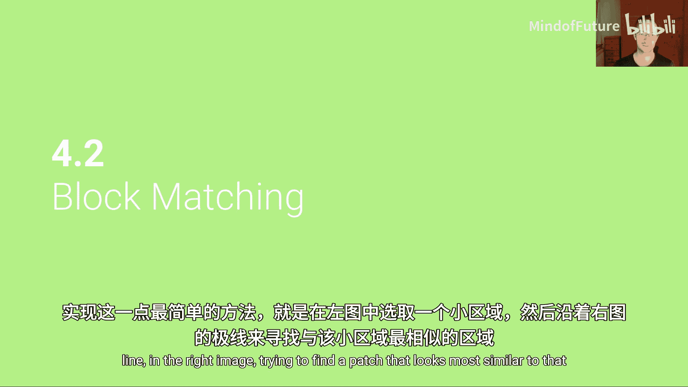
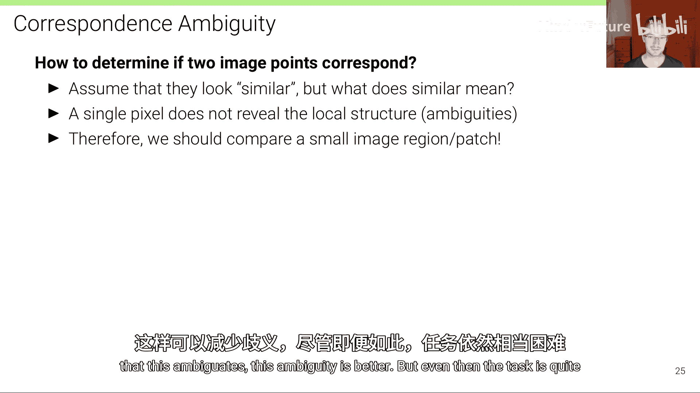
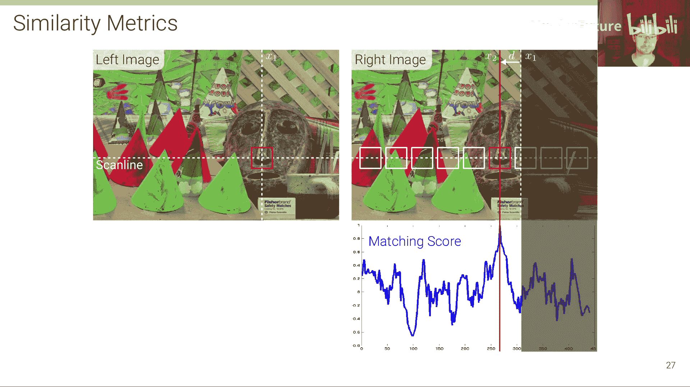
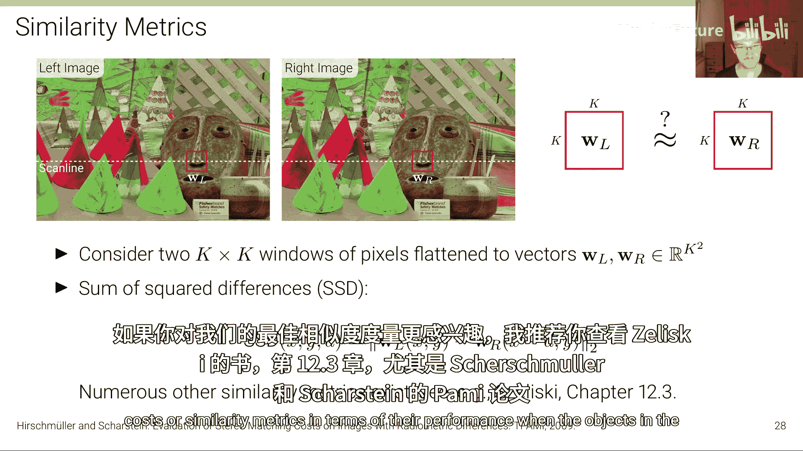
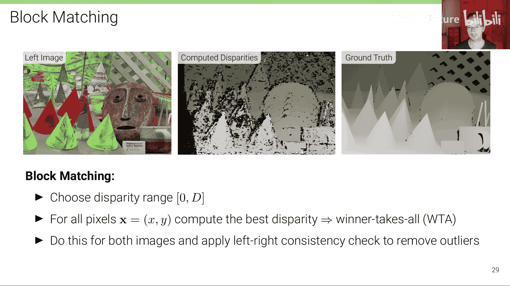
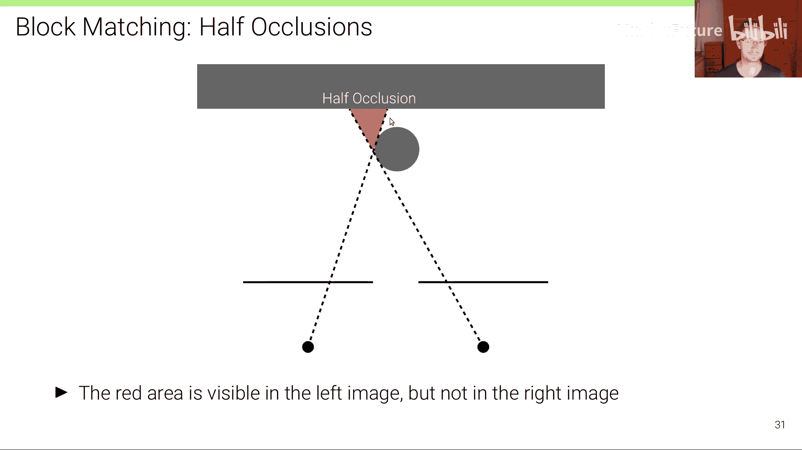
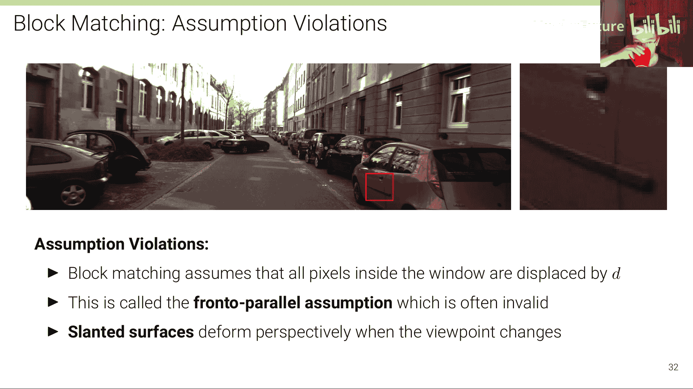
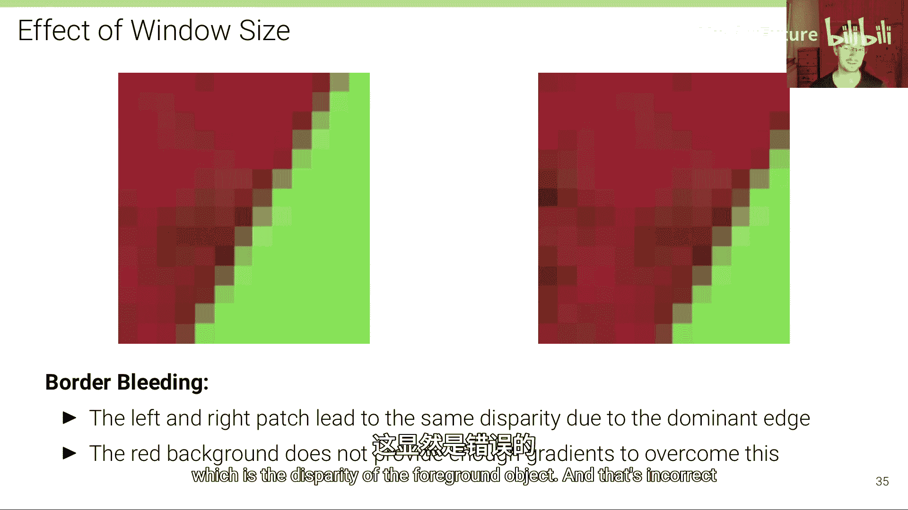
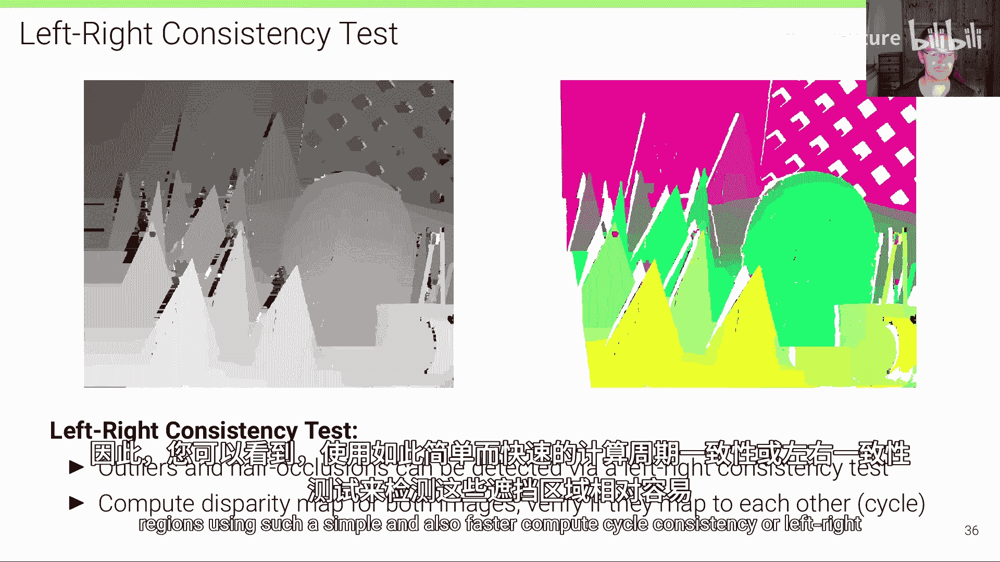

# 【图宾根大学 • 中英】计算机视觉 ML-4360 (Computer Vision) p13 P13 Lecture 4.2 (Stereo Reconstruction - Block Matching) -BV1S8N1emEef_p13-

Now we know how we obtain depth values from disparity values。

 but how given such a rectified stereo setup， can we actually determine the disparity values in the first place？

Well， of course。Given the left and the right image。

 we somehow have to find how much each pixel in the reference image in the image that we want to compute the disparity map for。

 let's say this is the left image sometimes。Also for the right image， a disparity map is desired。

 but typically people start by computing a disparity map for the left image。

 so for each pixel and left image we want to determine how much the pixel has moved。

And the right image with respect to the original location in the left image。

And the simplest way to do that is to take a little patch around that pixel in the left image。

And try to find that patch along the Eippoar scan line， the Eippoar line in the right image。

 trying to find a patch that looks most similar to that first patch。

that's called block matching。But how can we determine if two image points actually correspond to each other？

Well， informally。It's kind of clear that they should look similar somewhat to each other。

 but what does similar actually mean？If we just look at a single pixel RGB color value that doesn't reveal the local structure。

 there's too many ambiguities if there's a red pixel in the left image along the same scan line in the right image there is too many red pixels or pixels that have color close to red。

And that could be confused if that original pixel in particular also because all images are noisy。

 so the red color， even for the correct location in the right image。

not be exactly the same as observed in the left image and so you would get a lot of noise if you would just consider a single pixel and therefore what we do in practice is we compare a little patch。

 a little image region that disambigus this ambiguities better。

But even then the task is quite difficult， so if I show you this example here。

And you look at the tail of this animal， you can see that in these two images。

 the tail looks quite similar。But then in these two images， the tail looks quite different。

 so even looking at a local region doesn't completely solve the problem as we also see。

 but it makes it easier。Now， how does this actually work。

 I want to show this to you in the context of one very famous scene that has been captured by Daniel Shausstein and Rick Sliky in their famous。

Middlebury benchmark that has brought a lot of progress in the field of stereo matching has been published in 2003。

And this is one of the images from this benchmark。What makes this benchmark particularly interesting is that for every pixel there has been。

A procedure。There has been a procedure that was able to determine for every pixel the precise disparity ground truth。

 so for every pixel we know what the true disparity is and we can then take our algorithms and evaluate the performance of our algorithms on these image pairs。

So here's the right image， this is the left image， you can see that some objects in the front。

 they move more than objects in the back can also see that some objects occlude each other and you can also see that these objects are pretty lumerian and also pretty texture rich which makes correspondence estimation quite easy in this particular lab seen here。

Now， how does block matching work， Well， what we。Two is basically we take a scan line as we have rectified the images。

 we know that the correspondence for this particular pixel we are interested in the left image。At。

X location， x1。This is indicated here by this vertical line must also lie on that same scan line in the second image。

And so what we do is we query all possible patches here。

 only a few of them are shown in the second image and we are trying to measure similarity between these patches and ideally we recovered this as the correct patch for this query patch here。

What you can also see here is that there is a gray shaded region here on the right。

And I've shaded that region because we don't need to search in that region。Remember that。你。Disparity。

Is always positive。 but then the search is in， we have to search in the negative direction。

 So disparity， if we go from the left to the right image， then the。

Displacement goes towards the left。 So disparity0 would be at this white line。

 which is located exactly at the white line here in the first image。

 So this is the X1 coordinate now overlaid over the second image why it is， of course。

 at a different。It appears differently， but it's the same image column。

And then if the objects would be at infinity， then。This part here should be actually located here。

 but because they are not， they are closer， we go by some disparity here。

 we move for some pixels in this direction until we have found that patch， and that's then at x2。

 which is the correct location， this is what we want to recover。

So we have only to search in the non shaded region towards the left of x to x1。

And here at the bottom， you can see the matching score for a particular similarity metric that compares these two matches and you can see that in this particular example。

 the matching score attains its highest value for the correct location。

And so if in this case we would just pick the maximum， we would get the right match。

Some of them have really low score， some of them are higher， closer to the maximum。

 but the maximum was clearly distinct from the others。This is not true for all patches。

 in particular if there' is ambiguities， if the patch is textualless， etc。

 then this curfew doesn't look as good as it looks here in this。Illusstrative example。

So how can we actually now compute the similarity metric itself Well we consider K by K patches K by K windows in each of these images that are flattened into vectors and we call these vectors WL and Wr for a patch in the left and in the right image and flattened means that we just take all the。

The values of this。Patches and we concatednate all of them into a big vector that's now of size r to power of k to the power of 2。

And what we want to ask ourselves now as well is that patch in the left image the same or very similar to that patch in the right image。

And there's a whole variety of evaluation metrics that are used in the community。

 but two very prominent ones for basic block matching are the so called Ser normalmalized trust correlation CCC。

And the sum of absolute differences。CNCC is basically a correlation metric that。嗯。Takes a pitch。

In the left image and normalizes it by subtracting the mean and dividing by its variance。

 and then computing the dot product of this vector with the patch in the right image subed by the mean and divided by its variance。

You can see here that。The left patch is。Taken here the arguments denote where we center the patch where the patch has been extracted from the image。

It's taking at x Y and in the right image， it's taking at x minus t and y because we move。

Into the negative direction for D disparity levels or for D disparities。

 but we are in both cases extracting the patch at y in the y coordinate， so at the same image row。

This is one metric， another metric is the so called sum of squared differences。

 which is even easier to compute。So the sum of square differences basically just takes the left patch。

 This is this big vector。And then it takes the right patch at x minus D and y。

Which is this pick vector from the other image and then subtracts both from each other and computes the。

Some of the squares of the elements of this resulting vector。

Now different metrics have different advantages and disadvantages。

 we don't have time to go into detail and there is numerous other similarity metrics in the literature and if you're more interested in other better similarity metrics I recommend to have a look at the Zeliky book chapter 12。

3 or in particular also this Pamy paper from Shashmlo and Shashstein。

Call evaluate evaluation of stereo matching costs on images with radiometric differences that compares a whole variety of different matching costs or similarity metrics on。

In terms of their performance， when the。Objects in the scene are not completely inperssient。

So what does the block matching the algorithm then look like in total。

 while we choose a disparity range， we first need to decide what is the maximum disparity that we want to search for。

 which determines how close can an object be。To the camera。

 and so we set the disparity range to zero and this maximum D。

And then for all pixels in the reference image， let's say this is the left image we compute the best disparity by。

Using the so called winner takes all strategy， which is we're just computing for all possible disparity levels the similarity score and we pick the one independently for each pixel we pick the one that's best。

And then we can also do this for the right image as a reference image and search for the correspondences in the left image。

And the advantage of having disparities estimated in the left and in the right image is that we can then check for consistency。

 as you can see if we compute disparities in only one of the images。

 then there is a lot of outliers left and we can remove these outliers by doing the disparity computation in the left and in the right image。

And then they must be consistent so we can search from the left image we can go along the disparity and then we have the disparity in the right image。

 and that must warp us backwards to the first pixel location and if these don't coincide。

 then we can say， well， this is probably a wrong estimate and we can remove it。And here on the right。

 you can see the ground roof， which is very precise and has been estimated by a structured light。

Imaging technique for this particular scene。Now， if we inspect these estimated disparity pipe maps a little bit more closely。

 we can see some artifacts。Apart from the noise that we also see。

 one artifact is that theres some regions that appear to be entirely black。

And these regions are socalled half occlusions， these are regions that are visible in one image but not visible in the other image。

 in particular they are visible in the reference image， but they are not visible in the target image。

And that's why they are called half occlusions visible only in the reference image。

 but we don't we can't find a correspondence there because they are not visible in the target image。

For example， here on the very left of the reference image， if we look at the scene from the right。

Image perspective or right camera's perspective， then these pixels here will move outside of the image domain。

 you can see that this cone has disappeared， the first thing we see is this cone here and that's why here we can't estimate this per team。

Similarly， if we have an object inside the scene like this part of the mask here， let's say。

And there is another object in front like this con that's olud this mask。In the right image。

Then for these pixels on that mask， of course， we can't find a correspondence and so we can't estimate disparity for legs for those。

Here is an illustration of this half occlusion， let's say we have these two objects。

 the background object and the foreground object， and then there is this red area that's visible in the left camera image。

 but it's not visible in the right image because this object is occlu this。Portion of the sea。

。

Okay。Now let's talk a little bit in more detail about the assumptions of block matching。

 the assumptions that block matching makes that in practice are often violated and that's why more sophisticated algorithms are often used。

One assumption。One of the most important assumptions that block matching makes is that all the pixels inside that region that we consider for block matching。

Are actually displaced by the same disparityity。So let's assume we use this patch size for block matching for comparing patches。

And we compare two patches， pixel by a pixel using。

Seero normalmalized cross correlation or sum of square differences。

 then we assume that all the pixels inside that patch。Are displaced by disparity D into the oven。

Image。However， this assumption is often violated。This is called the fronttoer assumption。

 This assumption actually holds only true。 if you think about it， it holds only true for。

The planees for 3D planes in the scene that are coplan are with the image plane。

That's why it's called a frontaler assumption only holds true for all the planes that are parallelled with the image plane。

Like a wall that you're facing straight。It doesn't hold true in particular course landeded surfaces。

 so here we have a surface on this vehicle that is violating this assumption because it's entirely non frontaler。

 it's landed inwards。The wall is to the right， in other words。And this surface or this。

The content of the surface deforms prospectively， that's what we know if this would be a plane based on perspective projection it deforms prospectively and not via simple translation when the viewpoint changes and it's illustrated here so I have。

Zooummed into that patch。This is what we have here。

 and then if I look at the same patch in the other image and I togg it back and forth。

You can see that。The size of the structures has changed。That。

The content of that patch has been squeezed。And that means that。

The assumption of every pixel inside a patch moving in the same way just by translating based on a disparity。

Is violated。Similarly。We have a similar effect for occlusions。Or at disparity discontinuities。

So here we have。A patch and we want to predict the disparity for the center location of that patch。

 which is on this stick that's in front of this。Background。

And you can see the zoom in here and obviously， if I now move the camera， the foreground stick。

Moves differently from the background cloth。And therefore。

 the content of the patch that we are comparing， this is the first patch， this is the second patch。

Changes completely。Again， this is a violation of this assumption that all the pixels are moving the same way。

 so you can already see there's a trade off between choosing large patches and small patches。

And let's illustrate it here on the left is a disparity estimate of a stereo algorithm of a block matching algorithm using window size 5 by5 pixels and on the right you have a result with a window size of 11 by 11 pixels and what we can see here clearly is that small windows on the left here lead to matching ambiguities and therefore add noise to disparity maps。

But larger windows， which lead to smoother results， also lead to a loss of detail。

 so we have less accurate， less precisely estimated boundaries of the individual objects because we are violating the frontaler assumption too much。

So on the left。We have too many ambiguities on the right， we have less ambiguities。

 but we are violating this fronter assumption。And so this also leads to border bleeding effects。

That you can see here。Where the。If I talk backward and forward， you can see that the disparity map。

 the disparity， the boundary。Of this foreground object with respect to the background object is not precisely aligned with the boundary of the object。

 with the actual boundary of the object which we can clearly see because we can understand the scene so this boundary is here where the cone。

And here in this example here as well。So we got this bleeding artifact where foreground objects are bleeding into the background。

 the disparity of foreground objects bleeds into the background here at this pixel， for instance。

 where the disparity should be the disparity of the background object。We actually observe。

Or estimate the disparity of the foreground object that's called border bleeding。

 and it happens if the windows are too large and because of the violation of this frontar assumption。

And just to give a little bit more intuition。Why this happens if we look at this。

 this is for this particular region here。If we look at a little patch in this region。

 we want to determine the disparity for a point on the edge。

 that's easy because the edge is the dominant structure and so if we are on the edge。

 we can estimate the disparity precisely because that's dominating the matching cost。

 but unfortunately it's also dominating for this patch here where we want to estimate the disparity for this point。

But the background changes only slightly while this foreground edge is really dominant。

Despite this pixel location for which we want a compute disparity being located on the background。

There's a lot of information here from this edge and so eventually this is outruling the background。

 the background is not providing enough gradient information， not enough texture。

 and so this pixel gets assigned the disparity of that edge， which is。

The disparity of the foreground object， and that's incorrect。

Now we can alleviate some of these effects and also remove some of the outliers by performing a so called left right consistency test。

Now this is a result for a different better streo matching algorithm。

 but it illustrates the principle。Outliers and half occlusions can be detected。

By computing a disparity map for both the left and the right image as a reference image。

And then verify if they map to each other。 if there is a cycle。

 So we we for every pixel in the left image， we look at the disparity and move along that disparity。

In the right image。And then we query the disparity at that location。

And then we we move along that disparity backwards in the first image， and then that point that we。

En with should be the same as the pixel location that we have started with and if that's not true。

 then there is likely that there's an inconsistency and it's likely that in one of the disparity estimates there's an error and so we can reject that point and that happens for instance for occlusions because occlusions is very likely that the disparity is inconsistent because in the reference image where the occlusion happens or the half occlusion happens。

 we are almost assigning a random value here and so that value will with almost probability 1 be not the same or not corresponding to the value in the other image。

As a reference image and so you can see here that it's relatively easy to actually detect these occluded regions using such a simple and also fast compute。

Cychcon or left right consistency test。

