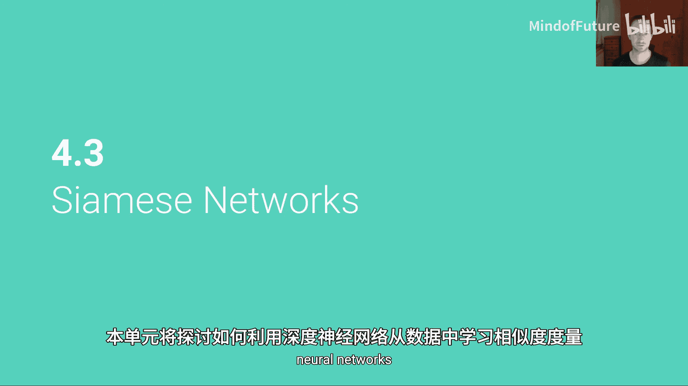
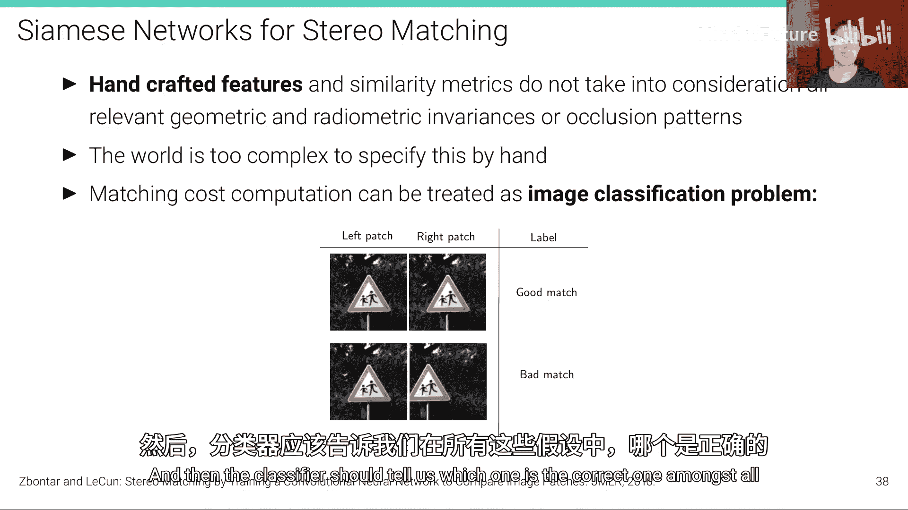
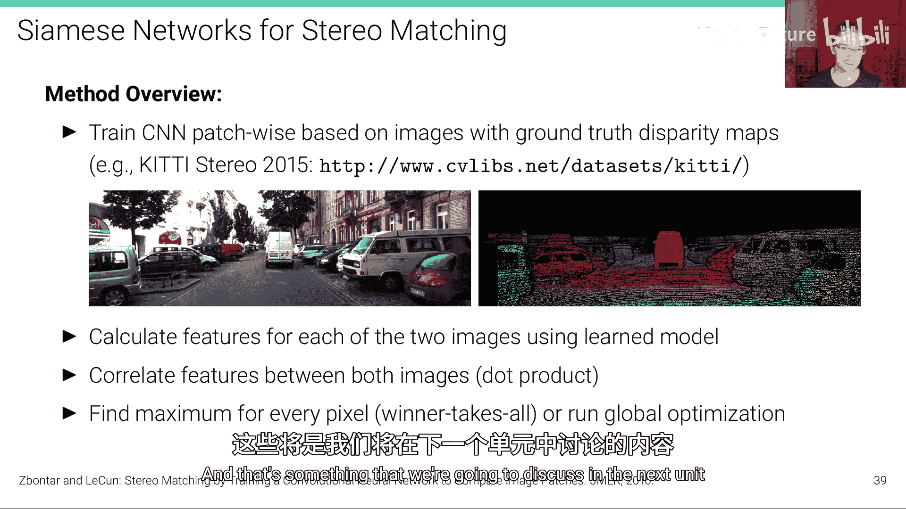
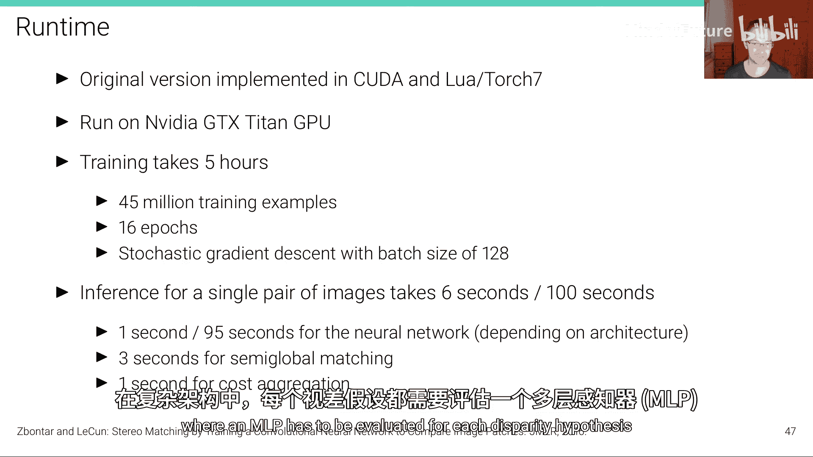

# 【图宾根大学 • 中英】计算机视觉 ML-4360 (Computer Vision) p14 P14 Lecture 4.3 (Stereo Reconstruction - Siamese Networks) -BV1S8N1emEef_p14-

While in the previous unit。We talked about very simple handcrafted。Similarity metrics。

 this unit is about learning similarity metrics from data using the power of deep neural networks。

The motivation for this is that handcrafted features and similarity metrics do not take into account all relevant geometric and radiometric invariances or occlusion patterns。

And of course it would be beneficial if you could learn all of this from data rather than trying to handcraft the feature descriptors as also deep learning has revolutionized recognition。

 for example， where handcrafted Siif descriptors were used before。

 but now all of the features are actually learned。So we want to exploit the same principle here。

 but still staying within the block matching regime so far。

 so we're using a similar algorithm for matching， we just want to have a better similarity metric。

Unfortunately， world is too complex to specify this by hand， that's why we need learning。

And the observation here done in this seminal paper by Sponor and Lacoon。

Is that the matching cost computation can actually be treated as an image classification problem。

The idea behind is very simple if I take a patch from the left image and a patch from the right image。

And I have the ground of disparity here。So this needs， of course。

 an annotated data set where we know the ground of disparity。

And it needs a sufficiently large annotated data set。

Then we can label these patches based on the ground of disparities， for instance， in this case。

This is the correct displacement， so the patch appears similar， as would be a good match。

And then here in this case， this would be a bad match because the disparity is slightly off。

So we can assign these good match versus bad match labels and then turn this into a classification problem while we trying for a particular left patch。

To classify all potential right patches in the right image。

 and then the classifier should tell us which one is the correct one amongst all these hypotheses。

Here has an overview of the method， the method assumes a large annotated dataset and one of the first large annotated disparity data sets was actually one of our datasets。

 the Kidie datasets， in 2012 and then in 2015， which provided each over 200 annotated。Images。

And much more raw images still that also have disparity ground true from which these models can be trained。

 one has to say that the siamese ste networks that we talk about in this unit are still much more label efficient and data efficient because they are just trying to learn。

Features。And similarity matrix compared to this end to end stereo estimation techniques that we're going to discuss in the last unit。

 but still they require quite a bit of data for training。Now。

 given that we have trained such a patch classifier。If you will。

 we can now calculate features for each of the two images using this learned model and we can correlate these features between both images using a simple dot product or a more sophisticated multilayer perceptron。

 to compare these patches， and then we can find the maximum for every pixel。

 the simple winner takes all strategy that we have discussed in the previous unit。

Or we can what's also been done in this paper to get slightly better performance run a global optimization algorithm that incorporates some smoothness assumptions about the problem。

And that's something that we're going to discuss in the next unit。

So here in this unit， we are still focusing on the block matching setup。Okay。In the original paper。

 two architectures for this matching problem have been proposed。One。

 which I call learn similarity and the other I call a cosine similarity。

And the way they differ is that for this first architecture。

 what is happening is that we take a patch in the left image and a patch in the right image and run convolutions to compute features。

But then we concatednate these features and run another。

A fullyully connected multilay perceptron that outputs the similarity score for this。Two patches。

It's still a Siamese network， it's called Siamese because we have these two branches here which are the same。

 they share the parameters， so the same convolution。

Convolutional neural network is applied to the left in perpech and to the right imp perpech。

 but then there is this。嗯。Expensive part here while being more expressive potentially than this simpler solution here on the right。

It's very slow to compute because now for every pixel， we have W times H。

 which is window image bit times image height pixels in the reference image。

Times all possible disparity hypotheses。So there's a very large number here， it's maybe 300。

000 times 100。For VGA image resolution， which is rather small。 so a very large number of。

Times that we actually need to concatenate these two features and then run an MLP on top。

 so this is very slow because we need to do a lot of MLP evaluations while these two parts are rather fast。

So a simpler method is to remove this MLP here altogether and shift all the burden。

Of this similarity metric computation to the features so what's happening here is we compute using a confin the features and we can do this at inference time then of course using reusing computation as in normal CNNNs。

 we can do this across the entire images， so it's very fast in a few milliseconds you get the feature for both the left and the right images for all the pixels。

And then we normalize across the channel dimension for all the pixels and this is the feature。

 and then we compute a simple dot product between these two。

And this dot product is then directly the similarity score， that's called the cosine similarity。

These two operations with this indesiaese branch here， with the shared weights。

 at inference time are really fast because we can run them on the entire images。

And then this dot product， which is the thing that we have to do W times H times d times is of course much faster than running an MLP。

And so the entire。Evaluation here runs like two orders of magnitude faster than for the learn similarity。

Moル。And interestingly， it doesn't lead to a significant drop in performance。

 so performance is roughly on par between these two。

Also an architecture that has been used by many follow up works。Because so fast。

Now how does training work in these models， well， the training set is composed of patch triplets。

And it uses a special loss function that we're going to talk about。

A patch triplet is composed of a patch from the left image。

That is the reference for which we want to compute the correspondence。

 and then we have a patch in the right image that is a negative。That's an incorrect patch。

And then we have a patch that's the positive example that's the correct patch that's exactly displaced by the disparityator by the ground roof disparium。

And this X。This bold x here are just two dimensional coordinates。

 these are the image coordinates in the left and the right image。Now the question is of course。

 how to choose the negative examples and how to choose the positive examples and what this paper does is it does hard negative mining and the reason for this is that if we would just choose negatives everywhere else then the positive。

Patches， then this would lead to a very simple classification problem because most patches actually look very dissimilar from the correct patch。

But what's happening here is。What we're trying to do here is we're trying to find negative examples that are actually quite similar。

 but still not correct to the correct example。And the way this is done is by choosing a negative patch or the coordinate for。

The center of the negative patch。By taking。Well， the correct patch location。

 which is x left minus the disparity。Plus， an offset，0。Of course。

 at the same scan line we're in the rectified setup。

 where this offset O neck is drawn from a uniform distribution with some thresholds and low。

 negative low and negative high。In the negative range and in the positive range。

And then we take positive examples。But also。Like moving to the correct location X L minus D。

 and then taking offsets that are drawn from a smaller range closer to the correct location from minus positiveify to positiveify。

So here D denotes the true disparity for a pixel that's provided as the ground truth and typically。

I think that's also what's done in this paper， the hyperparameters for this hard negative mining are that the positive patches from a range minus1 to plus1。

 and then the negative are assembled from ranges three to6。

 so they are quite close to the positive example， but they are still far enough away such that the classifier has a chance to classify them correctly。

So here's an example。😊，Here， let's assume this is the correct location here， the center one。

Where we have the reference。Location minus the disparity team。

And then we to the center location we add this offset O。

 and that depends that offset is chosen from these ranges that I mentioned before。

 so for instance the positive examples are chosen very very close to this correct location and the negative examples are chosen further away but not too far away so from three to6 let's say。

 minus3 to minus6 and plus3 to plus6 pixels。But not from here， let's say， and this leads to。

The strategy leads to patches in this particular case here that look like this。

 so here we have the correct location here we have it shifted by one pixel and here we have shifted by three or four pixels into the left and right direction and then are then the hard examples that the classifier has to distinguish from these examples and if the classifier is able to distinguish these from those。

 then it's also able to distinguish easier ones from the correct ones。

 easier negative ones from the correct ones。Now this is about the triplet creation。

 now how do we use these triplets？To train this classify and when I'm saying classifiedify is actually not exactly correct because we are using a regressor so。

This model here。It's not outputting a classification score， but it's outputting a similarity score。

 how similar are two patches and the same for this more complex architecture here。

So what we do here in order to learn this model to predict the correct similarities scores。

 we use a hinge loss。And that hinge loss is defined as such it's the maximum of0 and a margin m that's a tunenable hyperparameter。

 typically in the paper I think 0。2 is used。Plus， as minus minus s+ where S minus is the score of the network for the negative example。

So it's the score when inputting the reference patch in the left image and in the right image。

 the negative example and S plus is the score of the network for the positive example。

 so inputting the reference patch and the positive example and of course we want to make sure that the loss。

嗯。Is well， that the score of the positive example is higher than the score of the negative example。

Now this loss is zero when the similarity of the positive example is greater than the similarity of the negative example by at least this margin m。

And having this margin M prevent separation or having this hinge loss prevents separation of positive and negative features that are already well separated。

 that's why we have this hnge loss and the margin。And it gives the model the capacity to focus on the hard cases because things that are already well separated where S minus is already much smaller than S+。

 we don't need to separate more so we should disable the gradients for them。During training。

 So here's an example of this， what I've illustrated here is the loss of in the let's look at the left case here of。

The loss over free to the value as minus， you can see this hinge loss curves here。

For different fixed values with different colors of s+， so let's consider， for instance。

 s plus equals0。In this case。The hingela is。Linear。If as minus is bigger than minus 0。

2 and it's 0 if it's already smaller than minus 0。2， which means that。If。Well， if if the。

If s minus is bigger than0 then of course we want to decrease it， so we are in this linear part here。

 but we also want to decrease it if it's already smaller than s plus but it's only smaller by let's say。

 0。1 here， so if we are in this triangle area here， but if it's already smaller by 0。2， then 0。

Then we want to ignore it and we want to save capacity of the model for other harder cases that are harder to distinguish。

And the same holds true for these other curves， so here we have S plus equals 0。4 in this case we。

Introduce gradients for training until S minus is 0。2 or smaller。

 and then we ignore this example during training。And the same， this is vice versa。

So here we have the curves for s+， let's say if S minus is equal to0。

 then we want to decrease or we want to increase s+ as long as we are still smaller than 0。2。

 but if we are already at 0。2 or higher， then we are 0。

2 higher than 0 and so we can ignore this because they are already separated well enough and we can focus on other examples。

What does that look like here the winner takes all results。

 we have the left input image from a Kidie example from the original KiD 2012 data set。

 here is the result of the Siamese network compared to a standard block matching result and you can see that this is a much less noisy and it's a better result than this block matching result。

So learning actually improves the quality of the similarity metric。Now。

 if we run a global optimization and that's something we're going to talk about in the next unit。

In addition to this cost computation we get even better disparity maps that you can see here。

 and we do this for the left image and for the right image and then we can do a consistency check where outliers are removed and colored based on the occlusion relationships you can see that things that are half occluded are in green here。

And we obtain very nice disparity maps。The original version of this algorithm was implemented on Kuda with Luar torch 7 and run on a tight next。

Training required about5 hours。 They trained it for 45 million with 45 million training examples is little patches。

 Remember that training only requires patches， not entire images。 That's why it's。Rather。

 data efficient。And they trained it for 16 apochs using STD。

And then inference for a single pair of images takes about six seconds for the simple architecture and 100 seconds for this complex architecture when MLP has to be evaluated for each disparity hypothesis。

