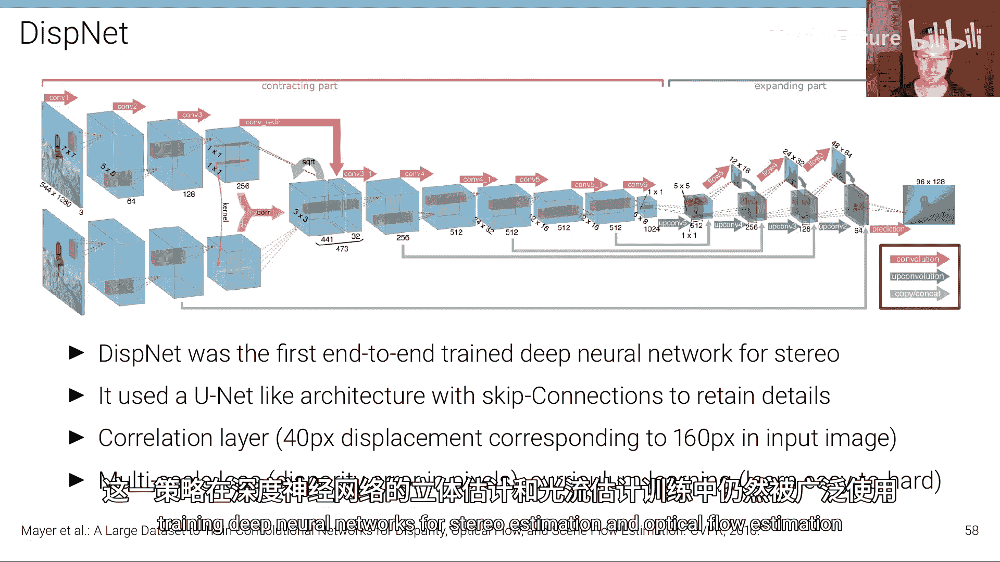
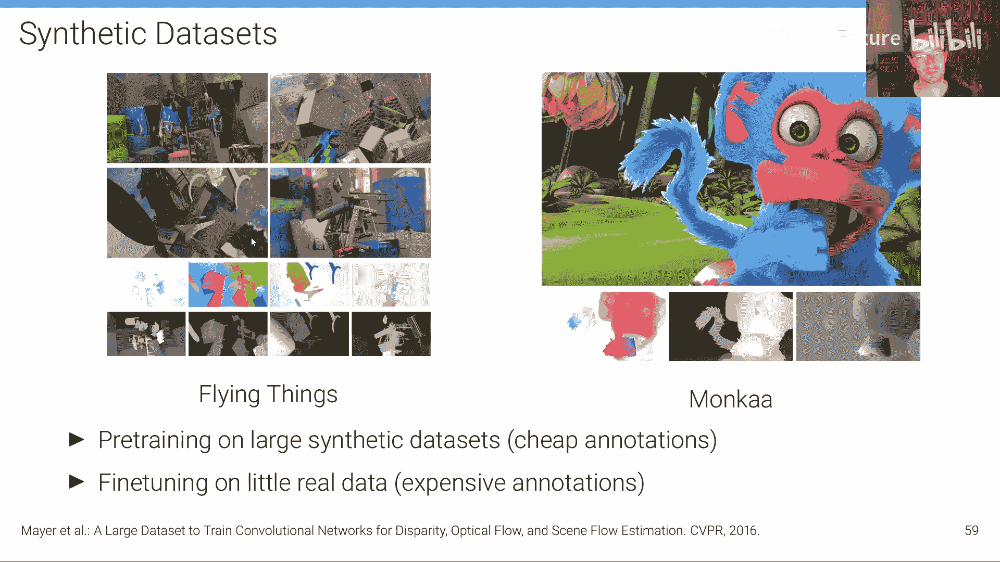
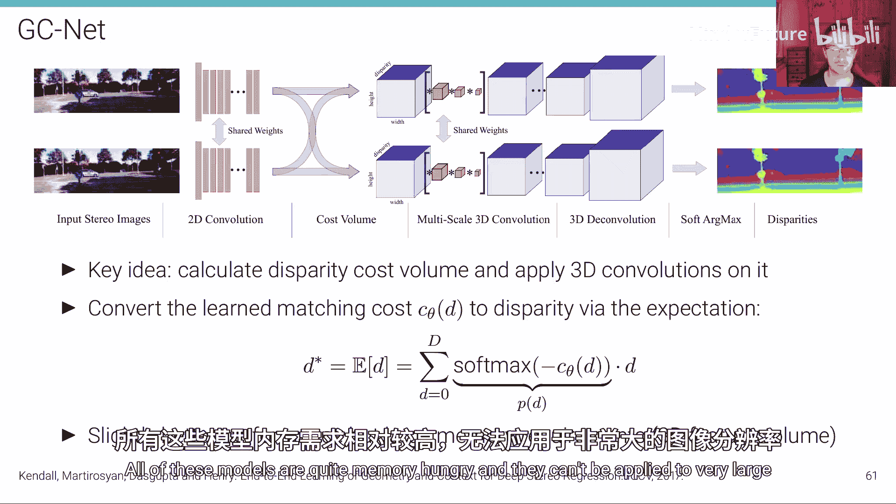
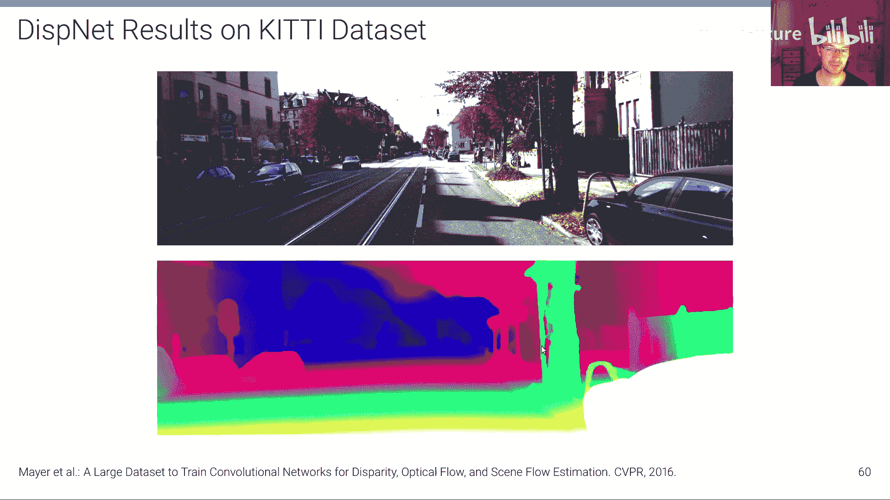
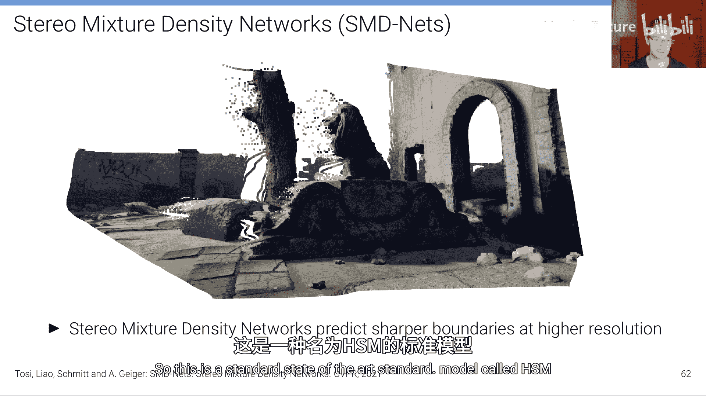
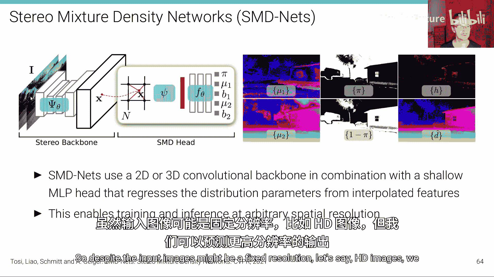
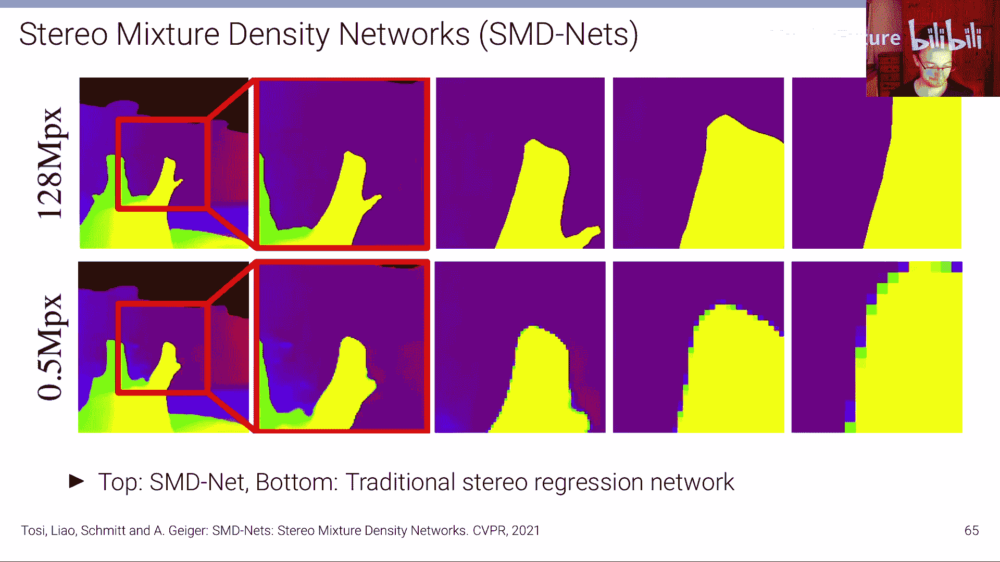

# 【图宾根大学 • 中英】计算机视觉 ML-4360 (Computer Vision) p16 P16 Lecture 4.5 (Stereo Reconstruction - End-to-End Learning) -BV1S8N1emEef_p16-

In the last unit， we're going to be talking about end to end learning algorithms that not only learn the matching cost。

 but directly take entire images as input。and using a deep neural network directly output disparity maps and this was something that was really only possible with increasing compute in particular annotated data sets that could be used for training these models because these models now require much more label training data compared to the models that just compute。

Or try to learn good models for matching local patches。

The first model in this context that basically spurred an entire field is called disnet was the first enter to entrytrain deep neural network for stereo。

 the input， it's very similar to the flow net model is a。Pair of images， left right images。

 and we have some convolutions down sampling and we have some skip connections。

 so it's a unit architecture， we use skip connections to try to retain fine details and then we have this up convolution。

In order to increase resolution again we have a contracting and an expanding part。And in the end。

 we obtain directly， we directly predict or regress a disparity map。

Using this and this is trained end to end， there is no global optimization introduced in the end。

 it's all trained from very large amounts of data。One thing that's specific about this architecture is that and that has also been used and by followup works is that after a few convolution and pooling layers when having reached already a relatively small resolution。

 there is already some idea about sting matching incorporated here by having a correlation layer that there's something similar to the correlation that's happening also in block matching。

 but now on this feature level， so were having if you will。

 a Siyese network here and then we're doing this。Correlation layer here that tries to now combine these two。

 and then。From there on we have just a single branch and not two branches anymore。

 so this is incorporating some of these basic ideas of traditional stereo matching。

Turns out that actually even without this correlation layer。

 just combining and concatednating these features here。

 we can already get good results but this improves results slightly。In order to train this model。

 the offers used a multi scale loss。Um。So the loss was not only applied。

 the loss that measures the discrepancy between the predicted disparity and the ground roof disparity was not only applied at the last layer。

 but it was also applied for downscaled versions of the ground truth at intermediate layers。

And another thing that they did in order to make this actually work is a curriculum learning strategy where the model。

 and that turned out to be very important in order to not overfit。

Was first trained on easy examples like very simple scenes。That are easy to match。

And smaller resolutions， and then later the difficulty of the data sets was increased until the target dataset difficulty had been reached。

And that's a strategy that。Is still frequently used in particular in the context of training。

Deep neural networks for stereo estimation and optical flow estimation。

Another important thing is data sets。Creating datas。

Of stereo imagery with crown truth is really hard， and Kitty we used a LiDar scanner。

But then the data set was very， first of all， it had to be manually created。

 so it created a lot of work。In order to remove outliers and cur it and then second it's very specific to the self-driving scenario now if you want to go broader you want to have also stereo images from more general scenes and for those it's often very hard to get the ground truth displacements because there's not really a good sensor that can measure that。

And what was done in this paper and whats particularly surprising to everybody at the time that this works is that very large synthetic data sets have been created。

 for which the annotations are cheap to obtain because if we render data 3D assets。

 then we get the depth for free， we can just render depth layer using a rendering engine。

But what was surprising is that that the data sets that were created were very dissimilar from the target data sets that were used for testing and for fine tuning and testing the model。

So on the target dataset sets like Kity， the model was then the pret model on this dataset was fine tuned for a few more epochs。

But only a few more epochs because these annotated real data sets are small and these synthetic data sets。

These artificial dataset sets are large， but despite this discrepancy between the appearance of these data sets in the。

 for example， Kidie dataset， the performance on the target dataset sets was reasonably good。

And the reason for this is that these models are able to generalize well。

 these matching problems are able to generalize reasonably well。

So here in this case this is a dataset called Flying F where just random assets have been downloaded from the internet。

 you can see there is flying cars and flying chairs and they were just put on top of random backgrounds from which then the images and also the ground roof was generated a very chaotic data but it provides a lot of difficulties to the stereo matching problem as you can see there's a lot of depth discontinuities and so the model becomes a generic depth estimator that generalizes comparably well if it's fine- tuned on the target dataset later on and another data that was used was the monca dataset。

Which is a CGI movie with free assets。Yeah。And here is a result of disnet applied on the KiI data set。

 you can see the resulting disparity maps are smooth。And they are of high quality。诶。

Follow up work is called Gnet that LED to even better performance than disknet by utilizing。

A very simple idea， what has been done differently in this model while also using a shared 2D convolutional encoder was that now the cost volume that was created。

By correlation， and in this case， both for the left and for the right image as reference image。

Was then filtered with a 3D filter。That could then adapt to this correlation volume and pick up features in that volume。

 so the difference to this model here while also having a correlation layer is that here this is still 2D convolutions and here from this layer on we have 3D convolutions and also 3D deco convolutions in order to increase the spatial resolution。

So the key idea is to calculate the disparity cost volume similar to traditional methods。

And then apply 3D convolutions on that volume。And this leads to slightly better performance。

 but has larger implications for the memory is very memory intensive。

 so very small mini batch sizes could be used here because these 3D volumes are very memory intensive and these 3D convolutions are more memory intensive than 2D convolutions。

One thing that was also done here was that the disparity estimation problem wasn't tasked。

To be as in the discson case here as a regression problem。But instead。

 as a problem where now because we have these3 convolutions on that volume， we can predict a。

Matching cost also for each disparity hypothesis， right， so we can have now for each。

At each location， at each pixel。UV or X Y in the image and at each disparity level now we can。

Predict for each disparity level at each pixel a matching cost。

So we don't have to rely on regression。And then these matching costs， they have to be combined。

 of course， somehow and what they did in this paper is simply to take the expectation。

 so that each pixel this is per pixel。We compute the expectation of a disparity。

 which is basically computed by taking to sum over all disparities hypotheses at that pixel。

Computing the probability for that disparity， which is。The negative cost。

Turned into a probability by computing a softm along the entire vector of disparities。Remember。

 the softmax outputs a discrete probability distribution。

 so the scores here is negative cost or scores are turned into a discrete probability distribution。

And this is then multiplied with the disparity。So we are trying to minimize we're computing the the estimated disparity is the expected disparity and we're trying to minimize the discrepancy between the expectedpar disparity from that cost volume。

And the ground roof disparity team。Now， as a final example that I want to show you while there's many more examples that many more works that have been done in that area is so calledled stereo mixture density networks。

 that's a rather recent work that we did in our group。At CVPR 2021。

And the idea of stereo mixture density networks is now to scale these models All of these models are quite memory hungry and they can be applied to very large image resolution and one particular problem of these models is also that if we use these models then because of the intrinsic smoothness properties of deep neural networks we get this mirroring artifacts you can see that the borders are not very sharp and if we would project such a disparity map into 3D space we would see that theres a bleeding at the edges of objects and this is illustrated here so this is a standard。

A state of the art standard model called HSM that produces the disparity discontinuities。

 such bleeding artifacts， flying pixels because of the smoothness properties of neural network based regression basically。

And so these are the results of the S&T net， the stereo mixture density networks that predict sharper boundaries and also at much higher spatial resolution and how is this done？

Well， the first innovation here is that instead of predicting just a single or regressing a single disparity value。

 we're predicting multimodal distribution over disparity values。

And the advantage of this is that with this， we can model much sharper disparate discontinuities on the left we see。

As an example， a classical deep network for stereo regression that suffers from the smoothness bias and hence continuously interpolate object boundaries so we see in green。

 the true disparity， but the best this model can do is to predict these black dots here。

 which you can see are smoothly transitioning from the background to the foreground on the y axis we have the disparity。

And here on the right。😊，We have。This mixture density network that predicts a mixture distribution。

 so at each x location here， this is the image。A column。For a particular image row， we predict。

A bimodal distribution in this case over the disparity values。 and so that distribution can。

Can basically model both of these modes， and if we then take。As the final disparity value。

 the value that maximizes this distribution， then we can model a sharp transition here because at some even though these two these distributions are continuously transitioning。

 you can see that they，This transition of this peak here becoming weaker and this peak here becoming stronger is continuous。

 we obtain a sharp discontinuity and this model is a much better model for given a C andN as a predictor。

Is a much better model for disparity maps。And the other innovation we did here is that we on top of a standard stereo backbone and we experimented with various backbones。

 what we did is we didn't directly predict at a fixed resolution。

 the output disparity or the parameters of this mixture model。

 but we have an additional head so-called S&D had that queries using an MLP at an arbitrary continuous location in the image domain。

 the feature values using interpolation using bilinear interpolation。

 and then passes this bilinely interpolated features predicted by the backbone food is MLP in order to predict the parameters of this mixture distribution in this case a bimodel lapplian mixture。

And this really enables training and inference that arbitrary spatial resolution。

 so despite the input images might be a fixed resolution。

 let's say HD images we can predict at much higher resolution outputs。

So here's an example of this。On the bottom we see an example the classical state of the art stereo deep stereo matching network。

 this is an output of course for a test image that wasn't part of the training set。

 we can see that the resolution， the output resolution。

 the maximal output resolution that can be achieved here is 0。5 megapixels。

 so we get a pixel related result。And we also see this smearing。

 this bleeding at the boundaries where we get disparity values that are actually incorrect。

While using the combination of this bimod mixture model。And this。

SMD head that allows for querying and also training a model at arbitrary spatial precision。

We don't get these bleeding artifacts and also at the same time we can query the output disparity map at much higher resolution like 128 megapixels as in this example here。

That's all for today。

