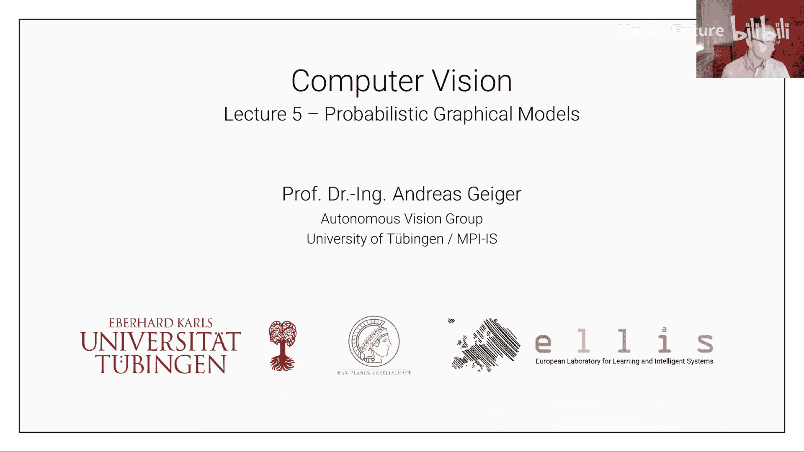
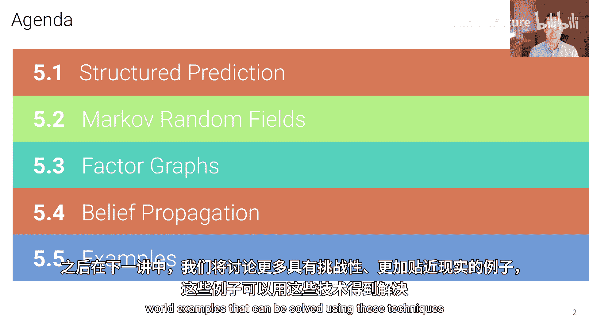
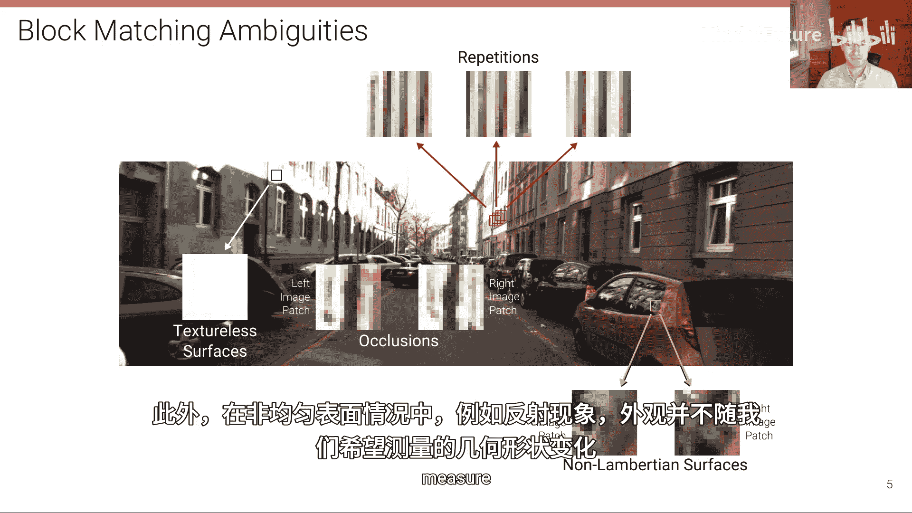
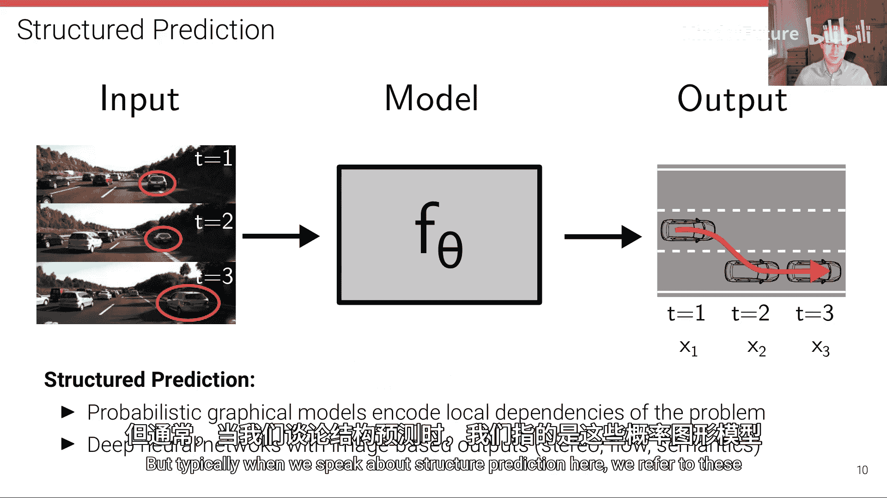
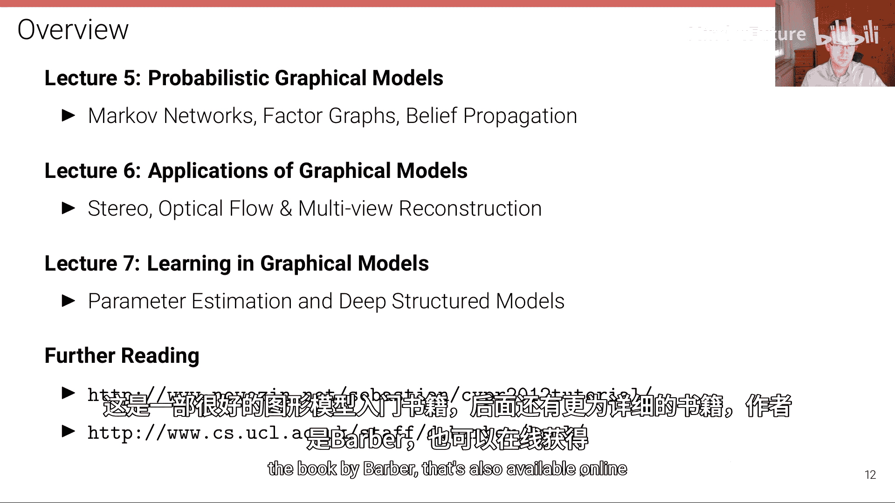

# 【图宾根大学 • 中英】计算机视觉 ML-4360 (Computer Vision) p17 P17 Lecture 5.1 (Probabilistic Graphical Models - Structured Prediction) -BV1S8N1emEef_p17-

Hello and welcome to lecture number five of this computer visionion course。

Over the last few weeks or so， I tried to improve a little bit of my audio setup。

 I've purchased some new components and tried to improve the acoustics and this is the result。

So I hope you enjoy the now new and hopefully improved all your quality of this course。

So back to lecture 5。Lecture 5 is on probabilistic graphical models。Lecture 5。

6 and 7 are a little excursion to techniques that today are。

Not de dominating techniques in computer vision， given the。

Given the fact that deep learning methods have overshadowed。

A lot of the things that have happened in the past， but still they are。

 they have been dominating the computer vision field for almost 20 years。

 and many of the ideas that are。Part of these techniques are still relevant today and worth discussing and certainly when giving a computer vision class that should treat also techniques that have been very popular in the past。

So this lecture is structured into five units in the first unit we're going to cover the basic setup。

 the setup of so called structure prediction problems。And in particular。

 graphical models and how they can help in。Modeling such structure prediction problems。In unit2。

 we're going to cover one particular graphical model， the so called Markov random field。

That's going to be our little friend for the rest of this lecture。And also for the next two lectures。

Then in unit3， we are discussing factorgraphs， which is a specific representation that's particularly useful for doing inference。

 and then in unit four we' are going to discuss one particular inference algorithm。

Which is called belief provocationation。 and we'll look at some very small toy examples in unit5 before then in the next lecture。

 we're going to cover。More。Challenging more real world examples that can be solved using these techniques。

So let's start with structure prediction。嗯。In the last lecture。

 we have seen stereo matching algorithms， in particular， block matching algorithms。

Where due to the inverse nature of this stereo matching problem， there is a lot of ambiguities。

 there's a lot of matching ambiguities such that the correct match between the left and the right image cannot be determined。

Andammbiguously。So the fundamental assumption of block matching algorithms is that corresponding regions in the two images should look similar but is。

A whole range of situations where these similarity constraints。

 the similarity assumptions that we do on little patches fail， and here are some examples。

For example， in textless areas where it's simply impossible to distinguish a and patches。

when we have repetitions where a lot of the patches look very similar to each other。

Or in the case of occlusions， when the background changes differently from the foreground。

 and so the appearance within the patch that is matched changes dramatically。

And also in the case of non lumberian surfaces， for example， when there is a reflection。Where the。

Appearance doesn't move with the geometry that we'd like to measure。

Now， in order to overcome such ambiguities。What we can do is we can try to integrate prior knowledge。

And prior knowledge in the case of stereo matching means。

Knowing what the world looks like in terms of depth maps or disparity maps。

In terms of what the quantity that we like to infer。

And one example that we've seen already in last lecture is the brown range image database。

 which provides。A number of depth maps or depth images。

From which statistics have been created that show that depth or disparity also very slowly except at object boundaries。

And object discontinuities。Which are relatively sparse。

 So we have such distributions where we have a lot of the。Probability mass centered。At。

Areas where the derivative of the range is small。But then we have some， also some significant mass。

Some non zero mass。That is in areas where we have this object discontinuities。

 this disparity discontinuities。And we want to。Take such statistics， this is our prior knowledge。

And now integrate this into the block matching into the stereo matching algorithm。

And this is called spatial regular。Or the simplest form of this is called spatial regular because spatially what we want to do is we want to integrate these statistics。

And what that means is we want to encourage smoothness we want to encourage。

Or we want to model the fact that adjacent pixels are more likely to be of the same value of the same disparity value rather than not being the same disparity value。

 but there should be also significant probability for them to differ。So how can we do this。

 how can we integrate this knowledge about the statistics of D mapps？

We have already very briefly touched upon this in the last lecture。

 we can formulate the problem as inference。In a graphical model。

 and this is called a structure prediction problem because we are predicting。Not at every site。

 at every pixel individually the disparity now， but we are predicting the whole disparity map at once。

While integrating。Our prior knowledge， our assumption about interaction of adjacent pixels。

Which is indicated here in this vector graph， which we're going to cover later in this lecture。

By these little squares that are connecting adjacentsten to pixels in this。

So called4 connected grid where for every pixel on this regular grid。

 we have a connection to the top， the bottom， the left and the right pixel adjacent to it。

And this can be written， as well see in such a form here in such a energy function。

That gives rise to a so called gis distribution that is the。

Probability distribution over the disparity map。And now we want to do maximum a posterory inference over。

The space of all these disparity maps in order to figure out what is the most likely disparity map？

Given these constraints， given the data constraints， these are the costs， for example。

 and given this prior knowledge that tells us， well。

 we have looked at the statistics of real world de mapps。

And now we want to integrate this by saying that adjacent sites， adjacent pixels have similar values。

So we're combining the data term and such a smoothness regularizer。So at a very high level。

What are probabilistic graphical models？Probilistic graphical models。

Take a probabilistic viewpoint and model the dependency structure of the problem。

So we really try to model probability distribution。And we will try to。

Model the distribution of the entire object， the entire disparity map that we want to infer。

And we want to then do inference。Over that。A model that we have。

So it's a structure prediction problem。And we're going to see in a few slides what structure prediction exactly means。

 but essentially it's predicting not just a single pixel disparity。

 but predicting all the disparities at once by taking into account these local interactions。

 these local constraints that we have defined between adjacenttened random variables in the case of this fourconed grid that I've shown before。

Graphal models have really ruled many areas， at least of computer vision before the deep learning revolution。

And they are particularly useful in the presence of little training data。

And they allow for integrating prior knowledge。There's。

Two ways to overcome ambiguities in these ill post problems that we often have in computer vision。

One is to integrate a lot of data。Possibly annotated data where we have set of input images and the corresponding disparity maps。

 and then we want to train a stereo matching network end to end， and this is what deep learning does。

But in many cases。These large amounts of data are not available。If you think， for instance。

 in medical applications。And therefore， it's useful if we have prior knowledge to integrate that prior knowledge。

 and this is where graphical models are powerful。However。

 graphical models and also the ideas behind them can be combined。

Can be advantageously combined with deep learning and can also inform deep learning。

And we'll see that in lecture 7， with a few examples that we can combine deep local features with inference in a graphical model。

 and that also we can derive deep learning architectures， novel deep learning architectures from。

Inference in graphical models。So here I try to put next to each other the pros and cons of probabilistic refere models。

 the pros are we can integrate prior knowledge。If we know something about the problem。

 such as the statistics of depth mapps， we can integrate that。They have relatively few parameters。

 which means we can。Estimate those parameters from limited data。

 and they are interpretpreable by design because we are， as you will see， modeling a graph。

Where certain components of the graph have a certain meaning。

 and so if we afterwards inspect what the model has inferred。

It's much easier to understand what happens compared to looking at a vanilla deep neural network and trying to figure out what the individual neurons are doing。

On the other side。Unfortunately， as people also have realized。

Many phenomena are really hard to model。And this makes it difficult to apply these graphical models。

 We're using the wrong assumptions， we are using a two simple dependency structure in order to be able to actually do inference that's still tractable。

For example， assuming a pairwise dependency structure where we just have pairwise relationships between variables while the true dependency structure is much more complex。

 and so this introduces errors of course。Then exploiting large data sets is often difficult also because these techniques are not particularly fast and inference is often approximate even for simple cases because。

Inference， for example， in。Graphs with loops is NP hard。

 and so we need to resort to approximate inference algorithms as we are going to discuss them also in this lecture。

Now， I already mentioned that。Inferencing graphical models is a structure prediction model。

 So what is a structure prediction model formally， Well， structure prediction is in opposition to。

Traditional classification and regression problems in classification or regression。

 we are trying to model a function that goes from some complex input space。

There can be any kind of objects， the input could be something really high dimensional。

 like images or text， audio sequences of amino acids， etc。And the output is a single number。

 and that's either a discrete number then it's called a classification problem。

 or it's a continuous number then it's called a regression problem。Now instructor prediction。

We have the same type of inputs， we have any kind of objects， complex objects。

 high dimensional objects， images， text， etc。But now the outputs are complex structured objects as well。

So instead of just predicting a single real or。Discreet number。Now the output could also be images。

 texts， or pastries， or folds of a protein， computer programs， etc。

So the output is now something high dimensional， something complex。That's the difference between。

Classification， regression and structure prediction as we define it here in this lecture。

So here's an example， this is a generic form of a model of parameters theta by the input。

Get mapped through this function F with parameters Phta to sum output。

And then we have two problems associated to it machine learning， the first is learning。

 estimating the parameters theta from the training set。

And the second is inference making novel predictions for unseen inputs X。

And in the case of classification or regression， the input might be an image。

 and we might want to infer the category that that image belongs to。

And the another example is a Siamese network where the input is now a pair of patches and the output is a classification result for that particular pair of patches that gives us。

嗯。A score for a particular disparity value at a particular pixel location。

And then we can for each pixel independently look at the maximum score and figure out the disparity that way。

 But we do this really independently across。All the pixels in the image。 and even in this case。

 across all the disparity levels。So we are not taking the structure into account。

Now in structure prediction， we want to take the structure into account。

So we wanted to inference over the entire disparity map in the case of stereo。

 or here in this more simple case， where we have an observation of a sequence。

 an image sequence and want to track this object in front。

Then the output here is not a one dimensional quantity， but it's a three dimensional quantity。

It's three random variables， x1， x2， and x3。And each of these variables in this simple example and we'll see this again at the end of the lecture is a discrete random variable that can take any of three states。

 the vehicle that we' are tracking is in the left lane in the center lane or in the right lane。

And now we want to do inference from these inputs。嗯。To infer what at each time step， T1，2 and 3。

The correct state of these variables is。And I assume there's a lot of noise in these inputs。

 so the predictions are inaccurate。But we can assume some regularities on the output space。

 then this becomes a structure prediction problem。Because we can say， well， it's unlikely。

 for instance， that the vehicle in the first time step is here and then directly in the next time step moves to the left lane。

Which is physically implausible。Instead， it's more likely that the vehicle stays on a lane or moves just by one lane。

And so by integrating such constraints as prior knowledge into that model and by doing structure prediction by doing inference in a graphical model。

 we can then take those。Prior constraintstrain these prior assumptions into account。

So one example for structure prediction problem， which is a problem that has a structured high dimension output is。

Probilistic graphic models or inference in probabilistic graphical models。

Where local dependencies are encoded。Or also deep neural networks with image based outputs as we have seen in the previous lecture。

 for example， with the end to end models that were taking two images as input and predicting an entire disparity map。

So they also fall into the category of structure prediction models。

 but typically when we speak about structure prediction here， we refer to this。

Probilistic graphical models。Now there's a whole variety of graphical models in the literature。

 and there is entire courses on this topic and indeed I have taught an entire class just on graphical models in previous years。

But in the context of this lecture， we are just keeping it to free lectures to get the gist of graphical models and we're just looking at a very specific type of graphical models so here you can see a taxonomy。

Maybe you have heard of page networks before， which are directed graphical models。

In the context of this lecture， we'll look at one particular graphical model that's very relevant for computer vision applications and these are undirected graphs graphical models。

With undirected graphs so called Markov networks or vector graphs。

So here's a brief overview of this little excursion in lecture 5， this lecture here。

 we are going to introduce probabilistic graphical models。

And we are going to be talking about Markov networks， factorgraphs。

 and belief Proagation and inference algorithm。To derive marginals and so called maximum a posterri solutions。

In lecture 6， we're going to see some applications of graphical models in the context of stereo optical flow and multiview reconstruction。

 and then in lecture 7， we're going to talk about learning or parametermeter estimation in graphical models and also how to combine them with deep learning。

And if you want to know more about graphical models。

 I highly recommend having a look at these two links here。

 the first is a tutorial that comes also with a book that's available for free online。

From Sebastian Novistein and Christo Lamardt， it's a great introduction to graphical models and then a little bit more extensive。

 the book by Barber。That's also available online。

Yeah。