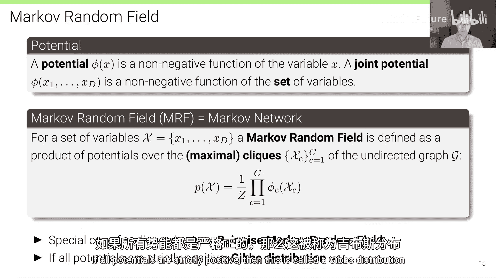
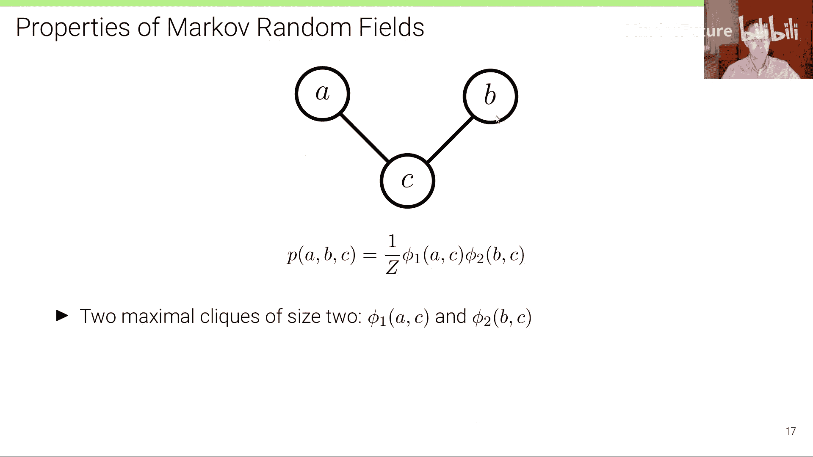
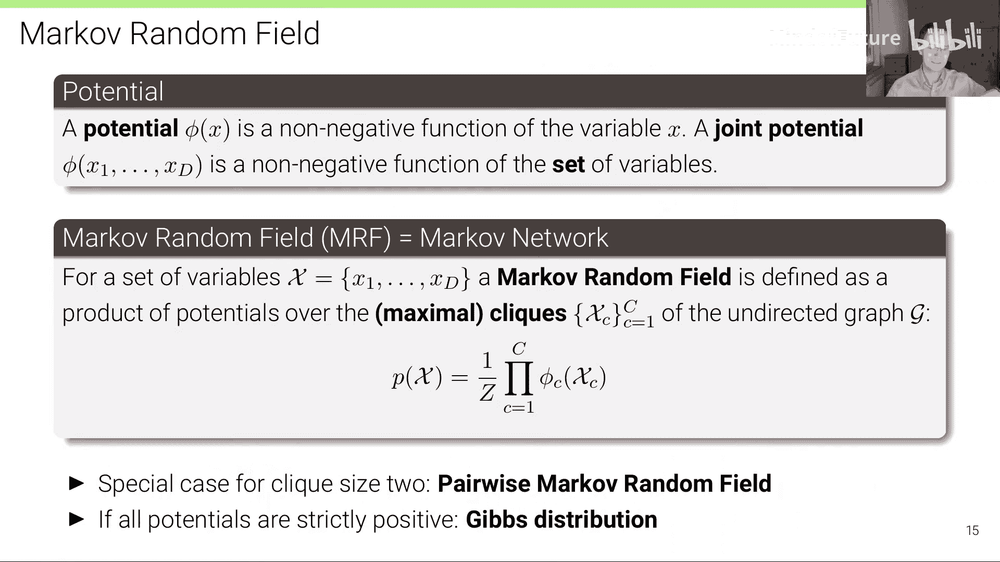
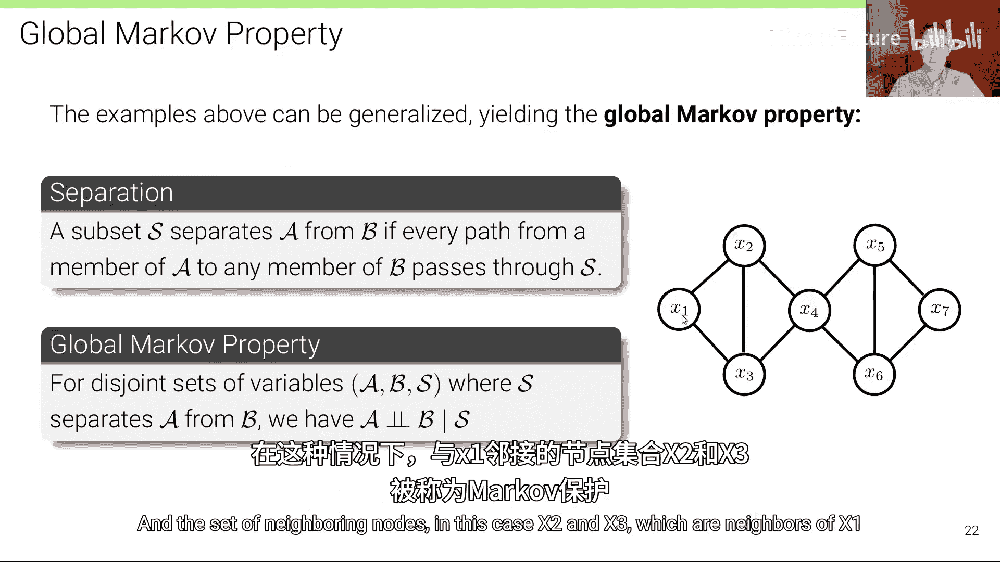
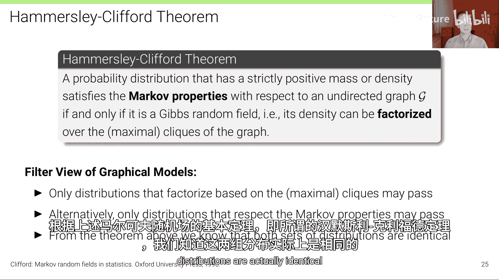

# 【图宾根大学 • 中英】计算机视觉 ML-4360 (Computer Vision) p18 P18 Lecture 5.2 (Probabilistic Graphical Models - Markov Random Fields) -BV1S8N1emEef_p18-

Let's start with Markov random fields， or in short MRFs。

。But before we do that， let's briefly recap probability theory。In probability theory。

 we're talking about random variables， which are variables over which we define distributions。

So there's two types of random variables， discrete random variables。

That we are consider for most parts of this course and in particular this lecture。

Where a variable can take。Any of C values think of the C as classes。

If this is a classification problem。And the probability that x takes a value C is。

Denoted as P of x equals C。And note that we are using the lower case notation of P here also for discrete distributions。

 while often it's a capital letter P。Then。If x is a continuous random variable。

 we can write the probability that x takes a value in a set。

So if this is a one dimensional random variable， then this is a subset of this。

One dimensional space R。The space of real numbers。And the probability that x takes a value in calligraphic x is P of x element of calligraphic x。

And a distribution over x is simply written as a shorthand notation as p of x where we again don't distinguish between discrete and continuous。

 which is always using this small letter P for simplicity。Now。

 there's some important properties to know about。Probability distributions。

That we're going to extensively use in this lecture。And that youre probably all familiar with。

 but just to recap。The joint distribution of two random variables is denoted as P of x comma y。

Or equivalently P of y comma x。Which is a shorthand notation for P of x taking value C and y taking value C prime。

 let's say。This is the joint distribution。 If x and y are one dimensional real numbers。

 then this is a。Two dimensional distribution， like a 2D cautionian， for example。嗯。

Then we have two important rules， the two basic rules of probability。

 one is called the sum rule and the other is called the product rule。

 and from those rule everything else can be derived。To some rule。

Is basically defining the marginalization of one variable where we have a joint distribution P of x and y and transform this into a so called marginal distribution marginal because one of the variables has been removed in this case y。

And we marginalize by summing， that's why it's called sum rule over the variable that we want to remove from the distribution。

 so the marginal distribution of x is equal to the sum over all possible y。

 all possible states that y can take off the join distribution of P of x and y。Or if。

X and y are continuous variables， then we take the integral operator here。So just call the sum rule。

Or marginalization。The other important rule is the so called product rule。Well。嗯。

The joint distribution。P of x and y。Equals the conditional distribution， P of y given x。

 this is the distribution over y， given that we have observed x。Times the probability of x。

Or in other words， p of y given x is equal p of x and y over p of x。

And as a direct consequence of the product rule， we have also the famous space rule。

 which is simply p of y given x equals p of x given y times p of y over p of x。Okay。Now let's。

After this quick recap， dive into Markco randomom fields。For defining Markco random fields。

 we first have to define what the potential is。A potential。5i。

Or potential phi of x is a non negative function of its argument x。And in this case。

 x is a single variable and a joint potential。Phi of x1 to x T is a non negative function of the set of variables。

 In general， all of the variables could also be multi dimensionsal， but in the。

Context of this lecture here， we are considering each individual axis a one dimensional random variable。

So this is a potential or a joint potential， it's a non negative function of the variable。

 but it doesn't need to be normalized， it's just non negative。Now a markco random fields。

In short MRF， or also called a Markov network。Is defined as follows。For a set of variables。

Cligraphic x equals x1 to xt。A Markco random field is defined as a product of potentials over the maximal cliques or the cliques。

We will see what maximal clickiques are， the maximal clicks。嗯。Are covering all the clickiques。

 so it's sufficient to consider all adjust the maximal clicks。

 but we can also consider all the cliques。So the Markco random field is defined as a product of potentials over the clicks or just the maximal clickiques。

Xc of the undirected graph G， and there' is capital C such cliques。

And then the product of potentials is simply the product of little C1 to C。Phi C of calligraphic Xc。

Where this。Clicks here are subsets of the set of variables。So for example。

 the first clique could contain just x1， the second clique could contain x1 and x2。

 the third clique could contain x2 and x5， etc， that depends on the graph as we'll see。

Now what we can already see here is that we have this one over C expression here。

 which is the normalizer that make sure that this expression here on the right is normalized such that this is a proper probability distribution that P of x integrates to1 we have to have this normalizer here it's called a partition function because we haven't assumed anything about the potentials except them being non negative。

And this， of course， does not ensure that this expression here is normalized。When。

Summing over all states of。Calligraph x of the set of all random variables。

 So we have to add this normalizer in order to form a proper probability distribution。

There's special cases， if the cliques here are of size 2。

 so if there is only cliques of size 1 or2 but no cliques of size3。

 no cliques that cover free random variables， then we call this a pairwise markcoran field。

And that's。An example for this we have already seen in the context of this stereo markcoferdom field that I've briefly shown in the beginning where we have unary potentials and pairwise potentials。

 but no。Potentials they connect more than。Two variables。If all potentials are strictly positive。

 then it is called aipse distribution。

Now we talked about cliques and maximal cliques and undirected graphs， so what is all that。

 so here's an example。This is an undirected graph。Liif。Seven vertices。And。1，2，3，4，5，6，7，8，9，10。

11 edges。And it's an undirected graph。Because。Each of the edges is undirected。 There is noarrow。

 There is no notion of。Diirectctionality。It's just an edge。This is why is called an undirected model。

On undirected graph。Now， each of these。Vertices in the graph corresponds to random variables。

 So in this case， we have seven vertices，7 random variables， and the edges correspond to。

Depenencies between these random variables， relationships of these random variables。

 so x2 and x4 are directly related。But x2 and x5 are not directly related， only through x4。

 they are related， but not directly related。Now， a click。And we see several examples here。

 the green is a click and also the red ones are cls。

 a click is a subset of vertices that are fully connected。So for example。

 here we have a click because x1 is connected to x3。

So all of the nodes inside that click are fully connected with edges。But also x 1， x2， x3。

 x 4 are clicks。Or is a click。Because we have connections between。

Every two variables of vertices inside。And similarly， x4， x5 and x6 are cliques， or x5。

 x6 and x7 is a clique。But x4， x5， x6 and x7 is not a click。

Because theres a missing connection from X4 to accept。Now a maximal click。

And only the red ones here are maximal cliques is a clique that cannot be extended by any other vertex。

If we look at this clickique x1， x2， x4， and x3， and we want to extend this click by。

 let's say verex x5。好。Variable x5， then there would be a lot of connections missing， for example。

 x2 to x5， so it's not a click anymore， so this is a maximal clickique。

But let's say x1 and x3 is not a maximal click because we can add x2。

And we have a bigger click that's fully connected。But also that is not a maximal clickique because we can still add x4。

 and now we have a maximal click because we cannot add any other variable to further extended。X4。

 x5 and x6 is a maximal click because if we would add x7， we wouldn't have a click。

 or if we would add x2 or x3， we wouldn't have a click because there would be connections missing so maximal clickiques are clickiques that cannot be extended by any other vertex。

Okay。So this is the notion of an undirected graph where the vertices correspond to random variables。

You can see why this is called the graphical model。And edges correspond to relationships。

And the concept of cliques and maximal cliques。Now let's look at some properties of these macrocoranum fields at a very simple example with just three random variables or three vertices in the graph。

 and this graph is not fully connected there is a connection from A to B missing。

 there's only connection from A to C and from C to B。

So as we've seen before， a Markco randomum field is defined as a product of potentials over the cliques of the undirected graph。

And because。The maximumimal clicks comprise。Or the set of maximal clickiques comprises all the clickiques。

We can similarly also just consider the maximal clicks so in this case we have two clicks which are at the same time maximal clicks we have the click AC and the click click CB。

 so this mark random field specifies this distribution。

 the distribution over the random variables A B and C the joint distribution factorizes as1 over C and the potential。

Phi 1 of AC and the potential phi 2 of BC。And C is an so called partition function which normalizes this distribution to sum to one。

In the case of discrete random variables that we consider here。And so in order to do so， of course。

 we have to take this expression and sumit over all possible combinations of A B and C。

So if these are binary random variables， then we have。

A sum over eight terms because we have eight possible combinations of。These binary， A。

 B and C variables。And it's easy to see that if we plug this in here and then we sum the entire expression over A。

 B and C， then this results in one because we have。

And the same term in the numerator than we have in the denominator。

So this is the partition function the normalizing constant。

Now back to the properties of microferum fields。What happens for this particular markrum field if we marginalize C if we marginalize C。

 what happens is that A and B become dependent on each other。A and B。

 which didn't have a direct connection before， if we marginalize C。

 then they become directly connected。And we can prove that by showing that A and B are not independent anymore after marginalization。

By showing that the probability of A and B， the joint distribution is not equal to the。

Probability of a times the probability of B。Which is exactly the。Independence property。

So how can we show this， Well， we can show this by contradiction， so let's assume。

Let's assume this holds true， let's assume there's an equality here instead of this inequality。Oh。

So as you can see here， I've used an equality here。

Let's assume P of A and B is equal to P of A times P of B。So what is P of A and B。

 P of A and B is of course the marginal P of A， B and C when we marginalize C， when we sum over see。

And then we know what P of A， B and C is， this is exactly this expression so we can plug that in。

 so we end up with this term here。On the other hand。P of A is the marginal of P of A。

 B and C when we marginalize over B and C and P of B is。

The marginal of this expression with respect to A and C。And so again。

 here we can plug in the expression for the joint distribution。So we have this expression here。

 which we now assume。Because we want to prove by contradiction。

Being equal to this expression here on the right hand side。Now， if we put them equal what happens。

 well， we have one over C on the left and then we have one over C square on the right。

So we can pull this in front here because it doesn't depend on the indices so we can pull it in front。

So1 over C。Remains on the right hand side， and one over sea。Vanishes on the left hand side。

Now1 over C。Is one over the sum of A， B and Z of the potential so we can just pull this to the other side。

So that it doesn't appear in the。Deenominator。So this is what we did here。

 we took the C and put it on the others side， this is this expression here。

And then the other expressions are the ones that are left。The ones without normalization constant。So。

 now。We。If this would be true。This expression must hold。

Now consider a concrete counter example to show that this is not true in general。

 consider the following example where we have a potential1 of AC defined as the so-cal everson bracket of a equals C。

 which means that the potential and this is the definition of this everson bracket notation that this potential here takes one if its argument。

It's true。 so if a equals C， then this is1。And its zero otherwise rise。

If you think of this as a two dimensional probability table。

 this would be a diagonal matrix which on the diagonal would have once and on the off diagonals would have zeros。

And similarly， let's assume that for the second potential we have。Is everson or。

Indicator function here of b equals C， which means that this potential here takes the value1 if both are equal。

And takes the value0 if they are unequal。This is a concrete example。

 a concrete definition of the potentials， which of course。Has to also。

Follow with equality here if the equality would be true。Because it must be true for all。

Settings of these potentials。Now， if we do this， however we obtain a contradiction。If we look at the。

 so this is just the expression from the previous slide that I've just copied， if I look at the。

This normalization constant is partition function C， I see that well。

 there's exactly two states of A， B and C because we're summing over all of them here for which this expression here is one。

Namely， A equals B equals C equals。0 and a equals B equals C equals1。um。Okay。

 what I forgot to say here is Ted this is assuming that we have binary random variables。

 so the variables are either 0 or 1。For this country example。I will add this to the slide。

So this expression is equal to2。1 plus one now this expression here。

What does this expression evaluate to， Well， we are summing overea。

And so this expression is going to be equal to one if a equals B， because then there is。For sure。

 one term where a C is also equal to these two， and we obtain a1 for this term。

But if a is not equal to B， then there is no way that this expression can be equal to one because either one side or the other side will be zero。

So in summary， we have the indicator or i and bracket of a equal B so only if a is equal to B。

 then this expression will be 1， otherwise will be 0。Here on the right hand side。

 we have the marginal over or the sumation over P and C of this expression here。And if we do that。

Let's assume。呃。A is。Serum。Then only for one particular。A state here， namely where B and C are also0。

 this will become1。So there is only one particular state for a particular chosen A where this will become1。

Similarly， of course， if a takes state 1。So this expression will be one because there is exactly one term。

Well， B and C agree with A， and similarly， this expression will be one because amongst these four terms。

Assuming binary variables。There is only one expression。Well。A and C will be equal to B。

And now what we have in summary is that on the right hand side， we have one， one times1。

 and on the left hand side， we have two。Times。嗯。Yeah。The ir bracket of a equals B so2 times。嗯。

We have two if a equals B and we have0 if a doesn't equal B， and so clearly this does not hold。

So therefore， in general， for arbitrary choices of potentials。

P of a and B is not equal to P of a times P of B。Because we have defined a concrete counter example。

For binary variables with this。Particular choice of potentials here where this is not true。

 Of course， there could be a choice of potentials that this is true， for instance。

 when all the potentials are equal to zero everywhere， then。

 of course the left hand side and the right hand side would be。Identical。

 but because it has to hold for all potentials， for all choices of potentials。

 in general is's not true。A second property of microferm fields is that conditioning on C makes A and B actually independent。

 so if we condition， remember before we have marginalized C now we are conditioning on C now A and B become independent there is no connection between A and B anymore。

And this conditional independent statement can be more compactly written with this expression with this terminology。

Which simply can be read as a is independent of B conditioned on C。 If we condition on C。

 A becomes independent of B， and this is the independent operatorator。

And the proof of this can be done by showing that P of A and B given C is equal to P of a given C times P of B given C。

 which is exactly corresponding to this independent statement。And we'll do this in the exercise。

 and the proof is， of course， very similar to this proof that we had on the other example。

 the other property。Now we've seen for this very simple。Marcro randomom field with free notes。

That marginalizing one variable makes the adjacent variables。

Depenent and conditioning on a variable makes the adjacent variables independent。

The letter statement can be generalized into the so called global mark of property。

In order to define the global mark of property， we have to first define separation。

Let's consider this graph here on the right。A subset of。Notes or random variables。

Let's called it subset S separates。A subset A from a subset B in that graph。

 if every path from a member of a to any member of B passes through S。So let's make it more concrete。

 let's say S is x4， so x4 separates x1， x2 and x3 from x5 and x6 and x7。

 because any path from a is set a here。To set B must pass through the set S or similarly。

Set S being chosen as x2，3，4，5，6。Is separating x1 from x7。

 where a set a is now the singleton x1 and B is the singleton x7 this one variable x7。

So this is what separation means we are shielding。Variables from each other。Now。

The global mark of property。Saetss the following for disjo sets of variables。A。

 B and S where S separates A from B。We have that A is conditionally independent of B given S。

 that means if we are conditioning on x4， then x2 becomes conditionally independent of x5。

Or x1 becomes conditional independent of x5。Or x3 becomes conditionally independent of x5。

Or x1 becomes conditionally independent of x7。Or。The joint of x1。

 x2 and x3 becomes conditionally independent of x5， x6， and xl。So we have by。

Defining the separation property defineds conditional independence properties。

That we can deduce from any graph。Okay。Any graph any concrete graph that's specified induces these independence properties。

From this global mark of property， we can very simply derive a local mark of property。

That is a direct consequence。The local markov property says when conditioned on its neighbors。

 the random variable X becomes independent of the remaining variables of the graph。Or mathematically。

😊，The probability of x。Given。All the other variables， this means all the random variables except x。

 so we're removing that single tone from the set calligraphic x。From the set of all vers。

It's equal to the probability of x given just its neighbors。So in this simple example here。

 let's say x1。嗯。X1 conditioned on all the other variables， x2， x3， x4。

567 is equal to x1 condition just on x2 and x3， because x2 and x3 shield x1 from the remaining variables through the separation property discussed。

And the set of neighboring nodes， in this case， x2 and x3。

 which are neighbors of x1 is called a markov blanket。

It's called the Markov blanket because it's shielding x1 from the other variables。

Given that I know x2 and x3。X1 is determined。We don't。

 it doesn't depend anymore on all the other variables， it's shielded by the blanket。

And this holds also for sets of variables， not just for single variables here。Yeah， so here's。

An example， again， so in this case， we have x4， which becomes conditional independent of。X1 and x7。

 if we are conditioning on x2， x3， x5， and x6， and similarly there's many other independence relationships that can be read of the graph defined in this way through separation。

And now， why are we doing all of this？We've talked about factorizations into maximum clickiques。

 and we've talked about。Graphs through the separation giving rise to conditional independence properties。

 And really the key of this is。Captured in the so called hammersly cled theorem。

 which says a probability distribution that has a strictly positive mass or density satisfies the mark of properties with respect to an undirected graph G。

 if and only if。It is a gise random field that is its density can be factorized over the maximal cliques of the graph。

So what this theorem says is that。Both things that we have defined are equivalent。We can。

can read of the conditional independence properties from the graph。In the way we've just described。

And the distribution that satisfies all of these conditional independence properties。Is the same。

Is identical to the density。That is defined by defectization over the maximal clickiques of the graph。

Or over all of the clickiques of the graph， but we can just consider the maximal clickiques because they subsume all clickiques。

So any。Clleique that's part of some specific maximal clique。Can be subsumed by the maximal clickique。

 we can basically add the terms to the maximal clickique because the maximal clickique by definition depends on also on the variables in that subclique that it contains so we can just define that potential。

Of the maximumimal click。And integrate these constraints into that。Yeah。

Another way of looking at graphical models is the so called filter view。

The filter view of graphical models is thinking about graphical models， thinking about graphs。

 specifying a filter on probability distributions， and only distributions that factorize based on these clicks may pass through that filter defined by that particular graph。

Or alternatively only distributions that respect the markov properties。Defined。

 as we've described in the previous slides， may pass。And from this fundamental theorem。

 the fundamental theorem of microcorum fields above so called hammermerslay Clifford Theorem。

We know that both sets of distributions are actually identical。

。