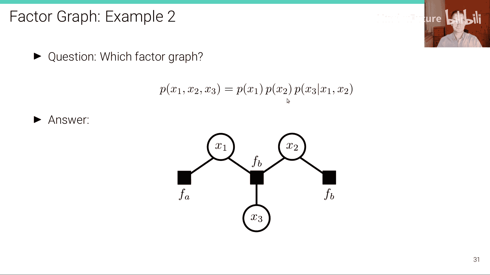

# 【图宾根大学 • 中英】计算机视觉 ML-4360 (Computer Vision) p19 P19 Lecture 5.3 (Probabilistic Graphical Models - Factor Graphs) -BV1S8N1emEef_p19-

While inference can be done directly on Markov random fields。

 we're now going to discuss a graphical model that's a little bit more precise than simple Markov random fields or Markov networks。

And this is called a factor graph。

Why do we need factor graphs？Let's consider MRFs again。

Consider the following factorization into potential functions where we have a joint distribution。

Written as。And one over the normalization constant。Times three different potentials，1 over A and B。

 one defined over the variables B and C and 1 over C and A。

What is the corresponding Markov network or Markov random field in terms of the graph representation？

Well。Clearly， there must be a connection between A and B and between B and C and between C and A。

So we have a graph like this is a fully connected graph that connects random variable A and C and B each with respect to each other。

However， the maximal click in this。Markov network is to click A， B and C。

So there is another factorization。That is represented by this network that represents actually。

As we now know， the same set of conditional independence properties。 So the same。

Class of distributions in terms of conditional independence properties， and this is the following。

So we have P of A B and C equals the normalization， and then we have just one potential which。

Is a potential over all free variables。对。Now， the second factorization is more general。As it admits。

A larger class of distributions。By having this triplet potential here， we can model all possible。

Fs of A， B and C， which is not possible by looking just at this product of pairwise relationships or pairwise functions or functions of two variables。

So this is richer than this。But。In terms of Markov networks， they don't differ because。They respect。

 both of them respect the same conditional independence assumptions。

 despite this one being more powerful。Therefore， the factorization into potentials is not uniquely specified by the graph。

In the case of a microranendum fieldat。And to disambiguate this， we introduce an extra note。

In our vectoro graphs， this is the new representation。And this extra type of node。

 we're going to utilize a square to distinguish these nodes from the random variable nodes。

 which are circles。And each of these squares is called a factor。

And now we can distinguish these two situations from before。

So here we have the Markov network that is the same for both factorizations。

But now with this explicit notation of factors， we can write。In the middle。

 the factor representation of this factorization with just one click。And here we can have。

The factorization。Into this。Representation with three clicks， but just two variables in each click。嗯。

So the two factor graphs here correspond to the same Markov network in terms of conditional independence assumptions。

But。They distinguish the different types of distributions that can be expressed。

And so they allow to distinguish the different factorizations by making them explicit。Now。

 very similar to before we define a factor graph。Just replacing the potentials find that we had before now with the factors F。

 and we're using now this graphical representation over this graphical representation here。

 which is more precise。Given a set of。Randdom variables x1 to xt。And。

Seets of subsets of these random variables。Joaw these clicks or potentials。

So each of those is a subset of x。And a function。F。Of all random variables， that is a product。

Of factors。Where we have capital K factors now， this is a product of k factors of these subsets。

 so for each of these subsets we have defined one function that's now called a factor and we use an f。

To make explicit that it's a factor。The effecto graph。

A short FG is a biparttheite graph with a square node for each factor FK。

 and a circle node for each variable Xi。And it's biparttheite in the sense that there is no connection between factors and there is no connection between variables。

 all connections are between factors and variables between different types of variables so we can transform this into a bipartite graph。

Here's an example of such a。Transformation， graphical transformation into a bipartite graph where on one side we have variables on the other side。

 we have the factors， and there's only connections going from the top to the bottom and not。

Between variables and between factors， so that's why it's called a bipartite graph。

So the vector graph is a bipart graph of a square node for each factor FK and a circle node for each variable。

So we are trying to graphically distinguish factors， which are functions。From the variables。

And similar to before， by normalizing F， we obtain a distribution。

 so we simply have the probability distribution over x over the set of random variables is equal to f of x。

Over this partition function C。Where the partition function is just summing up F。

Over the entire state space of all the random variables， jointly。

Or in the case of continuous variables， we are having an integral here。

Now it's easy to read of distributions from vector graphs and also vice versa to write vector graphs for distributions。

 so what is the distribution of this vector graph Well we can directly read of which vector are connected to which variables and we can directly write down the vector graph up to the normalization constant so we just write one over C P of x is。

Or that should be calligraphic X。Is。FA of x1 and x2 because it's connected to x1 and x2。

Fb of x 1 and x2 because Fb is also connected to x1 and x2， and so on。FT is only connected to X3。

And similarly， we can look at a particular。嗯。Factorization and ask a particular distribution。And ask。

 what is the corresponding factor graph for this if I've specified a distribution like this。

And the answer is， well， each of these。Individualiv distributions here are functions in their arguments so we can simply write them as instead of P。

 we can write an f。And so we have F that's。This term here is connected to x1 as' a function of x1。

 Fb， this is or Fc， this should be Fc， that's a function of x1， x2 and x3。

 and then we have Fb that's a function of。Just x2。

。