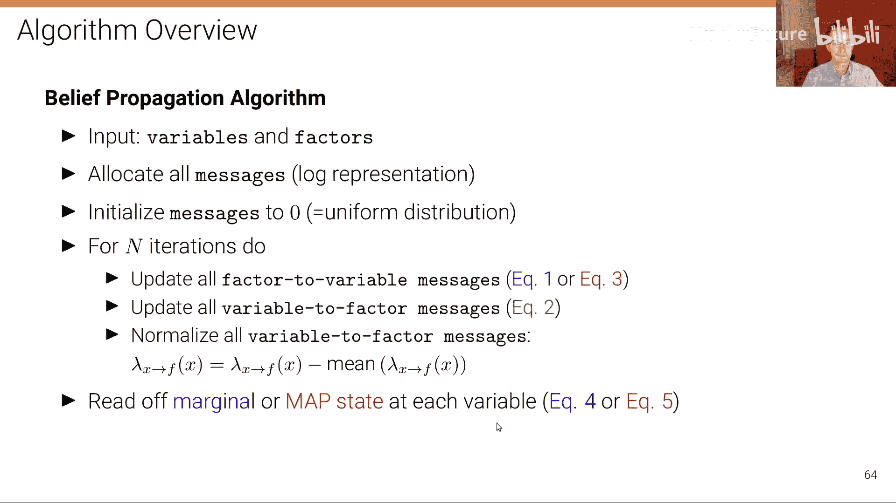

# 【图宾根大学 • 中英】计算机视觉 ML-4360 (Computer Vision) p20 P20 Lecture 5.4 (Probabilistic Graphical Models - Belief Propagation) -BV1S8N1emEef_p20-

In this unit。We're going to see how we can do inference in graphical models。

 how we can answer questions such as what is the marginal distribution of a certain subset of variables or what is the so called maximum a posttuory solution。

 What is the most likely configuration of random variables under that。Probabilistic model。

 defined by。

A factor， for instance。And we're going to first look at inference in chain structured factor graphs。

And what we are in particular going to look at is the so called belief propagation algorithm。

Which is an algorithm。That。Depending on。The order of the factors involved can be quite efficient。

 in any case it is much more efficient than just doing a naive calculation of let's say the marginal distributions as we'll see。

So here we have a simple chain structured vector graph。

All the nodes are arranged along a chain with factors in between， and this is the。

Corresponding probability distribution。Now， if we want to compute the marginal distribution of a。

 what we would have to do is we would have to take this expression and some overall configurations of PC and D。

What is the computational complexity of this Well， if the variables are all binary。

 then we have eight terms here， so we have two to the power of three equal to eight terms because we have three times。

A variable that has two possible states， so there's eight possibilities in total。

That doesn't sound too bad yet。 but if you think about a even a chain that is very long， let's say。

 has 100 variables， then you already have a computational complexity of 2 to the power of 100。

 and it becomes really intractable to do marginalization with such long chains。

 and that's not really a large problem。 even if you think about images that have。

Maybe a million of pixels。 It's clearly infeasible to do such a naive strategy for computing。

For example， a marginal。So what we're going to do instead is we're going to use a little trick。

And for doing so， we're going to observe the following。

If we take this expression here and we want to compute the marginal of A B and C。

 which means we want to sum over D， we observe that not all of the factors involved in this expression depend on D。

 but only the last two do therefore we can。Pull this summation operator inside that expression or we can factor out these two factors here。

In front of the summation operator and so what we're going to do here is we're doing the summation over D of just this expression here。

And if you look carefully， this expression is a function of C only because D is marginalized over。

 So the only free variable here C。 and we are calling this expression the entire marginalized expression。

 a message， a message that's sent from variable D to variable C， and that depends on C。

 So it has an argument C， you can think of this as a vector in the case of binary variables。

 this would be just a vector of dimensional E2， that has two elements。1 for c equals0。

1 for c equals 1， so we're calculating that vector， only that vector。

And then we can do the same thing for C， so the marginal over A and B。

 what we have to do is we have to take this expression and sum over all possible states of C。

And we observe again that the first factor does not depend on C so we can pull that summation inside。

 and we can only do this calculation here， which again is a message in this case it's a message。

 we call it a message sent from C to B。And this is a function of B only because all the other terms have been marginalized。

And then we can simply recurse further， we can now compute the marginal of a by just summing over B。

 Now B， the sum over B cannot be pulled in further， as we can see here。

 because the first factor already depends on B as well。So this is directly giving us the result。

 So we have now。This expression here， which we can call a message sent from B to A。

That is a function of only a because we have marginalized B。In other words， the message。

We call this message mu sent from M。To n。From variable M to variable N。And that's。

A function of n carries the information beyond that variable M。

 It summarizes the information and carries it beyond。So what what did we gain Well。

 if we look at the computational complexity now， what we can see is that we have now just done。

A summation of two terms here， a summation of two terms here and a summation of two terms here。

 so we have a computational complexity of three times2， which is6。

So6 is not horribly much better than 8， but again， if you now think about very long chains where you may have 100 or more variables。

Then in this case， this would be 100 times  two， so we would have to do 200 operations while in the previous case。

In the naive case， we would have to do two to the power 100 operations。

 which is more than there are atoms in the universe， so it's completely intractable to do。

So for this very simple example， it doesn't play a big role， but as soon as the chain gets longer。

 as soon as it has 10，20 variables already for 10 variables we have。

1000 operations versus 20 operations。 So one grows exponentially， and the other only grows linearly。

However， we didn't need the factors yet。So we have a vector graph， but we didn't use the vectors yet。

 but we will see that making this distinction is actually quite helpful。

If we go to more complex structures like。Tree graph， tree structured graphs。Or branching graphs。

 So here， this is not a chain anymore， but now we have a tree。

 and now it becomes useful to have these factors because now we can collect this information also at the effecto level and。

Then spread it further from the factors。 And so it becomes easier to describe mathematically。

So this is a vector graph。A tree structured factortograph， and the corresponding。

Factor representation here of factorization。Now， how can we compute the marginal of say？A and B。

This marginal distribution over A and P。Of this。Distribution over ABC DE。Well。

 the idea is the same we compute and pass messages。

 but now not just between variables but between variables and factors and from factors to variables。

 so we're sending messages from variables to factors and from factors to variables。

And this is what it looks like， So we have， for instance。

A message sent from this vector to this variable and a message from this variable to this vector。

 and this factor now collects these two messages。And sense them further。 And again。

 we are exploiting this idea of dynamic programming of pre computinguting results。

Or mathematically speaking of pulling the summation term inside in order to gain efficiency。

So let's do it concretely now for this three structured graph。

 if we want to do the marginal compute the marginal of A and B。

 then we do the same thing as before we need to。Well， we need to some over C D and E。

 and then these terms can be pulled inside depending on。

The variables that these individual factors depend upon。

So like we define this entire expression as the message of F2 to B because the only free variable here is B。

And then this message can be split further by pulling in the E summation because these three terms here don't depend on E。

And so we come up with this message passing scheme where we send a message from D to F2 here。

 and then from C to F2 from C to F2 is actually very simple because this message here only receives information from a single factor。

 so this brand variable here is connected only to a single factor so it's the factor itself。嗯。

And then we have the summation over。C and D of this vector multiplied with these incoming messages。

 with these two incoming messages， the message from C， this one here， and the message from D。

 this one here。So we take a summation over the entire state space except。

Of the variable that we're sending to， just C and D。We're summing over。

But all combinations in this case， this would be four terms because if we have binary variabless。

 because we have four possibilities。For C and D。And we do this for the vector multiplied with the incoming messages。

So this is repeated from the last slide here if we now want to make this a little bit more general what what can we see here。

 Well， we can see that at a general level， more generally speaking。

 what we have is that a message that's sent from a vector to a variable and。As an argument has。

The variable。Is simply a summation over the state of。The variables that are involved in that factor。

So here in this case would be BCD， except for the variable that we're sending to except for B。

 this is excluded here in this summation B is not part。This is indicated by Xf without x。

So this is a summation over the state space of all the variables except the variable that we're sending to。

And the summation is over the factor itself and the product of all the incoming messages。

So you can see here that these are all the messages that are sent to that factory。

That we are considering sending a message from。 So we want to send a message from here to here。

 So we're considering all the。Messages that are sent to that vector except the message that could be sent by the variable B。

 So here we have excluded the variable that we are sending2。

From the set of variables that we are receiving messages from。

The messages are only from the incoming side not。To where we send， that's important。

 so that's why it's excluded here， so we have a product here over the neighbors of F except the variable they were sending to x in this general notation。

And we are distinguishing these two types of notations because here this is a。

Smation over a state space。 And here this is simply a product over。A set of variables here。

While we're misusing a little bit notation because we're using it also here's an index of the message。

We're using it as an index of the message and as the variable itself。

 just to not clutter the notation too much。I find this the most clear exposition of this。

 admittedly quite complex material。Okay。So and and the other side is this is a message that's sent from a variable to a factor in this case。

 from this variable to this factor we have。Simply a product of the incoming messages。

 so we have a product of this message and a product of this message here， as you can see。

And so in the more general form， this can be written as a message sent from a variable x to a vector f that's a function of x or a vector in the states of x。

 if you will， in a discrete case。And this is simply a product of all the incoming messages where。

Incoming means that we have。Choooseing the factors such that they are neighbors。Of the variable x。

 in this case here， D， but we are not considering f2， just a 5 and a 4 because we are sending to F2。

So exclude again the factor that we're sending to in this calculation here in this product。

Admittedly there's many subs here and it's easy to get confused and that's why we have an exciting exercise for you to practice this and to get a deeper understanding。

 but it's important to look a bit at these slides and to understand how indexing works here。

Once computed， this is the key message。Mesages can be reused。

And an important observation is that all the marginals can be written as function of messages。

And now we simply need an algorithm to compute all the messages we have given some very concrete examples so far for computing very specific marginals。

 but of course we want to more generally have an algorithm to compute all the marginals。

 all possible marginals， let's say at the same time， ideally。

And for marginal inference this is the socalled sum product algorithm。

 we're also going to get to know another algorithm which is called the max product algorithm。

 but this is solving a different problem， the map problem。

 the maximum a posteriio problem finding the best possible configuration of variables here we are looking at the marginalization problem。

As an inference problem， and this is solved by the sum product algorithm。

So it's also called sometimes belief Proagation because we're sending these messages。On。

On this graph。And it's an algorithm to compute these messages really efficiently to avoid this exponential complexity that we discussed in the beginning。

At least if the graph is not complicated， if it has maybe just。

Pairwise potentials or not too high are the potentials。

And belief propagation assumes that the graph is sing connected so there is no loops。

 it's over a chain or a tree。But we'll see that this can also be generalized to loopy graphs if we let go some of the guarantees。

 in particular the guarantee of exactness if。Are happy with an approximate solution。

 which often is good enough， then we can also apply this algorithm on looppy graphs。

And the algorithm works as follows， we initialize in the first step。

 then we send variable to factor messages， then factor to variable messages and we repeat this until all messages have been calculated and the algorithm is converged。

And then we calculate the desired marginals。Which is the goal of the sum product algorithm from these messages。

So let's look at these steps in more detail。In the first step。This is the initialization step。

The messages from the extremeal node factors are initialized to the vector themselves。

 So here's an example， the message from the vector to the variable。If this factor。

It's is the end of the graph， basically。Then this message here is simply the if there is no other variable connected to that vector。

 then this message is simply the vector itself。And that's easy to see if you look at the equations from the previous slides。

And the message is from the exal variable notes。Two the factors is set to one。

 but they don't really matter because they get updated directly with the algorithm in the second step。

嗯。Then the second step of this algorithm is the variable to factor message computation we have already seen the formula it's simply。

Computing the product of all the incoming messages。And here's an example。

 we have this variable that wants to send a message to this vector。

 so we want to calculate this message here， and this message is the product of the incoming messages but not the message that's sent from that vector to x。

Of course we are computing messages sent in all directions， but for computing this message。

 this update here， we only consider incoming ones。To be mathematically correct。

As we have derived from the。Simple example。There is shown。

Now the effecto to variable message has this form， as we've already seen。

 and this gives also rise to the name of this algorithm。

 the sum product algorithm because we have a sum of a term that involves products。

So to compute this message， send from the factor to this variable。

We go over the entire state space over all y1， y2 and y3。

 except for the variable that we're sending to， this is excluded here。

And we compute the value of this vector multiplied with the value of the incoming messages that are also functions of these variables。

And then we're sending this to this variable。And then finally， once we have done this。Algorithm。

We have applied this algorithm and has converged。Then we can read of the marginal distributions by。嗯。

Simply。Taking the product。Of all the messages coming into a particular variable now， in this case。

 the difference here， unlike in step 2， is that here we calculate the product of all the neighbor over all the neighbors。

 So there's no。Factor that we're sending a message to。

 so we are taking all the incoming messages in this case。

The product of and then we know that the distribution must be proportional to this。

 it's not normalized， there's no guarantee for normalization here。

 but because we're getting out a vector， it's easy to normalize that vector to one。

And that we can do in prose processing。Now。A few words about numerical precision。

In practice what we do for very large graphs is to use a so-called lock representation because in very large graphs。

 we， as you have seen， have to compute products over many messages and if these messages are smaller than one。

 then they might become suddenly very， very small or if they are bigger than one。

 they might become very large， and this leads to numerical problems when storing these messages in a computer as floating precision or double precision numbers。

And the solution to this is to instead work with log messages。

 so instead of working directly with the messages mu， work with the messages Lambda。

 which are the logarm of mu。And if we do this， then the product， for instance。

 in the variable defect factor messages turns to a sum。 and of course， a sum is much。

Much easier to work with it doesn't have the problem that small numbers get to zero very quickly because we were just summing up terms here so it's。

It's better to work with and that's what you will have to do if you work with reasonably sized problems and apply this algorithm to it just because a computer has fixed precision or limited precision。

嗯。Yeah and so similarly for the fact that the variable messages they then become they look slightly more ugly here。

 so because we have the logarith now we have and the logarithm of a sum doesn't simplify further so the logarithm remains here。

 but inside here this message is replaced by Lada。And we have， well。

 we have the exponential of the sum because。The exponential of this sum。Is。

The product of the exponential of this expression。And because we have chosen this as the logarithm of this。

 this is equivalent。All right， so it' it's just the same。Now。

 this was the sum product algorithm for computing marginals。

 We do message passing in both directions from factors to variables and from variables to vectors。

And once the messages don't change anymore， once the propagation has happened along the entire chain or the entire tree。

 we can read of the marginals。As discussed。Nowaday's a second algorithm called the max product algorithm。

 which is very similar， but tackles a different problem。Did I take。

The goal here is that for a given distribution P of ABCD， we want to find the most likely state。

We don't want to find a marginal， but we want to find here illustrated with this arc max notation。

We want to find the A star， B star， C star and D star， which are maximizing this。

Probability distribution。I want to find the arcms。And this is called the maximum a posterri problem or map。

Problem or if we find it， it's a solution。And it's called maximum oposory because we are doing this inference on a graphical model where through the specification of this graph and the relationships in that graph。

 we have specified our prior knowledge so we are finding the most likely solution after。

Integrating our prior knowledge into the problem， that's why it's called。Maximum of his jury。

We are maximizing the posterior。嗯。Again， we use the factorization structure to distribute maximization to local computations as before with the summation。

 so again an example for the chain here and we can go a little bit more quickly。

 so it's exactly the same with the maximization where we observe that some of these factors here don't depend on some of these variables and so for instance the D can be pulled inside and then we call this a message sent from D to C。

Similarly， a message from C to B and from B to A。And so on。Yeah。Now。

 what we do with this algorithm actually is we obtain the maximal probability value。

But that's not what we were after。 We wanted to know the most probable state。 So we're not at。

 We haven't arrived at the goal yet。And the solution to obtain， so this is only the first step。

 The solution to obtain the max the the map state is that once the messages are computed。

 we can find the optimal values by backtracking so we can find。Now backwards here。

 the optimal A by maximizing this message that we have computed。

And then once we have found the optimal A， we can plug that in here and we can go one step backward and find。

The optimal will be by maximizing this expression and recur fervor backwards then。

And this is called back trackingracking or dynamic programming or。

In the case of a markov chains also called the vitubi algorithm， maybe a third of this before。If。

However， the maximum is unique。 Then the map solution is the maximum of the max marginals。

 And that's much easier to compute because we need to just find the maximum of the computed vector per variable。

 So we run the。AMax product algorithm that's similarly defined to the sum product algorithm just with a maximization instead of the summation。

And then after running it， we obtain a vector at each variable and that vector is called a it's not a marginal because we didn't run the sum product algorithm。

 so some people call it a max marginal because it's kind of the marginal of the max product algorithm despite the fact that actually marginal is not correct。

But let's call it a max marginal， so for these vectors。

That we have obtained after running the max product algorithm。

 we can just go through each vector individually and find what is the maximal value and then pick that state。

 So for binary variable， let's say if the second。Entry is larger than the state of that variable is one。

 And if the first state is larger then。H。If the first entry is larger， the state would be zero。

So this is much easier now because we can do this for each site and in most cases the map solution is unique so we can do that。

U。Okay。So the algorithm in this case is the same as before。

 we initialize we compute variable to factor messages， factor to variable messages。

 and we repeat this until all messages have been calculated and then we calculate the desired map solution。

I haven't specified the individual steps here because they are completely analogous to the Sun product algorithm and I have summarized them on the last slides of this unit to help you also with the implementation of this algorithm。

 so all the information is there。Now what we have assumed so far is that the graph that we consider is either a chain or a tree。

 but it doesn't contain any loops， however， in computer vision many problems actually have loops if you look at a simple image grid like this four connected structure that we've discussed in the beginning of the lecture then。

Of course， there is loops in this graph already very early on。

 if you just look at a very local part of this graph。

 you have loops and so these assumptions that we have made。In order to get an exact solution。

 actually break。However。Of course， the messages are well defined also for looping graphs。

 so we can just try to apply the same algorithm that's exact for trees and chains to loopy graphs。

 and that's called loopy belief proagation。So we can apply graph the same algorithm to loopy graphs as well。

The downside of this is that we now lose exactness。

 so it's only an approximate inference and in some cases there's even if in the simple case。

 in the simple algorithm that we consider here， there's even no guarantee of convergence so it might actually divert or oscillate。

But often for many problems in computer vision， this works surprisingly well。

 despite these violations of the assumptions。嗯。Now。

 well the question is what if we have such a loopy graph。

 how should we actually pass the messages and typically people either choose a random or a fixed order。

And the popular choice is that we first pass because it a bipartid graph。

 all the factor to variable messages， and then we pass all the variable to factor messages。

 and we repeat this for any durations until we hopefully converge。Again。

 there's no guarantee of convergence， but we hopefully converge。

And so this can an advantage of this strategy is that there's a lot of parallelism that can be exploited because all the messages that are sent from factors to variables。

Can be computed in parallel， so it's easy to parallellyize this algorithm。So here's a summary。

And these slides mainly serve as a guide or to help implementing the exercise task where I try to make everything concise on a few slides describing the entire algorithm。

The goal of the some product belief provocationation algorithm is to compute marginals of some distribution。

By passing factor to variable messages and variable to factor messages as we have seen or derived before。

To avoid very large values， what you can do is you can， in addition to the log representation。

 which you should always use and which is used here。

 subtract the mean of the messages after the message update in equation2 to keep them around zero。

And similarly， here the equation for the max product belief propvocationation algorithm which computes the most likely state。

Where now the variable vector message hasn't changed。

 but this message here has changed and the sum has been replaced by a maximum。

In the special case of a pairwise MF， this simplifies further。

 and that's the case that you're going to consider in the exercise。So here， for instance。

 the unary factor is simply the logarithm of the factor itself。

 it's easy to see this because while there is no other variables except for the variable of that factor。

The summation goes away and also these terms here disappear because there is no。嗯。

And no neighboring variables of that factor that are not the variable。That we consider。

but also the pairwise factor simplifies because now there's only one neighbor so we have to just sum over the states of y。

 which is the neighbor if we want to send from f to x。

And we have just this one incoming message that comes。From y that arrives from y at factor F。

And the same for。Max product BPp。Okay。And then at the end。

 we have the readout stage where we read of the marginal or the map state at each variable。

Which is similar to the variable defect message， except that with some of all the incoming messages。

So this is done here for the marginal and because the like the output here is not normalized。

 we have to normalize it in the end。You can see that we have an exponential here because we're considering log messages。

 of course we need to first convert this into probabilities。And then here on the right hand side。

 this is what we called。嗯。Considering the max marginal。 So we're taking。

These so calledled max marginals here， this is the sum over these lock messages。And then we。Find the。

Entry that is largest in that spectrum。And this is a very generic overview of the algorithm。

 The input is the variables and the vectors that are specified。

 this is the definition of the problem， we allocate the messages in this lock representation。

 and we initialize the messages to0 let's say which corresponds to uniform distribution but you can also initialize differently and then for some iterations we update all factor to variable messages。

 all variable to factor messages， these are these equations from the previous light color coded。

And then we normalize them by subtracting the mean。 and in the end。

 we read of the marginal Map state。

