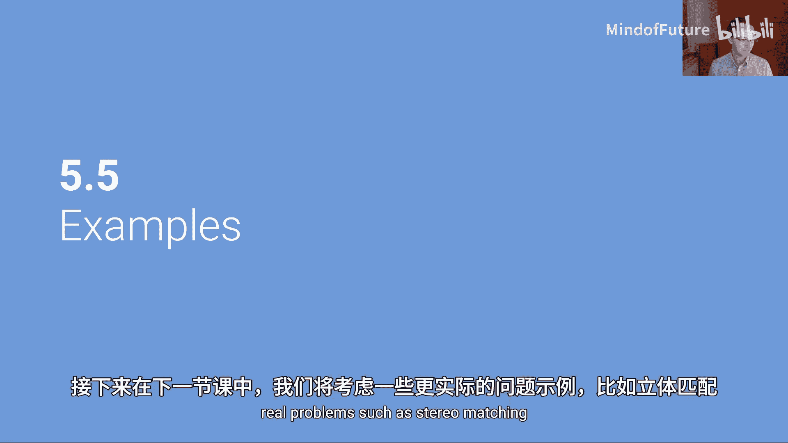
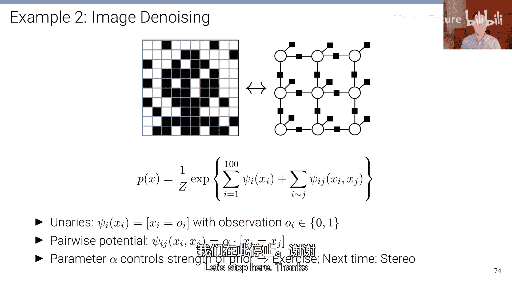

# 【图宾根大学 • 中英】计算机视觉 ML-4360 (Computer Vision) p21 P21 Lecture 5.5 (Probabilistic Graphical Models - Examples) -BV1S8N1emEef_p21-

Yeah。And finally。In this unit。I'd like to show you some very simple examples of this algorithm and practice and also guiding towards the exercise tasks while then in the next lecture we're going to consider more realistic examples with。

Real problems such as stereo matching。

So the first example I want to show you is this vehicle localization example that I've already。

Alluded to in the first part。So the goal here now at a bit longer time horizon is to estimate a vehicle location at 10 different time instances。

 so these are the time instances from left to right。T 1 to 10。

Where we state of each of these random variables， we have one random variable at each time step。

These alternative variables so they can take three different states， lane 1， lane 2 or lane 3。

 depending on if the vehicle is at lane 1，2 or three at this particular time step。

 so for this particular situation that we see here we have this particular configuration of random variables at the bottom。

So we have 10 random variables here。Where each of them can take state one， two or three。Now。

 in addition to this， we have observations。Observations we specify as。Continuous。嗯。

Probability scores。Where we have an observation for each time step。

And we specify with which probability。The vehicle is observed at a particular lane for their time step。

 So for instance， for the third first time step， we observed the vehicle with 70% probability arm。

Perception model is confident that this is on lane 1。

 but there's also some probability for lane 2 and even more for lane 3。

So we have now converted simply this numerical representation into a more easily。

Easy to understand graphical representation， we can do the same for the other observations。

 so let's assume these are the observations。And what happens， of course。

 if if we just naively take the most likely state independently at each time step。

 according to the perception model， we see such a result where we already have。

We have a very implausible transition here， transition that's physically implausible。

 and that we try to avoid now by integrating this prior knowledge using with the help of graphical models。

Because this is not a very plausible inference result。

Instead this is a more plausible inference result。It's a little bit less likely under the perception model。

 but it's much more likely under the prior knowledge under the prior that we have about the world。

The fact of this problem looks like this， we have the Uniaries that specify。

Or that are determined by the perception model， the observations。

These are called F and then we have and these are different here F1 to F10。

 because we have different。Potentials， different observations at time each time step。

 but then we have a G that's the same。And that's connecting nearby time stepss， x1 and x2， x2 and x3。

 so there's a pairwise potential that connects2。是的。Distribution can be written or factored。According。

To this markov random or this specgraph here， into this。Representation。

The unit vector we directly take as the observation probability scores。 So for instance， 0。

7 for the first lane。0。2 and 0。1 and so on。Okay。The question is now。

 how should we choose the pairwise factors， And， of course， ideally。

 we want to learn these pairwise factors。 This is in this case， is a free by free matrix。

 because we have。Free states for the。First variable and three states for the second variable。

 and so we have a free by free probability table here。

And the right thing to do here is now to have some training data and learn the optimal parameters from this data。

 and this is what we're going to cover in lecture 7。

But now for the purpose of this lecture where we just discuss inference。

 we assume that this is given to us。And let's assume that this is somehow reasonable。

And reasonable means that， well the highest probability is maybe that we just stay on the lane because that happens most frequently and then there is some probability for transition of lanes。

But not only to the adjacent lanes， not to by two lanes， which is physically completely implausible。

 so we have a zero probability here。Not a potential zero or here。Now。

 if we use this model that combines this unary with these pairwise terms。

And we now do some product inference and look at the marginal distributions。 We obtained this result。

 and you can already see that。Compared to the observations。

The probability for lane free in this particular state here。

At this particular time has changed completely。So we can see how this prior knowledge is incorporated into the solution。

Now this was the marginal solution， but we can also apply D。

Max product algorithm to obtain the maximum aosturi solution and this is the map solution that we get。

 this is the solution that we wanted， and that's the solution that we get if we use exactly this smoothness or pairwise term that we've just introduced。

A second example is image denoising。Let's assume we bought a camera， but the cameras。

Is not so good The camera is a black and white camera， It has just 10 by 10 pixels。

 100 pixels in total。And not even that， it actually takes very noisy images。

 so this is what you want to take， but this is what you actually take。

So now the question is how can we go from this noisy image to the clean image and that's called image denoing and we can use the same properties that we have seen in the stereo matching class。

That namely。Nearby pixels are more likely to have the same value than to have different values。

Now not in in terms of disparative maps， but here in terms of RGB value or binary pixel values。

So if we model this using a microranum field and if we just assume muary potentials。

 this is what the model would look like。 We have 100 variables because we have 100 pixels here。

 they are binary。And we just have urary potentials。And we specify these unit potentials， such that。

We have this， this is again， the everson bracket， so we have this indicator here that says， well。

 this potential is equal to one。If the variable takes the value of the observation。So for instance。

 here， if we get a black pixel， that's good here， if we get a white pixel that's good。

 this is our observation。And we have used here to lock representation。

 so these potentials here are lock factors。So the probability distribution is one over C。

 the product of these factors equal to1 over C of x of the sum over these lock factors。

So we have directly specified this problem now in contrast to example one here。

 we directly specified in terms of these log factors which we of course can do。And again。

 for solving the inference problem， of course， we pass log messages as well。Now， if we do that。

What is the outcome， Well， the outcome is， unfortunately， the same image， the noiseisy image。

 because we have not assumed any prior knowledge。 We have just said， well。

 we have these urary constraints at each pixel。 And， of course， every pixel。 if we maximize this。

 This is maximized by。Maximizing individually each of these Unii potentials。

 which is simply maximized by setting the variable to the observation。

So what we want to do instead now is to integrate prior knowledge by adding constraints to this problem。

 so what prior knowledge do we have about this image？Assume we know what images typically look like。

 assume we have some images like this well。One thing that was already mentioned is that。Well。

 neighboring pixels tend to have the same label， but can we make this a little bit more concrete。

 can we quant this？How many neighbors actually share the same label？

Let's look at this pixel grid here and let's find all the。Edges。

That are separating pixels with different color。And these are indicated here in read。

If we count this number of edges or transitions， this is where now later the potentials are going to be defined。

 they are defined at between two pixels so they are going to cross these edges。We see that。 We have。

Well， first of all， 180 neighborhood relationships in total。

 so there's 180 edges here because we have 10 by 10 times 2。

 one for the bottom and one for the right and minus 20 because the picture ends。So this is 100 edges。

 little gray edges in total， but then we have only these red edges， we have only 34。

So there's only 34 edges where we have a transition from black to white。

 while there is 146 edges where the transition is from black to black or white to white。

 so the label is the same。So there'， in other words， a factor of 4。3 more transitions。

Where the label stays constant。Compared to transitions where the label changes。And now， of course。

 we can exploit this by introducing a smoothness assumption by saying， well。

 it's more likely that the chasing pixels are the same and in this simple discrete case。

 which was considered very simple。Model for this So here we have again the model with the un potentials。

 but now also adding these pairwise potentials on the four connected grid here we look only at a MRF thats's free by free sub image here。

 but of course you have to imagine this as continuing to a 10 by 10 grid。

In the same structure as we see here。The Uniaries。Are the same as before。

 but now we have the pairwise potentials that are defined as such。 theyre defined such that。If。

On two adjacents， so this means adjacent neighboring sites if for two adjacent pixels this state。

The inferd state is the same X I equals xj。 Then we have one。 Otherwise we have a0。

 and we multiply this with alpha， which is the strength of this regularisizer that is a hyperparramid of the model。

 If you make it too strong， then all the pixels will turn to the same value。 If you make it too weak。

 if you make it0， then we get。The observation spec because we effectively disabling this term。

But you can already see now we have。A trade off， the model or the inference algorithm has to do a trade off has to weight the observations。

With respect to these move constraints， and it cannot fulfill both。

Ever it fulfills the observations and has ones here everywhere。

 or it sacrifices some of these ones here。It makes some of these inferred variables not the same as the observations in order to obtain more。

Reward to obtain more once。On the on the pairwise potential side here because we only obtain a one if two adjacent sites are the same and otherwise we obtain a zero here。

 so we have this trade off now。And the perimeter alpha controls the strength of the prior and you will implement this and play with this in the exercise。

 and then next time we're going to。Talk about。How these graphical models are used in more。

Advanced problems like like stereo estimation and so on with large label sets or multi view reconstruction where you have also。

Largeger potentials， potentials beyond powerwise potentials。Let's stop here， thanks。

