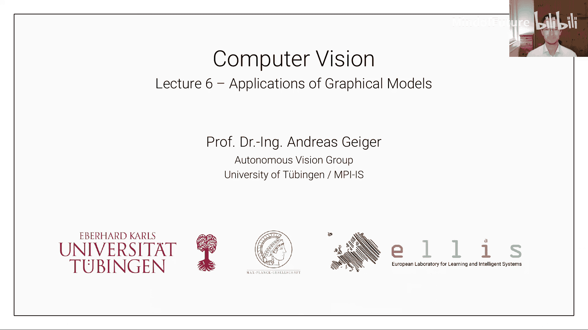
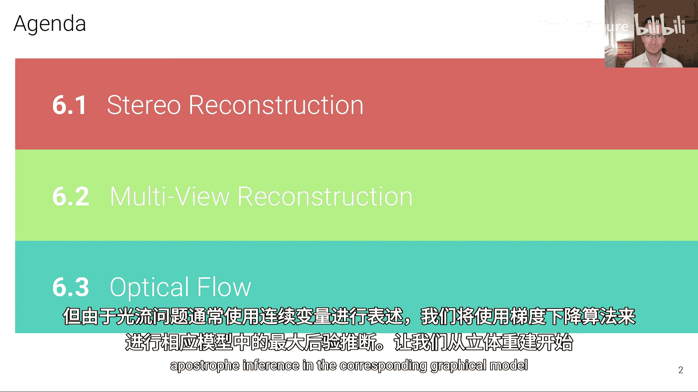
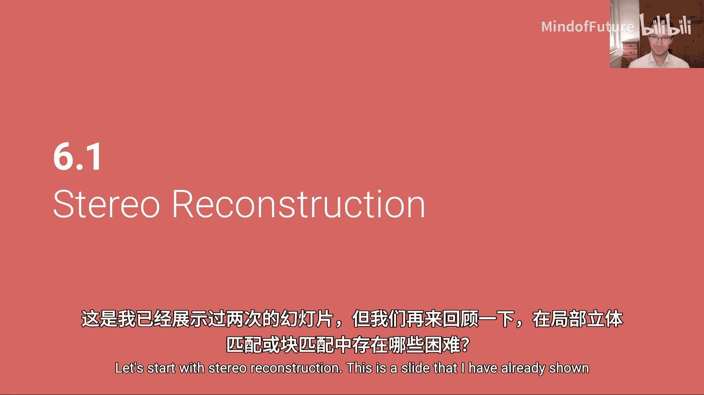
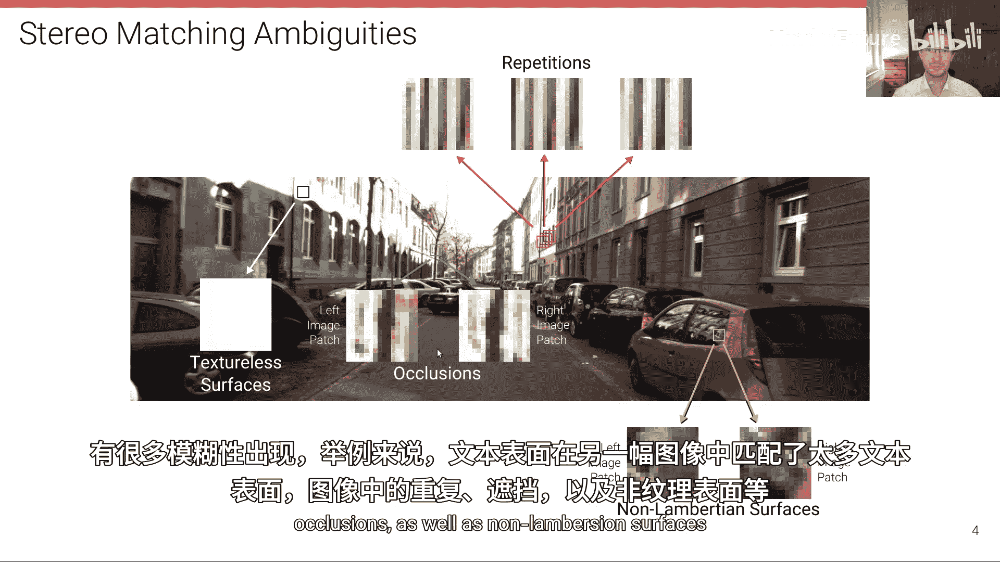
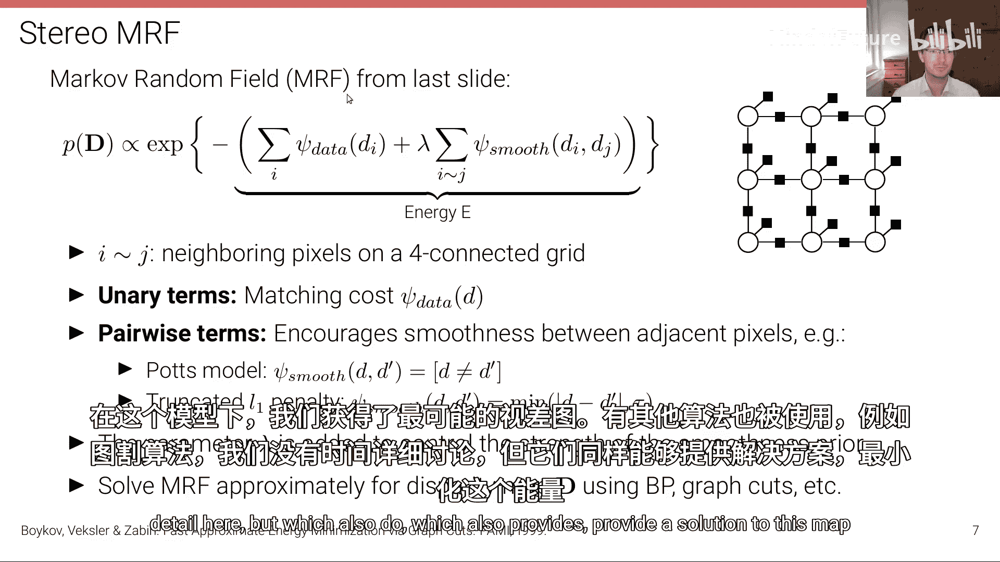
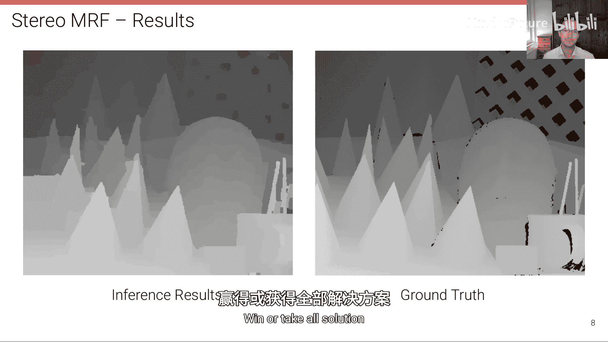
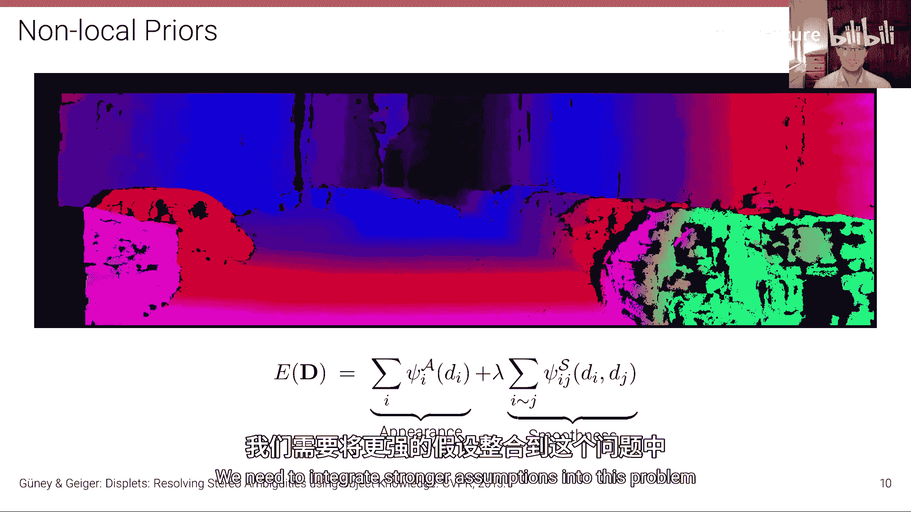
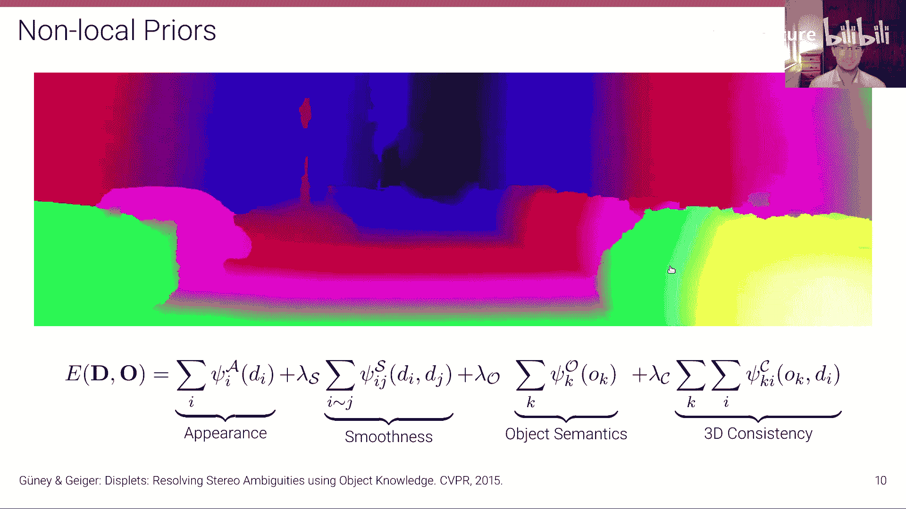
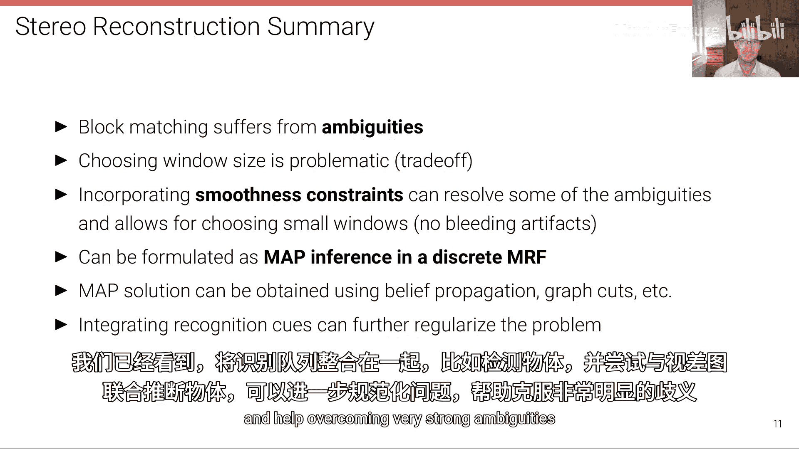

# 【图宾根大学 • 中英】计算机视觉 ML-4360 (Computer Vision) p22 P22 Lecture 6.1 (Applications of Graphical Models - Stereo Reconstruction) -BV1S8N1emEef_p22-

Welcome to lecture number six of this computer vision class。In the last lecture。

 we've introduced motivated by the ambiguities in the stereo matching problem we've introduced graphical models and a particular inference algorithm called belief proagation that allows us to compute maximum epistuiary solutions or map solutions。

And also marginals。Now in this lecture， we are going to discuss some applications of graphical models to computer vision problems。

In the first unit， we're going to discuss the dense stereo reconstruction problem that we already know using。

Marcoranum fields， in particular。Performing。Maximum a posterory inference in。

Marcroferum fields with discrete variables， so using the max product algorithm that we learned about in the last lecture。

In unit number two。We're going to discuss applications in terms of then multi view theory reconstruction。

Which is theory reconstruction， but not from two views， but from more than two views。

In the context of。The sum product algorithm for inferring marginals and probabilistic results。

And then in the final unit。We're going to discuss the optical flow estimation problem。

 which like the stereo， the binnacular stereo estimation problem is a。

Estimation problem in the 2D image plane。But because the optical flow problem is typically formulated using continuous variables。

 we're going to use the gradient descent algorithm to do inference in。

To do maximum a posteri inference in the corresponding graphical model。

Let's start with stereo reconstruction。

This is a slide that I have already shown twice， but let's just remember again what are the difficulties in local stereo matching or block matching。

Well， there's a lot of ambiguities arising due to， for example。

 textless surfaces that match too many textless surfaces in the other image。Repetitions in the image。

 occlusions。

As well as non Lamberian surfaces。And in order to overcome these ambiguities。

 we'd like to incorporate some prior knowledge about the real world statistics and we have seen that such statistics can be derived。

 for example， from datasets such as the brown range image dataset。

That provides a large number of depth maps from which we can compute statistics like this。

And we have concluded that we have concluded from these statistics that depth very slowly accepted object discontinuities。

 which， however are spars。So in most areas of the depth map， we have a very smooth transition。

 very small changes in depth， but then at the object boundaries we have a large transition。

 we jump over a large range of disparities in order to go to the next pixel。

And this reflects in this statistics here。 we have a lot of。Probability mass centered around 0。

 this is the gradient of the range。But we have also some probability here。In details。

 this are called tails of this distribution away from zero。

Now we want to incorporate such statistics into the model， at least approximately。

 and we can do this using a markco random field。On a gr graph here we see a four connected grid structure graph this is corresponding to a free by free pixel image。

 of course if we apply this algorithm to a real image this will be a much larger graph。

 but the structure will look the same。Here in this graph every。Circle corresponds to a variable。

 so every circle corresponds to a pixel and the variable is the disparity that we want to infer for that pixel。

And then we have unary factors， these are the squares that are connected to only a single variable and。

These are the matching costs that we can compute using a。Block matching technique， for example。

 or a Siamese network。But then we also incorporate our prior knowledge about the smoothness of disparity maps。

Into this markco random field。And we do this by adding。Perwise connections in this vector graph here。

 pairwise。UmPotentials。That connect。Two neighboring sites。So this is a very simple。

Graphal model it can be formulated as a standard undirected。Marov network or Markov random field。

 but it can also be formulated easily as a factor graph has done here。

So we have urary vector and powerwise vector。And this is reflected in this formula here。

So what we want to do is we want to solve for the entire disparity map now。

 not just for the disparity at a single pixel but for the entire disparity map。

 so we model a distribution over the space of all disparity maps。

 capital bold D is a disparity map that's in the case of a VGA image that is a 640 by 480 dimensional matrix and now we want to model the probability distribution over the space of all these。

Marices。And this probability is proportional to this factorization into urary factors and pairwise factors where this tilde here denotes adjacent sites。

 for example， this pixel and this pixel are adjacent in this graph structure that we have defined。

The unary。Factors are the data terms。That's。Are determined by our local matching cost。And that's。

Depend only on a single variable。And the pairwise factors are the smoothness factors are the prior constraints about the smoothness of the disparity maps that we want to integrate into this problem。

And they depend on two adjacents。Disparityity。Variables or random variables。Now。

We can convert this formulation。Into another representation。That is the so called Gis energy。

 and we haven't done any change here except that we have replaced the。

Uary and pairwise factors through corresponding negative lock factors。In the previous。

Lecture we have used just the lock factors， but here we're using the negative lock factors now。

So that we can interpret this as an energy。And we want to minimize an energy which is equivalent to maximizing the probability over this disparity map。

So we have equivalence through this skips distribution。off。

Maximizing a distribution and minimizing an energy。

This energy is an energy over the disparity map as well。Yes， so。

Pi data is the negative log of F data and psi move is the negative log of F's move。

In order for these to be the same， we have， of course to add the minus here。

 which means that minimizing this energy corresponds to maximizing the probability of D。

This is the equation from the previous slide。Just to recap。

 we have I tilde J denoting neighboring pixels on the four connected grid and we have unary terms which are the matching cost。

And by formulating this as an energy formulation we can directly take， for instance。

 the sum of square distance here as the matching cost。Where lower is better。

And we have pairvis terms here that encourage smoothness between adjacent pixels。For example。

We have a very simple term here that simply says， well。

 if the disparity of adjacent sites or pixels is not the same。

 then I add a penalty and if it's the same， I add zero， no penalty。

But we can also model something like the truncated L1 penalty。

 which is L1 distance truncated with such a truncation threshold here that's coming already much closer to the distributions that we've seen on the previous slide。

And that basically is as well。Up to certain thresholds。I want a penalliaas。

To adjacent sides if the disparity is different and I want to penalize proportional to the difference in the disparity。

And of course， lower is better， the lower lowest energy value would be obtained in terms of the smoothness or pairwise terms by just having a constant disparity map where all the D's are the same。

嗯。But of course， in that case， the matching cost would be high。

Because unless this would be really a scene where we have we're looking at a plane where this actually holds。

 we would violate the matching costs。 so now by solving this MRF。

 we are trading off the unary term and the pairwise term。

And this tradeoff is controlled by this parameter lambda that we have introduced， which is。

The regularization strength or weight。And I controlled the strength of this smoothness prior。

 if we set Lata to0， then we are only optimizing this term here and we fall back to the standard block matching algorithm。

The winner takes all solution。And if we increase this Lada。

 then we obtain smooth and smoothr solutions， but of course， if we increase it too much。

 then we will obtain solutions that are too smooth， then we are weighing this。

This prior knowledge about the smoothness too high。So we can solve now this MF using。For example。

 the belief propagation， the max product belief propagation algorithm that we have discussed in the last lecture。

In order to obtain a maximum of a story solution which corresponds to the most likely disparity map。

 at least approximately， it's an approximate algorithm。

We obtain the most likely disparity map under this model。

And there's other algorithms that have been used like graph cuts。um。

which we don't have time to go into detail here， but which also do。

 which also provides provide a solution to this map problem， which also minimize this energy。

And now here's a result for the scene that we are already familiar with the Middlebury cones scene。

 and you can see how the inference results using such an MRF。

Are much improved with respect to just a local block matching algorithm。

And that's also the reason why。For example， in the paper of Sponar and Laoon on Siamese stereo matching。

 this local Siamese matching cluster are computed by a deep network。Are complemented with a。

With inference in a micrordom field。In order to overcome ambiguities and to further improve on the estimation result of this local matching cost。

We're going to take all solution。

Now this was a very simple microranum field， we can also think about more or factgraph。

 we can also think about more。Complicated graphical models that incorporate even more constraints about the world。

That integrates。Non localal pon。

And here's an example of this， this is the energy formulation from before just using slightly different notation where we have an energy over the disparity maps。

This is the Gipps energy that is composed of an appearance or a data term and a smoothness term。

And if we do this， then we get a result like this for that particular scene。

 and the reason is that despite we have introduced this smoothness regularizer due to the very strong violation of the matching assumption。

 this very local， pairwise term cannot deal with such strong violations of our assumptions like in the case of this。

Reflections here， where you can see this scattered result， and so we need stronger assumptions。

 we need to integrate stronger assumptions into this。

Problem。And what we had done in this paper here at CBPR in 2015。

Is to not only think about the scene in terms of per pixel depth for disparities。

 but also in terms of the objects that are present in the scene and because for street scenes like this。

 there's a lot of cars， for example， and we know，What the shape of cars roughly looks like we can try to infer not only the disparity map but also the objects here oh jointly。

 and so there is two additional terms added here， there is a semantics term that tries to make the the semantics of these inferred objects similar to semantics that have been inferred from the image and then there is a consistency term that tries to make the。

3D objects。That have been inferred consistent with the disparity map。

And now by integrating this object level prior knowledge。

We can further regularize the problem and we can get a solution like this here。

 you can see it's not perfect， particularly at the boundaries。

 but these gross outliers at the reflections have been now taken into account by this。

By this object level knowledge。And so here are some results on the left you can see the result of the baseline method。

 the siam Mystero matching network from Sponter et al。And on the right。

 you can see the result when regular rising at the object level。

And all of these results that you can see here， these point clouds， these color point clouds。

Are inferred from just two images。Okay。In summarymar。Block matching。

Easily suffers from these matching ambiguities that we've talked about before and choosing the window size is really problematic due to this tradeoff that we've discussed in lecture number four。

And what we can do is we can integrate movement constraints。

That resolve some of these ambiguities and allow for choosing smaller windows。

By integrating this smoothness constraints， using these graphical models。

 we can then choose smaller windows and instead increase the smoothness。Praameter。

 which reduces the bleeding artifacts， and this can be formulated as map inference in a discrete MRF。

 all the results that I've shown on the previous slides have been inferred using the Max product algorithm。

So this map solution can be obtained using this max product。Algorithm。

 the belief propagation algorithm or graph cuts or any other。

Algorithm out of our toolbox of inference algorithms in discrete graphical models。

And we've seen that integrating recognition cues like detecting objects and trying to infer objects jointly with the disparity map can further regular the problem and help overcoming very strong。

Abiguities。

