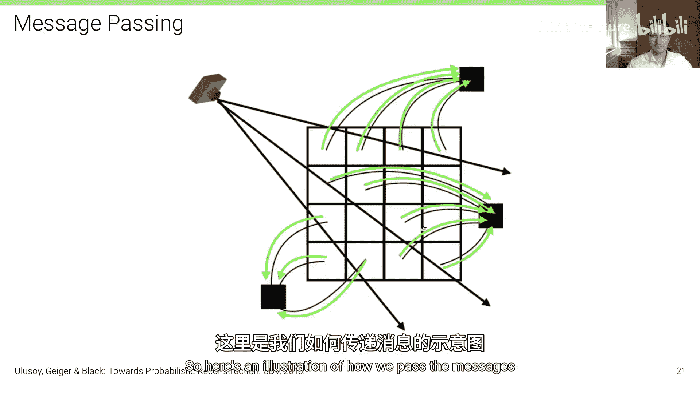
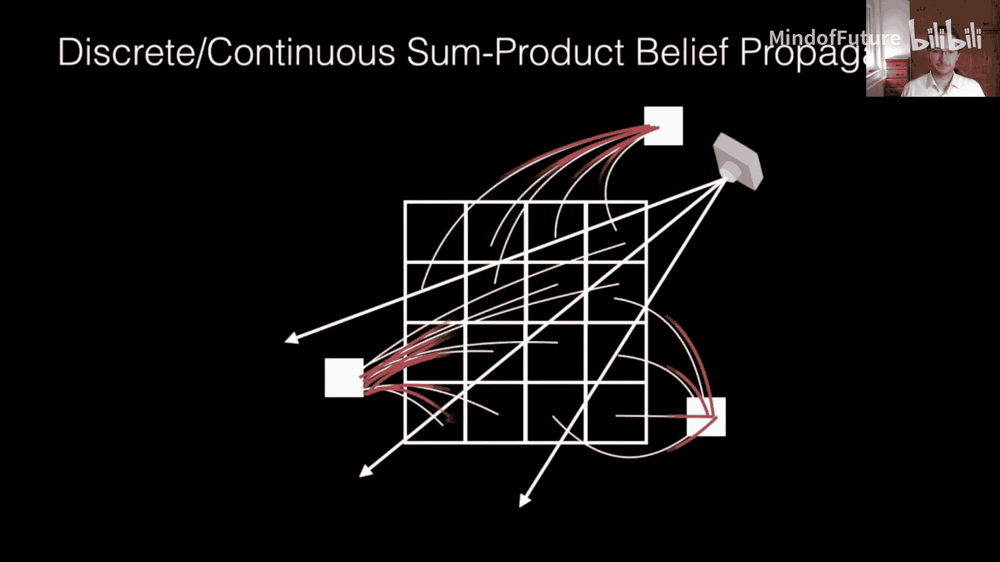
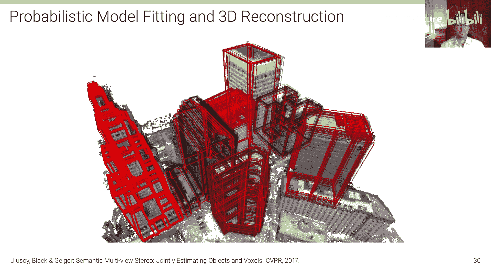
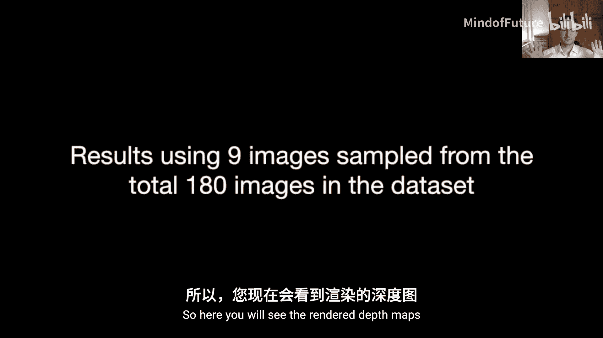
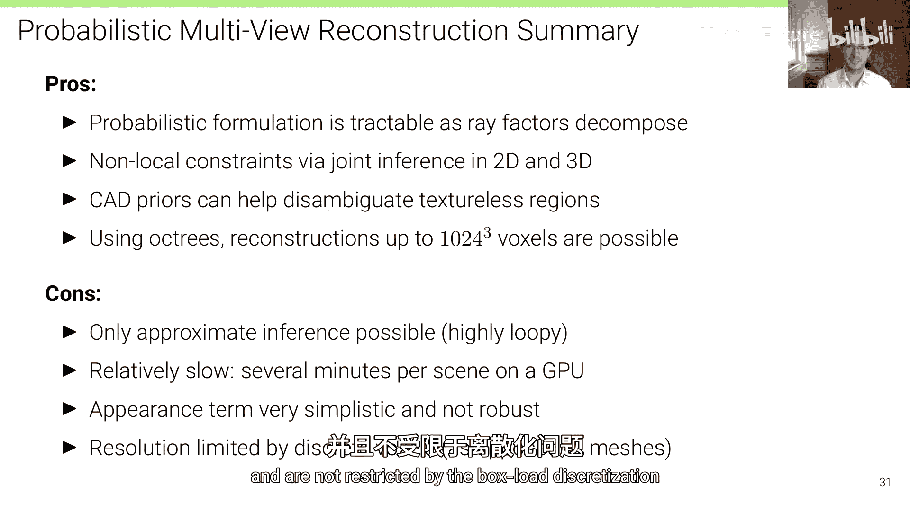

# 【图宾根大学 • 中英】计算机视觉 ML-4360 (Computer Vision) p23 P23 Lecture 6.2 (Applications of Graphical Models - Multi-View Reconstruction) -BV1S8N1emEef_p23-

In this unit， we're going to see a second application of graphical models。

In the context of dense multi view stereo reconstruction。

 which is the problem of reconstructing a 3D scene， not from just two images。

 but from multiple images of that scene。And the advantage， of course。

Similar to in the case of sparse reconstruction that we have looked at。

In the beginning of this lecture is that we have more constraints and we can better resolve ambiguities。

 and we can also reconstruct not just a2 and a half D。Deepth representation。

But really a complete 3D reconstruction of the scene。So here's an example of what we want to achieve。

On the left is a set of input images， as shown free here， but in practice， theres， of course。

 many more we use around 50 to 100 images for a 3D reconstruction。Okay。

And we want to develop a model now that allows for inferring such a 3D volumet representation。

 as we can see here on the right hand side， or for inferring depth maps from that。嗯。

A set of input images that we have observed。Now， even though using many more cameras。

 image based 3D reconstruction can still be a highly ill post problem。For example。

 in the context of textless areas。So here's this green area。

That has almost the same color everywhere， and if we look at the scene from multiple different viewpoints in this case。

 from two different viewpoints。Then so this is a side view， imagine this is a side view here。

Where this is the ground， then the true surface is the green one here。

 but because all of these pixels are roughly the same color or intensity。Any of these other surfaces。

 the blue one， the red one or the black one are also plausible surfaces。

So there's still a lot of reconstruction ambiguity。 and of course， we can。

Remove some of theseguity and ambiguities by introducing appropriate priors。

 such as maybe assuming that。This region here is flat， but the stronger these prior are。

 the stronger our assumptions are， the stronger will also be。

 or the larger will be the mistakes that we're doing in case these assumptions are violated。

And therefore， coping with and exposing uncertainty is really essential。

So the question is now can we utilize the power of probabilistic graphical models？

To formulate dense 3D reconstruction from multiple views in a probabilistic fashion。

This is the representation that we're going to use。

We're going to discretize the 3D volume that we consider into a discrete set of so called voxels。

Each of these little cubes here is a voxel and depending on the resolution that we apply in each dimension they have more or less voxel so here is just a5 by a5 by a5 voxel grid。

 but in practice of course we use much higher resolution voxel grids in the order of 1000 by 1000 by 1000。

So we have discretized the 3D volume。Now how do we represent the 3D geometry and appearance inside of volume？

Well， for each of these voxels， each of these little cubes we're going to。

Assigned with two random variables， the first random variable is the voxel occupancy。

 It's a binary random variable。Associated with each of these。boxoxels。The tellss。

Or that is equal to1 if that particular voxel is occupied and that is equal to0 if the voxel is empty。

And the second variable that we're going to associate with each vel。A is the voxla appearance。

 and that's a real number in our case here we are going to consider gray scale images or inference just in terms of。

Intensity values， but we could also use。A to the power free in order to represent color or even more more complex properties of the appearance。

 but we are going to focus on the most simple case here。

 which is just a one dimensional real number a scalar that represents at each。

Voxel how bright that voxel appears in the images， and of course it makes the imerian assumption and it's a very inaccurate representation。

 but it's the most simple representation that we can。Star。

And we're also going to introduce a little shorthand notation that helps us。

Forulating the problem later on。So here's a camera， this symbol indicates a camera。

 and on the image plane of the camera theres many pixels。Now we know already that。

The combination of the camera center。And the particular pixel defines a that passes for 3D space。

By projective geometry， as discussed election number two。

So we can talk about race or pixels interchangeably。And when I talk about pixels or array。

 that effectively means the same for a particular camera and a particular pixel that corresponds to a particular ray and one particular ray is illustrated here。

And what we are going to do with this shorthand notation。

 bold phase O and bold phase A with index R Later on we are going to omit that index for simplicity。

For each of these rays。Each of the cameras has a set of pixels and each of these pixel corresponds to ray。

 so from all of the cameras。Together， we have many more raised than we have from a single camera and we consider just a generic ray here that could be any of these rays from any of the cameras corresponding to any of the pixels。

So for each of these rays， we have this boldface O and boldface a variable which simply。

Collect a set of random variables from the entire volume。That are intersected by that ray。

 and they collected in the order that they are intersected with when starting from the camera center。

 So in this case here， we have。Two random variables。

 O1 and A1 associated with the first voxel that's intersected by the array。

And then we have two variables associated with the second voxel and so on。

 and that's how we define O R and AR in the order。The ray intersects the voxels。In this case， NR。

 which is the number of voxels that are intersected by ray R is 5。Now。

 in order to solve an ill post computer vision problem such as Moivevo 3D reconstruction。

 we first have to understand the image formation process and that's illustrated here。

I'm often using color to better illustrate， but really what we do in the end。

 consider only is the intensity， but think of color and intensity as being the same。

So how does image formation work？Intuitively， that's not very hard to answer for solid objects。

The color of a particular pixel corresponding to a particular ray， a particular camera is simply。

 well the color of the first occupied voxel that is hit by that ray。

 so if we go from the camera center along that ray through that 3D volume。

 the first two voxels here are empty space free space。

 but this first voxel here is occupied and has the color or intensity red。

 then this color should appear on that pixel because that's the first occupied voxel color。

Now how can we formulate this mathematically， well， let IR denote intensity or color at the pixel R。

And OI and AI be defined as before， these occupancy and appearance variables sorted along that ray where they are intersected by the ray。

Then the intensity at the pixel R is simply this expression here。

Now this looks a little bit complicated at first glance。

 but it's really easy to understand what we have here， this term here。Is simply telling us， well。

 or this term here is simply equal to1 if。I is first occupied oh I is the first occupied voxel。

And why is that true Well， only if Oi is the first occupied voxel。

 then this term is 1 and this term is0， so the entire product here is also one and the product of 1 and1 is 1。

 so only in the case of Oi being the first occupied voxel。

This expression is one and in all other cases， this expression will be zero because they are， well。

 either Oi might not be occupied or any of the previous voxels might be occupied。

So this expression is exactly one if or I is the first occupied voxel。And now， of course。

 if Oi is the first occupied voxel， then we want to take the color of that voxel so we multiply a one with that。

Color or intensity value and copy it to the pixel。And because we don't know which of these voxels along the ray。

 which of these n5 in this case voxels along the ray is the first occupied voxel we need to sum of all possible hyposes。

 but only one of these term in only in one of these terms。

 this expression here will be equal to one in all other ones。

O I will not be the first occupied voxel， so the color will not。

UmB or the color of that voxel will not be taken into account by this expression。

Because this term here is one only if Oi is the first occupied voxel。So now we have a simple formula。

That represents exactly the fact that the pixel should。

The pixel intensity or color should correspond to the intensity or color of the first occupied voxel。

그。O。Now， as mentioned before， we want to formulate a。Probabilistic model。

And want to do inference in a probabilistic model in order to expose uncertainty。

So given the knowledge of the image formation process。

 we now define a probability distribution over all the occupancy variables and all the appearance variables in this volume。

 so there's a very large number of occupancy and appearance variables。

And we denote this by capital O and capital A。And we are factorizing this distribution over all occupancy and appearance variables into a product of Uniaries。

And so called ray factors， and now these ray factors are higher order potentials。

 they are not like in the stereo example pairwise factors。

 but they are really higher order potentials because they connect all the variables along the ray。

All the O's and r's along the A's along the ray， which could be hundreds of variables。

 and so we need to find an efficient。way tractable way of actually doing inference in this model because we have such high order factors in that model。

Now what are these factors， well the U potentials are just some simple prior knowledge that we can specify about general occupancy of the occupancy variables or the general occupancy of the fear of the scene。

So this is a simple bannoli。Independent per site beno distribution。

where we have a hyperparameter gamma that controls how much we believe voxels in a scene are empty or not empty。

 and as most voxels in a scene are empty， typically gamma is a small chosen smaller than 0。

5 and it helps a little bit in cleaning up some of the outliers that are inferred by this model。

 so it's a useful term to have。But the really important term here is of course。

 this ray potential that models the consistency of the freeD reconstruction that we want to infer。

And all the images， all the observations。And as already mentioned this。Factor or potential here is。

A higher auto one because it's connected to all the occupancy and all the appearance variables along。

The ray。All the voxels that are intersected by the ray。And how do we choose that。

 well we are going to take advantage of our image formation model。

This is exactly the same expression as before， except that we have replaced AI here with the Gaussian centered at IR and the Gaussian of AI because we can't assume that the intensity。

嗯。Of a particular voxel is observed exactly the same way in all the images because of noise and because our simplistic assumptions here don't hold true。

Even in the Lamerian case， it would actually not hold true and so we are allowing for a little bit of slack。

So we're allowing for A and I to deviate a little bit。

 and this is a hyper parameterameter that we can tune with this sigma parameter of discussion distribution。

So there's a little bit of noise。Allowed by adding this noise term here。But still。

 if you think about this term。A configuration of O's and A's that maximizes the joint distribution。

 the probability is one where for all of the rays in all of the cameras。

 so this is the race set that goes of all of the rays of all of the cameras。I。嗯。

Increasing the value of this potential and that is exactly increased if。嗯。The first occupied voxel。

Is similar to the pixel that is corresponding to that ray。If a is similar to I。

 then this term will be large。And if it's the first occupied voxel， then this will leave one。

 so we are getting a large value here in this potential。

So we not only have a constraint from a single image， of course， which would be completely ambiguous。

 but now we have these constraints from all the images。

 and this illustrates again that only if we have the constraints from all the images， then we can。

On one hand， infer a complete 3D reconstruction， but also reduce the uncertainty。

Because we have neighboring many neighboring views that see the same surface and this leads to better surface reconstructions So we want to infer a 3D reconstruction here。

That is consistent with all of the images。That have been taken from that scene。

This is the model now how can we do probabilistic inference in that model。

 we're going to use the sum product algorithm。And。The simplest thing we can do in terms of an inference question is to ask。

 well。For each of the input views or any novel view， any ray actually in the scene。

 what is the depth along that ray？If we can answer that question then we can well we can reconstruct depth maps。

 but if we can get the depth along each potential ray in the scene。

 then we have the reconstruction we can also extract the mesh etc。

 so this is a question one of the simplest questions we can ask what is along any ray in the scene can be a from the cameras that have observed the scene but can be also any arbitrary ray？

What is the distance to the first occupied voxel along that ray。

 that's what we're going to consider here。So consider a single ray R in space as illustrated here。

Let now DK be the ocle distance from the camera center or the origin of that ray to the voxel K along the ray。

That's the case if we want to infer a depth map， right we want to get the metric distance。

 So for instance， voxel 1 is at three meters distance。 voxel 2 is at 3。5 meters distance etc。

That's just a definition。And let then the depth D along that array be the distance to the closest occupied voxel。

So D takes， of course， a value from the set of these decays。So D is either d1 d2 in this case。

 d is equal to d3 because this is the first occupied voxon。Now what we want to obtain is， of course。

 the best possible depth estimate， the optimal depth estimate。And if you're familiar with。嗯。

Baian inference。And risk minimization。And if you are familiar with the base risk。

 then you know that well the optimal depth is the one that minimizes some form of risk。

 but what is risk in our setting， so we want to find the D prime that's minimizing the risk over all potential depth values。

Well， the risk。Is simply the expected loss over the depth distribution。

 So you want to find the D prime that's minimizing some loss。嗯。

With in expectation with respect to the distribution of depth values along the array。

And depending on how we choose that loss， if we choose it as a。A squared loss for instance。

 then this corresponds to the mean over the depth values along the array if we choose the L1 loss this corresponds to the media。

This is easy to see if you plug in these expressions in here， you can see that。

This corresponds to the mean or the medium。Now this is good。

 but of course this hasn't solved our problem yet because it only demonstrates what we need right this is an expression that's easy to evaluate but we need first to compute the marginal depth distribution P of D along each ray and that's the inference quantity that we are looking after so we're looking after a marginal。

And we know that marginals can be computed using the sum product algorithm。

 so we're going to use the sum product algorithm or some form of the sum product algorithm here。Okay。

So but this is because of the higher order nature of these potentials a difficult problem and so we first have to simplify it and it turns out that due to the special setting here。

 the equations simplify quite a bit and I want to show you some of the simplifications。

 not all of them， some of them。We will find in the paper。So let's assume now。

Let's consider again the deput distribution for a single array and assume that we have this particular configuration。

But we assume this without loss of generality， so it could be any of the voxels could be the first occupied voxel。

 but here we assume that the cave voxel is the first occupied voxel。

The consideration that we're doing here holds for。All case being the first occupied voxels。

If this holds true， then the probability of D being equal to decay is of course the probability of this constellation because we have assumed OK is the first occupied vlog where。

Well， D takes decayK corresponds to OK。Now this expression here is a marginal distribution with respect to all the distribution over all the voxels and appearance variables along the ray。

 right， because this is a distribution over only the first K occupancy variables and it doesn't even consider the appearance variables。

So we can write this in terms of a marginal distribution whereby some overall the O's that are larger than with an index larger than k。

And all of the appearance variables， and because the appearance variables are real numbers we have。

 we have to integrate。Now here we have again a marginal distribution because this is the distribution of all the occupancy and appearance variables along a。

 and that's a marginal with respect to the joint of all the occupancy and appearance variables in the volume。

 which are many more here we only consider the ones that intersect the array。

So how can we compute a marginal distribution， well we can use the sum product algorithm。

 and then the marginal after running the algorithm is given as the product of the factor。

And the incoming messages， that's what we have derived in the previous lecture。

So in this case of a factor of this ray factor， this high auto factor。

 we have the product of the factor itself with all the messages that are coming in from the A。

 the appearance variables along the ray， and all the messages that are coming in from the occupancy variable variables along the ray。

好的。Oh。O。Now this is a very nasty expression to calculate， of course。

 because we have a summation of a very large state space and also an integration of a very large state space。

 this bold A is maybe 300 dimensional because it comprises all the variables along the ray。

But luckily， things simplify。The first thing that we can observe is that this expression here because OK is the first occupied voxel simplifies to just the gaussian of ak given eye。

RightBecause we know that this term here is one exactly。For I equals k。

 only the cave term here plays a role and we can plug that in。But again。

 this consideration that we're doing here holds for all the case。Okay， so we have simplified this。

 Now what we can do also is we can pull out all the products， all the messages where the。

Of all the occupancy variables with I smaller or equal to k。

 so that just the ones with I bigger than k remain here。Corresponding to the values that we sum over。

 and similarly， we can pull out the all the terms that depend on aK， there is one here， one product。

 and this term。So we have pulled out this integral over aK。

 such that only the integral over a not equal k remains。Now， why did we do that， well。

 if we look closely at this expression and if we assume that these messages are normalized。

 which we can do， these are very simple distributions。Then we see that， well。

 because we sum and integrate over exactly the entire state space here。That is still left inside。

Here this is over bigger than k and here we have all the elements that bigger than k。

 and here we have all the A's with I not equal to k， which is exactly what we integrate over。

So if you sum and integrate over the entire state space of a normalized distribution， then of course。

 this is equal to one。Right。If I am。Inteegrate over gaussian distribution than the integralous one。

So we're left with this expression and we see now that。This expression is much simpler than before。

 it doesn't require summation over very large state spaces。

 but it just requires an integral over a one dimensional variable now。

And a product over several of these terms， but it doesn't have this exponential complexity from before。

And the intuition of this term that we have derived is also very simple。

 the depth d is equal to decay。Exactly if。VoxelK is occupied invisible， This is the first term。

 remember again that this is what we have considered。In this case。

 this is corresponding to voxel K occupied and visible。And the second。

 the blue term simply says that it should explain the observed pixel value， right so for that。First。

 occupied voxel aK should be close to I because then this probability here is large。Yeah。

And the question of course is， well how can we obtain mu and this mu of O and this mu of AK。

 which are the messages， the incoming messages？UAs we go back。

Here these are the incoming messages right， and we obtain them using some product belief proagation。

Message passing。So here's an illustration of。

How we pass the messages， we have these cameras that are intersecting voxels in this volume。

 and then we pass messages from the race to the vectors and from the vectors to the race。

And we iterate until convergence。No。Some of these messages。Like。

These messages from the urary potentials to the occupps are very simple。

And the variable to vector messages are also simple because they are just a product。

But some of these messages are hard to compute， in particular the ones that go from this higher auto potential back to the variables。

However， using similar simplifications as we've seen on previous slide。This can also be simplified。

The exponential complexity of this high auto factor also reduces to a linear time complexity。

But the revision of this is a little bit technical， and so I omitted it for the sake of this lecture。

If you're interested in this， there is a very。Detailed and rigorous mathematical formulation that can be found in the supplementary of the paper listed below。

So to summarize， what are the challenges and what are the solutions if we want to apply。

Belie leaff propagation to the problem of multibusterereo。Well。

 the first challenge is that the MRF comprises discrete and continuous variables。

 so it's not just a discrete problem， but we also need to reason in this joint。

 discrete and continuous space。The second challenge is that the rate potentials are higher order and so lead to this exponential complexity at first glances。

And there are many factorss， each pixel defines a factor。

 so it a very it requires a lot of computation to be solved。Not a solution to this。Is that well。

 this continuous problem， we can tackle by approximating the messages using continuous belief propagation where we keep。

Distbuts in terms of mixture of cautions。And update them via important sampling。

 So this is something that I haven't shown。But it's something that you also find in the paper。

And then the messages can actually be calculated in linear time， as I already mentioned is。

An exact derivation of these messages but is quite technical。And then to address the third point。

What has been done in this paper is an are course to find representation and heavy GP GPU parization in order to。

嗯。Execute that algorithm。So it's running on a GPU with an efficient data structure。In order to。

Result in return meaningful results in reasonable time。Okay， so let's look at some results here。

Is a data set that has been considered in this work？It's a data set from Rt Po etal。

That has been captured by flying around a city。Providence。And capturing images of that city。

And at the same time， there was a lider that was measuring depth so that that accurate ground truth depth or relatively accurate ground roof depth was available for evaluation。

So I' just what you can see here at the bottom is the ground roof depth。And so this algorithm。

 compared to previous algorithms。Local algorithms， but also global algorithms that were not exposing uncertainty。

Improves performance in particular inless areas to conceive by this gap in the curves。

But what is maybe more interesting is to look at some qualitative results。

So here's a particular patch of a particular input image。And for the patch， of course。

 with this algorithm that I've just shown， we can infer a depth map。

And so here's the depth map that has been inferred by。

A previous algorithm that was using maximum posttuory inference and that wasn't exposing the uncertainty。

 and this is the arrow map。 So the arrow map is a colored visualization of where  errors are large and where errors are small。

 blue means small errors， red means large errors。And these red regions here typically correspond to textless areas。

 and so in these areas， is base optimal prediction。Is better。 It produces less error。

And heres a video of the results。You can see on the left a rendering of the appearance and on the right。

 a rendering of the occupancy。And what you can see here is that depending on the building。

 there is a good reconstruction possible or not。 So here's a building with a lot of texture。

 It's easy to reconstruct。 So we have。We have a high certainty also for these voxels to be occupied。

 but here there is a building with a mirror like facecade where the appearance model completely breaks down and while this algorithm is not able to reconstruct it。

 at least it knows that it's not able to reconstruct it because it exposes the uncertainty。

Which is illustrated here by this。White area。Now， similar to the case with。

2D stereo matching with two view stereo matching where we have also integrated higher auto constraints in terms of objects。

 here we can also utilize such shape prior knowledge。And so in this extension here of this paper。

 this has been done。Because for many scenes like this downtown scene。

 there is exclusive prior knowledge available。For example。

 if you have no the GPS tag of or the rough location of where the images have been taken。

 you can simply query that in in 3D warehouse and you obtain 3D models for that scene and that's。

What has been obtained for that particular scene here。

 so you can see theres rough building outlines available for this scene。And for indoor scenes。

 for example， many rooms contain particular type of furniture like IKEa furniture。

 and so for these type of furniture there's also a lot of cat models available online that can be used as prior knowledge。

However， there's a lot of challenge results involved， first of all。

These three models often only contain are a are only coarse and inaccurate。

You don't really know the orientation and also the location， so this has to be inferred as well。

 and there might be occlusions or the retrieve models might actually not be present in the scene and the object size is not correct。

 so these things have to be taken into account。And so there in this model。

 this has been done by using a。you can see here a particle based representation。

 a sample based representation of the 3D objects， so each object is represented by a particle set and the spread of that particle set that has been inferred determines the uncertainty also of the pose of these objects。

And so I want to show you this result here。So these are the shape models that have been used for giant inference of geometry appearance and the shape models。

And the algorithm also identifies which of these objects are very unlikely to be present and removes them。

It's， of course a very hard problem。 There is some pre processings steps involved。

 but then once you have a reasonable initialization。

 then you can get results like this where you have now inferred not only the appearance and the geometry。

 but also the。The type and pose and geometry of these objects in the scene。And what you can see here。

 for example， for this particular building that we have seen before。

 where there is a lot of ambiguities due to this mirror facade。

That this building can be reconstructed a little bit better， at least with this method。

So here you will see the rendered depth maps。

To summarize probabilistic multi reconstruction。At least this particular model here。

On the positive side， probabilistic formulation using graphic models is tractable as these ray factors decompose and we don't have this exponential complexity。

And the nonlocal constraints via joint inference can be or nonlocal constraints can be integrated by a joint inference in 2D and 3D。

 this is something I haven't shown here， but there has been another related work that has shown that you can also integrate things like local pity assumptions。

We have seen that also cat p can be integrated and help to disambiguate textless regions。

And using areies reconstructions up to 1024 to the power free voxels。

 which is a really large number of voxels are possible。So that's quite exciting。However。

 using this loopy， highly loopy， higher order MRF， only approximate inference is possible。

And it's also relatively slow， it takes several minutes per scene on a GPU。

And the appearance term is very simplistic and not robust。

 it doesn't take into account non luer appearance and noise and outliers。And also。

 the resolution is quite limited by discrete by the discrete voxel representation that we're using here。

 and in the course in the later course of this lecture， we're going to see some。

Some other neural network based。Implicit representations that tackle this or address this problem and are not restricted by the boxoxal discretization。

