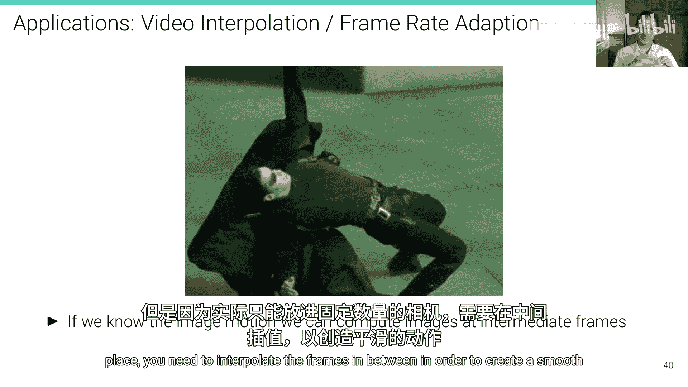
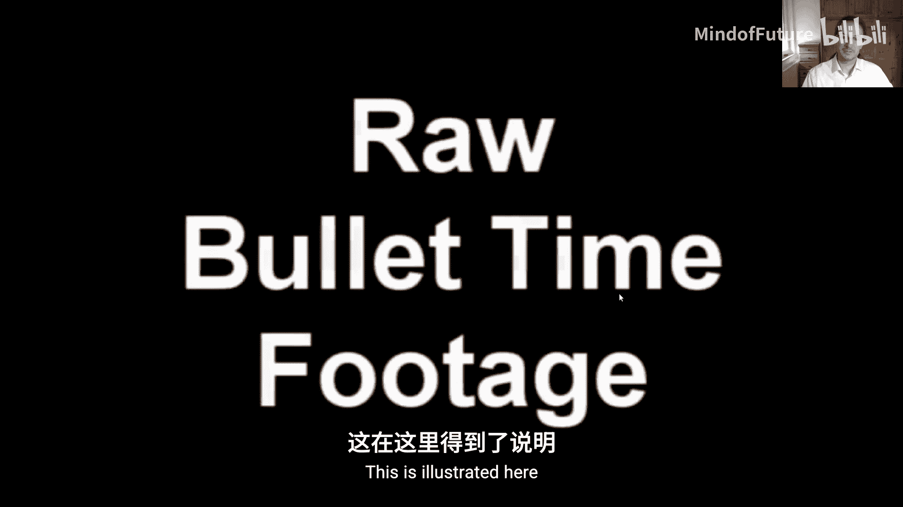
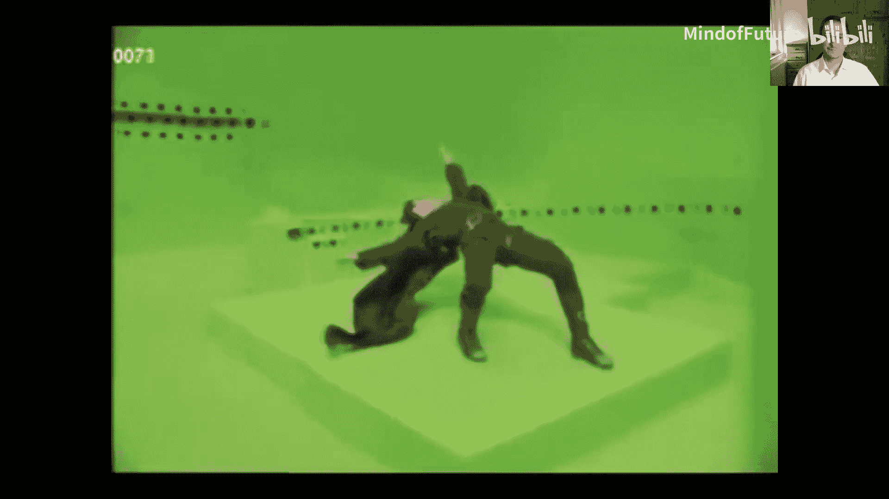
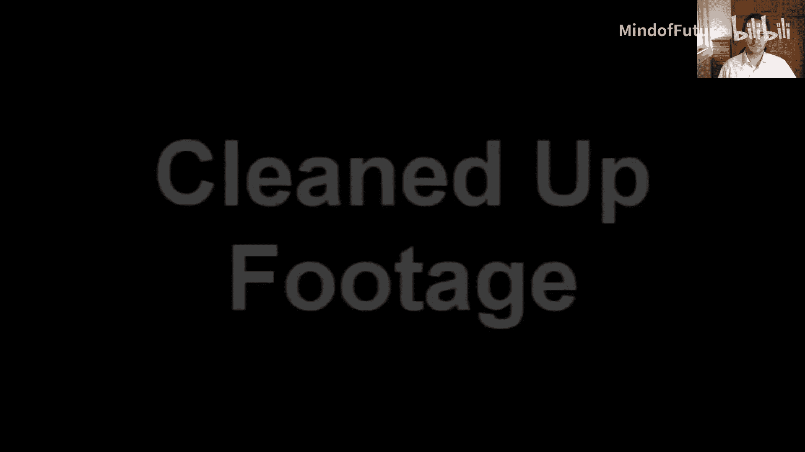
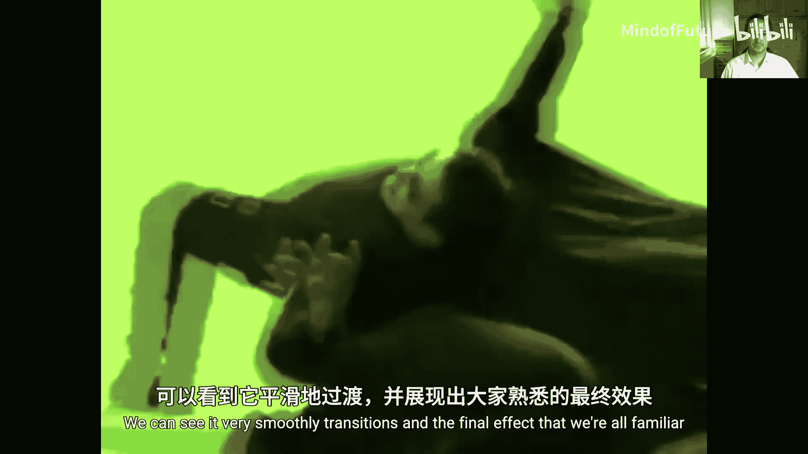
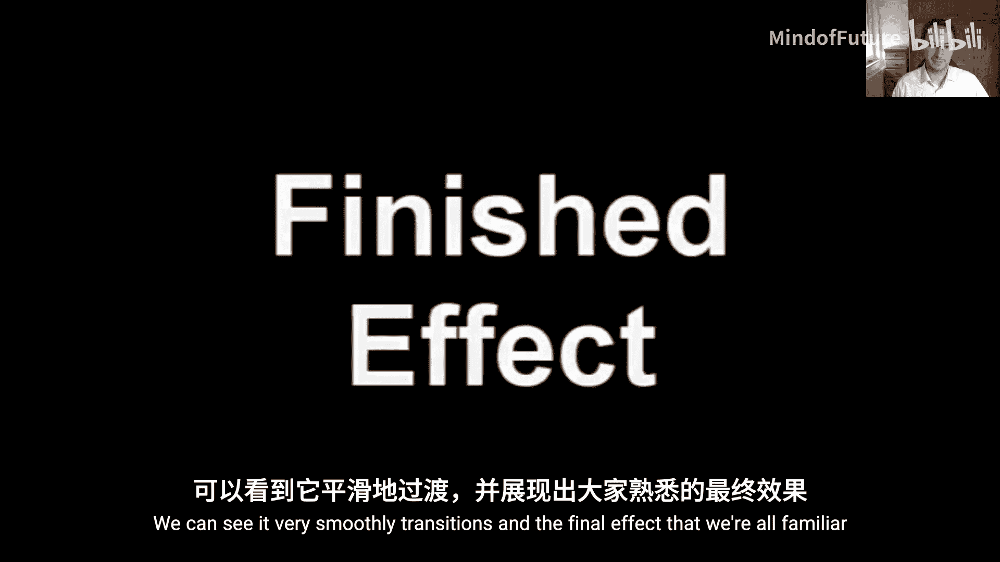
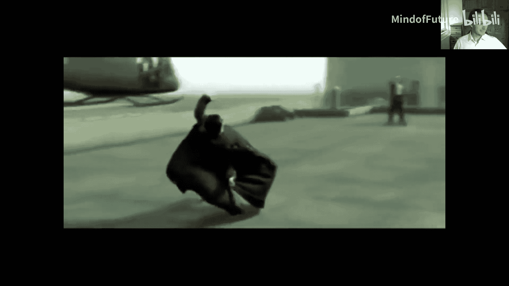
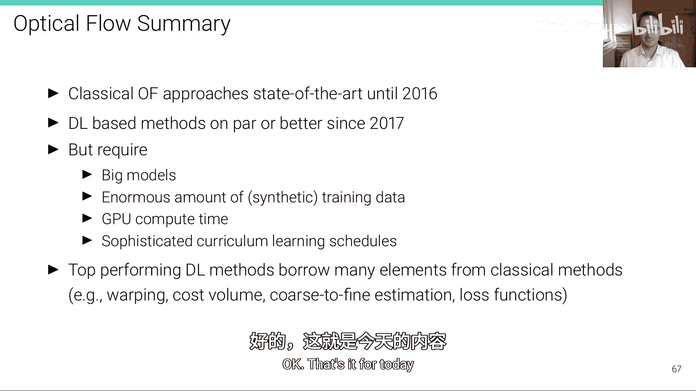

# 【图宾根大学 • 中英】计算机视觉 ML-4360 (Computer Vision) p24 P24 Lecture 6.3 (Applications of Graphical Models - Optical Flow) -BV1S8N1emEef_p24-

In the last unit of this lecture， we're going to discuss the optical flow problem and how it can be formulated or thought of as inference in a Markov random field。

Optical flow is defined as the apparent motion of objects， surfaces。

 and edges in a visual scene caused by the relative motion between an observer and a scene。

So these little errors that you can see here。Indicate how much a particular pixel moves。

And in this scene， where we have this pilot landing and airplane on this airfield here。

 you can see that there is a point of expansion where the arrow are very small and points that nearby the observer are larger than points that are further away。

没。And this motion is a apparent motion of how pixels move in an image is caused by either objects moving。

Objects in the scene。Or the observer moving。In this case， the scene is static。

 but the camera is moving with respect to the scene causing this motion field。

And optical flow has been first investigated by J。 Gibson in the 1950s。

 who was a psychologist and analyzed how。Animals conduct low level perception and also use this。

Ideas in order to help pilots navigate。Optical flow， of course has a relationship to stereo。

Both are 2D estimation problems， but the crucial difference is that in stereo we take two images at the same time。

 or equivalently we take。Two images of a static scene and in optical flow we don't make such assumptions。

 these two images are taking a two time steps without any restrictions on the scene。So in stereo。

 we only have camera motion while in optical flow， we have camera and object motion。

And therefore stereo is a 1D estimation problem， we just have to search along the Aippolar line。

 once we have found the aippolar geometry we can search along the Aippolar line。In 1 D。

An optical flow is a full 2D estimation problem。A pixel in the first image can be located at any pixel in the second image。

 there is no constraint。Apriary。And also， in。Animals。

 these two principles are used to a different extent。

 so for instance monkeys they have like humans of a forward oriented vision system。

 and so they have a large overlapping field of view indicated here by the dark gray shaded area。

And so they can do depth perception very well。While， for example， squirl。

 they have an outside oriented vision system， so they have a very small。

 a very narrow overlapping field of view， and they are not so good at doing stereo。

 but they can of course perceive very well in 360 degree if some other animal is approaching。

 for example。There is two terms that I'd like to define now before we start。Optical flow is one term。

 an optical flow field。E motion field is a number term。

Emotion field is the thing that we are actually after。

 but the optical flow is the thing that we can actually only measure。

So what's the difference a motion field is the 2D motion or represents the projected motion of of the actual 3D motion of an object of points in the scene onto the image plane。

So let's assume this is an image plane here and the camera of camera center here and there's a 3D point that moves from here to here。

And that's projected onto that image plane here and here。

 and so this is the motion field that we like to measure。But of course， we don't have access to that。

We don't know that this。A physicalhy point。Is actually like this dis projection here。

And this projection here correspond to the same physical point because we just have。

 we have just estimated this correspondence， or we can't just estimate that correspondence。

 We don't have any。Any3 de structure， any physical information about the world。

 except this 2D projection in the image。So the optical flow is the 2D velocity field describing the apparent motion in the image and that's what we can actually measure it's the displacement of pixels looking similar if there would be a corner here。

That's unambiguous and that corner would move to here。

 then we could match these two using optical flow and in this case the optical flow and the motion field would be the same and in most cases they are。

 so it's useful to estimate optical flow， but it's not always the case。

So it's not always the case that optical flow and the motion field are the same。

Why let's make a little thought experiment。Let's consider this ball。So think about this。

Image that I show here on the right。As a lumerian ball， a ball that doesn't have any specities。

 no specular material， it's a lumerian ball， and it's rotating in 3D around the up axis。

 so it's rotating like this， it's rotating in 3D around its up axis。

What does the 2D motion field look like？Can you imagine that？Well。

 because it's rotating around the up axis。You will have like small little errors here and then you have large errors here and smaller arrow here。

 so you really see the projected 3D motion as a motion field in the image。

But what does the 2D optical flow field look like？Well。

It's a lumerian ball with our texture rotating in 3D， so despite the fact that it's rotating。

It's actually not changing the appearance， so the optical flow field will be zero。

 there will be no motion that we can observe because both images look exactly identical。Conversely。

 if we look at a stationary specular ball， so this is now a ball with a specular material so we can see a highlight。

And now we don't move the ball， but remove the light source， then this highlight will start moving。

 right？What does the 2Dmotion field look like？Well， the ball is static。 The3d geometry is the same。

 It doesn't move， so the motion field will be0 everywhere in the image。

But the optical flow field will not be zero because this highlight here is moving on that。

iss moving because of the specular reflection moving on that object。

 and so we'll see we observe a motion here and that's also what an optical flow algorithm the group would determine if would determine the motion of that highlight moving despite the object the geometry actually being static。

So that's an example， or these are two examples for how a motion field is different from an optical flow field。

So the optical flow tells us something may be ambiguous about the 3D structure of the world。

 the motion of objects in the viewing area， and the motion of the observer if any。

And it's kind of a substitute for the motion field that we like to estimate。

 and it's often a pretty accurate substitute， except for these extreme cases that I've just shown。

In contrast to stereo， we can't make any assumptions on the apolo geometry。

 it's a real 2D estimation problem， so it's a much harder problem。

 of course has a much larger search space。And it's used by animals。

So here's an example of a so called northern Gnnet。That's a bird that hunts for fish in the water。

And that burn hovers over the gorgeouss surface。And then。Once it identifies fish it。

It goes into a descent。And dives into the water and in order to dive into the water。

 it needs to flap its wings to the body at the right point in time such that it doesn't damage its wings while entering the waters surface。

 which is done at or performed at around 60 or 70 kilometers hour。

 so it would have dramatic consequences for the bird， if the wings wouldn't be flapped。

And that Bt uses the optical flow， the speed with which this pattern moves in order to determine very precisely in milliseconds。

Point in time when the water surface will be hit in order to adjust the wings。

 so here's an example of this。Okay。Yeah。Yeah。在我。So this was an example from the animal kingdom。Now。

Of course， opticaltical flow has many important applications also in computer vision。

And so one application is a video interpolation of frame rate adaption if we know the image motion。

Between two frames。This is Michael Black here。Who was a pioneer in optical flow？

Or is a pioneer and optical flow？If we know the relative motion。Here by this flow field， then。

 of course， we can take the first frame。And warp it only halfway。From time t， not to time t plus 1。

 but2 time t plus 0。5。 So if from these two images we have estimated the flow， we can。

Reduce the flow vectors or scale the flow vectors by12 and then we can synthesize。

And artificial official frame in between。And so we can create artificial slow motion effect and this has been done。

 for example， in this movie here， where this so called poly time effect has been created by putting a lot of cameras around the a drum。

And then creating a virtual trajectory that flies around the actor virtually。

 but because there's only a fixed number of cameras that can be actually put into place。

 you need to interpolate the frames in between in order to create a smooth motion。

This is illustrated here， so here's the raw ball time footage。

Yeah。You can see the cameras， these little holes in the green room are the cameras。

And here's now the cleaned up footage。We can see it very smoothly transitions。

And the final effect that。

We're all familiar with。Yeah。

Yeah， so this is。How professional studios use it？I have also used it as a little。

Exercise in one of the previous lectures。 and here's a student that put assembled a Yaangard tower and then。

Tped it with a regular video camera and interpolated the frames in between。

 so I want to briefly show you this。This is of course a very simple optical flow algorithm that has been used here。

 so you can see a lot of artifacts and there's kind of a stop and go motion。

 but still you can see how the original hive or like like low frame rate could be increased with this technique and it works。

Better for small motions and works less well is much more challenging to solve this problem for large motions when the objects move very fast。

Good optical flow can also be used for video compression so for example to compress an image sequence we can predict new frames using the optical flow field and only stored and once we store the optical flow and then how to fix the prediction so we take this image at time T。

 warp it using the motion field or the optical flow field here。

And then we fix the prediction by changing some of the pixels only。

 and because the flow fields are smooth， they are much easier to compress。

 much easier to store than storing the second image separately from the first image。

Something like this is actually done。And。The impactEC video compression algorithm。

And then in autonomous driving， if you combine disparity with optical flow， you get 3D motion。

 that's called scene flow。 and that's something that。It's not so easy to visualize。

 but here visualize separately the disparity on the top and the optical flow on the bottom。

 so you know now exactly for which or you have inferred for which。

3D for many of these 3D points in which 3D direction they actually move if you know the depth and the optical flow。

And you can do this using a stereo camera and。Treracking frames over time。好。Okay。

 now optical flow comes with a problem， maybe the most famous problem in the context of optical flow is called the Aperture problem。

And the approach of problem is as following。If I just have a single observation， like a single pixel。

 but in this case， it's illustrated by looking through a hole looking through an aperture。At。A scene。

If I just have this single observation， can I determine how things move， how does this line？Move。

If I look just at this very small approach on this edge， let's say this is an edge of an object。

 I'm looking for this very small hole， how does the line move。

I'm toggling now between these frames here。It's。The first impression of how this moves is that it moves from the bottom left to the top right。

 I think most people would agree with this。But if I show you exactly the same scene now without the approach。

 removing the hole。You can see that there was a stick that was actually moving from the left to the right and not from the bottom left to the top right。

This means that a single observation。It's not enough to determine optical flow。

 And that also makes sense mathematically if I just observe a single pixel changing。Intensity， right？

Then I cannot determine optical flow because optical flow has two unknowns。

 I need to determine the flow in the x coordinate of the image plane and then the Y coordinate of the image plane。

And a similar effect can also observe or has been used has been exploited by the barpopo illusion。

Which you can find in some of the barbershops， for example， in the yes。Where you have such a。

 such a poll where this。Poll here is rotating around the up axis but the pattern that's generated the optical flow field is going upwards。

 so you have an optical flow field that goes perpendicular。

 the apparent motion is perpendicular to the motion that the pole is actually rotating。

That's quite interesting。Good。Now we know what optical flow is， now we just need to determine it。

And there is a seminal paper by horn and shunk that's called determining optical flow and it has。

Created thousands of follow up papers on this topic。

There's also another famous paper on optical flow that's called the Lucas Cannaada opticaltical flowlow。

But that is a local flow mechanism， so it suffers from the same window artifacts and because here we are considering flow in the context of microranum fields。

This Hnshung algorithm is the one that relates。UmTo this micro fields because it also makes these smoothness assumptions。

Let's。Formte this problem mathematically， consider the image I and it was considered like this in the original algorithm as a function of continuous variables X Y and T。

 so we have a continuous space time volume X Y is the image domain and T is the time domain。

Now of course we're going to discretize this later on if we want to implement it at a computer and in a computer。

 but for theoretical considerations， and that is what has been done in this paper has been considered as a variational problem。

Which we're not going to spend so much time on here。

Because we're interested in its interpretation as a Markov random field。

 but they have considered it as a variational problem where there is an image that's a function of these continuous variables and the quantity that we infer is also a function。

 it's the flow field that's continuous over the spatial domain。So this is the flow field。

We consider U of X， Y。 This is the flow in the U direction in the x direction in the image plane。

 And then we have a number。AOne dimensional field V。

 so it's effectively the flow field is a two dimensional field。

 but here has been split into two functions， two one dimensional functions U and B。

And at each continuous location in the image。This is what we want to refer。The value of U。

 this is a continuous flow field。 So we want to effectively infer。

Fs and that's why we are minimizing an energy functional right a it's an expression an energy that depends not on vectors that we want to optimize over but on functions。

 so we have a function of a function。It's called an energy Fun。

And the energy functional is as follows in the original formulation of hornn and shunk。

We have this first term here， which is a quadratic penalty for brightness change。

We have the intensity of a pixel that's displaced by the optical flow U and V。At that pixel X Y。

At time T+1。And that should be similar。So we are subtracting it from or to the image。

At location X and Y at time T。And so we're minimizing this squarearrow here。

 We want the image or the intensity at x Y time T to be the same。 The brightness should be the same。

 That's why it's called brightness constancy assumption The brightness should be the same。

If the optical flow is correct。If we move that pixel by U and V to the next time step T+ 1。

 then we want the intensity to be the same。The appearance should be the same。

My optical flow is about the apparent motion。So if the optical flow is correct。

 then we want the appearance to stay the same， we have a quadratic penalty for the brightness change。

And then because we have the purchase problem， we also need a penalty for the flow change。

This is a regular riser， without which the problem could not be optimized。

So we have a regular parametermeter lumpdown， and then Nabla here is the gradient operator。

So with the gradient of U and V the gradient of these flow fields and we want to minimize the squared gradient which means we want to have to change the variation in the optical flow in local neighborhoods to be small。

 we want it to be smooth， this is a continuous formulation。

 the continuous equivalent to what we have done for stereo matching。

So here we have again the equation from the previous slide。

And what we can see is that minimizing this directly is a really hard problem because the energy is highly non convex and has many local minima。

Why is that？Well。The last term。That's unproblematic， it's just a quadratic regularizer。But here。

 in the first term， we have。The optical flow fields the quantity that we want to infer U and V as an argument of the image。

It's added to the pixel location and because images are highly non convex， highly non nonlinear。

If you have a textured image， you have a lot of valleys and hills， right？

And because this enters as an argument。This expression I of x plus u is highly non nonlinear。

 highly non convex if we move a little bit。In the spatial image domain。

 we might have to jump over a valley or a mountain in this。In this， if you think of this image as a。

As an elevation map。The solution to this。That is often done in engineering and that has been used by Hann and Shank as well is to linearize the brightness constancy assumption。

 so we have a nonlinear problem， we're simply linearizing it。What does it mean？Well。

 we are linearizing it by taking a first order。Taylor approximation。

Now we take a first order tail approximation of this term here。

Now we have a function I image of three variables， so we need a multivari tail series。

 So here what what I've drawn here is。A multivariable Taylor series。

 I have drawn the Taylor series for two variables， which you might be familiar with。

What this means here is that the function F and x and y。Its linearized around A and B。

 this is what this means here， is approximately if I don't consider the higher order。

 the quadratic and higher order terms here。The function at A and B plus the gradient in x direction times x minus a plus the gradient in y direction times y minus B。

 so it's really just a linear approximation。To the function F at the location A and B。

So this is something that we are already familiar with。 Now， if we apply this to the。

This term here of the brightness。Constency assumption。Then this is this term here。

 then we obtain the following。Well， in this case now we want to linearize around X， Y， and T。

 the current estimate。So we have I of x， Y， and T， and then we have this expression。

With respect to X。Times， well， the argument x plus u minus x， so we need to subtract。

The variable that we're linearizing around。And the same for Y and the same for T。

And you can already see that x and minus x cancels and y and minus y cancel and T and minus t cancel。

And so this expression simplifies to this expression here。And if we now plug this into here。

 we can also see that we have a minus I of X Y T here， so this term cancels as well。

 so what remains from the brightness constancy assumption。

 quietness constancy constraint and what is often referred to as the brightness constancy constraint is actually this expression here。

So this term from before now is approximated by this linearized expression here at the bottom。

 where we have replaced this term with the linearized expression from the previous light and then cancel the I。

And so this is what remains。Now we can see that this is linear now this term here is linear without the square。

 is linear in UV before it was not linear because it appeared as an argument now is linear。

 so this first term here is quadratic in UNV， and that is something that's convex and we can easily work with。

 we can find good solutions for。Even closed form solutions， effectively。

 it's a very high dimensional parabola。Now， of course。

 in a computer we can't implement these integrals over the spatial domain。

 so what we do effectively in order to apply this algorithm is we do spatial discredization。

 spatial in the image domain。So these integrals， if we do this。

 I'm not going to give all the details here， but if we do this。

 then the integrals here are going to turn into sums。

 so we're not going to integrate over the image domain anymore。

 but we are going to sum over the pixels。And this variational formulation becomes a standard energy。

Function where now these functions， U and V are replaced by flow field by the flow field U and V。

 So U and V are matrices of the size of the。Image。Where U stores the value of the flow vectors at each pixel in。

Horizontal direction and V stores those in vertical direction。I。And。Yes。

And so we have the derivative of I with respect to x and y and T。

 but now here we don't have functions， but we have just these are elements of these matrices。

 U x y index by x and y， these are discrete spatially discrete elements and also this。

This term here then becomes this term。So we instead of the gradient here。

 we have a numerical approximation to the gradient， you can see we have Ux and minus Ux plus 1。

Or v y minus v and v x minus v x plus1， or here V y minus v y plus1。

Now we can see that this entire expression here is quadratic in all the U's and V's in all the U and V variables。

So therefore it has a unique optimum and that optimum can even be found in closed form solution。

 but it's still a very large optimization problem， it still has a lot of variables。

There's as many U variables and as many V variables as there are pixels in the image。And therefore。

 typically iterative solvers are used to obtain a solution。So how do we obtain a solution。

 well we have a corretic problem so we differentiate UV and set the gradient into0 but it's a very large linear system so we can do that directly。

 but we can exploit the sparsity and why is it sparse well because these spatial。

 well this is a local constraint and these here are also local because they only connect neighboring variables right？

So you already see maybe a little bit like how this is related to markcoranum fields。

 We have the same kind of data and then smoothness term here。So we have a sparse linear system。

 but now in contrast to the first unit where we had a discrete variables here we have all the variables you and V are continuous。

 so we use gradientd in descent and we can use iterative techniques。Like gocial， etc。

Now one problem with this approach is that this linearization that we have assumed before only works for really small motion because otherwise we are making mistakes and the solution to that that's typically performed is to first of all。

 iteratively estimate so we make a step and if we haven't converged then we make another step and we re linearize around the current estimate。

And because even that is not enough for recovering large motions。

 we also typically do a course to estimation strategy where we start with a small image resolution and then we do the optical flow estimation there because we know the optical flow is not larger than a few pixels。

 and then we go to the next higher resolution so we upscale or we use the next scale。

 we basically downscale we build a image pyramid， but then we start at smallest resolution and we take the next image in that pyramid at the next resolution。

 warp the target image based on the optical flow estimated at the lower resolution。

And use this as an initialization because now well now the starting point is already better。

 so the optical flow has only the delta has to be estimated。

 which is smaller and that can be then done using these iterative techniques。

So we do it would of course to find estimation and warping to go from very coarse to very high resolution results。

And here's the result of the hornornshung algorithm。

We have two examples for two different scenes from the Middlebury data set and on the right。

 the color coded flow field where the color denotes。

The orientation and the intensity denotes the strength of the optical flow。 so for example。

 here at the boundaries， the optical flow strength is very small， the vectors are not very long。

But then here for this ball， the color s。Coollorful， and so the flow is stronger。And I can show you。

 I can toggle between these input images for you to get a feeling how the objects actually move。

 you can see that this is a very simple data， this is one of the first data sets that people have really quantitatively worked with and now this algorithms work are much more challenging。

Snes as well， we can see that this， for instance， here is rotating。

 that's why we have this rotating flow field here， but other things like this here are more。

Translating。So the horn and shunk results that we have just seen are quite plausible already。However。

 the flow is very smooth。If we look closely， we can see that the from these the transition between these two objects is not as sharp as it actually is。

 so we are overming somehow。And the reason for this is that we have to overcome these ambiguities by setting this lambda to a relatively high value to overcome the Aperia problem and this very difficult ill post。

Soft this Ipost task。But this then overs smooths the flow is continuity。

 so we have this this trade off here and one particular problem is that we are making a very bad assumption we are assuming。

That these terms here are all quadratic and we have assumed that for convenience really。

 because it's convenient， we can then use standard techniques to solve these quadratic problems。

 quadratic problems are always convenient。But convenience is not a good thing here because these assumptions are really problematic。

If we have a quadratic penalty， for instance， for the change in optical flow。Then if it。

 that means that if we have a discontinuity in terms of optical flow， if there's。

Like two objects I move varied that have a very different optical flow。

Then the model gets penalized a lot for making a sharp transition there。

 and that's why we get this over smoothing artifacts。

so we should use something different than the L2 regularizer。 And that's also related to the。

problemsblems we have seen in the context of microcoranum fields。In other words。

 this quadratic penalty is penalized large changes too much。And the cause overs smoothing。

And therefore， there has been a whole line of research to try to formulate optical flow more robustly by using better penalties。

Penalties that are more aligned with the statistics of the real world， like in stereo。

 where we try to come close to the statistics of the real world。

So here's the connection of the optical flow problem to map inferenceencing an MRF。

We have the gise formulation now。That we are already familiar with。

 this is the distribution over U and V。It's equal to one over the partition function x of minus the energy of U and V。

Where the energy， the so-called GiIs energy is defined by the energy that we have just derived so we can take that energy that we have just derived for optical flow and plug it as an energy into the GiPS energy term。

 and this gives us a distribution。So there's this duality between the two representations。

And now performing map inference on this distribution is the same as minimizing this energy。

But as U and V are continuous here now， not discrete as in the case of stereo。

 we solve inference now with gradient descent， not belief propagation。

So we have a different inference algorithm。But， we can。Think about the model in the same way。

As map inference in a microranum field or in a factor graph or in a graphical model in general。Now。

This skips energy。Theres also。leadsad to the relationship of this energy function。

 these quadratic penalties to the distribution that is implied by that。

 because this skips energy has a corresponding Gis distribution。

If we take the skips energy and plug it in here， because we have x of minus this。

The summation here turns into a product， so we have instead of these summations here。

 we have just a product also here。And we have x of minus the stata term and the smoothness terms。

And we can identify these terms as Gaussian distributions Now。

 right we have a distribution that's a factor of many small Gaussian distributions because we have。

X of the minus something to the power of 2， which is the definition of a Gausian distribution。

 and we have this everywhere also for the regular rises。In other words。

 quadratic penalties translate to gauseian distributions。And these assumptions are invalid。Both。

For the。Brightness consistency constraint as well as for this smoothness constraint。Why。Well。

As we've seen， gaussian distributions correspond to squared loss functions。

 which are not robust to outliers or to flow discontinuities， let's say。

So these outliers occur at object boundaries because we have a violation of this squared smoothness regularizer。

And they also occur for the data term， think about non lubertion scenes where you have highlights which cause outliers。

嗯。Et cetera。Or if you have occlusions， for example。

The solution here that has been introduced in a seminal work by Black and Anaadan is to use a robust data term and robust smoothness penalties instead。

 which we call row here。So instead of this quadratic penalty， we use a function row。

And that function is not quadratic， but is more robust。Now the question is， of course。

 how to choose row D and row S for the data in this smoothness term。

 we want a prior that allows for discontinuities in the optical flow and the likelihood that allows for outliers and occlusions。

So what we do is we replace in the probabilistic formulation， we replace the Gaussian。

With a heavy tail student tea distribution。That corresponds in the energy domain to the so called laurentian penalty。

So here we have the the definition of the student T distribution that we want to plug in here。

The corresponds to。This we can we can derive that this corresponds to the following choice。

 this choice here of the。Penalties， row D and row S， so if we chose row D and row S。

Ass this expression。Then the distributions that we have assumed here。For the Gipps distribution。

Our student T distributions instead of the Gaussian distributions that we have assumed if we would use a quadratic penalty instead。

And here's a comparison。 This is now in the energy domain。 So we have a Gaussian。

 and this is this corresponding to a parabola because it's if we take the negative lock density。

 then this is a squared function and we can see how this is basically leading to。

The formulas in the bottom actually both correspond to this plot here this is a bit confusing I just see now。

 So this is just a square function which is not robust to outliers like it。

Fload or object discontinuities because it penalizes them heavily。

 there's a strong penalty for large values， and in contrast， the student T distribution here in red。

Is more gracious。 So it has heavy tails。 It's called the heavy tail。 The probability far away from。

The center is much larger than for the Gausian where the probability very quickly declines to zero and that's why we have this very large values here。

 and so in the negative log density in the energy domain we have curves that look like this don't grow quadraically but thatten flatten out here。

And if you compare this to the actual data。Distribution， empirical data distribution of how。This。

For instance， the gradient of the flow fields look like similar to what we have done with the。

Brown range each database in the case of stereo， we can see that this red。

Distribution is much better aligned to the blue empirical data distribution compared to the Gaussian here on the left。

And now we see an example of what this changes here is the result of horn and chunknk。

 and this is the result of black and anodan， it's actually the result of sun and black。

That has used a couple of more tricks， but essentially。

Uses the same ideas as in the original paper plus some additional insights。

 and you can see how the boundaries are much sharper compared to the original Hshan algorithm primarily because of the more precise assumptions。

Now， finally。I want to， of course， also mention that。Optical flow has not only been tackled by。

Classical algorithms like inferencing graphical models or variational techniques。

But it has also been approached with n2 deep learning。 and since a few years now。

 we see that these techniques， one of the。The latest fields where deep learning has succeeded to overcome classical methods and one of the reasons for this is that there it' very challenging to generate ground truth data that could be used for deep models to learn from and that's one of the reasons why deep learning has taken a while in order to。

To outperform the classical techniques and actually the first technique。

 the first deep technique called flowt。In a seminal paper by Dozoitzky Al has not been able to outperform the classical techniques。

 it was more a demonstration that optical flow estimation using supervised learning with large synthetic data sets is possible。

So this network is very similar to the distantnet network， it's almost the same。

 it has an encoder of convolutions with strides and a decoder of up convolutions and skip connections。

 so it's basically a UNe or hourglass architecture。

And it uses a multi scale loss curriculum learning and a lot of synthetic training data because it has so many parameters now that we need a lot of data and there is not enough real world data。

 so synthetic data has been used。And there's。Extension of this flownet model is called flownet 2。

 that's basically stacking multiple units together cover in order to。

Handle different problems separately， like large displacements and small displacements。

 small flow vectors and fuses them。And this leads to results that are this was the state of the art in 2017 here you can see some examples on the right。

 these are really challenging images you can see a lot of textist regions and compared to classical methods。

 this learning waste approach was able to resolve some of those。And then more recently。

 it has been demonstrated that actually。Optical flow can also be deep optical flow algorithms can also be trained in an unsupervised fashion。

By。Leveraging the principles。And models that we have used stereo in classical optical flow estimation techniques。

By predicting with a deep network， the forward and the backward flow and doing consistency checks and then warping the images into each other using these estimated flow fields and putting a data loss that's similar to the data term that we have just discussed。

And also putting a smoothness loss on the flow fields， and then we can of course， train this model。

Using just images without any optical flow from truth。

 which is great and so there it's possible to learn optical flow without supervision。嗯。

And more about this self supervised learning techniques will be covered in lecture 12。To summarize。

 classical optical flow approaches have been state of the art until 2016， 2017。

 and deep learning grace methods。Became on par or even better since 2017。

But they require very big models with a lot of parameters。

 enormous amount of synthetic training data， a lot of GPU compute。

 and sophisticated curriculum learning schedules where you're train with simple data first and then go harder and harder。

But today the state of the art is clearly deep learning here because all the data sets became better。

 and theres more data， also real data now with optical flow ground roof available。

And what is also interesting is that the top performing deep learning methods borrow many elements from classical methods。

So for instance， they use this idea of warping and iterative estimation。

 they use ideas of cost volume， course to estimation and also similar loss functions。O。

That's it for today， thanks。

