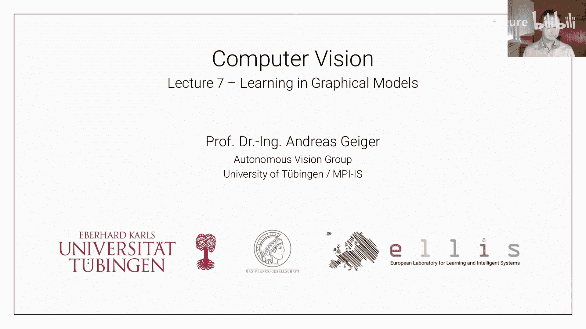
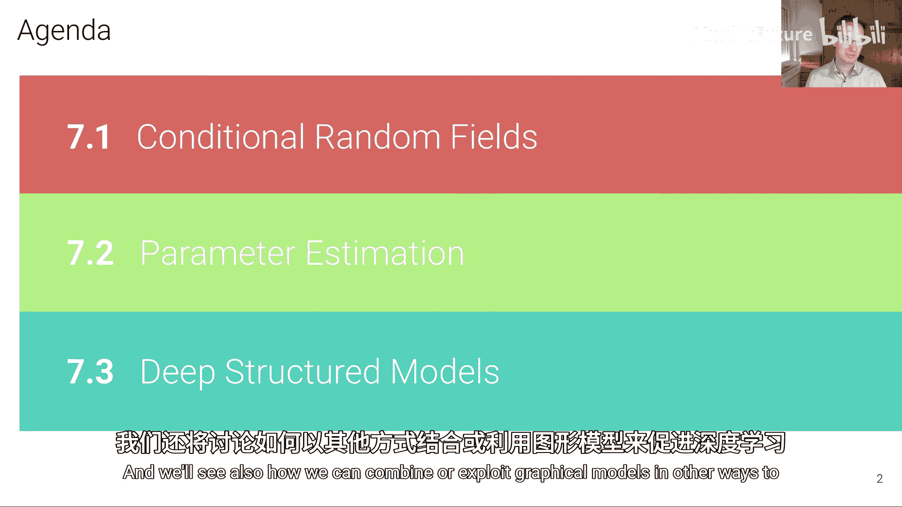
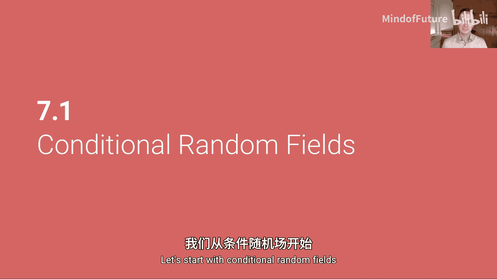
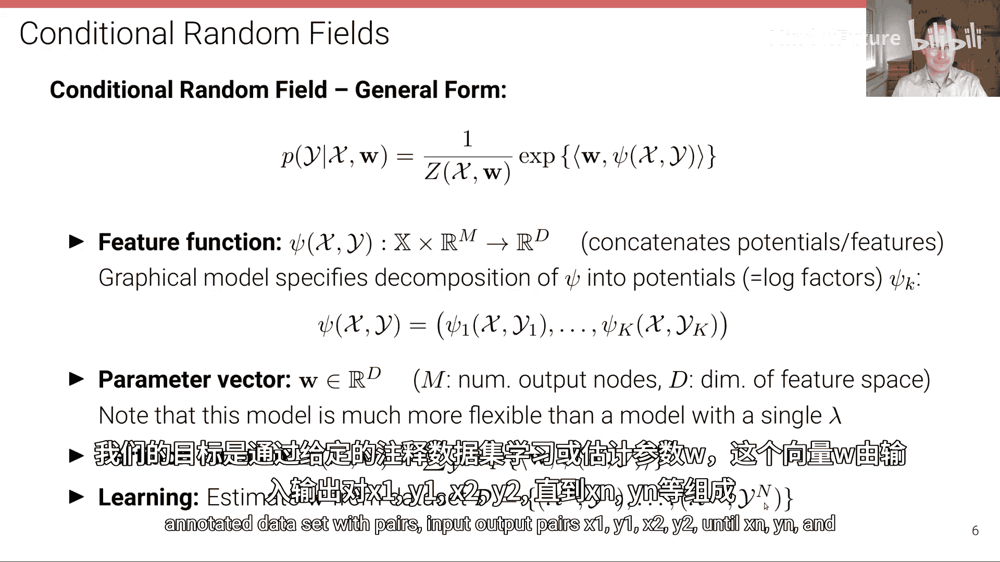
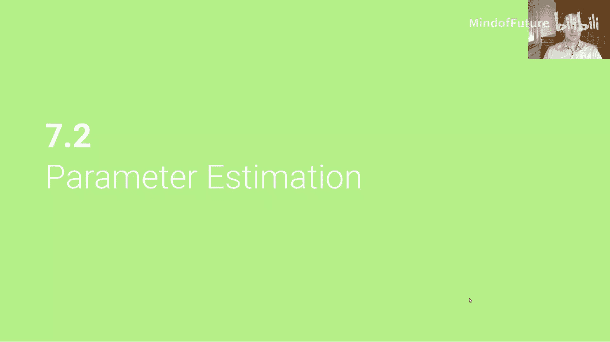

# 【图宾根大学 • 中英】计算机视觉 ML-4360 (Computer Vision) p25 P25 Lecture 7.1 (Learning in Graphical Models - Conditional Random Fields) -BV1S8N1emEef_p25-

Welcome to Computer visionion Lec number7。This is the last lecture in this little excursion on graphical models。

In lecture number5， we've introduced graphical models and a very basic inference algorithm。

 the belief propagation algorithm for。Inferring。Marginal or maximum ofstu solutions。In。

Lecture number 6， we have then seen some applications of graphical models and how we can incorporate prior knowledge about the problem into。

The model using graphical models， for example， in the case of stereo。

We've utilized prior knowledge about the properties， the low level statistics of depth maps。

 in particular that they are smooth。In the case of multifu reconstruction。

 we have shown that it's also possible to incorporate more complex knowledge such as。

Knowledge about the image formation process into the graphical model。

And we have seen how inferenceferencing graphical models leads to results that respect these prior constraints that we have encoded in the graphical models。

Now。All of them。Models that we've seen so far had some parameters， for example。

 in the case of stereo， we had this Lada parameter， which was adjusting the level of smoothness。

 the strength of deregization in other words。And in this lecture。

 we're going to talk about how these parameters can be。Estimated given a data set。

So this is about learning in graphic models。This lecture is structured into free units。

In the first unit。We're going to introduce the terminology of conditional random fields。

 which is crucial for learning。In the second unit， we're going to discuss the actual learning problem first in a simple setting。

Where the。Prorameterters。Up here are linearly or log linearly in the equations and where learning is a convex problem。

And then in the final unit， we're going to talk about deep structured models where the parameters depend nonlinearly。

Or appear non nonlinearly in the model。And we'll see also how we can combine or exploit。

Graphal models。In other ways to benefit deep learning。

。Let's start with conditional random fields。

So far， we've talked about。Marcoranom fields。Or factorgraphs。And to remind ourselves。

 what is a monocofum field or a factorograph？Well， we have in a mark of random field a distribution over random variables here very concretely for one example。

 this is the example of。An MRF for stereos moving。Where we have in this example。

 100 or image denoing where we have 100 random variables。

And then we have this exponential of a sum of these lock factors or potentials。Actually。

 often we call the。The factor is the potentials， but we also call the lock factor the potential。

 so this name of potentials is used。嗯。Both in the logarithm and in the original domain。

 so it's a little bit confusing maybe。But we always call these potentials。So we have， in this case。

 a sum of unary potentials and a sum of pairwise potentials over maybe adjacent pixel sites。

And this defines our probability distribution。 and because this is not normalized。

 we have to divide this by the partition function， which is。This expression here。

Summed over the entire state space of all the axis'es。

Or in the case of continuous variables integrated over the entire state space of these variables that participate。

And what we have discussed so far is inference in markcoranum field。

 so we were interested in estimating marginal distributions that is， for example。

 the distribution P of x1。Or maximum a posterii solution， that is。Given a particular model。

What configuration of x1 to x100 is actually maximizing this probability。

 so we're interested in this arc max。Over all the variables。And we have seen it。

Both of these inference problems are relevant。Marginal distributions are often required when computing expectations we have seen that in the case of multi view reconstruction。

 and we are going to see that also today。When we want to learn these models。

And the maximum posterior solution is often also interesting in a computer vision when we are just interested in a point estimate。

 what is the best solution given the model？Now in this lecture。

We're going to talk about the learning problem， which is how can we estimate the parameters？

In this example here there's just one parameter lambda， but we could have more parameters here。

And we'll see examples where we have more parameters。

 but here in the simple example is just this one single scalar Lada。

 so how can we estimate that Lada from a data set？A little remark in the literature is potentials。

Are sometimes defined as the negative lock factors。 Here we have to find them as the lock factors。

 which means that。诶。A high value of a potential。Will lead to a high value in the probability function。

But often people think about these potentials as。Low values leading to high probabilities。

 thinking about them as energy。But in the context of this lecture。

 it doesn't matter because well just consider these as generic features so we can just swap design and define them arbitrarily。

 it's just basically an interpretation if we consider them as being positive and negative。

And the advantage of not having the negative sign here is that the formulaas become a little bit more。

Slightly easier to write down。So here we simply omit design and use this definition where。

High values of the potentials。Imply high probability。

Now what are conditional random fields and why do we need them Well。

 if we just define Markco random fields， we can define the learning problem。

And why can't we define the learning problem well， because we're only looking at one particular model instantiation？

So in the example of image denoing， we're looking at one particular image that we want to denno noise。

And in that image。We associate each pixel with a random variable。

 and that's the set of random variables X。But of course， if we want to do learning。

 then we want to learn from a larger data set。Not just for a particular instance。

 and that's why we need to formulate the problem。Conditionally。

And this is what leads us to so called structured output learning again， we have seen this already。

Where。We want to learn a function of mapping F with parameters W that goes from some space X。

Some input space X。To another output space y。And instructored output learning， as we already know。

 the input inputs can be any kind of objects。As also in regression， but the outputs， importantly。

 are complex structured objects。 So in this case。The outputs are the x's。

 so we're going to swap the name of the variables now to define the conditional random fields。

So the outputs could for instance， be images or semantic segmentation maps or text or past trees。

 computer programs， etc。So here's the definition of the condition random field。

In our conditional random field， we make the conditioning of the output on the input。

And the parameters is explicit。So instead of writing just the distribution on x。

 we now write a distribution of where the y is now the output， which is what x has been before。

So please be careful now because we need to swap X and y。

When we talk about conditional random fields。So we have a model that given a particular X。

 that could be。啊。A noisy image。Produces an output y， which is the den noise image。

 so we make this input image x and the parameters。Explicit now in order to be able to apply this model on an entire data set where we want to。

Learn these mappings from x to y from noisy images to denno images。

So it's very crucial here that we remember that in the MRF notation， we have just x。

 so we call it the output variables x， but now in the CRF notation we have in the structure prediction problem we have a mapping from x to y。

 so the output variables are now y， this is what has been x before， and the inputs， the noisy image。

Is called X。We haven't explicitly encoded a noisy image here。

 this was implicitly encoded in the definition of， for example， the urary potentials。Before。

But now we have this explicit so that the unary potentials are functions of the input。

As well as the random output variable they act on。And also。

 the pairwise potentials are functions of the。Input and the output variables they act on。

And similarly， of course， for higher auto factors as well。So we denote the set of all。

Input variables in a conditional random field as calligraphic X。Which are。From a space。

X and the outputs as the set calligraphic y， which are from the space y。

And learning that amounts to estimating。The parameters of this model here。In this case。

 W is not a vector， it's just a scalar， it's equal to Ladown。

So we want to estimate the parameters of this model， in this case， just Lada。

 given a data set of input output pairs in the case of denoising noisy inputs and denno outputs y in the case of。

Semantic segmentation input images x and semantic segmentation maps Y。

 so it's a supervised learning problem where we always consider input output pairs。

 we always have annotations for each input X。And from this， we want to infer what is the optimal。

Prameter such that given a novel input that we haven't seen during training。

We do the best possible prediction under that model。Now。

 this was a very specific example of a conditional random field。

To make the transition easy from microranum fields。

 this was the example where we looked at the simple image denoizing problem with the unary and the pairwise potentials。

 but of course we can write this more generally。Okay。If we write this in a more general form。

Then we can just write， as you see here， we have just a sum of un repair wise and maybe higher order factors we can just。

mConcatenate all these features in a long vector and then multiply this with the parameters。

So there could be a parameter here， and there could be even a different parameter for every unary。

 so for every eye there could be a different parameter or lumpta I and for every combination IJ。

 there could be a different parameter lumpta IJ。Therefore， the general form。

Can simply be written as the inner product， these brackets here denote the inner product。

 I could also have written W transpose psi， but it's more common to use these brackets in this context for the inner product。

So we have a parameter vector W。And compute in a product of that parameter vector W with these features。

 which is the concatednation of all the。Potentials， all the feature functions。

 these individual feature functions that we have specified in the conditional random field。

And we take。I'm the exponential of this inner product。And again， this is of course not normalized。

 so in order to arrive at a proper conditional probability distribution。

 we have to divide by the partition function which depends on the input X。And the parameters W。

 but not on y because we are summing over y。And this also explains why this is called a conditional random field because we are modeling conditional distributions we're modeling。

The distribution of the output conditional。Or conditioned on the input X。Again， in this model。

 we have a feature function。This is this psi of x and y。

 this is a function that operates on x and y and that can possibly decompose into something very simple according to the structure of the graphical model。

And that in the general form that function is just a mapping from the input space X。And。嗯。

M is the number of。Output variables。 So we have r to the power of M because we have M output variables。

And it's mapping to the。Feature space。R to the power of D where d is the dimensionality of the feature space。

For example， here has this vector has the size D， the size of the feature space。

 and the size of the feature space of course， depends on the problem。In this case here。

 it would just be one， but in practice， of course we to if we have larger data sets。

 we want to make this model more flexible， give it more parameters。

 and estimate more than this one single parameter。Now this is a very general form。

 but of course we want to exploit， as we'll see in the following the structure of graphical models in order to make this actually tractable and therefore typically。

These potentials here， these log factors decompose， so we have a concatenation of all the potentials。

 all the log factors that are involved in the graphical model。

 This is just a big vector that concatenates all the features。

Produced by all the small features all these little potentials。 So for example here。

We're concatednating all the Uni features over all the pixels。

And then we're concatedinating all the pairwise features of over all the pairwise pixels into one big。

Mcome。Okay。不。And then we have the parameter vector W， which has dimensional TD。

So M is the number of output nodes and t is the dimensional t of the feature space。

And this general form here， of course， is much more flexible than just having a single parameter because now we can have one parameter for each feature that is defined by the graphical model。

And we have the partition function here that is simply the sum over the entire output state space y。

Of this expression here。And the goal is to learn。Or estimate the parameters W。

 this vector W from a given annotated data set with pairs， input output pairs， x1， y1， x 2， y2。

 until x n， y and， and so1。

O。

