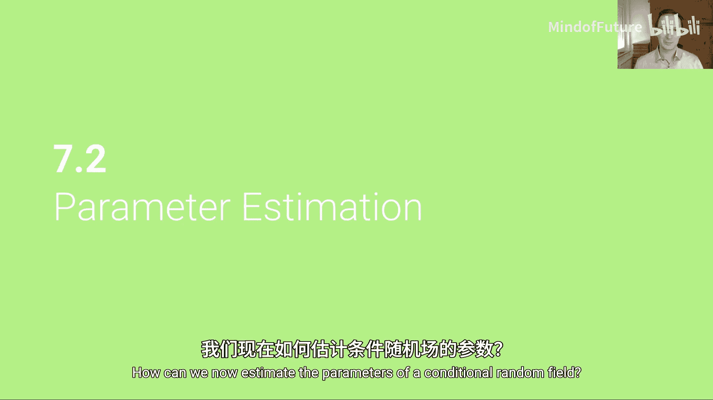
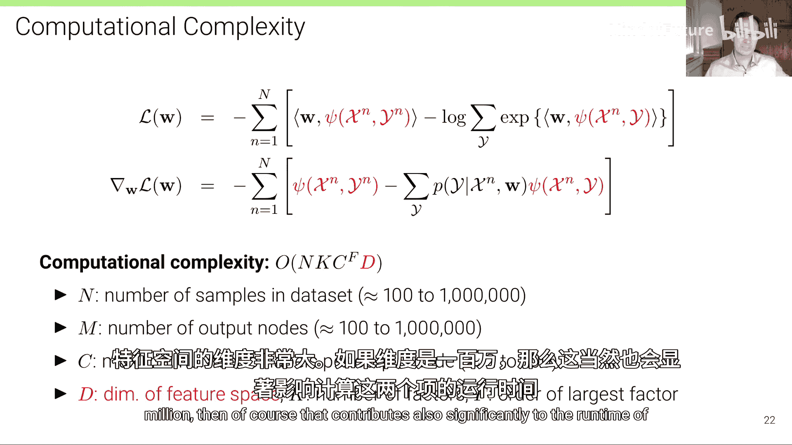
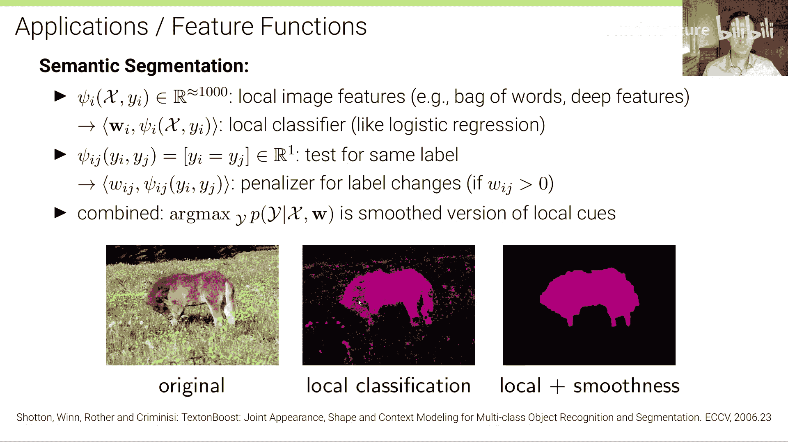
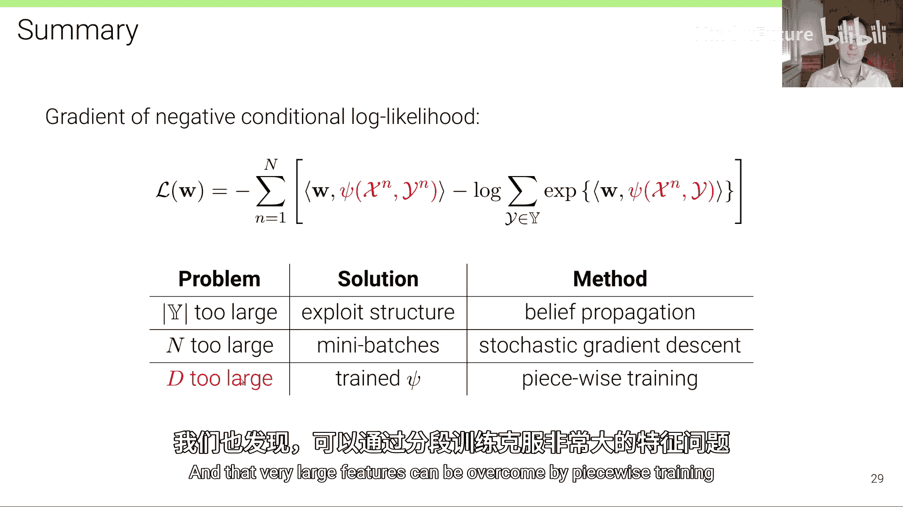

# 【图宾根大学 • 中英】计算机视觉 ML-4360 (Computer Vision) p26 P26 Lecture 7.2 (Learning in Graphical Models - Parameter Estimation) -BV1S8N1emEef_p26-

How can we now estimate the parameters of a conditional random field？

Our goal is to maximize the likelihood of the outputs y conditioned on the inputs x with respect to the parameter vector W。

And。As often the case in machine learning， we are going to assume that。

The data is independent and identically distributed in order for the likelihood to factorize。

Mathematicically， what we want to find is。The parameter vector to W。That maximizes。

The probability of why。Given X and W。And we're going to call this。Promitive vector。

W hat M L for maximum likelihood estimate。As we will see for these local linear models that we consider in this unit。

This optimization problem is convex or semiconvex。And so we'll find a global optimum。Now。

 because we assumed that the data is IID。The probability over。Y and X。

 which here in this case denotes the entire data set。It factorizes into the product。

Over the entire data set， So here n is the index that runs over the data set capital n is the number of annotated images that we have。

And so we have this factorization into the conditional distributions where y to the power of n and x to the power of n are the n element in the dataset set。

In other words， what we want to find is the parameter vector W such that the model distribution。

Its as similar as possible to the data distribution。If。

All the data points have high likelihood under that conditional probability distribution of the model that we have learned。

 then the model distribution must be similar to the data distribution。Of course。

 the model distribution is not going to be exactly the same as the data distribution due to all the assumptions。

 the simplifying assumptions that we have made when we model the problem。But。

We give it some flexibility with the parameters and at least in the class of all possible models。

That are defined through the parameters for this particular class of models that we defined。

We want to get the best one。By finding the best parameter vector。

Now this is equivalent to minimizing the negative lock likelihood。So instead of writing。The Arcms。

We can also write the argument of some loss function L of the parameters W。

 which is the quantity that we want to optimize over。

Where the loss function is simply the negative lock probability。

And because the negative lock of the product is the same as the negative sum of the lock。

 we have rewritten this here in terms of summations instead of products。

So we want to minimize the negative conditional local likelihood。Which is。

Copiied from the previous slide here。What is the negative lock likelihood if we write it out？Well。

P of y and an X this is this data point。And conditioned on W。嗯。

Can be simply replaced by this expression， which is the form of our conditional random field。

Remember if I go back， this is how we have defined find the conditional random fields now we are ping in one particular data point。

 Yn and Xn。From this data set here。And so this term here can be written as this term。

So we have simply substituted the conditional probability through its CRF form that we have defined in the previous unit。

Now， the logarithm of one over C。Is equal to minus the logarithm of c。

And the logarm of the exponential or the logarithm cancels with the exponential。

So we have minus the logarm C。Plus， because you have the logarithm of a product。

The argument of the exponential function。We have basically just applied the logar room rules here。

So we end up with this expression。Now we take this last term and。Put it in front。 And the first term。

And put it as the second term here。And then what we also do is we are taking this partition function and writing it out。

What is theition function Well， the partition function is the sum over the entire state space y。

So we're summing overall possible combinations of y。off。

Exactly the unnormalized conditional random field， which is the exponential of the inner product of the parameter vector。

And the feature。Or more precisely the feature vector。

So this is the expression that we obtain for the negative conditional lock likelihood。

Which we simply write as a loss function in terms of the parameters that we want to optimize。

 This is what we have to optimize with respect to W。Yeah。Now how can we optimize this， well。

 from this form is clear there is no closed form solution is' clearly not quadratic。

So what we're going to do is we're going to use gradient in descent。

How does gradienting descent work？In its simplest form。

 we pick a step size itta and a tolerance epsilon， and then we initialize the parameters somehow。

And then we repeat。Until convergence， we compute the gradient of the loss function。

And then we do an update on the parameters。And there's various。Varianants here。嗯。So there is。

 for example， line search where instead of just picking a step size。

 we're trying to query the optimal step size by going into the direction of the gradient。

Until we find the minimum， there's also conjugate gradients。

Wwhich provides a better direction for the next gradient step and you can see an illustration here on the right。

 but what is common to all these algorithms is that they all require gradients and some of them even require the function evaluation like the line search。

 so we have to be able to evaluate the function。The loss function that we' have seen on the previous slide。

And we also have to be able to compute the gradient of that loss function in order to execute the gradient decent algorithm。

So these are the two things that we have to compute。The loss function。

 the negative conditional lock likelihood。This is just copied from the previous slide。

And the grading of this。What is the gradient of this？Well， if we take the gradient。

 does the gradient with respect to the parameter W， of course， if you take the gradient of this。

Then we have the gradient of this expression here， which is simply the feature。

For x n and y in itself， because it's。A linearar term in W。

And then we have the logarithm of the sum of the exponentials。

 so the logarithm of the partition function。And so the derivative of the logarithm is one over the logarithms of this expression here。

It goes into the denominator。And we are through the chain rule left with。

This expression here times the inner derivative。Which is， again， this expression。With respect。

 derived with respect to W， which is simply the feature itself。 so through the logarithm。

 we have one over this expression。And then we have through the chain rule。

This expression times the inner derivative， which is simply the features here。

Now we can rewrite this slightly。We can。Well， we can write this here， which is simply a scalar。嗯。

With a different index， so instead of summing over all y's calligraphic ys。

 we are summing over all calligraphic y primes here。

In order to be able to distinguish this and this why nothing has changed so far。

And then we can pull this term inside this summation。That's what has happened here。

 So we have taken this term here because this is constant with respect to the index variables of this sum。

 and we can just pull it inside。So we get this is basically this is。

This sum here is this summation here。So we have this summation over this term and this term。

 just this and this divided by this term， where we just have used another。

Index variable to distinguish these two， because this is now part of this， but it's not the same。

Yeah。This looks a bit strange， why do we do that well， if we inspect this closely。

We see that this term here is exactly the probability of xn。Given y and W。

 because here we have the exponential term， this is our anormalized conditional random field。

Divided by C， divided by the Poition function。So it simplifies as follows。

 we have the first term minus the sum over this state space， the output state space。

On the probability of y given x n and w times the features。At X， N and Y。

So what this means is that we simply have， for the second term here， the expectation。

 this is just the definition of the expectation。Of。The features。With respect to the。嗯。

Y variables drawn from the probability distribution。Of y given X N and W。

This is just the definition of the expectation function。Some expectation of psi of the features。

And it's with respect to the。Variable is Y they come from this distribution， so this is。

Probability that we multiply the features with。So this is the expression that we obtain。

So we can already see that this gradient is subtracting the。Features evaluated。

For the labeled outputN for that particular input XN with the expectation of these features。

Under the model， this is the model expectation。And that makes sense， right。

 we want to make both of them the same。So it makes sense that in the gradient。

This difference between the。Features computed from the data set and the features that are computed as expectation of the model。

Appears。Because we want the model for a model that is good， we expect that on average。

 it predicts the same features for the same input XN。As。The features。That's。嗯。Correspond to。

The labeled example。For that particular XN。To make this a bit more concrete。

 when is the loss function minimum？Well。If the expectation。

Of the features under the model is equal to the features for the labeled example。In this case。

 this difference will vanish and the gradient will be0。

 so in this case we have found a critical point。Right？This is what we just。Set。

And the interpretation is that we aim at expectation matching， so we aim at matching the。

Expectation of the features under the model to the features of the observation here informally abbreviated with YOs。

 but we try to do this now discriminly only for the X that are available in a training set。

 we can of course not match the features for any unknown example because we haven't labeled it。

We might not even know the X。But we have the data set with the X Y pairs。

 and for these particular axis， we want the features。To be the same。

 the features predicted by the model and the features that are computed by taking the feature function of the respective input and the labels。

Example， if both are the same。Then we are happy。As a little node。The loss function L of W is convex。

Because。As can be shown， the hesching of it， if we take one more derivative。

Is positive semi definite， and that means that if we for this particular model。

 this particular CRF definition。嗯。If the gradient is 0。For example。

 by starting at some random initial guess and performing great in descent and。

Arriving at a critical point by the gradient in the zero， then we have reached the global optimum。

However， this is， of course only true if we use this very special definition of the conditional random field in particular if。

This probability of y given x and W is lock linear in W。This is what we have assumed right？

It is if I go back。This is lock linear if you take the logarithm of this expression then。

This expression here is linear， becomes linear in W。

 only in this case we have a convex optimization problem。

But later in the third unit we will also see nonlinear models where this is not the case。

 and of course in those cases if we apply gradient descent。

We don't necessarily arrive at the global optimum， but just at a local minimum。Now。

 back to the task that we have to perform， we know that we have to do great in descent。

And for gradient descent， for example， if line search， we must evaluate L。

 and of course we must also compute the gradients。Of the loss function L。And this is。

What the loss function and the gradient of the loss function looks like as we have derived on the previous slides。

Now the problem with this is that the state space y is typically very large， exponentially large。

 so this hints again at the same problem that we have discussed in lecture number5 on graphical models。

 this is also why graphical models play a role here now in order to make this feasible。

If we want to just naively compute these sums here over the entire state space of Y this is。

Completely intractable。As an example， if we consider binary image segmentation。

Of a VGA resolution image， 640 pixel wide and 480 pixel high。

Then there is2 to the power of 6 and40 types， 480 possible solutions。

So this sum is a sum over 10 to the power of 92，475 terms。This is。Completely intractable。

 it's way more solutions than theres atoms in the universe。

 it will require way more time than we would have to compute， so this is not possible。

And we need to now exploit the beauty of graphical models。In order to make this tractable。

Similar similar to what we did for the intractable inference problem in graphical models。

In lecture 5。We must use the structure in Y。Or we are lost。Okay。Okay。So again。

 these are the two equations from the previous slide。

The loss function and the gradient of the loss function。

In order to see and understand this a little bit better。

 what is the computational complexity of computing these two quantities？

Let's write down the computational complexity precisely。

 and then later let's see how this computational complexity gets reduced。

So what is the computational complexity team？Well。The first term in this computational complexity expression here is n。

Because we have to， for all n the number of data samples in the data sets。

 so in order to evaluate the loss or the gradient we have to， of course。

Compututers sum over n many terms， so we have n appearing linearly here。

Then we have the expression that we have already seen C to the power of M。Which is the。

Maximal number of labels per output node in the case of binary segmentation。

 as in the previous slide this would be2。But it could be much more， for instance。

 for semantic segmentation， if we have 100 different semantic classes， this would be 100。

And then we have M。C to the power of M where M is the number of output nodes。In in the previous case。

 we had 640 by 480 pixels， so 640 by 480 variables or output nodes。

And this is this computational complexity that we have already discussed。

 this is the main problem in computing these expressions。And then we have D。

Which is the dimensionalality of the feature space because we have to compute this sum here always in terms of all the features。

 so for example， this gradient here。Is the gradient the length of this gradient vector is， of course。

 the of dimensional D of the size of the feature space， the larger the feature space。

The more we have to compute， and so this D also appears linearly in this expression just because of the size of the feature space。

Here in the case of the computation of the loss function， it also appears because with。

A larger dimensional TD also this inner product here becomes more and more expensive to compute because it's。

A product of larger vectors。And so we have these three terms that contribute to the computational complexity in order to compute these two quantities that are required at every single step。

Of great and descent。And now we're going to look at how we can reduce this computational complexity。

And the first。Point that we are going to address is the most important one。

 this is the one that makes the entire problem if tractable or intractable， and this is this。

Complexity here introduced by summing over the entire state space where。

In the case of binary segmentation。Um， we have。A2 to the power of maybe 640 times 480 possible combinations in these two sums。

In order to solve this problem， we're going to again exploit the structure of graphical models。

As we did for inference， in fact， we're going to apply inference algorithms as we're going to see。

Remember in a graphical model， the feature。Vectctor decomposes。 So instead of。

Just considering this as a very long vector that we don't know anything about。

 this is actually a vector that is a condation of。Smaller subfactors。And we have， in this case。

 k different sub vectorctors because in this graphical model here， we assume there's K potentials。

 and each potential， each of these unary potentials or pairwise potentials are higher other potentials。

Produces a feature。So this global feature， this long feature vector。

 is just a concatedation of smaller feature vectors。And therefore， the partition function simplifies。

The partitionent function is relevant。This is this function here。Because we have to compute it here。

Mdam。So this is the intractable expression here， this is just the partition function that we have to compute。

So the prediction function simplifies。Why does it simplify？Well。嗯。

Instead of just writing this very long。In a product。

 what we can now write is a sum of smaller inner products。Where we have to sum over the K potentials。

And each of these inner products corresponds to one potential， so we have。A subset of the parameters。

 which we call WK， which is just maybe two or three values in this long parameter of x to W。

And we have local potentials that depend not on the entire output space y anymore。

 but just on a subset of that， maybe in the case of pairwise potentials， that's just two variables。

 two adjacent pixels。Instead of all the pixels in the image。

 and that's indicated here as in previous lectures by this subscript K with Yk。

This potential could still depend on all the input variables that doesn't matter。

 What matters here is the complexity with respect to the output variables。

 So we don't make any restriction or assumption here in terms of the input。 the input is still X n。

 This is for this particular training sample n。That appears in this expression here。

For a particular term in this sum， we have a little n for this training sample。

So we can consider the entire training sample， we don't need to restrict to certain nodes what matters here is this complexity in terms of the output space。

Now， what we can see here， of course， is that this is just a sum over the。

Entii output space of a product of these factors here。Right。

So x of the sum is the same as the sum of。X， which is， which is just。AF， this is the K factor here。

 according to our graphical model definition。So there's no。

Magic happening here is just we've just rewritten。This。

Some over this exponential of this very long feature space into a sum of product of very small factors。

And now what we know is if these factors are of tractable order。

 such as in the case of stereo problem we've discussed with pairwise and urary factors。

 then we can efficiently calculate。This entire expression here using message passing。

Using message passing， we can compute marginals。And by summing over any of these marginals。

We get the partition function。Yeah。So sum this is a marginalization here， as you can see。

 it's a marginalization over actually all the variables that are involved。

We don't want to just compute the marginal over。嗯。as we have done in the inference lecture over a particular variable x1 and marginalize x2 to x100。

 but here we are really computing the sum over x1 to x00 and we can do this efficiently using the belief provocation algorithm by computing the marginals and then taking any of these marginals and summing these values up so that we have sum not only over。

Over all variables except one variable， but over all variables。

And so this now becomes tractable for tractable graph models because we apply the trick that we have introduced for inference and message passing。

 and you can already see here now that in order to do gradient updates in order to learn the parameters of the model。

 we need to do inference in particular some product belief provocationation。

 we need to compute marginals for learning。Similarly， the feature expectation simplifies as well。

 The feature expectation is。This expression here that appears in。The gradient of the loss function。

 and it is also intractable if。Treated naively。So this case here。

What we have here is simply expectation。Of the why of。Again， now decomposed here。

 the sum of these potentials。Now， because the expectation is a linear operator， we can。

Puled his sum outside。So we have to sum of the expectation。Of the features here。

Where the features again as in the previous slide， only depend。

On the nodes that are involved in that particular potential indicated by the Subscript K here of y。

Now because of this fact， because these potentials only depend on some of the output variables。

 maybe one or two or three。This expectation。Has to also only depend on those variables because the errors don't matter。

 so we can equivalently write the expectation over just Yk this subset of the variables that this feature or potential depends upon。

And now what we see。Is， well， this expectation is simply the sum over the entire state space Y K here。

Of the probability of Yk。Times。The feature。At K or the feature K。And what we see now is that。Well。

The computation has dramatically simplified in terms of complexity。

 because what we have to do here is we have to sum just over this。St space Yk。

 which is much smaller than the entire state space of all the variables because this is only some of the variables。

  one， two or three， not all the variables， all the output variables。And what we have to compute。

Before summing this up is to compute the marginals。At a particular。

For a particular configuration of nodes， and we know that these marginals can be computed for tractable graphical models with not two high order clickiques。

Efficiently using belief propagation， so we have an efficient way of computing these marginals。

And then we need to sum up over these。嗯。Like the product of these marginals lift the features。

And we have to do this for all the potentials。In the graphical model。

What does that mean in terms of the computational complexity？Well。Compared to。

Computational complexity that we had before， C to the power of M by M。Was very large。

Now we have K times c to the power of F。Okay。Where now and this is important F。

 which is the order of the largest factor， typically two or three。Is much。

 much smaller than the number of all the output node。

So this now becomes tractable because K is just linear and F is small。In other words。

 we have exploited it。Efficient inference algorithms in graphical models in order to calculate。你。

Loss function。And the gradientd of the lost function。Much， much more efficiently。

Now let's look also quickly at the other terms that contribute to the computational complexity。Is。

Well the size of the data set the number of samples in the data set that could be just 100 samples that are annotated。

 but in some case it could also be a 1 million samples that are annotated and of course because this。

Is the sum over all these samples this also adds to the computational complexity。

 adds linearly to the computational complexity of computing。The gradient end。The loss function。

 which again has to be computed at every step of the gradient descent。Algothm。

So learning on large dataset sets becomes problematic because processing all and training samples for one gradient update is low and often it doesn't even fit into memory。

For example， if you use GPUs S& deep learning。So how can we estimate the parameters in this setting？

Well， one way would be to simplify the model to make the gradientding updates faster。

 but if you simplify the model， then a model is less accurate and so the results get worse。

 that's not what we want to sacrifice。Another strategy would be to train a model in a subsample data。

 but this clearly ignores some of the information in the dataset and is not ideal either。

We could also parallellyize across CPUs and GPUs。But that doesn't really save computation。

It just makes things run in parallel。So what we can do is what we did also in deep learning is to use stochastic grade incent。

In stochastic gradient sent in each gradient step， we create a random subset D prime of the data set。

Where this random subset is typically of the size 64 or 128。

 so relatively small compared to the size of the entire data。

And then we just follow the approximate gradient where the approximation comes in by summing now not over all the data samples。

 but summing over only。嗯。A subset of the data samples。A small subset of the data samples。

Now in this case， line search is not longer possible。

 so we have to introduce this extra step size hyperparameter Eta。That allows us to。Go forward。

Along the gradient for a fixed step size in stochastic gradient descent。Just as in deep learning。

It can be shown， as we have seen in the deep learning lecture that SGD converges to。

The minimum of local minimum， at least of the loss function， if Eta is chosen right。

And in our particular case here of these lo linearar models， it even converges to a global minimum。

SGD needs more iterations， but requires less memory and each of these iterations is faster。

And there's also a nice article that。Speaks about the tradeoffs of large scale learning。

And that I recommend as a read if you're interested in this topic。

And the final term now in this complexity expression is this D that appears at the end。

which is the dimension of the feature space the dimensionality of the feature space is extremely large if there would be 1 million。

 then of course that contributes also significantly to the runtime of computing these two terms。

Now in order to get a feeling of what these feature spaces typically look like。

 let's look at some concrete applications and where possible I put also the corresponding paper at the bottom。

Okay。The first application is semantic segmentation where the input is an image。

And the output is a label map。That could be just binary segmentation， foreground versus background。

Or it could be multiclass。Saegmentation。In this case。

 if you specify this problem as a conditional random field。We associate with every spatial variable。

 let's say every pixel or sometimes also super pixels are used， which are a little bit。

Bigger pixels to make the problem smaller to make the number of output variables smaller。

So with each of these sites。Y I， we associate a local image feature that describes how this。

Pixel looks or in particular how it relates to a certain semantic class label， for example。

 if there is a green region that is unlikely to be a horse。

 but if there's a brown region around that pixel is more likely to be a horse。

 so these are local features that can be extracted using。

Hand engineered features such as bag of words or deep features。

And are typically in the order of maybe a few thousand。

So we have to compute here this inner product of say0 dimensional parameter vector。

With a thousand dimensional feature。That is。Returned at this particular pixel。

And you can think of this as a local classifier， like in logistic regression。

 or we also take this inner product。And then we have another term here。

 which is the pairwise term that is a test in this particular case。

 in this particular example here for the same label。So it could for example。

 take value one if the labels are the same， if we want to maximize these。

 remember that we use this positive definition of the potentials。And zero if they are not the same。

And you can see what happens if we do just classification versus introducing this smoothness term。

 a lot of this noise that is present by just the local features， the local classifiers gets removed。

But at the same time， also， the foreground region gets overs smoothed a little。

So this combination of local。And。Smthness terms leads to a smooth version of the local cues of what we would。

Classify with the local features alone。

This was an example for semantic segmentation。 Another example is handwritten。

Recognition and writing recognition where we have a sequence。off。

Characters and we want to classify these characters。

 this could be little images and we want to classify these characters。And maybe we have a certain。

 we have certain prior knowledge about which characters occur after each other。

 and that could be encoded by such pairwise potentials here where we have a。

An indicator that indicates which letter is more likely to follow another letter and of course if we have such knowledge。

From maybe a big text database extracted， then we can。More robustly solve this problem。

 we can overcome some of the errors that some of the errors that might or some of the uncertainties that might be present in these local representations if the character cannot be uniquely identified。

By just its local surrounding。In terms of its appearance。So the combination of the local and the。

Perwise term here delivers a corrected version of the local cues。But now in this case。

 not for images， but for sequences of。Characters。And here's another example， in this case。

 post estimation。Where again， the input is an image。

But now what we want to infer is the human body pose of a person。

And so at the output space here is again， at each pixel。

 we associate with each pixel random variable， Yi。And that random verbal Y I indicates the body part that is associated with that pixel。

So， again， we use。Ever hoer deep features in order to extract local features at each pixel。

But if we do this alone and we use this for classification， we get a lot of ambiguities。

 so this is a result that comes out of just local classification。But if we now have a pose prior。

 if we know how certain body parts are aligned with respect to each other， for example。

 it's more likely that the head of a person， the blue one here is on top of the body。

And similar constraints also hold for relationships between。

The arm and the body are the upper and lower arm， for example。

If we have such a fit function that operates。On neighboring。Sites。

Then we can use this and include this into the。Conditional random field。

In order to obtain a sanitized version of the local queuees。And this is shown here on the right。

 where a lot of this uncertainty has been removed。And plausible。

Clasification into body parts has been established。So in summary。

 typical feature functions for CRfs in computer vision include。Uary terms。

 which are local representation and often high dimensional。

So you can think of this as local classifiers。And pairwise terms which encode some prior knowledge。

But are typically rather low dimensional。And sometimes。There's also higher order terms。

So dis purpose terms sometimes also depend on or this higher order term sometimes also depend on x。

 not only the un terms can depend on x， but also the pairwise terms can depend on x。

Depends on how the model is defined， but this doesn't change the complexity。And now during learning。

 we want to adjust the parameters。We want to。Learn these local linear classifiers at the unaries and we want to learn the pairwise rates the importance of。

 for example， smoothing in terms of。Obtaining a smooth semantic segmentation as an output。

And the Argm， as we've seen in all three cases， is a cleaned up version of the local prediction。

By utilizing our prior knowledge that's encoded in these pairwise or higher order terms。However。

 sometimes training this entire model is not easy because of the feature dimensionality。嗯。

So for example， often it's not so easy to specify features。Or terms where the parameters are linear。

In the features。And therefore we often need very high dimensional parameter feature vectors。

 and if we have high dimensional feature vectors， learning can be very slow。An alternative now。

 in order to overcome this problem。Of high dimensionality of this T。

Is to use peace Vi training where we first pretrain classifiers。For example， for these un potentials。

 here we have a un potential， we pretrain a classifier。

And then set the potential as a one dimensional function。

 which is just the logarithm of that local classification。So we use a nonlinear classifier。

In order to overcome this problem of specifying very high dimensional features。U。

s that we can use a linear inner product between the parameters and the features。

 so this classifier now can be nonlinear and it outputs something that's more low dimensional。

The advantage of this is that lower dimensional feature vectors during training lead， of course。

 to faster training and also faster inference。And that is。

Classifiers can be stronger now than just the linear classifier as we have to find it in the conditional random field。

 it can be a nonlinear SVM or a convolutional neural network， etc。However。

 disadvantage of this strategy is that if these local classifiers are actually bad。

 CRF training can also not fix this， so the features in other words that we extract from this must still be meaningful in order to solve our problem。

Good， so let's。Summarize what we have seen in this unit。Given a training set D with。

I IDD drawn data and a feature function from input。And output space to some feature space。Datacus。

To find the parameter vector， W maximum likelihood。Such that the model distribution。

Is similar or becomes similar to the data distribution。Under a debt training set。

And in order to do so， we minimize the negative conditional log likelihood。

in the case of log linear models is a convex optimization problem。

 so we know that gradient descent leads to a global optimum。

We have also seen that training needs repeated runs of probabilistic inference。

 therefore this inference must be fast because we have to do it at every iteration of the gradient and decent algorithm。

And we have also seen how we can make it fast。For example。

 how we can solve the problem of this exponentially large state space that we have to sum over by exploiting the structure of the problem using graphical models。

And for example， using the belief proagation for computing marginal distributions。

We have seen that we can overcome the problem of very large data sets by exploiting mini batches and stochastic gradient descent。

And that very large features can be overcome by piece by training。

Yeah。

