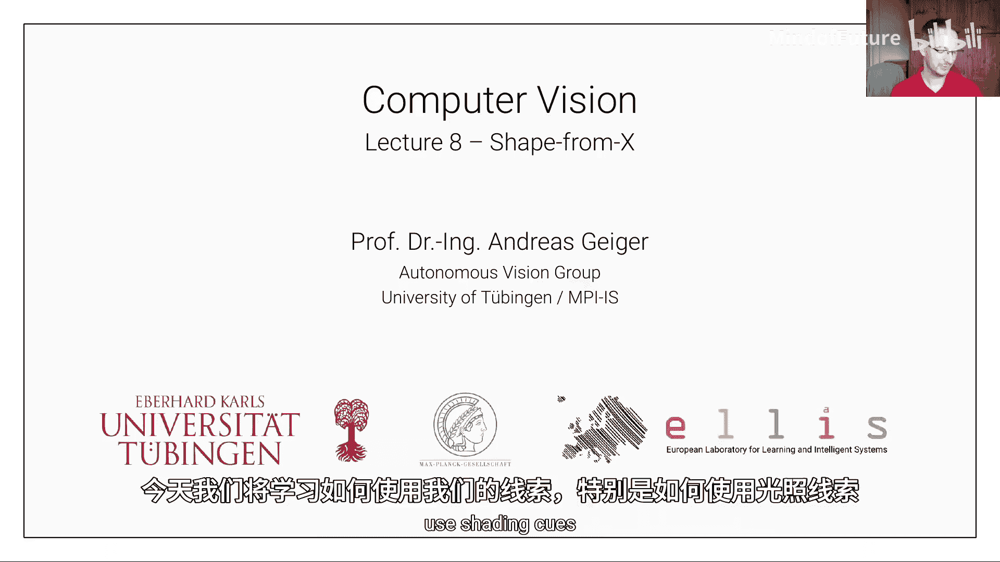
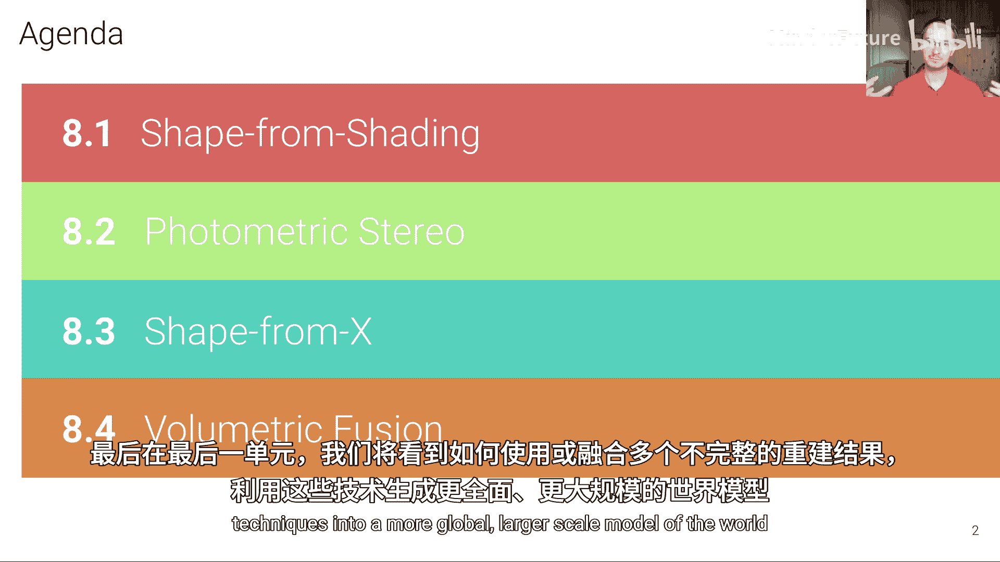
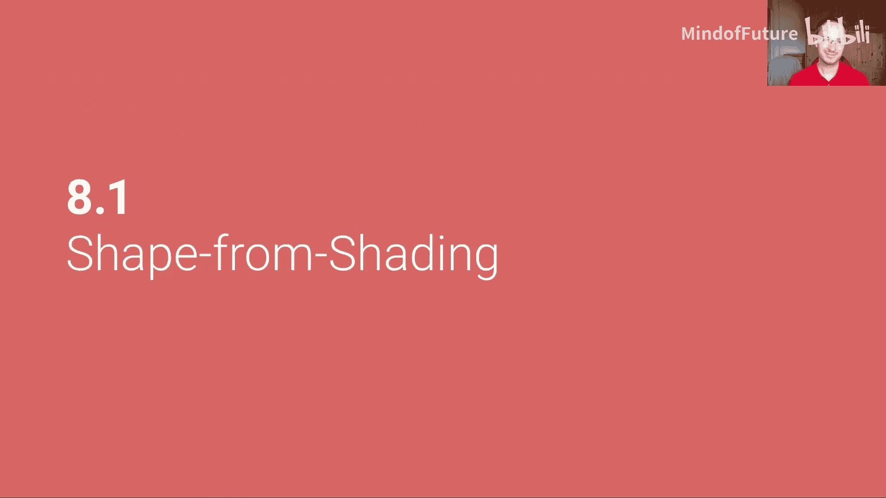
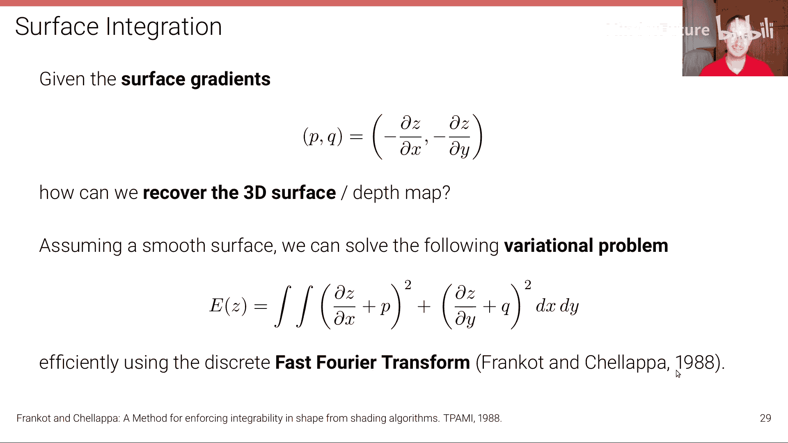
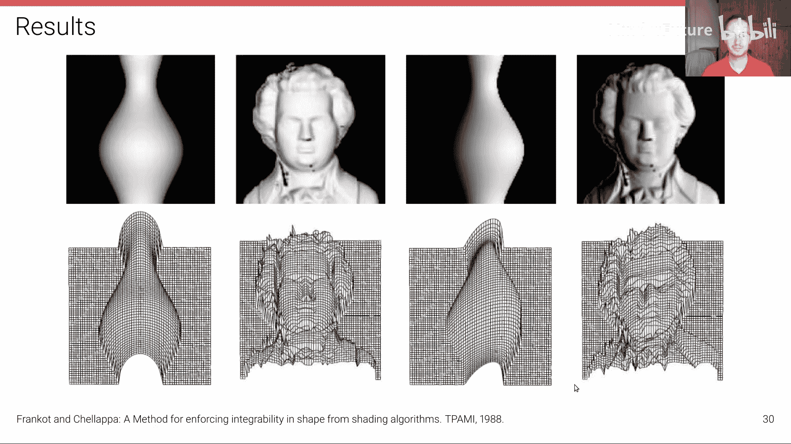
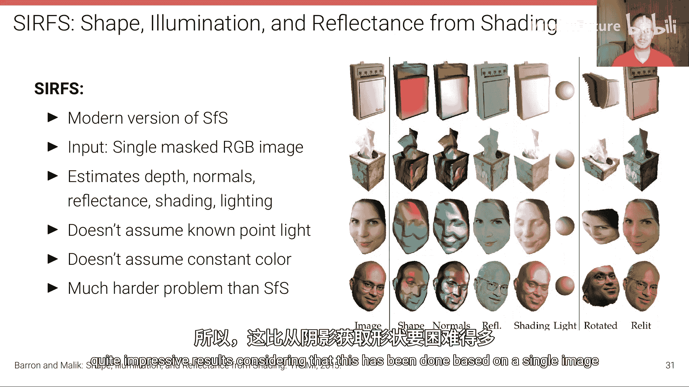
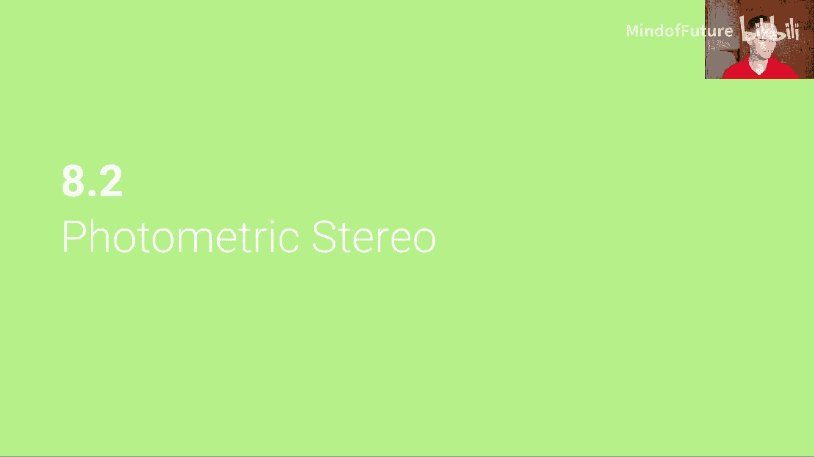

# 【图宾根大学 • 中英】计算机视觉 ML-4360 (Computer Vision) p28 P28 Lecture 8.1 (Shape-from-X - Shape-from-Shading) -BV1S8N1emEef_p28-

Hello and welcome to Computer Vision Lec number 8。Today's topic is shape from X。

 which means reconstructing 3D geometry from images。In previous lectures。

 we've already learned about two techniques。1 was。Binocular stereo reconstructing from two images using stereo matching techniques。

 finding correspondences across two images， and we've also seen a multi view reconstruction approach。

And today we are going to learn how to use upper cues as well， in particular。

 how to use shading cues。

This lecture is divided into four units。In the first unit， we're going to discuss shape from shading。

 a technique that allows to reconstruct 3D information even from a single image。In the second unit。

 we're going to cover a photometric stereo， which is a generalization of shape from shading。

 if you will。To multiple observations。Where the camera is kept fixed。

 but we are illuminating the scenes with different light source。

 with different illumination conditions。In the third unit。

 we're covering an overview of shape from X techniques including shape from shading。

 photometric stereo， binocular stereo， but also other techniques that exist。And then finally。

 in the last unit， we're going to see how we can use。Or how we canfuse？

Multiple incomplete reconstructions that have been obtained using those techniques into a more global。

 larger scale model of the world。

So let's start with unit number one， shape from shading。

The main question that we're going to cover in this unit is。

 can we actually recover shape from just a single image by looking at the shading cues？

What does shad mean， well， shading means the relative intensity。

That I observe when I look at an image。In other words。

 we want to recover or we want to uncover the question。

 what is the relation between intensity and shape， is there any relation between the intensity that I observe in this image？

Say that the image is brighter here and darker here。Or in this case。

 this pixel is brighter than this pixel， let's say。

Does this tell us anything about shape can we recover shape from this information by making appropriate assumptions。

 you will see that we need actually very strong assumptions。Intuitively， it should be possible right。

 if we humans look at an image like this， well we recognize the object。

 but even if we don't know the object， this is a pretty generic object here on the left。

By just observing the shading cues。We have an idea about where the light is probably located。

And what the shape of that object is。However。In general， this is a very hard problem in particular。

 if we look at this problem trying to solve it from a single image and this is well covered by。

This famous Adelsons and Pentland's workshop Meafer。嗯。Which illustrates that。

Solving this inverse problem。And coveringing the 3D geometry from just the 2D RGB image is very challenging because the space of shapes。

 paint， and light that exactly reproduce particular image is vast。So for example， in this case here。

This is actually this workshop Me from Adelson and Penduance's paper。

That has often been used to illustrate the problem in this example here。This image is observed。

 this is a 2D pixel matrix that we observe here on the left。

 and on the right are multiple explanations that could have given rise to exactly this configuration of pixels。

So this image。A very likely corresponds to something like this。

 a wall that sticks out from the floor。That has different paint in different areas， but also because。

This piece of the wall is oriented differently from this and this piece of the wall。

The color or the intensity of this piece is darker than the other two pieces。

This is one possible explanation， but there is other explanations it could be that。

What we look at here as an image is simply。A painting。

 we have taken a photograph of a painting that shows us exactly that set of pixel configurations。

It could also be that there was a sculptor。That has sculpted a。A set of objects like this。

If illuminated from the right angle， also give rise to exactly this image。

And it could have also been created by just a special configuration of light sources that illuminate these nine patches exactly with the right intensity。

 but the actual object is flat。So what we're looking for is a simple explanation。

And priors that we can use in order to recover the most likely 3D geometry。Given。This image。

Here's another example。HowAnd that illustrates how humans perceive。3D from a single image。Yeah。

Many people that look at this image probably tell， well。I see， a。A little hill here。

A little mountain with a little crater on top。Now， what one would expect is if I take that image and turn it upside down。

We would see that。Little mountain hanging from the top with also a little crater inside sight。

But if I do that。Actually， something interesting happens。So what？Most humans perceive。

 if I look at this image， is that now we don't have a mountain。

 but we have a big crater with a little mountain inside。A big crater with a little hill inside。

It's not what we would have expected， a hill hanging from the top with a little crater inside。

 but it's actually a big crater with a little hill inside。Why is that well？

It is because also we as humans。By our experiences that we have。Otained through our lifetime。

Make certain assumptions about the configuration of the world， and in this case。

 we assume for instance， that the light source is always coming from above。

And this makes this particular explanation that we see here that we perceive as humans。More likely。这。

Okay， so far for the motivation。Now let's try to solve this problem。

And in order to solve this problem， we have to remember again。

 the image formation process from lecture number two， so let's recap the rendering equation。

This is a slide that we have already seen before in lecture number two。

And it is the rendering equation。Let P denote a 3D surface point and V the viewing direction and let S be the incoming light direction。

 so here we have a camera， this is a view direction。

 we have an incoming light ray that gets reflected at this surface point with this normal here so we have this little patch here。

It gets reflected at this little patch。Into the viewing direction。

You can imagine that this is a little patch that's located on a bigger surface。Now。

 the rendering equation describes how much of this light。😊，L in。

 that's the intensity of the light with a certain wavelength lada arriving at this point P is reflected into the viewing direction B。

And this is the for it。 if this light， if this point is also emitting light。

 we have also an emitting。A term that's responsible for the emitting light。

 but typically we don't consider this here。So we just left with this right hand side of the equation。

 which is the integral over the upper hemisphere。Over the BRDF。

 which is the bidirectional reflectance distribution function that defines how light is reflected at an opaque surface at this particular point here。

 so it's defined at that point for a particular incoming and outgoing light direction and a particular wavelength。

Times， well the strength of the incoming light times。And the normal。Transpose times the。Incoming。

Light direction， which is modeling the foreshortening effect if the light comes directly。

At a very flat angle。Then the intensity is very low， but if the light comes directly from above。

 the intensity is high， so more light is reflected。At a particular fixed surface area。

And so we're integrating this over the entire hemisphere here。

 so this overall all possible incoming light directions because there could not just be one point light source。

 but there could be many light sources， in fact in the real world we typically model an environment map because the light comes a little bit from everywhere because it's not just coming directly from the sun but it's reflected by the atmosphere and by other objects until it reaches。

As a particular surface， and then eventually the camera。

This is the most general form of the rendering equation。

 Now what we're going to do now is we're going to try to simplify it successively by making certain assumptions。

About the world。In order to arrive at a much simpler equation。

That we can then apply to this shape from shading problem in order to infer geometry from。

The shading cues of a single image。Typical PDfs have diffuse and specular components we've already learned about this。

 where diffuse components getalide uniformly in all directions。

And this leads to the shading variations that we see。

 this leads to the shading variations of the sphere and the face that we've seen in the motivational part in the beginning。

The specular component， in contrast， strongly depends。嗯。On the outgoing light direction。

So there is a strong dependency here， it's not uniformly scattering。

 but it depends it's going like the strongest effect is in the perfect mirror direction。

And so here are three examples， typically we observe a combined effect because materials are both diffuse and specular。

 but there are materials that are purely diffuse and there are materials that are purely specular。

 so here are two examples。On the left is a clay pot。That's。

Mostly diffuse because it has a very rough surface。

 So whenever light hits the surface it gets scattered。Into all directions。

And this is the type of objects that we are going to consider。

 this is the simple type of materials that we're going to consider in the shape from shading formulation。

On the other extreme are completely。Are mirroring surfaces。That like a mirror。And here's an example。

 this is the so called cloud gate。If you have been in Chicago， you have probably seen this。

 it's in a millennial park。And it's art installation from Kapur from 2006。And quite impressive。

So back to our rendering equation。What we're going to do first is we're going to drop the dependency on lumpda that's typically done because we we don't observe。

The N has spectrum of light， but we have a sensor that already integrates over a certain spectrum。

So we don't consider the entire spectrum anymore， so we're dropping the dependency on the wavelength Lada here。

And also P， just for notational simplicity， of course， we are going to consider surface points。

But we're just going to make the notation simpler and then what we're also going to do is we're going to consider a single point light source that's located in direction S。

嗯。And if we do that。😊，Then the rendering equation simplifies drastically。 So first of all。

 we don't have an emitting surface， so this term vanishes。And as you can see。

 the lambda and the P have been omitted here from this equation。And also。嗯。Well， actually。

 this this L in turn should also depend on S still。

But what has happened here is that the integral has vanished because we are not。

 we don't have to integrate over the entire sphere anymore because we know there's just one single point light source。

 there's no environment map， light is just coming from one particular direction。

So you can think of this as in terms of a distribution as a direct delta。And therefore。

 the integral goes away and we can simply write this equation here。

 where s is now the direction of this one point light source that we assume。

So we're going to assume now also that the images that we consider have been captured with a single point light source。

Everything else is dark。The object is placed in a dark room。

 and there's just one point light source that illuminates the scene。

So this is also illustrated here at the bottom on the left we have the hemisphere on the right。

 I have removed it to illustrate that we don't integrate over S anymore。

 but we just have a consider a single point light source。Now， the next thing that we're going to do。

 as I already indicated， is to assume a diffuse， a purely diffused material。

Where the albedo is now called。Row， so the BRDF is a constant。

This this constant row is called the albedo。But the PRRDF does not depend on S and V anymore。

All right。So instead of this expression here， we simply have replaced now the BD F with a constant。

Row， which is the albedo。Because it doesn't depend on the incoming and the outgoing lie direction anymore。

Because we assume a diffuse material， and in fact we assume this material。

 or we will assume for the algorithm to work this material to be the same everywhere in the image or everywhere on the target object。

 like in the case of the clay port， which just consists of one material。

So we end up with this equation here， which is again simpler than this equation。

And the last thing that we're going to do is we're going to eliminate the minus sign here by simply changing the definition of the。

light source direction， as you can see here， the arrow points from the light source towards P and I've just reversed that arrow。

And if I do that。Then the minus here goes away and of course。

 you can see that this is true because this term here must always be positive， right。

 if n and S coincide， these are both。The same unit vector。

 then the effect or the light that's transferred。By add that surface point is maximal。And if。

S is autogonal to an。So in that case， that term would be  one， but if s is autogonal to n。

 so we goes in that direction here， then this term is 0。

And so the outgoing light will be zero no matter what the incoming light and the albedo are。No。

We end up with this expression here。Buthi just。Under all these assumptions that we made。

The Laberian assumption， the diffuse material。And the single point light source gives us a much simpler expression than what we had to deal with before。

嗯。So what we've seen is that for a fixed material and light source。

 the reflected light L out is a function of the normal。

So we can consider this expression here as a function of the normal because we assume a fixed light source that is known we have calibrated it。

We know where it is located。And also here we assume a known albedo or the albedo can be actually absorbed in the image intensity。

 so it doesn't matter。So really what this term depends on is just the surface orientation。

The outgoing light strength。Is a function of。En the surface normal。And this function。

Which we now have named R of N is called the reflectance map。 That's why it's called R of N。

 This is called the reflectance map。And we will see examples of this note that R of n depends on。

Or is a function on the normal space， not on the image space。

 the function on the space of all possible unit vectors n。Now。

 if we would know n at each surface point。We can integrate the geometry afterwards。

 so our goal is to determine N。And from N， we can actually recover the depth or the geometry。

 we can't directly relate the geometry or the depth to the intensity。But instead。

 the intensity is related to the normal， which is the gradient of the depth。Now。

 how can we determine n from the observation L out， that's the question。

 can we do this for every pixel in the image and this problem is called the Shape from Shading problemble。

 and it has been introduced to the community by Bradholdtonhn in the 1970s。

So let's move on to the shape from shading technique。Before discussing the technique。

 we have to reccapulate the assumptions that we do。The assumptions that we make about the world。

 The first assumption we have seen already， we assume a diffuse material。

With spatially constant albedo。So not only must the material be diffused。

 but it must also be the same material everywhere in the scene， like in the case of the clay pot。

This is a pretty strong assumption。But if you make this assumption then the number of material parameters reduces to one。

We have only a single parameter that describes the material properties。off。The entire object。

If we would be spatially varying， then we would have one parameter per pixel。

 and if we would be spatially varying and not diffuse but a BRDF。

 we would have many parameters depending on the parameterization of the BRDF。Per pixel。

But now here we assume there's just one single parameter for the entire。Image or entire scene。

The second assumption that we make is that the point light source that we consider is at infinity。

 or it's at least sufficiently far away that we can consider it to be equivalent to infinity。

The reason why we do this is that if we assume this。

 then the light direction S is constant across all the pixels。

 if it would be very close to the object， then depending on the pixel that observe。

 the light orientation would change。But we assume the light source is far away so that the orientation。

 no matter where I am in the image or on the surface of the object。For the same normal is the same。

And this makes us independent of the geometry or depth。

So this is a simplifying assumption that we make， but it's it's not super strong because。

At least in laboratory setting we can often put the light source sufficiently far away from the object and if we consider real scenes we will see examples later on where we consider the sunlight then the sun is of course very far away compared to the objects that we are looking at。

 so the light rays can be considered pro。The third assumption that we do is similar for the camera。

 we assume the camera also to be at infinity， which corresponds to an autoographic projection。

And this in turn keeps the few direction V here， the left one here on the left side。

 the blue one here。Constant across all pixels。So similar to the light direction S。

 now the view direction B is also constant across all pixels。And therefore。

 V becomes independent of the geometry and depth as well。

If the camera would be very close to the scene。Depending on the surface point I would look at。第一。

The definition of the normal， the oriented relative orientation of the normal with respect to that observation ray would change。

But in order for our algorithm to work， at least a simple algorithm that has been introduced in the early 70s。

We just abstract away from this problem by assuming an autoographic camera where the。

The rays that enter the sensor plane are assumed to be parallelable。

There is extensions of this problem to the perspective case and to close point light sources and to non diffuse materials。

But。These are significantly harder problems， so we are focusing on this simple problem now to start with。

The first thing that we have to address is， how should we actually parameterize the normal N？

A unit normal N lives in a three dimensional space， it lives actually on a sphere。

 a three dimensional sphere。So it has only two degrees of freedom。

Can be represented by two degrees of freedom。So it's not ideal to represent the normal using free coordinates and therefore。

What we're going to do is we're going to use the so called gradient space representation。

The gradient space representation。Parametizes the normal N by the negative gradients of the depth map。

So instead of。Specifying the normal directly， we specify the gradients of the depth map。そっこ？

So let's call the depth C， this is the。I can imagine here a camera on top that looks at this scene。

From the top and C is the depth direction。Or the inverse depth direction depends on how you define it。

But C goes into or goes along the principal axis of the camera。

And so we define P and Q as the negative gradients of the depth map， and if we do that。

 then the surface normal n at pixel X Y is given by p Q1。Transpo。嗯。

And in order to obtain a unit normal， the normalizes to one。

We divide by the magnitude of this vector， which is p squared plusq squared plus 1。

And the square root of that expression。Let's look at a simple example， so here we just have a。

A 2D visualization， so we have the X and the C plane。

And we have a surface here that has a gradient of minus2。

And if so we have just the x and the C coordinate if we。Look at P in this case， so P would be minus2。

Minus minus2， so two， we have two， and then we have the one here。And we normalize that vector。

 and as you can see， this is the correct。This is actually the anized vector here on black。

 this is2 and one。But this is the correct normal that corresponds to this gradient。

So there's the relationship between the gradient or the negative gradients of the depth map。

And the normal， if I give you。The gradients of the depth map。

 you can tell me the normal by applying this equation here。And similarly， if you give me a normal。

 I can convert it into the P and Q values。Now， assuming this representation。And assuming。

Albedo times the incoming light strength to be1。which we can do because we can just factor that into the image intensity into the observations。

 this is an unknown that we can globally adjust afterwards， so we don't need to take care of this。

Here。Then the reflectance becomes simply， so this r of n is simply n transpose S。 Let's look at D。

Equation from before we have r of n equals this expression times entrance pose S。

 so now we are just left with entrance pose S if we assume this to be1 or to be absorbed into r so you can think of this as r divided by this constant here。

And if we write this in our gradient space representation， then， of course。

 multiplying this vector with the。Incoming light vector S， where the components are denoted Sx， S Y。

 and S。We have PSx plus QsY plus Sc over the normalization of this term。

 we don't need to normalize over the S vector because we have assumed it to be normalized。the。

Mectctor that goes into the direction of the light source is assumed to be one。

The magnitude of that vector is assumed to be one。And so as you can see。

 instead of writing a reflectance map in terms of the normal space。

 the three dimensional normal space， we can write the reflectance map instead in terms of the two dimensional PQ gradient space。

So this expression here is in terms of the normal and this， we have converted it into expression。

That depends on P and Q。And now we have exactly the two degrees of freedom。That we want。

Here's another visualization of this gradient space in gray。So we've given this coordinate system X。

 Y， and C。If we cut the Xy， or if we cut the C xs。And c equals 1， so we put a plane。That is。

Co planer with the XY plane。And that's located at c equals 1， this is this gray plane here。

 this is exactly the gradientd space。P and Q。And if we take now。A 3D point， peak Q and1。

Whi is the intersection of the normal or the extension of the normal with that plane。

 so we extend this normal until it hits that plane。Until it intersects that plane at c equal 1。

 and that's the point that we call p Q1。Where P& Q is the gradient space representation。

Then we can of course， again obtain the unit normal by simply normalizing P Q and1 by its magnitude。

So this is the relationship between the PQ space。And the normal。So， for any。Any normal that is not。

Lying exactly in the X Y plane we'll find and that's not。That doesn't have a negative C component。

We can find that intersection with the PQ plane with this gradient space plane。

And we can determine that point PQ1。Ded。The normals that have a negative C direction。

Are not important for us for this purpose because there would not be any light reflected from them。

However， the normals that lie inside the X Y plane where the reflected value is0 pose a problem or normals that are very close to that because they are。

Close to infinitely far away from the origin of the PU plane。

 and we're going to see how we can deal with this problem。Okay。Similarly to。

Normal P&Q is a normal representation， we can also represent， of course。

 the light source in this PQ gradient space。So the gradient space can also be used to represent the light source in a similar manner by considering a。

ANmalized or the unit vector that goes into the direction of the light source， which we call S。

And we're extending that and intersecting that with the PQ plane。And this gives us。

What we call PS QS1 to distinguish it from the normal。

 we have added an index S here to indicate that this is the vector corresponds to the light source。

Now for given the question that we want to answer here is that for a given light ray S and observed reflectance R。

What is the normal N？This is what we want to solve for using this representation。And。

There is a very nice and elegant visualization of this when we look at this particular。

Graph here on the right。So what we have here。Is the expression for the reflectance R。

 which is the normal transpo times S。Which is equivalent because these two are unit vectors to the cosine of the enclosing angle。

Fta。A theta is the angle between n and S。Now， if you consider a particular。Vectctor S for particular。

Light。Sour。That points into the direction of a particular light source。

And we fix R to a particular value。Then what that means is that。嗯。

The space of all or all possible normals。Must lie。At an angle theta at the same angle theta from that vector S。

So what we have here is that all possible surface normals that are at that angle theta such that entrance pose s equals r or a cosine of theta is equal to R。

Or in other words， theta is the aus cosine of R。嗯。Are located on or pointing in the direction of a circle right a circle around。

The vector S。Such that all the vectors， all the black vectors， which are normal vectors here。

Are are at an angle。Fitita。嗯。That lies between S and the respective normal。

 So what we are doing here is we are effectively spanning a cone。

And now we are extending this cone like we did with the normal before。

What we're extending now for all possible normals， so we're extending the entire cone to intersect with the PQ gradient space。

 and this is what I've drawn here in purple。And so we can see that。The space of solutions。

Where the reflectance is taking a particular value。

 it's a so called ISOreance Contour because it's the same value everywhere。

So the space of possible normals in the PQ representation lies on a con section。Or in this case。

 here， an ellipse。Okay。So any point on that ellipse or equivalently any if I normalize that to a normal。

To a unit normal vector， any normal that。Lice on that circle here。Is a solution。

To the shape from shading problem for that particular pixel。

The set of solutions N is located on a circle around S。So it's not unique。

And projecting this set to the C equals one plane yields this con section， right？It's also。

Intuitive why we don't have a unique solution here。Because we just have a single observation。

 a single intensity that we observe。But there is two unknowns。Right， so it's。

It's relatively clear that we have to end up with a set of solutions。

 There's no way we can solve the shape from shading problem。拜。

Just looking at a single intensity and making no other assumptions。

 even having assumed a lumberian scene， etc。So there's one exception to this。At r equals 1。0。

Where all these were basically the。Normal has to face the direction of the light source where basically all the ellipses shrink to a single point。

 this is indicated here by this orange point here， except for this point。

 the normals consistent with the reflectance that we observe at this pixel are not unique。

You can see that they are only unique， there's only one solution for this。Single location here。

But in all other cases， for all other reflectance values， and in practice。

 of course we also have noise， sensor noise， etc to deal with。For all other cases， we have。

A set of solutions。It lies on a curve。Ls on an eyesop brightness con， that's a con section。

There's another special case， which is the case where。

The normal multiplied with the vector S equals 0。In this case。Conic section degenerates to a line。

So we have。This。Spectrum from a line to a single point。W are these conic sections here。

Because the normals consistent with R are not unique。

We require further constraints to solve this problem。And there's。

Two solutions to it that we are going to both talk about today。

 the first solution is the shape from shading problem there should actually be an S shape from shading。

Where we add？Additional regularization， for example。

 smoothness constraints like in the case of optical flow。

 and the other solution is to add simply more observations。

 and this problem is called photometric stereo。Before we now continue with the shape from shading problem。

Let's look at this problem that we have hinted to before already where。嗯。What happens if the normal？

That we want to estimate。Becomesocgonal to the viewing direction。In this case。

 we can find a point in this PQ space。The point will be infinitely far away。

So all the normals that are very close to being autogonal with the viewing direction are problematic。

But there is a simple trick to solve this problem， we're going to change the representation。

And this is called the streographic mapping。That has been used， for example。

 in this paper here by a cu and horn numerical shaped from shading and occlusion boundaries。

And the idea is actually quite old idea is rather simple。We changed the representation。Such that。

We bound the area。In this gradient space representation to a particular area， in this case。

 to an area that is smaller than one。How do they do this？Well， instead of。

Taking the normal and intersecting that normal with the PQ plane。

Is we are going to take a line that starts at。0ero is0 and minus1。Here at this point。

 C equals minus1。And it goes through this。Normal hat， the point where the normal。Points2。

And we are going to intersect that red line now with this C equal1 plane and because we have changed representation。

 we're going to call this the Fg plane instead of the PQ plane so you can see that。

The location of this point has changed from here to here。It has come closer to the center。

And there is a mathematical， a mathematical relationship that holds for this。

 which is a simple expression thats shown here on the left that can be derived by considering equal triangles here。

And solving for F and G。Now， compared to before R depends on F and G now。

 So we have a reflectance of R that depends on F and G， which in turn are。Fs of x and y。 Remember。

 we are we are working in the normal space here， but of course， we have an F and a G。

For every pixel location， X Y。Often we ignore these dependencies just for notational simplicity。

 but let's just keep in mind that these dependencies are there and F and G are in this stereographicically mapped gradient space in this normal space。

And X Y is the image domain。So this is not the image domain。Here we can see why we bound the。

set of possible solutions now， well this is the case because the normals。

 the most extreme normals are autogonal to the viewing direction。

 so they lie on this equator of this sphere here and if we take this point at minus1，And we。

Draw a line through the equator， you see that we end up at a circle here on the FG plane。

That has a radius of two right so this circle here would have a radius of one if we would autographically project it onto that plane。

But we do a prospective projection and so this。Circle has a radius of two。

But now in contrast to before we bound， so it's much better behaved and that's the representation that we're going to work with。

So now we finally come to the shape from shading formulation。

The assumption that we're going to make is that the image ir raradiance。Or the intensity。

 we're going to consider it to be equal here， abstracting away from all the measurement process。

 just saying that the irradiance is the same as the intensity that we measure。

The voltage that comes out at every pixel of the sensor plane。Should be equal to the reflectance map。

We want this intensity that we measure to be the same as the reflected light。Therefore。

 shape from shading minimizes。A error term。Let's call that the image error term of the reconstruction error term。

That depends on F andG， these are the quantities， these are the gradient fields that we want to optimize that corresponds to the normal。

 if we have found FNG， then we have found the normals。And this is the integral。

 if we consider the continuous domain here， this is the integral。Over the spatial domain。

And what we' are going to subtract is。你。Observed intensity。And to reflectance。

That is a result of a particular F and G at x and y。

 and so we're minimizing this in in the squared sense。

So this penalizes errors between the image of radiance and the reflect map we want both of them to be the same。

However， as we have seen before already， this problem is highly ill pose。

 there is many solutions f andG that give rise to an R。That is equal to I。

Because there is more unknowns than we have observations。To constrain this ill post problem fervor。

Shaped from shading therefore exploits two additional constraints。The first constraint is。

A simple smoothness constraint， as we have already seen it in the case of optical flow。

We call this additional energy term E smooth that also depends on FNGA。

And simply penalizes the magnitude， the squared。Grads。Of both F and G in x and y direction。

In other words， the goal is to penalize rapid changes in the surface gradients FNG。

Weum that the surface is rather smooth。If you think about the clay pot， for example。

You have a rubber smooth surface almost everywhere。And the second。Constraint that we introduce。

To make this。Soolvable is so called occluing boundary constraints。

We assume that the object that we observe in the image has been segmented。

 and we know the segmentation boundary， it could have been segmented because there is an instant segmentation algorithm that figures out the segmentation of that object or because the human has drawn the segmentation manually。

So let's assume we have segmented the object。And we have this camera looking at the object。

 so we know the boundary of the object。What we know is that at the boundary。

The surface normal must lie in。In a plane that is autogonal to the viewing direction。Otherwise。

 it wouldn't be an olu boundary， we assume that the surface is smooth and at some point it reaches。

A 90 degree orientation。嗯。So it's directly becoming parallel。To the viewing direction。

Such that the object ends at this point。So this normal here must lie in the plane that is autogonal to the viewing direction。

And the upper constraint that we have is that this normal must also be autogonal to the direction of the edge。

 which we can compute by looking at the variation of the edge in the image domain。So in other words。

 what we have is we have at these particular pixels at the boundary of the object。We know the normal。

 We know that the normal must be。The cross product。Between the E vector， the H。

End the viewing direction。It must be autogonal to both of them。

 so it must be the cross product of them。So the goal here is to constrain the normals at occlu boundaries where they are known。

Now with these two constraints， the smoothness constraints that applied everywhere in the image。

Everywhere in the image on the object and the occluding boundaries that are applied at the boundaries。

Of the object。We can now solve the problem。So in summary we optimize a variational energy。

 it's a variational energy here because we still use this continuous formulation。

E of F and G that comprises this image and this smoothness term weighted by some weighting factoro Lada。

 with respect to the gradient fields F and G subject to the occluding boundary constraints。

Here's some remarks as images are spatially discrete。

Similar to the Hannsung optical flow formulation， this problem is of course in practice when we implement it on a computer also transferred to a spatially discrete problem the way this is transferred is very similar to what we have discussed in lecture6。

So everything becomes just a discrete counterpart of this continuous formulation。Furthermore。

 similar to optical flow， iterative optimization is required as R depends nonlinearly on F and G。

And eyes required in this。Image term here。Furthermore。

 we use the known normals at the occluding boundaries to fix f and g on the occluding boundaries and we initialize all the other variables to0。

So we initialize them to zero and start the iterative optimization there until the object or the normal map emerges until it converges。

And then we take this converged normal map and transfer it into a geometry， as we'll discuss next。

If you want to know more about this technique， I can highly recommend a recent。

Meidedia lecture on this topic from the University of Columbia。Okay。

 so we have discussed how we can using this。Additional constraints and using all the assumptions that we have made。

Converts。A intensity image into a normal map。But how can we now go from the normal map to the actual geometry？

Remember that the normal map or the gradients， how we represent them here in example in the P&q space。

 which we can of course obtain again from the F and G space。Is simply the surface gradients。

So we have the gradients of the surface that we're actually interested in。

 we don't have directly the surface we have。We have only access to the gradients。Now。

 how can we recover the3D surface or the depth map from this gradients？Well， the best way to do that。

Is。Also assuming a smooth surface that doesn't have any jumps。To solve a variational problem。

Where we integrate。Over the image domain。And we are computing。嗯。These two terms here。

 which is the so this is the gradient of the surface of the depth map with respect to x。

And we add P here because。P is the negative surface gradient。So effectively， we are subtracting it。

And these two must be the same。And we're doing the same here on the right hand side for the gradient of the depth map in y direction。

Again， plus Q because it's the negative surface gradient and we want to make we want to obtain we optimizing for a depth map C such that its gradients。

Are consistent with the gradients that we have inferd。

 with the P and Q values that we have inferred using the shape from shading algorithm。

And this variational problem can be solved very efficiently using the discrete fast Fourier transform。

And more details about this are described in this paper here from Franco and Shelapa from 1988。

Now， let's look at some results。 So here on the top， we can see。The input image and at the bottom。

 the respective to reconstruction。After converting the gradient field into a。Dep map or a mesh。

 you can see that we can actually recognize。Something from that mesh we can recognize the shape。

 but you can also see that depending on where the light source is located you introduce certain biases into the reconstruction。

 so it's a very difficult problem。

More modern versions of shape from shading consider generalizations of the problem。

Trying to relax some of the assumptions that we have made。So for example， in serfs， shape。

 eumination and reflectionance from shading， which is work from B Malik from 2015。

The input was assumed to be also a single masked RGB image as in the case of shape from shading。

But instead of just estimating in the normals and assuming a known point light source and a constant。

alpeddo。What they do in this paper is they estimate the depth， the normals， the reflectance。

 the shading and the lighting， trying to disentangle all of these components。

 which of course is a much harder problem compared to assuming a single known point light source because now there is much more ambiguities to be resolved。

For example， between the environment map。The light map。

That is unknown and the appearance of the object， so it's a much harder problem than shape from shading。

 but as you can see here， to some extent， reasonable results can be obtained despite the fact that the reflectance。

Doesn't capture pure color and there is some color left in the shading。And also that of course。

 it's a very difficult problem even very for objects of very similar materials such that the is noise in the depth maps and the normal maps。

 but still quite impressive results considering that。

This has been done based on a single image only as input。

Yeah。

