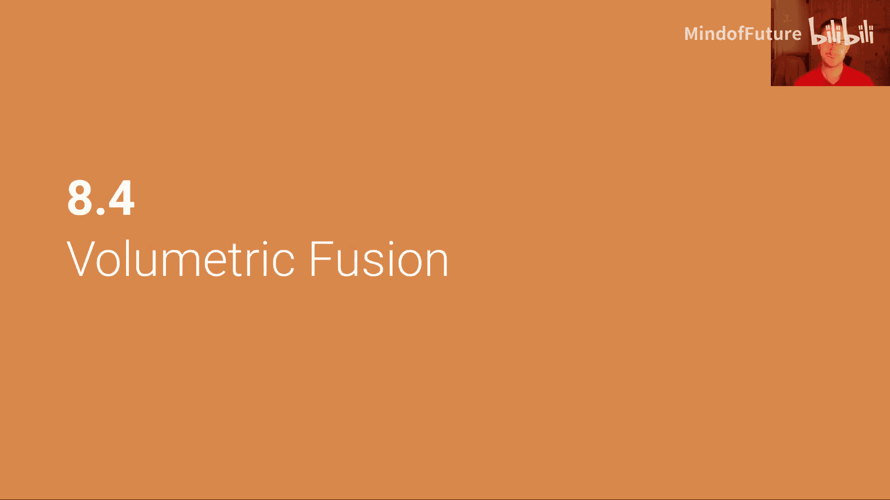
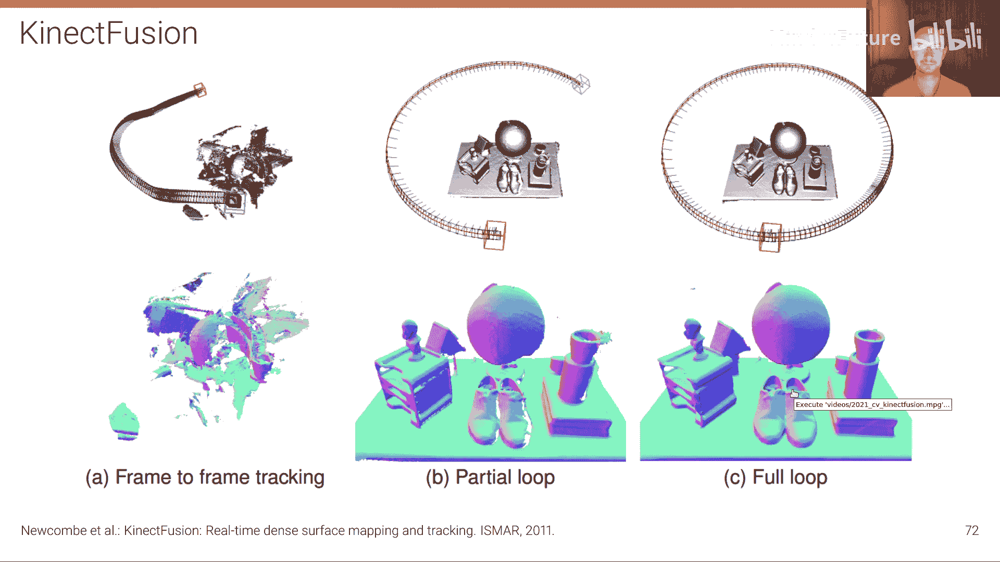
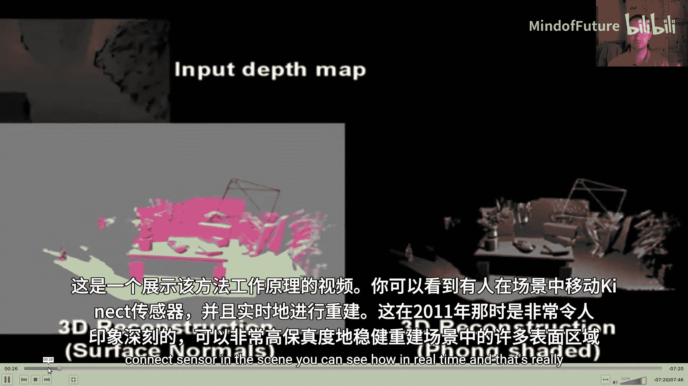
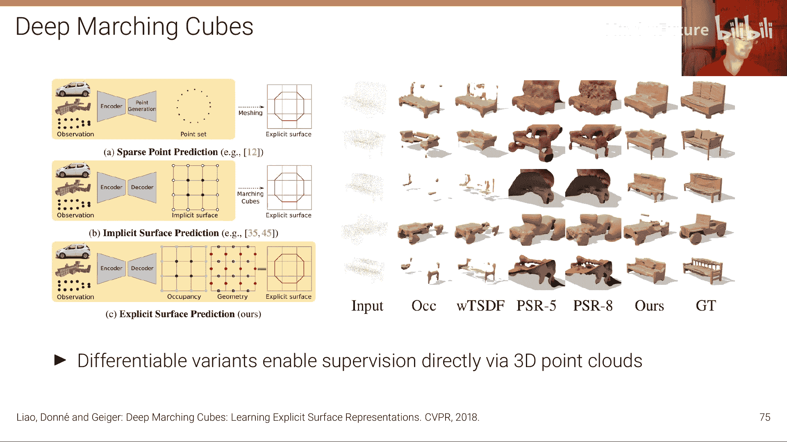

# 【图宾根大学 • 中英】计算机视觉 ML-4360 (Computer Vision) p31 P31 Lecture 8.4 (Shape-from-X - Volumetric Fusion) -BV1S8N1emEef_p31-

We have seen many techniques to reconstruct geometry from image inputs。

But most of these reconstructions only considered a particular object or even just produced a single depth map。

And often when we want to do reconstruction， we want to reconstruct entire scenes。

 we want to reconstruct larger scenes， scenes that are composed of multiple objects。

And then the question。Becomes relevant how to combine these individual reconstructions into one big。

A consistent3 d reconstruction of the entire scene。

And one technique that is very popular in this area and used a lot also due to its simplicity is called volumeot fusion and。

What we're going to look at now。

Here's an overview of a traditional 3D reconstruction pipeline the input is a set of images。

We first estimate the camera poses and we have seen techniques for doing so like structure for motion。

 bundle adjustment。From this。Estimated camera pose and images we can then compute dense correspondences using binocular or multious stereo techniques or monocular or active or shape from shading techniques or techniques that combine all of these。

Aspects and one intermediate representation that might be the outcome of such a calculation might be a depth map for each of the reference images。

That we have。And now depth mapfusion is about taking all of these depth maps。

And combining them into one consistent 3D reconstruction as shown here on the left。

So let's look at how this works。And in order to。嗯。Understand how it works。

 we first have to understand the representation that it uses。Which is。Not an explicit representation。

 but rather an implicit representation of this shape。Here we see a mesh based representation。

 this is a shaped in this case is a circle that is discretized into a set of vertices and edges。

 can see the different vertices here enumerated。And the set of edges。

 which indicates that there is an edge from one to two， two to three，3 to4。

 and if we would do this in 3D， this would of course be a set of vertices and a set of faces。

But here， simplicity， we illustrate everything intuitive2D。

So this is an explicit representation that stores a de geometry in terms of verticies and faces。

 but it's not an ideal representation， while it has been used for fusion。

 it's not an ideal representation for fusion。And it's very hard to change topology with that representation。

What we're going to do instead is we're going to look at it。Implicit representation。

The simplest implicit representation is a simple parametric form。For example， we can represent a。

A circle as a level set of this parabola here， we have a function f of xy。

 which is x squared plus y squared minus r squared。And of course， if you set that equal to0。

We arrive at an equation for a circle。So we have implicitly defined the surface。

The shape as the level set of such a function。Now in the next lecture。

 we're going to actually talk about such implicit models more。

In the context of representing these functions using neural networks， but this is a rough recent。

Line of work and so we're first going to focus on what has been done in the past in the last 20 years。

Which is a discrete。A discretization of this implicit space。And in particular。

 we're going to look at socalled sine distance functions that measure distances from the center of each of these vs that we're looking at here or pixels in this 2D example。

 to the actual surface， the closest distance。So we are discretizing the space as such。

Using a resolution as it suits us depending on the memory and compute that we have available to us。

And then we insert。At each of these vs or pixels， will insert a value。

We set the value of that pixel voxel to as the distance to the closest surface。 So in this case。

 the value of this。Boxel here might be 2。5 because it's 2。5 units。 The center is 2。

5 units away from the closest surface point， or here we might have。

Mus3 because it's three units away， and we have a minus3 here because it's a signine distance。

 So we indicate with a positive sign that this box is inside the object and with a negative sign that the。

Box is outside the object。For example， here we have an voxel that's outside the object。

 but it's closer to the object than this one here， so we set the value as minus 0。6。

 which is roughly distance here。In some formulations you will see the signs flipped。

 that is arbitrary that's up to definition， we can of course also define the inside to be the negative distances and the outside to be the positive distances。

 but it's important that we define a sine distance so we know what is inside and what is outside。

So this is the discrete sign distance。Function， representation。

That stars assign distance to the closest surface at each and every walkel in this representation。

And the surface is hence also represented similar to the continuous case as the level set of this discrete highest representation where we have to interpolate now in order to actually find the surface as we will see。

A crucial advantage of implicit models is that they allow for representing arbitrary topology。

They allow for representing topology changes。For example， in this case here。

 if you look at this scene and you take this slice， this red slice through that scene。

 and that slice in x Y。Coords is represented here， you can see that there is some pixels in that slice。

Where the。Function value， the SDF value is smaller than some threshold or smaller than0。

 and there is some。Areas where it's larger than zero。

And this by just changing the corresponding voxels， you can change topology。

 you can switch this object off， you can remove this object。

And by just turning all these values to be positive， so it will merge into the background。

 you can create a new object here by taking these positive values and turning them negative and an object will appear so the topology the number。

Of connections between surfaces， so to say is changing depending on the implicit representation is it can be changed in an easy manner。

 it's much harder to change a mesh because you have to connect vertices。嗯。

Differently if you change topology， but here you just have to turn change the value of the SDF value of the voxels。

Here's an example with different topologies， so here we have a topology with holes。

 here we have a simple topology。And。I want to show you a video， this is a newer work that we did。

 but it nicely illustrates how such implicit models allow for changing topologies you can see here now we have genus0 changing to genus 1。

2，3，4， adding more and more holes over the time of the optimization of this implicit representation and it's no problem at all for this representation to do this。

To change top policy to add holes， to add object， to remove objects， etc。Okay。

So given this representation， what do we do？Plometricriccutsion typically has three steps。

At least if we assume depth mapps as input。The first step is to convert the depth map to this。

Discrete signine distance field， sign distance function representation that we've just seen。

The second step is to actually perform the volume fusion。

And the third step is to extract a mesh from the fused signine distance field。

 from this implicit model， so we convert。An explicit representation to an implicit one。

 we do the fusion in the implicit space， and then we convert it back to an explicit representation。

Let's start with the first part， depth to SDF conversion。Unfortunately。

 the problem is not as easy as I've illustrated before。

 because the true distance to the surface is often unknown。

 What we often only know is the depth of the surface at for a particular ray along a particular ray。

 so for example， for this surface here we know that the surface intersects that ray here。

 but we don't know what is the closest point on the surface， and therefore。

What SDF fusion methods often do is they assume。And depending on the complexity of geometry。

 this is a better or worse assumption they assume that this distance to the surface can be approximated with the distance along the ray。

So here we have the distance along the ray， this is not the distance to the surface right the distance to the surface here might be 0。

5， but the distance is slightly larger because we are measuring distance to the intersection along the ray from the voxel center。

 so for each voxel center we measure now distances along the ray and we consider the voxels that intersect a particular ray。

Yeah。So for this ray we consider all these voxels that intersect。

 we take the voxel center and measure distances to the intersection along the ray because that's something that we have easy access to。

And it's a good approximation， for example， in the vicinity of the surface。If be。

 if you would consider， for instance， this voxel here and there would be another object here。

 then of course the distance to this object would be much smaller than the distance to this object。

But because we often only fuse， we assume that the reconstruction is pretty good already and we fuse in the vicinity of the surface。

 and we don't consider distance values that are far away。

 but just do the actual computation close to the surface。Yeah。

 so these are the two distances for these two vels。

 and we just enter them here as a signine distance。 So we have， for example。

 a negative sign to indicate that we have。A voxel that's in front of the surface and a positive sign to indicate that the voxel is behind the surface。

And then this voxel here is further away from the intersection than this voxel。

 but it's a little bit closer than this voxel， etc。So we can， we can now。For a particular viewpoint。

Considering all the rays of that particular view， fill this。

Discrete sign distance field representation。We have many rays。

 three of them are only illustrated here， but of course we have one ray per pixel。

 so it's very densely capturing the space。And in between we can interpolate if there is no ray intersecting with a voxel。

 in fact， in an implementation we would implement it reversely。

 we would basically take all the voxels and project them into the image and look where at which pixel they would fall and take the depth value of that。

Deef map at that pixel。But just for illustration here， we walk along race。

So we have this for the red camera， we have this for the blue camera。

 and we get these two discretized SDF representations， one for the red camera。

 one for the blue camera。This was a bo。Db to SDF conversion。

Now let's see how we do the actual volumetric fusion and to illustrate this on a more simple example。

 we look at the autograph case where the cameras。A autoographic look in the same direction。

 so all the arrays are parallel to each other， but really this is just for simplicity of illustration here。

 this algorithm works also for prospective cameras that are not oriented in the same way。

So what we do here effectively after this conversion into this discretized STF representation is to calculate the average of the discrete STF fields because this gives us。

An average of the implicit surface。So by doing the average on this。S the F values。

 we will also average the implicit surface that we afterwards extract。So let's look at an example。

So for example， we consider like this ray here and this ray and this ray。

 you can already see that here we have both a blue and a red ray here we just have a red ray because the camera and the blue camera doesn't see that that part of the scene。

And this are actually the blue and the red are actually the surfaces that have been observed by the red and blue camera。

 so for example here， if we fill in now I've just partially filled it in to not make it too complex。

But if we fill in the red SDF map， then we have 0。4 here because the surface is slightly behind this boundary。

 so this distance from the center to the voxal might be 0。4 and conversely might be 0。

6 here along this ray。And these values are negative and these are positive and they are red because they belong to the red camera。

Similarly here， we have blue values behind the surface。And in front of the surface， and for example。

 this value here is 0。1 because this。Intersection of that ray with that surface is just slightly in front of the voxel center。

And now here we have both a blue and red ray， so we have information for both。And you can see that。

 for instance， here， the red。While both the red and the blue values are positive。

 here we have negative red values and positive blue values because we are between these two surfaces。

And here we have negative values for both。And as already mentioned， what？

Bometric fusion does is simply to average these values。So we're going to replace。

well these values here are just occurring once because we just have two cameras here。

 of course in practice we have more and there will be more overlap but here we don't have more observations so the average will be the same value。

But here we take the average， for example， of 1。6 and 3。4， which is 2。5。

So we have instead of these values here， we have minus 2。5， minus1。5 minus 0。5， 0。5，1。52。5。

And we do the same averaging in the entire region of overlap。Actually。

 we do the averaging in the entire space in the entire domain。

But it just doesn't change anything if there's just a single observation。

And what you can see now is that， well， the surface intersection。

The zero level at the surface is actually intersecting this ray here here。No longer here or here。

 but in the middle。 So we have effectively also averaged the implicit surface。

 if we would now extract the implicit surface from。

If we would extract the surface explicitly from this implicit representation。Yeah。Yeah。

 so this is what the surface might look like。 you can see there is this。Well。

 this discontinuity here actually is not a continuous surface it because we have a discrete representation。

 but you can imagine this to be much finer and so it might look much closer to this。

 but we have this discontinuity here because，There is no averaging happening here because it's just seen by one camera。

 and then this part is seen by both cameras。And then this is the part that's seen only by the blue camera。

But the surface that we have in the end is a smooth surface。That。

Is this is a more smooth surface that is。An average between these blue and the red surface。

How do we do this mathematically， Well， it's simply a weighted average， so the。

Fused distance is the sum over I。Of。嗯。The weight I add voxel x， so this is a voxel。

Times the distance to sign distance。At that Vox X。Divided over the sum of all the weights at Voxel X。

 where I arranges over all the cameras or all the images。

And this expression here at the bottom is simply theffussed weight is the sum of all the weights。

Yeah this is actually the sum of the weights and this is a  fu distance。

 so we normalize by the sum of the weights。And we distinguish the fused。

Distance and individual distance with。The fewest distances， calling them。

Or using an upper case symbol and the individual distances of individual cameras。

 individual measurements as low case symbol。A nice property of the simple weighted averaging here is that this can be conveniently expressed with an incremental update rule。

Which we'll do as an exercise。And the advantage of this incremental update rule is now given a particular representation we can just add an image at a time using constant computational overhead。

 so we are not increasing computation a lot， we can just add range images at a time and fuse them into an existing reconstruction you can see here in this expression that DI+1 just depends on expressions from the previous image or time step。

嗯。Plus the currentren measurements。So it's a very simple incremental update rule and it supports reconstruction with thousands and tens of thousands of depth maps that are fused into one reconstruction。

Now what about these weights， we said it's a weighted average， why do we need weights？

Well there's two reasons why we want to have weights here on the left we can see well the signine distance。

And also two different weight profiles。And here on the right we can see the fused。Results。

The reason why we have these weights that are non constant is that on one hand， behind the surface。

 let's say we have the surface here， behind the surface， we want the weights to decay。

And the reason for this is。That all the values that are behind the surface are just speculation everything that's in front of the surface。

 we know it must be empty space because we have measured the depth。At the surface point。

So we know that everything in front is empty space， The weight can be high。

 We are assured that these distance values are correct。

 but behind the surface we are not sure still we need to have some for some distance behind the surface we have to have a positive weight otherwise we wouldn't keep a zero level set in our fused result so we need to propagate information。

 we need to propagate that we have a。AA positive values behind the surface for a certain distance。

 but then if we have very thin， it's kind of a trade off if we have very thin structures like a thin wall。

 we don't want to propagate this too much because if then the camera comes and looks at the object from the other side might see that actually。

The voxels that we have indicated as being inside the object are actually not inside。

 it's just a very thin。Structure。So this is a trade off that we have to。嗯。Play here。

The other reason why we want to have a weight profile is that we also want to have the opportunity to down less certain race for example。

 if an observation has been made from a very large distance and maybe。

The measurement noise increases with the distance， as in the case of stereo。

 it even increases quadraically。Or from a very slanid angle。

Or at the boundary of an object where we are not expecting the measurement to be very precise。

 if we have that information， we can integrate that。By just。Changing the weight。

The entire weight globally for that particular observation， So here we would have， for instance。

 W2 would be a more confident measurement than W1， which receives a overall smaller weight。

So it's good to have this weights in the formula。But why is this averaging in general or this weightded averaging in general a good idea。

 this is a formula from before。Well。It is a good idea because it's the solution to a simple weightedly square problem。

What we do here effectively is we're trying to find a surface。

D and this is just a long array that also holds true if we consider more general setup。

But this is just a long array。If we have multiple measurements of depth or distance along a array。

D I am。And this areed by WI。And we minimize we want to find the capital D that's closest to these Ds on average。

 weighted by this WI。Which is what we want to do。Weigh each of these measurements relative to the weight that we give it。

 and we want to find a D that averages this out。Then。

The solution to this weight least scarce problem is exactly this equation here。In other words。

 d is the optimal distance in the least square sense。玩过。Yeah this holds at every location X。

 I didn't include the location， the dependency on x here for simplicity， but of course。

This holds in general。No。We've seen。Well themetric fusion is nothing than weighted averaging in this sign distance。

And this discretized sign distance volume。How can we now from the results。

 which is also a discretized signine distance volume extractor mesh？

And the answer to this is the so called famous marching cubes algorithm that's used。

Everywhere in computer vision and computer graphics。It has been developed by cooles and Levo。In 1996。

And the idea is to simply take the discretized。Representation and try to come up with a triangular mesh that best approximates the zero level set。

And the way this is done is by marching， this is where the name comes from marching through all the grid cells can actually be done independently for all the grid cells。

And insert triangle faces whenever a sign change is detected。There's two steps。

 The first step is to estimate the topology。And the second step is to predict the vertex location。

So in this this is a 2D case here and here we have a 3D case in this 2D case。

 what does topology mean topology means where the triangle phase is inserted。It could， for instance。

 be that all of these notes here are read， all of them would be。

In front of the surface or behind the surface。Then there would be no triangangleular phase in this case。

 theres two two our。啊。Behind and two eye in front。And so this triangle surface this triangle of face just intersects both。

 but it could be that it intersects here or it intersects here or intersects here。

 and these are different what we call topologies。And in 2D， well。

 there's four of these voxel centers here that we dis course these dots here correspond。

 this is actually the dual grid， this corresponds to the voxel centers from the volumeotric fusion grid before at which we have estimated the。

Distance values。Design distance values。And if we have4。

 then we would have two to the power of four possible topologies in 2D。But in 3D space。

 we have eight because we have a cube。And so we have 256 possible topologies。This is the first step。

 figuring out the topology just by looking at which of these。

Vertices are actually larger and which are smaller than zero。

 and this directly maps one to one to a particular topology now we know。Where the triangle phase。

Should be located。But we don't know exactly where the vertices are。

So where should we locate the vertices？If we have signine distance values。

Then a reasonable thing to assume is that these vertices are at the zero crossing of a linear interpolation between these two。

 so if we take a line。And pass fruit is to values minus 0。5 and plus 0。5。Well that line intersects。

A0。This is the best possible vertex for the triangle phase。Because this is the zero level set。

so if we do this， if we set this to0， then we end up with this very simple equation here and。

If we have 0。5 and minus 0。5， then we have 0。5 over1， which is 0。5。

 so it's intuitive that the intersection should be exactly in the middle。

In contrast here on the right， we have 0。8 and minus 0。2。

 so this intersection is closer to here than to here。And so on。And so we get also in the 3D case。

 first the topology， and then from the actual values。The vertex location。

And we do this for all cells in our grid。And this gives us our mesh。

Here's an example of the different toppologies that we can observe in the 3D case。In fact。

 there is 256 different apologies， but they can be grouped into 15 equivalentvalence classes due to rotational symmetry and these are shown here。

Let's now look at some applications of。S the fuion。Of volumetric fusion。

Maybe the most popular one is called Kin fusion has been。Published by Newcombe All at Ismar。

A conference for Vision and Aed Real in 2011。And here is the overall system workflow。

 it's a real time post estimation and volumeotric fusion method。

Which uses the connect sensor that we've seen before。

 particularly the depth maps that are obtained from that sensor as input。

And it's doing real time post estimation using。A version of the iterative closest point algorithm。

And then updates the reconstruction using the SDR fusion techniques that we have seen in the previous slides。

And so what you can see is that if you track now frame by a frame。

 you get a more and more complete reconstruction， so here after having tracked a partial loop and reconstructed that。

 we get this reconstruction and then if you have the full loop， we get an even better reconstruction。

And here's。A video of how this works， you can see a person that's moving a disconnect sensor in the scene。

 you can see how in real time and that's really impressive I think at the time in 2011 particular。

Reconstructing at a quite high fidelity here。Many of the surface areas in the scene。Quite robustly。

Of course， in this case， the person had to be static because the system assumed the static scene had to stand still。

An extension of this work has been presented by the same。

Offers in CVPR 2015 that addressed exactly that problem that the scene is often not static。

 let's call dynamic fusion where。嗯。From the first frame。

 a canonical representation has been extracted and then with every live frame we can map between this canonical representation and a live frame。

 so for instance， if we take the canonical representation and map it to live frame。

 then this race would actually bend map from the frame to a canonical frame。And now this approach is。

Basically reconstructing non rigid scenes are able to reconstruct non Richard scenes by whopping the estimated geometry using a warp field that's also estimated on the flyer。

Into the live frame to update the representation。After whoping。

And to obtain a rigid and a consistent representation。And you can see here。The person is moving。

Is talking is moving the head。The camera is moving at the same time。

 yet the reconstruction that is obtained。Is quite stable。

Now this method works only for motions of a certain extent。

There have been a few followup works that extend this method to larger emotions than what is shown here。

嗯。This paper has created a lot of。A bus in the community and also won an award。

You can see the reconstruction。In the reference canonal representation。And this is never seen。

Here's one work that we did in our group。One problem with bometric fusion is that it assumes quite noisefree input。

 which is often not guaranteed depending on the type of sensor。

 and so it's beneficial to also integrate deep learning into the estimation process and that's what Onet fusion tries to do。

It's basically a。A 3D convolutional。Network that uses efficient data adaptive data structures。

In order to take as an input， features from the fusion process and outputs a dennoed and completed reconstruction。

So you can see here an example of volumetric fusion when noise is applied to the input。

There's observation noise and this is a simple variational fusion technique that doesn't do you learning and here at the bottom left you can see what happens if you train such a learning based model now on a large data set of 3D shapes that nowadays is often available。

And as you can see， it can eliminate a lot of the noise while still keeping details intact。そ。

In contrast here in the fusion technique， you can see that a lot of the due to the strong smoothness constraints that are required。

 a lot of the details are gone。And another line of work is。

Works that try to tackle the the learning problem end to end。 What we've seen so far is that。

At least the learning based approaches。That's。Let's say take a set of images and learn an implicit representation in a discretized voxal space。

 or also a point set representation had to have a separate meshing step， for example。

 parts on surface reconstruction。Or run marching cubes in order to arrive at an explicit surface so the supervision happens at the implicit representation。

 so we need to have a loss function defined on the implicit representation to back propagate。

Graadds to the parameters of， for example， the Onet fusion network and so in this work。

 this marching cubes algorithm that we have just。S has been a variant of this algorithm has been developed that is differentiable。

It's actually easy to see that the original variant or the original version of the marching cubes algorithm is non differentiable because of the topology changes。

 but here is a version here that is differentiable that combine these topology with the vertex location in a probabilistic manner in order to be able to then backproagate gradients end to end through the entire system to the parameters of the network and allows for training using not this auxiliary loss function on this implicit representation that has first to be obtained but can be directly trained using。

 for example， point clouds as supervision。That's all for today， Thanks a lot for。Watching。

