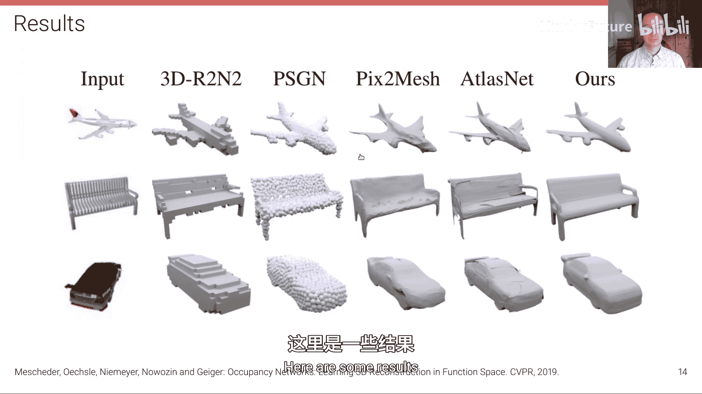
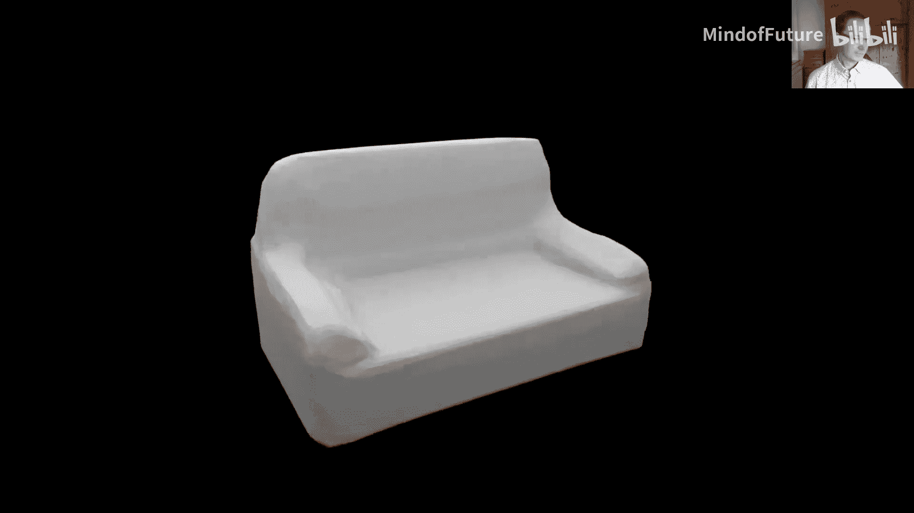
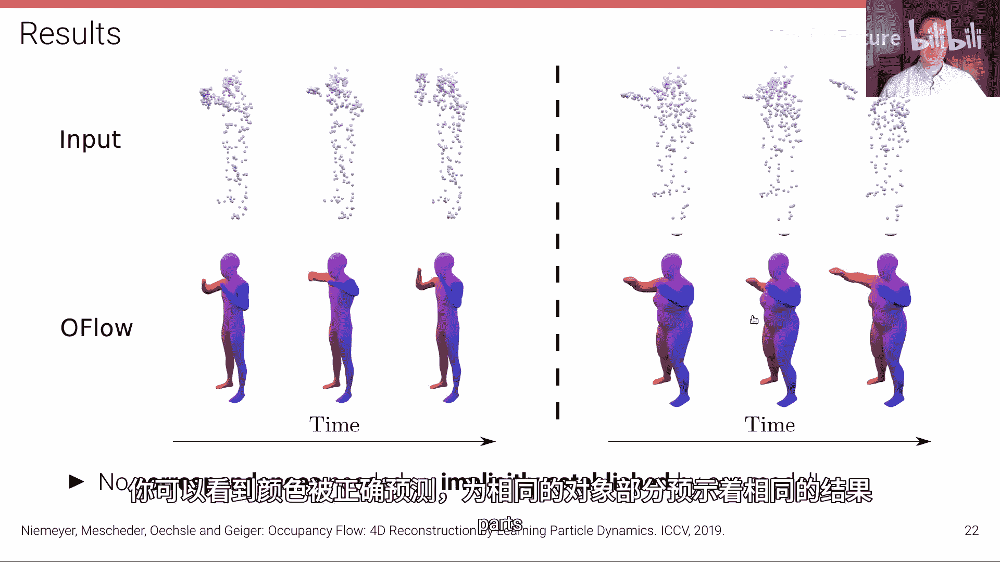
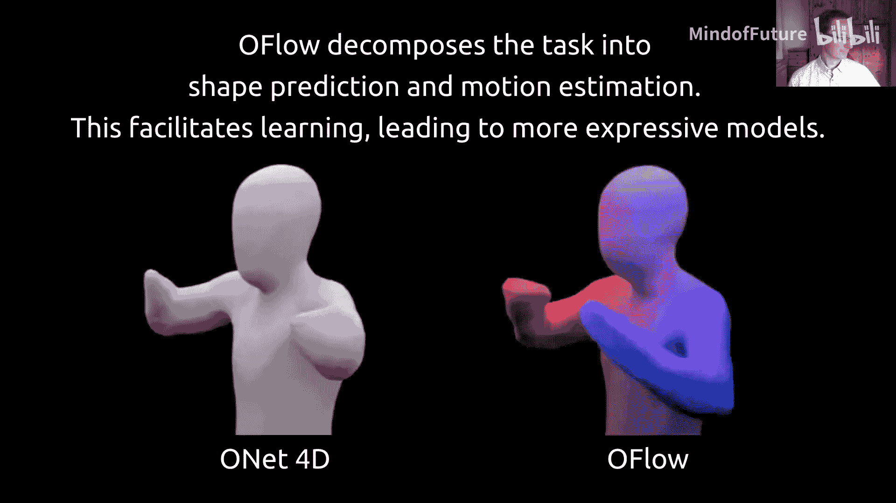
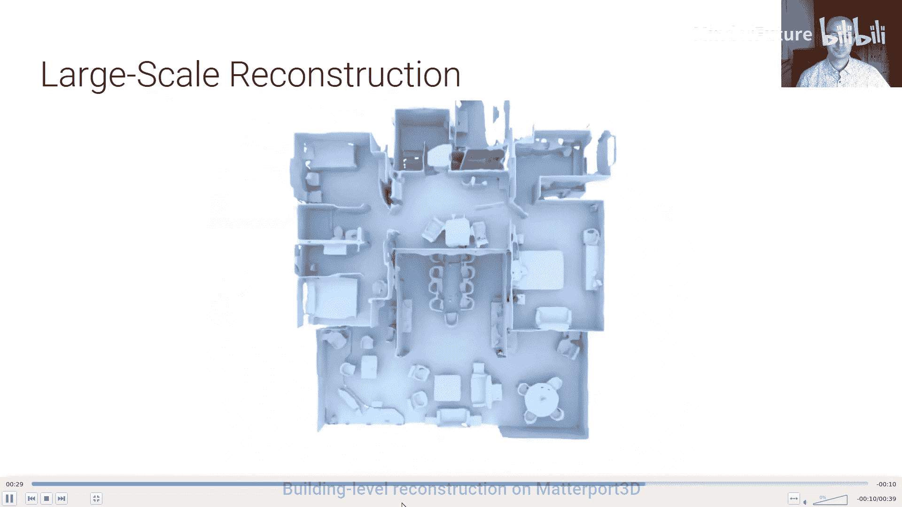

# 【图宾根大学 • 中英】计算机视觉 ML-4360 (Computer Vision) p32 P32 Lecture 9.1 (Coordinate-based Networks - Implicit Neural Representations) -BV1S8N1emEef_p32-

Hi and welcome to Computer Vision Lec number nine at the University of Tubingham。

This is a lecture that I have been looking forward to for a while。As it is about a topic。

 coordinate based neural networks or implicit shape representations。

That my group has worked a lot on， and in fact， we have proposed one of the first models。

In this area called occupancyup networks that has established an entire field and sparked。By now。

 within maybe one or two years already， more than 1，000 follow up works。This lecture is。

Subdivided into four units in the first unit we are going to cover basic implicit neural representations for shape。

Appearance and motion。In the second unit。We'll talk about differentiable volumeumt rendering。

 which allows for training these representations from images alone without requiring 3D supervisions。

In unit number three， we are going to cover neural radiance field or Nerf in short。

 a very popular method that also uses these implicit network ideas。

But with the primary goal of novel views synthesisis。And in unit number four。

 we're going to cover generative versions of these models that allow for building。

Representations of the worlds that we can sample from in 3D。

let's get started with implicit neural representations。This is a slide that I have shown you before。

 this is a traditional 3D reconstruction pipeline where the input is a set of images we infer the camera poses。

 for instance using bundle adjustment。Then we established dense correspondences。Stereo。

 binocular stereo， or multiverse stereo resulting in depth maps。

We are fusing these depth maps into a more coherent global 3D reconstruction of the scene。

Now this is all fine， but despite some parts of this pipeline might utilize learning。

 we haven't used learning extensively， and in particular we haven't answered the question if it's possible to directly go from just one or multiple images。

It's possible even from one image for a human to a complete 3D reconstruction of an object。

And that's the question that I want to start with， can we learn 3D reconstruction from data？

This is a heavily machine learning。Or data driven。P dime。嗯。Learning requires data。

 but luckily over the last 10 years or so a lot of 3D data sets have become publicly available。

 for example， through scanning techniques such as active lighting systems。

 active light scanning systems that we have discussed in the previous lecture。

Or this is another data set that has been scanned。And that has happened for both on the object level。

 as well as at the room level。Or data sets that are comprised of CAD models that have been designed by artists。

 and there's a lot of these CA models now available online。

Free for download and have been collected in the so called ShapeNet data set。

So there's a data set called Snet and there's a data set called Shapenet。

Scanner is a data that has a lot of 3D scans obtained with a scanner and shape it is a data set。

 It's a collection， a taxonomy of 3D cut models that can be used for。Um learning。

And then more recently， there's an example from the Mattport data set。

There also have been also attempt to not just reconstruct single rooms， but entire buildings。

 and this of course has a lot of immediate applications。嗯。

So can we make use of this data now if we want to build a model that learns to predict shapes directly from one or multiple input images。

 we have to of course answer what is a good output representation The input representation is pretty clear it could be in the simplest case just a single to the image。

That gets processed with a standard 2D convolutional networks as we have introduced it in the deep learning lecture。

So the input representation is a pixel matrix， and we have a 2D conin encoder here。

But what should be the decoder？And in particular， what is a good output representation？

There's a couple of output representations that people have considered。

 starting with this seminal work from Matranidal and IRS 2015 where they have looked at the most simple extension of pixel based representation。

Which is a voxel based representation， A voxel is a 3D equivalent of a pixel。

Basically so here has a this is the pixel version here on top。

 this is just always a 2D illustration to better see what this representation is like with free space。

 so it's inside， is gray and outside， free space is white and this is the actual 3D representation where we have these gray voxels that are filled solid。

 this is indicating what's inside and the free space that's outside you can see these voxels are 3D equivalentence。

 little cubes。Of 2D pixels。So it's a simple disctization。

 it's a discretization of the continuous 3D world that we live in or the 3D space that we want to reconstruct into a regular 3D grid。

As illustrated here， and it's easy to process with neural networks because we can apply the same convolutional neural networks that we have。

 just extend to 3D。Instead of 2D kernels， we have 3D kernels now。And of course。

 also the channel dimension， so effectively we would have4 d kernels。

And the problem with this representation or the major difficulty with this representation that we have also played with is even if you use very special data addive data structures such as Orcrees。

 you still suffer from very large memory growth which in the naive case is cubic but even with these special data structures is a problem。

 so this effectively limits the resolution of what we can output to something very blocky。

 maybe a little bit larger than this， this is very small resolution。

 but typically not exceeding 256 to the power of free voxels。Which is still pretty coarse。

 and you can still see the artifact。And then another downside of this representation is that it introduces an a Manhattan world bias。

 right， so you have this these voxels， they have to be oriented in some way because we are using these voxels as this most simple。

Primitives in our representation， and so we have to define the coordinate system that orients the voxels。

And that coordinate system introduces a bias。 So we always have。

We can model flat surface only in the。Canonical directions， but not。

45 degree oriented with respect to the canonical directions。Okay。

Another representation that has been used in the literature and has been popularized by Feedol CVPR 2017 is a point sets。

Points are a discretization of the surface into 3D points， so this is not a volumet representation。

 but that's directly a representation of the surface you can see a 2D example here and a 3D example here。

The difficulty of this representation is that it doesn't model connectivity or topology。

 we don't get a surface out。Of this representation immediately。

 but we have to extract it using a post processing algorithm such as personal surface reconstruction that is not directly taken into account when we train these models。

Furthermore， these models are typically limited in the number of points that they can represent。And。

They typically require a global shape description as input that also limits the flexibility of what these models can output。

And typically， this is possible only at the object level and not at the scene level。And then finally。

 in 2018 mesh based output representations became popular， meshes are very natural。

 they are used ubiquitously， for example， in computer graphics and games in movies。嗯。

And they are also discretizations， like point sets and voxels。

 but here they meshes discretize the 3D space into vertices and faces。

 so here we have a 2D visualization it's basically just a line segment and here we have a 3D version which is a mesh and that's actually an output of this method here called Atlasnet。

Now the problem that arises through this discretization here in the case of mehe is that measures are not very nice output representations to predict with a neural network due to their complicated structures。

 it's very simple to create self-ins and it's very hard for the network to learn to not produce selfinsecting surfaces。

As shown here。There's two primary paradigms， one is to predict little surface patches and stitch them together as Atlasna does。

 the other is if we know something about the shape that we want to represent。

 then we can build a class template， a class specific template， such as a mesh of a。

A human face or a human body or an animal body or whatever。

 so if we know what class we want to reconstruct， then we can utilize these templates and instead of predicting local surface patches that have this problem with nonwater tightness。

And self intersections， we。嗯。Then deform the vertices of this template。

 but of course this only works for well behaveved cases if we don't want to change topology。

 we don't want to create holes。And if we know already the class that we want to reconstruct。

 so it's limiting the applicability。And it's not as generic as the ever representations。Now。

 what we try to do in our CBPR 2019 work is to go away from these discretized representations。

And instead， represent the surface implicitly。And I will tell you in a second what that means the advantage of this is that this allows for representing arbitrary topology and in theory。

 at least that arbitrary resolution。Using a very low memory footprint。

And it's not restricted to any specific class template like in the mesh case。

So the key idea is to not represent the 3D shape explicitly。

 but instead to consider it or to consider more specifically to consider the surface。

Implicitly as the decision boundary of a nonlinear classifier。Here's a 2D example。

 in this case with a linear classifier， you can think of for example。

 a support vector machine or a linear neural network in practice。

 of course we're going to use linear neural networks。That。Tryries to separate two classes。

 the red points are the points inside the object。Which take occupancy value1。

And the blue points are outside the object， which take occupancy value zero。

And if we want to train a classification model。Or if we have trained a classification model and we can extract the decision boundary。

That most optimally separates inside from outside points。

And this decision boundary is what we consider the surface。So the surface is represented implicitly。

 represented implicitly by the parameters。Of this model。

And it's represented implicitly because it needs to be extracted in a post processing step because the only thing that we have is access to this classifier that separates inside from outside。

Here at the bottom， you can see a 3D example in this case with a nonlinear decision boundary。

You can see this object is a bench。And there is these red points that are sampled inside the bench and the blue points which are sampled outside the bench。

And we want to train a classifier that most optimally separates the blue from the red points。

And we do this by repeatedly sampling points from the volume for which we know if they are inside or outside。

 and we can sample points closer to the surface to become more precise， for example。

And then we're refining the weights of our neural network， of our classifier。

 such that the decision boundary becomes closer and closer to the decision boundary we like to have。

So of course， this requires full supervision 3D we require the ability。To for every surface。

 for every 3D point， to query if that point is inside or outside。The shape。

 so we require a watertight mesh in order to generate the ground truth。To repeat。

 instead of representing the3 shape explicitly， we consider the surface。

The surface of the object implicitly as the decision boundary of a nonlinear classifier。

 and we call a classifier， an occupancy network Ffita because it's a neural network with parameters fita。

There maps from a 3D location， this is just three coordinates， this is the point location。Plus。

 some condition that could be an encoding of an input image or a point cloud。

Representing the structure of the 3D shape that we want to model， so we need to。

 of course condition on something in order to be able to represent multiple different shapes。

So this is where the condition comes in。And the output of this neural network。

It's just an occupancy probability that's between0 and  one， right neural networks。

Can predict probabilities。By a simple sigmoid or a binary softm。Actation。If the network predicts one。

 then it's very likely that this point is a point that's inside the object。

 if you predicts zero it's very likely this point is outside the object。

And we want this classifier to be as confident for most of the points and as correct for most of the points as possible。

Some remarks。The function of Fita models and occupancy fields。

Here we have really a continuous space that we consider。 so this。Function here Model A。

It fields in a mathematical sense。And it's also possible to model not just the occupancy probability。

 but also design distance。As we've seen in the previous lecture design distance is useful， it allows。

 for example， to directly。Find the surface from a point close to the surface by just following the gradient。

For as long as the sine distance value as the magnitude of the signine distance value。

And this has also been proposed by related work。But the model is very similar， except that we。

Change the occupancy and probability output with a SDF output。In this。

 in the context of list lecture， however， we're going to stick with the simpler model。

 which is just predicting occupancies。か。Now， in order to implement this model。

 we need to define this neural network architecture F theta。So what we do here is。

A very simple multilay。 we use a very simple multilayer perceptron。

Which is a recceedual network composed of five blocks， this is a repetition。

Are five of these yellow blocks。Where we have an encoder here， this is another neural network。

 for example， a 2D convolutional network that takes an image or a point encoding network that takes a point set or a voxuxel 3D convolutional network。

And that produces a。Fixed length vector， which is the condition。

 let's say this is a 128 dimensional vector。And then this condition is injected at multiple locations。

Into this。Receual network using so called conditional patch normalization。

 but you can also do other conditioning techniques you can apply other things like。

Concatednating these vectors or adding these vectors， and all of them work to some degree。

And then the other thing that's the input to this recital network is a set of 3D points。

We not just only pass a single three point， but we pass directly a batch of tea in the order of 2。

000 points。Because it's of course more efficient to process more of these points in parallello。

 to process the entire batch in parallello。On the GPU。So we pass an entire batch of these points。

To this network， that's why they have a t times3 for X Y C dimensional input。

And the output is for each of these t points， the occupancy probability。It's a very simple model。

How do we train this model Well it's a simple classification task so we can train it with standard binary cross entropy。

And that's what we do， so for all of the K points we compute the binary course entropy between the model prediction for that point and the true occupancy。

 which is 01 for that particular point。And that's always given this input condition C。

This is the condition on the image。We can also build a variational occupancy encoder。

 and thats simply the variational auto encoder model that we have talked about in a deep learning lecture applied to this idea of implicit shape representations where we have now in addition to the reconstruction term。

 a KL term。A kback lipla divergence term between some prior and the encoder distribution Q psi。

 so we need another encoder that goes from the point set。To the latent code。Right。Okay。Now。

 because this is an implicit model， we don't get it mesh out directly。So we have to。

Extract the mesh from this implicit representation and how do we do this。

 we do this using a technique that we call multi resolution isour extraction in short mea， which。

It incrementally builds an Ouk tree by querying the occupancy network。So we started with a grid。

 let's say a4 by four grid。In practice， of course， we use a more fine grain grid。

 and we query the occupancy network。 This is， you should imagine this in 3D， but for purpose of。

Easy visualization I've plotted in 2D here。So we query these 3D locations on that grid and we observe that this point is inside the object and this point is outside the object given。

The object representation， given the parameterization of our neural network for that particular setting of parameters and input condition。

This is the shape， the boundary， the surface。Of the object， therefore， at this point。

Will result in a will be classified， positive and the other points will be classified negative。

Then we look at all the adjacent cells。That are adjacent to any point that's inside and points that are outside。

 that transition from points inside to points outside because the surface must lie inside these cells。

And we're subdividing this cell simply。And then we are querying these subdivided unknown locations。

And we find that these points here are inside and the other points are outside。

And we can repeat this process and times and get finer and finer until we reach level of graronnularity。

That we want。And in the end， we can run the margin cubes algorithm。

 as discussed in the last lecture to extract the surface。To extract a triangular mesh。

From this indicator grid。And the whole process requires about one to three seconds depending on the size of the scene。

 so it's not super fast， but it's not super slow ever。And the main。

Time requirement of this process is because we have to query this neural network many times。

 but we do it in a clever way， we don't do it naively and densely at the same resolution。

 but we do it close to the surface， we do it in this hierarchical course to find manner。

Here are some results。

This is Steve。Input to the image and on the right you see some baseline of vuxel based approach a point。

Sa generating network。A mesh generation network。And the output of our method。AMeshed to a 3D mesh。

 you can see that it。It's very simple for these implicit representations because we don't model the surface explicitly to hand la topologies and produce very nice and smooth surfaces。

Here you can see a different input condition， this is a point cloud。Shape reconstruction task。

 but the input is a sparse and noisy point cloud and the output is。A 3D shape。And on the left。

 the ground truth。And we can similarly apply this to a voxel super resolution task where the input is a coursear。

Voxel grid， and we are trying to do super resolution of this voxel grid。

 You can see the output of our methadone right。What we show here is a visualization of latent space interpolations of our generative model of this variational autoenr type model。

Wwhichch is able given a set of CAD models as input to generate shape。

 new shapes from the underlying shape distribution， and to interpolate between shapes。

 as you can see here。

Okay。So let's move on， This was all about shapes。Representing shapes。

 but can we also represent appearance with this type of implicit model idea。

 and it's actually quite straightforward to extend these ideas to color。

What we did in this work is called Learning impmplicit surface light fields that we published at 3DV in 2020。

Is。To try to model。View dependent appearance。By conditioning a neural network on an input image just as before。

 but also on some 3D geometry， that could be a cut model that represents this object in the image。

Or there could be a shape that's predicted using an occupancy network from that image。

And we show results for both cases。And what we want to do then is we want to train this model using。

Different few conditions such that afterwards we can only change the view pump。

 but we can also manipulate the illumination as you see here。

You can see that the shading and the shadows。That are on this object change depending on where the light source location is。

Here's。The rendering equation that we are familiar with。

We're not using the rendering equation directly， but we are modeling a conditional surface light field。

 so we're not modeling the material， the BODF， and we are assuming a point light source。

 which means that this integral here goes away。So what we do in is we model a function that maps from a 3D point location and a viewing direction V and a light location L。

 these are these three quantities。To a 3D color volume。

That's called a surface light field for every point on the surface。

Given any possible view direction and light direction。

 we want to know what the color is that this would produce when I render this into the image。

So here's an overview of the model， the image encoder is the same as before。

 we take an input image and encode this into a latent vector C。

 and then we have an input shape that's here in this case encoded using a geometry encoder into a global shape code S。

And then。We can take any point on the surface of this object。

And we query first an appearance field that gives us a feature vector for the appearance and then this lighting model that conditions also on the light setting and the view direction to produce the color of the pixel that this 3D point renders to。

And we're minimizing the reconstruction loss between this predicted image and the true image。

This is trained on a data set of chairs with materials that we render using physically based light transport。

Here are some results， this is with ground truth geometry as input。Here the input image on the right。

 you can see a 2D baseline that tries to transfer that learns to transfer the appearance of that 2D image to any render 2D image of the object。

And that doesn't work very well， of course。And it's not very consistent。

 but because we model directly in 3D， our results are much more consistent than in particular what you can see here is that it is capable of modeling specular highlights as well as also shadows。

And this also works with inferred geometry， so here's an input image。

 this is the geometry that has been inferred with an occupancy network。And then this is T。嗯。

The color。The view dependent color and elimination conditioned color that we produce this is all。

TheZ produced this output is entirely produced from a single 2D RGB image。

That that's quite remarkable that you can learn to produce such an output from this type of image。

 however this model has only been trained on chairs。

 so anything it cannot predict anything else than chairs and of course if you go to an object that's a little bit further from the data distribution from the distribution of chairs that have been seen during training。

It will not work very well。So this was about appearance。Can we also represent motion？

The naive way of representing 3D motion is to simply extend this idea of occupancy networks to 4D。

But unfortunately， this is hard due to the curse of dimensionality。

It is hard to represent a complicated4 function。And the shape evolving over time is a complicated 4D function because it's discontinuous at the surface boundary。

 So it's really hard to represent this in 4D。 And the additional difficulty is that there is much less。

Data sets。With gr of inside outside points with waterite meshes。Available for this type of 4D task。

 So we have less data。And we have a。A higher capacity model and a more difficult。嗯。

Optimization problem， which makes it very hard。Therefore。

 what we do instead is to represent the shape， only the shape at a particular time instance。

 let's say t equals0 without。Losing generality。Using a 3D occupancy network。

 so this is what we have done before already， and then we represent the motion by a temporary and spatially continuous vector field as illustrated here。

Now this is still a 4D function that we have to predict。

 but in contrast to the shape evolving over time， this is a much more continuous object because the spec field can be continuously over the entire duration of the sequence as illustrated here it's very continuous you can see this little errors are changing very continuously both in space and time and therefore it's much easier for the model to learn and we can use。

Lower capacity models。To accommodate the fact that we have less data available for training。

The relationship now between the 3D trajectory or 3D location S and the velocity is of course given by a simple ordinary differential equation which tells us well the gradient of the location is the velocity。

That's what we know from high school physics。Now because we have such a simple relationship as an ODE and because ODEs are differentiable。

 this has been popularized or repoopularized in a 2018 Europe's Best paper Award。

We can use this ODE inside our model and back propagate gradients for it。And this is the model。

So what we try to do is we try to give ground too shapes at discrete time instances。

For which we know inside and outside， we can take any point here。

And warp it through that OdeE that's predicted by the velocity field or that's conditioned on this velocity field or implied by this velocity field。

But itself is conditioned on the input。So we can work that point。To the location at time equals0。

 you can see how the space deforms in the background。And then。

We can try to make the occupancy network predict the。

Classic class label of that particular point correctly in this case， it's an insight。Object point。

 so you should make the occupancycc network predict one for this particular point。Now。

 this is all end to end learnable because the O D E is。It doesn't have any parameters。

 but it's differentiable so we can back propagate the gradients through this entire process to both。

The parameters Vita of the occupancy network and the parameters of the velocity network。Okay。

And the really nice thing about this is that which we don't need any correspondences which are typically required for such kind of tasks。

 but the correspondences are implicitly established by our model。And they are correct。

So here you can see some inputs。Some frames of the inputs。

This is a point cloud completion task and at the bottom you can see the output and you can see in color。

 which points correspond to which points and you can see that the color is correctly predicted the same for the same object parts。

Here's a little video。Again this is point cloud completion results。

 the input is a very sparse and noisy point cloud， and on the right you can see the result of this naive occupancy network in 4D and this occupancy flow model and you can see that it's much more expressive。

It does suffer much less from this course of dimensionality than the occupancy network 4D approach。

We've talked about representing shape， we've talked about representing appearance and motion。

 but all of these results that we've seen were on relatively small scale scenes in particular objects。

 single objects， reconstructing single objects， and so we're wondering well can we also。

Use this output representation as a representation to predict larger scale scenes。Entire rooms。

 let's say， or entire buildings， even like in the case of the Meport data set。

There is an important limitation of this implicit neural representations， as we have。

Seen them so far。There is actually two important limitations。

The first limitation is that what we have done so far is to predict a global latent code as input X。

That's the image or the point cloud or the V liquidgri gridd， and we have a 1 D encoder。

That predicts a fixed dimensional latent code。For that image。

 and that's the condition of the occupancy network of the MLP。These are the features。

NowThis is a let's say， 128 dimensional vectorome。And it's very difficult to represent。

The entire distribution of possible 3D scenes in such a vector。

 it's kind of possible to represent the distribution over objects because the shape variability is not as large but for scenes with multiple objects inside the。

嗯。Type of outputs that we can expect grow exponentially because theres any possible object at any possible location in any possible combination。

And that makes it really hard。So because there is no local information in this global code。

 this 128 dimensional vector has to represent the entire scene， it's very hard。And typically。

 it leads to very smooth geometry， as we'll see on the next slide。

The other limitation is that this architecture is very limited by its nature。

 it's a fully connected architecture。A fullyly connected network。That for example。

 doesn't exploit translation equis such as we exploit it。On a regular basis。

 when we deal with images in our convolutional neural networks。

And we know that this translation experience is crucial for modeling images or also 3D scenes with voxelgris。

 but this is not at all captured here in this type of model。

And this is what it looks like if we apply。😊，This implicit。Occupancy network。On well。

 still relatively simple， but。sceneins that are more complex than single objects on the right you see the ground truth on the left you see the prediction。

 this is a model that has been trained for a very long time。

 much longer than for the single object prediction tasks。

 and it's just not able to get the objects right。It actually gets the ground plane right because the ground plane is something that looks similar in all the scenes。

 but it doesn't get any of the objects close to， even close to what they actually should look like。

So what we are trying to do in this work that we published at ECCCV2020 called Convolutional Occupancy Network。

Is to。Combine the merits of both approach， implicit modeling and convolutional networks into one approach to remedy the two limitations that we've seen。

Previously。The task that we consider here is the point cloud based shape completion task。

And what we do is we first encode the 3D points。Locally using a pointed encoder。

 that we take all the points that are inside such a volume and project and encode those using a neural network that produces a feature for just those points at that location on the ground plane。

 let's say this is the ground plane here。And we do this for all the points on the ground plane。

 so we use a discrete structure on the ground that we establish。A disc pixel grid。

And then we compute features for each of these pixels on the ground plane based on the points that fall inside this tube。

And then we have a 2D convolutional network that runs on this image。

 this is now an image on the ground plane， it's a simple unit that aggregates features on that image and that exploits now equivaris。

And then we can query each of these features by doing biline interpolation of the features on the ground plane。

 So we if we want to query the occupancy state of that 3D point， we are querying。

These features by bilinely interpoolating them and inputting the bilinely interpolated features and the location。

To the occupancy network that predicts the class inside outside。Now。

 because we have already a lot of weights in this 2D unit。

 this occupancy network can be more shallow than before。

 so this readout network is much more shallow and we exploit。The convolutional property equivaris。

 so we have exploited locality by just looking at a local neighborhood and the convolutional equivariance property。

There's multiple ways of doing that， we can just project to a single plane。

 we can project to three canonical planes here， these are the planes aligned with the X。

 y and cxs of the coordinate system， and then we query all of these features as input condition to the occupancy network。

Or we can do it directly in a 3D volume where now we have to use a little bit of coarsaw representation of the volume compared to these planes here。

 which are 2D now here we have a 3D grid。Instead of maybe 128 by 128， we can just use 32 by 32 by 32。

But we use the same principle， we aggregate information just within local cells。

 so this is a cell center and we aggregate information from all the points that are surrounding that are fallinging inside that cell。

Locally， and then to query to obtain the features， we use trial linear interpolation of these features that have been computed using a 3D。

Unt architecture on that box look great。So we query these features now using trialline interpolation because we are in 3D。

 but then we do the same thing， we have a shallow occupancy network as a readout。

That predicts the class conditioned on this。Interpolated features， and we can do that， of course。

 for any continuous location in that volume。For a point that's in the vicinity。

 but still in the same cell， these features， of course will look different and that's what the network。

Both this network and this network， together because they are jointly trained。

 can exploit to learn robust scene shape representations。So here's the comparison again， this is the。

Naive occupancyccupancy network and at the bottom is the convolutional occupancy network that。

In contrast to this produces a。Localized feature representation that can be processed using a convolutional network。

And then we query the features using interpolation as input to this more shallow readout MLP。

In comparison to the occupancycc networks， this leads to much higher accuracy and also faster convergence。

 so we have here the input。For a point cloud reconstruction and。

AVoxel reconstruction task or voxel super resolution task This is the result for occupants and networks。

On this more complex shape categories， and this is the output of the convolution Occupants network that exploits locality and equivariance。

More importantly， this not only leads to better accuracy and faster。Convergence。

 but it also allows for representing scenes， where we have a comparison on synthetic rooms you can see compared to the naive Occupancy network。

 our reconstructioncons are much more precise。And even when training only on synthetic rooms。

 we can apply this model on real scans， so this is a model has been trained on synthetic rooms。

 but we have applied it then on real scans from a connect structured light sensor。

This is on the scanner dataset set。And the results， while not perfect， they look plausible。

 at least much more plausible than the results of the naive occupancyccupancy network。

And then finally， we can also take this model and extend it to a fully convolutional model。

And apply it to really big scenes like the Mattport data set。

 which contains scenes of entire buildings with multiple rooms。 and this doesn't fit in GPU memory。

 but because this model is fully convolutional， we can。

With overlapping receptive fields applied in sliding winter fashion in chunks。

 and we can train it also on these chunks， we can then。

ububequently process multiple or iteratively process multiple of these chunks in a sliding window fashion。

 just like a sliding window object detector。And produce very large scale reconstructions as shown here。

This is also illustrated here in this video。This is one example。Of the Meport3D reconstruction。

And this is another example from Mepod。