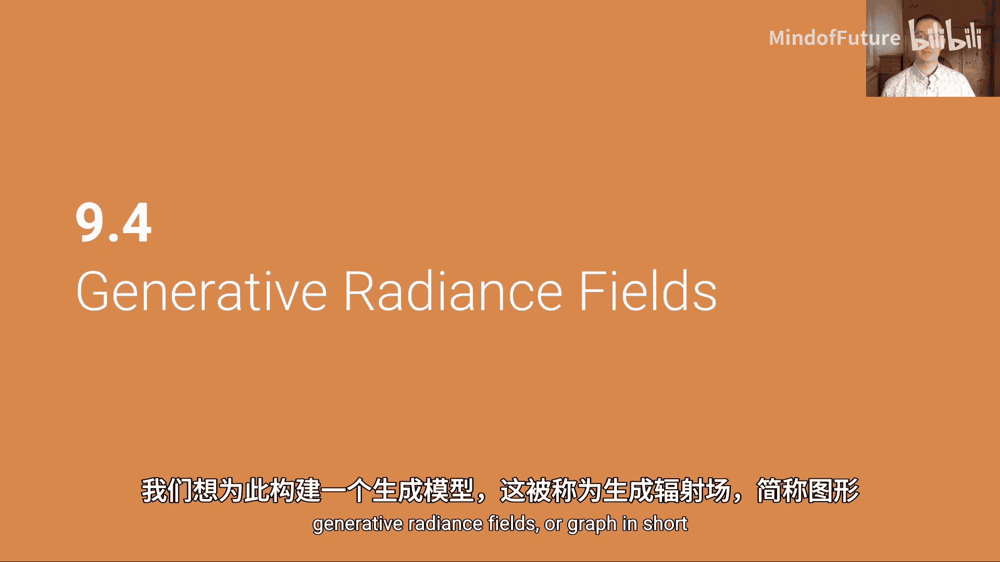
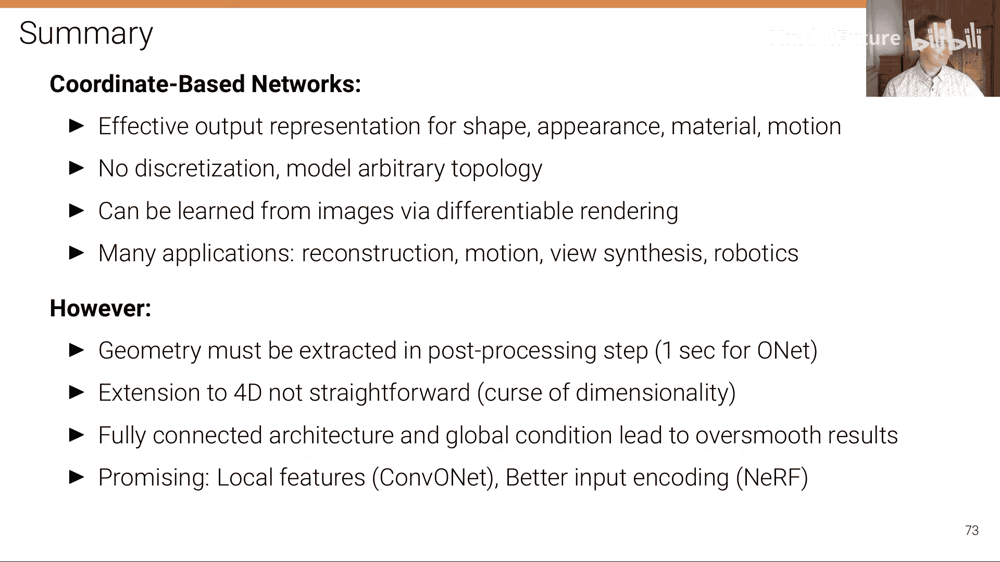

# 【图宾根大学 • 中英】计算机视觉 ML-4360 (Computer Vision) p35 P35 Lecture 9.4 (Coordinate-based Networks - Generative Radiance Fields) -BV1S8N1emEef_p35-

In this last unit， we're going to take the representation from the previous unit。

 the neural raddiance field。And try to build a general model for it。

Try to build a model that is capable of。Given just a collection of 2D image of a particular object category。

Builds a generatedative 3D model that can be rendered photorealistically into new images。

The difference to before is that Nerf has always been optimized for a particular scenes。

 given many viewpoints where the camera poses have been known。Now we don't assume any such thing。

 we just assume that there's a collection of images of objects， of a particular category。

 and we don't even know the camera pose。And we want to build a geneerrative model for this。

And this is what we call generative radiance fields or graph in short。

Before we start let's quickly recap generative adversarial networks。

 these are slides from the deep learning lecture that you should already be familiar with。

The termgenrative model refers to any model that takes a data set drawn from a data distribution P data and learns a probability distribution P model to represent that data distribution。

In some cases， the model estimates。P model explicitly and therefore allows for evaluating the approximate likelihood P model of x of a sample x。

But in other cases the model， in many cases this is not deable。

 so the model is only able to generate samples from P model。

And Gs are prominent examples of this family， this family is called family of implicit models。

 so you can see this is another occurrence of the term implicit but again in another context。

 but it fits the spirit of this lecture。So here， implicit means that the likelihood is not represented explicitly。

 but only implicitly。Yeah。So GANS provide a framework for training models without explicit likelihood。

And this is what we have seen in the last deep learning lecture。The prototypical diagram of agan。

 there is a latent code sampled from some noise distribution。

And so we get that latent code and we input that to some generator network that produces。

In the case that weve seen in the deep learning lecture， just a 2D image。

And then we have a discrimininate work that takes this image and tries to classify this。

What it sees is an input， X hat or x， which comes from the data distribution。

So these are the same networks here， that is a real image or if it's a real image or if it's coming from the generated distribution。

And we're training this model using this two player minim game paradigm with a value function specified as such。

And try the discriminator， try to optimize both the generator and the discriminator so the generator tries to produce images that are more and more realistic and the discriminator tries to distinguish them。

 and if the generator becomes better and better， then the discriminator has a hard time and ideally in the end will be completely uncertain will assign 0。

5 probability to all the samples。That's。Gans in a nutshell。

We have seen in the deep learning lecture that the theoretical analysis shows that this miniax game is specified here at the bottom。

Recovers。嗯。In some using some very， very strong assumptions。In particular。

 assuming that D star can be reached at each iteration recovers the data distribution as the model distribution。

 and also assuming that the model has of course enough capacity to represent the data distribution。

But in practice， reaching the star， the optim at ititeration is too slow and so we must use iterative numerical optimization。

And optimized in inner loop to completion is just not possible。

So we have typically an alternating optimization where we do one， two。

 three steps of optimizing D the inner loop and then one step of optimizing G。

Using a small enough learning rate。And this way we maintain D near its optimal solution as long as G changes slowly enough。

 which。In gradientding descent typically it does because we can't do very large step sizes anyways。

And we have seen this little 1D example here we have the data distribution in blue。

 the model distribution。At the initial iteration in orange。And the discriminator here in green。

And this is the noise distribution in red。And if we start optimizing， this is iteration 500。

 iteration 1000。20。2500 we see that the model distribution converges to the data distribution。

And the discriminator becomes more and more uncertain and close to。

 so here's the x for the discriminator probability close to 0。5 for all the samples。

Now let's take this idea and apply to radiance fields。

So we want to build a generalrative model for radiance fields， we want to sample a latent code。嗯。

That captures a 3D point location， a viewing direction。

And information about the shape and appearance of the object。As well， which is not shown here。

 as well as the camera pose。And then for that point， using the radiance field。

 we can predict the color。And the density， and then we can use volumet rendering to render the scene。

And we want to render the scene such that a discriminator applied on that scene， on that images。

 a 2D discriminator。Can distinguish between。嗯。Real。Images from the data set。

This is all trained just with 2D images。And the renderings from the model。

This is the idea behind graph generative models for radiant fields which has appeared at Newris。20。

20。And we train this from unstructured and unpost， unpost means we don't know the posts of the cameras to the image collections。

A particular challenge here is that we can directly apply a discriminator in 3D because we just have images as observation。

 so we really need to apply this volumemetric rendering which is slow and this is one of the contributions that this paper does is how to make this tractable。

So let's now step by step build up this model。嗯。We have a radiance field here that we know already that maps a 3D point x and a viewing direction D and this gamma here just is a positional encoding as for nerve。

 so we push these both to a positional encoding。And this maps it to a color and a density。

And then for that ray， we do this well we do this radiance field computation for multiple samples along that ray。

 so x changes， we have an index I here because we have multiple samples along the ray。

The direction is always the same。嗯。And so we evaluate this conditional。

 this radiance field is not yet conditional。This radiance field is nerve。

For all of these points along the array to get for all of these points， color and density。

 and then we apply volumeary rendering， which is abbreviated with pi here。

 but it's what we have discussed before， the standard alpha composition in order to render a pixel's color。

From this endpoint along the Ray， this is how。Nerf works。

Now what we add here is two additional latent codes。

 one is a shape lant code and one is an appearance lant code that are also sampled from some standard distributions。

Normal distributions。And that are responsible for modeling the condition of。Well。

 the rendered image on the shape and the appearance。Of the object。Now。

 because we can' render the entire image， which would be much time way too time consuming。

 what we do instead is we rendered just a few pixels in particular we take a patch。

This is shown here as a 5 by a5 patch in practice we use a 32 by a 32 patch。

 so we take a 2D image grid and the location and stride it to the size of this image grid。

Is sampled randomly。So only for those five by5 for 32 by 32 pixel locations， we do this process。

And that is。WhatWhat we have here with R so this plate here denotes that we do this r times。

 where r is， let's say 5 times 5， 25。Times we do this。K is the intrinsics。

Cs the x transnics does come from the。that was sampled also randomly here in this case。

 we assume the intrinsics are known， but you can also sample the intrinsics。

And this new parameter here is responsible for placing this sampling grid。

 this sparse grid on top of the。Image plane， which determines then where the rays are located that we sample from。

So it's very similar to N just that instead of sampling for all pixels in the image that we want to render。

 we sample just a few of them。And so we got this predictive patch here。And the sampling pattern。

Uhi changes the location and stride arbitrarily because at any scale and any location we want to produce a realistic patch。

But we just produce this patch， but because you have a 2D patch。

 we can apply a standard con now and this is very fast， so we apply a small confinant。

That is basically。Discriminating that predicted patch from a real patch that is sampled from real images。

 using the same pattern generator here we also have the new that generates the sparse pattern at a certain location of a certain stripe from this random distribution and we sample a random image from a data set and we get therefore a random patch。

So we compare these two with a 2D discriminator。And the 2D discriminator is a simple fall layer conant。

 So this is very simple。 Now we've reduced a problem because we don't need to render entire image。

But we just do sparse sampling of the image。And compare these very small patches。

 and this is fast enough。And takes little enough memory to be able to be trained。呃。

in the context of a generative adversarial network objective。

 you can see blue is the generator of the generative adversarial network and red is the discriminator。

 the discriminator is a 2D conant similar to standard Gms。

 but the generator is generating a 3D structure that's rendered into an imagemature more specifically into this little patch that the discriminator tries to discriminate from real patches。

Here is an illustration of the conditional radiance field network architecture。

 this is this block here。And as I mentioned already in the beginning。

 we have a shape code Zs and appearance code CA， but how do we make sure that they are not entangled。

 why do they represent different things， well similar to nerve。

 the volume density sigma depends solely on the 3 d point x。Yeah。嗯。And not on the view direction D。

 which is injected later into the network。And it also depends on only the shape code yes。

 because the appearance code is later injected。 We first want to model the shape。

 and then the appearance is typically something simpler that we can model with a。嗯。

Model it has less capacity， so it's injected later。The predicted color C。

Then additionally depends on the view direction and this appearance code。

 but there's less capacity in this last part of the model obviously because we've already done some computation here。

So this color head。Needs to then adapt the color using these conditions。

And this allows us to model view dependent appearance， for example， specular materials。That's all。

So let's look at some results and。Katya， the PhD student who did this work， did a beautiful video。

 so I want to show you simply this video。Hi， I'm Kaya from Tubing University and I will talk about 3D aware image synthesis with generative radiance fields。

😊，This is John work with E Liao， Mi Neemiaya and Andrea Ser。

While generic guns can synthesize high resolution images。

 they cannot model 3D properties like viewpoint changes explicitly。But， we want this。

We want to make generative models，3D aware。But 3D supervision is difficult to obtain for real world data。

 So the question is。Can we learn a 3D aware generative model using unpost 2D images only。

Existing approaches rely on voxel based representations。

 They either generate the full 3D object or an abstract。

 low dimensional 3D feature that is decoded with a loan projection。

While the letter reduces discretization artifacts and memory requirements。

 the learn projection can impair multi view consistency。

This can be seen particularly well in the 3D reconstruction from the generated images。

Inspired by neural radiance fields by Milden Hall at all。

 we propose generative radiance fields to replace voxel based with continuous representations。

This scales better to high resolution， avoids a learnable projection and allows generating 3D consistent images from 2D images only。

So how do we learn to generate radiance fields？We start by sampling a camera pose randomly on the upper hemisphere。

Following a patch pattern， we select a fixed number of camera rays。On each ray。

 we sample 3D locations to which we concatenate the viewing direction of the ray to create 5D coordinates。

We embed the cards with a position of encoding and concatenate a shape and an appearance code。

Our generator predicts a volume density and a color value from the input。

Note that changing the shape code will correspond to a change in volume density。

 while changing the appearance code will modify the predicted color。

The radiance field is predicted for every sample location on the ray。Next。

 we compute the pixel value using volume rendering。The pixel values from all raids form a patch。

 Lastly， our discriminator compares the generated patch to a patch sampled from a real image。

Let's look at some results。While all methods work reasonably well for small images at higher resolution。

 boxer based approaches either get too memory intensive or fail to disentangle viewpoint and identity。

Our method scales well to high resolution and further produces adapt depth prediction because we learn the full 3D object。

😊，The two lighten coats allowed to manipulate shape and appearance independently。

Our method also works reasonably well using unpost natural images。If you like our work。

 visit our webp page and check out Graph on GitHub。Thanks。Great。one。

Final work I like to mention is giraffe。 giraffe has just yesterday received the。

CVPR 2021 best paper award， and it's an extension of graph to compositional scenes instead of。

Moodeling just a single scene using a radiance field。

 we have multiple raddiance fields here that are composite together into a representation and which allow for disentanggling。

From just two the image collections alone， scenes into various objects。

We don't have time to go into details into this method。Today， but I encourage you to have a look at。

The paper， and also， there is a nice blog post on our website and。

A good video from Michael about his work。Let me summarize， We've seen that。

We've seen various neural network as continuous shape representations。

 as continuous material and appearance representations or motion representations。For example。

 we have seen occupancyccup networks， which was one of the first and came out at the same conference as Sc representation networks and D SDF。

 which follow a very similar principle。In Occupants networks given a 3D coordinate。

Is are all coordinate based networks？Given the 3D coordinate would predicted occupancy， in contrast。

 deep SDF predicts a sign distance。neural radiance field takes us input the 3D coordinate and the view direction and predicts color and density。

In differentialable volume rendering， we predict the color and the occupancy from a 3D location。And。

And graph。We take the 3D location of the point， the view direction。

And a latent shape and appearance code to predict the color and density。But always。

 we have this little。Pretty naive MLP。As a simple predictor for these implicit representations。

So let's sum up coordinate based networks。Accordingor based networks form an effective output representation for shape appears material in motion。

And they don't require any discretization。And are able to model arbitrary topology and can be learned from images via deferiable rendering as we've seen。

 and there's many applications in3D reconstruction， motion， estimation， fuse synthesis。

 but also we have recently done some work in the area of robotics and self- drivingr where these representation proved to be useful。

However。They are implicit that means certain properties such as geometry must be extracted in a post processing step。

 which takes some time。And the extension to higher dimensions is not necessarily straightforward due to the course of dimensionality。

We've also seen that the fully connected architecture。

The global conditioning lead to overs smooth results and also the load dimensionality of the input。

But there is promising directions such as。using local features like inconfininant or Pfu。

 which is also related work as well as better input encodings as proposed in Nf。

And also there is a lot of work on new architectures， for example， there is a work called siren。

That uses different architecture different from a Raylu MLP to achieve better results。

That's all from myzaai today。Thank you very much for watching。

