# 【图宾根大学 • 中英】计算机视觉 ML-4360 (Computer Vision) p36 P36 Lecture 10.1 (Recognition - Image Classification) -BV1S8N1emEef_p36-

Hello and welcome to Computer Vision Lec number 10。In the past lectures。

 we have focused our attention a lot on the geometric aspects of computer vision。Now in this lecture。

 we're going to touch on another important subfield of computer vision， which is recognition。

Recognizing objects。 and it's a very data driven。Field， which has benefited a lot from the advances。

That the field has experienced with the rise of deep learning over the last 10 years。

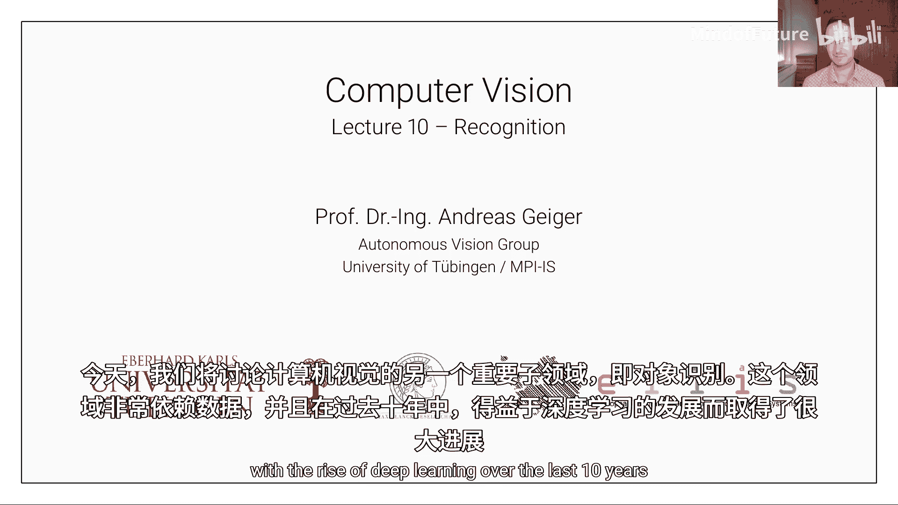

This lecture is divided into free units。In the first unit。

 we are going to cover image classification， one of the fundamental grand goals of computer vision。

In the second unit， we're going to have a look at a problem called semantic segmentation。

 and then finally we're going to discuss object recognition， object detection and segmentation。

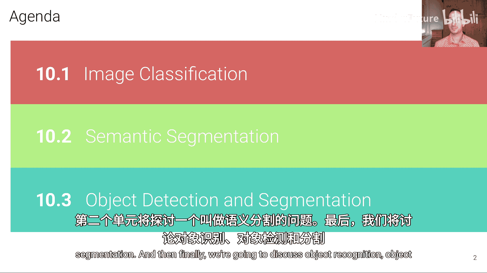

Before we start， let's have a brief look at。What these problems are and what they distinguish from each other。

Let's start with image classification。In image classification， we are given an image。

Like this one here， and the goal is to assign a single class label。An image category to the image。

Let's suppose we have a set of maybe 50 possible class labels for images that we might observe。

And for this particular image， we want to assign the label street scene because it's a street scene。

That's one discrete number that we assign to the entire image。This is image classification。

In semantic segmentation， the goal is different here。

 the goal is given again the same image as an input， which I haven't shown here。

 I have just shown the output。But given the same image。

The goal is to classify each individual pixel with respect to its semantic category。In other words。

 we want to assign a semantic label to every pixel in the image。

And these regions that we want to classify are both object regions such as cars that are。

That could be potentially distinguished from each other， but we don't distinguish them。

 we just assign the label car or stuff labels。Like sky or trees or grass。

So for every pixel in that image， we want to assign one of these discrete labels。As illustrated here。

In object detection， the goal is to localize objects via the bonding box， their 2D bonding box。

And classify them。In this example here， we have localized a couple of trees。Pools and cars。

We cannot localize stuff categories such as Sky。Or grass， we can only localize object categories。

 That's why it's called object detection。And for each of these categories。

 we want to find all the objects and describe them by a 2D bonding box。

And retrieve the correct category label。So we want to。

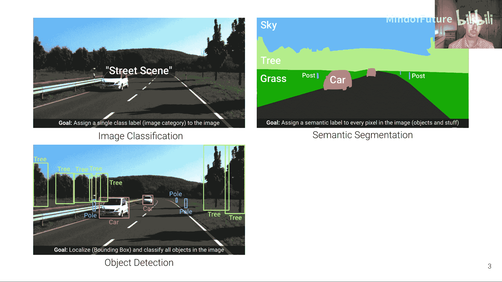

Mark this object here with the correct bounding box that exactly。Describes that object。

And we want to say that this is a car and not a tree， for example。And， finally。

Semantic instance segmentation is to assign a semantic and an instance label to every pixel of an object again。

 this can only be done for object classes。There is another problem it's called panoptic segmentation that combines both instant segmentation and semantic segmentation。

 but in traditional instant segmentation the goal is really for all of the objects that we have detected。

 we want to assign a mask。And a class label， so we want to know which pixels in the image correspond to this particular object。

And we want to know for this particular object， like what is the category and which pixels correspond to that object。

And in contrast to semantic segmentation where， for example。

Cars or trees that are olu each other cannot be separated from each other because they just obtain the same semantic class label here。

They obtain the same semantic class label but a different instance label。

 for example for these pixels here we would assign the instance label number3 and for those pixels here we would assign instance label number4 so we can actually distinguish them despite the fact that they are nearby。

So every pixel gets a semantic and an instance label， every pixel that is on an object。

These are the four problems that we're going to have a look at。Let's start with image classification。

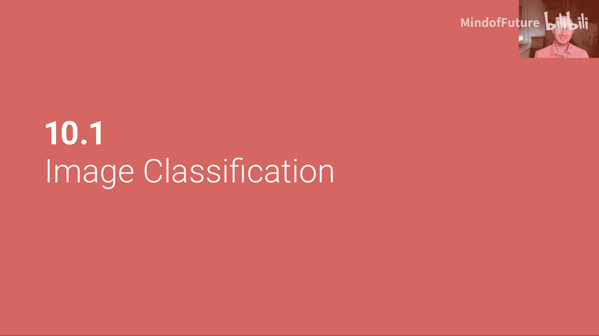

Here's again， the problem， input is an image。And we want to assign a single class label or image category to that image。

Such as。Street scene。Why is this an interesting problem？Well， first of all。

 it can be a useful task on its own， for example， think of recognizing handwritten in digits or searching images based on keywords。

These are tasks where image classification has a direct purpose。

Another advantage of this very canonical and simple problem is that they this problem has a very simple specification。

 The input is easily specified as an image often in data sets。

 the images are resized to a common format， so it's the same height and width。

And the output is just a discrete。嗯。Category label。

 so it's a very simple one dimensional discrete output。

 and we can use standard loss functions like cross entropy to learn such a model。And for that reason。

 for a long time， image classification has been one of the difficult gold standard tasks in computer vision because it requires a lot of reasoning about what's happening in the image。

 it requires an analysis， an understanding of the image in order to describe the entire image。

Furthermore， image classification。As it turns out， is also a useful high level proxy task to learn good representations which transfer well to new tasks and domains。

So there these representations are useful for transfer learning given。

A big data set that is labeled with image level labels， we can train a representation。

And then we can take that model。And find unit on a smaller data set on a different task。

 there can be a very different task， it can be semantic segmentation， it can be object detection。

 it can be even reconstruction。And we get away with much fewer data on this target task。

Because we have pretrained on a very big data set。Using this。Image classification， proxy task。

And this is something that we'll talk about also。Okay， so how can we classify or categorize an image？

Early attempts have tried to solve this problem via a hand engineering。

 try to come up with an algorithm。That solves this task。

 come up with hand engineered manually engineered rules， for example， given this image。

 we want to find some edges using some edge detector and then based on the relationship between the edges and corners。

 we want to using simple rules describe what's in that image and eventually infer the image class。

But as you can already see from this example， these early attempts have horribly failed。

And led to a dead end。And the reason for this is that object shapes and appearances are just too hard to describe manually。

 it's impossible， and that's really why machine learning and label data sets。

Play a fundamental role in solving this problem。So let's look at some data sets。

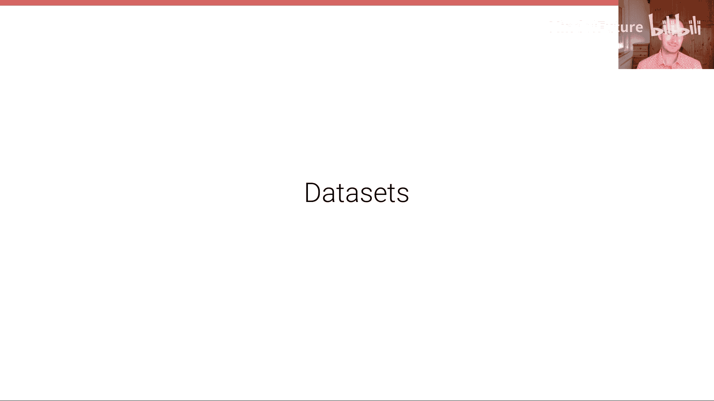

Here is one of the most famous dataset sets called MNIS。

Has been popularized in the machine learning community and。

It's mostly used in the machine learning community， there is many variants。

 and it's actually still used today。It's based on data from the National Institute of Standards and Technology。

And these are handwritten。Ditchits by employees of the Census Bureau and high school children。

And here are two examples of ditits written by two different people。

They are relatively low resolution， but there's a lot of data， there's 60。

000 training samples with labels with ground truth。

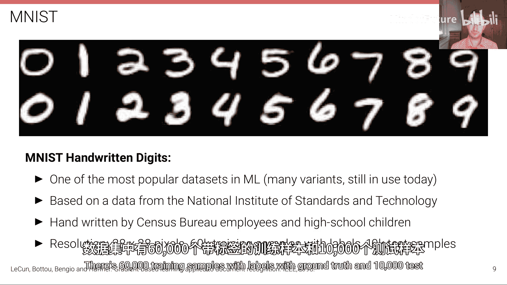

And 10，000 test samples。A slightly more realistic data set is Caltech 101。

It really was the first major object recognition data set。And was collected in 2000。

 free by Li Feif Fei and Rob Ferguson， Pito Poona。And it compred 101 object categories。

Compared to MNIS， it has much larger image complexity， as you can see here by a few examples。

And it had many more classes， 101 classes， that's why it was called Caleltech 101。

And these objects were obtained or these images were obtained。

Via Google image search and then manually create it a little bit。However。

 the data set is still relevant by today's standards is very simple。

 all the objects have a canonical size and location there centered in the image。

And they are in a relatively canonical pose and often the very simple backgrounds。

 as you can see here。 And what you see here on the right is an image that shows the average。

Of all the images of a certain category， and you can see that for certain classes like faces or stop signs。

 flowers。or motorcycles is actually very easy to recognize just from the average。

 it doesn't contain a lot of variability， so it's a relatively easy data set。

But this is how it all started and this is what people have worked with。

When they started looking into machine learning based techniques for tackling this problem。

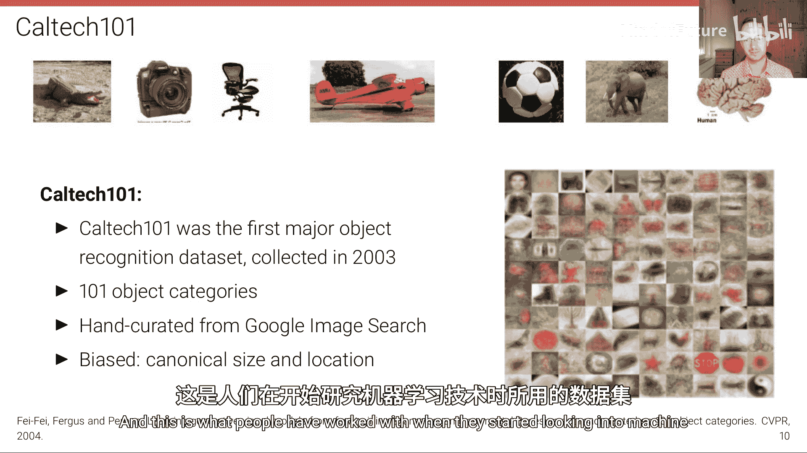

And then in 2009 came ImNe， which has really。LED to the rise of deep learning， if you will。

 in combination with one of the first models called AlexNet。

That demonstrated that on this particular data， there was a challenge associated with this data that was carried out every year at one of the major computer vision conferences。

And in one year in 2012， Alexnett demonstrated for the first time that deep learning actually works and can outperform classical techniques that have been used so far for image classification。

And outperform these techniques not only by a little margin but by a significant margin。

And this is where deep learning started。However， finallyni ImageNe despite now more than 10 years after the creation of ImageNet。

Is still one of the primary data sets for pre training generic representations。

It's still used for obtaining pretrained models using this proxy classification task。

And the reason for this is that it's a very well it's a very large data set first of all。

 and it has objects in complicated poses and difficult categories and it has 22。

000 categories and for this challenge here there is typically 1000 categories considered so it's a very difficult classification problem so a。

A deep neural network that has to classify the image， correct。And there is 1。

000 possibilities has to really do a good job in understanding all the aspects of the image。

And because there is millions of these images that the model can learn from。

These representations become very powerful。So it's all about complexity and size and less about the complexity of the output that we want to predict。

 that's very simple， just a discrete number。

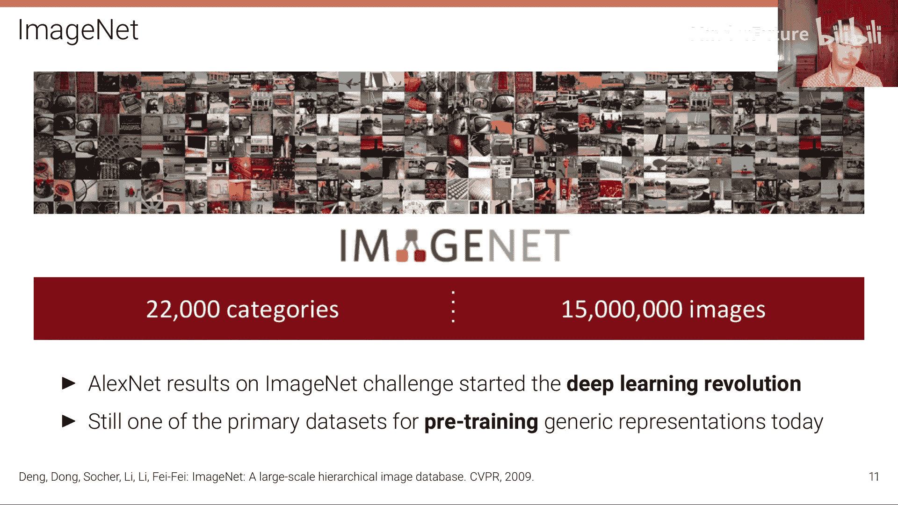

And so here's a little slide that illustrates the pretrain aspect。

Or sometimes it's called transfer learning。These representations generalize really well despite the large number of parameters。

And what do I mean with generalization， this has been illustrated， for example。

 here in this very early paper， if we pretrain a let's say。

 convolutional neural network on large amounts of data on a generic task， for example。

 imagenet classification， and then fine tune。Or retrain only the last layers or even fine tune in all the layers。

On little data of a new task， we can obtain state of the art performance on a variety of different tasks。

And this is something that has shocked the community。

And is something that still works very robustly today here in this early paper day。

 they basically just trained a SVM readout model on top of these representations。

 but today this is replaced with also neural network layers。

 but you can think of this as having a very deep backbone with maybe 20 layers and then have a few layers on on top a few readout layers that make use of these very powerful representations that have been obtained using imagenet training or maybe just by downloading a model from the internet。

 there's a lot of models now available on the internet。

 you can just download and then pluck you a little network on top and do something very different but do it well because you have these powerful representations。

Okay。So let's look at some challenges now， and why is image classification non trivial？First of all。

 there is a large number of image categories， it is estimated that there is between 10，000 and 30。

000 image categories or main image categories， so it's a really difficult task to get the right category。

For example， there's many different。Dg and bird species。That might look very similar to each other。

 but still they are different species。Another challenge is intra class variation。

 here are some examples of chairs。All of these chairs are chairs by their function。

 They have a suitable。Am。But they look very different from each other。

 the image pixels are very different in each of these images。

And also their 3D geometry and their appearance， their color， their shape。Is just very different。

But all of these should be categorized by our classifier as chairs。And this makes it difficult。

 there's a huge intra class variation。And we have to capture that correctly and still be able to distinguish chairs from some other objects like you sofas or tables。

Another challenge is a viewpoint variation。If we look at this object from different viewpoints。

 pixels also change dramatically， yet we have to recognize the object always as a legal bulldozer in this case。

Illumination changes are another challenge。Depending on how I choose the eumination and because。

Of the fact how light interacts with materials and reflects and refracs at material surfaces。

The image looks might look completely different， the image pixels。

 even for the viewpoint hasn't changed here， the image pixels。

 the intensities have completely changed。There are shadows here。

 the objects are much brighter and there is some very dark objects here because the light source is in the middle。

And this is a more uniformly lit scene。It's also challenging， of course。

 to categorize or detect objects when there's a lot of clutter as in these examples。

And some object categories might even deform。Here in the case of cats。Now all of these cats。

For a computer， they look very different， the images look very different。

 despite the fact that these are all cats。And of course， if not the entire object is visible。

 if there is occlusions in the image， it also becomes harder to detect these objects or these image categories。

Let's get started with some simple models。A very naive model for image classification that you can program。

In a few lines of code。Is a nearest neighbor classifier。For nearest neighbor classifier。

 we need to choose， first of all， an image distance。Let's call that distance D。

 that's a distance between two images。And in the simplest case， we could just say， well。

 we loop over all the pixels in these images and。Measure the。

The intensity or RGB difference at the respective pixel location between。

Image 1 and image 2 in this case， we use the L1 norm。

So this is a very simple L1 distance between two images。

And then if I want to do nearest neighbor search。I really don't have a training phase。

I just I do everything at test time， basically I just have a big data set。A label data set。

And I call that T here calligraphic T。So given an image。I， we can find the nearest neighbor。

 so this is the image that we want to find the category for。

 we can find the nearest neighbor by the argument over the entire data set。So we have i prime here。

And we measure distance from i to i prime to each of these i prime from the data set。

We check all of the images in the data and return the image。That is closest to the query image。

And then simply we look at that。Image that has been retrieved from the data set and returned the class of that image remember this is a label dataset set so we know the label。

This is the simplest image classifier that we could build。However。

 this classifier doesn't work so well。First of all。

 it's very slow because we need to do nearest neighbor search at inference time。

And even when using sophisticated approximate nearest neighbor algorithms in this high dimensional image space。

 this can be quite slow。And second， it's typically also quite bad because。

Pixel distances in pixel space are not very informative。So it's a bad classifier。

And here are some examples。On Cypher， I believe。Where you can see for some query images。

 what are the top ranked images from the data set？And you can see that in some cases the classifier was correct here in green。

 but in many cases it was actually incorrect。So for example， here。The frog。

Was incorrectly retrieved by another animal。And you can see what the classifier here focuses on is not the animal。

 but it's the shape and the white background。Or here also this shape of the boat has been。

A bird has been retrieved for this boat because the bird is in a similar。Poose as the boat。

 but of course， semantically。There's nothing that these two objects have in common。

So looking at pixel distances is not a good idea。

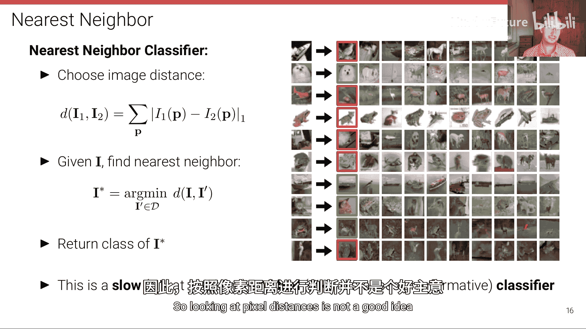

And here's a little thought experiment that tries to highlight why this is so。

 or is one of the reasons why this is a bad idea， if we look at these two checkerboards。

 if you look at the left checkerboard and the right checkerboard。

 they have been horizontally displaced by exactly one field。

And what would be the distance between these two if you take the。

Absolute difference between these pixels of these two images。

 well it would be the maximal possible distance that you could get because every white field falls onto a black field and every black field falls into a white field。

So by translating this images a little little bit。We are getting the maximal distance。

 but both are checkerboards， they are the same category。

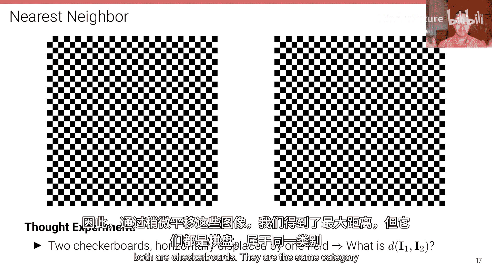

Okay， what can we do， the next idea that has been followed in the community and that has been successful for some years by the same offers also of the ImNe data set。

And of course， many follow ups is so called back of Word model。

 and here the idea is to obtain spatial invariance by comparing histograms of local features。

Which removes the dependency on the location of these features。In this case。

 translating the checkupboard doesn't change the classification result。

So it's illustrated here by this。This brown bag of features of this person here。

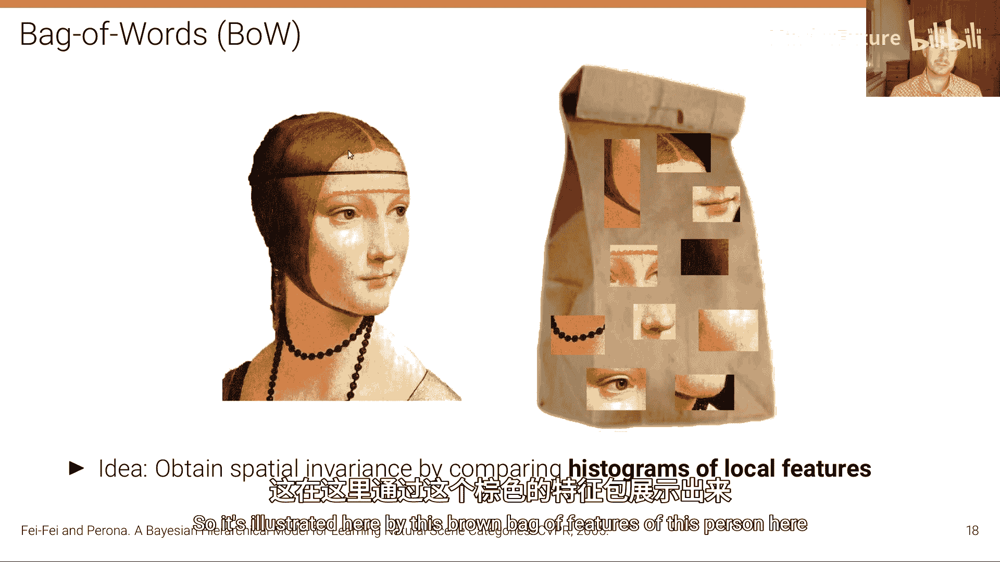

The idea of pe of words models actually originates from natural language processing。

In natural language processing， it's common to use a spec of words which are basically an orderless document representation。

That counts the frequencies of words that appear in a document。To describe the document。

Here's such a。A word histogram。Visualized by the size of the words that is according to the frequency that they appear in the document。

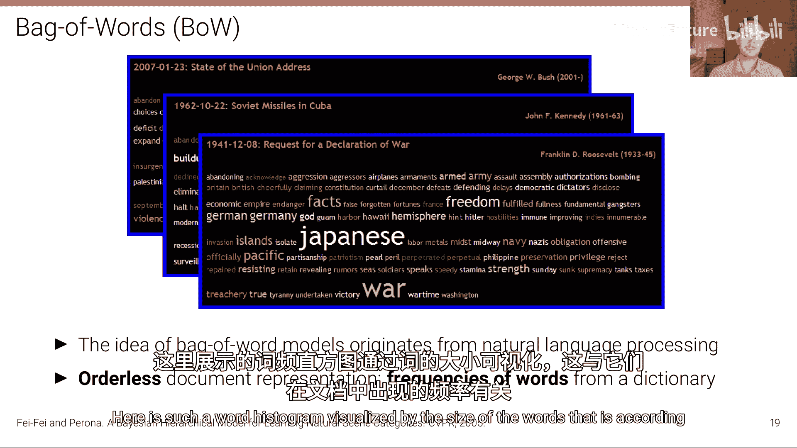

How does this work for images， this is where the idea comes from。

 has been transferred to images well in the first step we extract features we can use the Siif descriptor that we have learned about in previous lectures in order to obtain a number of features for an image。

At salient locations in the image and then we learn a visual vocabulary， so we do this。

 we extract features for the entire training data set。

And then we have a big set of features for all of the images， we throw them together。

 and then we do K means in the simplest case， K means clustering in that。

Of these sift feature vectors in that feature vector space。

And this gives us our visual vocabulary of K。Categories， so we have K canonical clusters。

And then we quantize all the features into the visual words using that vocabulary by just finding the nearest neighbor。

 So we take each feature and assign it to the。Cluster from 1 to k that is closest to that feature in that safe feature space。

And then now we can represent images by histograms of these visual word frequencies。

 they're called visual words in analogy to word frequencies in NLP。So for example。

 heres an image of a person that has a high frequency of this person features and here's an image of a instrument。

Presumably a violin that has high frequency of these violin features。And now given these histograms。

 so these are three different images now histograms for three different images。

 of course there's more bins in practice， we can now train a classifier， for example。

 Can nearest neighbor on the histograms or a support vector machine or a neural network。

For image classification。And this is already much better than this naive approach I showed in the beginning。

But there's still a problem there was still like the performance was saturating at some point。

 and the reason is that theres still too many hand design components and too little learning。

These Sift features are hand engineered， they are actually designed for feature matching。

And not necessarily for object recognition。And also the way we do the clustering。

 the number of clusters and the classifier that we put on top matters a lot。Now the solution to this。

 as we now know， is to learn instead the entire model from image decisions end to end from data。

 which is illustrated here。So on the top we have this very simple classifier on features or gradients here we have the bag of word model that extracts gradients and histograms。

 these are the sift features and then does k means clustering and classifier on top and here we have the deep learning。

A model that has all these blocks now in green are all trainable blocks and we can end to end train this is the important thing on big dataset sets we can end to end at just all the parameters。

And this gives us much better performance。This is also illustrated here。

 this shows the image net classification error for the different imagenet challenges from right to left。

 this is 2010， 1112。And we really saw a of these more shallow models。In 10 and 11。

 while we had a big jump here now in 2012， introducing。Alexnet。

 a deep learning model for image classification。And since then。

 performance has increased further and further surpassing on this particular task。

 human level performance， which is estimated to be around five。

And the current state of the art on this problem is 1。3%， so it's even much lower than。

This model here from 2015， so tremendous progress progress that wasn't was unthinkable in 2010 where for several years the performance didn't decrease。

Okay。Now。Good， we have learned that deep learning is a key element for image classification because it's very important to do recognition and one of the main models of course。

For。Solving image classification tasks are convolutional neural networks that we have already learned about in the deep learning lecture。

But here in the context of this computer vision class。

 I want to just do a little recap of the convolutional neural network lecture from the deep learning course。

So what are convolutional neural networks？Here is an example of a so called VGG network。

Typically these networks， these CNNNs for image classification， have three types of layers。

They have convolutional layers。Down sampling layers and fully connected layers。

And they take an input image here， this is the image resolution， 224 times 224 pixels times RGb。

And then they decrease the size of the spatial dimensions。And at the same time。

 they increased the number of featured channels in this network。Until in the end。

 they arrive at this。1 by 1000 dimensional vector， which is then passed through the soft marks。

 and this is then the probability distribution over classes。

 the output of this image classification network。So let's look at these components in more detail。

The most important component is the convolution。Layer。

 which is used at every resolution and every block of this convolutional neural network。

Compared to a fully connected layer that is illustrated here on the left。

 convolutional layers illustrated here on the right share weights。

So instead of this relationship here， here we have a kernel and the weights are associated with the kernel。

 so we don't have weights for each of these connections here to all of the input pixels。

 but we have only weights to this maybe be free by three dimensional kernel times the number of feature channels of the previous layer。

This is a large reduction in the number of parameters through weight sharing。

And makes these models easier to learn， but at the same time。

 it introduces one of the most important concepts of convolutional neural networks。

 which is translation equivariance， at least at the layer level if I take the input to one of these layers and I translate it a little bit。

The output of the convolution operation gets translated in the same way。

 and this is a useful property that we want to use for images because no matter if the cat that I want to classify is in the center of the image。

 or if it's slightly displaced to the right or to the top or to the bottom。

 it still it's always an image of a cat。And so translation equivariance or ultimately translation invariance in the case of classification。

 because of these pooling layers that we will talk about。

 we obtain some sort of invariance is a desirable property。Okay。

 so here's an illustration of this convolution happening。

 so we slide this kernel over the input feature map in the first layer that would be the image。

And in later layers， these are just feature maps。And then we multiply the weights with this。

The weight of this kernel with this。Respective locations in the input feature map and obtain。

After a linearity obtained a value at the output。So this this illustration here is only for one feature channel。

 but of course it is meant to be for all the feature channels， so we have really a C times k times k。

ADional kernel here。And depending on the number of output channels。

 we have weight these weights multiplied so have if we have two output channels。

 then we have two K by K by C kernels， one for each of the output channels。

The next operation is the down sampling operation。 The down sampling operation reduces spatial resolution of the input。

 So this is here the max pooling operation， for example。

 that tick goes from this spatial resolution to this spatial resolution success successively reducing the spatial resolution until we reach just a one by one。

One pixel by one pixel image， if you will， which is then the classification result for the entire image and where information from the entire image is stored。

In that sense， we reduced the spatial resolution， but increased receptive fields。

Every pixel here in the input contributes to the final output。

There's no pixel that potentially does not matter that。Ignoorreed a。Through these pooling operations。

Typically， these pulling operations are applied with a stride of two， so we jump over two。

And we have a kernel size of2 by 2 for here in this case， the illustration is with three by3。

And so therefore we get a reduction in spatial dimension of two because of this dry tube。

Puling doesn't have any parameters。And typical pooling operations are， for example。

 taking the maximum of these values and putting it here or the minimum or the mean。

Pooling is applied to each of the channels separately， so it keeps the number of channel dimensions。

If we have C input channels in layer I minus1， we have C output channels in layer I。

And the final part here are the fully connected layers once we have。Pools， finally， all the。

All the spatial dimensions to one by one pixels here。

Then we apply simply fully connected layers in this VGG architecture。

 and these are really the most memory intensive part also of this VGG architecture because we have  the 4096 channels。

And so， we have。4096 times 4096， which is the next layer。weights。16 million weights。Okay。

And here here's an example of like this this last well。

 this last stage here could be a could be a pooling stage。

 but in in Vji G it's actually a reshaping stage。 So from here to here we go with a reshaping where we basically take the。

7even by seven times channel。Cnel's dimensional input feature map and simply reshape it into a one by one times channel dimensional feature map。

UWell now these channels are much more because they have to capture also the the spatial dimensions。

 theyre just basically flattening the vector， it's called reshaping。

So there's different ways of doing it and this is just one particular choice that has been made for the VGD architecture and it's done differently。

For different architectures。What we also need to talk about is what the output layer and the loss functions are for image classification。

So we've talked about now the input and the hidden layers， convolution， pooling， reshaping。

But what are the output layer what is the output layer and what is the loss function In image classification we use a soft max output layer and cross entropys and we'll see why that is a natural choice。

And let's in order to see that， let's start with the basics。

 let's start with defining a categorical distribution。 Remember， image classification is about。

Returning an image category。And so what we effectively want is we want to compute a probability over in a probabilistic sense。

 we want to compute a probability over the outcomes of the model。

 so if we have eight classes we have a discrete random variable， So we have a discrete distribution。

 a categorical distribution over these eight possible。Values of that random variable。

And this is called a categorical distribution。So the simplest definition of a categorical distribution is this one here where I say well P。

 the probability of the random variable y taking value C or class C is equal to mu C index C。

Which is the probability for classy， this is the parameter of that。Distribution。

We have one such parameter for each class and they have two， sum to one and positive。

Here's an example on the right。This is a discrete distribution， a categorical distribution。Over。

A random verbal。That has four states，  one，2，3，4。And you can see that together sum to1。

They're all positive and the probability for example for class4 is higher than their probability for class2 in this particular example。

And so these are the mus。Mu 1 would be 0。2， mu 2 would be 0。1， etc。Now。

 an alternative notation to this， which is useful for deep learning is the so called one hot vector。

 which is a vector y。Like here， that has a one in one location and zeros everywhere else。

And it has a one in the location of the class that we want to describe。So for example， for class2。

 this would be 0，10，0。And with that， we can describe the probability。

Of why now this is a vector in this case， a one hot vector as the product over all the classes。

Mu C to the power of Yc。Because we know that yc is only  one for 1 c。So for all of the other cases。

 it will be zero， so it will be a product of a lot of ones。And one element that is not one。

 which is the Y C element。Right。So basically， in other words， with this YC。

 we're picking out the parameter mu C。For a particular class。

 which is namely the class where we have inserted the one in the vector。

It's exactly the same as this， just a different representation。And it should of course。

 be familiar from the deep learning class。So here are some examples， we have four classes。

And we see the。NonB Y representation and the one hot encoding here on the right。

So the one hot vector has binaryry elements and the index C。Where yc equals 1， for example， here。

 would be 2 determines the correct class， the class would be 2。

Here are the third elementement is one so the class is free。

 and here are the fourth elementementous one so the class is four。🤧う。The elephant class。Now。

 given that we know what a categorical distribution is。We cannot define。Or derive the loss function。

 the cross entropy loss function by maximum the log likelihood。Of such a。Cateorical。

Conditional model。So let。The model distribution。The conditional model distribution of y given x and the parameter is W。

X is the image and y is the label that we want to predict for that image and W are the parameters of the neural network。

So let this conditional distribution be equal to the product over all the classes。

Of the probability predicted by the neural network now， so FW is the neural network for class C。

Of the inputex to the power of YC， so you can recognize the categorical distribution here。

Now the only difference is that we have replaced this mu C with actually this mapping， this function。

 this neural network。That produces the parameters of that categorical distribution。

 given a particular input X， and then the index of it we take the Cif element of this vector F is actually a vector。

If we assume such a categorical distribution where the categorical distribution is parameterized for a neural network FW。

 and we maximize the log likelihood。Of this。Model。And we will obtain the cross entropy loss。

And this is illustrated here。So what we want is the maximum likelihood estimate of the parameters。

 which is arc maxx。Of the parameters over the parameters of the sum。Of all the data points。

 so now we have I is the index of the data set。The data elements lock P model of Yi given X I and W。

This is the log likelihood。Now we plug in the model distribution so we get this term inside here。

But in addition， we have the I now， the index。Both for the input and also for the label。

 this is a supervised learning problem， so we know both the input and the output， the target， Y I。

Which can be writtenwritten as such if we consider not this as a maximization problem but as a minimization problem。

And this term here inside。It's called thero Entropis。

Some over all the classes minus Yi times the logarithm of the probability predicted by neural network。

 this is the cross entropy loss， the famous cross entropy loss that's used everywhere。

When training deep neural networks for classification。

What you have assumed is that the neural network F predicts probabilities。

 but how can we actually ensure that this is true， that FW predicts correctly these parameters of the categorical distribution？

Well， we must guarantee that the outputs of our neural network are between0 and 1。And that。

well this F is again of vector indexed here by c。That if I sum over this vector。

 I get one that the distribution sums to one， and this is guaranteed by the softm function。

And this is the illustration here， and this is an equation for the softmax function。Soft marks of X。

Is well， for each of the elements in that vector x。X of x1 over the sum of all of the X X k。

Of course， this is。Positive because the exponential function transforms from。

The real line to the positive domain。And we divide by the sum， which means that we normalize。

So the sum of these elements will be one。This is the generic definition of the softmax function now instead of x。

 we are going to of course， use the last。Elements or the last。Features in our neural network。

The output of our neural network， and we call that the score vector。

 so we have a neural network made of convolutions and nonularities and max pooling。

And at the very end。If we have 1000 categories， we get a 1000 dimensional vector。

 and that we call the score vector， this is the output of the neural network。

 and that vector we pass through that softm。This is the vector S we pass through that softm。

 and this is then what we call Fw of x， this is the output of the neural network。 The last part。

 the output layer is a softmax function。If we take the logarithm of this。

 we obtain SC minus logarithm of the sum of。Exponential of SK。嗯。Now what is the intuition here。

 assume C is the correct class。 Our goal is to maximize the lock softm。As such。The first term here。

 this one， encourages the score SC for the correct class to increase。All right。

 we want to maximize the lock soft Max， remember that we want to minimize the negative block。

Of the softmax， so we want to maximize the lock of the softmax。So SC。

For the correct class seem to increase， the second term encourages that all scores in S decrease because of the negative sign。

And furthermore， the second term here can be approximated。By the maximum。Over K of SK。

x of SK is insignificant for all SK that are quite a bit smaller than the maximum。

 so we can approximate it like this。And by making this approximation we see that this loss always strongly penalizes the most active incorrect prediction。

 let's assume C would be the correct class and there would be a k not equal to C that is much larger that has a score much larger than SC because we have this approximation here。

 this would be heavily penalized by this loss。This would be pushed on。To score。

If the correct class already has the largest score， then both terms roughly cancel out， right？

And the loss of this particular data example， this data point in our stochastic gradient decent procedure will contribute little to the overall training cost。

Because it's already balanced。So we see that the softmax responds to differences between the inputs。

And it's invariant to adding the same scalar to all its inputs。

 that's something that's very easy to show。And we can actually exploit this property team。

 but in order to derive a numerically more stable variant， if we implement this algorithm。

 this neural network on a computer with floating point precision。

 we always have to worry about numerical precision。

And we can make this numericalmery more stable by just subtracting。The maximum of all of elements。

Which doesn't change the output because it's invariant。To addition。

And so this allows for accurate computation of the Somax even when the x's are actually quite large。

So let's put it all together。Here's the cross entropy loss for a single training sample from the training set。

This is the cross entropy loss。Now suppose a concrete example of four classes。

 four categories and four training samples， these are the four training samples。

And we have four categories， dog， cats， mouse， and elephant。And these are four training samples。

 let's assume we have a mini batch of size4。And these are the ground true labels。

 the correct labels here， right， a different class for each of these categories。

And let's assume that our neural network predicts the following score of vectors here。

 where on the diagonal I have colored elements in red because those are the elements that correspond to the correct label。

So in the first case， for example， the dog has been correctly classified。

 in the second case the cat has been correctly classified。

 but the dog has received similar probability， if you will。Here in the third example。

 all of the classes are equally likely we produce a uniform distribution and in the final example。

 actually the elephant， which is the correct。Class has received the lowest score。

 so this is a bad result from our network。Now we take these core vectors and transform them through the soft Max。

In two probability vectors and we can see from these probability vectors as expected that in the first case the probability of the dog is high then here we have same probability for cat and dog because these two are the same and here we have very low probability actually for the elephant class because it has a very low score。

And now if you take the cross entropy loss， which effectively grabs these numbers here in red。

And pushes them through a loger room。And computes the negative of this logar room。

We have a very large number here for very small values because the logor becomes very large negative。

And so we take the negative of that so it's a very large loss because this is very wrong。

 but here the dog is already correctly classified so our loss doesn't care so much about it。

 it's already good。So we observed that sample 4 contributes most strongly to the loss function。

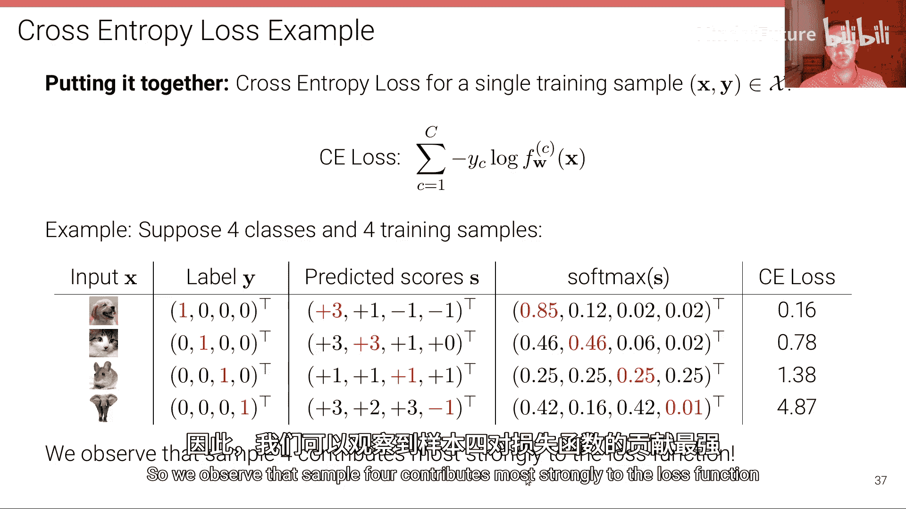

And this is a nice illustration from the Stanford people where you can play around with a convolutional neural network in your browser and you see how images get propagated through the different layers of a convolution neural network。

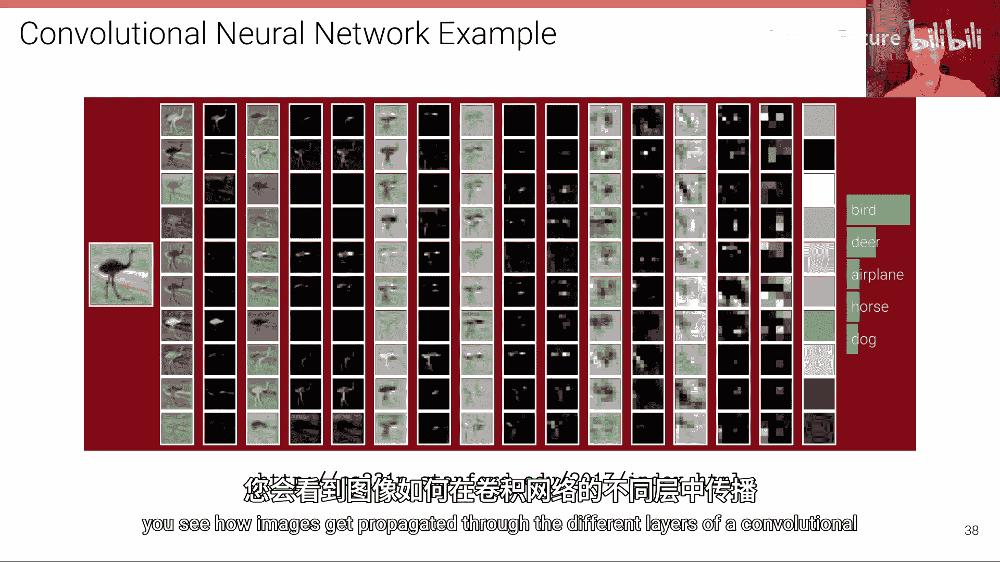

The corresponding class is predicted as the output。

Finally in the first unit I want to show you some network architectures that have been successful very briefly in 1998。

 this is one of the first successful convolutional neural network called Linet 5。

Has just two convolutional layers here and two pooling layers。

And then to fully connected layers is a very small network， but it was。

Only applied to small problems like Ams and the chief state of the art a Caresian Amnesist。

Prior to IageNe， but it wasn't so。Such a big bus， it was a big bus in the machine learning community。

 was not a big bus in computer vision because in computer vision。

People were more interested in real problems like real images and not these small MNnes images and so it required Alexna to demonstrate to the computer vision community that actually these models can work well。

 also for more interesting problems。And the reason why this worked in 2012 was combination of clever engineering。

 the availability of。AGP GPPU computing。And also the availability now of these large data sets which allowed for training these parameters of these very deep high capacity models。

And this really triggered the deep learning revolution and showed that CNNs work well in practice。

 and from there it really went very quickly。I just show some。Lighthouse is here， some。Cornerstones。

 VGg is one。Wjiji demonstrated that。Actually， it's much better if you just use free by free convolutions everywhere。

Because you can get the same expressiveness with much fewer parameters。For example。

 if you have three layers。Of three by three convolutions。

 you get the same receptive field as 1 7 by7 layer， but with less parameters。

But of course you have to train these models correctly， so deeper models are harder to train。

And so training becomes more challenging。Then in 2015， also Inception or GoogleNe has been proposed。

 which is a 22 layer deeper network with these inception models you can see that there is a lot of components that are similar that have parallel streams of convolutions of different filter sizes and pooling operations。

And also multiple intermediate classification hats to inject gradients also at earlier stages into the network and to improve the gradient flow to improve optimization of this network despite the fact that only this last。

Soft Mar here， this last classification result at the end is used at inference time。

 but this is just for improving this has been added just for improving training。And then in 2016。

 of course， ReSNe， which showed that， well it's actually beneficial in order to build very deep neural networks。

 it' beneficial to use recital connections where you loop the input directly to the output and just try to predict the receual。

Which is much easier because now it's very easy to represent the identity transform。

 which otherwise is harder。And it turns out that these models。Can be trained。

Much more effectively and allow for much deeper。Moels up to 152 layers， for example。

 in this case here。And it's a very simple and regular network structure， as you can see here。

 so it's very easy to implement the uses free by free convolutions like VGG uses drieded convolutions for down sampling。

And these recentcent architectures are really dominating today in many areas of deep learning。

Here's a little plot that compares。Accurency versus complexity。You can see the top one accuracy。

 This is one of the metrics how。Imagenet classifierifies our evaluated top1 means。

Your prediction out of these 1，000 possibilities must be the correct one。In order to get a point。

And top five accuracy means that the target label， the correct label must be in your top five predictions。

 it's a little bit easier to achieve high top5 accuracy。

 but because models are getting better now we mostly focus on top one accuracy you can see here from this plot。

On the x axis is the computational complexity on the y axis is the accuracy of the models and the size of the circles indicates the number of parameters of the model you can see that VGG really has a high computational complexity because of the fully connected layers also high。

Numb of parameters。And where you want to be is actually here on the top left。

 so the inception and the ressonite architectures have a better trade off they have even higher accuracy。

And at the same time， fewer parameters and。嗯。Better computational complexity。

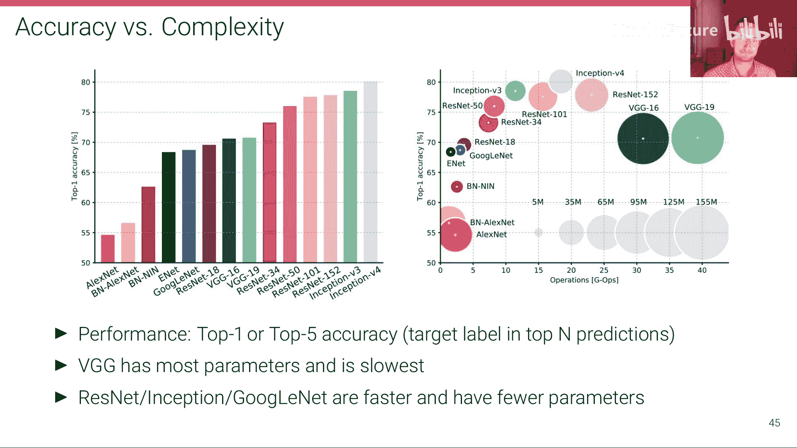