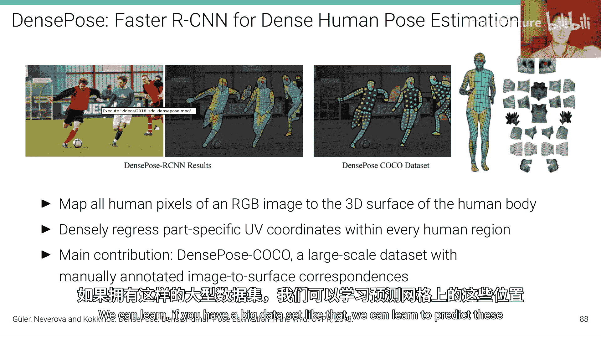
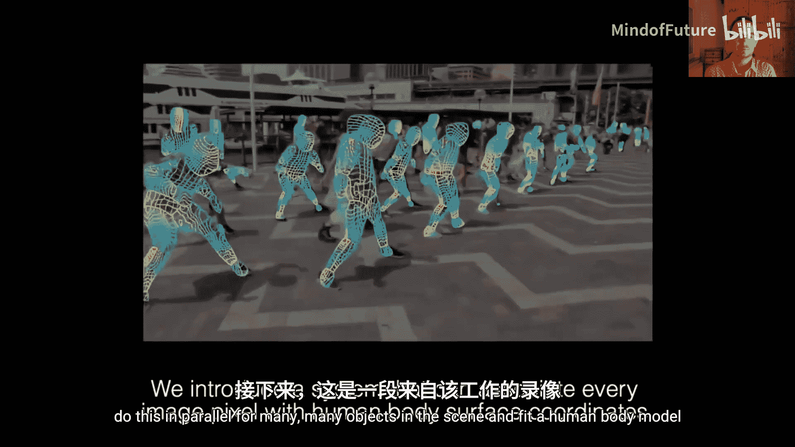
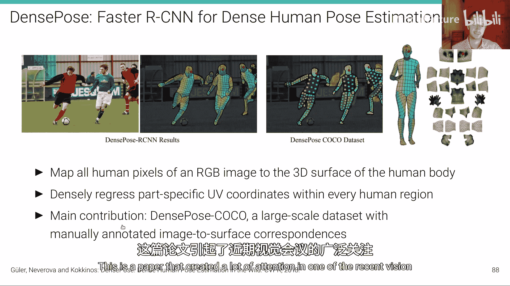

# 【图宾根大学 • 中英】计算机视觉 ML-4360 (Computer Vision) p38 P38 Lecture 10.3 (Recognition - Object Detection and Segmentation) -BV1S8N1emEef_p38-

Yeah。Let's now move to object detection。And some other related tasks that can be solved with similar algorithms such as。

Object instant segmentation or object mesh prediction。

Let's remind ourselves again what object detection is about the goal is to localize and classify all objects in the image we're not interested in these stuff categories here we' are just interested in objects。

 but we want to localize and in terms of a tightly fitting 2D baring box。As well as。

A class label so when say that this is a car， maybe this is label number5， and this is a pole。

 maybe that's label number 7。And at the same time we want to have a bonding box。

That's the high level idea。Of course， there's many motivations for why we want to do that。

 we need it for navigation， we need it for self driving， object detection， we need for manipulation。

 we need it everywhere。 and here's an example。 This is an image from mobile eye that's a company that produces。

Driving assist systems。 and it has a system that produces a warning based on camera input。

 If the vehicle comes too close to the vehicle in front by detecting that object in front。

And also estimating how far that object is from the ego vehicle。

Let's look at the problem setting a little bit in more detail。

 the input is an RGB image or a laser range scan in case we want to do 3D object detection。

 we will have a very brief look at that in the end of the unit。

And the output is a set of 2D or 3D bonding boxes with category label and confidence。

So we don't only want to。Know where the object is and what it is。

 but we also want to know from the detector what is the confidence。 This is a number。

That is relevant for any subsequent processing stage if we predict something very low confidence。

 we might still want to drive on， but if there' is a high confidence in a prediction。

 then we want to take it seriously and similarly the evaluation metrics that we're going to discuss。

Are also gonna to take the confidence。The detection， confidence into account。

Here is an example for 3D detections at the bottom。So this is the 3D equivalent。

 instead of 2D bounding boxes， we are now predicting 3D bounding boxes in these point clouds。

In both cases， 2D and 3D note that the number of objects and the object size are not known a prior。

 so it's really a complicated output space， it's a structure prediction problem where even the number of output variables is not known。

April。Before we go into algorithms， let's first discuss。

A little bit how we can measure the performance。Of such an algorithm。

In classification and semantic segmentation we've seen is easy， we can just use accuracy but。

Even in semantic segmentation， a cru is not enough， so we've talked about intersection over reunion。

And that's also the metric， the performance metric that we're going to use in object detection。

 So let's look a bit more detail into。What is intersection of reunion in this case for bounding boxes。

 but you can do the same thing for masks？Let's suppose。

We're seeing this image here and our object detector returns the red box as the predicted detection。

But the true box is the green box here。 that is the box that has been annotated by the annotator。

Now the intersection of reunion measures the area of the overlap of these two boxes divided by the area of the union of these two boxes。

 and as you can see if both the predicted and the target box are the same。

 this number will be 1 but that's actually very hard to achieve in practice will already be happy if the intersection of reunion is 0。

9 and even if it's 0。7 it's already a pretty good detector。But if it's below 0。5。

 then the alignment of the prediction and the true box is not very high。

And so we say this a poor detection。And that's why typically in most evaluation scenarios。

 a detection thresholds an IOU of 0。5。Is considered。Now this was for a single object。

 how can we fairly measure detection performance in case of multiple objects？

What we do for this is we run the detector with varying thresholds or what I actually mean with that is that normally you just run the detector once。

 but it returns a confidence for each detection and so we can。

Change the confidence threshold to from the set of all detections that are returned by the object detector。

Get just a subset of the detections that are the detections that are higher than this confidence threshold that I'm looking at。

So this is what it means to run a detector with wearinging thresholds。

 in practice we almost never have to run the detector again。

 we just threshold the detections that are returned based on the confidence of the detector。

In these detections。Now， once we have created such a subset。

 we assign the detections to the closest object and we do this using bipartite graph matching。

 using the Hungarian method， for example， such that we have a one to one correspondence of predictions and。

Targets or ground truth bonding boxes。And you can already see that it's not great if you produce a lot of wrong boxes。

Um， so it's important that you really detect their objects correctly， but you detect them only once。

And remove all the other detections that might be detected or produced in the vicinity of a correct detection by the detector。

So now once you have done the association， you count the true positives to false。

 positive and false negatives。What are those， the true positives are the number of objects that are correctly detect it。

Where the intersection of reunion is bigger than 0。5。

The false negatives are the number of objects that are not detected。

 the number of ground truth targets。Boxes that are labeled by the annotator。

 but there's no prediction that。Nowhere close。And then there's the false positive。

 which are simply the wrong detections。 these are detections that are returned by the object detector that are either not overlapping enough with any of the targets。

An IOU of smaller than 0。5。Or that are overlapping with an high IOU。

 but there is actually already a never detection that has been associated that has a higher IOU even。

So this assignment here is based on this IO use as well。

And so the detector effectively produced two detections for one object。

 And so one of these two detections must be counted as a wrong detection because there are no two objects。

 There's only one object。And then we compute the average precision from these numbers。

 and this is the metric that we're going consider。 and that average precision is kind of the integral under such a curve。

 So what is that Well the first quantity that we can we compute from true positives。

 false positive and false negatives is the socalled precision。

 This is true positives divided by true positives plus false positives。

And the recall is the second number that we can compute。

 The recall is the true positives divided by the true positives plus the false negatives。Intuitively。

 what are these two things， the precision is high。If。The objects that are returned by the detector。

Are actually correct。They have a high overlap with the targets。But there is no false positives。

 there's basically false positives lowers this number here。

 there is no detections in spurious places or no double detections for one object。

 It doesn't matter if an a true box hasn't been detected， precision can still be high。

 but at least there shouldn't be any false positives。Recall is the opposite。

 A high recall is obtained if for all of the。True boxes。

 I have at least for each true box I have at least one prediction that's nearby。

 but it doesn't matter if I have a lot of false positives that doesn't count here。

 so I can produce a lot of detections and recall will just increase。Now， of course。

 if I want to have a good detector， I want to have both a high precision and a high recall。

 so if I plot this on a curve like this。That I want to be in this area of this plot。But that's hard。

So what？And we therefore do is we vary the detection threshold and enter all elects。

This precision recall points into the precision recall plot here for these different thresholds。

 and that has been done here。 so this is the orange curve。

That shows these points that are connected by a line segment then。

And then the average precision is simply taking the area under this curve。

 measuring the area under this curve by taking the average over this in this case。

 11 discretization steps， some over the precision for this respective recall we're trying to produce a value for each of these recall levels by varying the threshold appropriately and then we take this sum over these numbers here。

 but we don't do。It exactly like that。As you can see here， there's this maximum。

 which means that if we're at this point here， we take the maximum recall。To the right。

 which is this here。 so that this。The function which we integrate where we compute the area under。

Is actually a monotonic function and not influenced by this。

This very low precision points here this non monotonic behavior of the detector。

 so it becomes a little bit more robust that way。Because it's just how average precision is defined。

But in general， you can see your detector must for varying thresholds return。

E high precision or high recall。And there must be some values where both the precision and the recall is high in order for this detector to be ranked highly。

If the curve would be like this， then the average precision number。

Would be smaller than for this orange plot if the curve would be like this。

 then the average precision number would be higher。And we want， of course。

 a higher average precision。So far for evaluation， let's now talk about object detection methods。

 And let's start with one of the most simple methods。Which is a sliding window object detection。我。

The idea of sliding window detection is to run a sliding window。

 a crop yang green of a fixed size over the entire image and extract features for each of the crop locations。

So I'm running it here here， until here， and I go to the next。Line I'm running it here。

 go to the next line， running it here， and here I have finally a crop that actually。

Exactly fits a pedestrian and for which I would expect if I'm taking this crop and passing it through a image classification algorithm。

 it would return a high。Probability for predicting a pedestrian here。

So effectively we run this crop over the image and classify each crop independently with an object versus background classifier。

 for example， pedestrian versus background car versus background， we can do this using any features。

And any classifier like an SVM， for example， and this is also one of the classifiers that have been used in the beginning。

Using for example， histogram of oriented gradient features that we'll discuss next。

And because these objects might appear not only at different locations。

 but also at different sizes in the image， we need to run this algorithm also for different possibly different aspect ratios and scales of this box。

 so it's really computationally expensive to run this lighting window detector。

And then another thing we do is because like in the vicinity of a detection。

 often we also get like high detection。Highly confident detections。

 we are doing non maxim suppression， so were suppressing all the detections that are in the vicinity but don't have the highest possible confidence in order for not getting penalized in the evaluation later on by predicting too many false positives。

Now， one of the first methods that did this very successfully and became one of the landmark techniques for a decade or so is the method from Da Lax called histogram Saoriented gradients for human detection。

Appear at CPR 2005。The first question to ask is well what features can be used for this lighting window detector and we know already that RGB pixel space is not a good idea。

And so what they do in this paper is they use so called histogram of oriented gradients。

 which are very similar to sift features and also appeared at a similar time。

The idea similar to sift is to represent patches with histograms。Of these orange gradients。

Here's an example， this is an input image。We first run well differentiate that image spatially and get the gradient magnitude and the gradient orientation。

He discretized into8。Angelo bins。With the different colors。Then we subdivide this image domain inmb。

In this case4 by four cells， and for each of these cells we compute a histogram of the orientations weighted by the gradient magnitudes。

So for example， in the first cell， we have a little peak here for orange because theres some orange and yellow gradients here。

 but not that many。And for the second cell here， we've got a histogram that's much larger peaked at orange and yellow。

 but also has a little peak at blue because there's some blue gradients inside here。

And we do this for all the cells that we have to find。

And then condnate all these feature vectors into a big feature vector and。

The feature vector that we're going to use with a support vector machine for classification。

Similar to sift，hawkless in into small deformations。

 If we just translate the input by one or two pixels， it will not affect。Hk feature much。

 but it will affect the RGB pixel space features a lot。Similarly。

 if we just scale the image slightly or rotate it or apply a small perspective transformation。

The features will not be affected much， and that's the benefit。

Of these ho features that they are invariant to these small deformations。However。

 they are not inver into large deformations and there is a lot of categories where large deformations happen。

 they can happen because theres different viewpoints。

 but they can also happen because some objects just deform non rigidly。

And what has been done in this work， which was also one of the most influential works of this particular era。

In object detection is to use part based ideas， part based modeling ideas from the 70s。

 here's this image here on the left is from a paper from the 70s and 80s。

Well the idea is you model components。And then you model relationships illustrated here by the springs。

And you're allowed to stretch and squeeze these springs。

 this is all implemented with a graphical model。But then you have this ability to actually locally reconfigure the model。

And allow for these nonre deformations。So the idea is to model objects based on their parts and then model distributions of these part configurations。

And this allows for more invari than the naive ho based template。Which is necessary， for example。

 for non rigid deformations。 However， inference is much slower because it's effectively implemented using a graphical model。

And there is not much gain with respect to a。Actually has been retrospectively found with respect to a multi viewhawk model using just multiple planes to capture the entire space of non rigid deformations and viewpoints works actually quite well as well。

Yeah。Okay。So classical approaches haven't really led to major breakthroughs。

Before the deep learning era。And only worked for certain non safety critical tasks。

 the performance wasn't really good enough for safety critical tasks。Why is that。Well， first of all。

 as we know already by now， computer vision features are very difficult to hand engineer and it's unclear how a good representation should actually look like。

Furthermore， lighting window approaches are slow in practice。And inference is complicated。

Inference in these complicated part based models is even slower。

The computation is not really efficiently reused as it is in deep neural networks。But as we know。

 deep learning has changed this and has lifted recognition， has really boosted recognition。

The ideal application for recognition， which is so hard to hand engineer where learning is really crucial。

 so it has really。Transform the field of recognition。Here's an example。

The deformable part based model， a highly sophisticated deformable part based model with ho features and a graphical model inference。

And it was really the best performing model for several years， 2012。

Now with the first deep architecture in 2015， there was a free times improvement in an average precision。

When moving to these deep learning methods。And ever since from 2015 to 20717， there has been another。

Like a point a three times increase in only 2。5 years。And performance continues to increase。

Since 2017。This is another example。Of the importance of entering training。Based on large data sets。对。

And in the remainder of this unit， I want to give you a little overview。

Of deep object detection algorithms。 and of course。

 this is just a little snapshot and shows just the most influential works。But luckily。

 most of the most influential works have been done by just a few people and one of the main drivers is Ross Gshik and this is also where the slight credits go to。

So these slides are taken from one of his tutorials。

The first model that the team around Roskerershk developed is called our CNN。

 region based convolutional neural network， and the idea is really simple。

We use an off shelf region slash object detection proposal algorithm。

 it's a traditional algorithm that people have been using in state of the art object detection methods before deep learning and this is an algorithm that returns a set of。

Boning boxes。Maybe 2000。That are likely contain an object。

 but the model doesn't know what category or if it's correct， so there must be a second stage。

 but it reduces the output space already significantly because we have to deal with just 2000 proposals from which we have to determine if they are correct and in case they are correct which category they。

Belong to。So this is the per image computation then for each of these boxes we crop and warp the input image。

 so for example， for the yellow one we have a cropped and warped input image to a fixed size。

And now we simply run a standard convolutional network for image classification on this crop。

So we have transformed effectively this object detection problem to an image classification problem。

 and we don't need to do it in a sliding window fashion because now we have this proposal mechanism that gives us 2。

000 boxes and we just need to run our conf 2000 times。

And this predicts then the category of that box， this is this linear classifier and at the same time it tries to refine the。

The corners of this spawning box， so if because this proposal mechanism is not very precise。

This con also predicts a delta for each of the corners， this is called the box regressor。

 refines the proposed location。Localization of a bounding box regressor that regresses to Deltas。

But otherwise， it's a very simple con， like a standard confinant for image classification。

Looking at this we can generalize this framework this is the generalized framework again。

 we have in yellow the per image computation and in green the per region computation。

Per image we compute some features。And some。Bounding box proposals。

And then per bounding box proposal， we compute a featureurized representation for each of these proposals。

 and we run some。Neural network in order to do some further processing in order to。

Perform several tasks， for example， predict the category of this box or to predict the。

Offetsets of the bonding box too。Relocate to refine the bonding boxes。So if you look at this RC。

 this basic RC in an algorithm from 2014 in this general framework， it looks as follows。

 we have the input image。The per image computation just copies the image into this feature。

There's no network here， then we run a traditional reach proposal method。

We crop and war this image based on these proposals， run a con and classify that box and。

Regress de box。Corners。This is our CNN reach CNN in the generalized framework。

What is the problem with ourcn？Well。perer region， there is a heavy computational involved because I have to run this image classification network。

In other words， I need to do 2000 full network image classification network evaluations for each of these regions I need to do a full network evaluation and so it doesn't scale well。

 it's very computational intensive。There is no computation feature sharing。

 that's the reason why this is so computational inefficient。And in addition。

 this low traditional region proposal methods add to the runtime and also these methods are not very good。

 they have very limited recall， so theres an upper bound to RCNN based on this traditional region。

Proposal techniques that are used。The next version of this model is called Fast aN and and appeared in 2015 in Fast as and the idea is to use lighter weight per region computation and shift some of the heavy weight burden to the per image computation and that way gain a speedup。

So what is done here is instead of copying the image。

 running a fully convolutional network to produce image features。

A fully convolutional network maps the image to a lower resolution spatial feature map shown here in white。

And then we have a region of interest pooling operator that converts each of these regions from the posts into a fixed dimensional representation that is then passed through a more lightweight MLP with much fewer parameters and it can be executed much faster。

In order to predict these different quantities that we want。

 such as the category and the box regression。Now we have shifted a lot of this heavy。

Computs from the per region computation to the per image computation。Instead of doinging it 2。

000 times， we have to do it only once， and that's why this method。Is much faster。

Let's look at the individual components。For the。AFul convolutional network part。

 we use a standard backbone， any standard convolutional network might serve。

But we remove the global pooling such that。The output spatial dimensions are proportional to the input spatial dimensions。

And of course， if you use a stronger backbone。And that has been also observed by the offers here。

If we use a stronger backbone then also the detection accuracy benefits。So features really matter。

Better use a good backbone。The dry pooling operation is very simple， it takes these proposals。

A region proposal of interest。And snaps it to the closest。Git。Cells。And then。

This royal pooling transformation computes a max pooling to a fixed dimensional representation。

 so any arbitrary size proposal from this feature map here。

Can be converted into a fixed dimensional representation， for example。

 a2 by two feature map in practice these are， of course， higher dimensional。 But here， for example。

 as an example， a 2 by  two feature map is shown， and this can be done input to an MLP because the。

Size of this representation is fixed， it's always the same。

This is the key of this ro pooling transformation for any proposal， we extract features from the。

A feature map。Such that they are in the same format with a fixed dimensional representation。

That's all fine， but what is the problem with fast RC？

We have seen that we have removed the heavy per region computation and now there is。

Computation and feature sharing that's good， but there's still the slow region proposal methods。

And this very generic region proposal take method that has a low recall。

So let's get rid of this traditional RPpN。Methd。And what we're going to do is we're going to learn the proposals as well。

And we're going to share the computations with this general feature extractor here with this feature encoder here。

So instead of computing them separately from this image。

 we are going to take these feature maps that are computed from the image。

And apply the RPPN on top of these feature maps。 and this RPPN is now a neural network that can be trained end to end with the entire model。

So here's an example of this region proposal network。

We basically run a sliding window over the image， a free by free sliding window over the feature map。

 sorry， this is a run over this feature map。And it scans the feature map looking for objects。

And then for different anchor boxes， this yellow one here's an anchor box。

 it tries to decide if there is an object。Remember it's a proposal network it just needs to determine if there is an object。

So tries to determine if there's an object。And then also tries to adjust the coordinates of this anchor box by reing。

Deltas to this bonding box。Such that it is a better fit， a tier fit to the object。

So here's the objectiveness score that is predicted。And here's the。嗯。Anchorbox， regression。

That is predicted。And this is for another example here， in this case。

 the objectness score is very small because the feature is not central on the object。

With a single anchor box that doesn't work so well because it cannot deform arbitrarily or at least it very hard for the model to learn。

 so what is done in practice is to use K objectness classifiers and K anchor boxes with different aspect ratios to cover different aspect ratios of objects。

Just to mention。There is an alternative line of works that doesn't use this region proposal mechanism and that we don't have much time to look into here in this lecture。

 but I just want to mention it， one example is Yolo and number is SSD。

Which shifts even more of this computation to the per image processing。

And tries to predict2 de bindinging boxes in a single stage。

 there is no recent proposal and proposal based prediction。

 but there's just a single convolutional neural network that directlyly predicts these anchor boxes and the classes。

But because in a single stage， that is a very difficult problem while being potentially faster and more efficient。

Often the accuracy is not on par with2 stage detectors。That are a state of the art。UmCurrent。Okay。

 let's go back to the two stage detector。One additional innovation that has been presented here at TPR 2017 is to。

嗯。Improve the predictions by considering a multi scale feature representation。 This is， again。

 the topic of objects， observed an image appearing。At multiple scales， potentially。

And so if we can take into account that this happens at multiple scales efficiently in a neural network。

 then we can potentially also predict。Better detections， so we。

One of an image feature representation that is multi scale。And。

So we want to detect and classify objects no matter and which。Size。

 they appear in the image and this FPN like introduces disability。There's different strategies。

 how you could implement such a mechanism， the first is to simply use an image pyramid。

And then independently for each resized image， apply the object detection algorithm。

 but that's very slow。A second strategy would be to create multi scale features using a standard neural network with pooling。

And just predict at the lowest。Feature， and this is the approach that's taken in the models we've discussed so far。

 fast and faster RCNN， Yolo， etc。But it leaves all the computation to the features and while it's fast it's suboptimal。

 it doesn't predict all the scales equally well because we have kind of a preferred scale that we can predict well。

The third strategy is a naive in network pyramid where we have this feature hierarchy。

 but then we do predictions at multiple stages Now this is still fast。

 but again it's still suboptimal because at the lowest resolution we have very strong features because we have passed many layers of the neural network at the highest resolution we have just passed a few layers so the small objects。

With the small objects we can predict with much， much fewer capities so the predictions will be worse for the small objects。

 the features are worse and the predictions will be worse。

And so what is proposed here in the feature pyramid networks is。To have a unit like architecture。

 we have seen that before。 there is a feature pyram。That scales down in terms of spatial resolution。

 and then we have the skip connections to the right and we have an inverse pyramid that scales up again。

And at each of these scales， we are making a prediction。Now this is one neural network。

And now we have both at the low resolution and at the high resolution。

 we have strong features because we have this encoder and this decoder we the skip connections here。

So it's basically just。An implementation of a particular unit variant and prediction at multiple resolutions。

That is proposed in his paper is a very simple idea， it's quite powerful and works very well。

Another thing that we can do。With this type of two stage detection models is we can add additional network hats as outputs to this framework。

 which has already been indicated in the previous slides。

So one example is mass Garciian and in addition to the class and the boxergressor。

 we also have a couple of more convolutional features per。

Reachion of interest and predict a segmentation mask。And similarly， in dense pose， a per pixel。

A texture map coordinate is predicted。Corresponding to a human body model that can be used to infer a human body pose。

So let's look at this socalled instant segmentation algorithm mask R CnN in a little bit more detail。

 the goal here is to assign a semantic and an instance label to every pixel of an object bounding box is not enough anymore now we really want to delineate the individual objects。

And here's the figure a little bit larger than before。And what we do here in addition。

 as already mentioned the class and box to the class prediction and the box regression。

 we add a few convolutional layers to predict the foreground background mask per detection so here this orange region is the foreground everything else is the background and we do this for each of the detections。

 and we supervise of course also densely with annotated instances。

There's a little change that has been made to the faster RCN and backbone。

 which is that this ro pooling operation。Has been replaced with the so called Roy All line operation。

 which is a bilineium endoppolation instead of this max pooling。

And that allows for a much more precise estimation of object boundaries。

And then this extra head here is a standard convolutional neural network that predicts binary masks and various。

Architectures have been tested in this。Paper here。Here's an example of what the supervision looks like。

 we have an image with a training proposal。And we can see the foreground background mask。

 the ground roof mask for this particular proposal that has been extracted at this location。

Similar here for the bed or the kit。And the results of this。maskask R CNNN are just amazing。

 This There also have been some improvements also to the detection。

Moel to the backbone to the training， etca， so also the 2D detections have become better。

But as you can see， the instance boundaries are really precise and sharp。

So it's really impressive these results here， I believe。

Evaluation can be done similar to evaluation of object detection algorithms by using the intersection of reunion。

 but here now at the mask level， not at the bonding box level。

So it's much harder to obtain the same IOU here because。

The correct mask shape has to be predicted as well。As already mentioned。

 there are several now with this general framework。

 there's many other possibilities that what we could potentially predict。

 One possibility is to predict a。Texture map coordinate of a human body。

 so in this dense postberg where the main contribution was actually a novel data set that was annotated with as you can see here with these colors that correspond to locations on a mesh。

 so now we can predict these locations on a mesh， we can learn if you have a big data like that we can learn to predict these locations on a mesh。

And we can then。This is a video from this work， we can then run this algorithm and do this in parallel for many。

 many objects in the scene。

And fit a human body model to these predictions。This is a paper that created a lot of。

Attention in one of the recent vision conferences。

And here's another example where the prediction is not 2D but 3D， this is a mesh prediction。

 so for each 2D bounding box the goal is to predict a 3D mesh。

 which is also possible with this type of models。And what is shown here finally is the prediction of 3D bonding boxes。

 This is basically a version of fast R CNNnN for point clouds。 It's called point R CNNnN。

It published at CBPR 2019， and really all the components that youre seeing here are very similar to the components of faster RCNN except that the input is now point clouds and the output is 3D bondning boxes。

 not 2D bonding boxes。If you want to play yourself with these type of models。

 there is a great toolbox released now by the Facebook team that has developed or。

Made most of the major contributions of this type of work。It's called theron2。

 you can access it here at this link， it has pretrain models for all kinds of outputs。

 and it's quite fun to play with。That's all from me today。Thanks。

