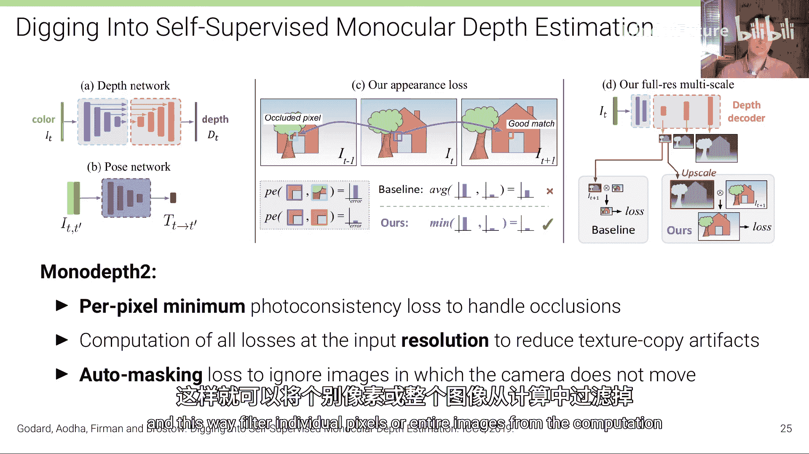
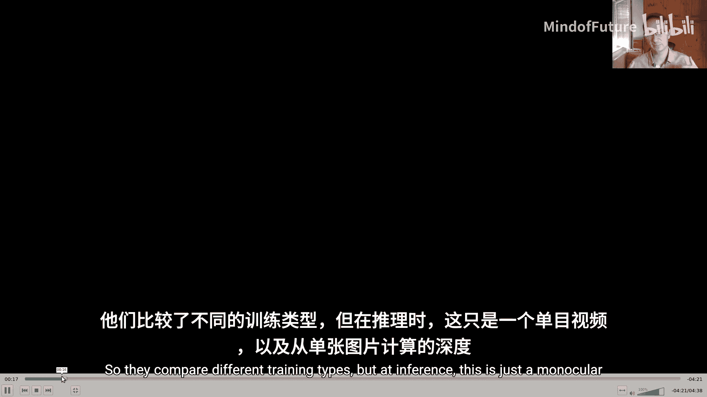
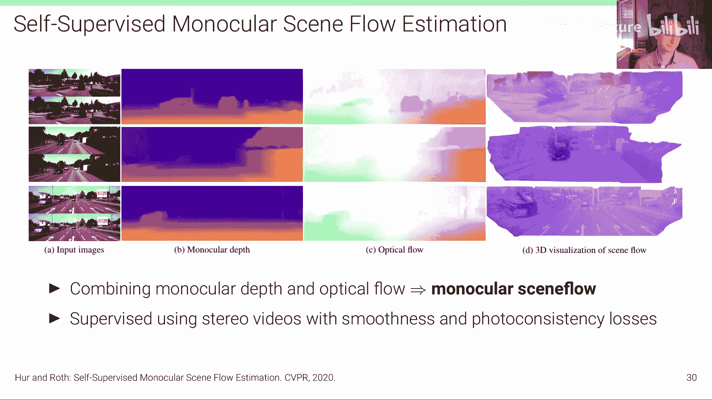

# 【图宾根大学 • 中英】计算机视觉 ML-4360 (Computer Vision) p40 P40 Lecture 11.2 (Self-Supervised Learning - Task-specific Models) -BV1S8N1emEef_p40-

T specific models。These are。Self supervised。Models that are specific to a particular target task。

 downstream task， as opposed to the models that we are going to consider。In the later units。

That are trying to learn generic representations independent of any downstream task。The first。

Case that we are going to consider is the case of。Unsupervised learning of depth and egomotion。

The task is as follow。The input at training time is just monocular videos that we can just download from the internet。

Or record using a camera that's attached to a vehicle in this case here， for example。

And what we want to do is we want to train two neural networks。The green one and the red one。

 the green one is a depth neural network。A convolutional neural network that takes a single image。

As input and produces from that single image。A dense step map。That's a so called single image。

Depth prediction task。And we have seen a model for this task already， but this model was supervised。

Was trained in a supervised fashion。Here we assume that the ground truth of depth is not known。

 but we want to train these parameters of this green model。Without access to such information。

Which is of course， much more challenging。And it might seem a little bit magical at first glance。

 even how this is ever possible， but we're going to see。

That it's actually not quite as hard as it might look like in the first place。

And the second network that we're going to train。 and that's important actually， to learn this task。

 you can only do these two things jointly。 You can do them without。With only either of them。

The second network that we're going to train is dispose pose in and in red that takes two a in frames and predicts the relative camera motion。

 the rotation， 3D rotation matrix， and the 3D translation vector， six degrees of freedom。

And we want to train the CNnNs to jointly predict the depth from the relative pose from。

Two or three adjacent video frames。那好。Are we going to learn these networks without any supervision？

What we're going to do is we're going to get inspired， by the way， classical。嗯。Optical flow。

 for example， techniques were optimized and we're going to use。

The photo consistency assumption that these models have been using for optimizing the flow field。

For example。To now not optimize a per pixel optical flow。

 but to instead optimize the parameters of the green and the red network。

And this is illustrated here on the right。So we're going to try to create a photocon loss。By warping。

The source views， so here we consider a free adjacent views。

 this is what has been considered in this paper here， CVPR 2017。

Because it makes training a little bit more stable。

It's more information if you do it for the previous and the next frame。

 so we have to target frame here， this is the frame at time T。

 and then we have the previous frame at time T minus1 and the next frame at time T plus 1。

And the frame at time T is called the target view， and the frames at time t minus1 and T plus1 are called the source views。

And what we're going to try to do is we're going to try to learn the green and the red network parameters。

Such that。When they make a prediction， the green one predicts a depth map and the red one predicts the relative motion between frame T and t minus1 and between frame T and T plus1。

 this already6 degree of freedom Richard motion transformation here called T， this is R and T。

When the network predicts these two networks predict these two quantities。We can take。

Any point in a target view？And because we know the depth map， we can， of course， project it to 3D。

And because we know the relative pose between the two frames。

We can project that point onto the previous frame and onto the next frame。

So we know the correspondence from frame T to frame t minus1 and t plus1。Which is implicit through。

The implicitly given through the specification of a depth map and a relative pose。

 assuming the scene to be static。Just seen aesthetic。

Then we can take any point on that static scene and we know the 3D location because we have the depth map。

And then we can just。Translate and rotate it according to how the camera has moved。

And then this point is a 3D point in the camera coordinate system of the ever frame。

And then we can project it back using the calibration matrix into that image plane。

 and this is where the point。The pixel is then found the corresponding pixel。Because we can do this。

 we can take any pixel in a target view and project it into the previous and the next frame。

We can we can warp effectively the source view 1 and the source view 2 into the target image。

And then in the target image， we can compare the pixels。

 we can compare the pixels of the target view to the Warped source view1 and to the Warped source view 2。

 and only if。Assuming lumerian scene and photo consistency and aesthetic static scene。

 just ego motion， just camera motion。So making all these assumptions。

What should happen is that if the predicted depth and the predicted motion is correct。Then the same。

Sne point is observed at the same pixel。 Nevertheless words， if I war this。Frame here to this frame。

And I take the difference。The difference should be 0。Or if I take this source view too。

 this is the next frame and warp it into the reference frame and take the difference to the reference image。

The difference between the RGB pixels。It should be zero because I have worked the sourcefuse according to the predicted depth and the predicted pose。

However， if the predicted pose and the predicted depth are incorrect。

 then there will be a discrepancy。And I can use that discrepancy， that photo inconsistency。

In order to。Back propagate gradients to the parameters of the green and the red network and update these parameters。

So effectively we want to try to minimize the photo consistency for a lot of frames of monocular sequences。

 and this doesn't require any ground truth post or any ground roof depth。We just minimize photocon。

Here is the process illustrated again， this is the process for the warping。

 assume we have a pixel in frame T here the red one。

Then based on the depth that is predicted at that pixel。

We can project that pixel into 3D and then based on the rotation and translation between this and the source frame。

We can project that pixel into the source frame。And then we can a biline interpolate that means we can find a linearly weighted combination of because this pixel is not going to fall into a discrete pixel grid location is' falling。

Necessarily in between， because it's producing some real value。Not a discrete pixel value。

So we are bilinear interpoolating the color values。

And then we can take these color values and insert them at that location。

 and this is what we call the Warped image。So we take a bilineally interpolation step here。

And that bilinear interpolation step is also differentiable。

 so we can back propagate gradients through this， through the entire photoconistency loss all the way to the parameters of the depth and the post network。

 of the green and the red network in the previous slide。

Here's the formula for the projection process we have seen such a formula before。

In the case of hographies here in this case we use the depth。

 of course to predict the depth so the depth and R and t this is deposed depend on the parameters of the network and on the input images。

 it's not shown here as a dependency just for clarity。

 but this is theposed R and t and T is the depth for that pixel here。

And this is in homogeneous coordinates， so we have the augmented vector。

 we multiplied with the inverse of the intrinsic the calibration matrix of the camera。

Multiply with the depth。Then we multiply with R and at T and multiply with the calibration matrix in the end。

And this gives us the projected point。And there is actually a bracket missing。

 there should be a bracket here and a bracket here as well。As mentioned。

 we use piin enppolation to warp the source image to the target view and we call that then。I hat S。

 this is the warped source image into the target view。

And then we compute the photocon loss between the target and the warped source images。Just by。

Comparing RGB value differences。And we do this twice。

 we do this for the first source view and for the second source view。

 we have a photo consistency loss that we can just average。

This is an illustration of the architecture that's used in this particular model。

 this is a simple unit。Disite architecture here with a multi scale prediction loss。

Deev is predicted at multiple scales and then also the image is。

A warped at multiple scales to improve the gradient in flow and improve optimization。

 It's a very difficult problem， of course。It suffers from all the problems that classical stereo methods and opticalal flow methods suffer。

And in this case， we even need to train the parameters of a neural network， which are many。

 so we need to make sure there is a proper gradient flow happening。And here's the Post network。

Here the input is two images。And then after the encoder， the pose is produced， like in PostNe。

 and then there's another decoder here that produces an explainability network that can reweight the observations or reweightate the measurements in the photoconsency term。

 but we're not going to go into detail about this here。

The final objective for optimization includes this。Already mentioned photocon loss。

 but it also includes a smoothness and an explainability loss for almost all of these methods。

 it's crucial。To have a smoothness loss， like we had to introduce smoothness constraints。

 for example， for stereo estimation or optical flow estimation。

 otherwise the problem is too ill post。And the parameter that controls the strength of the photoconency loss with respect to the smoothness loss is a critical one and has to be tuned。

 this hyperparameter。But the smoothness loss is pretty standard。

 it's just a smoothness loss on the disparity map， we want the disparity map be smooth。Otherwise。

 we fall into a bad local minimum during optimization。What do the results look like？

Here had the results。Surprisingly。And these are results from 2007 to。

These type of methods produce much better results and you'll see some improved results in a second。

But in 2017 it was surprising。U to the community that the performance of this self supervised method was nearly on par with depth or post supervised methods。

Here are five examples， you can see the input image and the depth maps that have been produced。

 the ground truth， this is a method that has been fully supervised in terms of depth。

This is a method that has been supervised in terms of posts， the post was given。

 but the depth was self supervised。And this is the completely unsupervised method that estimates both depth and pose。

 and it has to estimate both otherwise the mapping is ill defined。And you can see that this。

Model produces sensible results， we can see the tree， we can see the car， we can see this car here。

 it does make sense， and it's quite smooth。But it also doesn't contain a lot of noise。

It's a really good result。😊，In contrast， for instance， this。Deft supervised methods。

They also produce good results， but。嗯。Because for example， here。

 the ground roof was produced using a LiDar scanner， wasn't available everywhere。

 they can't predict everywhere。If you extrapolate into this region， you will get very bad results。

While the self supervised method handles these regions easily because it has observed supervision。

It just wasn't labeled supervision， it was self supervised。So this was quite amazing。

 the performance was nearly on par with these supervised methods but。

This method assumes the static scene so it can fail in the presence of dynamic objects。🤧う。

What can we do about that？Well， another way of training。A monocular dev estimation network is。

In a self supervised fashion is to do that from stereo。

And the advantage of doing it from stereo is that。First of all， depending on the baseline。

 you can get sharper results。But also because this theory images have been taken at the same time。

There's no problem with scene dynamics， scene dynamics doesn't matter here。

Can completely cope with dynamic scenes doesn't get affected。This is a paper from。

Kay Bsov's group CBPR 2017。The idea is basically the same as the one that I've just described。

 so I'm going to go a bit faster。Just apply not to consecutive images， but to the stereo pair。

So here are three different models that they tried。And the right one is the final one。

 the left one is the naive model because it the naive model。The NeE model takes the left input image。

Run it through a CNN that produces a disparity map。

But because it compares that to the target is the right image。

 the disparity map has to be represented also in the right。Image coordinate frame Why is that well。

 because if I run this sampler this pilinear interpopolation mechanism then。

I can only interpolate points in one direction。I can only warp another image into the reference image for which I have the disparity map。

And so if I want to compare the left image， if I want to warp the left image here。

I need to do that using a disparity map that's defined in the right image frame。

That's not what we want， we don't want to predict the right image。Disparity map。

So what we can do is we can say， well， I take the left image and predict the left dising map and then I war the right image。

And this is the ver dry image， and I compare that to the left image。

Using a photo consistencyency loss， that works， but it suffers from artifacts as they found。

And what works even better is if you take the left image， running through a stereo network。

 run through a monocular depth estimation network that outputs not only the。

Dparity map for the left frame。Or left image， but also the disparity map for the right image produces both left and right disparity maps。

And then we can take the respective other image。 We have the left and the right RGB images and warp these。

And compare them to their counterparts。And the advantage of doing this is that we can now apply a consistency constraint between the two disparity maps。

 a left right consistency constraint we have talked about this in the context of stereo。

 which helps eliminating outliers and also helps doing training of the self-supervised technique here。

So here's a comparison。Here's the result with out left right consistency check and here's the result with left right consistency check and you can see that some of these artifacts at trees are here at the car。

Have been。Remod。In a follow up work， also from the same offers。

They looked into more general into self supervised monocular devestimation methods。

 both supervised using monocularar videos or also stereo videos。

And they introduced some improvements， for example。If we have three consecutive frames。

And we so let's assume we have these three frames and we look at this point here on the this is the surface point that we want to compare at the top left of this door。

 then we see that in the first frame it's occluded， so the appearance is very different。

the second and the third frame， in the reference frame and the next frame。It is unoccludeed。

 which means weve got a low photoconistency arrow， while here we have a high photoconencyarrow between these two。

The baseline approach that I explained previously took the average of these two。

So it basically it says， well， despite the fact， what this implies is that despite the fact that the correspondence has been correctly estimated。

It assigned a relatively high。A phototo consistency loss， meaning that。嗯。The model was told。

That this is not a good match。But it actually was a good match。

 it was just occluded in one of these frames。But however， if we have three consecutive frames。

Then if a feature is visible in the central frame。It has to be visible at least in either the previous frame or the next frame or in both frames。

So if we take instead of the average， we take the minimum。

 then we ignore this occlusion effectively and we're just taking the best of like this correspondence match and this correspondence comparison and this leads。

 of course， to a。Small for the consistent or small appearance loss overall。

And this is one of the contributions that they have。

The per pixelel minimum photo consistency loss to better handle occlusions。

Then they have another improvement or the show that if we compute all the losses not at the multiscale resolutions。

 but warping them back up， scaling them up using also biin interpolation to the input resolution。

 this can avoid some texture copy artifact so by using a multiscale architecture。

 but then for computing the loss they warp also the low resolution depth map back to the high resolution and then they compare the higher resolution images。

And then they have another improvement which is about auto masking。

 so if they detect that the camera stands still， which for instance。

 in Achi data set happens from time to time， and then the problem is becoming completely ill post。

If the camera is still， then any depth type is valid， right？

So estimation becomes completely illposted that harms if such cases occur frequently in the data set that harms training these networks。

 so it's good to mask them out and what they do is they basically just compare like how pixels overall change in the images。

Between adjacent frames and this way filter individual pixels or entire images from the computation。

And they get quite amazing results， I believe。So here is the previous method。

 which was still quite blurry despite producing something reasonable。

 but then this so called improved monode 2 version leads to significantly sharper depth boundaries and more details and I linked the video here I will briefly play。

Play it。So they compare different training types， but at inference。

 this is just a monocular video and a per frame computation of depth from a single image you can see。

How accurate that is， given that。The downstream task is already very challenging。

 and then the supervision was done using pure self supervision。No depth labels involved。

You can see some arrow here on there， the boundary is a little bit overs smooth。

You can see in particular errors where you expect them at reflections， etc。

But you can also see how accurate the ground and the objects in general have been recovered。Okay。

So if we want to see more， can click this link。So finally I want to show you that these type of techniques。

 of course， also work for unsupervised learning of optical flow we can use exactly the same ideas。

 This is a method from Stephen Rhos group。From 2018。

And what they do is they use so called bidirectional training， they use a flow net C。Here。

 the gray one。And they use the same flow and see that's why it's called why we have weight sharing here。

 so they use the same network。In the upper case here with i1 and i2 givenness input and in the lower case with i2 and i1 so we flipped the two images and effectively we produce a forward flow and a backwardboard flow and we want to train this network is a single network。

 just apply twice。We want to train the parameters of this network such that both the forward flow and the backward flow are accurate。

And。This is。Mostly it is all illustrated in this very nice plot here。

 so it has of course also a smoothness loss， otherwise this is really ill post and doesn't work。

And here we have this network that's applied。With the inputs swapped to yield the forward and the backward flow。

And then using that flow， they're simply happening a warping of the first or the second image respectively。

To yield the warped first and the warped second image。

And then there's also a forward backward consistency check here in order to retrieve occlude areas that can be done masked from the data loss。

And there's this consistency loss where also these occlusions have an influence on。

So in total they have free losses， they have a smoothness loss。

 they have this data photo consistency loss。And they have a consistency loss between the flow fields。

 they want to encourage that it like left right consistency or and stereo here they encourage that there is a forward backward consistency of the flow if I take a pixel in the first frame and they're projected using the forward flow。

And I take the flow at that pixel in the second frame and project it backwards to that。

Pixel is the same。And these are some results from left to right， the columns are a supervised method。

A unsupervised baseline and their approach and on top is the color coded flow field and in the second row respectively we see the arrow map where white indicates large error and black indicates smallarrow。

 it's just very difficult to see the arrow in these flow fields。

It's much easier to see here and you can see how this method produces quite reliable flow estimates。

And you can also do the same game for a Sflow estimation for monocular Sflowlow estimation。

 which is a difficult task， so from just a monocular video sequence you want to now predict the depth at each frame。

 but then also the 3D motion of each of these 3D points。

It's a combination of monoclocular depth and optical flow。

 and you can use the same ideas of self supervision here using now stereo videos。

Videos where we have a stereo camera for supervision， but then at inference time。

 only a monocular camera for making the prediction。The stereo videos are just used for self supervis。

