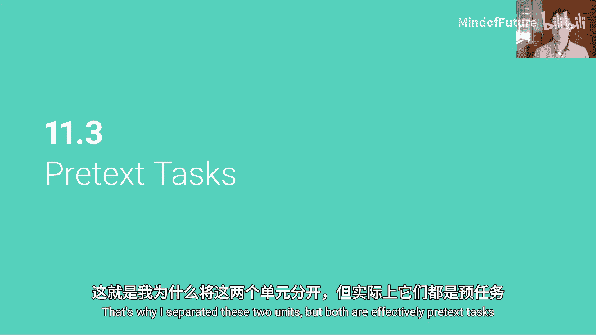
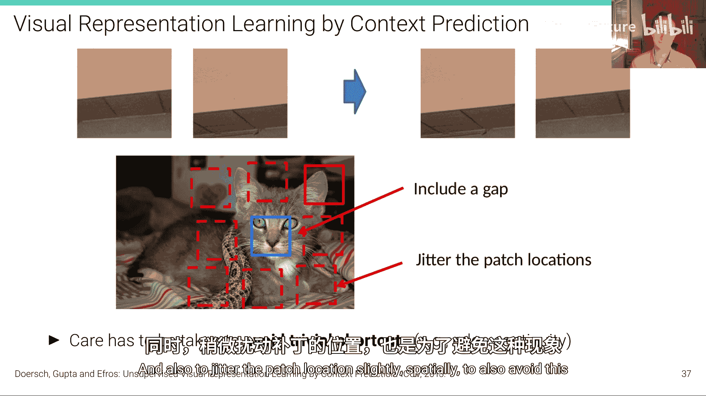
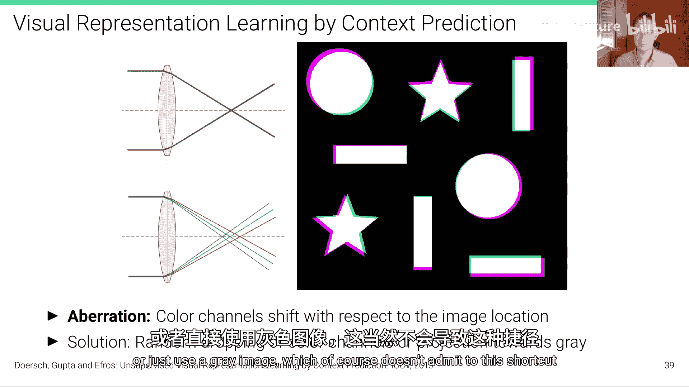
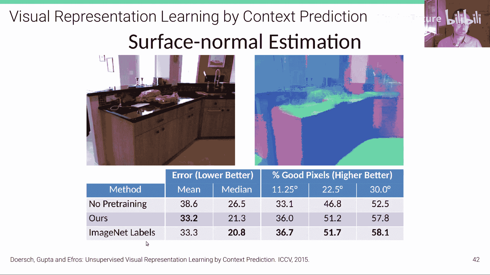
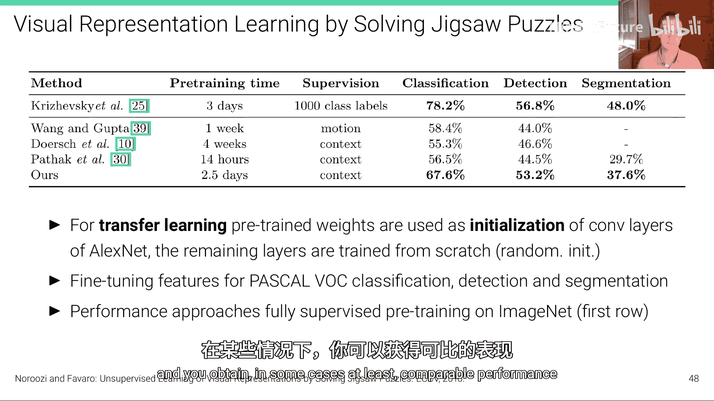
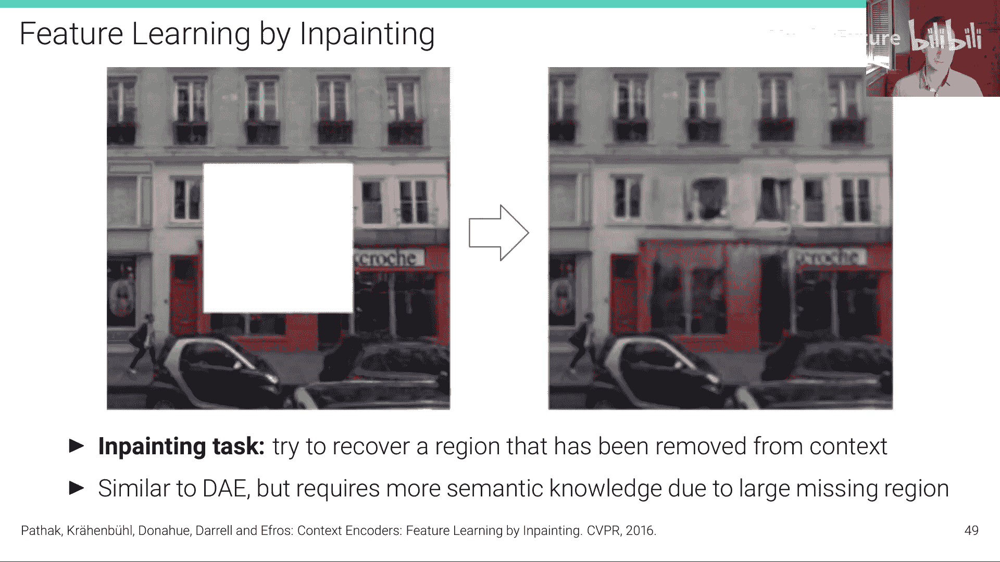
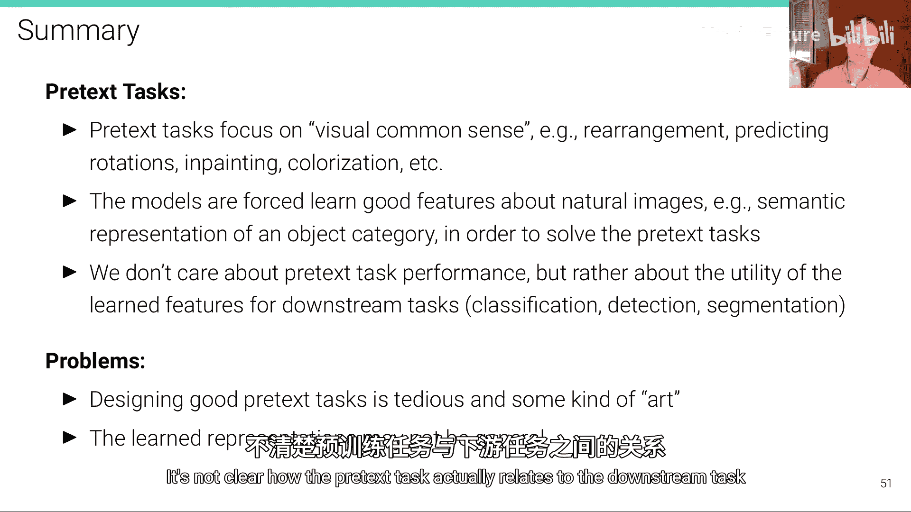
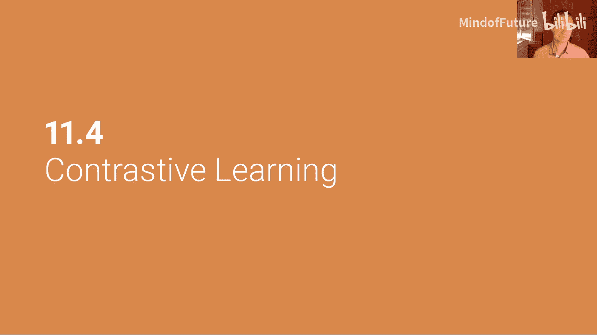

# 【图宾根大学 • 中英】计算机视觉 ML-4360 (Computer Vision) p41 P41 Lecture 11.3 (Self-Supervised Learning - Pretext Tasks) -BV1S8N1emEef_p41-

Pretext tasks。Actually， both this unit and the last unit of this lecture cover pretext tasks。

But the last category of pretext tasks that we discovered is so called contrastive tasks。

Have developed into their own field， that's why I separated these two units。

But both are effectively pretext tasks。What is a pretext task？So far。

We have looked at self supervised models which were tailored towards a specific downstream task such as monocular depth estimation or optical flow or Sc flow estimation。

Now， in this unit， our goal is to learn more general neural representations。Using selfsvision。

Towards this goal， we're going to define a so called auxiliary task， a pretext task。

 such as predict the rotation of an image， a random rotation of an image the image has been randomly rotated like the image of this bird。

 and we want to uncover what is the canonical orientation of that image。

And we're going to use this auxiliary， this pretext task。

As a auxiliary task for pretrain in the hope that thiss this leads us to good features that we can then reuse for the downstream task of interest。

So we define an auxiliary task such as rotation prediction for pre training。And for this。

 of course we have lots of unlabeled data， we can just download millions。

 billions of images from the internet。And then we can rotate them。And asked the network。

 what was the rotation that I did？And I can rotate them arbitrarily in arbitrary step sizes。

For example， I can take any of the 90 degree possible rotations and ask the network by how much has this image been rotated？

So this is the pretext task， we take a lot of unlabeled data。

 we define such a convolutional network on a pretext task where we have a few convolutional layers and some fully connected layers and in this case we want to classify either of four possible orientations in this case 90 degree would be the correct answer。

嗯。And then we throw away these last layers here in white and just keepvol the weights of the convolutional layers。

So called feature extractor。And copy that。For the downstream task。

Let's assume the downstream task is not rotation prediction， but is classification。

 we want to classify that there is a birdt in this image。

And then we have a small amount of label data， maybe 20 instances。

 where we have images with birds and other objects。

And we have the labels for these 20 birds and 20 dogs and 20 cats。

But because there's only 20 images per category of all there's a very small data set。

 we cannot afford to update all the parameters of the network。

But we hope that these parameters that we have learned in the pretext task are already good。

 they are general， they are semantic in some sense。

 such that it's sufficient to just add one or two more layers and just train these layers。

 for example， just one layer， a linear classifier。And obtain good performance from this model。

By having transferred。The large chunk of parameters from the pretext task and just adding a little small readout hat to that network that has to be trained and it can be trained with less data。

And then we evaluate this network on the target task， which is classification。

Now what is prett what is a pretext task in general， so I copied this from Wikipedia， a pretext。

A pretextual task is an excuse to do something or say something that is not accurate。

Pretext may be based on a half true or developed in the context of a misleading fabrication。

 pretext have been used to conceal the true purpose or rational behind actions and words。Now。

 clearly this is not what we want to do， we want to find a pretext task。

That is somewhat related to the downstream task， yet it is a pretext。

 it is a replacement for what we want to actually do。And we do this because it's easier。Right。

As in this example， it's easier to tell my wife， I'm going to the library every evening。

Rather than telling the true story。Okay。So here's another like now in the following slides。

 we're going to look at a couple of these like。Of these pretext tasks that have been proposed in the literature and admittedly they are all quite hand engineered。

 there is no theory， at least not yet underlying this pretext task， there's just empirical evidence。

For each of these pretext tasks， that they empirically work well。

 that empirically when copy the weights and apply them to some downstream task where we just fine tune in some layers。

 or maybe a few iterations of all layers。That we can get away with less label data for the downstream task。

Okay， so here's another pretext task。This is called learning by context prediction as one of the first one from Drscheel in ISCV 2015。

In this task， the goal is。From two patches to predict the relative location。

So we're taking a center patch here in blue， and then we're asking for this patch here。

 we're just observing these two patches and we're asking the network to classify。

If the red patch was at this location or this location or this location， etc。

There' is8 possibilities。 So it's a8 way classification task。

 Given this blue patch and the red patch， there's8 possible。

Locations how the red patch could be located with respect to the blue patch。

So the goal of context prediction is to predict relative position of patches。

 relative position of patches， it's a discrete set。

And the hope again here is that this task requires the model to learn to recognize objects in their parts。

The task is designed in a way that if the model wouldn't load something interesting about how objects are composed。

It wouldn't be able to solve that task。To understand this a little bit more。

 let's play a little game。 This is actually the game that has been。

In the teaser figure of that paper， you will find it if you look up the paper。

Can you identify where the red patch is located relative to the blue one？

So I give you five seconds too。Do this forward experiment。Probably， if you look at these two patches。

 probably what he will say is， well， this is the front of a bus。And this is the。

The left back of a bus， so it's likely that this page is at the bottom right of this page。🤧嗯。

It's unlikely that it's at the bottom。Because I would have to show the front of the bus。

It's unlikely they would be to the left because it would have to show some background。Similarly here。

This patch is more likely to be on top of this patch because it shows the top of the train and this shows the bottom of the train。

If a model， a neural network wants to do the same task correctly。

 you can already see that has to gain some knowledge about objects in the world。

 and that's what we are leveraging here。This is the architecture that was used。

There's these two patches coming in， there's a Siamese kind of architecture here with convolutions and pooling until we have a fully connected layer。

And then the output of this fully connected layer is。It's concateninated。And then there's。

A small number of fully connected layers in order to make classification。This sounds all great。

 but there has。Some care has to be taken。In particular， we have to take care。

That the neural network doesn't take any trivial shortcut solutions。

And that's really what's happening in practice neural networks don't do what you want them to do。

 they do what's easiest。For example。If we take patches that are directly adjacent to each other。

The neural network can， instead of。Understanding the object in terms of its semantics。

 just look at edges and try to align the edges if it sees that edges are aligned。

 then it's likely that this patch configuration here is more likely than this patch configuration like left and right are swapped。

Because of this continuation of this edge。So we need to distract the model from looking at this。

 from exploiting dis trivial shortcuts， and the way this has been done in this work is to include a small gap between the patches to not make them directly adjacent to each other so such that edge continuity can be exploited。

And also to jitter the patch location slightly， spatially。

To also avoid this phenomenon。Yeah。There is a more subtle shortcut。

And I can clearly remember when I was at ICCB， 2015， wasn't Chile。

I was standing in the back of the big lecture hall where this paper was presented and I was just immediately catching my attention because I was just。

 I wasn't believing it in the first place。So they found out there is another shortcut。

 and it was quite tricky to actually understand where it comes from。

In order to understand where it comes from， the shortcut that the network was exploiting in order to overcome having to actually learn more semantic。

 meaningful representation。Was that the network had actually an easy time to predicting the absolute image location。

And if a network from just observing a patch is able to predict the absolute image location。

 then the relative location of patches can be easily inferred， obviously。So why is this happening。

 the authors ask？And they did a little experiment。To understand this。

I to first verify that this is actually happening。So they took images。And cropped patches。

At random locations。And then trained a neural network。To predict。In a supervised fashion。

The absolute image location of each patch。Give them just a patch and no other information。

The network had to predict that this patch here， if it sees that patch。

That patch appears in the top right。And here on the right。

 you can see the results and you can see that it's actually working。

The network that's just observing this patch is able to predict the absolute image location。

 how is that possible， where is this image location encoded in this local patch？

How can the network learn？That this part of the image is should actually be on the right of the image。

 or this patch here should actually be on the left。Here's the solution。The solution is that。

Some cameras， some camera lenses shift color channels。Differently， depending on the image location。

 in particular， bad cameras with bad lenses suffer from so called aberration problem。

And we have discussed aberration already。In the image Form lecture。Aberration comes from the lens。

Reflecting light of different wavelength differently。And that means that there's a color shift。

Of the different color channels。A spatial shift of the different color channels。

 and that spatial shift is。Dependent on the location and the image。

And the model can exploit that fact， can just look at the local can learn the local color shift without ignoring everything else。

 ignoring texture， ignoring semantics， ignoring what's happening in the patch。

 just trying to figure out the color shift in order to predict the location。

 and that's what was happening。The solution to avoid this trivial trivial shortcut for the network was to randomly drop color channels or project project the colors towards a gray channel or just use a gray image。

Which， of course， doesn't admit to this shortcut。

Yeah， okay， so now having solved is trivial shortcuts。

The network was actually able to learn something semantically meaningful。

 that can be transferred to downstream tasks， and so they tried this for object detection。

 for example。This is an RCnN that we have discussed already。

 and what they did is we trained these convolutional neural network features using this pretrain technique using context prediction。

Without any labels。And then they used the small then they used。A smaller set。

 a training set for training the remaining parameters。

And fine tunening the remaining parameters of the neural network。

And what they found is that if you don't use any pre training。

You obtain significant divorce results compared to the results that they obtained using context prediction for self supervision。

For pre training。And while the performance is not yet on par in this case。

 with pretrain using imagenet labels， also because this is a very semantic and it's a recognition task。

 so it benefits really from these supervised semantic categories。It's quite impressive that。

The performance is already rivaling the performance of fully supervised。Imagenet。

 huge amounts of data pre training。Without any labels。

And it also works for surface normal estimation， so here are results for surface normal estimation。

 which is a completely different task， but again they observe that without pre training。

 the results are significantly worse and they sometimes even outperform。The Inet pretrain models。

 and in this case， it also makes more sense surface normal estimation is a task that's very different from recognition。

Therefore， it's harder for a recognition。ADa set to pretrain。The parameters of this model well。

 and so it's easier to compete with these supervised methods here。

What they also did in the paper is they looked at what the network。

 what the visual representations actually are， what the network has learned。

 and one way to do that is we've discussed this already in the deep learning lecture is to just find nearest neighbors。

So for this particular queries here， they tried to find the nearest neighbors in the feature space。

And they compared random initialized network AlexNe and their self supervised method。

 and they found that。In many cases， random imization doesn't give you meaningful results。

But their retrievals are actually semantically meaningful in a way that also the patch is retrieved using imagenet pretraining。

R， as you can see here， for instance， for。This。What body image there's a lot of water images retrieved for horse legs。

 there's a lot of horse legs retrieved for this cat， there's a lot of cats retrieved and so on。

This is another。Pretext task is called jigsaw puzzle。

In a jigsaw in a jigsaw puzzle pretext task idea is to just randomly permute。

A free by free tiled version of the image and ask a network to recover。Like in a jigsaw。

 puzzleel recovered the original image。Now because there is nine factorial different permutations。

 which is very large， this is two large classification problems， so they restricted themselves to 1。

000 possible random permutations that they have predefined。

And these permutations have been chosen based on the hemming distance to increase the level of difficulty。

 so they try to find particularly hard perutations。To make the model learn better。

This is the architecture there's this。Nine patches that are fed pered first and then fed into this convolutional architecture。

 and then the features are fed into this MLP for 1。

000 way classification and that's then used for back propagating and training these models。

Also in the case of jigsaw puzzles， they had to make sure to print shortcuts and the story is similar to the story from the previous paper。

 also the methods have been developed at similar times。These shortcuts happen because。

They are useful but the shortcuts are important for the model because they are useful for solving the pretext task。

 but they are not relevant to the target task， that's why we want to avoid them。

One shortcut is low level statistics， if you look at the chasing in patches。

 they often include similar low level statistics like the mean and the variance and the solution that they applied to this problem to solve this problem is to normalize the patches based on their mean and variance。

Then also edge continuity， we talked our already about this。And so they。

Also selected 64 by 64 pixel tiles randomly from larger cells。Effectively。

 also applying some jtering and。A padding。And then the same is also true for chromatic aberration。

 and they basically applied grayscale images or applied a spatial chdter to each colored channel by a few pixels to avoid this。

Shortcuts is in a general an interesting problem for learning deep neural networks and if you are interested more in shortcut learning I can highly recommend this paper here from Mattias Baka group in Tuingham called Shortcut Learning in Deep neural networks。

Here are the representations that are learned by solving jigsaw puzzles。

 you can see they are meaningful， there is this low level statistics learned in the。

Earlier layers of the network and then as you go to more。To later layers you get more semantic。

The meaningful activation， so these are the patches that activate particular neuron。嗯。

So here also they applied this representation to Pascal VOC， classification， detection segmentation。

 this is one of the famous challenges from a few years ago。

And what they found is that their performance， in some cases， for instance。

 in the case of object detection was already rivaling the performance， despite now。

This being a recognition task of。ImageNe fully supervise free trained models。Using same architecture。

Same pre training time， but just without labels。So here this first row is pretrain on ImNe。

F tuned on Pascal VOC， this was the standard paradigm。Up to then。But they have shown that actually。

 you don't need this image in the data that you can also pretrain using。Such pretext tasks。

 and you obtain。

In some cases， at least comparable performance。

This is another pretext tasks called Im and paintingin。 It's a little bit related to the。

Denoizing auto and coded that we have already seen。

But in contrast to the dennoizing autoing quoted requires more semantic knowledge because here now。

 not individual pixels but entire large regions are masked out。

And the key the task now is to try to recover。This region that has been removed and to recover that from the context alone。

 you can see that the model actually can do a decent job in doing that。

stateate of the art methods today， five， six years later are much better than this。

 but already in 2016， where things like semantic segmentation and image level reasoning with neural networks was quite new。

Results like this could be achieved。And then this。In order for the model to。

 to actually perform this， well， it has to learn something about how。The world is structured。

It's always the same idea。This is the image rotation prediction task we've already seen in the teaser。

The goal is to predict in which orientation the displayed image is shown。

 the images are artificially rotated and the output is a far way classification。

We tried to recover the true orientation。And again， in order to recover the correct orientation。

 the premise is that semantic knowledge is required for solving that task。

To summarize the pretext task unit， pretext tasks focus on visual common sense。For example。

Rearrangement， prediction of rotations in painting， colorization， etc。

The models are forced to learn good features about natural images。For example。

 semantic segmentation of an object category in order to solve the pretext tasks。

 so they have to implicitly solve this harder task in order to solve the pretext tasks。

 that is how the pretext tasks have been chosen。We don't care about pretext task performance。

But rather about the utility of the learned feature representations for the downstream task that we actually care about。

And this task that we actually care about could be image classification， object detection。

 semantic segmentation， depth estimation， normal prediction， etc。

Now the problem with this is that designing good pretext task is tedious and still some kind of black art。

And there's no good theory around this， so it's not clear how to construct better pretext tasks。

And another problem is that the learned representations may not be general。

 it's not clear how the pretext task actually relates to the downstream task。

And that's what we're going to look at next。

