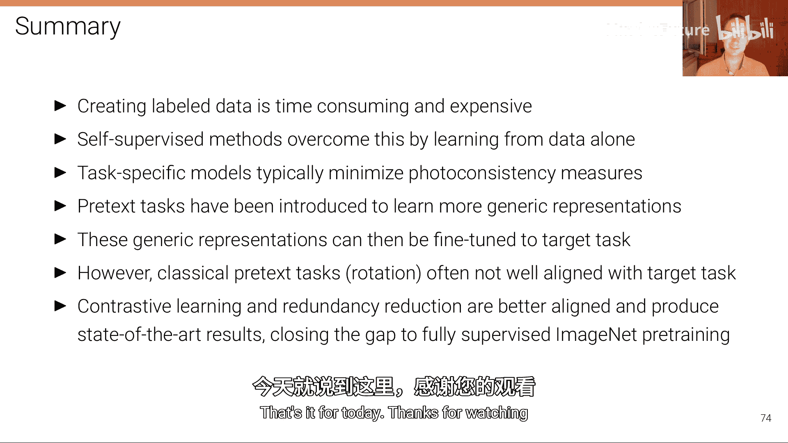

# 【图宾根大学 • 中英】计算机视觉 ML-4360 (Computer Vision) p42 P42 Lecture 11.4 (Self-Supervised Learning - Contrastive Learning) -BV1S8N1emEef_p42-

The last unit is about contrastive learning。

What is the problem with the pretext tasks that we have discussed so far？Well。

In this pretext task for pretaining the large chunk of parameters in the neural network。

 we were considering a task。That at first glance is completely decoupled from the downstream task。

For example。Here in this case， we are trying to solve a chiigsaw puzzle for pretrainining the parameters of the neural network。

And then we're attaching small， linear or MLP。Readout hats to this network and training the parameters of these readout layers using fewer supervised examples。

On the actual downstream task， which in this case is image classification。

 but we don't know that this jigsaw puzzle solution task is actually related to the downstream image classification task。

How should we know？We don't know， and as I mentioned。

 there is no theory that we can use here it's all empirical。嗯。

So what we do in other words is we hope really hard that the pre training task and the transfer task are aligned and try to find better pretrain tasks。

They are better aligned with the downstream task， and that's what contrastive learning is about。

So here is another illustration of the problem of this pretext feature features learned from this pretext task。

 for example， in the case of a jigsaw puzzle。What happens if we attach the reddoant hat a different。

Layers of that network。Is illustrated here in terms of。In this case， MA of the downstream。

Task performance higher is better， the task doesn't really matter here for this purpose of this illustration。

What we observe， however， is that the pretext feature performance saturates。

So if we go to later layers， more semantic layers。Layers that should actually be better。

For our downstream classification task and we attach our linear readout there。

The performance satates or even drops at some point。What is the reason for this？Well， the reason is。

That's。The pretext task， the jigsaw puzzle task is too different from the image classification task and that the last layers then therefore have specialized for their pretext task。

 the last layers are very specific to solving jigsaw puzzles。

Are very specific to solve context prediction。Or two rotation estimation。But they don't contain。

The semantic knowledge required for solving the image classification task， and so performance。

Thegrades。The question is now， can we find a more general pretext task？What is desirable。

 Well the first thing that's desirable is， of course。

 the preted feature should somehow represent how image relate to each other。 So， for example， images。

Even if slightly altered。Of the same object of a cat。

Should be in the same feature in the same area of the feature space。

And images of different animals should live in different areas of the feature space。

But at the same time， also。The feature should be invariant to nuisance factors such as the specific location of the object or the lighting conditions or the color。

 etc。So all of these versions， and you can recognize some of the pretext tasks that we talked about before。

All of these versions here。Should be similar to this one here。

But what we are now going to do in the context of contrastive learning is not to try to predict some information that has been lost。

But rather to try to make those similar directly。And so we can use any augment that we want。

These augmentations that we generate from a reference image， this is the reference image here。

Are called views， so this is one view， this is another view。

 this is another view in this community they are called views。Just to introduce them。

Terminology already。So in short， we want to build a model where。For a particular reference image。

Different views of that reference image。Our closing feature space。But。

Any view of any other object is further away， and that's at an intuitive level。

 exactly what's happening。How do we implement this？This is the picture from before。

 you can see the reference here called X。 and you can see the。Positive examples。

 which are different views。alterations through data augmentation， we've removed some part。

 we've rotated it， we've changed the color， we've cropped it， etc。But they should all be similar。

And then we have x minus， which is a negative that's from a different image or a different region in an image。

That's very far away from the region of interest。So we can call this a negative。

 these are positives and these are negatives with respect to the reference。

And what we want to do now mathematically is given a particular chosen scoring function s。

 we want to learn an encoder network F that yields high score for positive pairs， x as x plus。

 and low score for negative pairs， xx minus， or in other words we want the score of f of x and f of x plus to be larger than the score of f of x and fx minus。

And we're going to formulate this as an optimization problem。This is Steve。

D factor standard contrastive learning objective that we can consider As we have one reference。X，1。

 positive and n minus-1 negative examples。 The positive examples called x plus。

And the n minus negative examples are called x minus J。

Now consider the following multiclass cross entropy loss function。

 This is a standard multiclass cross entropy loss function as it is used。In imagenet classification。

 except。That now we do have the scoring function inside。

So the loss is minus the expectation over the entire data set it is composed of。

Each of these samples is one reference， one positive， and n minus one negative examples。

 and we have many of those that we can generate， we can draw from a data distribution。

So this's expectation over the entire data set of the logarithm of this。Exponential of。

The scoring function of the reference to the features of the reference to the features of the positive example。

Divide it over the sum of the positive and all the negatives。find。You can see this。

There's a soft mark here。And this is commonly known as the InfoMCE loss。

 as has been coined by Fund orD Ad all in 2018。And the interesting thing about this objective is that it's。

It's negative。mininus L。Is a lower bound on the mutual information between f of x？And F of x plus。

Between the features of all the reference reference images or patches。

And all the corresponding positives。And the detailed derivation of this is given in or 2018。

 the paper is linked here at the bottom。we don't have time to go into detail here in this lecture。

 the only thing that's important here is that the mutual information between these two。Features。

Is bigger or equal than the logar of n minus L。And the larger the negative sample size and the tighter the bound。

That's another crucial takeaway， we need really a and large negative set for this to work。

But what we can see here from this equation is already the key idea that we're trying to follow。

 the key idea it namely is to maximize the mutual information between the features extracted from multiple views。

Which forces the features to capture information about higher level factors this is the goal here we want to maximize we want to minimize the loss。

So we want to maximize the mutual information between。Multiple views。Of the reference image。

This is what this objective here tries to do。And if you do that， here's one particular method。

We don't suffer from the problem that I just mentioned。

We can also take features at later layers that are still well aligned with the downstream task in this case。

Image and classification accuracy。There's a couple of design choices for these contrastive methods that we can consider。

 and there's also a couple of problems related to it。For example， the large amount of negatives。

That lead to very large memory requirements。And so we're going to discuss these different design choices and problems in the following。

The first design choice is the scoring function， we haven't talked about the scoring function so far。

We've seen there's a feature。Function that produces a feature vector。From an image or a patch。

So text this image， produces a feature。It takes a view。

 an augmentation of this image and produces another feature。

 and then there is the scoring function and the most common choice for the scoring function is simply the cosine similarity。

 which is the inner product。Between the features divided by their norm。

If you remember the lecture on stereo where we're also discussing Siamese's network similar to here。

 this is also Siamese's network because the features are computed with the same network from the inputs。

We're using the same score function。The second design choice is how to choose the examples。

 the positive and the negative examples。In contrastive predictive coding。

 these examples are taken from the same image。In a way that related examples are chosen from nearby regions。

 for example， here the crown of the tree and unrelated negatives are chosen far away。The more common。

😡，Scenario nowadays is so called instance discrimination。Well。We say， well。

 all the patches from the same image。And the image has to depict not an entire scene。

 it doesn't work with scenes with multiple objects， it has to be something like image network。

 there's a single object， it's a very simple scene like this tree here。

But then if it's a single object。I say that all of the patches that are related。

To each other or all the patches from the same image are related to each other because all of them are somehow showing a tree。

And the unrelated ones are， take any random different image。

And take any random patch from that different image that's called instance discrimination because we're discriminating instances。

And the third design choice， the third axis is augmentations。There we have a big playground。

 but now in contrast to this pretext tasks that we have to find before we can combine all the augmentations that we want and that's what's happening in practice and what's really important for making these methods work。

For example， we can crop the image， we can resize the image， we can flip the image。

We can rotate the image or cut out a region from the image。

We can also drop some colors or jitter the colors。 we can add Gaussian noise or Gaussian blur or compute edges。

One of the top performing performinging methods in this space currently is called Simcl。

For a simple framework for contrastive learning。It uses a cosine similarity score function。

Right now we have C here as the arguments。嗯。Which is the features one before。

 but I'm taking the figure here from the paper。And what you can see here is that Simpliier takes the input reference image and produces two different views through randomly sampled augmentations。

And it runs the network F that we're interested in。

 this is the network that we optimize for to produce a representation。

 and on top of that it runs a projection network。Which we are not interested in and which is thrown away after training。

Which produces C。So this representation we are interested in。

 but the C is only this projection is only required for better training。And。

I do believe this is also。Required similar to the pretext task that we discussed earlier because。

The task itself is not directly related to the contrastive learning objective， the downstream task。

 so it helps to take earlier features， in other words。Similar to before。

 and the another reason for having a projection network is that we can also project into higher dimensional spaces so we can play with the dimensionality here。

 and that also makes a difference。So F is what we want。

 G is an auxiliary network that we use during training but throw away afterwards。

And improves learning because more relevant information is preserved in H。

 which is discarded later in C as it's closer to the contrastive learning objective。

Here are some of the augmentations that are used， you can see crop and resize， color distortions。

 rotations， gash and noise， ga and blur， all the things that we discussed before。

And it turns out that actually these augmentations。

 having a diverse set of powerful augmentations is really crucial for getting good performance with these methods。

This is the a pseudocode of the method。It's actually quite simple to understand so first we draw two augment augmentation functions。

And。Then we generate a positive pair by assembling data， this data augmentation function， so we have。

The first one T of Xk and N T。A prime of Xk that produces these two views。

The first and the second view are the first and the second augmentation。And then we run the network。

 we run the representation and the projection network to get H and C for each of those。

And then we define here the info NCE loss that we discussed before。And we iterate through。

And use each of the two n samples as references and compute the average loss。You can see we have。

The sum goes from k equal 1 to n， but we have in the lightus loss， we have 2 k minus1 and 2 k。

 so we have it twice。Because each of these pairs serves as a reference。

 and then the other view is deposit positive while all the others are negatives。

So this is how the losses。Implement it。And it works amazingly well。

 so here we see results you can also compare it to some of the older methods like rotation and instance discrimination。

And it produces much better performance， this is top one accuracy on INe compared to the supervised method。

You can see that if we increase the number of parameters， this is a model that has。

Is four times wider than this model。We are on par with the supervised pretrain model。

And in this setup here we train the feature encoder on ImNe on the entire training set using SimpA but without labels。

 and then we freeze the feature encoder and train linear classifier on top with label data。

What's happening here is that we train the feature encoder on ImNet again on the entire training set using selfsvision。

 and then we find tune in the encoder with only 1% or 10% of the label data on ImageNet。

So this is a much smaller data set now for find tuning。

And what can be observed is that in these cases， we significantly outperform now this supervised baseline。

That doesn't that has only seen this 1% or 10% fraction。Of the supervised data samples。And of course。

 if we have just 1%， then the performance gain is even larger than we have 10% of data for the supervised baseline。

However。A large training batch size is crucial for Sclair。

What we have here is for a different number of training epochs， we have the batch size from 256。

 which is already pretty large。To 8129。And you can see that the top performance respectively is achieved at around 2000 or 400 negatives。

And this is problematic。 Remember we have a Siyamist network。

And we need to forward pass and backward pass through all the negatives for training。

In the forward path we have to store the activations and the backward path we compute the gradient。

 so it's a huge memory requirement， and that's why this type of model can only be trained at Google Sc。

 so can be trained on Europe。GPU， not even the GPU node with8 GPUus at home。

But it requires distributed training on TUs in this case， for this imagenet experiments。

So this is not nice， this makes it rather impractical as it requires these huge compute centers。

And to alleviate a problem。A method called momentum Con has been proposed。

Which in spirit is similar to Scl。But has a couple of major innovations that reduce the memory requirements。

Here's the model， the idea is that we have now a so called queries and keys。

 so they phrase it in terms of a database with queries and keys， but the keys。

 I mean these are really just positive。And this is a reference that these are negatives here。

For which we want to compute the contrastive loss using cosine similarity as before and here we have after the encoder。

 we have the features， after the encoder of the keys， we have the key features。那的。

The crucial thing about momentum contrast or moco。Is to keep a running Q or dictionary of keys for the negative samples。

 you can think of this as a ring buffer of mini batches， we push in here。

 we have a very long ring buffer where we push in a new mini batch， maybe that's 64 or 128 negatives。

And we remove。In that ringbuff， we will remove the oldest of the 128 negatives。

And that's how we update the ring buffer with this case。And then we don't back propagate gradients。

To these negatives to these keys here， but only to the query encoder， not to the Q。

And therefore we don't have to store all the intermediate activations。

 we just have to store the final result， the features， the keys。And therefore。

 the dictionary can be much larger than the mini batch size。

The problem with this is now that the dictionary becomes inconsistent as the encoder。

So if we would take this encoder as this encoder here。

 this is what is updated so we could just clone it and use this encoder here。

If we would take this encoder as the encoder for the keys as well。

 we would have a completely differently encoded mini batchge。Inside the dictionary。

 so each mini batch would have been encoded with a completely different encoder because that encoder varies relatively quickly over time because it gets updated through the parameters。

To alleviate this problem and to improve consistency of the keys in the queue。

TheWhat was proposed this per paper was to use momentum。 momentum similar to momentum in。

tochastic gradientding descent where now we don't just copy this encoder。

But we use a momentum encoder that's a linear combination of。Well， the query encoder。

And the previous momentum encoder such that there is less fluctuation。

 there is more consistency across the keys across the features inside that big Q that have been encoded using different encoders。

 so we're smoothing it out。And this is key to actually making it work。

And this is already a result from an improved version called Moco version 2。

 where they have now used also stronger augmentation like in Simclair。

 which hasn't been used in Moco version 1 before。And did non nonlinear your projection hat。

 which both turned out to be crucial here as well， but the key difference to SMCl is that now the same or even better performance can be obtained at a much smaller batch size。

 so this can be now trained using well， not your home GPU。

 but at least using a regular8 GPU node without like a Google scale TU cluster。

Because the batch size is only 256， compared to 8，000 or 4，000 for sliier。At the same performance。

So this is now the last part of this unit。All of the methods that I've shown so far in this unit were classical contrastive learning methods and there's many more just highlighted some of the most prominent ones。

But a very recently proposed method。Deeviates a little bit from this paradigm and makes things even simpler。

 it's called Barlow twins， and it's inspired by information theory as it tries to reduce redundancy between neurons。

Redduces redundancy between neurons， not between samples， it doesn't look at distances of samples。

 it just looks at distances of neurons， that's why it's so simple。

And the key idea is that neurons should be invered to data augmentations， but independent of others。

In this example， an image is projected or is augmented in two different ways。

 so these are two different views of that image and then。

Pass through the network that we want to train to yield a representation。

Imagine this to be a 64 dimensional feature vector， CA and 64 dimensional feature vector CB。

Maybe let's say it's a free dimensional feature of vectorctors C and a free dimensional feature of vectorctors C。

 blue， green and red。😊，Are the free features？And now what we want is that。😊。

For these two different views， this feature， the red feature is similar because these are two different augments of the same object。

And the green feature is also similar to the green feature from the overview。

 and the blue feature is also similar。To the blue feature from the other。

But at the same time we want to minimize redundancy。

 we want the features themselves to be different from each other。

 we want the blue feature to be different from the green one and from the red one。

How can we formulate this mathematically？Well the idea here is to simply compute the cross correlation matrix over the mini batch。

We take the mini batch。Compute the empirical cross correlation and then encourage。

This to be the identity or to become the identity matrix。

So we have a loss that tries to make the off diagonal element 0。And the diagonal elements 1。

And the inition is， of course， that the diagonal elements are the neurons across the different augmentations which should be correlated the same neuron。

But on the off diagonal， they should be not correlated to minimize redundancy。Very simple。

So here's just the correlation， and this is the loss that's used。

The crucial difference to Sclair and moco is that no negative samples are needed。

Like in classical contrastive learning， but the contrast of learning here happens at the neuron。

In a neurons space。And it's super simple to implement。😊，we take two randomly augmented versions of x。

 we compute the representations， normalize them， compute cross correlation， the loss and back probe。

It's probably one of the simplest。ASelf supervised learning methods that you could implement。

And it works。😊，It's a simple method that performs on par with state of the art if you compare it to。

 for example， SimClar here on ImageNet。Or with a fine tuning experiment or just looking at linear readout classifiers。

It is also more mildly affected by batch size compared to Scl。

 at least so you can see here the red curve。Which is a little bit affected by the batch size。

 but at 256 or 512， you can still get reasonable result for this method。

 reasonable results for this method。They also found similar to the previous approaches that projection into a higher dimensional space。

Well now in this case， projection into a higher dimensional space， but its also projection。

Only for the pre training leads to better results， so again here's a yellow auxiliary network projector network added。

Before the correlation。That is thrown away afterwards and only the sine feature encoder is still。

And product the result of this method。But having this projection helps and in particular what's interesting here is that you can increase the output dimensionality of this MOP。

 this little MOP， and performance keeps on increasing here's the comparison of。嗯。

This method in red and boil and S clear in black。That's it for today。

 We talked about many different methods and。I want to briefly summarize。

Creating label data is time consuming and expensive， as we have seen in the first unit。

Self supervised methods have the potential to overcome this by learning from data alone。

Without any labels。Examples。Task specific models typically minimize some photo consistency measures for predicting。

Optical flow or depth。Pretext tasks have been introduced to， in contrast。

 learn more generic representations。And these generic representations can then be fine tuned to the target task。

 like image classification or normal prediction。However。

 classical pretext tasks such as rotation estimation often do not well align with the target task。

And contrastive learning and redundancy reduction， in contrast are better aligned and produced state of the art results。

 so they close the gap as we see right now。To fully supervised。Imagenet pretaining。

That's it for today， Thanks for watching。

