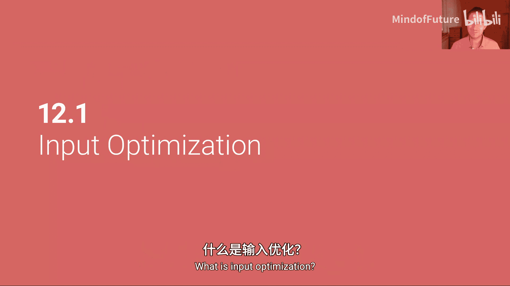
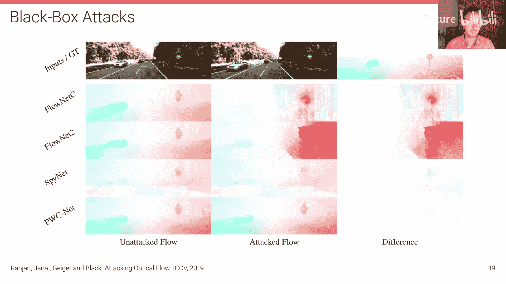
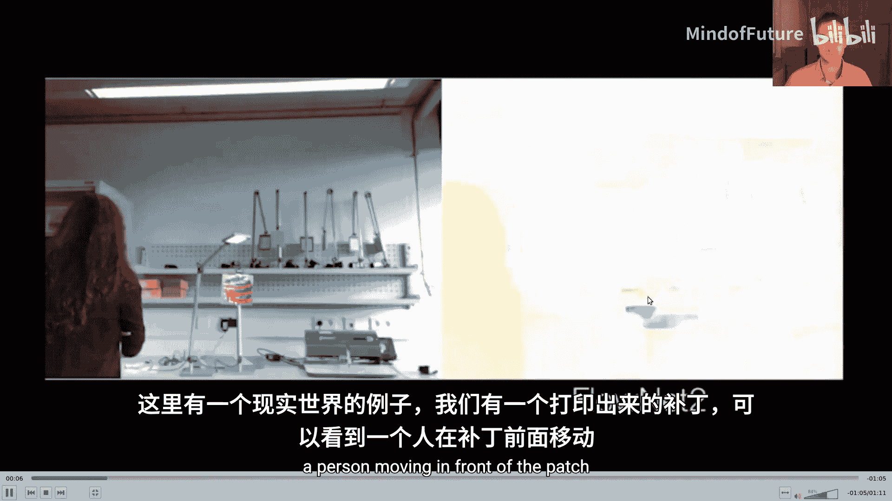
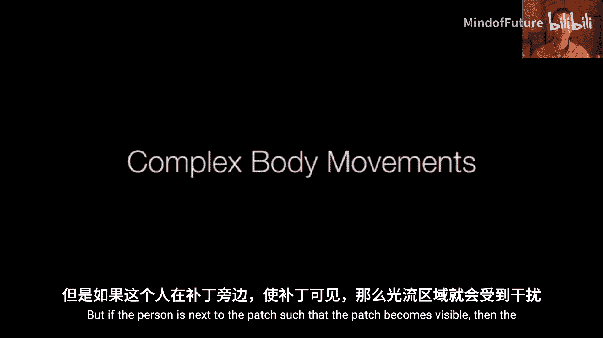
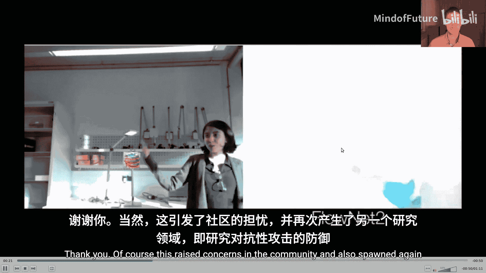
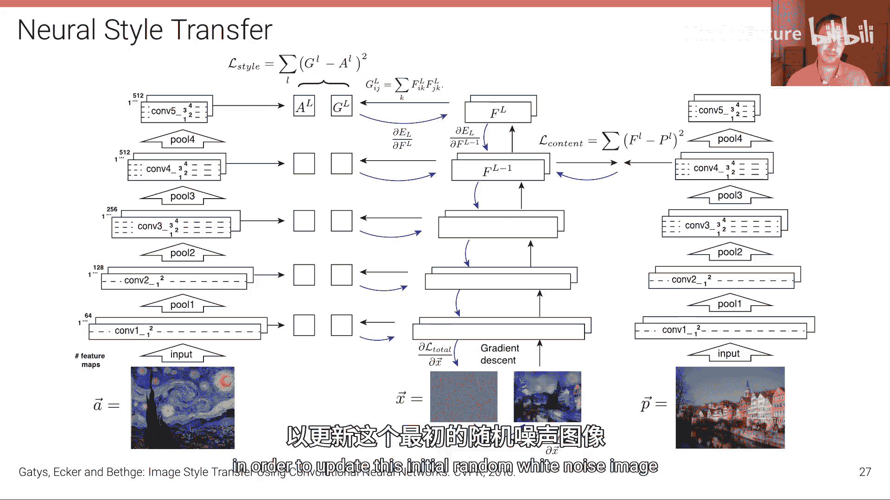

# 【图宾根大学 • 中英】计算机视觉 ML-4360 (Computer Vision) p43 P43 Lecture 12.1 (Diverse Topics in Computer Vision - Input Optimization) -BV1S8N1emEef_p43-

Hi and welcome to lecturec number 12， which is the last lecture of this computer vision class。

And today I'm particularly excited because we just got to know that we received the best lecture award for this computer vision class from the computer Science department。

And so I'm even more excited to tell you about the things that I wanted to tell you about today。

In this computer vision course， we've learned a lot。 right， This is an overview over。

Over the topics that we have covered， it's not really complete。

 but it tries to give you a rough idea of what we have covered。

 and it's really amazing what we have covered in this class so far。

 starting from the history over basic geometric primitives and image formation， camera calibration。

 3D reconstruction， binocular stereo， structure prediction， optical flow， shape from shading。

 milddy view reconstruction。Bometric fusion， marching cubes， implicit neural representations。

 differentiable rendering， novel use synthesis。Image classification and all the other recognition tasks like 2D detection and semantic and instant segmentation。

As well as self supervised learning。However。There is much。

 much more Comp visionsion is such a diverse field。

 has grown a lot theres so many people doing research in this area。

And here I try to list some of the topics that are also computer vision。

 but which we didn't have time to cover in this lecture。

And this is not because that they are less relevant。

 but just because we had to focus and I wanted to focus this class on the fundamentals and dive deeply into the fundamentals rather than just giving a shallow overview of all these topics。

What I did in order to create a slide was I went to。

A website that was visualizing the topics of papers submitted to a recent computer vision conference。

I was looking for topics that we haven't covered and I'm not going to read them all to you here。

 but this is just to give an impression of what else is there in our field。So I was thinking。

 what can we do with this last lecture， of course we can't cover all these things that's impossible。

And we would have to be very shallow if we wanted to do that， and in fact。

 some of these topics we are covering in other classes。

In some of my other courses at the University of Tubing and， for example。

 SM and localization were going to cover in the self driving class。

 which is taking place next semester。Image synthesis。

 GNs and VAs we have already covered in the deep learning class。

 object tracking and robot vision are also part of the self driving class。So what I decided。

Is I will cover some of these additional topics。Not as in depth as。

 of course I could cover all the previous topics， but I want to just give you an overview。

 a high level overview over these topics， diving a little bit more deeply into some specific methodologies of some particular breakthrough papers。

 but otherwise staying fairly high level for this course。

So in particular I want to cover shape abstraction techniques。

 adversarial attacks which had a tremendous impact， created their own subfield。

 human body models is also a big subfield in the area of computer vision these days。

Neural style transfer， you' probably heard of deep fakes as well。

 and also disentangles compositional representations。

And I want to credit some of the resources that I have used to create these slides。

 which you can find here， there's links to blog posts as well as videos and these are great resources which I encourage you to have a look at if you're interested in these topics。

This is the structure for today， the agenda for today。

 we will talk in unit number one about input optimization techniques， that's what I call them。

 there's a couple of techniques that fall into this category。

And it will become clear in a minute why I call this input optimization。In unit number two。

 we are going to talk about compositional models and holistic models in unit3。

 we are going to cover human body models and finally we are going to briefly talk about。Deep fakes。

 which are so much in the newest these days。Okay。So let's start with unit number one。

Input optimization。What is input optimization？

Well。This is a computation graph as you're already familiar from our deep learning lecture。

And this is a computation graph of a neural network， so we have some weights here in orange。

 the input in green。And then we have also the label in green here。And the model makes a prediction。

 in this case is a very simple model， it's a logistic regression model， let's say。

 that predicts this Y hat， and we have a lost function that compares Y hat to y。

And what we are going to do in order to train the model parameters is we're going to backproagate the gradients。

Along these blue arrows here backwards to the parameters W0 and W1。

 given pairs of training samples X and Y。This is。The setting that we are familiar with。

But we can do more with such a computation graph。 It's much more flexible instead of back propagating。

The gradients to the parameters， we can also take a pretrain network。

And from some loss node back propagate the gradients to the input instead of the parameters。

From the perspective of a computation graph， really nothing changes。 It's the same computation graph。

 it's just that we are computing gradients for another note。And in this case。

 this node is not an parameter node， but it's an input node。

And we will see two examples of why or where this could be useful in this unit。

 the first example are so called adversarial attacks。

 and the second example is a style transfer and in both of these examples we're going to take a pretrained network so the parameters and the architecture。

Are going to remain fixed。And we're going to back propagate the parameters to the input。

In the first case， in order to create。An artificial input。That looks like a particular image。

That we would be familiar with， but that is classified wrongly by the classifier。

 and in the second example to create an image that is an artistic rendering of a particular input image that we provide。

So in both cases， we want to generate image， we want to invert basically the process here by back propagating gradients to the image to generate an image through this back propagation process。

This is the idea of input optimization compared to the traditional weight optimization that we have been dealing with so far。

Okay。Yeah。It's the last lecture so today I brought wine。Okay。

 let's start with the first topic adversarial text。Okay。And this really。

Spawned an entire field in computer visionion， and there was this one paper I can still clearly remember the talk of this paper was calledIntriguing Proper of neural Networks。

 was published at ICLR and I learned about it at the subsequent CVVPR。

And the results of that paper were shocking。Was shocking to the entire community。

This was like this paper was published at a time where people got really excited about deep neural networks because they have demonstrated state of the art。

Substantial improvements。In terms of imagenet classification and on the side a lot of additional use cases were developed such as depth estimation and also other recognition problems like object detection have been successfully addressed and so people got super excited about these neural networks。

 but then they came this paper that showed， well these networks have a fundamental flaw。

And what like this first paper proposed was a so called LBFGS attack and the idea is very simple。

 say take an input image。That is classified correctly by the classifier as a school bus。

And then you add a little bit of noise to each pixel。But you do it in a specific way。

And this noise here is highly magnified， highly amplified just to recognize it。

 the noise is much weaker than this image here。Illusts。And you see this also by this image。

 which is actually this image plus the noise， and from a human perspective， they look the same。

So it's still a school bus， obviously。But in this case， the classifier now becomes super confident。

 99% confident that this is actually an ostrich。And the same here。

 this is the input image is correctly classified as whatever that class actually is here and。

When we add this little bit of noise， it becomes an ostrich with 99% probability。

If you think about the soft Mac probabilities。Or this image as well。So if we add the right。Noice。

 the right noise image， and they are all different here， as you can see。

 we can take any input image that is classified correctly。

And turn the classification result upside down。And of course， this says consequences。

 right that's why it's called an attack， we can attack a classifier。

 we can create an image that from a human perspective looks good。

But the machine becomes very confident that this is something else。

So here's the mathematical formulation for such an adversarial example under the LBFGS attack。

So we want to find so given a classifier F that takes an image Rm。

As an image out of RM M is the number of pixels and produces maps that into a set of classes。

In case of ImageNe， there would be L equal 1000。We want to find an adversarial example and this entire expression here is the adversarial example for a particular image X。

 this is for example， the school bus image here。And we do this。By adding to that image X。

 this noise here， which is the argument。Over all possible Delta x the space of all possible noise images。

Where we want the noise to be small， so we take the L2 norm here， the argument over the L2 norm。

But at the same time， we inject the constraint that the。Image is misclassified。

The most likely class that this classifier produces is actually a particular target class。

 for example， ostrich。So Yt， the target class is ostrich， no matter what the input image is。

 we want to find。The smallest perturbation of the input image。Which is this column here。

Such that when we add it to the input image and classify it。

 we get with very high probability the class that we want。And so once we found this delta x。

 we add it to x， and that's the adversarial example that we see here in the right column。

This is pretty amazing， right， that this works？That demonstrates how fragileile neural networks are and how very small。

 but very targeted changes we can actually fool them。

And this works not only for classification it works also for semantic segmentation here is a street scene。

 we can add a little bit enough noise to the street scene and what has been correctly classified is completely misclassified as a completely different street scene。

 This is an intersection this is a straight road， there's pedestrians， there's no pedestrians here。

The car would stop here。 The car would drive。Right。Just by this little change of the input。嗯。Now。

People were wondering is is actually really a problem right。

 so this assumes that we need to really be able to manipulate every input pixel of the image and that might not be practical if we want to really attack。

A classifier or a detector， we can't do that typically because we don't have access to the system。

 or if we would have access to the system， we could just directly change the output of the system。

And there was this very controversial paper here from Davidvy Forsi's group called"No needed to worry about adversary examples in object detection in autonomous vehicles。

And this is a sentence that I cite from this paper。I'm going to read it。

Adversarial perturbation methods apply to stop sign detection， as shown here。

Only working in carefully chosen situations and our preliminary experiment shows that we might need not to worry about it in many real circumstances。

 specifically with autonomous vehicles because there's all these intermediate processes there's the imaging process the sensor adds noise。

 the optics adds or manipulates the image but what we can really do is we can't manipulate the image we can just manipulate the environment that's going through this imaging process we don't have access directly to the pixels。

Let alone the gradients。And so they tried to convince the community that it's actually not a problem。

 at least with these early methods。But as it turns out， it is a problem。Even in that setting。

And that is what's called a robust adversarial attack It has been demonstrated by， for example。

 this paper， but also follow up papers。That there are robust adversarial examples in the physical world。

 and what does that mean， that means that there are these examples that no matter from which perspective I view them。

 they still fool the classifier and what they do in this paper in order to demonstrate this is that instead of just taking one image and trying to manipulate all the pixels such that the image is misclassified。

 they maximize the expectation over the space of all possible transformations that they are interested in。

It's called EOT expectation over transformation， so they define a transformation space。

 let's say the space of all Eine transformations or the space of all perspective transformations。

And then they maximize the log likelihood of the wrong or the target class that we want to fool the network with。

And then at the same time， minimize the distance of the two transformed images。

The image that we search and the original image。which is kind of the same same formalize here just differently expressed。

 but now the difference we search over where we compute the expectation。

 this is different the important part here we compute the arc marks over the expectation over the set of all possible transformations that we're interested in and initially people thought this is not possible。

 this is just too large and we can attack these networks。

 but it turns out we can still attack them not as well as if we could manipulate per input each individual pixel but we can。

And of course， larger distributions， the larger we choose our distribution space。

 the larger the perturbations have to be。 so it might become。At some point。

 obvious to the human eye as well that the image has been manipulated in order for actually being able to fool。

你冇。And there's different papers that describe also text that are more easy to implement in practice。

 so， for instance， you can also optimize over patches of a regular form that you can more easily print and stick to actual。

To the actual 3D environment like the stop sign here。It's called graffiti in this case。

 and it still works。 You can optimize over this type of。嗯。

Images and you can still get an adversarial tech and now it becomes really easy because you can just spray the image。

 you can spray the objects in the world or you can put stickers on them。

And you can fool the classifier if the classifier is not trained。2。Cope of that。

Another type of attack is called aceal patch attack。

 all the attacks that we've seen so far were specific to particular objects or even to specific input images。

But if we want to really attack a model more generally。

 we of course don't know what the environment will look like and so we might need a more general。嗯。

Attack， and this is a patch attack。 So in the case of a patch attack。

 we are interested in in placing a patch。Into an image。And the patch might look arbitrary。

 so it's easy to see there is something added to the scene。It's not。

A change that is imperceptible to the human eye as before。

But it covers only a small portion of the image。嗯。And it's still able to attack no matter what else is in the image。

 So for example， here， the patch is added to this table with the banana and it can basically change the classification of the banana into it classification of the toaster。

 Just a little video。 you can see the banana。If we add an image of a toaster。

 it's still classified as the banana because it's probably dominant object。

 but if we add this little patch that has been specifically tuned for the classifier it becomes。

The model becomes very certain that this is a toaster now。

And this is easy to apply in the real world because you can just print the patch and put it somewhere。

This is some work that we did in our lab we wondered， well。

 now most of these adversarial attacks have been。Developed for and tested with recognitionco systems like classification and detection。

 does it also work for deep learning models that try to estimate geometric properties or in this case optical flow。

So here， given an image pair from a video sequence。

We have an optical flow algorithm like flow in a 2 that predicts a smooth optical flow field color coded here。

 the direction， and the magnitude of the optical flow。Another question is， can we actually obtain。

 can we optimize for a small patch that covers a small piece of the image， let's say。

 smaller than 1% of the entire。Pixels， the image area。

There's a attack patch here and that attached image like that。

Successfully attacks the Opical flow network。To formalize this。Let F of I and I prime。

 which are the input images。The two frames， so let F of I and I prime denote an optical flow network。

And calligraphic I is the data set of all frame pairs。And let a of IPL denote the image I。

On which a patch P has been inserted that is transformed by some aine transformation T。

That is inserted at location L， so T and L describe a transformation。

And let T denote the distribution over all possible AffI and 2D transformations of the patch。

And that L denote the uniform distribution over the image domain， that is where we insert to patch。

And then。What we're trying to do is we're trying to find the patch P hat such that。

P hat is the minimizer。That's the argument。Over the expectation of all the image pairs。In our data。

Overall， the 2D aine transformations and the 2D locations。

 so we are putting the patch basically everywhere and under any transformation in the image。

And what we want to do is we want to minimize the inner product。

 the normalized inner product between。At every pixel between the。The unperturbed flow field。

This is the first term here， this is the flow U and V。And the perturbed flow field。

 U Tilda and V Tilda。Where utilde and Btilde are the flow fields when we take I and I prime and pass it through that function A that takes that patch and puts it at a particular location with a particular FN transformation。

So this is the flow computed on the perturbed images。

 and this is the flow computed on the unperturbed images。And the intu of this is， of course。

 that because we are minimizing the correlation， we want to find a patch P hat that reverses the direction of the optical flow ideally at every pixel in the image。

And if we can do that， then we say， well， we are successful have。And we can't misclassify here。

 right this is not classification， but we can try to reverse the optical flow。

 we can make it the opposite of what it would have been。And it works。

 so here we have a very small patch it's hard to see actually。

 and each row is a different flow network and you can see that depending on the type of flow network。

 we get a stronger or a weaker effect of this。Attack so in particular。

 this unit type end to end models like flow at C and flownet 2 are heavily affected is。

The unatted flow field and this is the attack flow field。

 this is the unatted flow field and this is the attack flow field。

 you can see that almost half of the image is corrupted now by little by this insurgion of this little patch。

Nothing else has changed， we just changed a few pixels in the image。And of course。

 if we make that patch larger， then we can perturb a larger region。

But what's important here is that in both cases， the。The attack region。

 the region where the optical flow has changed due to theceptive field size of the network extends far beyond the region of the patch itself。

We are attacking a much larger region and that's really problematic。

And then we can also look at black box attacks where the setting is we optimize a patch for some networks and then we take that general patch。

 which is looking like this， and we use it to attack an unseen network。

And that's what we call a black box attack because we don't know the network that we applied on and also it works in this setting。

So here's an example on the real world where we have a patch printed and you can see a person moving in front of the patch and if the person is in front of the patch。

 then the flow field looks fine， but if the person is。

Next to the patch such that the patch becomes visible， then the flow field becomes disturbed。

Like here。

Of course， this raised concerns in the community and also spawned again， another research area。

 which is concerned with defenses against adversarial attacks and both of these fields somehow。

You know hunt each other there's a new adversarial attack proposed and then a few months later there's a defense against that attack。

 but then there's a new attack and a defense against that attack。

 now people trying of course to put this on a more theoretical basis now and trying to develop general defenses。

 general defenses，That is also related to general robustness of these networks and out of distribution generalization。

 etc。So an entire field evolved around defending upver attacks， and theres free dominating。Paraigms。

 the first， and you can read about this in this review here， for example。

 the first is gradient masking obfuscation since most attack algorithms are based on gradient information of the classifier if you mask or hide the gradients。

To the attacker， then this will confound the adversaries。The second is robust optimization。

 and there the idea is to relearn a deep neural network classifier so that it increases robustness。

And you do that by， for example， training classifier。To correct the classify。

Artificciialally generated adversarial examples， it's called adversarial training。

So you generate these attacks， but then you provide this attacks to the algorithm and the algorithm can take them into account during training and become more robust。

And then there's also adverscerial example detection。

 which is concerned with studying the distribution of natural or benign examples。

In order to detect adversarial examples， and then this allow them as input to the classifier。

And there's many more papers， this is just a short list。

The second topic I wanted to talk about in this。Unit on input optimization is neural style transfer which is。

A completely different technique where the goal is completely different is not about attacking a network。

 but about creating beautiful artistic images， but it uses the same idea of optimizing not the parameters。

 but the input。Of a neural network。And probably many of you have seen this in particular。

 if you are in Tupingen， this is a technique that has been developed in Tping and Matta Spkas Group。

And it has been showcased on this famous tubing and riverside。image。Where this image。

 which is called a content image is combined with a style image。

 this is a single image of a painting of fungo， and then the output of this algorithm is a stylized version of the content image。

Okay。So in neural style transfer， the goal is to synthesize an image。

This one here on the right with the content of one image。And the style of another image。

And the way this is done is to start with a random image。This is the input X to the neural network。

And this is a pre trained VGG network pre traineded on IageNe。And then we're optimizing that image。😊。

Using a content and a style loss。To match in terms of the content。

 to match the content image and in terms of the style， to match the style image。

And here's an overview of how the content loss works。 There's these two losses。

 the content and the style loss。The content does make sure that the content is matched。

 so how does this work？The first step is to， so we have a pre trained VGG network。

 pre traineded on ImNet， this is this network here。In the first step。

 we pass the input image through that network。Which gives us some high level features at some deeper layers of that network。

 which we extract。I'm going to keep that fixed。And then in step three。

 we initialize a image of the same size randomly with random numbers， this is this。

And then we pass that image through that same VGG network。And that will produce also some features。

 and then we have this content loss that tries to make these two the same。

And so it generates a gradient A blue。That flows through these layers。

 it doesn't update the parameters。Detached in Pytor slang。It doesn't update the parameters。

 it just updates the pixels， only the x， the input。And then step by step， we arrive at the content。

Or it's something that's similar to the content based on what is actually captured。

In in this extracted features and also of course， based on what this neural network here has learned during the pre training stage on imageageNe。

So here's the formula for this loss， it's very simple。

 so we just the F and P are just the feature maps of the generated and the content image。

At Vg G layerer L。And so the loss， the content loss at layer Ls。

The features at layer L of the generated image minus the features of the content image。

 the feature map， we just subtract that and take the L2 loss of that vectorized。Quantity。

How does this work if we just do that， this is not yet style transfer is's just one part。Well。

 if we take features from the early layers， it works super well， so if you look at this。

 we almost get the input back。And if we go to later layers， we also get the input back。

 but we also get some random noise in there， so we see the content is preserved。

 but somehow in terms of the style and the appearance it has changed quite a bit。

So and this is what we would expect because the features like this low dimensional code that。

We have a very deep layer of the network doesn't capture。

The low level statistics of all pixels in the original image， but it captures the overall properties。

 and so we still see the oval structure while details have been gone。

And what we are using as content loss is， I think at layer four。

 style transfer uses layer four because it wants to keep the content as much as possible。

From the counter image， and so it uses L equal4。Now about style。

 how can we make sure that the image that we optimize matches in terms of style to the style image like this one here？

The idea here is borrowed from。The literature on texture optimization， texture generation。

It's called the gram matrix， so we compute at each layer we can compute what is called the gram matrix。

 and instead of subtracting the features we are subtracting the gram matrixes。

 the gram matrices from each other and computing the L2 loss of that vectorized quantity。

Now what is the gra matrix of the feature， it's very simple， it's just the correlation of features。

At each layer L， we have a feature map produced by our VGG network。

So we have width times height of the feature map times number of channels number of feature channels。

And this gram matrix has the size of the number of feature channels times the number of feature channels。

 and it computes simply the correlation between any two feature channels by summing over all the pixel pixels in the image domain。

 so here the sum runs over all the pixels in the image domain on the feature maps。

And it correlates the feature map I with the feature map J at layer L。

 That's all it's just a dot product。And that's what's called the gram matrix。

 and then the gram matrices are made as similar as possible。

What happens if you do that if you do that for the first layer you get something like this so you can see that you have very local properties matched。

 but it doesn't look at a more global level like the style of this image。

 but as you move to later layers。And in this case， we're actually computing the gram matrix at all subsequent layers as well and adding them up。

 so this loss is a combined loss of。All the style losses across all the layers。

But that's the technical detail。So as you do that and move to later layers。

 you can see that the style starts to match， but the content。Is no longer there， right。

 So because we are computing here something that is。Where we have。

Some overall pixel locations so we're becoming spatially invariant we don't have we can't expect that the content is the same。

 but the statistics。Of these feature correlations are the same and through this pre traineded VGG network。

 we're getting an image then。This is the optimized image that matches in terms of style。

 but not in terms of content。And what neural style transfer does is simply combine these two objectives so here we have the image that is optimized for on the right we have the content image and here we have simply the difference in the feature maps which is the content loss here we have the style image and here at each layer in this case we have the difference in the gram matrices。

And then we're using this as the loss functions and back propagating the gradients here along the blue arrows。

In order to update this initial random white noise image。

And this yields these beautiful stylistic images of the provided content image and you can do that for any style image。

 so here are different examples for different painters you just need a single image of that painter and you can stylize。

This image of the beautiful tubing and riverside front。

According to the style of that particular painter。So that created a large。

But in the community that this is actually possible and this is a feature that you can now find in modern software for image processing as well。

And there is a website。From Matthia Spga's lab where you can take your own picture and you upload your picture and you upload a style picture and you get a stylized version of that picture。

 I encourage you to try that out it's called deepart。io。

