# 【图宾根大学 • 中英】计算机视觉 ML-4360 (Computer Vision) p45 P45 Lecture 12.3 (Diverse Topics in Computer Vision - Human Body Models) -BV1S8N1emEef_p45-

This unit is on human body models。Humans interact through their bodies as illustrated here on the slide。

 which is a slide I took from Michael Black， who is a Max Plank director here in Tingen。

And who has dedicated a lot of his research to understanding and modeling human bodies。

And modeling and understanding human bodies is important if we want to understand what humans do。

 but also in order to to interact with humans。 So here I see some of the interactions that humans do hugging。

Collaborrating， dancing， interacting with their environment， etc。

And what we're going to discuss today is the socalled simple body model， SL。

 and the simple model is maybe one of the most popular models these days in the research community and the foundation for many follow-up works and it's a generative human body model and the goal of this is to create a model of well minimally cloth human bodies。

 cloth human bodies is harder， so model focus on the human body itself。

 so focus on people in minimal clothing as you can see here。

And that the goals for this model are as follows。Reconstructions from this model should look like real people。

 of course we want to build a model that's precise。

It should also allow for deformations that look like deformations of real people。

It should have a small number of parameters so that it's easy to represent and to store and to manipulate。

And it should be easy to fit the data because we often want to fit this model to scans or to images in order to understand humans。

And it should also be easy to animate because often we are also interested in taking a character。

 an avatar that we have generated and animating that character， for example， in the context of。

Generating movies or video games， etc。嗯。Yes， so here。

This is the model that we'd like to obtain M the output is represented in terms of 3D mesh。

And that mesh depends on the pose and the shape and the dynamics and the texture。And some parameters。

 some general parameters of that model。Here's an illustration。On the left， you can see。

Re image and on the right you can see the reconstruction of that simple body model in terms of both the geometry and the appearance and you can see that this reconstruction is matching the inputward image quite well。

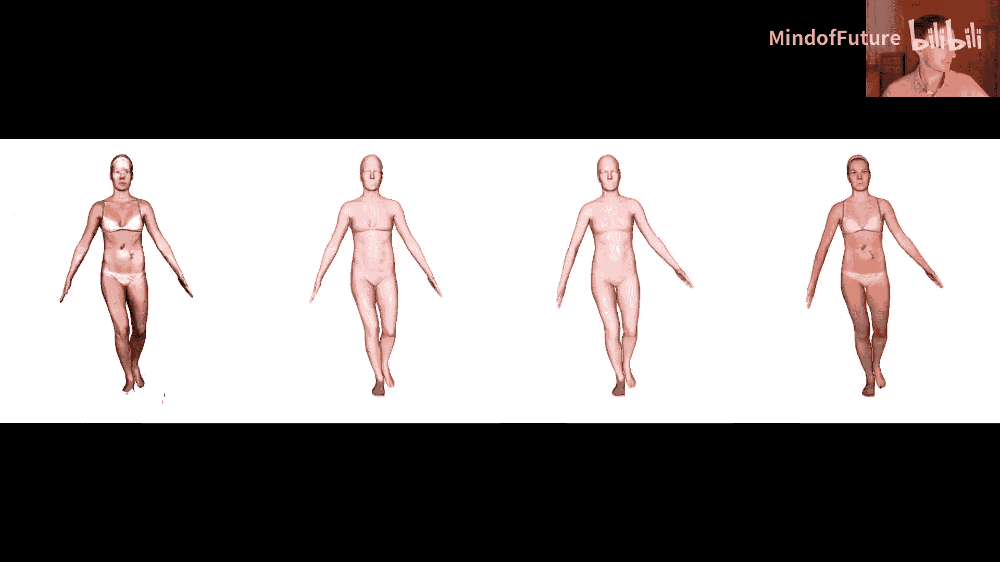

And in this unit， we are going to discuss how this is done。Moodeling of human bodies。

 human shape and pose has a long history in computer vision starting from well， the 70s and 80s。

And the question is， of course， what is a good representation？

So the representation that the simple body model focuses on is the representation of。

Not the interior of the human body， but the human body as it can be observed。

Basically the minimal clothed human body。But to represent that minimally clothed human body as accurately as possible in terms of geometry and appearance。

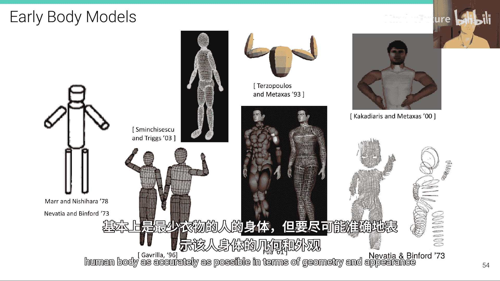

And。A big inspiration for the simple body model was the seminal work by Plan and Fetter in Sikraft 1999 on human face models。

That is a precursor， if you will， of the simple body model。

But for a specific part of the human body for the face。

And there's a little old video from this technique which is still amazing to watch these days in terms of the accuracy that this model has achieved。

 so I want to play this video for a little while so they can get an idea of what this methodist is doing and what is capable of。

The Morable face model is derived from a data set of 200 colored 3D scans of faces。

Individual faces are combined into a single morphable model by computing dense point to point correspondences to a reference face。

A modified optic flow algorithm establishes 3D correspondence automatically。

The morphable model combines 3D shape and texture information of all example faces into one vector space of faces。

We can form arbitrary， linear combinations of the examples and generate continuous transitions。

Starting from the average face， individual original faces are caricatured by increasing their distance from the average。

Forming the average for male and female faces separately。

 the difference can be added to or subtracted from an individual face to change the perceived gender。

Other facial attributes， such as the  fullness of a face， can be manipulated in a similar way。

From a labeled set of faces， the characteristic changes are extracted automatically。 In our model。

 they are controlled by a single parameter。Differences in facial expressions captured from another face can be mapped to any individual。

We now reconstruct 3D shape and texture in order to animate a face。

 given only a single photograph of a person。First， we manually align the average face to the target image。

 roughly estimating position， size， orientation， and illumination。

Then a fully automated algorithm finds the best reconstruction of the face within the morphable model。

3D shape and texture are optimized along with parameters such as size， orientation。

 and color contrast。The output is a high resolution， 3D mesh of the face。

It is an estimate of 3D shape and surface colors based on a single image。

Additional texture extraction improves details in texture。

The reconstruction can now be rendered into the image。

 and a whole range of facial variations can be applied。 here we simulate weight gain and weight loss。

Facial expression can be post processed in images， forcing a face to frown or to smile。

From this image， we also estimated 3D shape and texture and combined the photograph with 3D computer graphics。

Cas shadows of novel objects are rendered correctly into the scene。

Illummination conditions can be changed， and pose can be varied to some extent。

From a single black and white image， we obtain a full estimate of 3D shape。

The result of the matching procedure includes an estimate of surface color since the morphable model contains color information。

Finally， we show the application of our model to a painting。

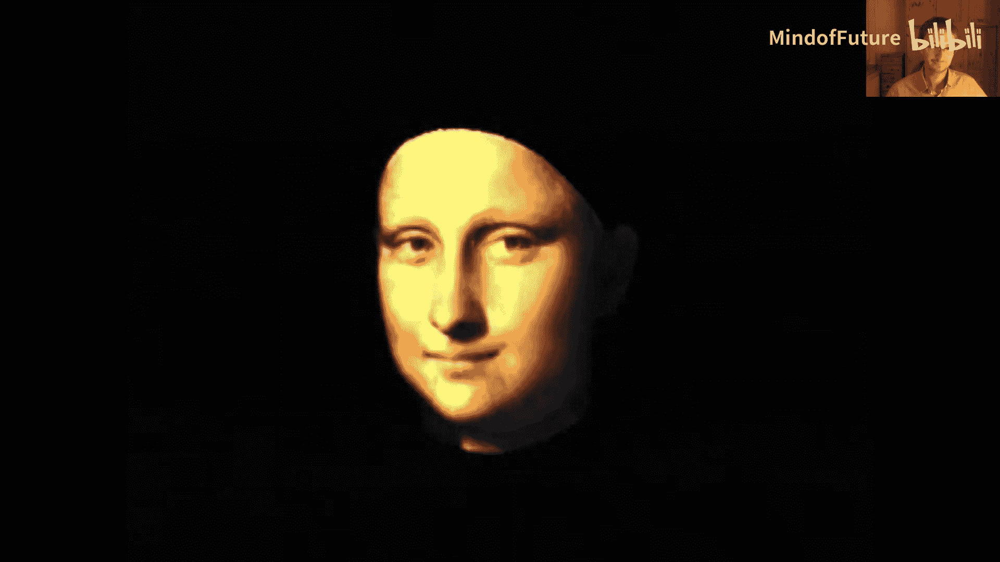

This was 1999。More than 20 years ago。Quite impressive。Okay， so let's dive into simple。

 simple is an acronym for a skint multi person linear model。And the idea is。

 as in the previous video， Ive seen to。Take scans from a big human body scanner。

 take many of these scans， and to create a generative 3D model out of those。

And to create this model in a way is such that it is factored that we have different controls for posts。

And shape， dynamics， breathing and all the other factors that we might be interested in。

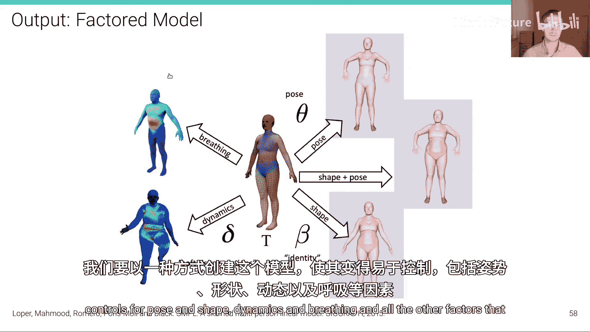

So here's an example to illustrate this。You can see a character， you can see the geometry。

 so I want you to focus on the geometry here on the top。You can see on the left that。

The pose is fixed， but only the shape is varied。In the center。

 the post is fixed and the post is varied and the shape is fixed。And on the right。

 both the shape and the posebury。 So you can see how。

These factors are disentangled in the model and can be independently controlled and give rise to such generations here。

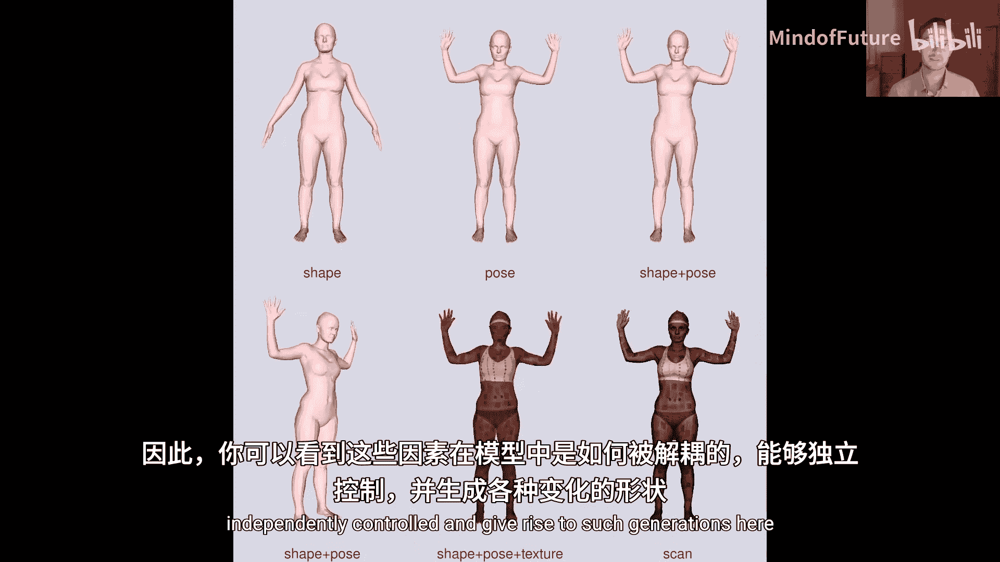

So let's now look at the technical details of this model。

Simple uses a 3D mesh as an output representation， and as we know a mesh is represented through vertices and faces。

The base mesh is designed by an artist to match the majority of human bodies well。

And the mesh has 7000 vertices， which yields a representation with 21，000 numbers。

 Each vertex is a three dimensional vector。And so we have 21000 numbers to represent the human body。

 This is the space that we want to operate in， but it's of course a very high dimensional space。

 It's not as high dimensional as typical images， but still very high dimensional。And via that。

 it's clear that most settings of these numbers do not really correspond to people or any shapes。

 but just random。Noise， random garbage。So we want to find now a sensible setting of these numbers that corresponds to shapes in the data set that we've used to train our model。

 that's the goal。In order to do so as a first step we need to do something is's called mesh registration the raw scans are just unordered and incomplete 3D points。

 they can be meshed， but you will see they have many artifacts and holes。As illustrated here。

And to get correspondence is a template mesh。This template mesh designed by the artist must be aligned with each scan。

And this is a hard problem， it's actually a chicken and egg problem because you require the body model。

 the trained body model with the parameters in the first place to deform it towards the input towards the observations。

嗯。But you also require the observations to train the human body model the registered observations。

And the solution here that is taken by the simple body model is to solve。

Model and registration dissolve solve model estimation and registration jointly。嗯。Now。

 let's for a moment， assume that we have already solved the registration problem and that this allows us to convert all the。

Scans that we have obtained from the scanner into canonical pose。

And that pose is this a pose called a pose here because the arms are in this a position。

Then we can we can basically apply it， we can transform each of the scans into this apoOS as illustrated here。

 so these are the raw scans transformed into the apoOS。

And then we can fit this body model to these scans in ApoOS。

And what we have then is basically we have this this body model。 we have we have this 3D mesh。

 which is a collection of these 21000 numbers of these 7000 vertices。

 So if we vectorize the vertices。The mesh vertices， we call them T， and we subtract the mean mesh。

 take the average of these vertices， and this is the colored。Model that's illustrated here。

 and I're going to subtract that。And then we can apply a principal component analysis to yields a linear model of this。

 right， so we can stack these into the columns of a matrix team。Then we can decompose that matrix。

Such that these observations are linear combinations。Of some basis。U shapepes。

And these are called the B shapes。That are combined linearly with this weight beta here。

And these weights be are now are very low dimensional compared to this original 21。

000 dimensional representation ge， weights may just be 10 dimensional or up to 300 dimensional to express most of the variance of the observations。

 so we can now using PCA because we have assumed that the body is an canonical pose we can reduce this problem。

And obtain a 10 dimensional。Lant space that expresses most of the variance in the data。

What does that look like？😊。

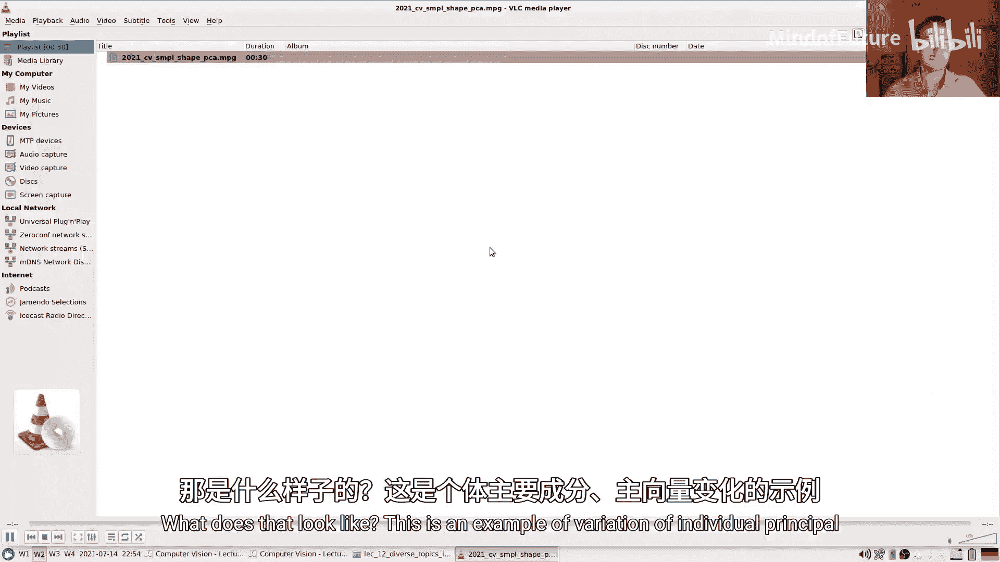

This is an example of variation of individual principal components。In principal vectors。

 you can see that in the beginning， when we vary the first principal component。

 then the size of the characteror changes。If they vary the second principle component。

 we see that the size of the other。The weight of the vector character changes。

And then if we go on to additional principal components， we see that smaller details start to change。

And this is what we expect because the first principle component explains most of the variance in the data。

As we know。

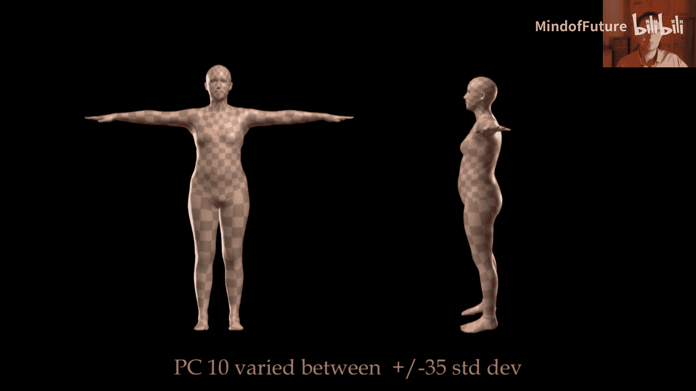

。However， of course we do not have all of these， as initially explained， all of these。

Observations registered into the same coordinate， and so we have to solve this chicken and egg problem。

Where we are solving for both the registration and the model parameters jointly。

And that's what Simple does。So simple solves also kind of a PCA problem。

 but at a larger scale by also deforming the template mesh。

And how it deforms the template mesh is it uses。A extension of so called linear B scanning。

 so first need to understand what linear plan scanning is。In linear land scanning。

 the goal is for each vertex on the template mesh。To find the transformation to the mesh in target pose。

As illustrated here on the right。 So here we have a template。 This is in T posts。

 we want to find for each of these verticies the transformation that transforms。

Or for each point on that surface， we want to find the transformation that transforms that。

To the corresponding point on the surface in target pose。

And we're going to do that through this linear equation here。 This is just a sum over sum weights。

 These are called the blend skin weights times a rigid bone transformation matrix。 that's just a。

A rigid transformation matrix with6 degrees of freedom。That depends on the post parameters。

And ajo locations。And。We're going to multiply this with the input point T。

So we take this TI and by this linear combination with this weighted combination with these Gs。

 we're transforming that point here。So what is these g， this rigid bone transformation。

 this is illustrated here， so in different colors here you see different bones。

 let's look at for example， this green bone here， which is the right upper leg。

And this green bone here， which is encircled by this ellipse。

Is transformed using a rigid body transformation。To that green bone here。

 which is the same bone and we call that。This is the cave bone we call the transformation that Richard transformation GK。

So any point that lies on the surface of that bone should be transformed according to that bone transformation GK。

 so we simply transform that point by multiplying TI with GK and the weights which are discoled。

 discolful representation on the surface of the human body indicate how much each of the bone。

Influences that transformation， so if you take a point that's in the center。

Of that of that body part， K。Then all the other weights will be0 except for the weight of that particular bone of that particular body part。

But what happens if we take a point that's in between two body parts。

 let's say this point which is in between the red and the blue body part Well in this case。

 the weight of both the red and the blue body part will be high， both will be 0。5， let's say。

But all the other weights of all the other 25 or so bones or body parts will be0。

 So we have an a linear interpolation of the。Transforms。

 these really body transformations of two adjacent body parts or bones。

 and this is necessary because we overall we have a non-ri transformation。

 so we need to interpolate whenever we have a joint we need to interpolate between the rigid transformations that are induced by the two adjacent bones。

Right。And these rigid bound transformations， of course， depend on the pose theta。

 and potentially also on the joint locations J because depend on the size of the character。

In particular， we depend on theta because if you think about this as a kinematic tree。

 if I change this joint here， the elbow， then of course the。

m correspondingorresponding a child's part or child bone transformation is also affected by this change of the joint in the kinematic tree。

So this is how linear blend skin works， it's basically a linear blending of rigid bone transformations。

We points that are in between two adjacent bones。Receive。

Information receive transformations from the two adjacent bones such that there is a smooth transitioning happening。

Now how are the skinning weights obtained， well the answer is simple in practice they are typically obtained by an artist and the artist manually in a careful process designs these skinning weights such that they are leading to realistic。

嗯。UpPos human body shapes。But that is a difficult task， actually。

And a particular configuration of skinning weights doesn't lead to very nice deformations。

it cannot be guaranteed to lead to nice deformations for arbitrary body poses as you can see here。

 so if you look at the elbow， for example， the deformation that's happening at the elbow is appearing very unrealistic and the cause for this is really。

That this linear blend scanning is too simple， it's not enough to just linear blend the transformation of these two bones because you will get effects like this。

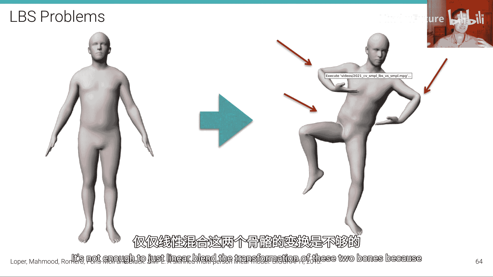

It's also illustrated in the video here， we have linear blend skin on the left can see this effects。

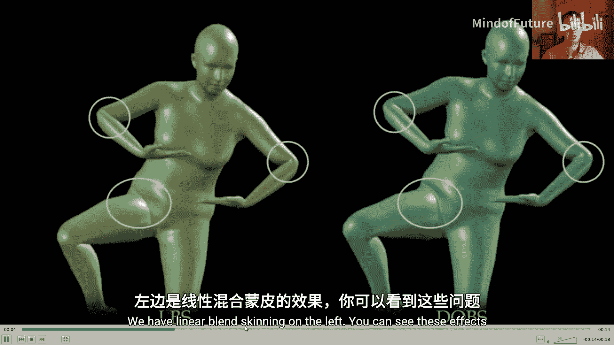

And you have the simple body model， which we're going to talk about in a second on the right。

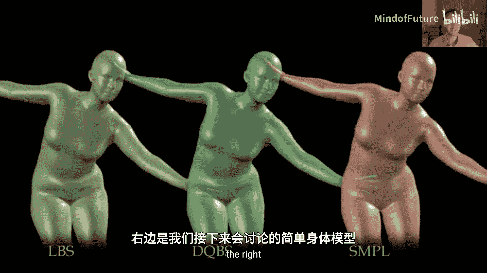

Which is a generalization of linear blend skinning， which doesn't suffer as much from these effects。

You can see a much more natural shape appearing。So what does S do differently from linear blend scanning？

This is LBS linear blend scanning versus simple or simple versus linear blend scanning。On left。

 we have the same illustration as before。And here this is the formula from the previous slide。

 which is the formula for linear blend skinning。And on the bottom you can see the formula for simple。

And in red are highlighted the three key differences。

The first key difference is that because simple is a model for multiple bud。

While LB was typically applied to a single character， simple now has to handle many characters。

 of course the。嗯。Joint locations must depend on the body shape。There's tall people。

 there's small people。 and of course， the bone length。

 and therefore also the distance between joints must and the location of the joints in the canonical。

 say T pose template must depend on the body shape。

 That's why J now depends on the body shape and it's regressed。Effectively from the body body shape。

And then。Two additional modifications are so called correctives。

In addition to simply take that point， TI on the surface in economical rest。

 called the rest pose and transform that point to Yale TI prime。What is added to that point。

 TI already in the canonical space are two correctives， a shape corrective S and a post corrective P。

The shape corrective allows the。Model in the rest pose to accommodate different shapes。

To accommodate heavy people and to accommodate fin people， for example。

And in order to model the shape variation， of course。

 we have to change the location of the surface point。And we have to model it。

 and that depends on the shape parameters， which are called beta。And the additional。

 the last difference here is this post corrective。As we have seen previously。

A major limitation of LBS is that it is too simple。And that there is many artifacts。

 if we just take this linear combination of。And at a joint of two adjacent body parts or bones。

 if we take the linear combination of this rigid body transformation G， of these two。

 this is too simple and it leads to these artifacts that we have seen。

So what Simple does instead is it adds these post correctives。

 which are also changing the shape of the human body in the rest pose。But it's changing it not based。

On the shape parameter speedta as the shape correctives to， but it's changing it on based on the。

APo parameters feta， so you get also a post dependent corrective to the shape in canonical or in breast pose。

And these two models are linear。This is a little simplification here for the model actually does。

 it actually uses not the。Let's say the joint angles directly。

 but it uses a bit more clever representation of the joint angles。

 but still it's a linear model in this representation。And then this model。

Is trained on a big data set。And optimized。For the parameters。Of that model， which are， well。

 the basis。Shapes S。And the。The basis post correctives P。

So basis shape correctives and basis post correctives。嗯。In order to yield the final model。

 and of course also in terms of the upper parameters like what to。嗯。LBS is optimizing for depo。

And that。Well， the skin weights are given。

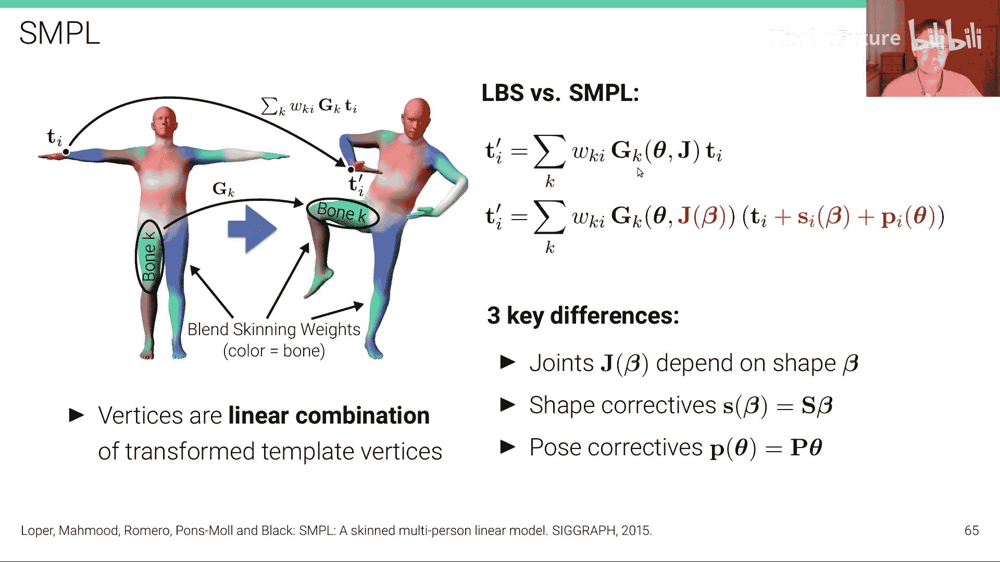

So here's an overview of the data。This is is just a little glimpse on all the scans that have been used for training that model。

 it's enormous， it's a large data set of several thousands of shapes。

And here you can see illustration of what the model has learned in this case in the context of lens shapes。

 so you see what happens if the animated， this is a generated geometry funded model。

 the animated model。What a change in the pose of that model induces on the shape in canonical pose。

 you can see that due to the post dependency， because we want to this final generation result to look good。

Don't have these artifacts that are induced by LBS。你。

Shape in the canonical in the rest pose is modified accordingly to compensate for these effects。

 and this is what these post correctives these post blend shapes do。

So's basically all the big PCA model just factorized into these different components。

 some depend on shape， some depend on posts。

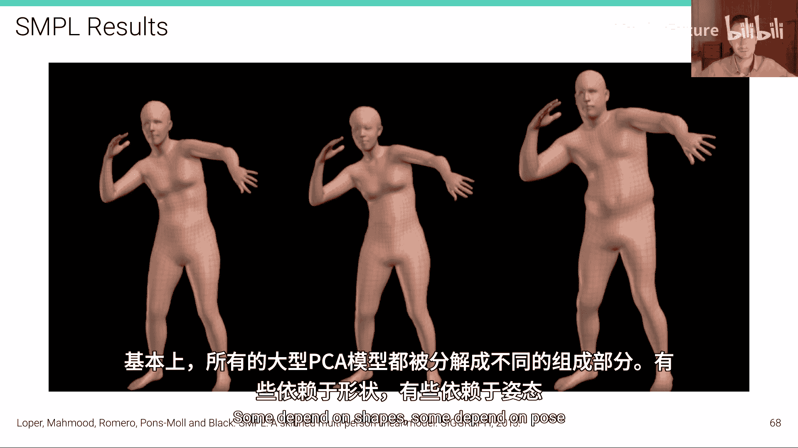

And here's a result of what this model can do。 so you can see different。

Identity is different people performing the same action。Fruit is simple human body model。It's a very。

Precise representation of the human body shape and can be fitted to many different people。

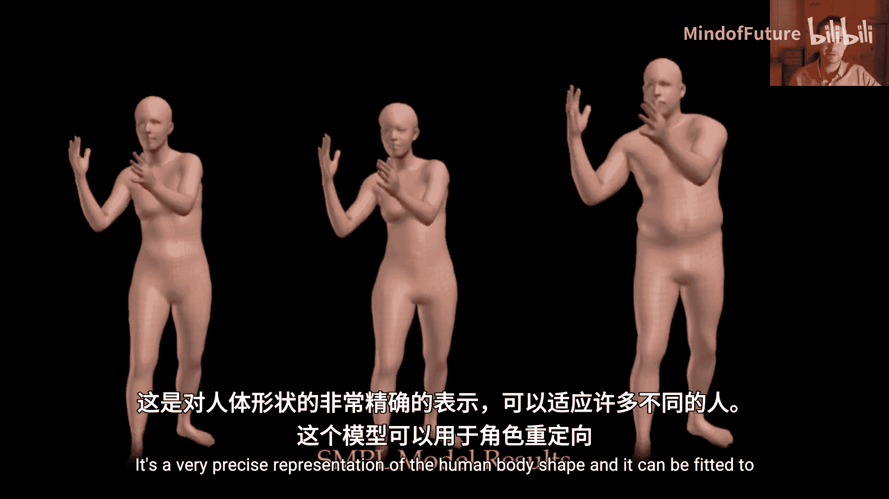

The model can be used， for example， to retarget characters。

 here's an example where there is a motion， an original body shape on the left and there is a retarget motion for a different shape here on the right。

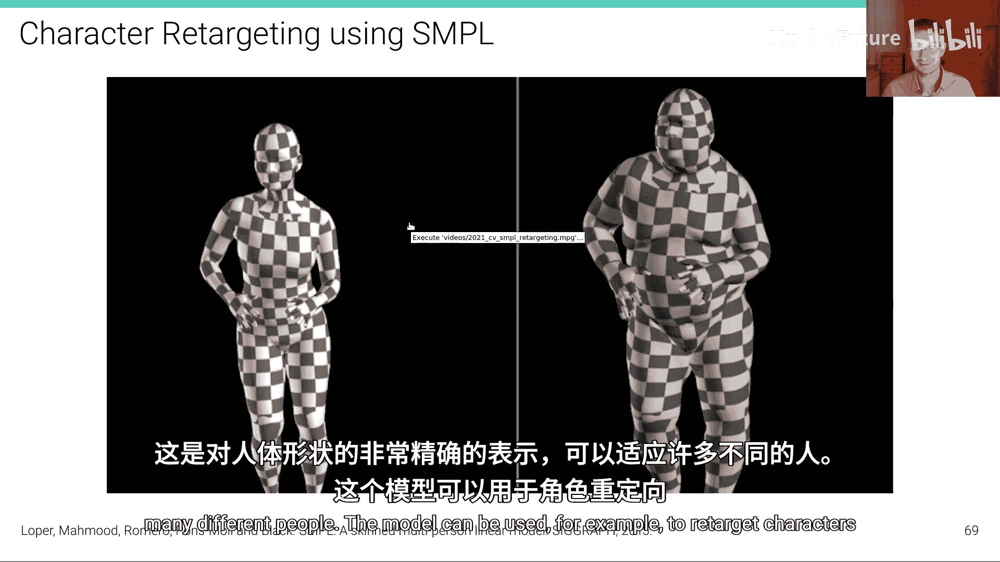

You can see that。The person is moving accordingly， but with a very different shape as the。

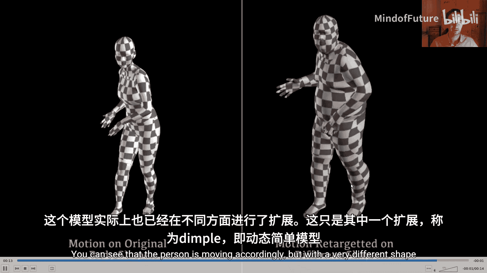

Input character the model has also been extended in various ways actually。

 so this is just one extension it's called dimple dynamic simple。In particular， for taller people。

For people with more weight， you have soft tissue deformations that depend also on time。

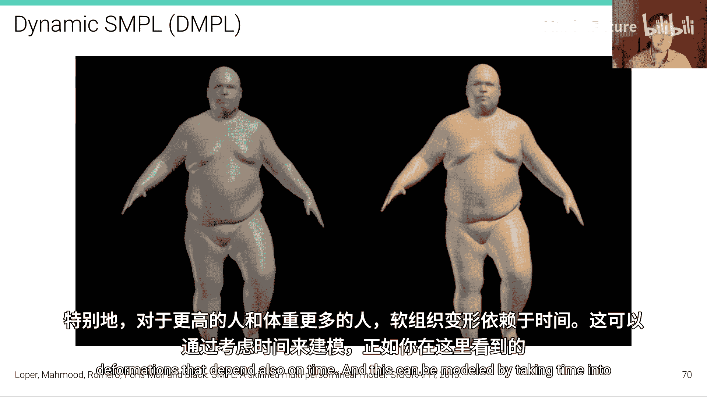

And this can be modeled by taking time into account， as you can see here。

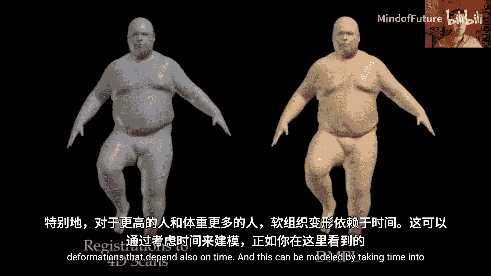

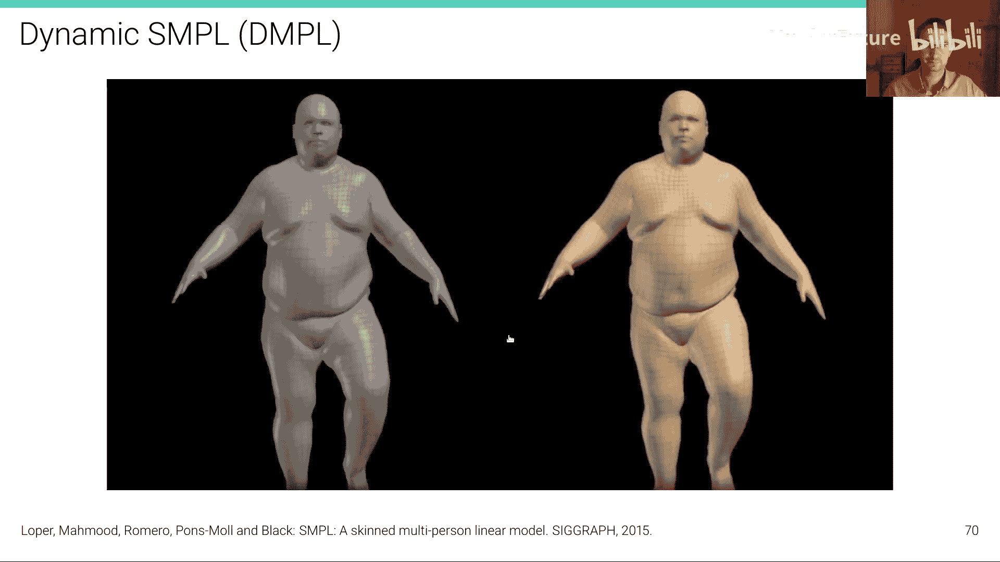

Now， this model cannot just。Be used to generate artificial characters。

 but it can also be used to more precisely estimate the shape of humans by just looking， for example。

 on a single OGB image as shown here。There's a little video for this。

 you can see the pose and the shape that has been extracted for the people that are visible in these images here on the left。

Yeah。Of course， if you estimate human body pose and shape from a single image。

 there's a lot of ambiguities to resolve， the more views。

You have the better or if you have depth data that's also helpful。

 but in this case it's estimated just from a single image and you can see that the model quite successfully is able to reconstruct。

Pose and shape due to its prior knowledge because it has been trained on this big data set of。

3D human scans。Now this is of course， not the end of all of human body modeling it like there's a lake research community in the computer vision community that's just concerned with this problem。

And some of the current research directions as illustrated here include modeling of clothing。

 which is much harder than the naked human body or minimally clothed human body。

 modeling of garments， realistic modeling， there's a lot of stochasticity involved。

 also modeling of appearance。Many of these models that I've shown to you didn't include appearance。

 but of course， appearance is important if we want to realistically render these。

Then modeling of dynamics。A few short learning， learning just from RGB images and building avatars from very little data。

 like maybe just from your webcam observing yourself。

And inserting them into maybe a video game or a virtual reality application。Interreaction。

For example， interaction with other humans with avatars or with 3D environments。

