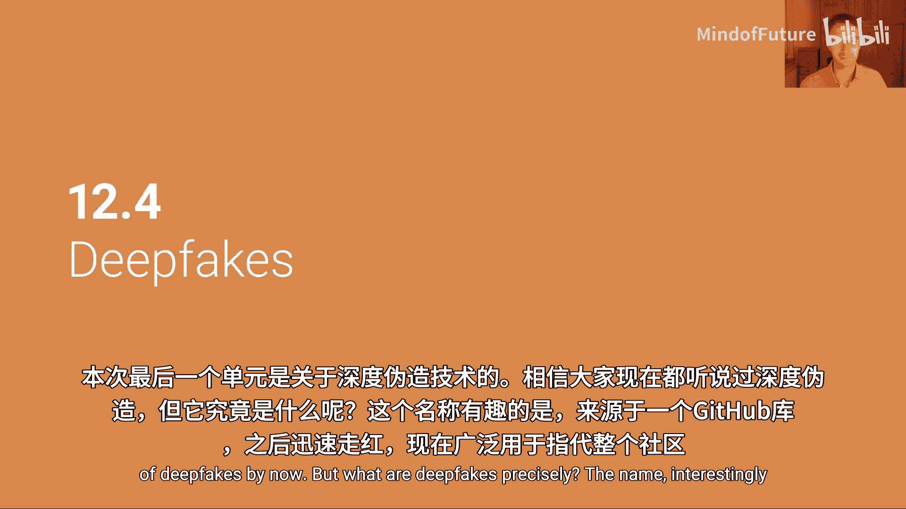
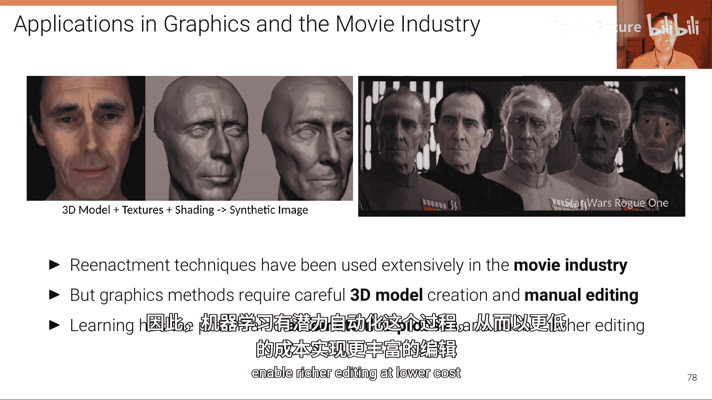
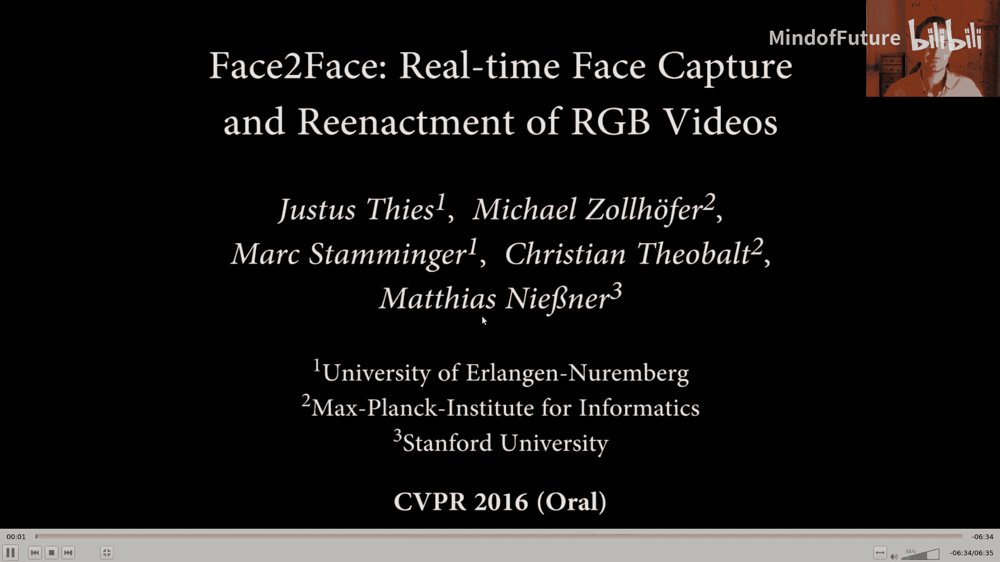
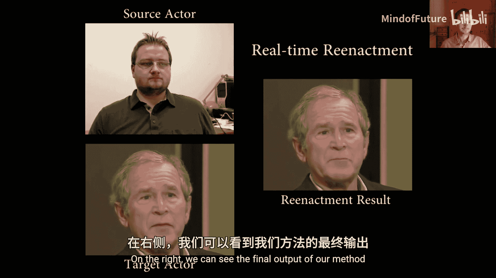
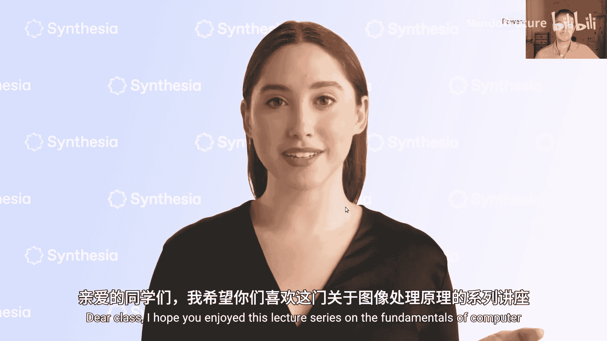

# 【图宾根大学 • 中英】计算机视觉 ML-4360 (Computer Vision) p46 P46 Lecture 12.4 (Diverse Topics in Computer Vision - Deepfakes) -BV1S8N1emEef_p46-

。This last unit。Of the last lecture is on Deep Fs。Probably all of you have heard of Deep fakes by now。

But what are deep fakes precisely？The name， interestingly。Actually stems from a Gitthub repository。

And then became viral and is used now。Everywhere to。Deote an entire community。

So here's the GitthHub repository， and that's a still actively maintained repository that tries to make the technology called faceb。

Available to everybody to better understand what's possible with that technology and to make the public aware of also the implications of that technology。

Here you can see an example where face swap， which is a technique for。Replacing the face of a person。

And playing that back as a realistic video has been applied to a video of an actor。

But the actor has been replaced by Nicholas Cage。As shown here on the right。How does this work？

This original face swap model is actually quite simple。

The way it works is it extracts faces in two videos。

 you need two videos and from which you want to swap the faces。

 you need to record two videos of two different people。And faces in these two。

 you extract the faces in all the frames of these two videos。And。Once you have extracted the faces。

 you train an alt encoder for each of the two people， where importantly the encoder is shared。

Such debt。You can go with the same encoder from either this face or this face into the latent space。

And what the sharing of weights of the encoder does。Is to enforce。

The same latent space where things like the pose and expression and lighting things that vary。

During that individual videos。Are captured。So now we have a trained encoder and the separate decoder for the two。

People。And what phase swap then simply does at inference times， it swaps the decoders to decode。

A latent coat with a new identity so we can take the expression and the lighting condition。off。

That person here。And render it with the appearance of that other person。As you can see。

 it doesn't work perfectly and in many cases still relatively easy to identify for people。

 but the technology has advanced since of course， and there is a lot of progress and it becomes harder and harder for people to recognize differences。

So here's an example of this original deep fake space swapping technology。Running in action。

Are you able to have friends。Yes。But you don't have feelings， do you。Not as such， however。

 even among humans， friendship is sometimes less an emotional response and more a sense of familiarity。

You can become used to someone， exactly。As I experience certain sensory input patterns。

 my mental pathways become accustomed to them。 The input is eventually anticipated。

 and even missed when absent。So， I hope you。Recognized。

The characters that have been face swapped here。Facewa is only one technology。

 it's actually a very naive technology， what is maybe more interesting is reenactment。

 it's called facial reenactment。What is the difference between face swapping and facial reenactment？

This is illustrated here， face swapping on the left in face swapping， we take the face。嗯。

From one video and copy it onto another video。So we take that phase here。

We copy that face onto the face of another video， but we're not able to manipulate that video。

 The VP video is running with the expressions of that original。Of that actor in that original video。

 we're just trying to replace the appearance。How that。Face looks with a new appearance。

And therefore the output is a hybrid between the background。

 which includes things like the hair and the new forkground。

 and there' is also artifacts as you can see here so there's different hairstys mixed together。

 it's a clear artifact of this hybrid process。In facial reenactment， in contrast。

 we are interested in animation， so what we do here is we take the expression， just the expression。

 just the expression from one video。This is the expression here。And。

Take that to animate another person， so we have that person here， we're taking that expression。

 and we're trying to animate that person but keeping the identity。Of that person。The same。

So we're not taking a hybrid of two images， if you will， but we're still having that person。

 that identity， that appearance， shows that we're changing what that person is doing。

And that enables much more things than just sbbing the face in particular animation。Its， of course。

 very relevant to the the graphics and moving industry and has been used using traditional graphics techniques like free reconstruction。

A material and lighting estimation extensively。In the movie industry， for example。

 for many productions。However， the classical methods require careful 3D model creation and manual editing。

 which is quite tedious and very expensive。And so machine learning has the potential to automate this process in order to enable richer editing at lower cost。

And this is what some of the research groups。In this area。

 I focus on what I'm going to show you is some of the research that has been done in Matthia's Nisna lab at Tomunnich。

So one particularly popular。Work from their lab is called face to face。

And the goal of face to face is real time facial reenactment。For the source video。

 this is the video of the actor。Is captured with a commodity webcam。

 so it's kind of combining two very difficult problems， doing things in real time。

 and at the same time with very limited sensors， just a commodity webcam that you can buy for $50。

How does this work Well this is a traditional technique it's from 2016。

 so it doesn't do a lot of learning it uses mostly computer graphics techniques what it does is。

URes the well， has a face model like the Bs and fe model that we have shown in the previous unit。

It recovers the parameters of that model by non rigid dense alignment of this face model to both the source and the target。

 and then tracking this face model parameters。Of on both the source and the target video。

 and if you can do that， you have the geometry。Estimate the appearance。

On both the source in the target video， then you can start swapping the two because through the model you have the correspondence of the tube。

 so this is what's called appearance transfer。You can take like。

This target here and the source and render the target with the expression of the source。

Here's a little video for this。We present a novel real time facial reenactment method that works with any commodity webcam。

Since our method only uses RGB data for both the source and target actor。

 we are able to manipulate YouTube videos in real time。

Here we demonstrate our method in a live setup。 On the right。

 a source actor is captured with a standard webcam。

 This input drives the animation of the face and the video shown on the monitor to the left。

A significant difference to previous methods is the re renderndering of the mouth interior to this end we resynthesize the mouth interior of the target actor using video footage from the training sequence based on temporal and photometric similarity。

As we can see， we are able to generate a realistic and convincing reenactment result。

Here we show a close up of the footage from the previous live reenactment。

The input video stream is shown on the left， note that the target actor is rerendered in a neutral pose。

On the right， we can see the final output of our method。

So as you can see it allows for quite sophisticated manipulation of the expression。

 but of course it doesn't allow for arbitrary manipulation of the pose and it's only affecting the face area in this case。

Now。To go beyond just traditional graphic techniques and to improve the realism of the output。

 this particular paper here called Def neural rendering uses a so called neural renderer。

 which is basically just a U net that takes a feature representation。And produces。

 renders the output through inference via this neural network。 and the advantage of doing so is that。

This well this allows to compensate for inaccuracies that the model based approach that I was discussing previously might have。

 for example， the face model might not be registered perfectly or the face might actually not adhere to the face model perfectly。

Or it might be actually very difficult to transfer some of the。

Pixels appearances due to occlusion or foreshortening effects。

And therefore what you would have to do is you would have to hallucinate content and this is what this neural network can do So what this model does is basically very similar to the previous model。

 it also extracts a phase model， but it basically so it also extracts a geometry geometry。

But it extracts that geometry in combination with a so called neural texture。

 where for each pixel we have a feature vector that captures parts of the appearance that should be stored in that。

On that surface point。And this neural texture can then be rendered into an image。

 and that's the input that this neural rendering。Which is then tasked to produce the realistic。

 the photorealistic output image。 And so that way can overcome。

 can inpat artifacts and can overcome these problems because it's。

has additional parameters that can compensate for these deficiencies。Well， Bush 41， clinton。

 Bush 43 or obama。And why， I would really say Clinton probably I would have to say Clinton and why there was a little spirit。

 frankly， he would have been had。This was example， as you can see。It's very hard for human to。

 well apart from the boys in this case， of course， to distinguish the。啊。

A videoideo from a real video。And exactly that is， of course。

 also a big concern and has also created interest in the research community。

 So theres theres many works now concerned with deep fake detection。 how given。

A video can I detect if that video has been。Ardificially manipulated。Or if that's an original video。

And。The basic idea for this is very simple。Well， we create a big data set。

of real videos and manipulated videos using many techniques。

 and then we can train CNN to simply try to distinguish real from fake。

 so we simply learn a binary classifier to detect manipulated images。And that works quite well。

 so this is the data set that has been collected in this paper called F forensics。

It's collecting many videos over 2 million manipulated frames。

 so also public domain so everybody can use it to test their algorithms， their detection algorithms。

And it has been created using many。😊，嗯。Deep fake techniques， as you can see here on the left。

Including face to face and the original face swap tech technology， etc。 So there's different。

Different techniques for creating this deep phase combined into a big data set that can be used then to train classification models。

And if you do that， what happens is that the performance。

 if you test on the same on the test set of the of the same distribution of the same。Data set。

Data set has been manipulated with the same technology， example face to face。

It obtains a very high classification accuracy。But if you move。

 if you train on one of these data sets and test on a data set that was created with a different technology。

The performance drops to almost chance's performance。Which means that this。

Approach as such doesn't generalize very well， and so that's the current research topic。

How can we make these models generalize better and techniques that are employed here are classical techniques that are used in the computer vision community to tackle these problems such as self supervised learning。

 transfer learning and fused learning？嗯。Maia's Nis group has also spun off a startup in this area because of course。

 it is not just like generating these artificial characters is' not just。An adversarial idea。

 but it's something that can be used quite。Beenefficiially， in many areas， for example。

 in movies where maybe a character has died and you need to reenact that character or in a。

In a news report where maybe the reporter is not available or is ill， etc。

 and so there's many use cases of where you want to have synthetic characters speaking and this is exactly the focus of one of these startups which called synassia。

And。There's a website， you can actually submit your own video。

 you can submit your own text and it gets translated into a video that's narrated by this actor that is done entirely through artificial intelligence and I want to show you the video that has been produced by Stasia for the text that I have been submitted。

Dear class。

I hope you enjoyed this lecture series on the fundamentals of computer vision at the University of Tuubingship。

I wish you all the best for the exam。I couldn't say better。 This concludes the lecture。

 Thank you very much for staying with us until the very end。And of course。

 me and the entire team of TIs wish you all the best。For the exam， and I hope to see you。Again。

 in future lectures。Thanks。