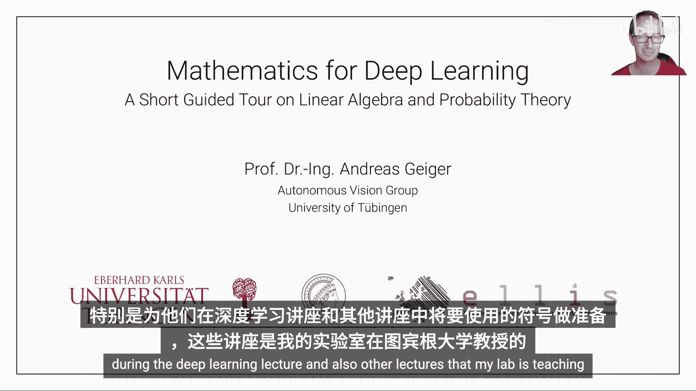
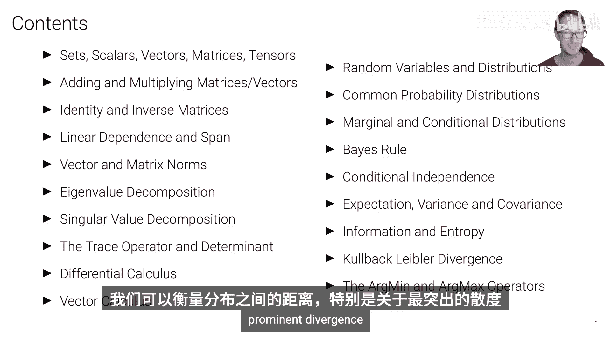
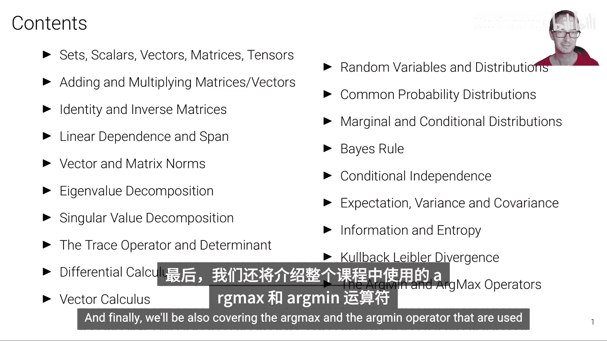
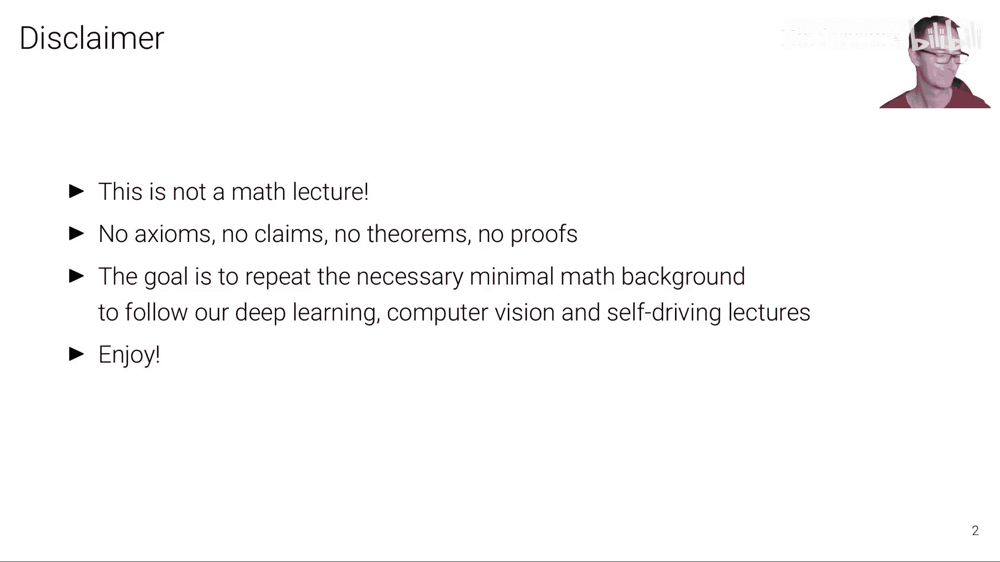

# 【图宾根大学】深度学习的数学 p01 P01 Introduction -BV1xgKPz9EQH_p1-

Hello and welcome to Mathematics for deep Learning。

 a short guided tour on Line algebra and probability theory。This micro lecture series。

Is a short course comprising many small video tutorials。

That I've created in response to the diverse background knowledge that students have when they come and attend our deep learning lecture at the University of Tubingen。

It's not meant to be a comprehensive math course， it's rather meant to be a little recap of knowledge that students have already acquired during their undergrad mathematic classes。

And to prepare them in particular also for the notation that we're going to use during the deep learning lecture and also other lectures that my lab is teaching。

Here at the University of Tiubbham。Here's a brief overview of the contents that we're going to cover in this micro lecture series。

So we're going to start with the notation of sets and scals and vectors and matrices。

 and we're going to see how we can add and multiply matrices and vectors and what an inverse matrix is and what linear dependence in a matrix means。

We're going to also see the most important norms of vectors and matrices that we are going to use in the class。

As well as matrix decomposition techniques such as eigenvalue decomposition and singular value decomposition。

Furthermore， we're going to be talking about differential calculus and vector calculus that means how to compute derivatives and gradients and hesian matrices。

Then we'll move on to probability theory。What random variables are and what probability distributions are。

 and well see some of the most common probability distributions that are used in the deep learning class。

We'll also cover the topic of marginal and conditional probability distributions。

 as well as the famous space rule。We'll see when random variables are dependent or independent or conditionally independent。

And we'll introduce the notation of。Expectation， varianceance and covariance。And finally。

 we'll talk about information theory in particular， about what is information。 How can we measure it。

And what does entropy mean。And then we're gonna be talking about divergences。

 how we can measure distances between distributions， in particular about the。

Most prominent divergence they callback late blood divergence。

And finally， we' be also covering。The Arcmax and the Arc Min operator that are used throughout the class。

As a little disclaimer， this is not a math lecture again。There's going to be no axioms， no claims。

 no theorems， no proofs here。It's all very applied。Instead。

 the goal is to repeat the necessary minimal math background to follow our deep learning or computer vision and self driving lectures。

Enjoy。

