# 【图宾根大学】深度学习的数学 p04 P04 Identity and Inverse Matrices -BV1xgKPz9EQH_p4-

This unit is on identity and inverse matrices。

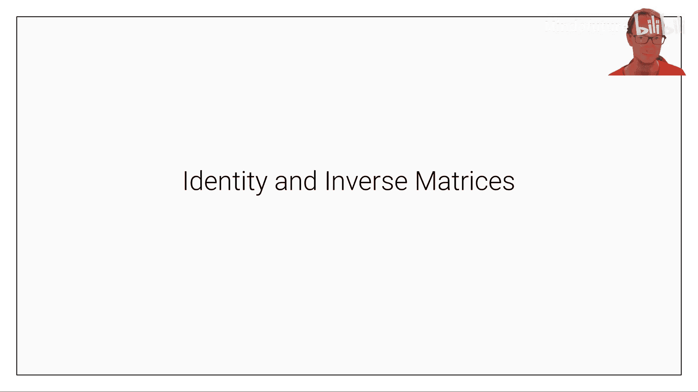

A matrix that does not change a vector multiplied with it is called the identity matrix。

We denote the identity matrix preserving n dimensional vectors with boldface I subscript n。

 where n indicates the dimensionality of the vector that it preserves。And， of course。

 this matrix is out of the space of。Real square matrices of dimensionality n by n。

Or with shape n by N。So what does it mean that this matrix preserves n dimensional vectors？Well。

 that simply means that for any。Possible vector。From that vector space r n。If take any of those。

Any random vector， we can multiply that with that matrix， and that vector is preserved。

 That means after multiplication。We get the same vector than before the multiplication。

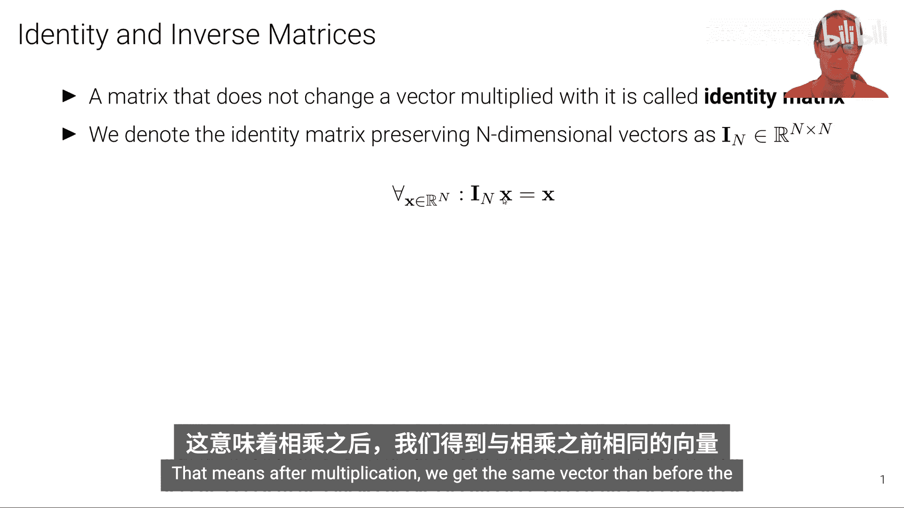

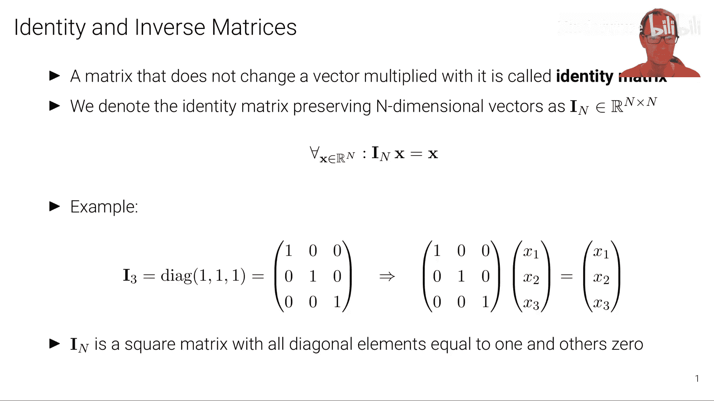

What should that matrix look like？Obviously， it must be a matrix that has once on its diagonal and ses elsewhere to preserve all elements of the vector。

So for example， if we look at the three dimensional vector space。

 then this would be the corresponding identity matrix。

And we can also write this because this is a diagonal matrix。 we can write it as this expression。

 This is a diagonal matrix where the first element is one， the second element on the diagonal is one。

 and the third element on the diagonal is also one。

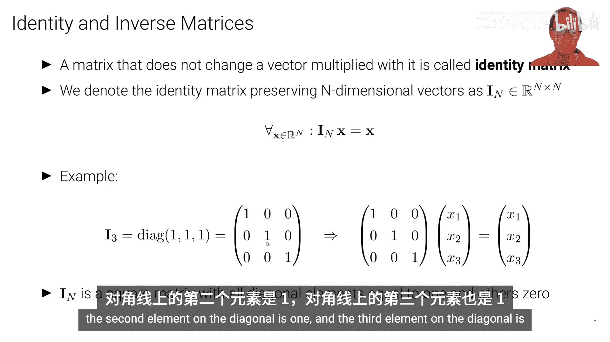

And， of course， this matrix looks similar， just with one more dimension for。

A four dimensionagin vector spaces。And we can also easily see that this。Mattrix。

 this identity matrix preserves three dimensional vectors。

Any vector that we put in that be multiplied to that matrix。Its gonnana be preserved。So in summary。

 IN is a square matrix with all diagonal elements equal to one and others set to0。

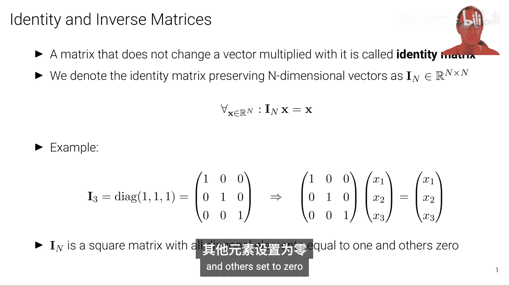

Now， the matrix inverse， which we don denote by a to the power of -1。

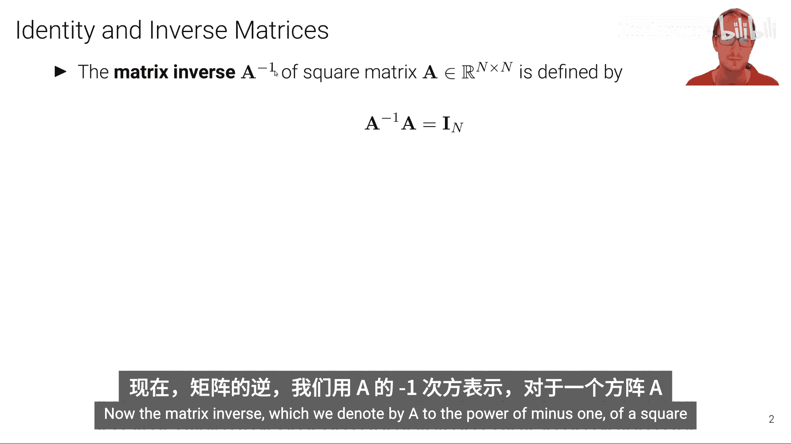

Of a square matrix， a。Is defined through the identity matrix such that if I multiply a inverse with a itself。

 I obtain the identity matrix。I obtain the identity element。Through this multiplication。

In other words， we are canceling the effect of a by multiplying a to the power of -1。

 the matrix inverse。 So we get the。Identity。As an outcome。Now， having this definition in mind。

 this allows for solving， for example， linear systems of the form ax equals B that we have seen in the previous unit。

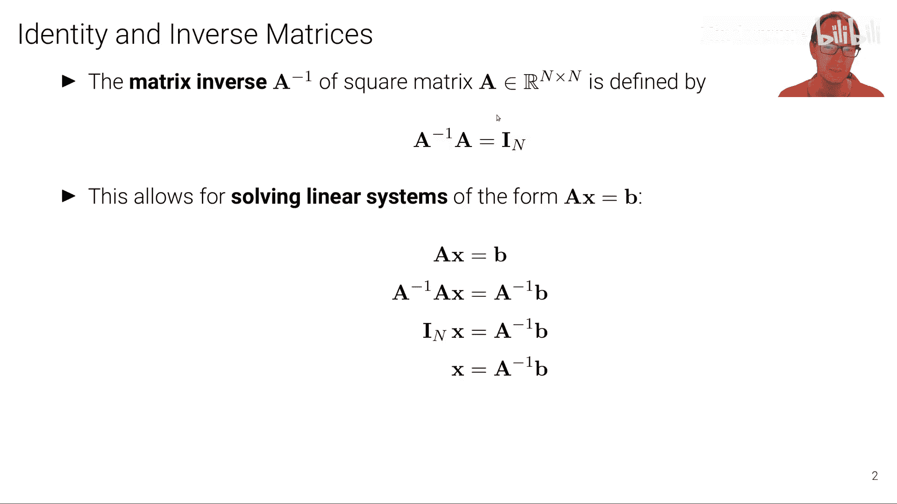

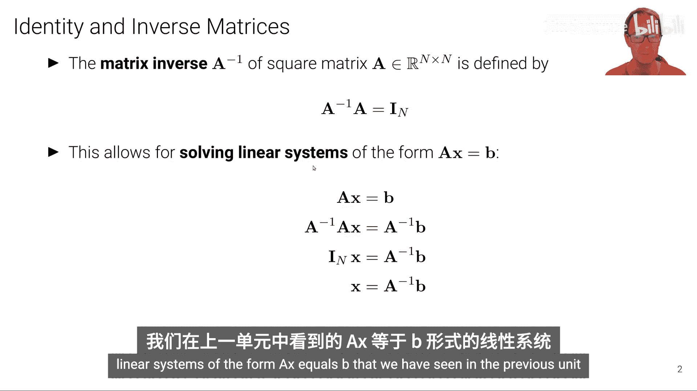

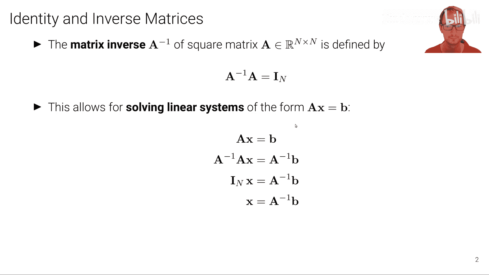

How can we do this？Let's write down ax equal B。And let's multiply on both the left hand side and the right hand side with a to the power of -1。

 which doesn't change the quality。 It's still equal。And now we can see that on the left hand side。

 we have obtained a inverse。Times a。Which we know is the identity。

 so we can replace that with the identity。And then we know that the identity preserves vectors so we can just drop the identity and we get the solution to this linear system as x equals a to the power of minus-1 times B。

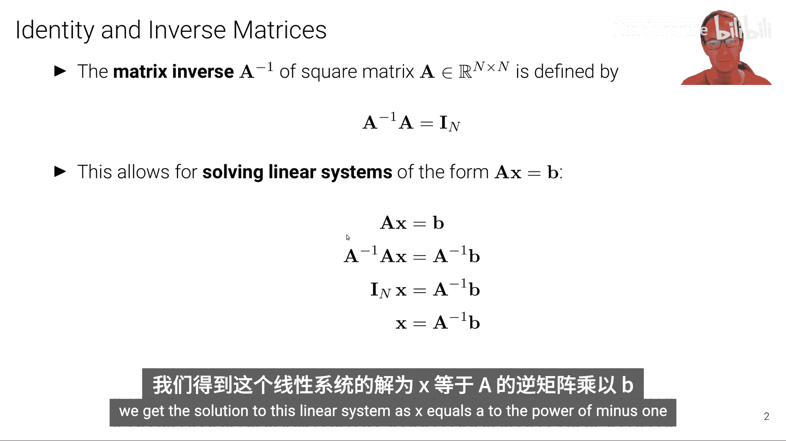

As a little remark， this is only possible if the inverse actually exists。

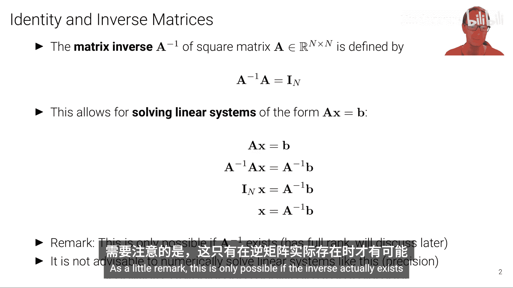

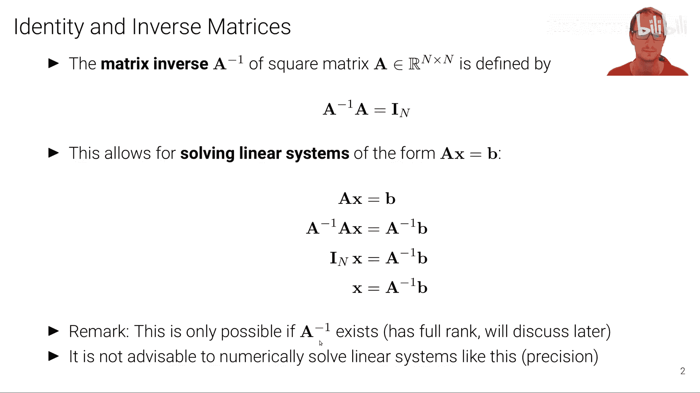

So if the matrix a has full rank， which is a property that we'll discuss later。

Another remark is that while this is mathematically correct。

 it is not advisable to numerically solve linear systems like this to solve numerical systems by first computing explicitly the inverse and then multiplying this with the vector B。

Because that is numerically instable。And it's better to use a proper decomposition or elimination technique that uses piting and that's more stable。

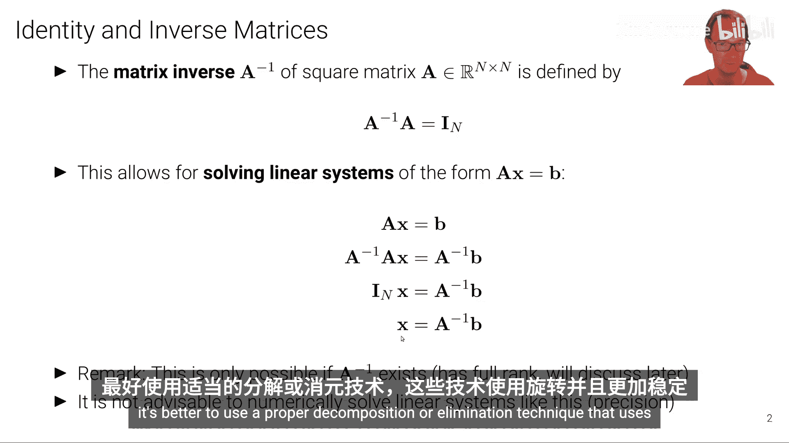

Let's finally look at an example。Consider this matrix A with elements 1，1， and 2 and 0。

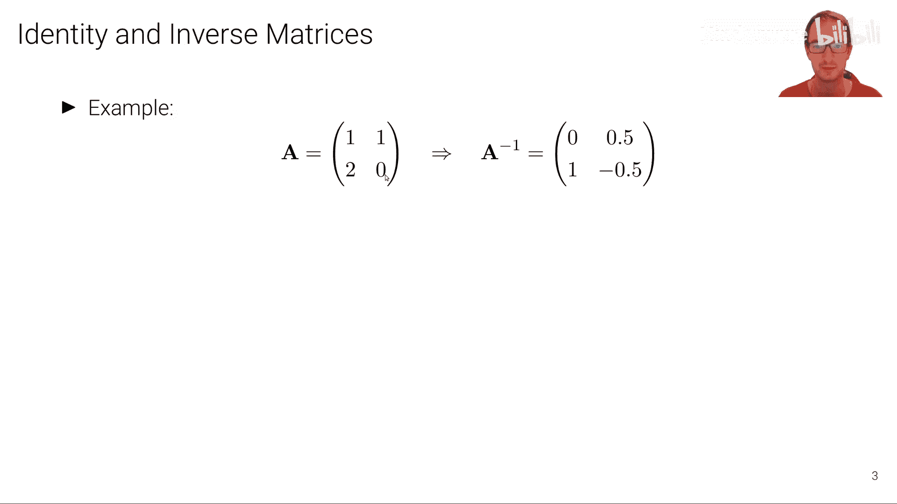

The inverse of that matrix I have obtained with pen and paper。Im using Gau elimination。

 which we don't discuss here。And the inverse of this matrix is this one here with the element 0，0。

51 and minus-0。5。And if I take now the inverse。And multiply it with the original matrix。

I get back the identity matrix here。Which is i2 right。

 So if I multiply this vector with this vector here。

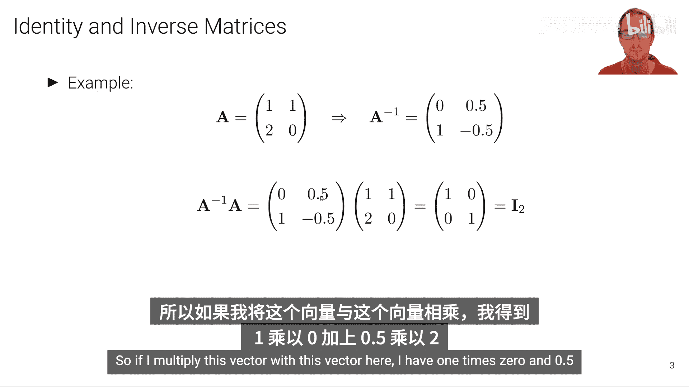

I have1 times 0 and 0。5 times 2。 this is1。

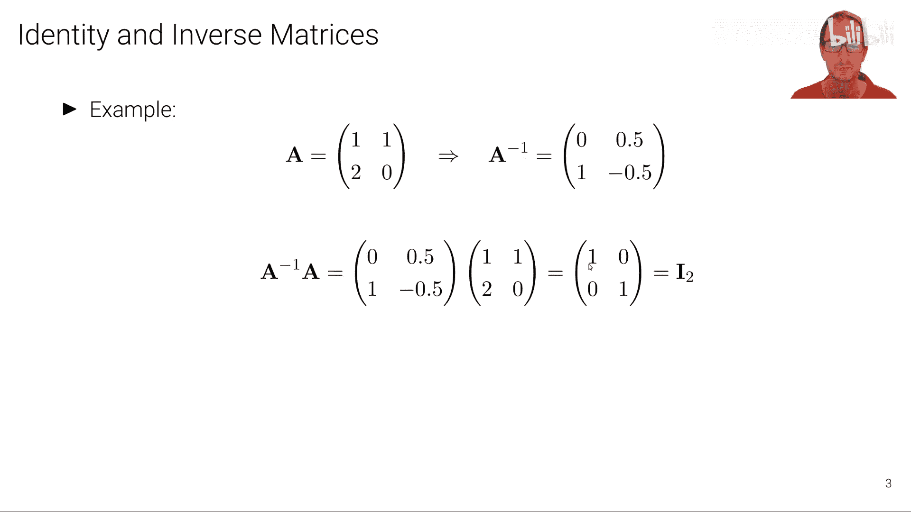

And similarly， for this element here， I multiplly this with this， which is0， etc。

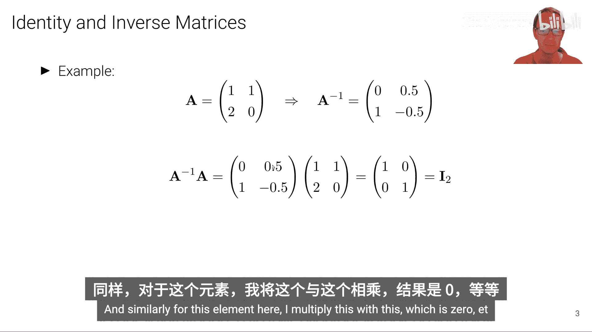

And now if I want to solve this linear system what I can do now I have already computed the matrix inverse。

 I just need to multiply the vector B， let's take an arbitrary vector B。

 let's say2 and1 and multiply that with the matrix inverse， and I get the solution X， in this case。

 0。5 and 1。5。

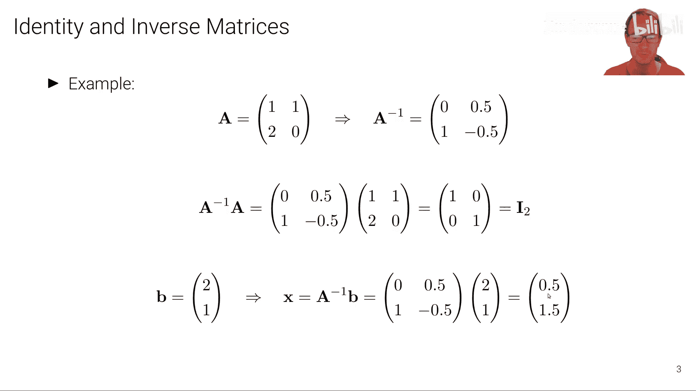