# 【图宾根大学】深度学习的数学 p06 P06 Vector and Matrix Norms -BV1xgKPz9EQH_p6-

Yeah。

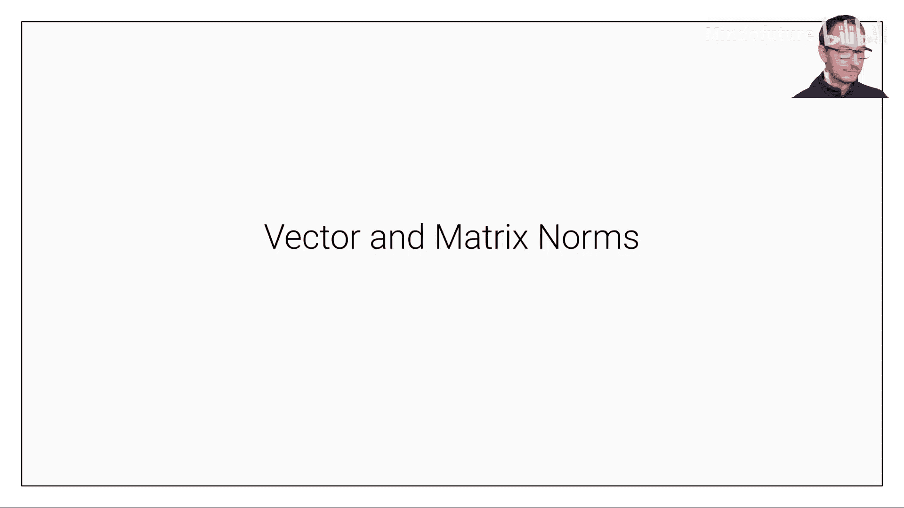

Vectctor and matrixtri norms。We can measure the size of a vector using a function called norm。

And the LP norm， the most general form of the vector norm， is defined as follows。

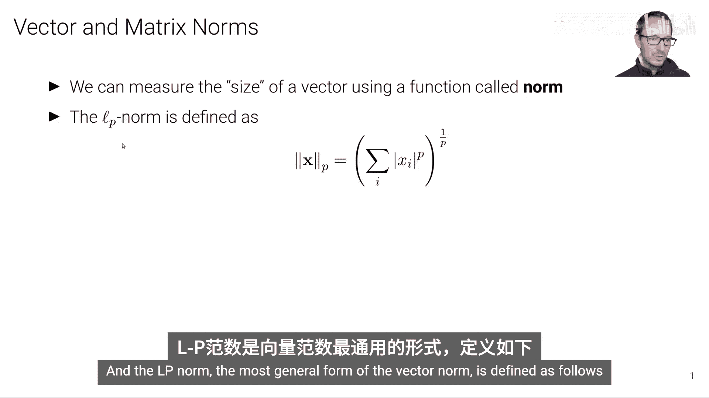

First of all， thenot taste for norm is these two vertical lines on the left and right side of the vector symbol。

And we have this subscript P here， which defines the P value of the norms。 So for example。

 in the case of an occlan norm， this would be P equal 2。 So we would have a2 instead of the P here。

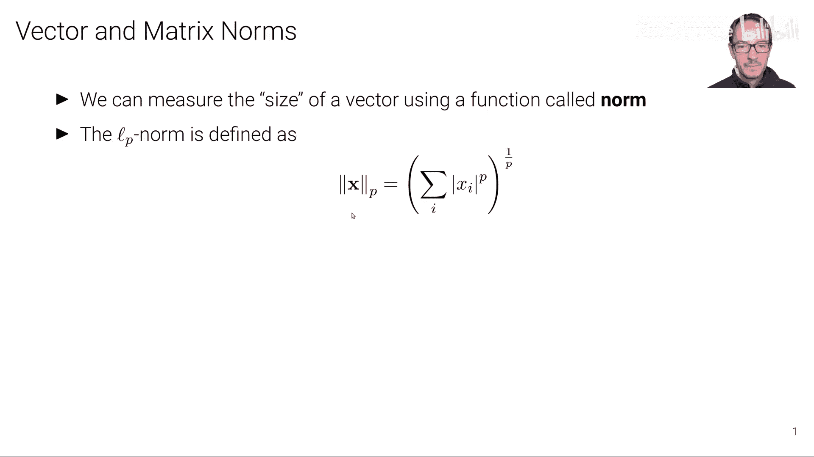

And then the definition of the pen norm is simply we take all the elements of the original vector x。

We take the absolute。Value of these elements and take those to the power of P。

And then we sum them up。And finally， we take。The results to the power of one over PM。

We can see through this equation that a norm。And vector norm maps vectors to non negative values。

And we can interpret this as。Measuring the distance to the origin。

 according to this particular pen norm。

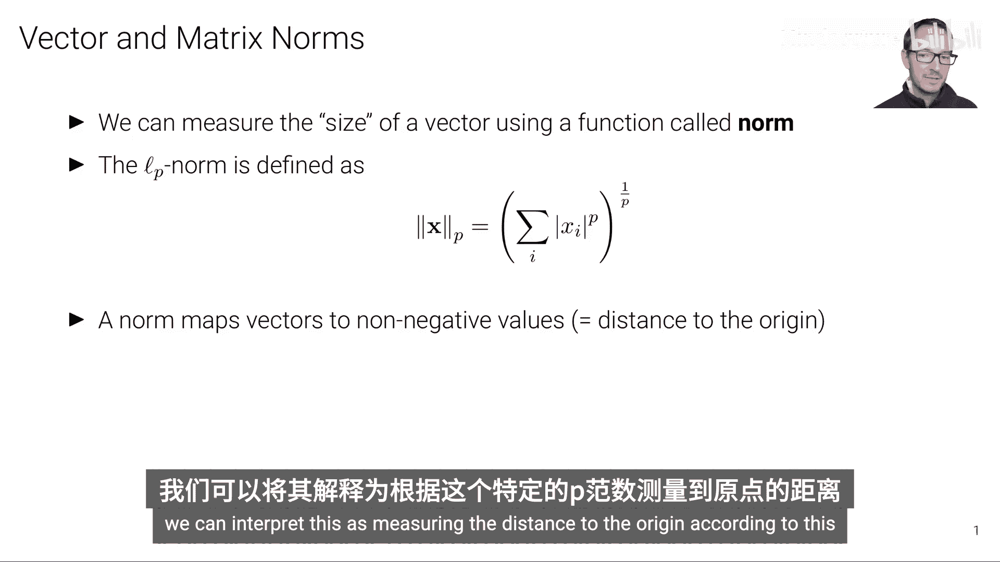

Mathematicically， a norm F satisfies several conditions first。

If the norm of a vector。Equals 0， then the vector must also equal 0。 If the distance to the origin。

Is0 then the vector itself must be0 in all of its elements。

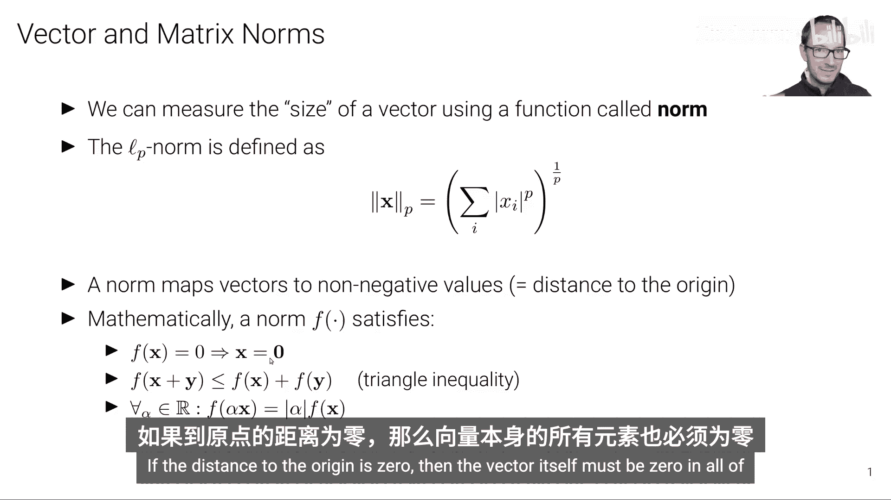

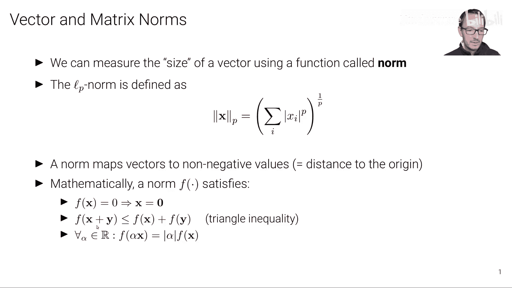

Furthermore， the triangle inequality holds。The norm of vectors x plus y is smaller or equal to the norm of the individual vectors summed up。

And finally， for each。Scalar alpha。The norm of。The vector multiplied with alpha must be equal to Al absolute times the norm of the vector itself。

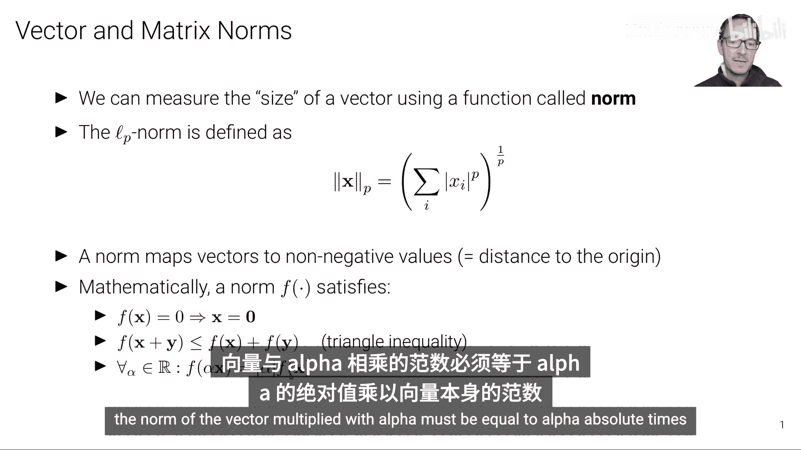

Let's look at some examples。 Here we see an example for the。

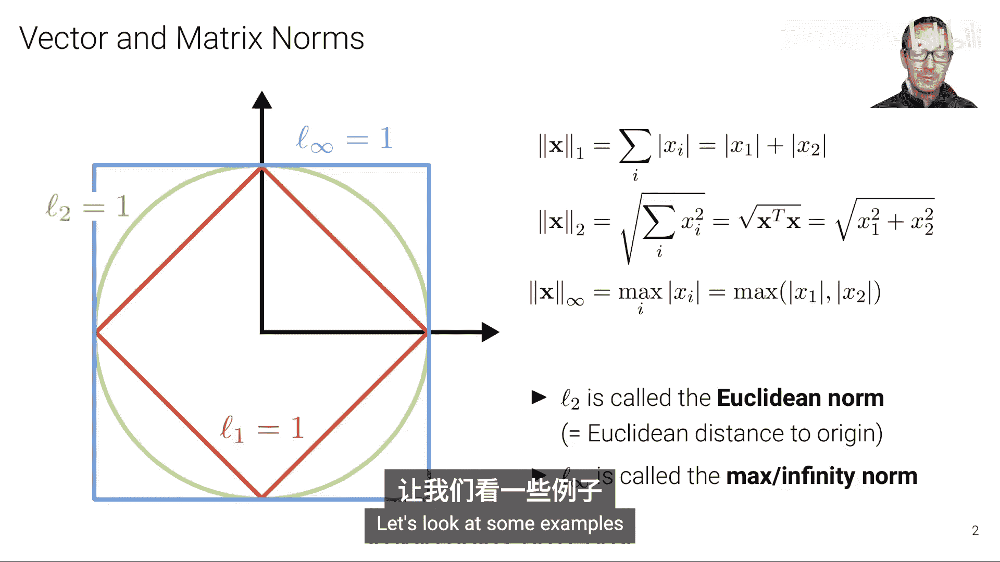

L1 norm， the absolute norm， the L2 norm， So called the Occlidean norm。

 which measures occlan distances。And the L infinity or maximum norm here at the bottom and on the right。

 I always。

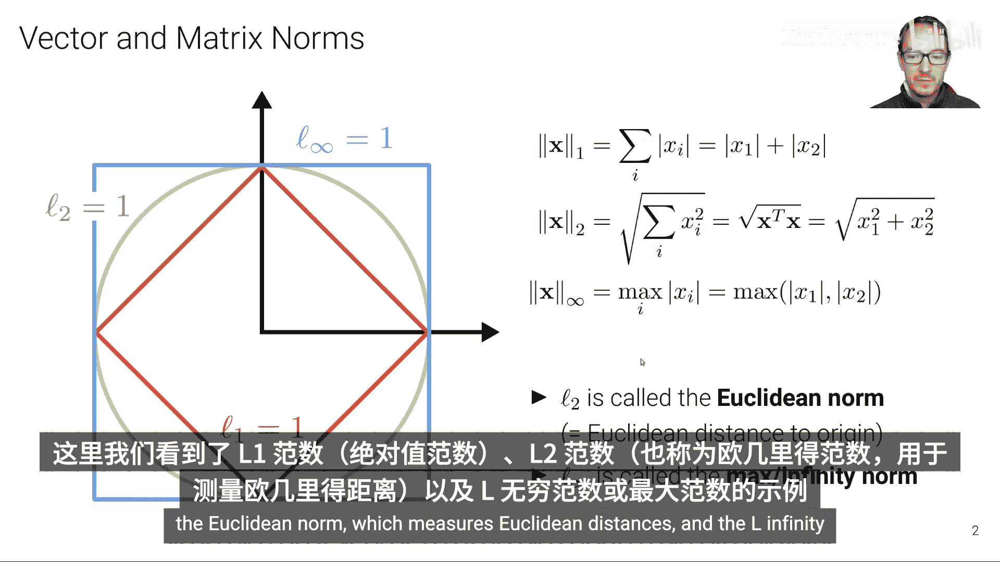

嗯。Show， show this norm for the two dimensional space that's illustrated here on the left。

What we can also see is that for the oucleidean norm here in the middle。

 we can also write this as the inner product of the vector transposed with itself and the square root of that。

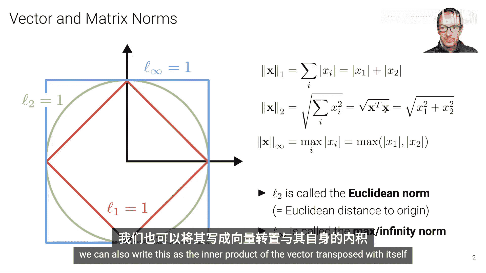

We can now visualize these norms in this case， for the two dimensional scenario。

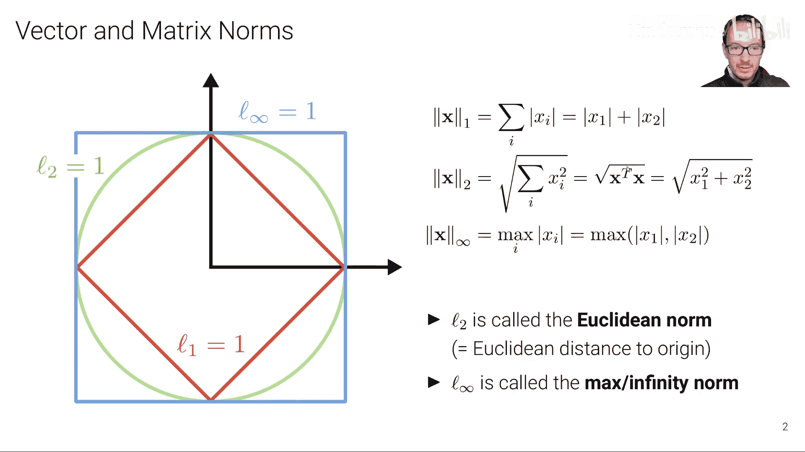

By drawing the one level says， that means。The line or the set of all points where the norm is equal to one。

 And we do this here for the。L1 norm， the L 2 norm and the L infinity norm。

 And you can see that this leads to these different shapes。 Maybe not surprisingly。

 the L 2 norm leads to a circle because we have this quadratic expression here。

 And if we set this equal to constant 1。Then we get a circle because this is the circle equation。

And for the L1 norm， we get this diamond shape here in red， because， for example， the vector 1。

0 has no1， but the vector0，5，0，5 also has norm 1， and the vector 0，1 also has norm1。 and similarly。

 for the negative sides， because we take the absolute。

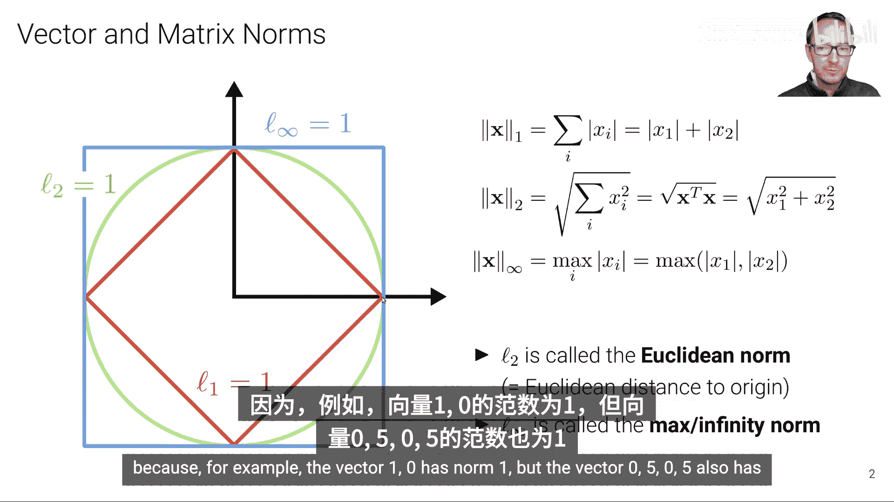

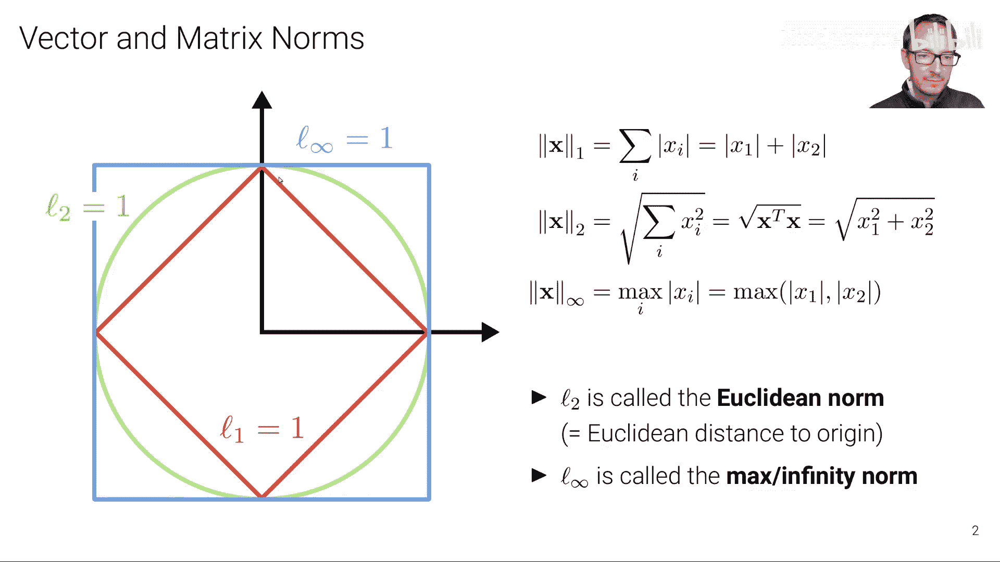

Value of each element。And then finally， we have the blue square。

 which is illustrating the maximum norm。And we can see， for example。

 that all points on this line here for all points on this line。

The x2 coordinate doesn't matter because the x1 coordinate is already1。So。

All of the points on this line。For all points on this line here。

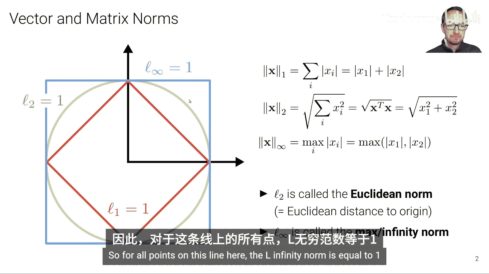

The L infinity norm is equal to1。

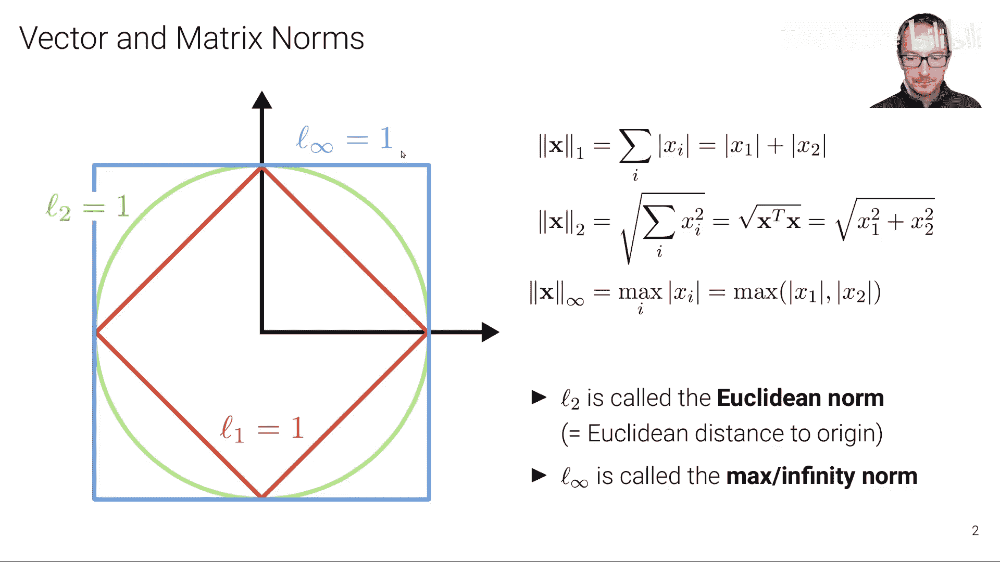

Finally， some remarks， the dot product of two vectors， X and Y can also be written in terms of norms。

So we have x transpose y equals。The norm of the vector xs itself， the occlidean norm。

And the Olan norm multiplied with the occlan norm of the vector Y itself。

Times the cosine of the vector of the angle theta， where theta is the angle that lies between these two vectors。

 x and y。And the size of a matrix can also be measured。

 and one common measure for the size of a matrix is the Frrobinus norm。

 which you can fingers the straightforward extension of the L2 vectorome to matrices。

 We write this with the F。Subscript。And it's simply the square root。

Of the sum of squares of all individual elements of the matrix a。

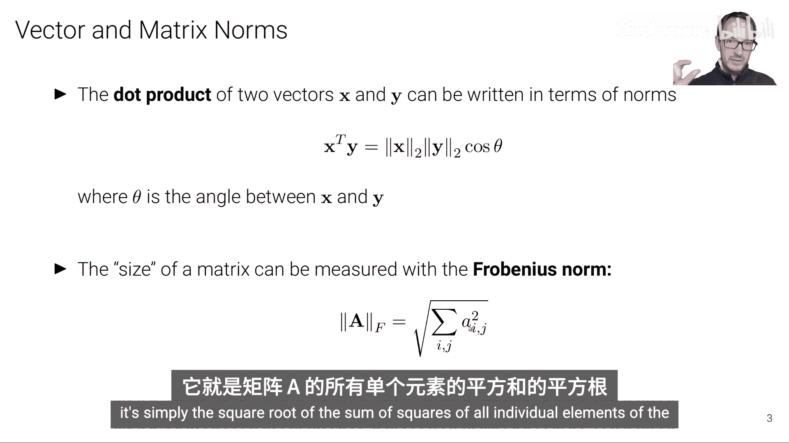