# 【图宾根大学】深度学习的数学 p08 P08 Eigenvalue and Singular Value Decomposition -BV1xgKPz9EQH_p8-

Let's now talk about eigenvalue and singular value decomposition。

 which are very important tools they will see in。The deep learning lecture。

 the self driving car lecture and also the computer vision lecture。

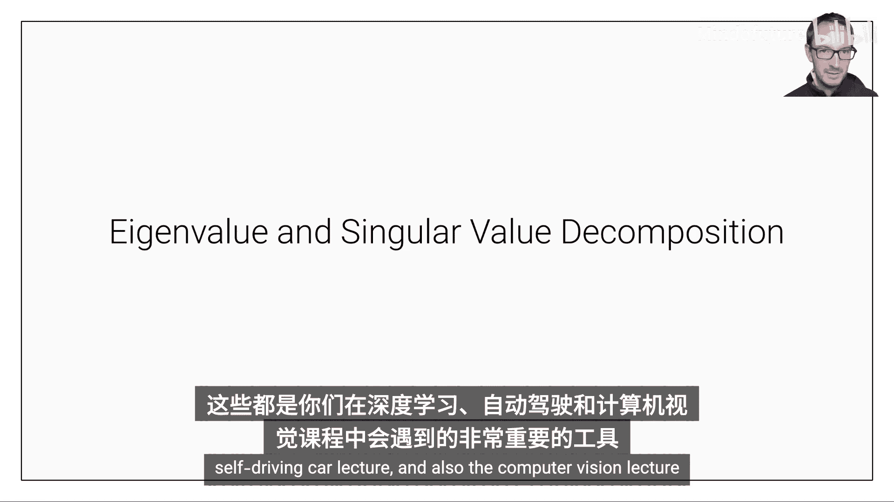

It's true that many mathematical objects can be better understood by breaking them into parts。

 For example， integers can be decomposed into prime numbers from which we can directly see by which certain integers can be divided by。

Now， here， in this case。We are interested in decomposing matrices。

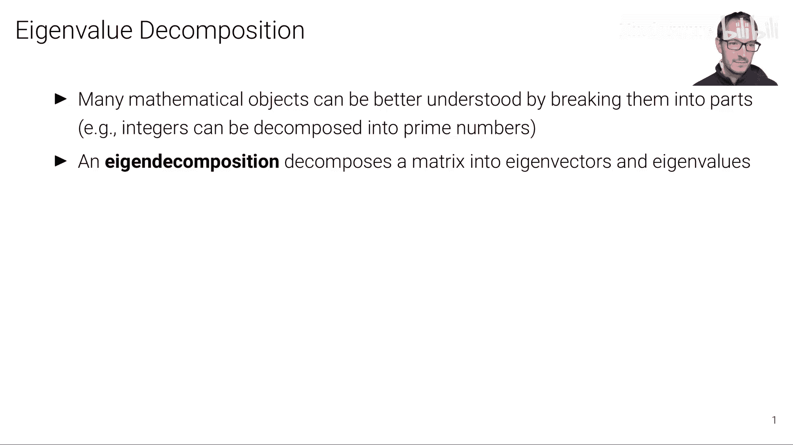

An eigen decomposition decomposes a matrix into so called eigenvectors and eigenvalues。

An eigenvector of a square matrix a is a non0 vector such that multiplication by a only alters its scale。

 and the scale is known as the corresponding eigenvalue。So here's an example， we have matrix a。

 that is the matrix we want to decompose。And。If there is a vector v that if we multiply that with matrix a。

 we get a scaled version of vector v， then this vector v。

 we call an eigenve and the corresponding eigenvalue that we need for scaling v such that this equation is 2。

 we call the eigenvalue。That's what we mean by only altering the scale。

 We don't change the direction of the vector。 We only change。The norm of the vector。

Ass any scaled version of vector v is s nagging vector。

In order to make the eigen decomposition unique， we typically only consider unit eigenvectors。

Require that these vectors here。啊。Anomaize such that they have olean norm 1。

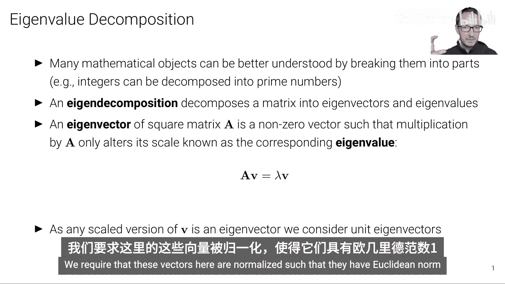

We now concatednate all eigenvectors to form a matrix beam。

 So this is a matrix v where all of the eigenvectors are in its column。And similarly。

 we form all eigenvalue into a diagonal matrix lumpta， where we put all of these eigenvalue。

 there's always one eigenvalue that corresponds to an eiging vector。So Lada 1 corresponds to v1。

 Lada 2 corresponds to v2 and so on。So we form this diagonal matrix that the corresponding eigenvalues corresponding to these eigenvectors are in the diagonal and the rest is 0 because it's a diagonal matrix。

As a little remark to remove further ambiguity by convention。

 we typically sought the eigenvalues in descending order。Which means that if。

 if Lada 1 is not the largest een value， then we swap that with。Another lumpda。

 which is large as such until we， we achieve this descending order。 And， of course。

 we need to swap the columns of V。In the same way， such that they correspond。

The eigen decomposition of a。Is then given by the following expression。

 A equals v times lambda diagonal matrix times v to the power of -1。We inverse。

And it's guaranteed that every real square matrix has such an eigen decomposition。Furthermore。

 every real ansymmetric matrix A， which is also very common case， can be decomposed。

Into a simpler expression， Q， Lada Q transpose。 So we don't have a minus1 here。 no inverse。

 We have just a transpose because Q in this case， is an auton normalmal matrix composed of the eigenvectors of a。

RightIt's again， a matrix with the columns being the eigenvectors。 but in this case。

 it' all of the columns are auton normalmal to each other。Which means that we can。

Replace the inverse with the transpose。

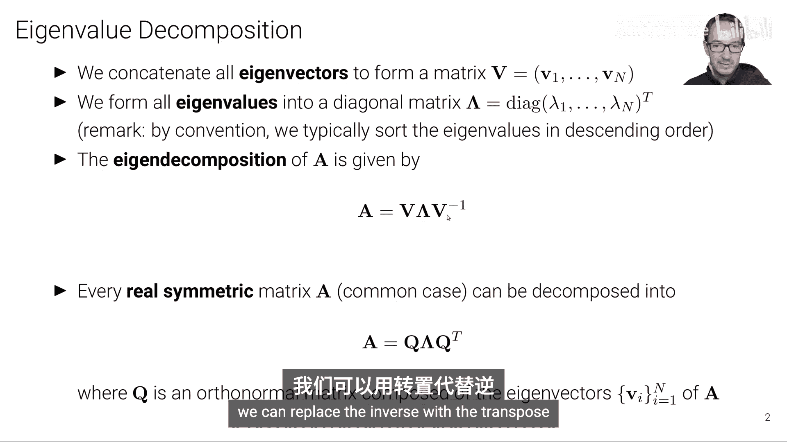

Let's look at an example what this。Transformation that we discovered， thus。To is that affect us。

Or a set of elements in space。So what I've drawn here are the in， in black， the。First。

 eing vector and the second eing vector， V1 and V2。And I've also drawn a circle。

Which denotes a set of points， as well as two specific other vectors that have no specific meaning just to see how they are getting transformed。

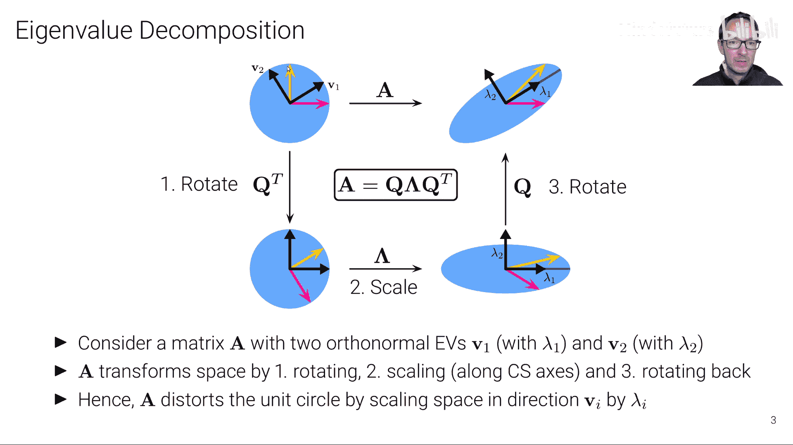

And if we now apply matrix a to the circle and this vectors， we get this circle and D。

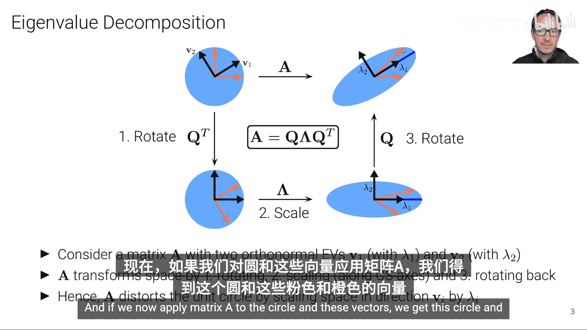

Pink and orange vectors here。But in this case here we do it by decomposing this transformation into three subtransforms where first we rotate。

 we have a Q t that we multiply with the if we multiply a vector here on the right hand side and we multiply this first with Q T and because Q is an autonormal matrix。

 we know that this is just a rotation matrix in 2D space， for example。

 so we rotate this entire coordinate system here。Such that it is aligned like this with the axis's。

And then we apply the diagonal matrix， which means。

We scale along the individual axis by the eing values。

 So now you can see we have a stretched ellipoid here in the horizontal dimension。

 and we have a little bit of shrink ellipoid in the vertical dimension， because in this case。

 we have assumed that lump up 1 is larger than one in Lda 2 is smaller than one。And similarly this。

Example vectors， the orange and the purple one get transformed as well。And then finally， we apply Q。

 So we rotate back。 We don't apply Q T。 Now we apply Q。 So we rotate back into the original。

Coordnate system。And what we can see now， what it does。

 what this transformation does effectively through these free sub transformations is that we have wrote。

 we have basically。And distorted this unit circle here。

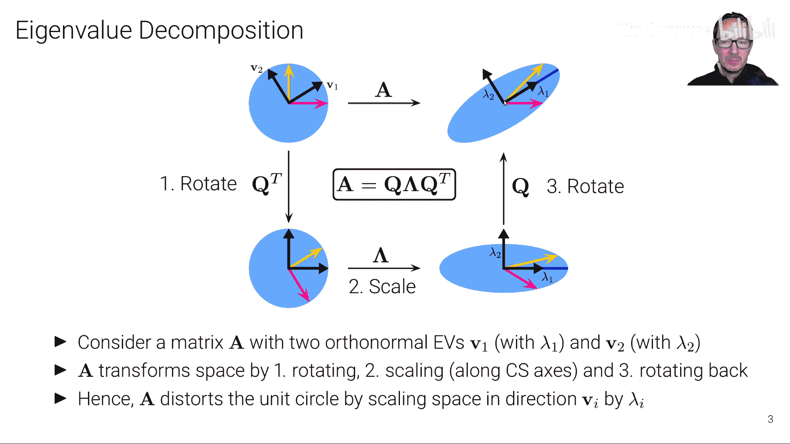

This isotropic Uni circle by scaling the space into the direction of V1 and V2。

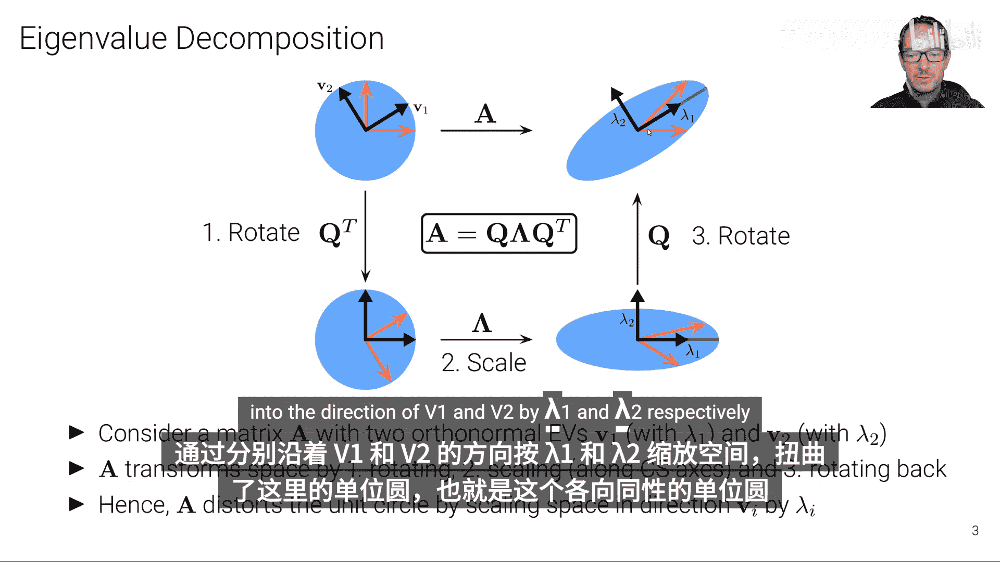

By Lata 1 and La 2 respectively。 So in this direction of V1， we have stretched the space and also。

This corresponding example vectors。And in the other direction， we have。E， shrink the space。

Because Lada 1 is bigger than 1 and Lada 0， and this example here is smaller than one。

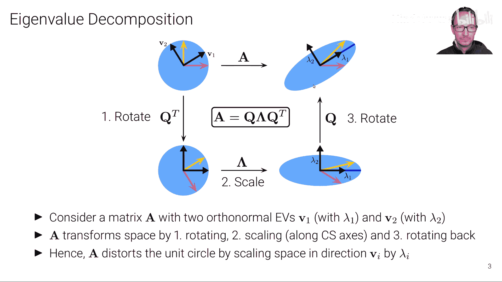

Okay， so heres some properties。 A matrix is called singular。 If any of its eigenvalues is 0。

 If any of its eigenvalues is 0， we have a matrix where。There is some dependencies between。Columns。

 And so it's not invertible。 It's singular。The rank of a matrix equals the number of non0 eigenvalue。

 That's a convenient property。 If we have the eigingvalue decomposition。

 we know how many of these eigenvalue are0 or close to 0。

 so we know if it's possible to invert that matrix or not and we know how many solutions the corresponding linear system has。

Only matrices with full rank can be inverted， right， only if we have， that's what we said before。

 If we have all of the。Columns to be independent， only a non single matrix。 we can invert it。

A matrix host e values are all positive is called positive definite。

And the matrix was eigenvalue are all positive， or0 is called positive semi definite。

For positive semi definite matrices， we have that for all x phi。Construct this product here。

 this must be bigger or equal to zero。Positive definite matrices additional guarantee that if this product is0。

 then also the vector must be0。Now it's， of course。

 possible to derive and calculate the eigenvalue decomposition with pen and paper。

 but luckily in practice， we don't need to do that because theres great numerical linear algebra packages that we can use。

 and for example， in python， we have nuy where we can use nuy L ac dot Ike to simply。

With one call decompose a matrix a into its eigen rec and eigenvalues。

If you want to know a little bit more about this decomposition and how to do it by hand。

 I can recommend this link here。

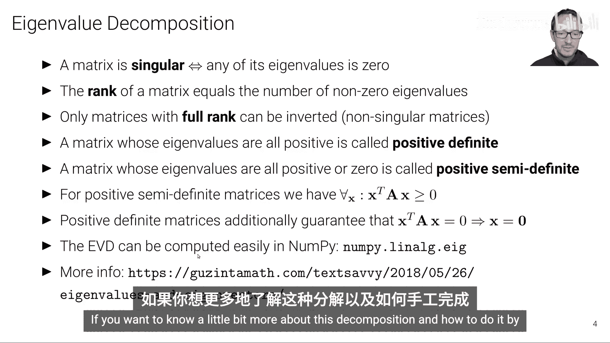

Now finally， there's also something called a singular value decomposition。 Now。

 why do we have yet another decomposition？The problem with the eigenvalue decomposition is that it can only be applied to square matrices。

For non square matrices， however， we can use the singular value decomposition。

The singular value decomposition looks similar to the eigenvalue decomposition。

But it can factor rise a non square matrix， a matrix out of the matrices。

 the M times n matrices of real numbers， for example。And you can see that here on the left hand side。

 on the right hand side， we have different matrices now。

 but we also have a D diagonal matrix in the center。So in this case。

 we have U element of the space of M by M matrices d。This diagonal matrix。

Element of the space of m times n matrices and V element of the space of n times n matrices。

U and V are autoagonal matrices， and D is a diagonal。

 It could be a square diagonal or non square diagonal matrix。 Of course。

 the interesting case here is the non square diagonal matrix case because then we can apply this to non square matrices。

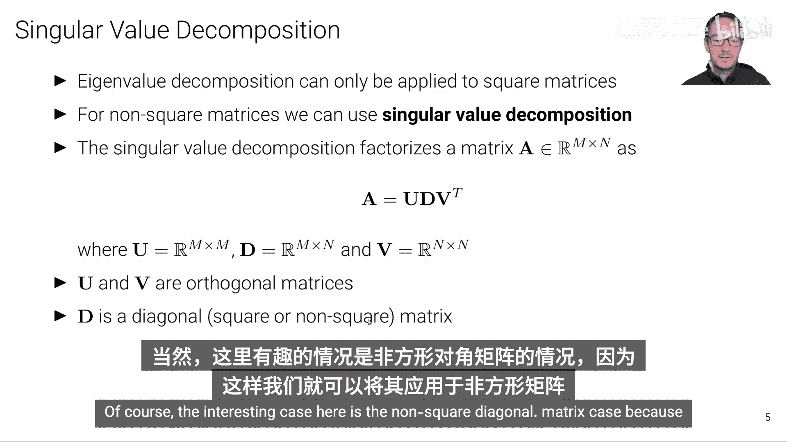

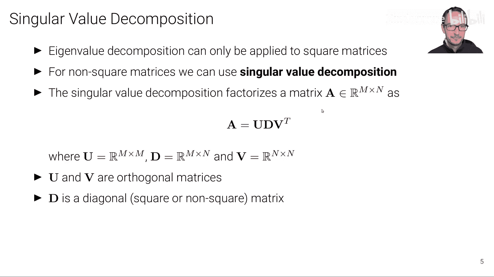

The elements along the diagonal of D are known as singular values。

And the columns of U and V are the so called left and right singular vectors respectively。

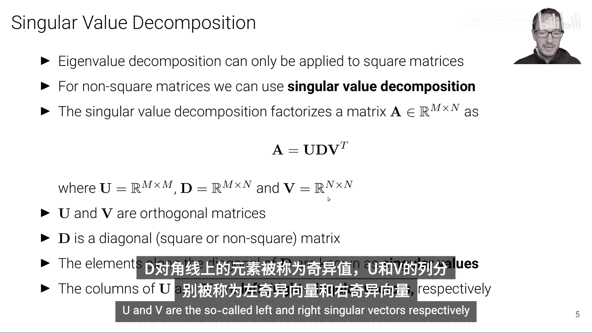

And indeed。The eigenvalue decomposition and singular value decomposition are quite related。

If we consider the singular value decomposition of arbitrary。Real matrix A。

And if you take a transpose a。Then be using the rules of transpose that we've seen earlier。

 We can write this as such。 And then， of course， dear。Because U is an autonormal matrix。

 This term goes away here。 So we have D squared V， D squared V transpose。

 so we can see that the right single vectors v。Are the eigenvectors of a transpose a。

The right singular vectors of v， according to the singular value decomposition of a。

Are the eigenvectors of a transpose a。And similarly， the left single vectors。

 you are the eigenvectors of A H transpose。And the eigenvalues of a transpose a and A A transpose。

Are equal to the square singular values of a。 We have the D square here。

So it's basically just a square operation sitting between the eigenvalue decomposition and the singular value decomposition。

Now， let's finally look at an application and this application is something we'll look into more detail in lecture 11 of the deep learning。

 of course。Ass called the principal component analysis。PC。

PCA is a technique for analyzing large high dimensional data sets， as we'll see。

So we can project any high dimensional data set into a smaller dimensional space where we can look at it。

 And we do this by。Projecting it such that most of the information is retained。

 so we want to project it such that we keep the directions of largest variants。

And now the nice property here is that。If we compute the eigenvectors of the scatter matrix or the covariance matrix。

 these eigenvectors are called the principal components。

 and they face the direction of the largest variance。

 This is something you can show and we also look at later。So here in this example。

 we have the blue data set。And we compute the eigenvectors。

 And we can see that the largest variance is in this direction here。

 because this is spread like that。 and then。The next。Large variance。

 autogonal direction to this vector here is this vector here， which is the second eigenve。

 And so if we want to project this two dimensional data set into a one dimensional data set。

 the best we can do is if we project it along this line。

 because this is how the variance is spread maximally。For this illustration here。

 the two eigenvectors we1 and B2 are scaled by the square root of the eigenvalue。

 so this indicates the spread of the standard deviation in each of these directions。

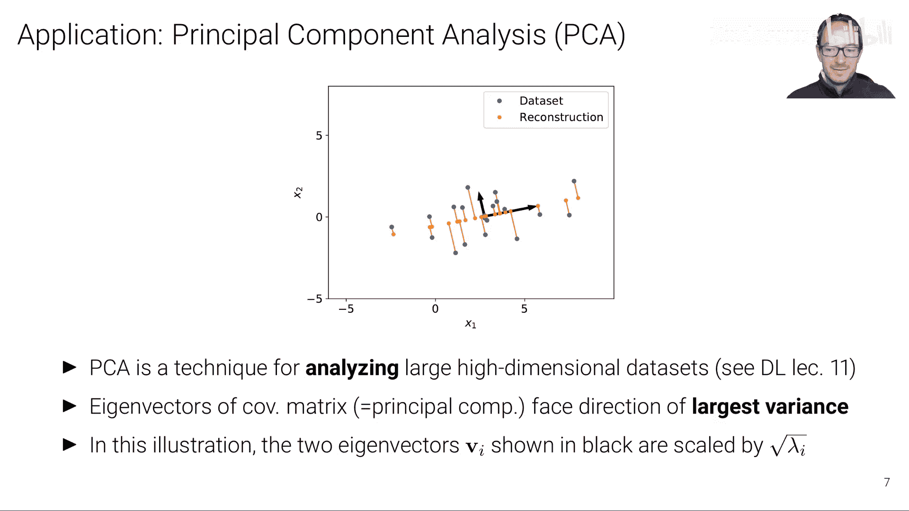