# 【图宾根大学】深度学习的数学 p09 P09 The Trace Operator and Determinant -BV1xgKPz9EQH_p9-

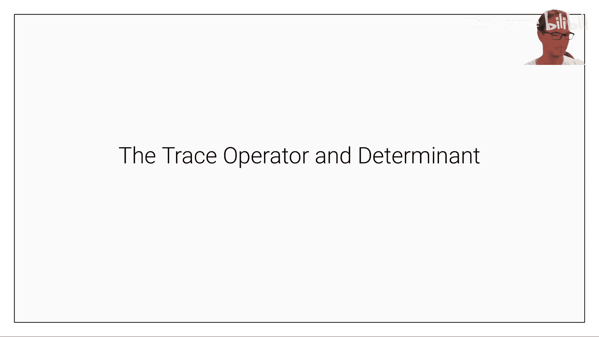

Let us now finally look at two matrix operators， the trace operator and the determinant of a matrix。

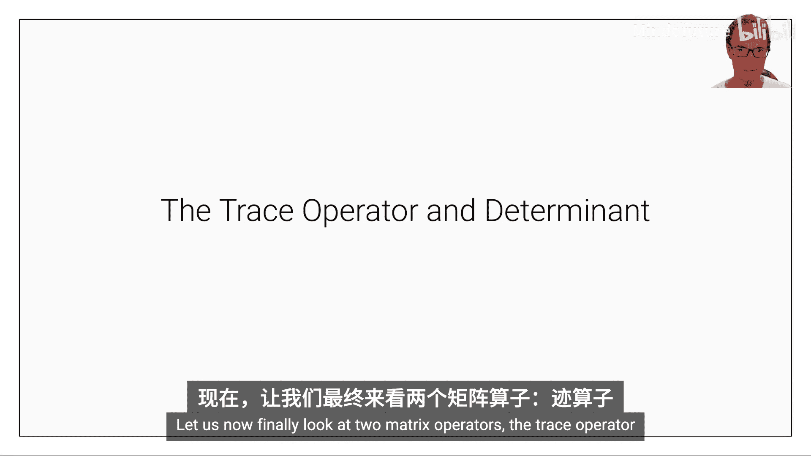

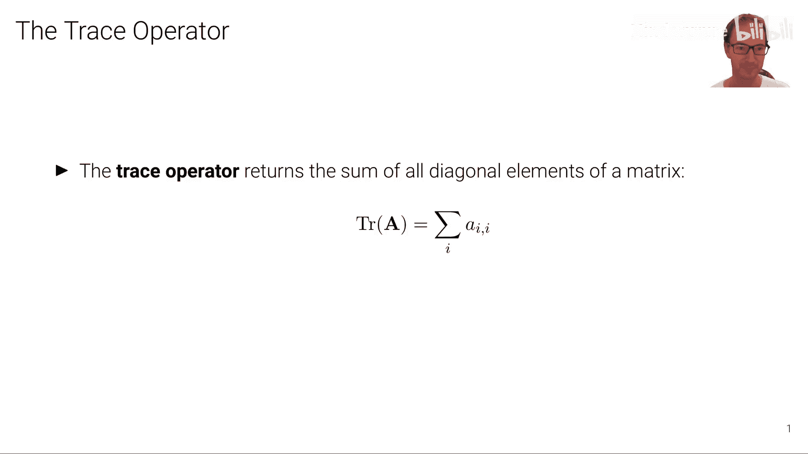

The trace operator a returns to some of all diagonal elements of a matrix。In other words。

 the trace of matrix a is equal to the sum of all I。Elements， AI， comma I。

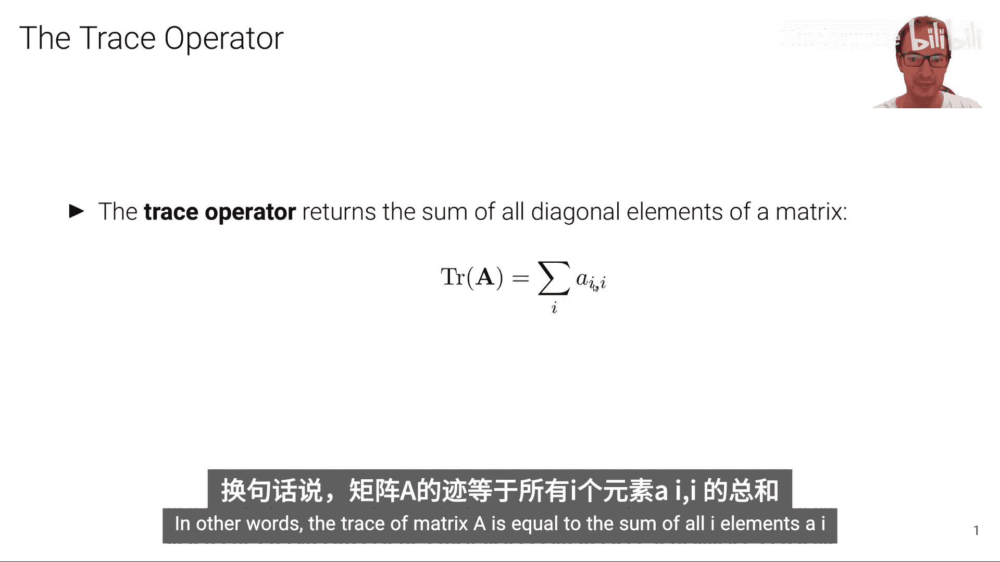

The trace operator allows for writing the Frenous norm of a matrix， without summation。

If you remember before we have written the Frroenus norm as the summation of all squared individual elements followed by the square root after the summation。

Now， we can simply write this。As the square root of the trace of A A transpose。

The trace operator is also invariant to the transpo operator。That means。If we transpose the matrix。

 the trace stays the same。 That makes sense because the transpoererator chest mirrors the matrix elements along its diagonal。

 So the diagonal will stay the same。

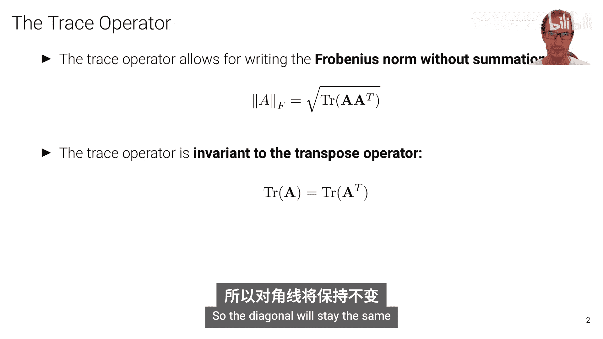

And finally， the trace of the product of square matrices is invariant to cyclic permutations。

That means。We can cycle these free matrices through here。 We can。Take this。Matrix C here。

 and put it in front of A。 And we got C， A B。 And then we can take this matrix B and put it in front of the matrix C。

 So we have B A and the trace of all of these free matrices， which are。Themself， products of。

3 matrices。

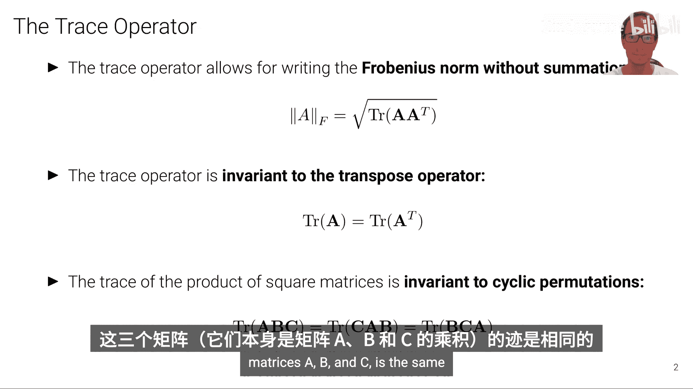

A， B， and C。Is the same。

The determinant， in contrast to the trace operator of a square matrix is equal to the product of all eigenvalues。

 In other words， the determinant written as such。

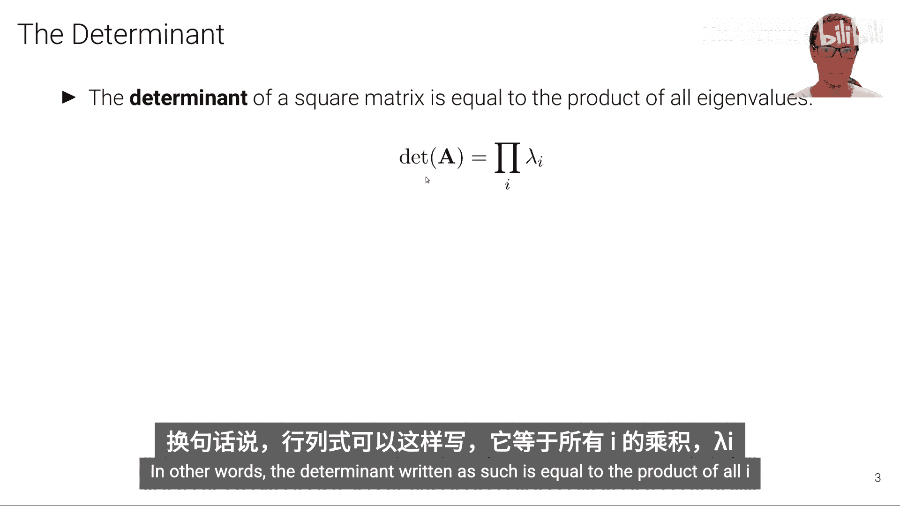

Is equal to the product of all I Lata I where Lata I is the if eigenvalue of the matrix a。

 as we have defined find it before in the unit on eigenvalue decomposition。

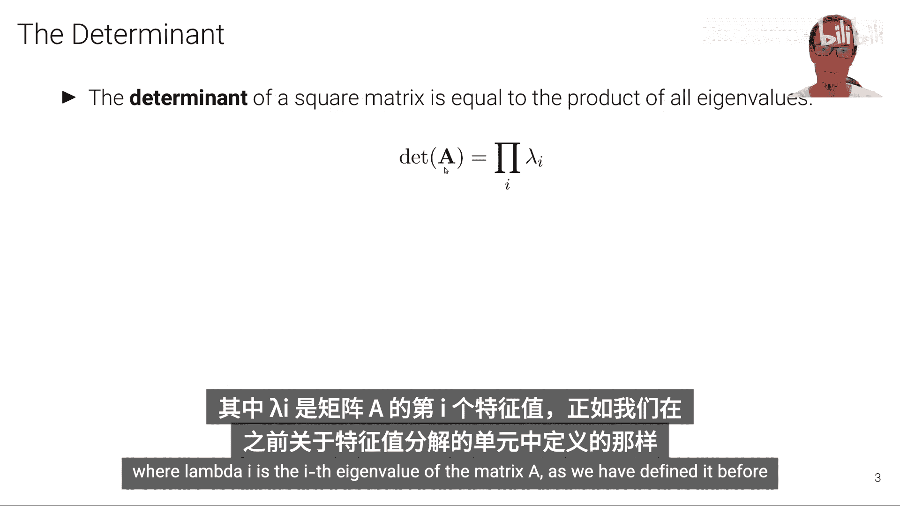

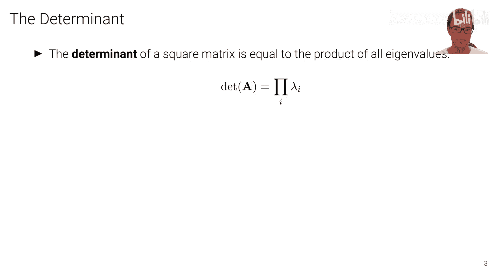

The determinant can hence be thought of as a measure of how much multiplication by the matrix a expands a contract space。

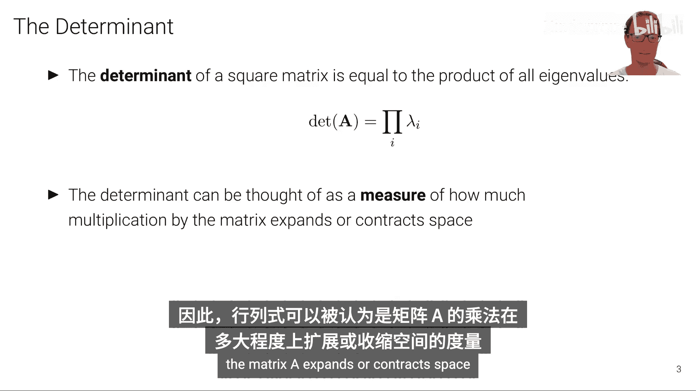

If we take some。Vectctors describing points in 3D or higher dimensional space。

And we multiply those to the matrix a。Then they will either contract towards0 or expand away from0。

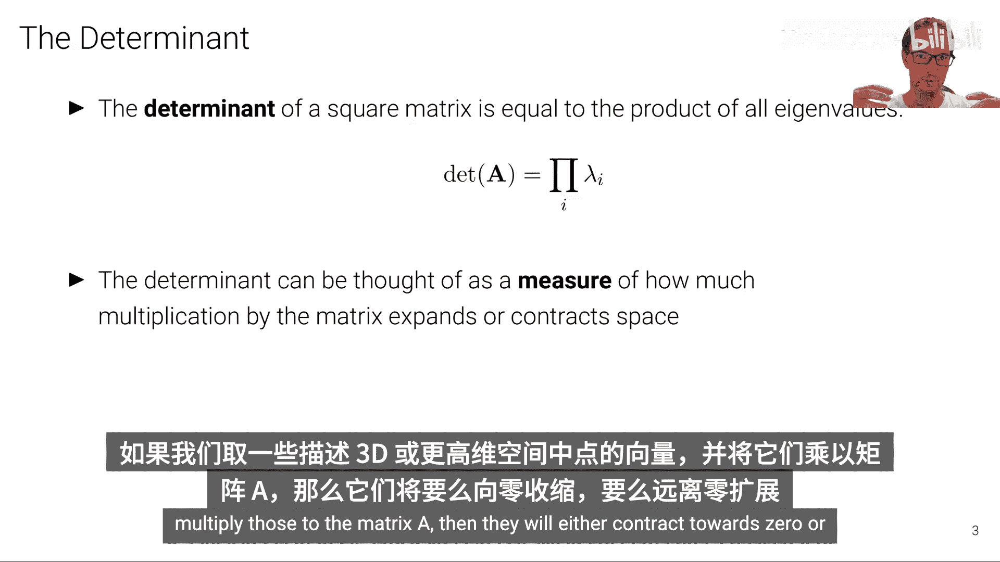

And the determinant can be thought of as a measure of how much。

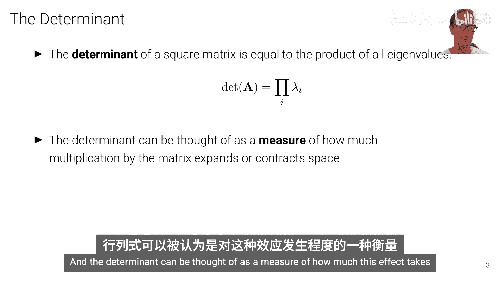

This effect takes place。In particular， if the determinant is one。

 then the transformation is said to be volume preserving。

 The volume described by the input is preserved when applying this。

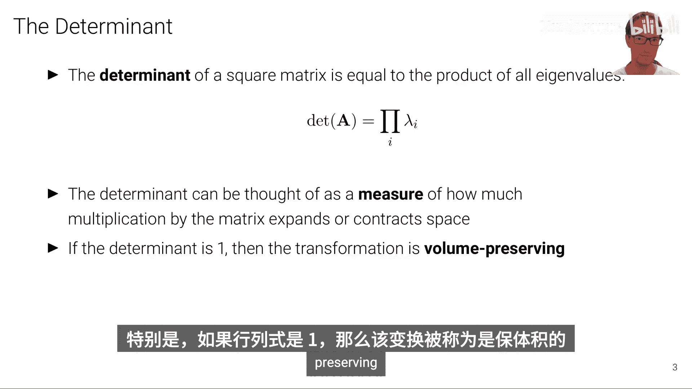

Matrix a。And on the other hand， if the determinant is0。

 then space is contracted completely along at least one of the dimensions。

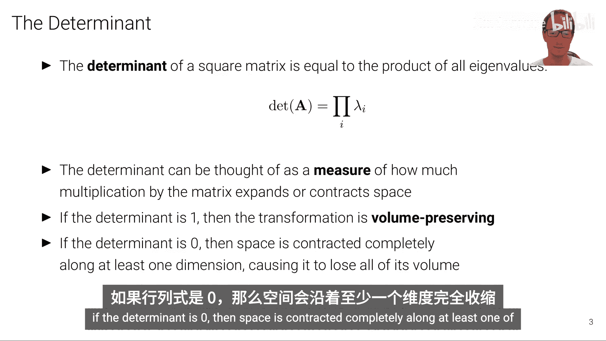

ItCollaps along one of the dimensions， causing it to lose all of its volume。

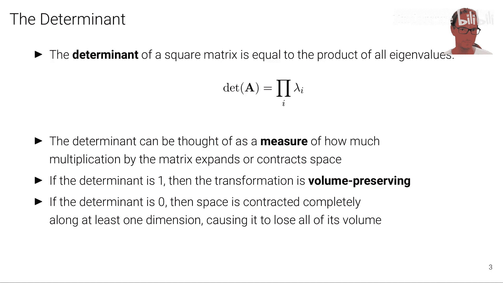

Collapsing all of the volume to 0。Along at least one。Dimenssion。In other words。

 the matrix is singular or rank deficient in this case。

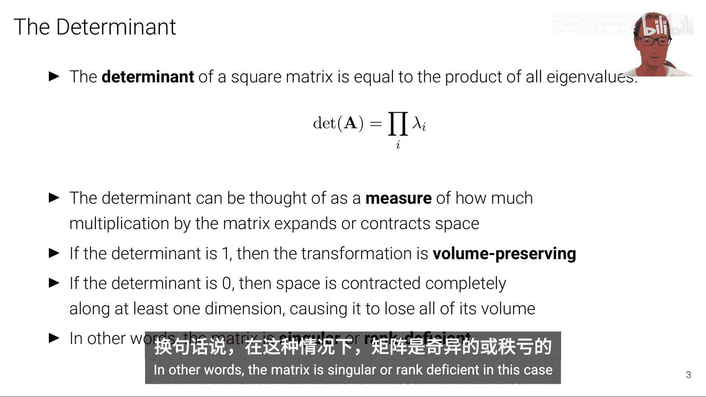

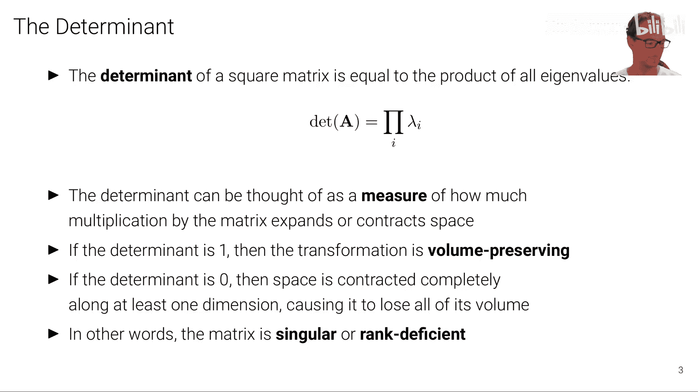