# 【图宾根大学】深度学习的数学 p10 P10 Differential Calculus -BV1xgKPz9EQH_p10-

Let's now talk a little bit about differential calculus。And because this is pretty much high school。

 calculus will go a little bit faster here。

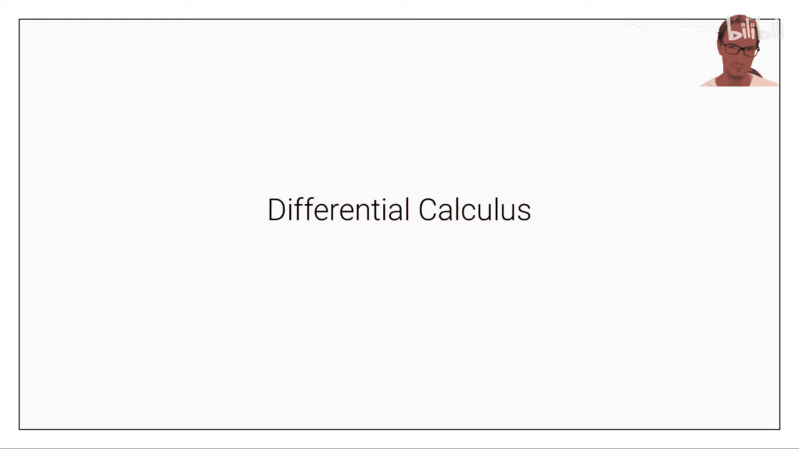

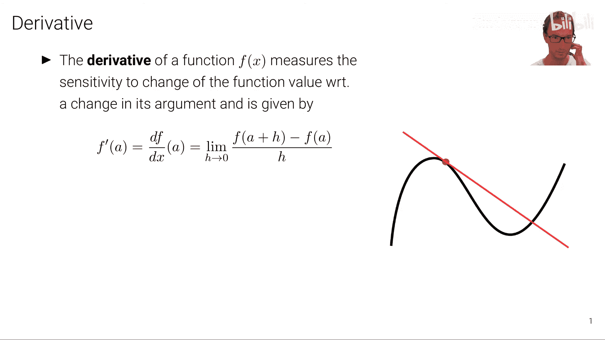

The derivative of a function F of x。 And on this slide， we only consider univariate functions。

 which means functions of a single。1 dimensional argument， X。

The derivative of a function F of x measures the sensitivity to change of the function value。F。

 with respect to a change in its argument， X。And is given by the limit。

Of F of H of a plus H minus F of a over H when we let H go towards 0。If this limit exists。Then。

 the derivative exists。And we write the derivativeruifous Ava F prime。Evaluated at。

A or D F with respect to Dx evaluated at a。

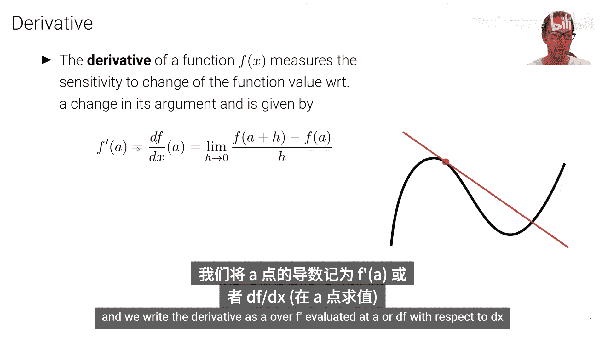

These are just two different notations for the same thing。A function is differentiable， if。

The limit exists。In particular， it's differentiable at a if the limit exists at a。

And the slope of the tangent line。Here， an example from Wikipedia is equivalent to the derivative at the tangangan point here in dark red。

So this tangent line slopeia is equivalent to the derivative of the tangan point。

 the point where the tangent。嗯。Touchesty。The function。F。

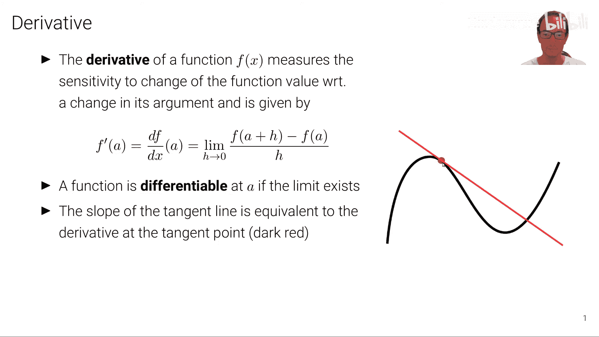

He un read。Similarly， we can also write down higher order derivatives。

 We can take the derivative of a function and compute the derivative of the derivative of a function and so on。

 So for example， the second derivative is written as F prime prime of a or d squared F respect to dx squared of a。

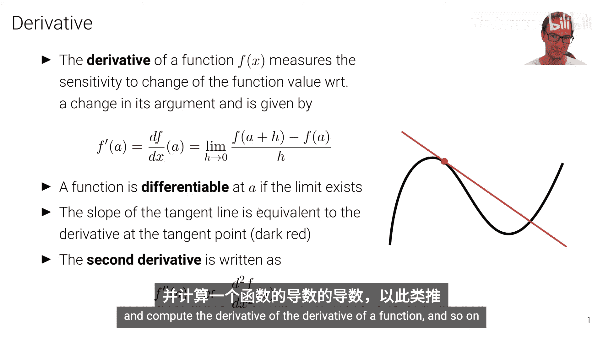

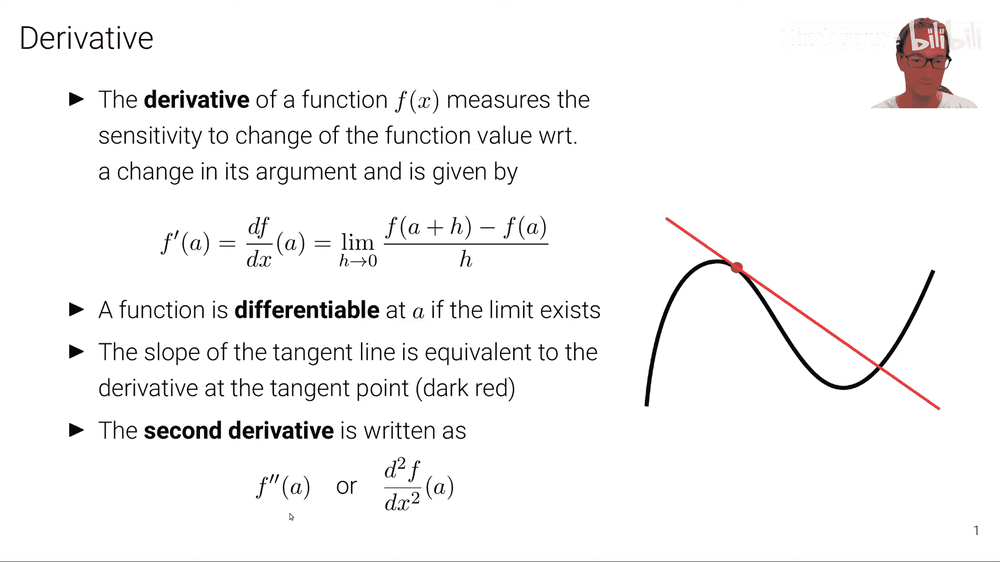

These are just two different。Expressions that enote it the same。

 The second derivative of function F evaluated at a。

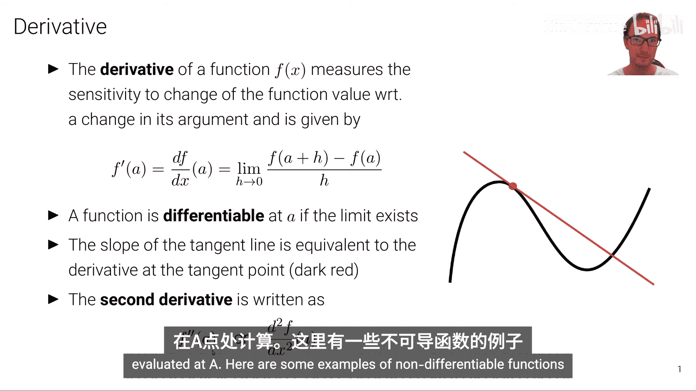

Here are some examples of non differentiable functions。The first example is。

A non differentiable function that's also not continuous。This is a function that has one value。

And then suddenly jumps to another value。And at the jump。

 we define this function to have the higher value of these two。Now。

 this is clearly not continuous because we have this jump here。It's also not defiable。

Because if we take the limit from the left and the limit from the right， we get different。Lits here。

 If we take the limit from the left， we get an infinitely steep slope。

 If we take the limit from the right， we get zeroem。

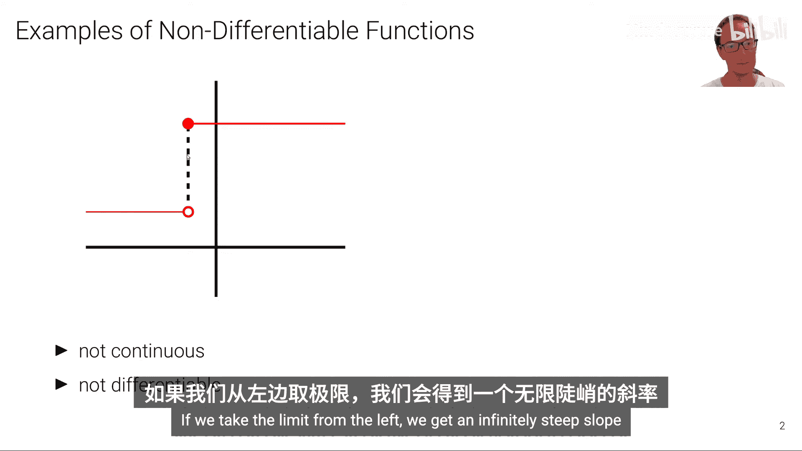

Here's no example。 This is the L1 norm。

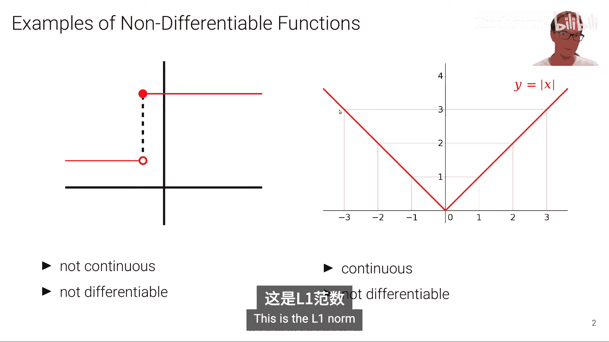

This is the absolute norm。 Y equals absolute of x。In this case， the function is actually continuous。

But it's not differentiable at that particular location， at 0。It's differentiable everywhere else。

 just not differentiable at 0。Because if we take the limit from the left。Then， we have。

A derivative of -1。 And if we take the limit from the right hand side， we have a。

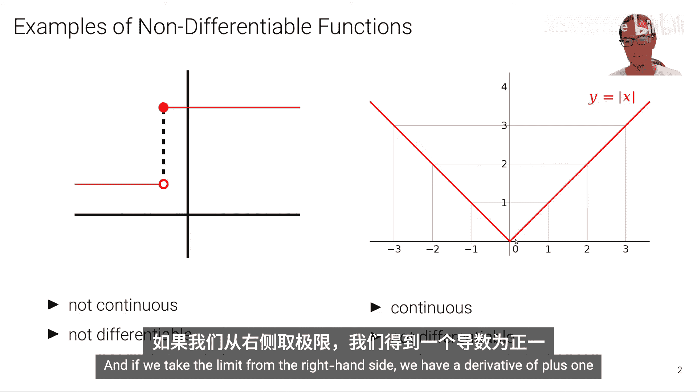

The relative of plus  one。Or a positive slope。All of you have heard of the chain rule。

 So what does the chain rule tell us now， The chain rule expresses the derivative of the composition of two differentiable functions。

 F and G in terms of the derivatives of F and G。More precisely。

 if we denote the composition of functions F and G。

 which are typically denoted by this little circle here as。Another function， H。

And this is such that H of x equals F of G of x。 this is the composition of the function A G。

 we take。X as an input to G。And then the output of G as an input to F。

 And that's what we call the function。Age of X， this composed function， this nested function。

Then the chain rule tells us the following， again， in both notations。

 The first is called the Lagrange notation， and the second is called the lanet notation。

The chain rule tells us that the derivative。Of the composed function， with respect to x。Is。

The outer derivative， which means the derivative of F with respect to its argument。

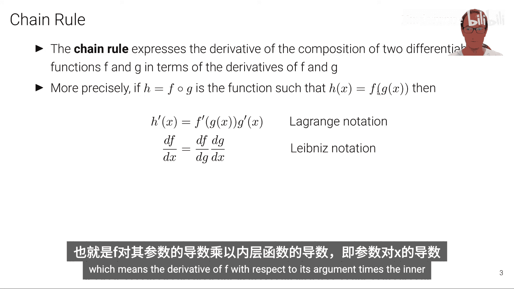

Times the inner derivative， which is the argument with respect to x。Similarly here。

 D F with respect to Dg。Times Dg with respect to Dx。

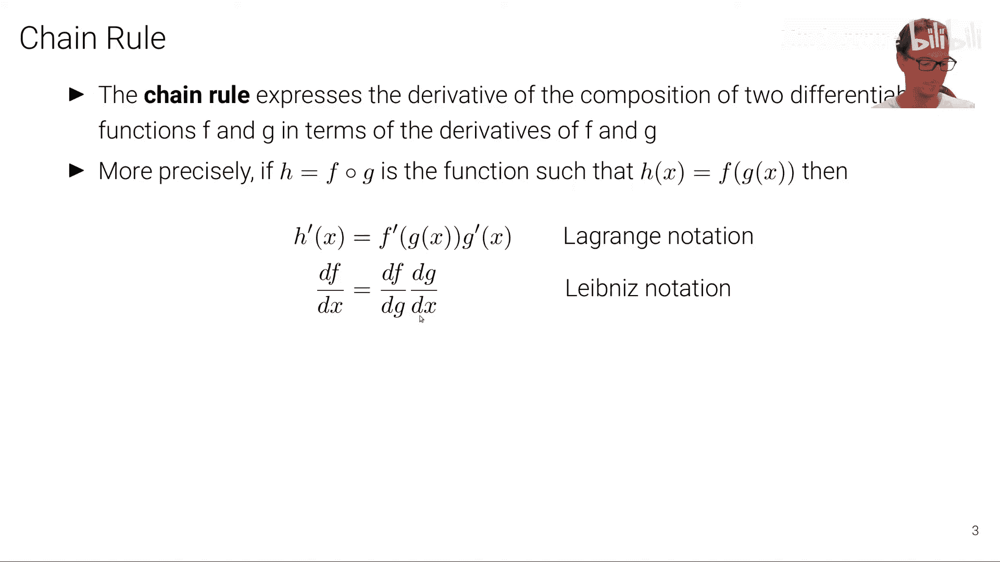

Here's a simple example。Let suppose the function H of x is equal to 2 x squared plus x to the power free。

Then if we take the derivative of that function 8。Of x。

Then we have to use the chain rule in order to calculate this derivativeive。

 because it's a composition of two functions， namely the function。

2 x squared plus x and the function。X to the power of free。So we first take the the derivative。

Of this expression here， which is3 times 2 x squared plus x to the power of 2。

And then we have the inner derivative， which is the derivative of。

This expression here refers back to x， which is 4 x plus 1。

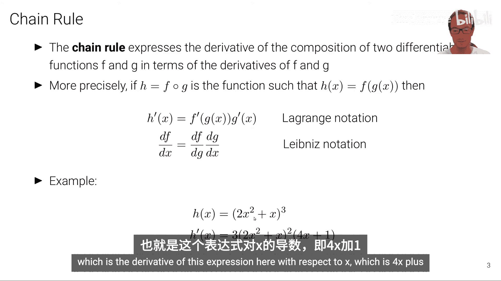

Okay。So now let's move to derivatives of multivariate functions。So far。

 we've only considered functions of a single argument X。 But now let's consider。Multivari functions。

 which are functions that depend on multiple arguments。

That depend on an argument of higher dimensionality。

So let's consider the simplest case where we have a function that depends on two arguments。

 Let F of x come a y be a function where in addition。The variable， the argument， Y also depends on x。

 Y is also a function that depends itself on x。Let's suppose this is the situation。

 and we have created a situation with a special purpose in mind。

 with the purpose of distinguishing the terms partial derivative。And totally derivative。So far。

 for the case of a。A single variable， we didn't need to this distinction。

 but now because we have multiple variables。We must have this distinction， as you will see。

So let's first consider the partial derivative。The partial derivative is defined， as follows。

Partial derivative of the function F with arguments X and y with respect to x。

Is denoted with these partial symbols here。And that's simply the partial derivative of F with respect to x。

Times。Well， the derivative of x with respect to x， which is 1。So this is just the chain rule。

 as you can see。Written out explicitly， we could have also directly removed this term here。

In other words， in this case， we don't consider that y is a function of x。

 We consider y to be a constant。And that's why we call this a partial derivative。

We just differentiate this term as if y was a constant。

 We don't see that y has a dependency on x in this case。It's like a constant， see。

So as an example here， we have the function x comma y equals x times y。

 and if you take the partial derivative。Of that function with respect to x， we simply get y。

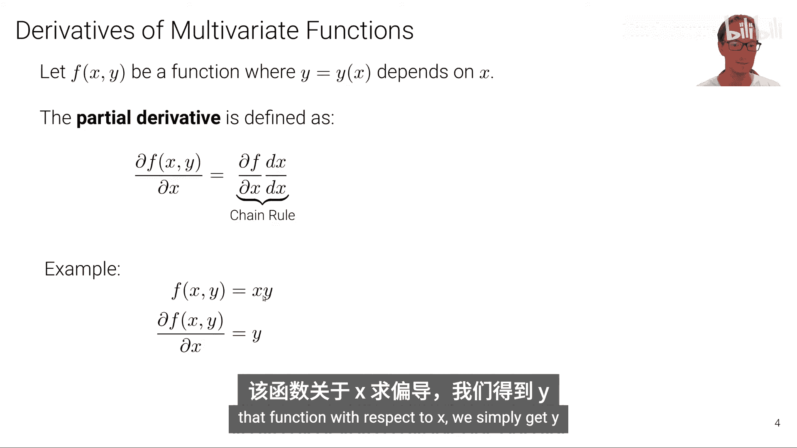

Now， in contrast， the total derivative considers this dependency here。

 It considers that y is a function of x。And the total derivative is defined as follows。D。

 now we have D instead of the partial symbol here， D F。With respect to x equals。

The partial derivative of f of respect to x times dx d x， which is1 again。

 plus now an additional term that wasn't there before。

 which is the partial derivative of F of respect to y times dy dx。

And you can see that we need this additional term here。Because y depends on x。 Now。

 if y would not depend on x。 if y would just be a constant。

 then the y with respect to the x would be 0， and this term would go away。

 and we would be left with this term here， which would be the same as the partial derivative。

But because we have chosen that function such that y depends on x， this makes a difference now。

And this is called this expression is called also the multivariate or multi variable chain rule。

So this is the difference between the partial and the total derivativeroive。

 The partial derivativeroive considers y constant。And the total derivative considers the dependencies of all the variables inside the argument with respect to the variable that we differentiate with respect to。

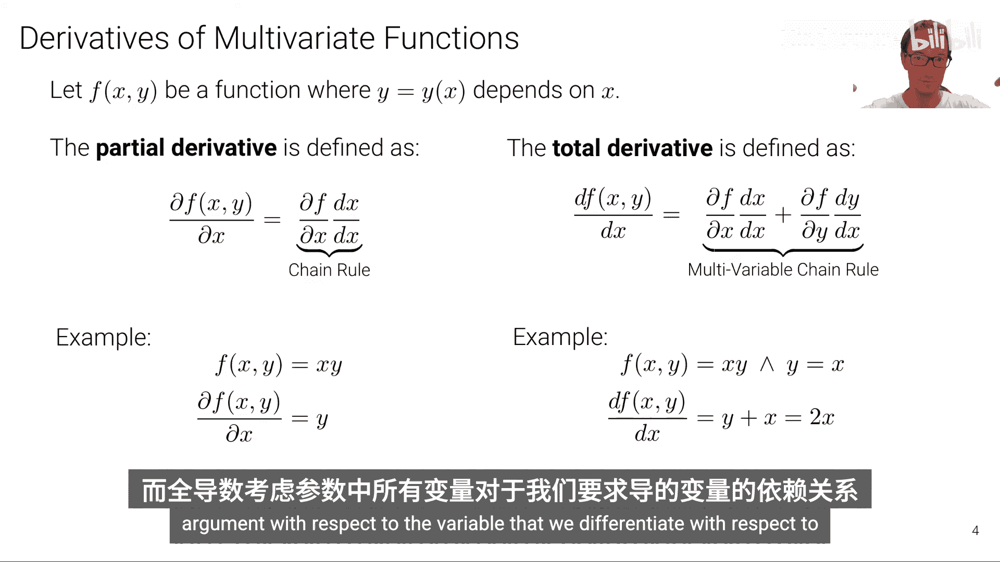

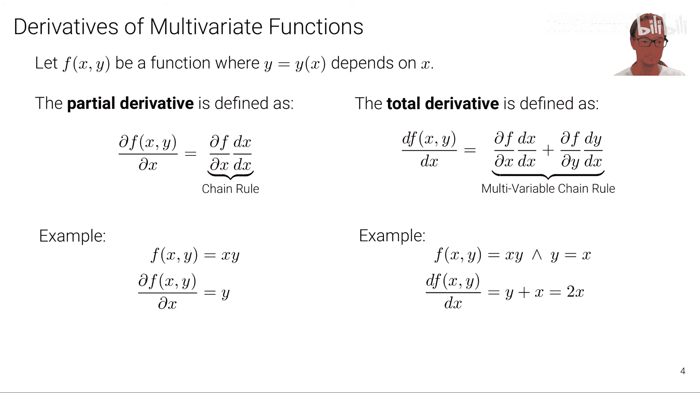

So here's the example now for the same example here for this case， for the total derivative。

 now we have again f equals x times y， but we also assume that y depends on x。

 and in particular we make a very simple choice here， Y equals x。So in particular。

 it's not a constant here， it depends on x， it is equal to x。And in this case。

 if we compute the total derivative root， we see that the right hand side does not vanish because y depends on x。

So first of all， we have the left hand side， which is the partial derivative of f with respect to x times 1。

So we have y times 1 equals y。And then on the right hand side。

 we have the partial derivative root of F with to y， which is x times d y。With respect to Dx。

Which is， in this case， one， because y equals x。 And if we differentiate that with to x， we have1。

 So if x times 1 or x。And because y equals x， we can write this as2 x。

 So you can see that these two expressions are different。Because in the first case。

 we have computed a partial derivative。

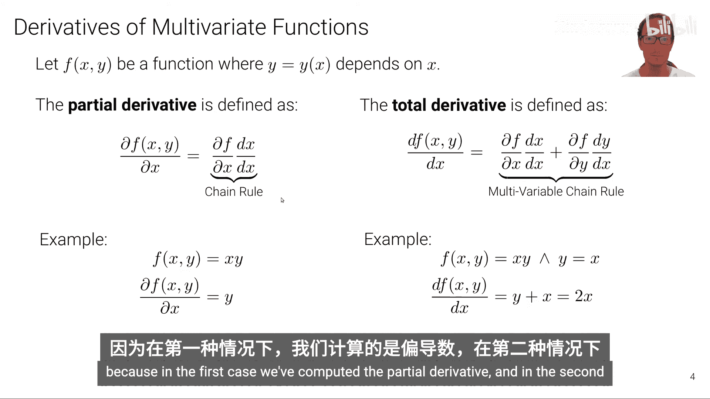

And in the second case， we have computed the total derivative。

 And that makes a difference for multivariate functions。

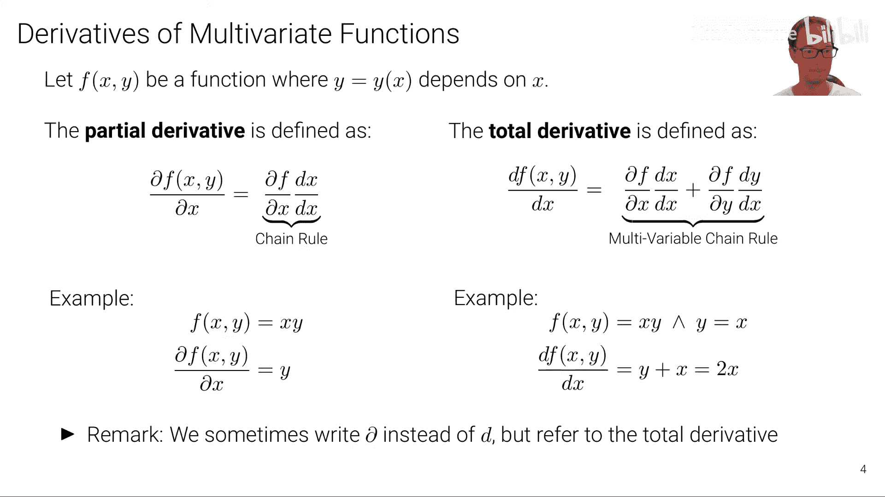

As little remark， we sometimes write the partial symbol instead of D。In the lecture。For simplicity。

 but。We， in this case， still refer to the total derivative because otherwise it wouldn't make sense。

 So this has to be inferred from context sometimes。What is meant， actually。

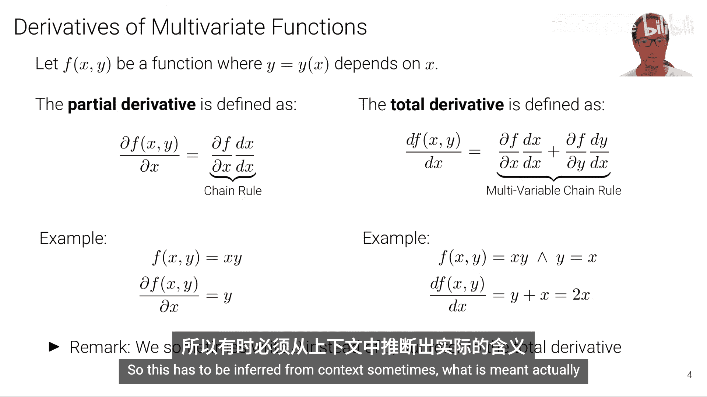

Let's now move to implicit functions and implicit differentiation。

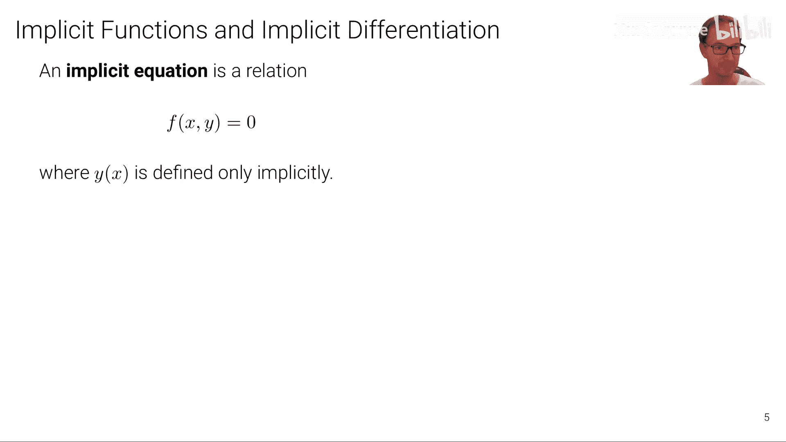

An implicit equation is a relation described as such。 For example， F of x comma y equals 0。

 where the function y of x is defined only implicitly。 It cannot explicitly。Be defined。

 And maybe it's not even a function。 Maybe it's a curve that cannot be described as a function that doesn't have a unique。

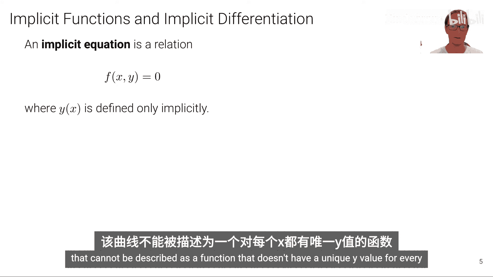

Y value for every x。

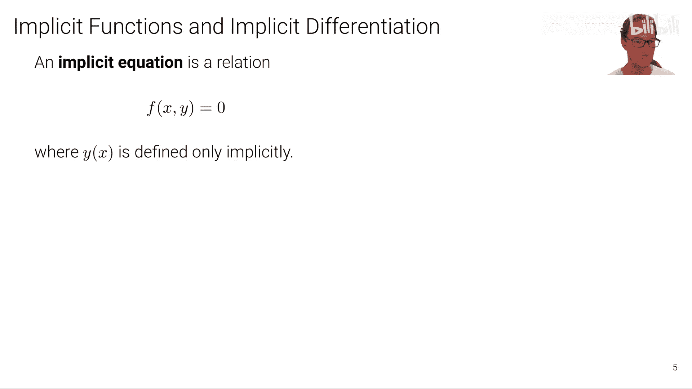

Implicit differentiation computes the total derivative of both sides with respect to x。

So we have the total derivative of the left hand side and the right hand side。 Obviously。

 the derivative of the right hand side is 0。 But on the left hand side。

 we have the expression from before。And then we can solve this for dy with respect to D x。

To understand this better， let's consider a simple example， let's assume。

X squared plus y squared equals 1。And as you will recognize， this is the equation for a circle。Now。

 the circle is not a function。There's not a unique y value for every x。 In fact。

 there's almost for every x。 there is two y values， so we can describe it as a function。

 but we can still differentiate this curve。We can still find the derivative of every point。

In other words， the slope of every tangent along this。Curve along his circle。Despite this not being。

 we can't really represent a shape explicitly as a function， but just through this implicit equation。

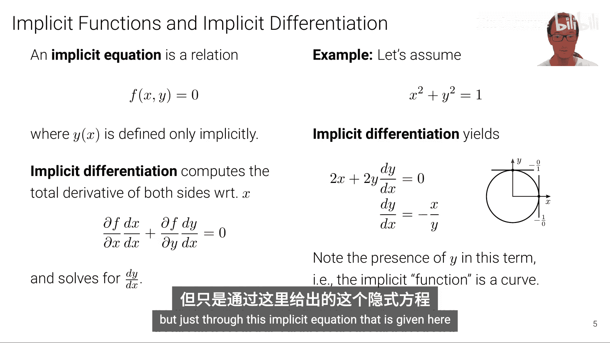

That is given him。

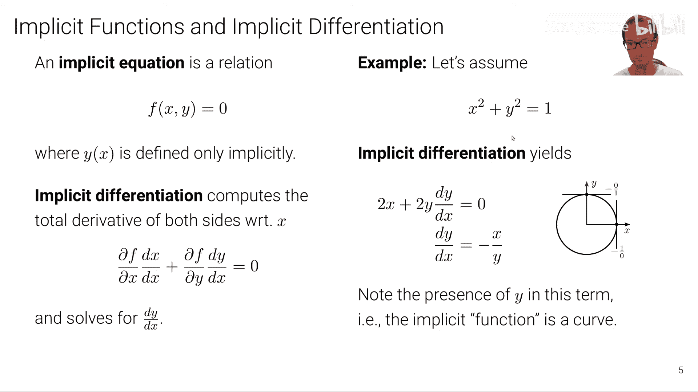

So let's see how this works now for this example。If you apply。

The total derivative on the left and right hand side， we get。 well on the right hand side，0。

 of course， and on the left hand side， we get2 x。Plus，2 y times dy with respect to Dx。

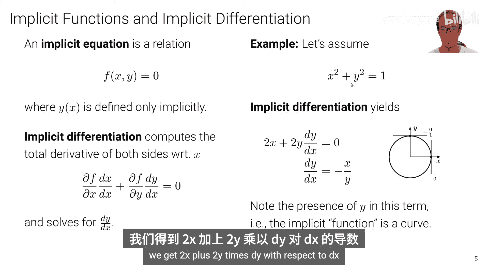

And then we can solve for dy with respect to D x and get minus x with respect to y。

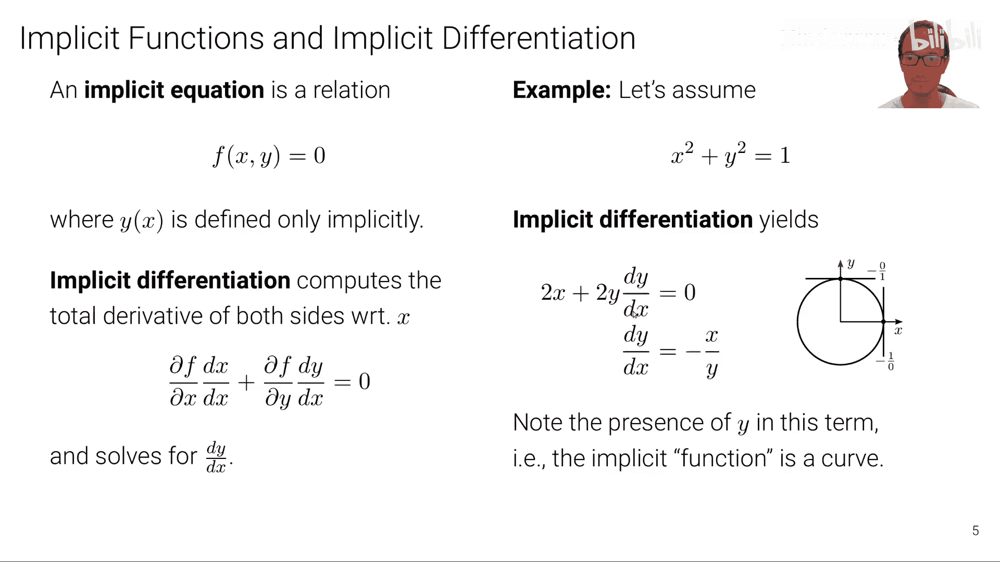

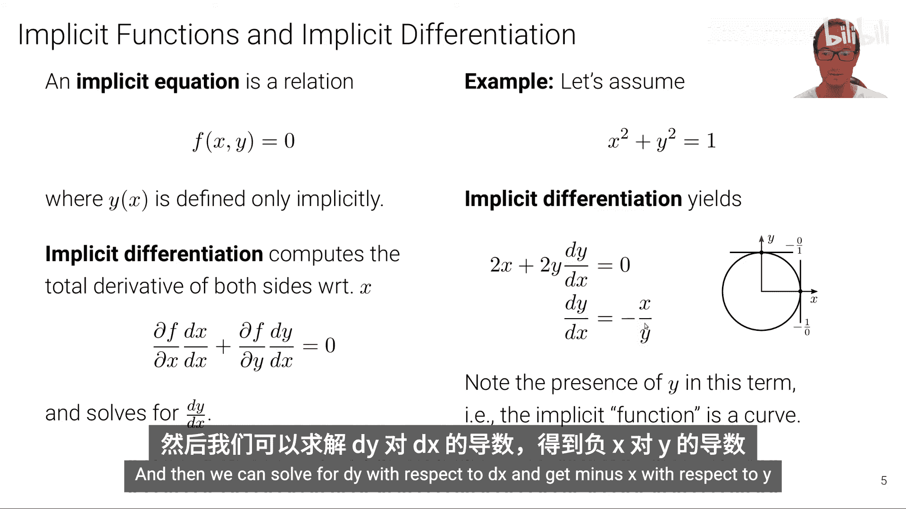

And note that this expression here actually contains the variable Y， which is the variable。

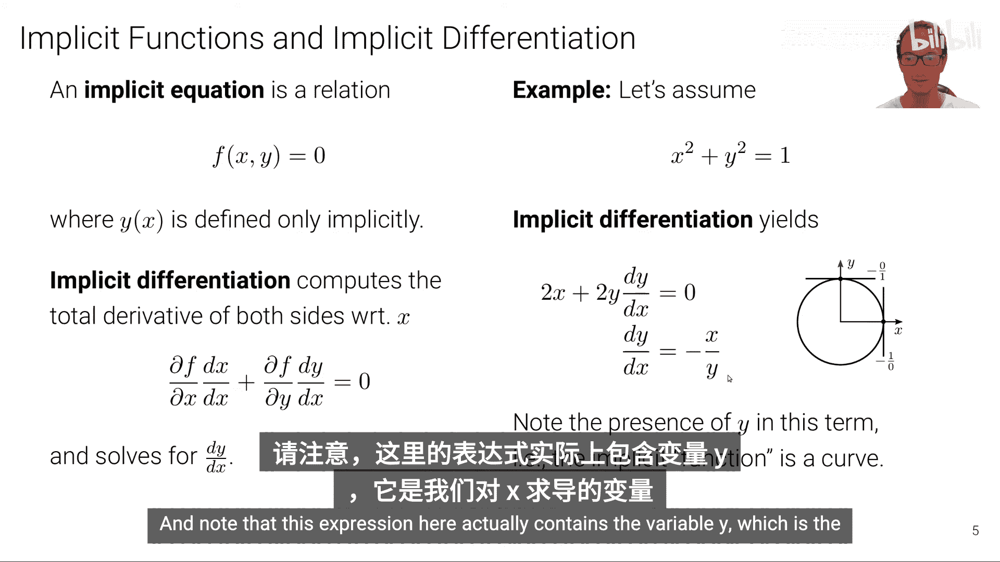

That we have。Differentiated with respect to x。 This is something that would not occur for explicit equations if we would use regular differentiation on explicit equations。

 But here， this can happen。 And this exactly this fact allows us to describe。

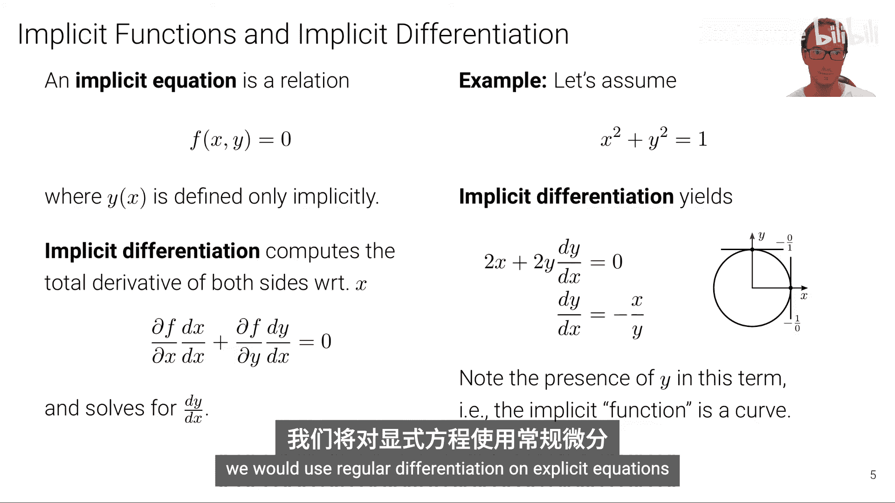

嗯。Divatives， also for。

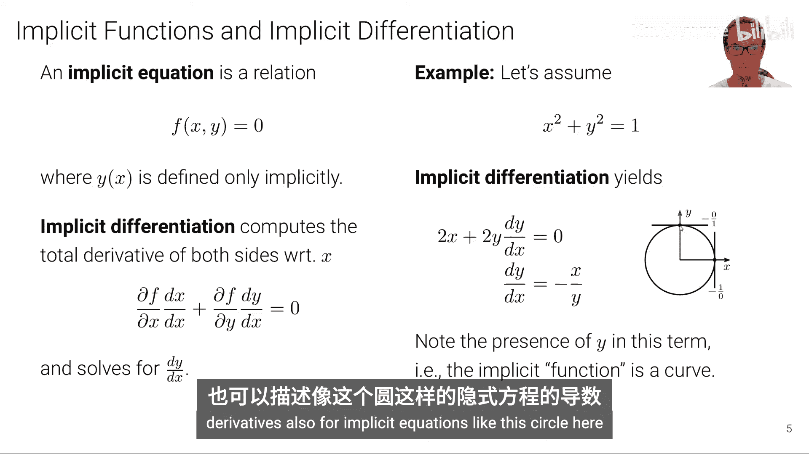

Implicit equations like this circle here。