# 【图宾根大学】深度学习的数学 p12 P12 Random Variables and Probability Distributions -BV1xgKPz9EQH_p12-

Let us now move to probability and information theory。

And let's start with random variables and probability distributions。

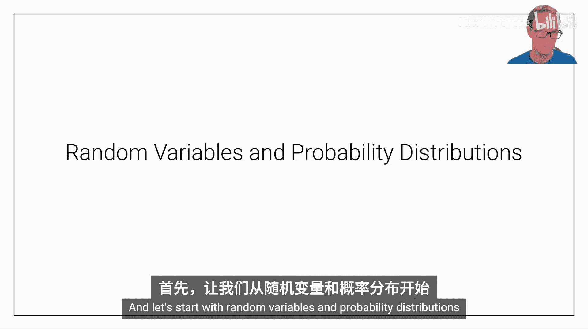

Why probability in the first place。Well， nearly all activities require some ability to reason in the presence of uncertainty。

And there exist fundamentally three different sources of uncertainty that we might want to consider。

The first is inherent stochasticity in the model system。For example。

If you're building a perception system for a self driving vehicle and you're observing。

The traffic scene around you。You see our traffic participants。You might。Have an idea of what they。

Might be planning。 Well they might be going， but you don't know exactly。

 So there is some uncertainty in their behaviour that you can't model。

It is inherentrant stochasticity in the model system。A second source is incomplete observability。

 and this is very common， for example， in fields like computer vision where we， for example。

 want to reconstruct a 3D model from 2D images where the 2D images are just projections of the 3D world。

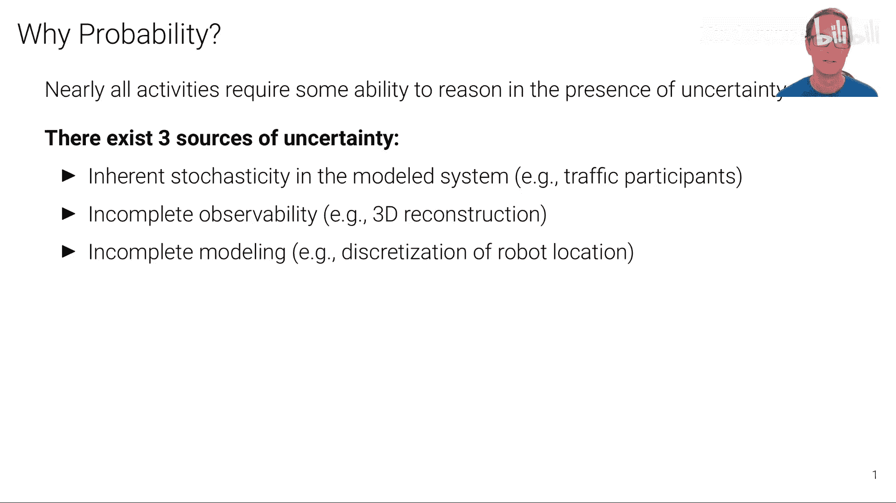

And so we have incomplete observations， an incomplete picture of the scene。

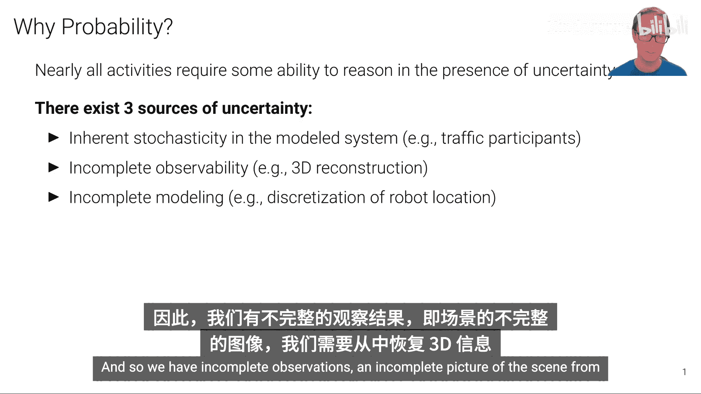

From which we need to recover the freed information。

 So we need to use inductive biases and prior knowledge to help us with overcoming。

What is missing in our observations。And another source of uncertainty。Is in incomplete modeling。

For example， if you build a robot that needs to localize itself and you maybe be due to computational constraints。

 discretize the 3D environment。Into a voxel grid or a bird's eye view pixel grid。Then， you also。

Are not able to localize precisely due to the discretization of your representation。 So in this case。

 your model is incomplete and your model will always be somewhat incomplete because。

The world is just infinitely complex。 And so we all of our models are going to be approximations of the real world。

Now here is probability theory to the rescue。Probability theory is a mathematical framework for representing uncertain statements。

So you can handle these different sources of uncertainty and can model them。

And it allows for propagating uncertainties。 Let's say you are modeling one piece of a larger process。

Then you can model it。By taking。Probilistic inputs。

Treating probabilities inside your process and outputting also the probabilities。

Probity theory is also a tool to quantify uncertainty and reason in the presence of uncertainty。

An information theory。What we'll discuss。A few units later。

It's also very related to probability theory in that it quantifies the amount of uncertainty that's present in a distribution。

 in the distributions that were're going to define in this unit here。

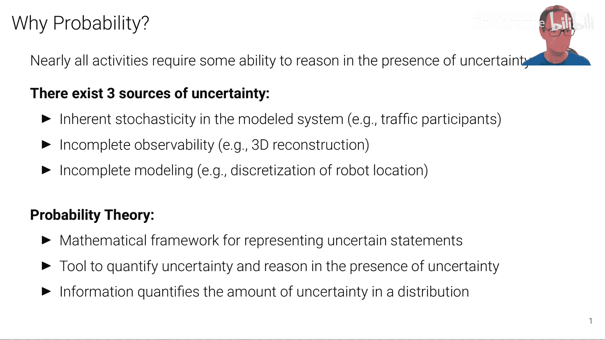

Let's start by defining some terminology。Let's start with random variables。

A random variable is a variable that can take on different values randomly， as the name suggests。So。

 it's。Unlike a regular variable that is just taking on a particular value。

 this variable is associated with some randomness， typically specified through a distribution。

Random variables may be either discrete or continuous。Just like regular variables。

 they might be discrete or continuous。A discrete random variable has a finite or countably infinite number of states that it can take on。

 Typically， we're dealing with finite number of states for discrete random variables。

A continuous random variable is associated with a real value， a real number。Now。

 a probability distribution is a description of how likely a random variable is or a set of random variables is to take on each of its possible states right。

 so can describe。The likelihood of certain states， both for individual random variables。

 but also for a combination of multiple random variables， as well see。And again。

 we have to make the distinction between discrete and continuous random variables here。In particular。

A a probability distribution is described by a so called probability mass function or short PMF。

In the case of discrete variables。And it is described by a so called probability density function。

In short， Pdf， in the case of continuous variables。

So depending on whether we are dealing with discrete or continuous variables。We're calling the。

Quantity that describes the probability distribution differently。

 either a probability mass function or a probability density function。As a little remark。The reader。

Of a mathematical text often has to infer which function。

To use based on the identity of the random variable， that means typically， we write P of x as the。

Probability mass function or probability density function of a variable x。

But we don't write a different P for different distributions， so we might write P of x and of y。

 but despite we use the same name P， these are different distributions and we make this distinction because one has an X as its argument and the other has a y as its argument we are not writing different function names typically。

Buthi just distinguishing based on its argument。So this is a little。Pitfall， to be aware of。

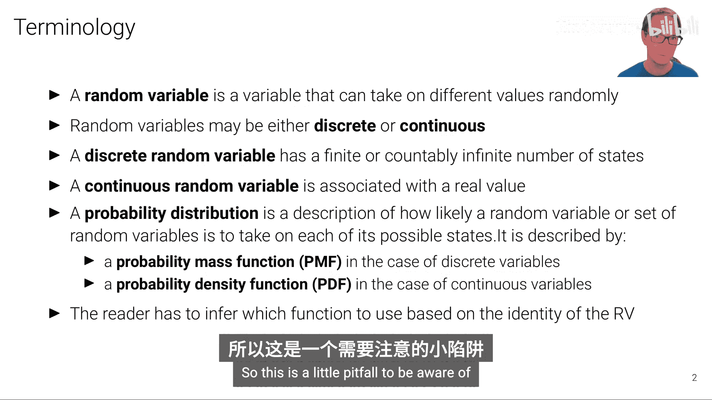

O。Now let's start first with the discrete case， let's start with discrete probability distributions。

A random variable， which we typically denote by an upper case。嗯。Simple， in this case， uppercase X。

Can take values from a discrete sets of outcomes。Calligraph X。 So this is the set of outcomes。

For example， a six sided dice with equal probability one over 6 for each of the6。Numbers。

 it can attain。If I am rolling a dice， then with probability 1 over 6。A。

Will obtain a one or a2 or a3 and so forth。And 1，2，3， until 6 are。

My discreet set of outcomes in the case of the six sided dice。

We usually use the following shorthand notation here on the left。

For the probability that random variable x takes value x。So the full notation is here on the right。

This is the probability of a random variable x taking a particular value， lowercase x。

And this probability。Must be， because a discrete probability must be between 0 and 1 to be a proper probability。

But because this is quite long to write， p of x equals x。And because every， you know。

Probbil is associated with such a random variable。 We often just write P of。Little X。

 which is the value that。X takes， if we want to evaluate。The probability for a particular value。

In the case of discrete probability distributions that we consider here now。

P of x is called the probability mass function， or short PMmF。In contrast with P of capital x。

 we denote the probability distribution over x。 so you can already see that in this case also the argument makes a difference。

Here we are considering P of x as the probability mass function。

 and here we are considering P of capital x。As the corresponding probability distribution over x。

Over the random very blacks。If the random variable with x follows distribution p of x。

 we often also write x tilde p of x。X follows the distribution P of x。You will see this， sometimes。

Sometimes with a slight abuse of notation， we are also using the small letters here。

 but it means the same thing。The probability P of x must satisfy the following conditions to be a valid probability。

 First， the probability for any。

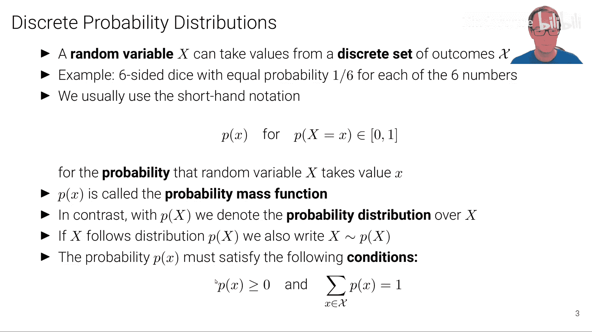

Possible。Argument here must be。Equal or bigger than 0。

 And then if I sum over the entire discrete set of possible outcomes， the。Probability。

 the probabilities must sum to one。Let's now consider joint。

As well as marginal and conditional probabilities in the discrete case。

The joint probability of two random variables now， X and y。Is written as such。

P of x comm a y as a shortcut for， or a shorthand notation for P of。

Random variable x taking value x and random variable Y， taking value y。

So if both of these x takes value x and y it takes value， Y are true。This is the probability here。

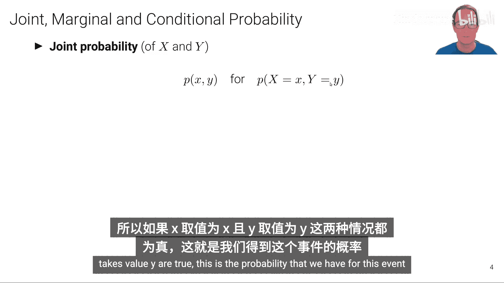

That we have for this event。The conditional probability of a random variable x conditioned on another went random variable y。

Is written in shorthand notation as shown here on the left。

And in the long notation here on the right。We use the vertical bar to denote the conditional probability that。

This is a probability of a random variable。Or of， of x conditioned on y。

And the definition of this is that we take the joint probability and divide this by the so called marginal probability。

 the probability only of y。 And this is the conditional probability。 I' will see an example later。

 But what this means again is that。It means that。this is the probability for the random variable x taking value x conditioned on the fact that the random variable y has taken value y。

And finally， we have the marginal probability of random variable y in this case。

Which is defined below。 So in this case， we marginalize over all the other random variables。

Of the distribution。In this case， we have just x and y。

 so we marginalize with sum over all the other x's over the entire space of x of all possible states that x can attain。

So P of y equals this sum。With respect to x of P of x comma y。 And again， here on the right。

 we have the。Full notation。But what we will typically use。

In our lectures is always the shortened notation here on the left， which is much easier to read。

 in particular if we' are dealing with long expressions manipulating those。

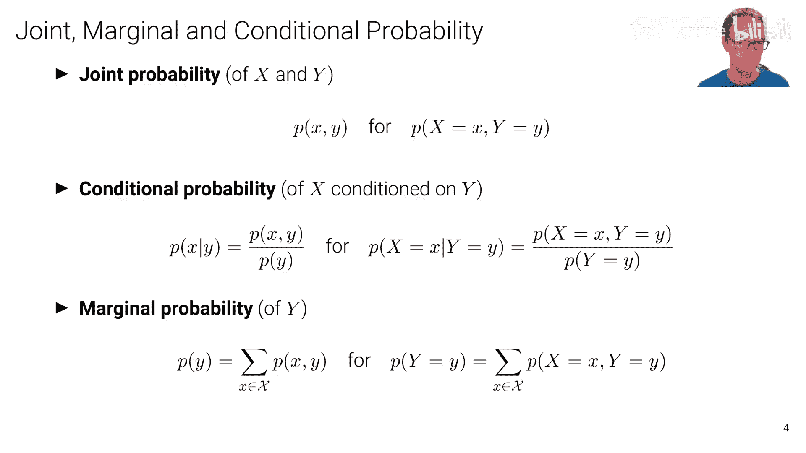

So let's now look at an example。For the joint marginal and conditional probability。

To make this a little bit more concrete。Let's consider a so called probability table because we are dealing with a discrete distribution here。

 We can write down the probability。As a probability table。Where on the y axis， we we。

 we have all the different x values， X 1 in the first row， x 2 in the second row。

 x 3 in the third row。 And then y in the columns here， we have the Y 1， y 1， y 2 and y 3， right。

 And so each of these elements here is basically a count or a probability。 We'll start with counts。

And well normalize on the way。 But we can also think about this as a probability table if we normalize the entire table right away with this sum with respect to all the elements。

So let's consider this table as a table of counts。 So we have two random variables， each of them。

Have three possible states。And we make some observations for。These variables taking states jointly。

 right， Let's say maybe we have observed that X1 is。X1 and x Y 1 are occurring five times。

 And we put a five here。 That's observed that X 2 and y 2 have observed。

 have we have observed that 10 times。 So we put a 10 here。

 or that X 2 and x Y 3 have have been observed three times。 So we put a free here and so forth。

 So these are the counts。 This is the table of counts that we have。Now。

 if we have such a table of counts， then we can compute or calculate the joint probability P of X I。

 Y I。As the。嗯。Individual count of each element in a table， divided by the。嗯。

The sum of all elements in the table， right， This is the normalization such that if I sum of all elements in the table。

 then I would get one back。 if I sum over all of these entries。

 So this is the then the the the probability for one of these combinations of x's and y。Right。

 so if we consider all of them all combinations， this is what we call the join probability。

 we have the probability of x being a particular being set to particular value and y being set to particular value。

Al，So for example， x1 by 1。If this is 5， we divide by the total number。 Let's say we have in total。

 we have 10。嗯。Then we would have5 over 10， so if we would have 50% or 0。

5 probability for this cell here。嗯。The second quantity that we consider is the conditional probability。

 the conditional probability of P of x given y or conditioned on y。So in this case。

 what we are interested in is。Were interested in。The probability over。

 over x over all the different rows for a particular column that we have fixed now。

 Let's assume that we want to fix y 2。 Let's say Y J is y 2。 So we wna have the probability here。

 and the conditional probability。With respect to x1， x2， and x3， conditioned on y2。

And so what we do now is we take the counts just in this column。

And we divide by the sum of all counts in that column。 This is deoteityia。 So we sum up these counts。

 these counts and these counts and divide each respective。

Element here by the sum of the count such that， again。

 this conditional probability with respect to x sums to1。

If we sum this now up with respect to all access， then we。We obtain one。

And so we have a proper valid distribution that is conditioned on y right on y 2， in this case。

 the other Y is y 1 and y 3， don't play a role， We just。Considered this。Im conditionditioned。

Dis conditioning him。And finally， we define the marginal probability。

Which is the probability when marginalizing over one of the random variables in this case over x because we're interested in the marginal probability。

Of why。If we are interested in the marginal probability of y， then we want to know。

 well what is the what is the marginal probability， what is probability of y 1， y 2 and y3。

 So we basically marginalize now we sum over all the rows here。Right。That's why we have the Zj here。

 This is summing of all the rows。And so we have then in the end， a distribution of a y 1， y2 and y 3。

 which is again。A proper distribution， because if it' some of a dose。

We obtain one because now we have basically condensed all the values into this last row， if you will。

 right， So effectively， the entire table is contained and we divide again by all elements in the table。

 So if we sum up， then this must again sum to one。So this is the marginal distribution with sum over one of the random variables in this case。

 x。So we take this value and this value and this value and sum it together write it here。 this value。

 this value and this value， write it here and so forth。

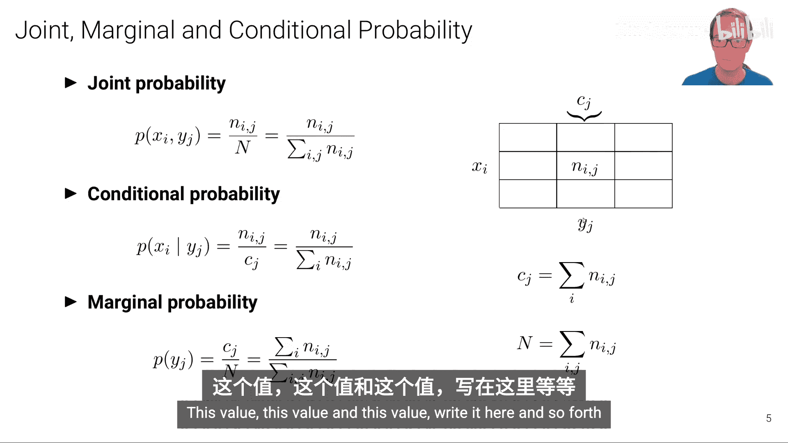

Let's look at an example of numbers。That makes it a bit more obvious， maybe。

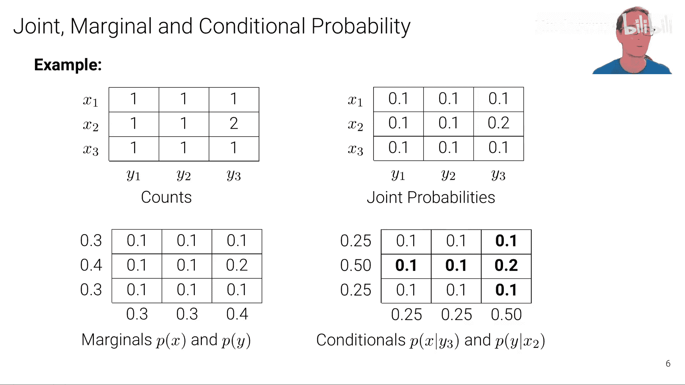

It's a very simple example that are designed here。Again， we have these x and y random variables。

 and each of them takes three different states， x1， x2 x3， y1， y 2， y 3。

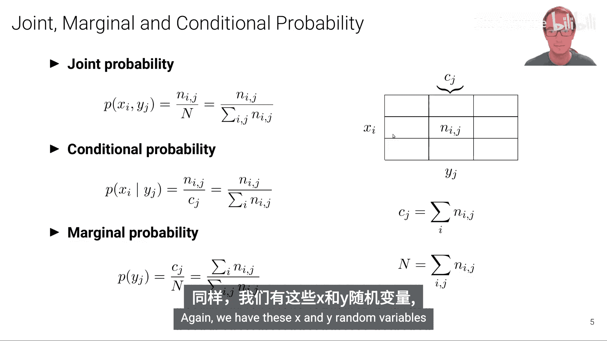

And we have this table of counts。Where we have observed the combination of x1， y1 exactly once。

In fact， we have observed almost any of these combinations exactly once except for the combination x to y3。

 which we have observed twice。Okay。

So everything has been observed once， every combination， except for the combination x2， y3。

 which has been observed twice。

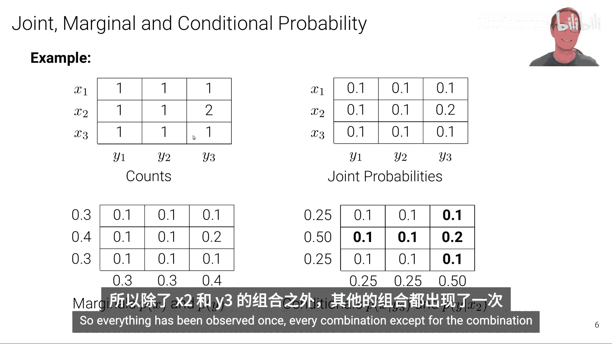

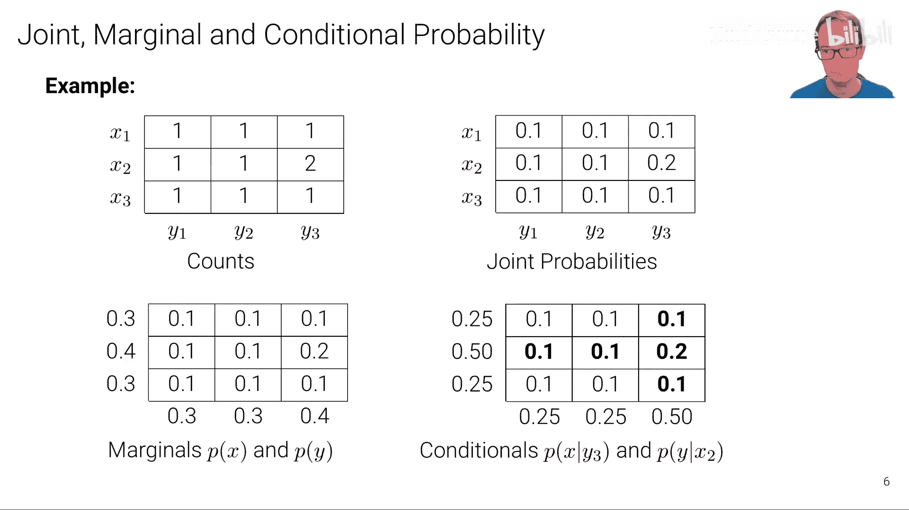

Now， if we want to go from counts to。The giant probabilities， we simply have to。

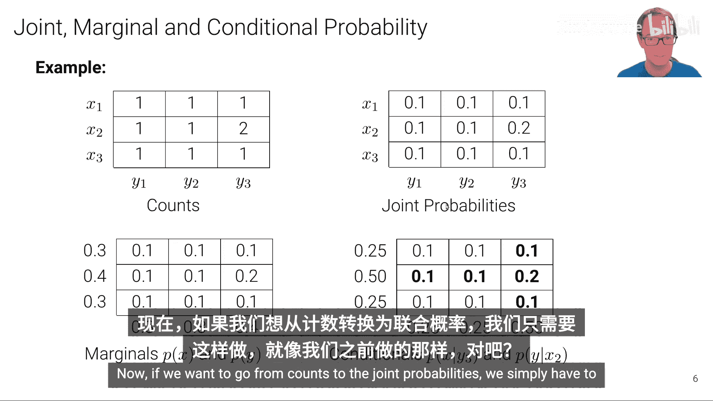

That's what we had here， right， we have to divide by the total number of counts for all the elements in the matrix。

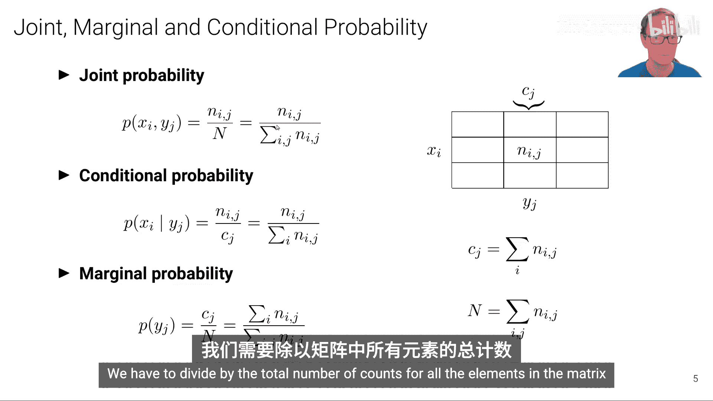

And I have designed it such that it's particularly simple。 We have 10 counts in total。

 So we divide by 10。 we get 0。1，0。1 probability almost everywhere。

 except for this combination here again， where we have 0。2，20%。

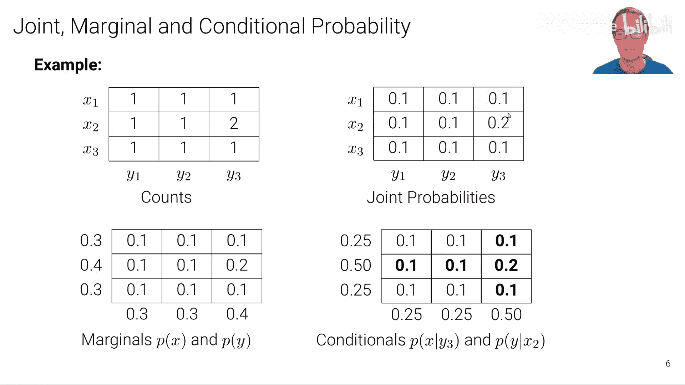

This is， these are the joint probabilities。Now let's consider the marginals。For example。

 the marginal P of x。 If when I compute the marginal P of x， we have to marginalize out y。

 We have to sum over the y dimension。So we can write the marginals。Of x here on the left hand side。

And what I did is basically I summed up these three numbers。 So I get 0。3。

 summed up these three numbers。 I get 0。4， summed up these three numbers。 I get 0。3。

And as you see now。If I sum up those numbers， I get a one， right？

 So this is a proper distribution similar to here， where if I sum up over all of those numbers of the joint distribution。

 this is a distribution of a two variables。 I also get a one Here。

 We have a distribution of a one variable。 I get a one。And similarly for P of y。

 I just sum up all the columns here， write them down here。And finally。

 let's consider some example for conditionals in particular， we consider。One conditional for。X。

 which is P of x conditioned on y3。That's why I have。Boltface this last column here。

 which corresponds to this。 And then the conditional of P of y given x2。

 We have boldface this one here。So let's consider the the first one first。

 So if I am conditioning on y 3， I only consider this column。 So have 0。10。20。

1 as the distribution of x。 but wait， this does not normalize。 This is not summing to one， right？

 So what we have to do， of course， is we have to make sure that this is properly normalizedised。

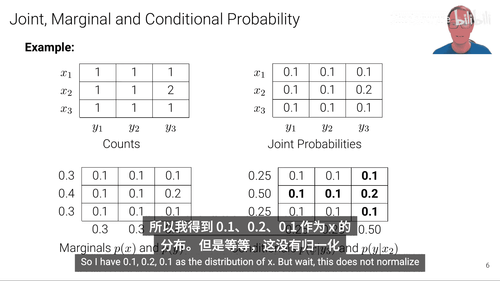

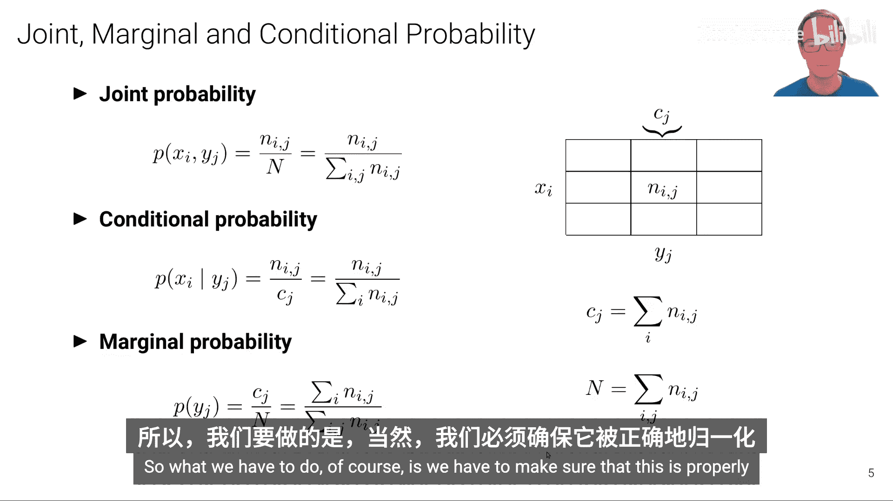

So。If， if I would go down from the counts， I also had to normalize for this also dozen sum to one。

It can also go from the probabilities。 It can also sort normalized though doesn't matter， right。

 It's just a different normalization factor in this case here。I have to， well， I have 0。1，0。2，0。4。

 I have 0。4。 So I need to。Multiply with 2。5 right So I get 0。25，0。5，0。25。

 If I multiply all of those values by 2。5， such that those again sum to one。 So I obtain a proper。

Conditional probability distribution。And similarly， for the conditional distribution of y given x2。

 So here now we're focusing on this row。Which again， is not normalized， it sums to 0。4。So we have to。

 again， multiply by the normalization。One over the normalization factor， which is 2。5， so I get 0。25。

 0。25，0。50 S， the conditional distribution P of y given x2。

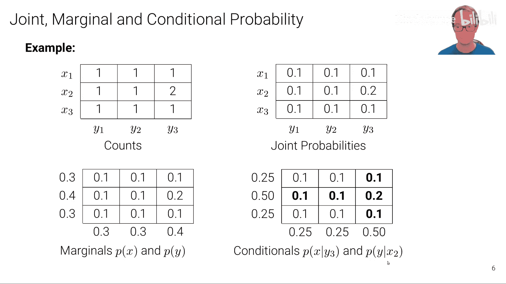

Okay， so I hope this example made it a bit more visual。Here is an even more visual example。

 This is from the Bishop book。In this case， we have， again， two random variables。

 X and y 1 variable has 1，2，3，4，5，6，7，8，9 possible states。

 and the other one y has two possible states。And so in this grid。

 you can see the observations that we have made。Now we can look at different。Quantities， so。

 for example， you can look at the the marginal distribution P of y， where we sum up all the。

Counts here and the sum of all the counts here。 And we normalize。 And so we get this distribution。

 we see there's a little less points here than there are less there are blue points here。

 There's a little bit of。A little bit less blue points here than there are blue points here。

 That's why we have a higher bar here。 There's small probability here。We can also look at the。

Marginal distribution of x。 So we now marginalize in this direction。 We can see that we obtain this。

Kind of distribution now is histogram。Where most of the probability is in the centre。

 but there' is also some probability at the。Bors。And what we can also do is we can look at the distribution of x conditioned。

On a particular setting of y， in this case， y equals 1。 So in this case， we have。

 we are just looking at this part of the histogram。

 And we can see that now the distribution shifts a little bit towards the left because。If we。😔。

Take the marginal of X， and We have to sum up all of these blue points。

 So we also obtain an influence of those points。 But if we look at the conditional。

 we just look at this bottom part of this table。 So the distribution is a bit。

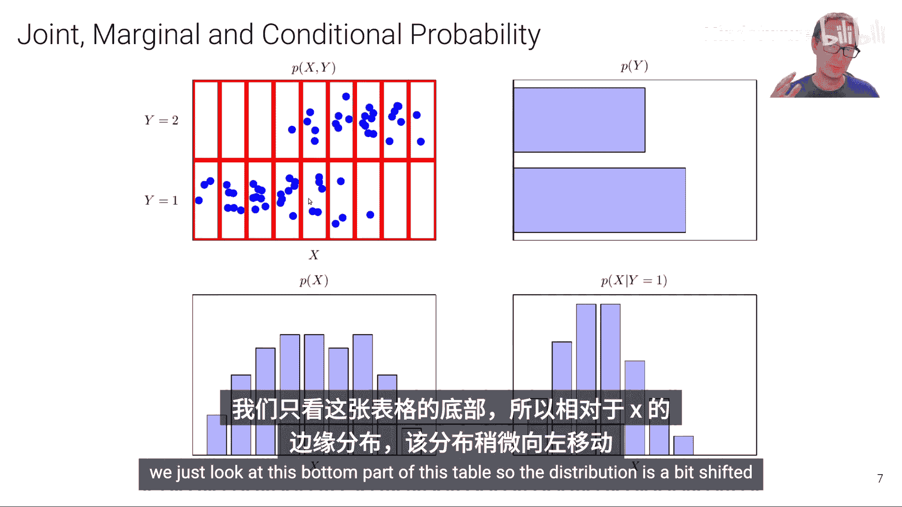

Shifted towards the left with respect to the marginal of x。Great。

Let's also mention the rules of probability that we have already kind of looked at。In passing。

The first is the sum rule， which is basically the marginalization rule。

 where for con discrete variables， we have P of x is。

The marginal of x is the sum of the joint distribution When I sum over all device。 and similarly。

 I can compute the marginal。

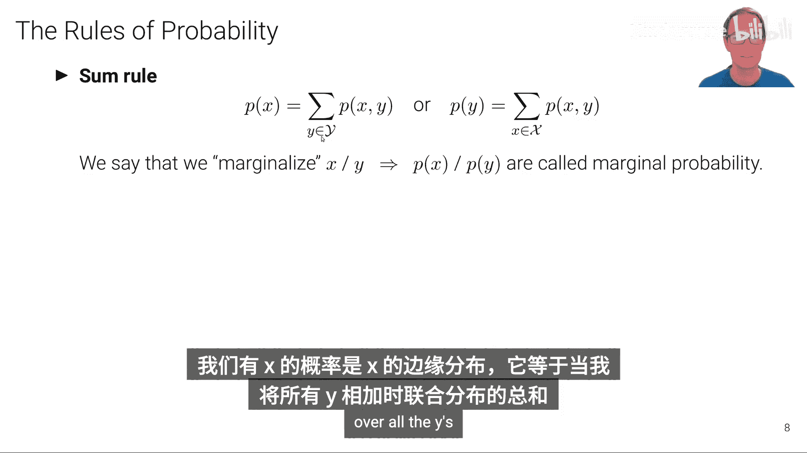

Of why， S the。Joint distribution summed over all the x。

And the second fundamental rule of probability is the product rule。

 which we've already seen as well in the context of the conditional distribution。

 which is the joint distribution can be factorized into a conditional P y conditioned on x times the marginal p of x。

Or equivalently， just swapping the variables。The conditional distribution of x given y times the。

Marginal P ofY。And as a consequence， you have probably heard of this。

 we obtain the famous base theorem， which is taking this equality here and putting this here on the other side。

 So we have p of y given x equals p of x given y times p of y。Over a P of x。And will' see。

An example of the application of base fiim， when we briefly discuss。Decision theory， later on。

But before we do so， let's move on to continuous probability distributions first。In this case， now。

 x is a continuous random variable。That means it's a random variable that takes values in the real numbers R。

The probability that x takes a value in some interval Ab。

Is computed as the integral over the so called probability density function。

That defines the continuous probability distribution。And to take that integral。From a to B。

So we call P of x， the probability density function。

The probability density function must satisfy the following conditions。

It must also be positive everywhere， so P of x must be equal or bigger than0。

And if I integrate it over the entire domain， I must obtain one。

Like the discrete distribution sums to one， the continuous distribution must integrate to one。

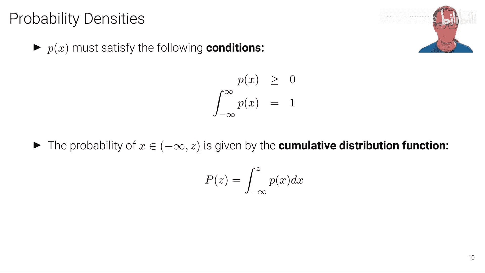

Also， the probability here。Of x element of the interval minus infinity to C is given by the so called。

Cummulative distribution function。Which we write here as capital P of C。

Which was simply the integral for minus infinity to C P of x d x。

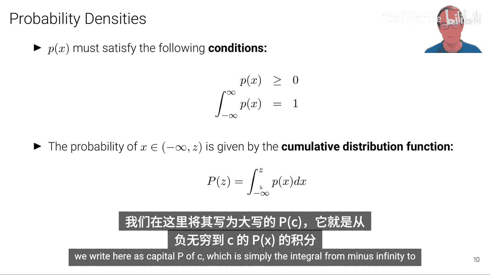

And of course， if we let C go to infinity， then this must approach one。A little。

Remark about a pitfall here， as the following。Note that the probability for x。

A continuous random variable。Taking exactly one particular value。Is often0。

 I say often because it's not always true。 So if we look at direct functions， functions。

That are actually not， that are more generalized functions， not real functions。

 but functions that are relevant in measure theory and often used to characterize empirical distributions then。

There is cases where the probability is also10， for example， one， but in an almost any regular。

Continuous function， parametric continuous function that we'll see in a bit。This is not the case。

 if I， if I consider just a single value， then the probability of the。

 because we are looking at the continuous。Thema， where there is so many values， right。

 infinitely many values， the probability of hitting exactly one value is always0。While the。

Probity density function at that point。Is of not0， can be arbitrary。

 so the probability density function can be bigger than 0 despite the probability for hitting that point。

Exactly is0。That's something to remember。 And so there's a little bit maybe of ambiguity also in the notation that has to be inferred from context as well。

In other words， for continuous distributions that we consider now。

 we consider P of x typically as the probability density function and not as a shorthand for P of。X。

 taking value X， as we did before， for discrete。Distributions。Okay。

 so let's look at an example of a probability density。

 So we here we have the probability density function in red P of x and the corresponding cumulative。

Density function here in blue。And we also see a little。

Interval here that we can integrate to obtain the probability。

 to integrate the probability density function over that interval。 We obtain this area here in green。

 And that is exactly the probability of。A。U。The probability of the random variable x taking a value x inside that interval。

 right。So that is what we specified here。

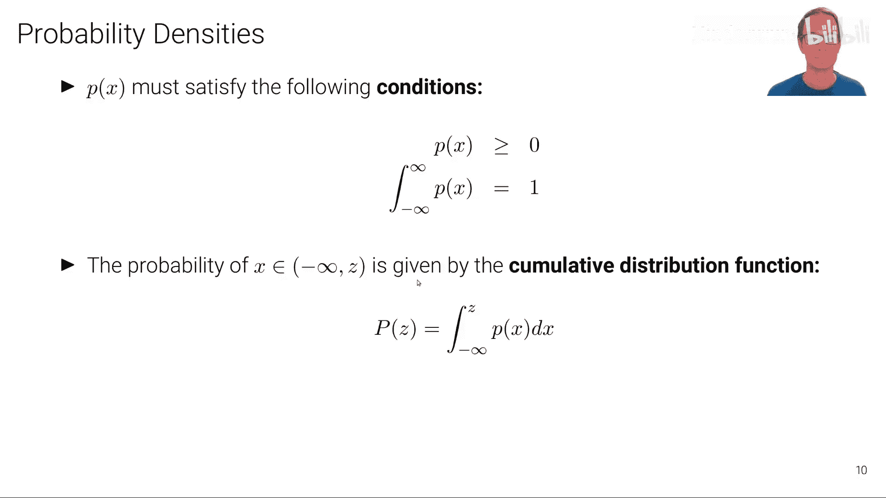

And as you can see already from this picture， if we now let this interval go towards 0。

 then the probability will also go to 0。 That's why if we have it。

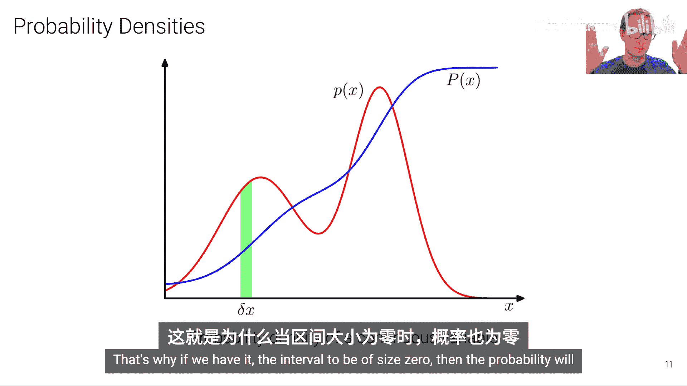

The interval to be of psi 0， then the probability will be 0。Again。

 we can formulate joint marginal and conditional probabilities also in the continuous case。

In this case， we consider the densities。 So the joint density of x and y is written as P of x comma y。

The conditional density of x， conditioned on y is P of x。Given why。

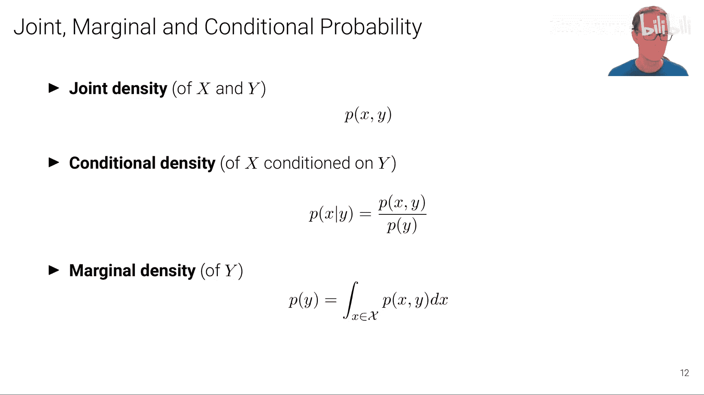

And the marginal density of y is P of y， where we take the joint density P of x and y and integrate out the other random variable in this case。

 x。So this is completely analogous to the。Previous exposition on discreed。Probilities。

We can also visualize。What this means in the continuous case。

So here we have an illustration from the Bishop book， which I find quite nice。

What we see here is the iso plot of a gausian distribution。

So we can think of this as the the height lines when looking from above。

 So we have two random variables X， A and X B in this case。

 And this is a gaussian distribution with some no。Significant correlation where the covariance is is not is not an isotropic distribution。

 but it's elongated in one direction， right。There's some correlation here。And。

The maximum of this distribution is attained in the centre and then falls off in all directions。

 And here we have the is or contours， which means these are contours of same probability in green。

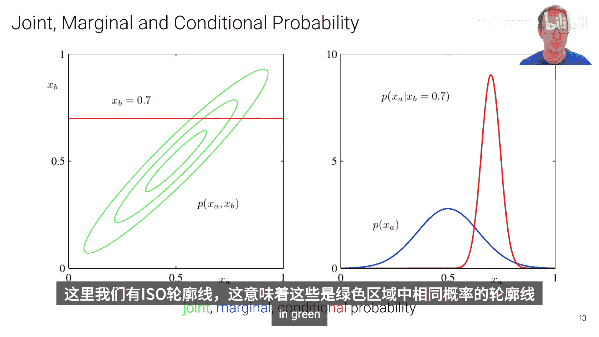

And so this is a way to visualize the join distribution。

 if we just have a 2D picture available to us so we can visualize it with this height。

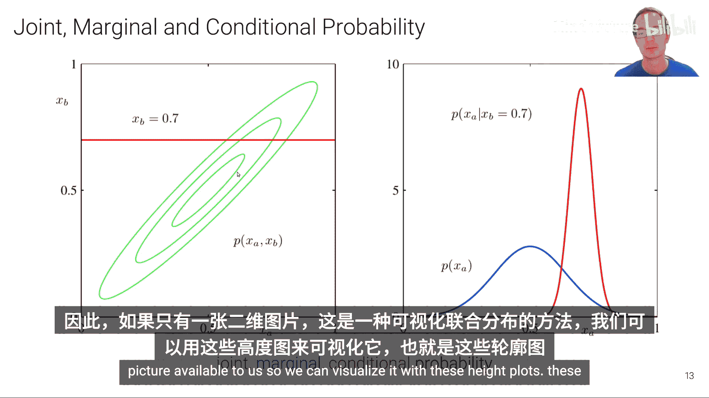

Plus。This control plots。

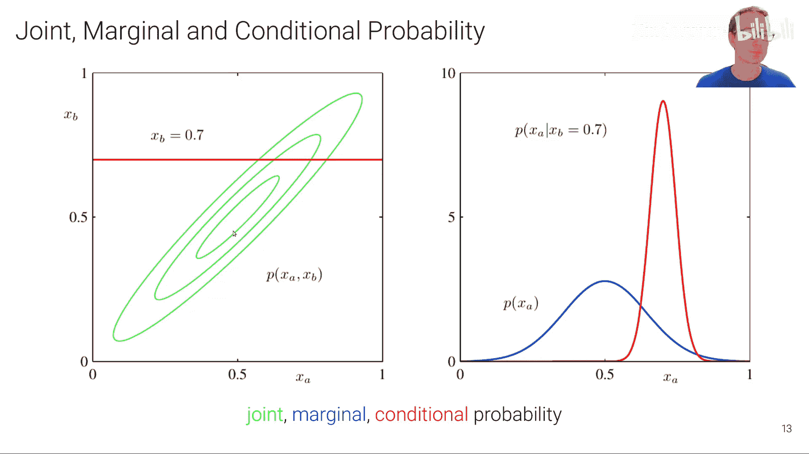

And what we can now look at is， for example， the marginal distribution， which is effectively。

Like integrating， like， if we consider， for example， the marginal of X A， we integrate over like the。

R the variable or the dimension X P。 So we integrate in this direction。

 So we get this Gaussian distribution here。 The marginal of a Gaussian is， again。

 a a Gausian distribution。And the center must be here， which is 2， right，0。5。

But we don't see this correlation here anymore because everything has been projected onto this axis here。

But we can also consider the conditional distribution。 We can do that by， for example。

Conditioning on X B equals 0。7， which is this red line here at 0。7。

 So we can think of this as a slice through this con plot。 And we now want to know， what is the。

Distribution along that slice。 And， of course， there， the centre is not at 0。5。

 but it's somewhere here， right， This is the。Value of that joint density with the highest probability。

And this is also what we see here in the conditional case。 right， So we have the。The conditional。

 which， again， is a Gaussian， because the conditional of a Gaussian distribution is Gaussian。

 We have it shifted towards the right and with smaller standard deviation。

 So it's a little bit of a more narrow distribution。Compared to the marginal in blue。Yes。

 and so again， we have the sum rule and the product rule for the continuous case。

 which is completely analogous to the discrete case。

 except that we have now integrals instead of sums。And the product rule。Writes the same way anyways。

 So we also obtain the base fiim in the continuous case。

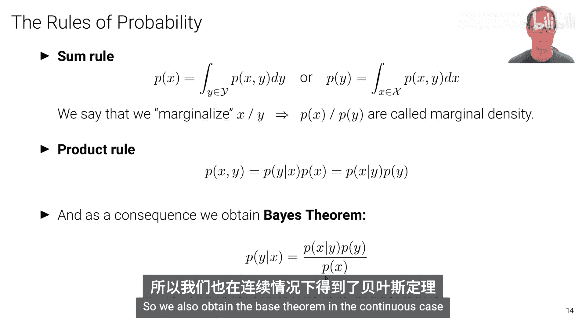

Now finally， let's look at。Independence and conditional independence。

Two random variables x and y are called independent if their probability distribution can be expressed as a product of two factors。

In other words， if the joint distribution of p of x and y is equal to the product of the marginal p of x times p of y。

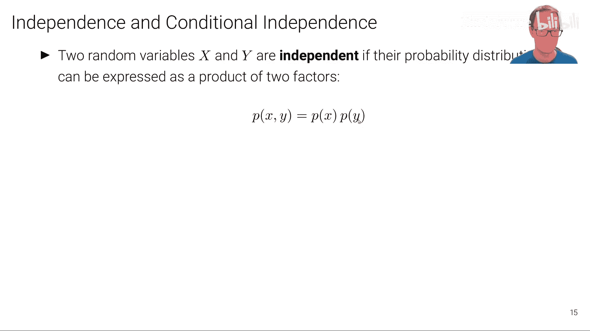

And similarly， two random variables， x and y are conditionally independent。

 given a random variable C， a third random variable C。

 if the conditional probability distribution over x and y factorizes as follows。

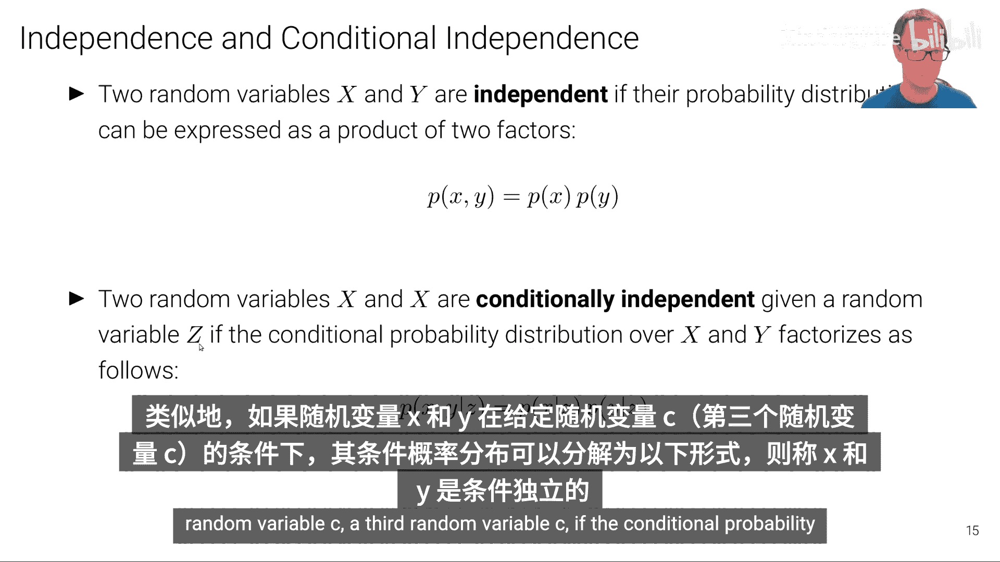

P of x and y given C equals p of x given C times p of y given C， right So here in this case。

 we marginalize y。 in this case， we marginalize x。 It's the same as before。

 except that on in each of these terms here on the right hand side we have the C after the conditioning bar。

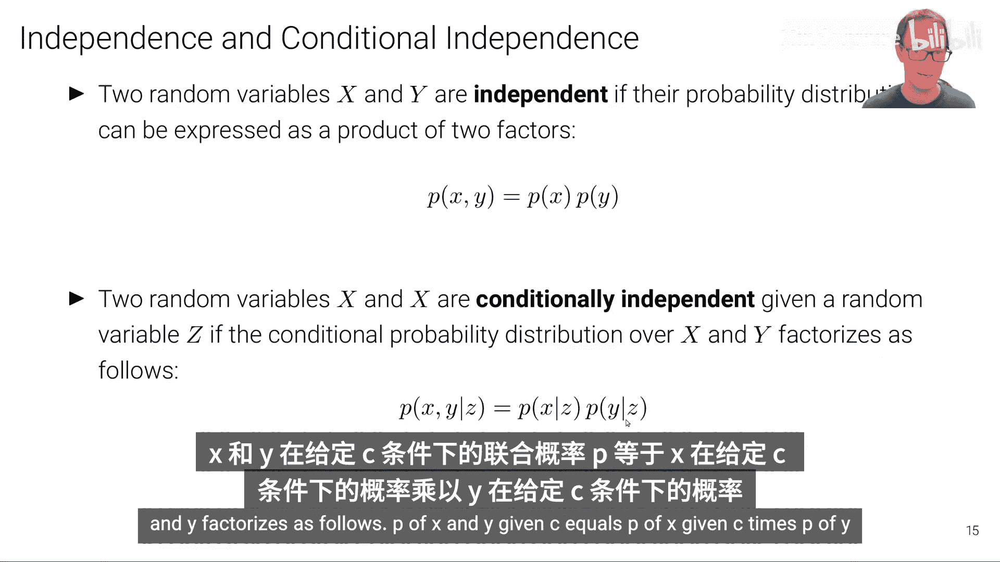

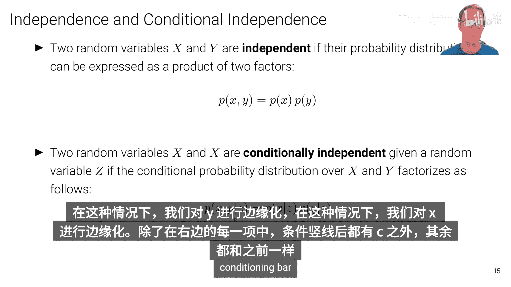

There's also a shorthand notation for these statements。 We denote these two statements compactly。

 as in the first case。Random variable X is independent of random variable Y。 And in the second case。

 random variable。X is conditionally independent of random variable Y if we condition on random variable C。

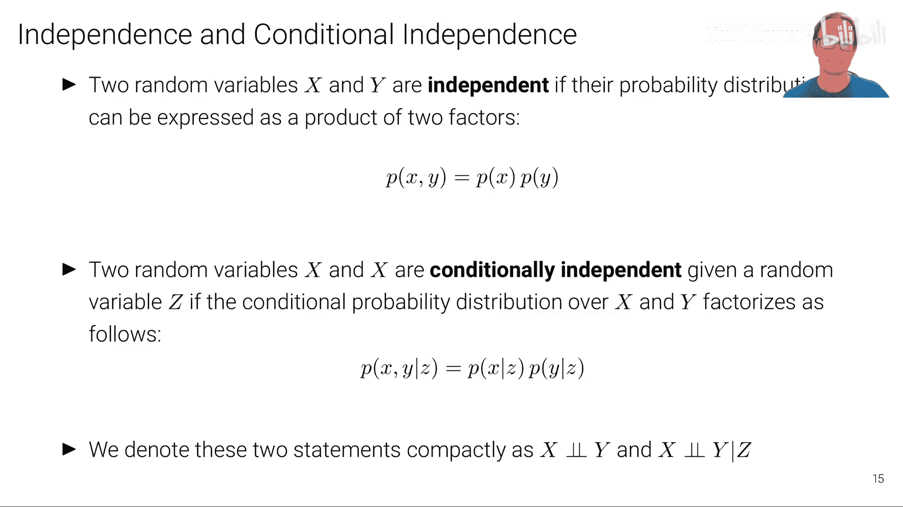