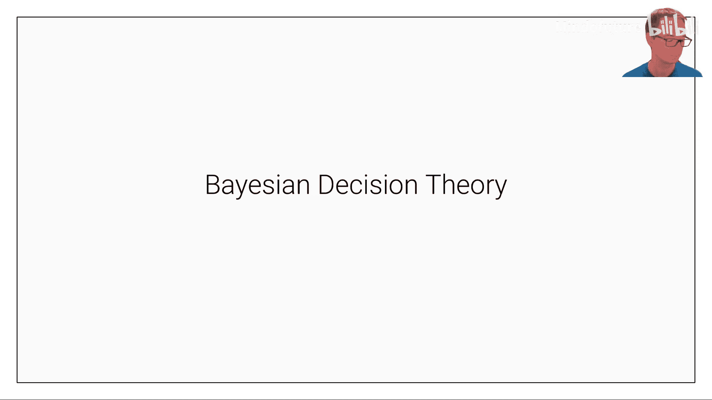
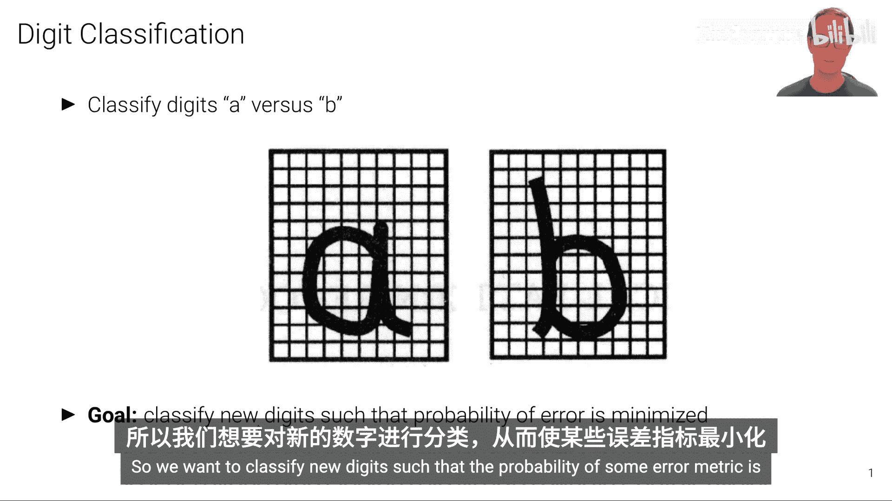
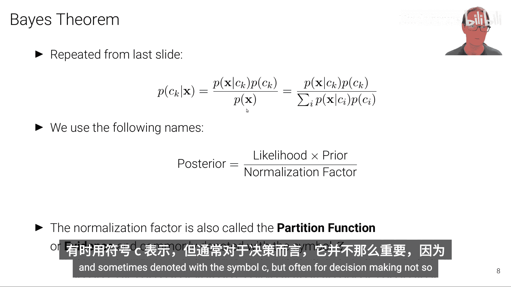
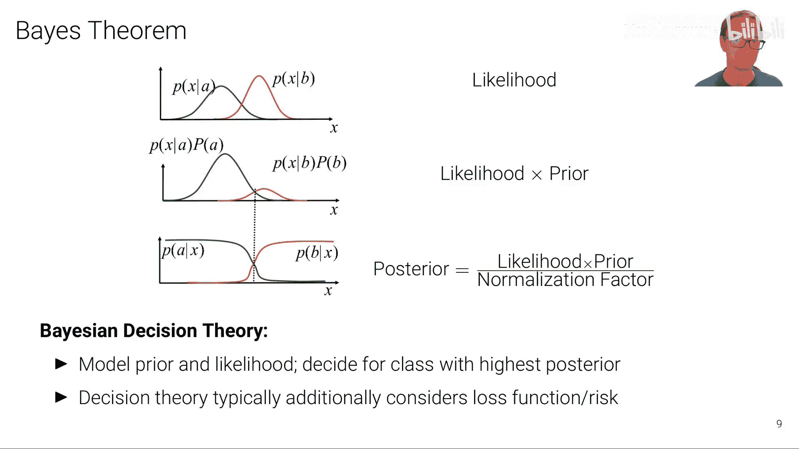

# 【图宾根大学】深度学习的数学 p14 P14 Bayesian Decision Theory -BV1xgKPz9EQH_p14-

To motivate a little bit better the usefulness of base rule。

 I'd like to provide a very basic explanation of patient decision theory。

 Just scratching the surface with a simple example to understand better the different quantities that are involved in。

Base rule that we've seen in the previous unit。

So let's consider a digitchit classification task where the goal is to classify digits A versus B。

 We have just two digits。And we want to classify if you see a picture can see this pixel matrix here。

If do we see a picture of an A or a picture of a B。

So we want to classify new digits such that the probability of some error metric is minimized。

Now we can approach this problem in the following way。 we can think about， well。

 what is the prior distribution of these digtits to occur。

 How often do the letters A and B actually occur in natural text。And we can say， well。

A is a rather common letter， so it might occur four times more often than the letter or three times more often than the letter B。

 So let's assign。The probability for class 1， which is the class corresponding to letter A。To be 0。

75 and the probability for class 2， C2， which is a class corresponding to letter B to be 0。

25 to reflect the fact that A's occur more frequently in natural text than B's。Notes。

That the prior has to be a distribution in particular， if with some of a。

The entire state space over the entire domain， Then we must obtain one， which is the case here。Right。

 so maybe we have obtained this number simply by counting how often these letters occur in certain texts on Wikipedia。

 and these are the results， right and we normalize them。Such that we get0。7。5 and 0。25。

 That's sum to 1。We now describe every dit using some feature vector X。For example。

 this feature vector can contain。Or describe the number of black pixels in each image。

Or the relation between the width and the height， the aspect ratio， some very simple features。

Could also be something more complex like。For just derive from some。Neural representation， etc。

But let's consider something very simple。 Let's consider even a one dimensional。

Feature space for now， just because it's much easier to visualize。Right。

 let's assume we have a one dimensional feature vector。And so the likelihood。😊。

Is now defined as or specifies how likely。A particular x has been generated from。嗯。

Like the conditional distribution P of x， given the class either A or B。

 right so we have now two cases we have the case where we condition on the category A and on the category B。

And we have two different distributions， hopefully different distributions if they would be the same。

We couldn't discriminate， right？ So our features must be， to some degree， discriminative。

 And you can see that they are to some degree here。 So we have。

Like the features that correspond to pictures of A's to be。Well。Distributed like this。

 where the distribution is a little bit more towards the left as compared to。

The distribution that's a little bit more narrow and more towards the right。

Of features that correspond to the letter beam。Right。

 but you can also see that they are not completely designed。 It's not a trivial classification task。

 There might be an image where the features are somewhere。Overlappping both with。

Like like yielding a high likelihood for both。Li。😔，Class A and the class B。So here's an example。

Let's consider a particular image that is represented as this feature， this one dimensional feature。

So in this case here， which class should we assign x to， right？Obviously。

 we should assign it to the green class， right， class A， because this has a much higher probability。

A much higher likelihood than the。Red1。What about this one， which class should we assign x to， Well。

 obviously， in this case， we should assign it to class B。But if we are。Like。

More in between these two class， it becomes less clear。 So what about this one here。

 Which class should we assign the x to。Well， while it looks like that class B has a higher likelihood here。

 which is true。We should still assign it probably to class A because class A has a higher prior probability of occurring。

 right， So we know that。Class a， on average， occurs more frequently。 And that should increase our。

Probability with which we pick class a。So even though the likelihood is slightly smaller than for class B。

 we want to pick class A。So how do we formalize this intuition？

And this is where base theorem comes into play。So I copied the base fiorem from the previous unit here。

And we're going to apply this now in our context， where。And well。

 y now corresponds to the class and x to the feature。In other words， we have P。Of the class。

 given the features is equal to the probability of。So this is called the posterior。

 This is equal to the probability of the likelihood that we've already seen。

 the features with respect to a particular class times the prior probability for the class。

And that divided by the so called evidence， which is the。A。Well， the marginal distribution of x。

And that is typically a constant。 in particular， if we， if we're looking for the most likely class。

 this is a quantity that doesn't contain。C K， right， but we can describe it， of course。

 also as the marginal distribution， if we have these。Join distribution described by this。

 the product of these two terms。 and if we marginalize over the classes， then we obtain P of x。

So here's the formula repeated from the last slide。And in particular， we are going use in。De theory。

 the following naming convention， the left one is called the posterior。

Then we have the likelihood times the prior over the normalization factor， which is。

Also called the partition function， or the evidence。And sometimes denoted with the simple C。

 But often for decision making， not so relevant because it's constant with respect to the quantities that we seek。

And so we can also look at this visually。Here in the first image。

 we have the two likelihoods from before。But now， if we multiply them with the prior， right。

 we have to multiply the likelihood with the prior。Then these curves change significantly。

And if we now divide by the normalization factor， we obtain basically the green curve here and the red curve here。

 where we see the decision boundary very clearly now。

 which is exactly at the point where these two curves cross。So if we are left of that。

Intersection point， we should probably assign the。Image。

That we have recorded the feature x of to class A and otherwise to class B。So in short。

 in a nutshell based decision theory models the prior and the likelihood and then decides for a class with the highest posterior。

But this is， of course， not the complete picture。Decision theory typically also additionally considers。

 for example， a loss function or a risk in order to perform empirical risk minimization。 For example。

 not all outcomes are equally desirable， right？ So， for example， if you want to detect cancer then。

If you， if you have a false negative， that is。Much more harmful than a false positive。 right。

 if you detect cancer。In case there is no cancer， then it will start maybe a treatment but quickly discover that there is no cancer。

 but if you don't detect cancer in the first place， then the patient might die at some point。

 so not all of these should be treated equally right so an additional loss or risk function is typically used in order to consider the entire risk assessment。

 but it integrates a the ba way of treating likelihood and prior as we've discussed here。

