# 【图宾根大学】深度学习的数学 p15 P15 Expectation, Variance and Covariance -BV1xgKPz9EQH_p15-

Let's now consider some fundamental。Properties of random variables or function of random variables in particular。

 differs two moments of those called expectation and variance or covariance in the multivariate case。

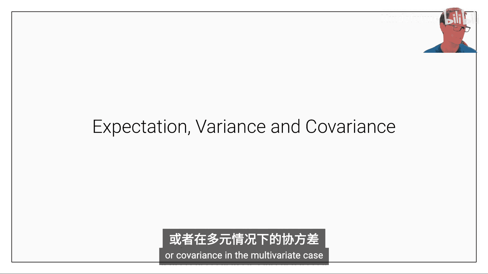

The expectation or expected value of a function f of x。

With respect to a probability distribution P of x。Is the average of F of x for。

Samples drawn from the distribution。For discrete variables。

This can simply be computed with a summation， right？

And we write this expectation as the expectation of a function of x with respect to a particular distribution P。

Equals to sum over all。Elements of x。嗯。P of x， the probability of x。Times F of x。

You can see that this is a weighted sum of that function that's weighted by the probability。

Of the particular sample x。For continuous variables。

 it is computed with an integral So we have exactly the same expression as before。

 except that we have replaced the summation again now with an integral integrate over x the x。

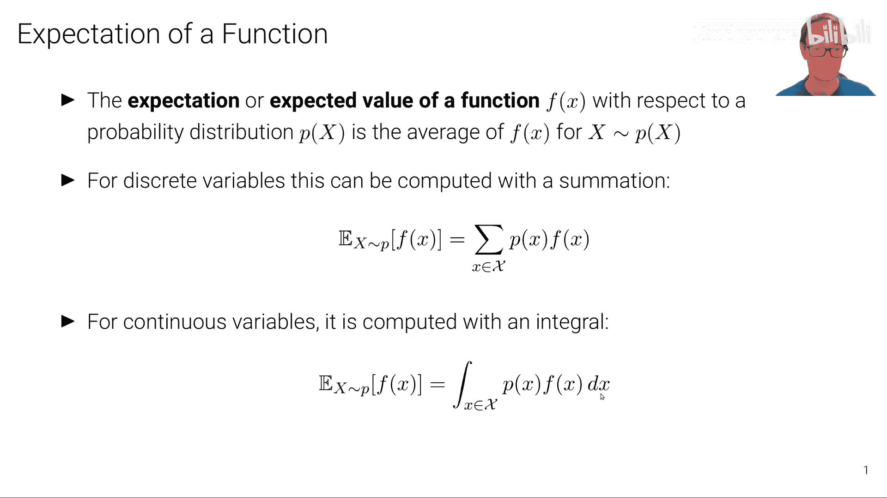

But again， also in the continuous case， you can see that this is a。

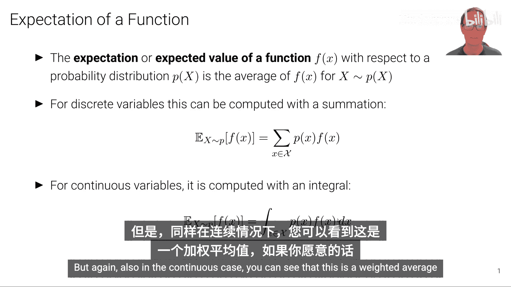

So waiteded。Average， if you will。

An important special case of what we just saw is the case where the function of x is the identity。

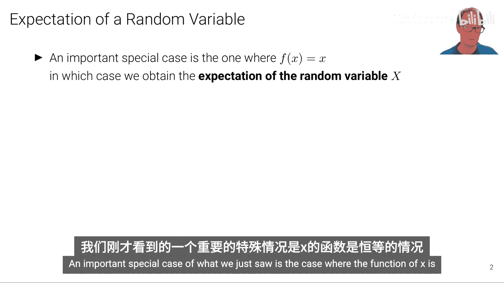

In which case， we obtain the expectation of the random variable X。

This is the expected value of the random variable x。So for discrete variables。

 we have the expectation of x is the sum P of x times x。

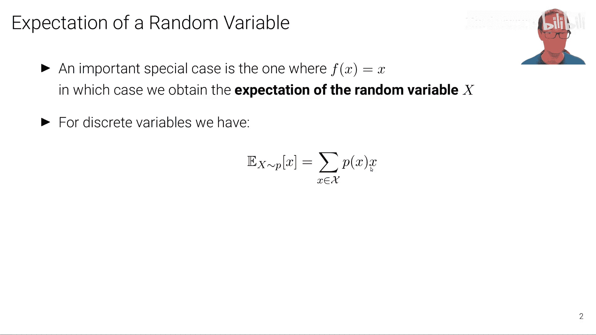

And for continuous variables we have the same， except that we swap dis summation with an integral。

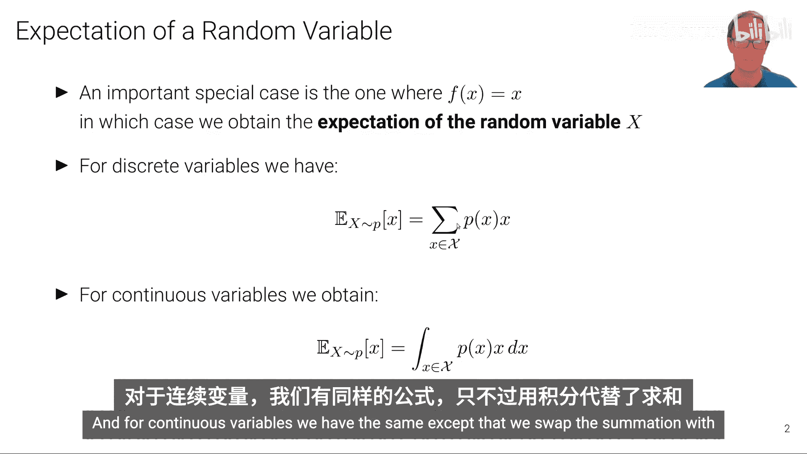

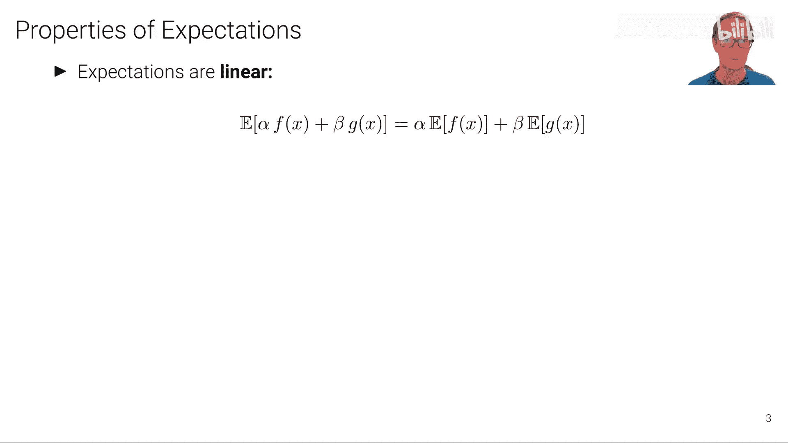

One important property of expectations that we are often using in the lecture is the fact that expectations are linear operators。

That means if we take the expectation of alpha times one function of x。Plus， be times。

 another function。Then this is equal to alpha times the expectation of f plus beta times the expectation of G。

We can linearly decompose。 We can push the。Expectation operator inside。

In the case of a Gaussian random variable， the expected value is the mean of the distribution， right。

As you can imagine， because this distribution is symmetric。

We obtain the expected value of that distribution as the mean mu in this case。

 in this illustration here， it would be0。Let's now move to the variance of a function。

And similarly to before， we can also use the identity function to obtain the variance of a random variable or the covariance。

The variance measures how much the values of a function of a random variable x vary as we sample different values of x from its probability distribution。

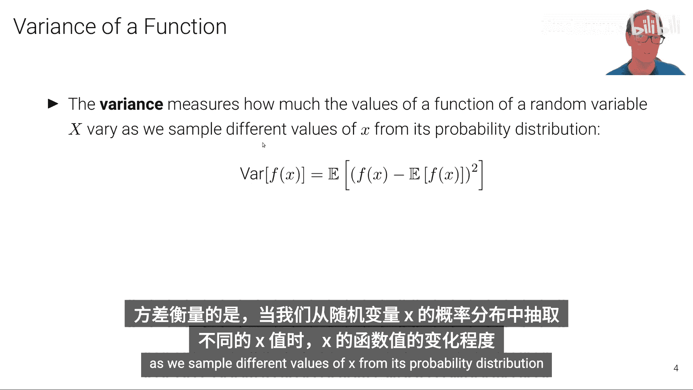

Right， so the variance of f of x is defined as the expectation。Of this quantity。

 which is f of x minus the expectation of f of x。So here we have the expectation from before。

 This is how we defined the expectation before。And functions here。And here。

 in case of the function being the identity。Right。So we first do that。

 and then we compute again the expectation over the function minus that expectation squared。

 And this is what we call the variance。

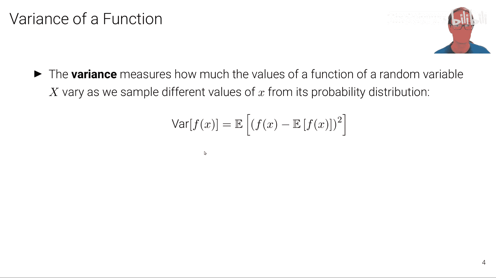

For example， in the case of the Gaussian， random variable the variance determines to spread here。

 right。

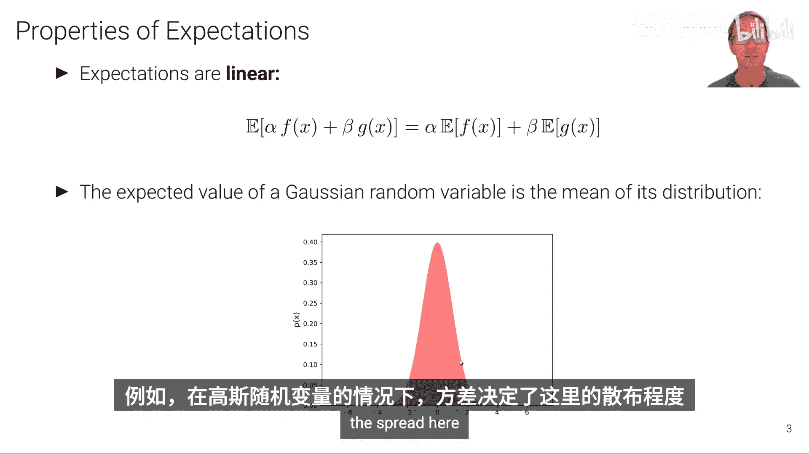

When the variance is low， the values of f of x cluster near their expected value。

 If the variance were be low， we would get a much more narrow。

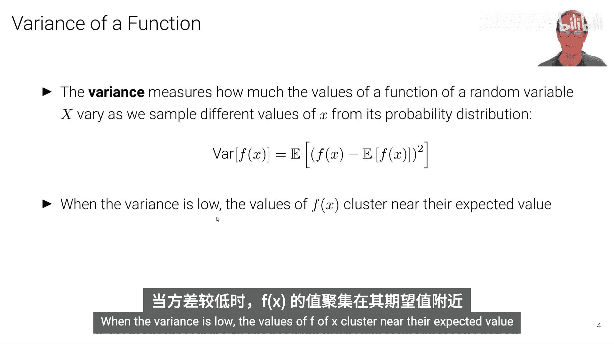

Prob density function， with。Much larger maximum value。

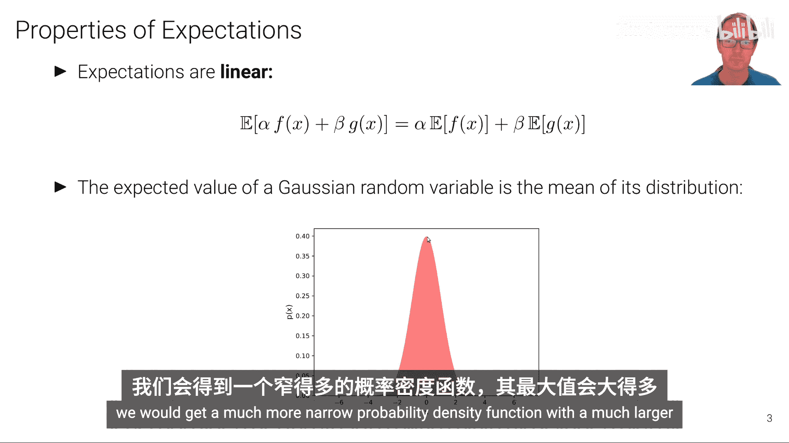

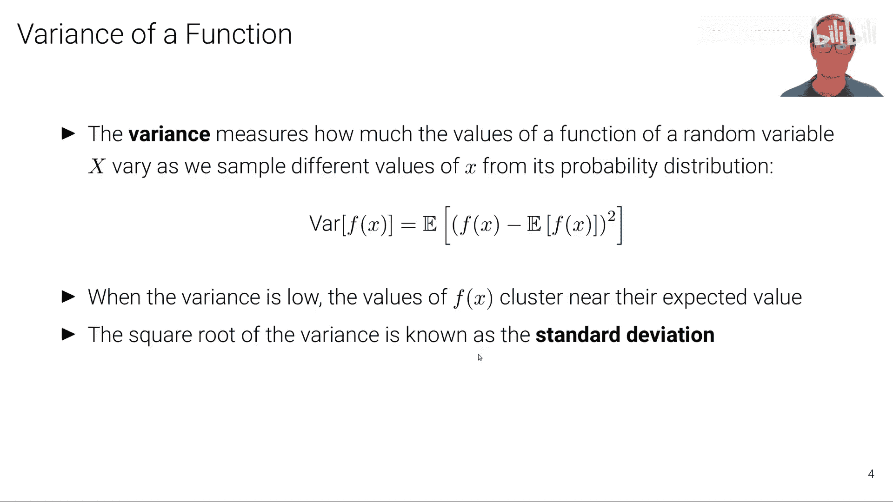

And vice versa， if the variance is high， then the， the distribution would spread， spread out。

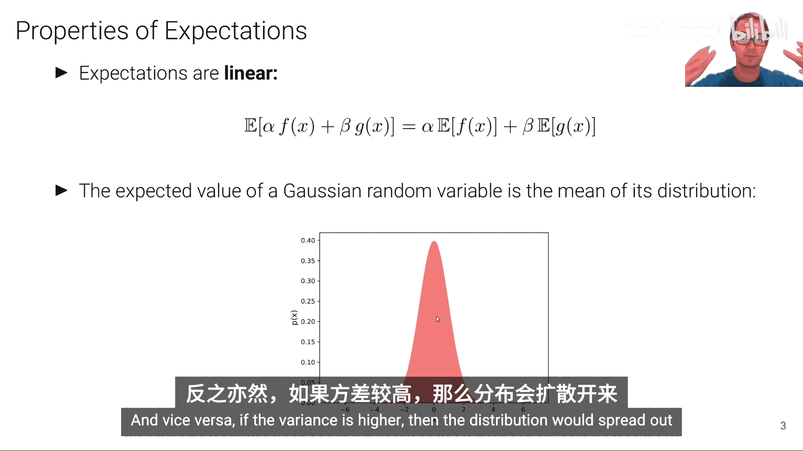

The square root of the variance is known as the standard deviation。

And that's what we use as a parameter to define the Uniivariate gausian distribution。

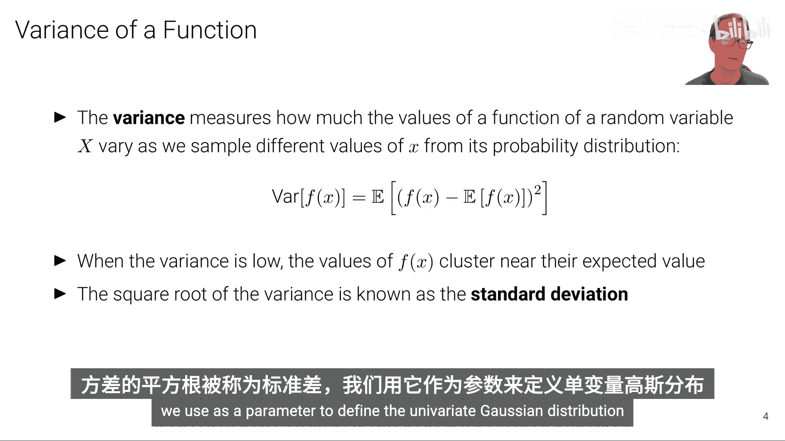

So the variance or the standard deviation。It's one of the parameters of the Gausian distribution。

The covariance measures how much two values are linearly related。

So if you consider the covariance of F of x and G of y。

Then this is simply the expectation of f of x minus the expectation of f times G of y minus the expectation of G of y。

 and everything here。 So this is the outer bracket is inside that expectation， right。

So we have the expectation of this product of two things that are again normalized with respect to their weighted averages。

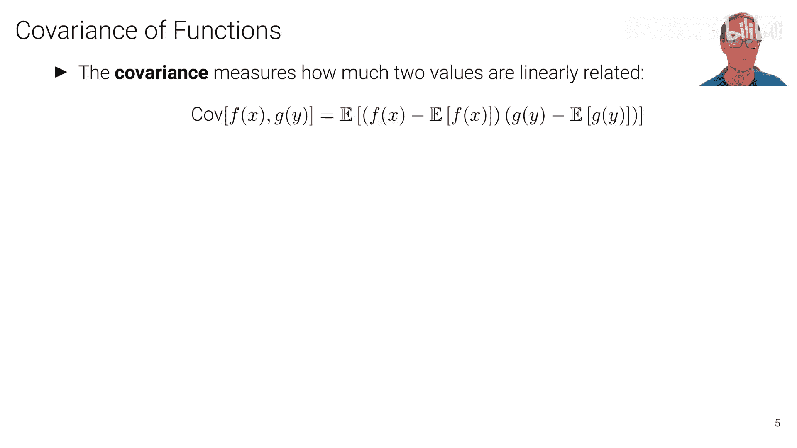

This is the covariance。The covariance matrix of a random vector。

An n dimensional random vector is the n by n matrix， right， We can compute the covariance。

Between all。Paairs of dimensions。The diagonal elements of the covariance matrix。

Are the individual variances。 This is also something you can see here， right， if we use。

If we have the covariance of F of x and f of x then basically the right hand term here becomes the left hand term。

 and we are left with this expression。

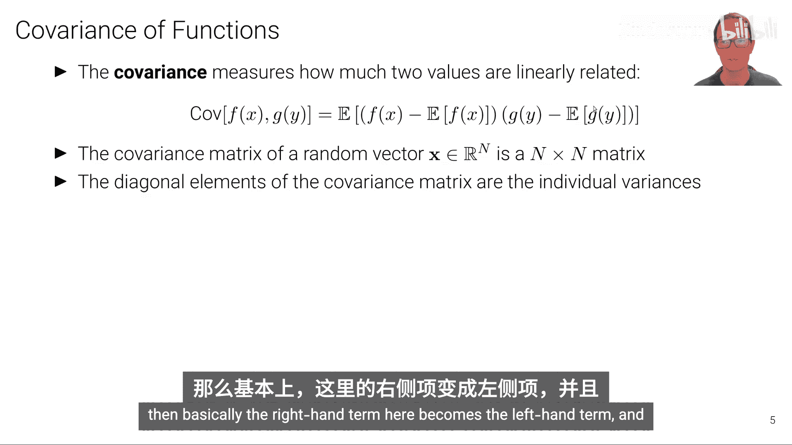

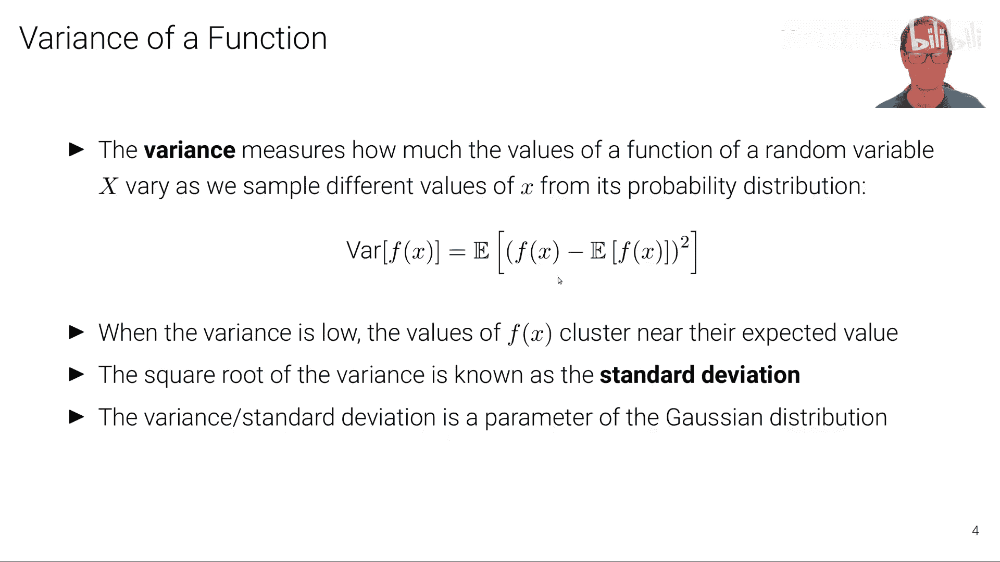

The sign of the covariance determines if variables are positive or negatively correlated。So。

 for example， in this two dimensional case here， where we have two variables and exactly one core variance that describes the relationship between these two variables。

 basically a two by two matrix， which has the diagonal and then one of diagonal element。

 which is the corevari。 and on the diagonal， we have the variances。 So we have just one。

Covariance element this2 by 2 matrix。And we can read a front that element。How that's。

How how these these two dimensions are correlated， how these two random variables are correlated。

So here on the left hand side， we have。These are all gaian distributions。

 but with different covariance matrices。Where they。O diagonal element is either positive。

 negative or。Weakly， positive。And so if it's positive。

 we see this correlation in positive direction where if we if we have larger values for x。

 then we also will obtain larger values for y。If the。If diagonal element is negative。

 then we have negative correlation where larger values of x imply smaller values of y。

And in this case， we have almost no correlation。So， the。And coance between x and y is close to0。

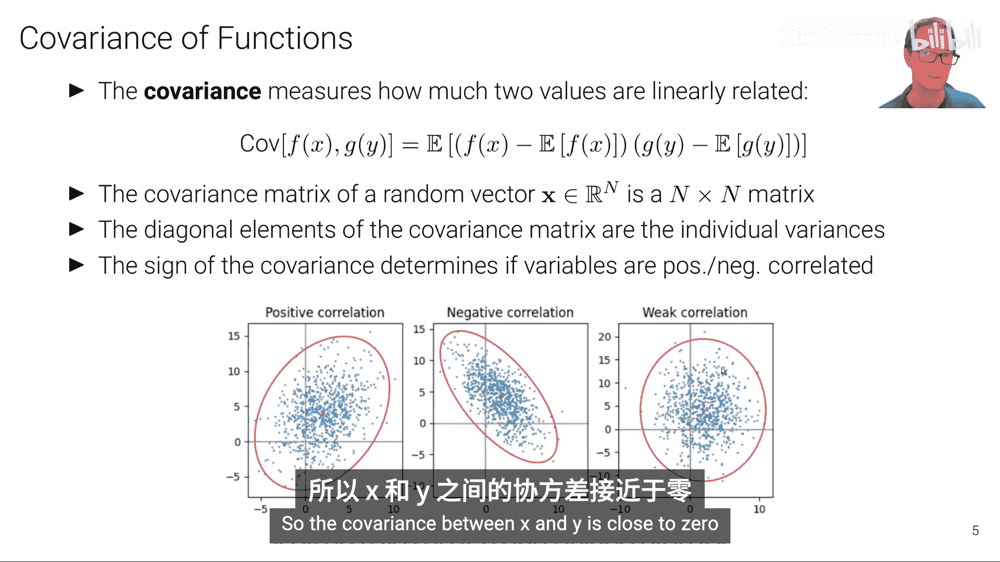