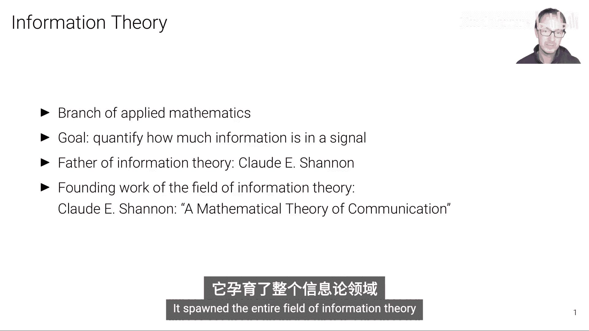
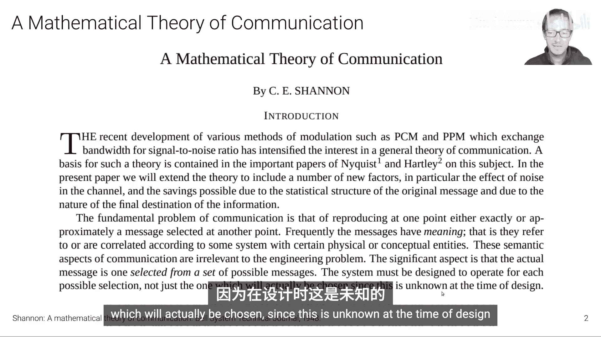
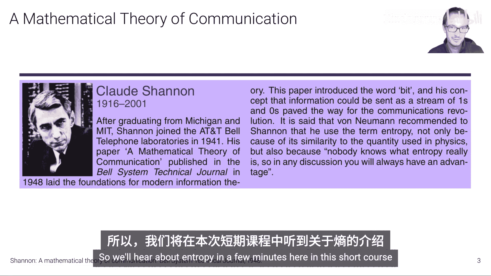
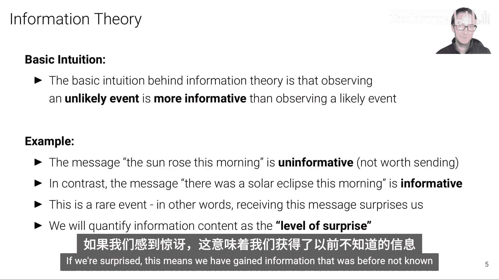
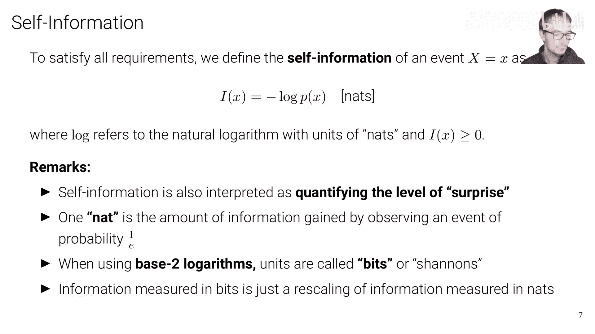
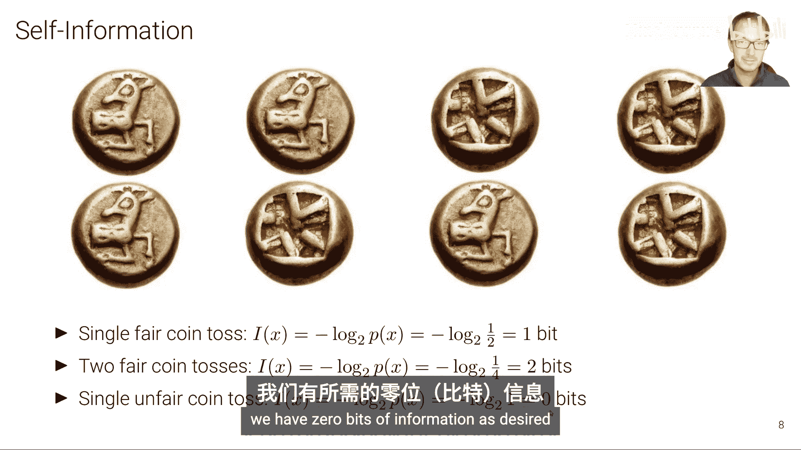
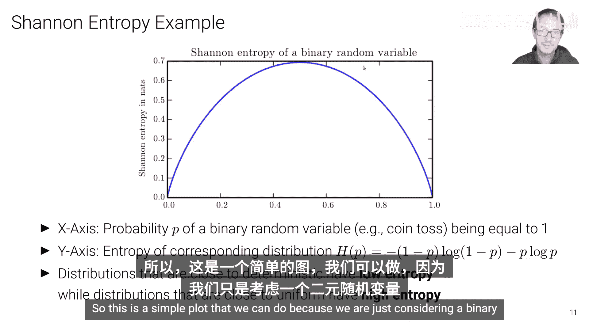
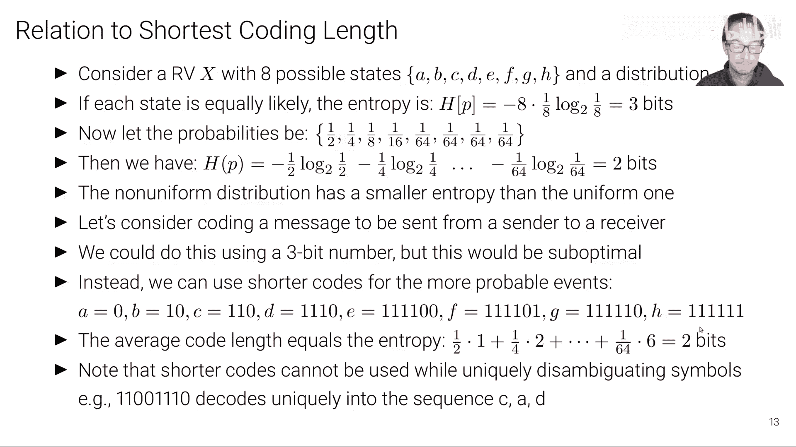

# 【图宾根大学】深度学习的数学 p16 P16 Information and Entropy -BV1xgKPz9EQH_p16-

In the last units of this short mathematics for deep learning course。

Will touch upon information theory。The very basics of information theory in particular。

 will introduce concepts such as。The self information。Shannon's entropy。

 or they call back labella divergence。Information theory is a branch of applied mathematics。

And its goal is to quantify how much information is there in a given signal。And really。

 the father of information theory is Claude Shannon， who in 1948， published a seminal work。

 a mathematical theory of communication。And， in fact， one year later， this work appeared as a book。

With a small change in the title， it was called the mathematicalal theory of Com。

 which indicates that already。By that time， it was widely recognized how important that paper is。

 and it was the founding work for an entire field。 It spawned the entire field of information theory。

So here is it。 This is a screenshot of the original 1948 paper offered by Claude Shannon。

 a mathematical theory of communication。And let's just have a look at the first few lines of this work。

But he writes。The recent development of various methods of modulation such as PCM and PM。

 which exchange bandwidth for signal to noise ratio， has intensified the interest。

In a general theory of communication。A basis for such a theories contained in the important papers of Nquisten Hartley on the subject。

In the present paper， we will extend the theory to include a number of new factors。

 in particular the effect of noise in the channel and the savings possible due to the statistical structure of the original message and due to the nature of the final destination of the information。

That something will touch upon。Nao。The fundamental problem of communication is that of reproducing at one point。

 either exactly or approximately a message selected at another point。Frequently。

 the messages have meaning that is they referred to or are correlated。

 according to some system of certain physical or conceptual entities。

The semantic aspects of communications are irrelevant to the engineering problem。

The significant aspect is that the actual message is one selected from a set of possible messages。

The system must be designed to operate for each possible selection。

 not just the one which will actually be chosen。Since this is unknown at the time of design。

So here's a little anecdote about Claude Shannon that I found in the bishop book。

So Claude Channon lived 1960 to 2001。And after he graduated from Michigan and MIT。

 he joined AT and T Bell Telephone Laboratories in 1941。Where he also wrote his famous paper。

 a mathematical theory of communication published in the Bellll System Technical Journal in 1948。

And this paper led the foundations for modern information theoryorem。

The paper introduced the word bit。And his concept that information could be sent as a stream of ones and zeroes paved the way for communications。

 revolution。It is said that Fon Neumman recommended to Shannon that he used the term entropy。

 not only because of its similarity to the quantity used in physics。

 but also because nobody knows what entropy really is。 So in any discussion。

 you will always have an advantage。So we'll hear about entropy in a few minutes here in this short course。

This is a picture from Shannon's work。 I can see the structure of the system that he considered。

Which is。There's an information source that produces a message that's then transmitted via a。

A digital signal and received that the receiver site and then decode it again。At the destination。

 into its original form。And this。Channel here is subject to a potential noise。

 That's not something we will consider today， but that's。What information theory is about。

So information theory。😊，To recap。Was originally invented to study sending messages from discrete alphabets over noisy channels。

For example， communication of messages via radio waves。

Information theory tells how to design optimal codes for those messages。And。

How to calculate the expected length of messages sampled using various coding schemes。

And we'll see a very simple example。Here， we mostly use here， meaning in this short course。

 we mostly use a few key ideas from information theory。 The field is huge。

 and we can't even cover this original paper。Not even a tiny bit。

So we'll just use a few key ideas from information theory and we'll use them with the purpose of characterizing probability distributions or quantify similarity between probability distributions。

That's where information theory comes into machine learning in the context of our courses。Okay。

 so let's now dive in， dive into the。Into the notion of information。What is information。

The basic intuition is the following。The basic intuition behind information theory is that observing an unlikely event is more informative than observing a likely event。

Let me repeat。The basic intuition behind information theory is that observing an unlikely event is more informative than observing a likely event。

Okay。Intuitively， that makes sense， right， let's see an example。The message。

The sun rose this morning。Is completely uninformative。The sun rises every morning。

 It's not worth sending this message。 It doesn't contain any valuable information because the sun rises every morning。

 every single morning， the sun rises。There's no information if you tell me this。In contrast。

 the message there was a solar eclipse this morning is very informative。

It's actually rather rare that a solar eclipse happens。

 And so if you tell me there was a solar eclipse， then this is quite informative to me。

This is the basic intuition。 Unlike events such as the solar eclipse， contain more information。

Then very， very likely or extremely likely events such as the sun rises every morning。In contrast。

 the soil eclipse is a rare event。 In other words， receiving this message surprises us。

Surprise is another word for information。 or quantify information content。

Informally as the level of surprise， if you will。If we are surprised。

 this means we have gained information that was before not known to us。

We would like to quantify information now in a way that formalizes this intuition。

Likely events should have low information content。Right。

Sunrises every morning should have low information。

And certain events should have no information content， actually。

 the sunrises every morning is certain。So it should have zero information。However。

 less likely events should have higher information content。And deferreder。Rule that we impose。

Is the following that independent events。 if you observe independent events。

Then the information should add up， they should have additive information。As an example。

 finding out that a tossed coin has come up as hats twice should convey twice as much information as finding out that it has come up as hats once。

If I tos a coin， it comes up it as heads twice。This should contain twice as much information。Now。

 given those。Assumptions， there's only one formula letter that can fulfil all of those to satisfy all of those requirements。

 we define the self information。We call this information quantity de self information of an event x equals x。

 So here we have a random variable x taken a value x。As i of x equals minus the logarithm of p of x。

Where in this case， the logarithm refers to the natural logarithm of units of nutss。

 This is the unit terminology for the unit nutss。 if we use the natural logarithm。And。

The self information is always bigger or equal than 0， just through the definition of this formula。

For the properties of the log room。Note that if we use a different logarithm。

 this is equally possible， but then the unit changes。 So for example。

 if we use the logarithm to basis 2， then this is called bits。And it's just a scaling。 so we can。

 because we just need to multiply the white with the respective logarithm。

 we are just effectively scaling。So there's a， there's just a scaling factor in between nutss and bits or。

嗯。Information expressed。In terms of the logarithm to the basis is 10。Yes。

 so it is possible to show this that this is the only。For a letterfuls these requirements。

But it's also quite easy to see that， because we know that。

Mre the route de rott and admire the the rules of the logarithm。

That if we have a a logarithm of a product， then this is this sum of the logarithms。

 So we have this additive。Requirementfuled。 We also know that minus logarithm of something。

Is always positive。And。The smallest value it can take is0。

 and we know that if the probability is higher， then the information will be lower because this is a monotonic function and we take the negative of it。

So these two conditions are also fulfilled。Self information is minus the negative logarithm。

Of the probability。Of x。Okay， so we here we have the definition again to satisfy all requirements we define the self information as such。

Self information of the event that X takes X。A few remarks on this。

Self information is also interpreted as quantifying the level of surprise， as we've already learned。

And one nut is the amount of information gained by observing an event of probability1 over。Yi。

When using base  two logarithms。Units are called bits or shannons， instead。

And information measured in bits is just the rescaling of information measured in nutss。

Just need to rescale。

Let's look at another example， a simple example on this additiveness。So， let's consider。

A fair coin toss。At first， let's consider a single fair coin toss。

 So we have this coin and can either turn hats or tail， show up hats or tail。So if we fre it once。

Then the probability， if it's a fair coin of coming up hats， is one half。

So if we are now considered in the logarithm to basis 2。

Then the self information is minus log21 half， which is equal to 1 bit。

IfWe now consider this situation here where we have two fair coin tossses。

And the event of each of those happening is one quarter。Then， the information。

Of observing this is 2 bits。us log 2。Of one quarter。You can see that。

We have this additive effect here，1 B plus 1 B is 2 B by observing these two independent events。

And contrary， let's go back to。A single coin to us。

 if we have an unfair coin that always comes up heads。I'm not sure how if that's physically possible。

 but assume there's a kind that comes up always with hats。So it's a very unfair coin。

The probability of this happening is one now。And so， the information。For this event is minus- log 2。

1 is 0 bits。Because it always comes up with certainty， comes up with hats。

 we have zero bits of information。As decide。

Let's now move on to entropy， so called Shannon entropy。Self information， as we've seen。

 it deals only with a single outcome。ButWe can also quantify the amount of uncertainty in an entire probability distribution。

 And we do this using the so called Shannon entropy。 We write Shannon entropy as H。

Of some probability distribution P of x。And it is defined。As the expected self information。

When x is sampled from that distribution。And so that can then be rewritten by the definition of the self information from before as minus the expected value of the logarithm of P of x。

In other words， the entropy。H of P is equal to the expected amount of information when drawing from P of x。

As the self information is positive。The entropy is also positive， right。

The expectation doesn't change anything， which is summing up and waiting by the。

Like positive probabilities。 So if I is positive， then E of I must also be positive。

When using base 2 logarithm， the entropy specifies a lower bound on the number of bits required on average to encode symbols drawn from a probability distribution P of x。

When axis continues， the Shannon entropy is known as differential entropy。

 So many of these concepts that we see here not only work for the discrete case。

 but also for the continuous case。 And in this case， we call this Shannon entropyy。

The French entroroppy。AndSo here's what it looks like。 In the first case。

 we have the discrete setting where we have specified the Shannon entropy here on the left。

And then because beyond the discrete setting， this translates into minus the sum of all possible states。

 P of x。Times logarithm of P of x。 This is just a definition of the air expectation。And then。

 similarly。For the continuous case here at the bottom。

 where the summation is simply replaced by an integral。As a quickly， a quick remark， by convention。

 we treat 0 lock 0， which can。Occur here。As the limit of x log x for x to0， which is equal to 0。

So0 log 0 is considered to be 0 if this occurs in any of your calculations。

Let's look at some examples。The simplest example is to look at the Shannon entropy。

Of a binary random variable finger of fame coin that is either fair or unfair。

So what we have here in this figure is on the bottom。

 we have the probability P of a binary random variable like a coin being equal to1。

 So for a fair coin， we would have 0。5， but for an unfair coin， we would have maybe  one。Or0。

And on the y axis， we have the entropy of the corresponding。Bnoli distribution， which is。

H of P equals。 Now， we have just these two states because it's a binary random variable。 So we have。

Like two terms now， right？ So we we， we're doing this expectation， but we have just two states。

 So the first one is minus1 minus P， lock 1 minus p。

Or the other side of the coin turns up minus p log P with the probability 1 minus the other one。

Right。So this is the entro is showing the entropy。 and this is actually the curve that shows up if we plot this expression here。

What we will serve is that indeed， if we have maximal uncertainty。

 if the distribution is close to uniform，0。5 if p equals 0。5。The entropy is high。

Takes the highest value。Just below 0。7。If you do thee。Calculation。But on the other hand。

 if the distributions are close to deterministic， meaning that the coin always turns up heads or tail。

Then， in this case， the Shennon entropy will be close to 0。Right。So we， if we have a。

Completely random distribution， uniform distribution。 Then we have high entropy。If we have。

Events that take place with high certainty， then we have low entropy。

So this is a simple plot that we can do because we are just considering a binary random variable。

But we can also look at。Ava distributions in this case。

We have histograms of discrete probability distributions of a 30 pinence。

so this is a discrete distribution of a 30 different pins。And we show also the entropy in nutsia。

At the top and what we can see is that the entropy of the broader distribution as expected。

 because it's more uncertain， is higher than the entropy of the more narrow distribution。

 where it's more clear which states will be taken when sampling from that distribution。And again。

Also， in this case， a uniform distribution would yield the largest entropy possible。

So if we would have a completely uniform distribution here， then the entropy would be。

While we would have， if we go back to the formula， we would have 30 times one over 30， because every。

this P of x， every of these。Is equally likely now， and this cancels。 So we don't see it here。

And we are left with minus log P of x， which is minus log1 over 30。And so this is equal to 3。4 nets。

 which is the highest possible entropy that we can have for this particular distribution。Now。

 to conclude this unit， I want to briefly show you the relation to the shortest coat length that was so important to Shannon。

When transmitting messages from the sender to the receiver。And how this relates to the entropy。

So it's not only useful as a measure of probability distributions or uncertainty for us。

But it also relates。It's actually。It's coming， it's it's found it in this， this coding。

So what is this about。Consider a random variable X with8 possible states， A，B，C， D， E， F， G， H。

And a distribution on that random variable X。Which you call P。If each state is equally likely。

 the entropy is well。H of P is。minus。8 times 1 over 8 because uniform distribution log 2。

 we operating again in bits。 taking taking the logarith to the basis 2，1 over 8。 And this is。

 you do the calculation，3 bits。Okay， this is the entropy。

Of the uniform distribution of8 possible states。Now， let's assume a non uniform distribution。

In particular， let the probabilities be。As we see them here。

The first state is extremely likely and has half of the probability mass。halflf of the probability。

And then the second half of the probability is split。Across all the other states。

 where the second state is still quite likely and the third state as well。

 But then the remaining states are rather unlikely。In this case。We can also compute the entropy。

 so we have minus1/2， log12， minus14， log 14 and so forth and so forth until minus 1 over 64。

 log 1 over 64， and this is2 bits if you do the calculation。

So we can already see that also in this case， if we have uniform distribution。

 the entropy is higher than if we have a non uniform distribution。Okay。

 so what does that have to do with the shortest coding length。Well。

 the non uniformi distribution has a smaller entropy than the uniform one。

 but what has this to do with the shortest coding length？

Let's consider coding a message to be sent from a sender to a receiver now。What can we do。

 why we can， because we have eight possible states， we can simply naively encode this message。

By encoding each single symbol in their message using a free bit number。Right。With three bits。

 I can uniquely encode messages with 8。Characters， alphabes with8 characters。However。

In the case that。The probability for these characters looks like this。

 this would be quite suboptimal。And this is what the difference in entropy between these two tells us。

Because what we can do instead is we can use shorter codes for the more probable events。

At the expense of using long codes for the very unlikely events。So， for example， we can take。

The code 0 for。The symbol a。And the code 1，0 for the symbol B， I can see， they are quite short。

And then， this。Symbols E FGH， which have low probability We encode code with longer codes。Like 1，1，1。

1，0，0。And if we do so， and if we assume that this or if we generate messages from that distribution here。

Then what we'll observe is that the average code length now equals the entropy in this case。Right。

 because。With probability one half， we have a code length of one whenco symbols with a coat of length 1。

Of probability 1 quarter we are encoding the symbol with。Coode length，2。

And only with probability 1 over 64， we need6 bits。To encode a symbol。 And so on average。

 if we do the calculation， we obtained again，2 bits。Like the two bits that we have come up with here。

 which is the entropy of this distribution。 So the entropy tells us something about how many bits we need if we in an optimal way encode these messages。

As little remark here note that shorter codes cannot be used。While uniquely disambiguating symbols。

we need to know when a symbol ends so we can't use any arbitrary code here。

But we have to encode this。Sybols in a clever way such that we can make a distinction。For example。

 this co here 1100，1110 uniquely decodes into the sequence CAD。Right， because。6，1，1，0。

Is the is only a code where a single symbol starts with， which is a symbol C。And then， 0。

This is the code where a simple A starts with。 And so it is all unique。

 That's why these codes look like that。

