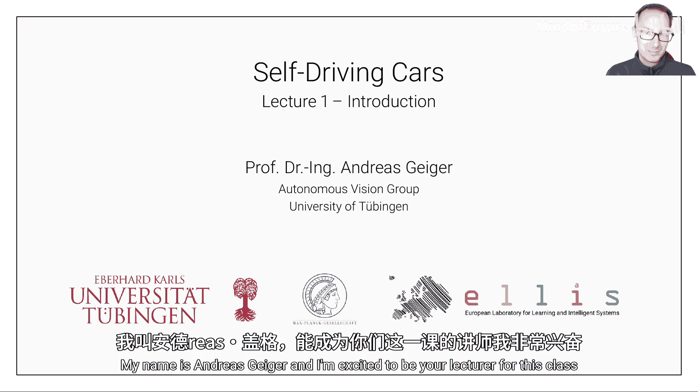
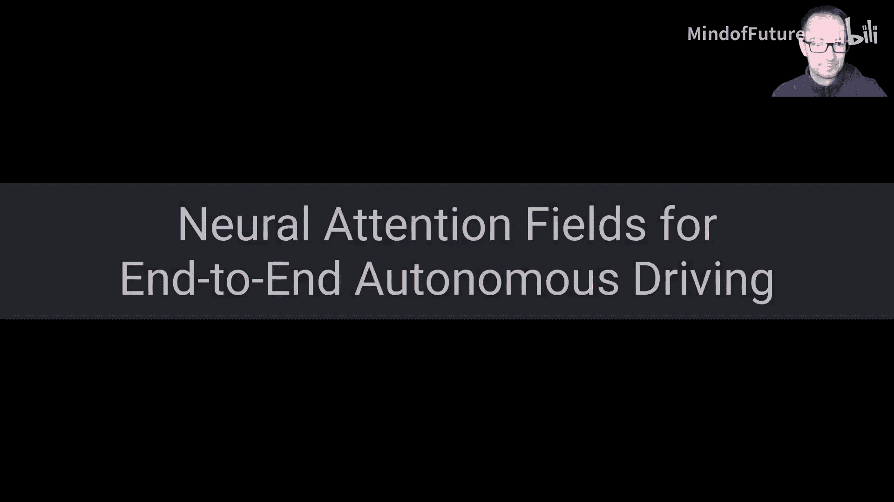
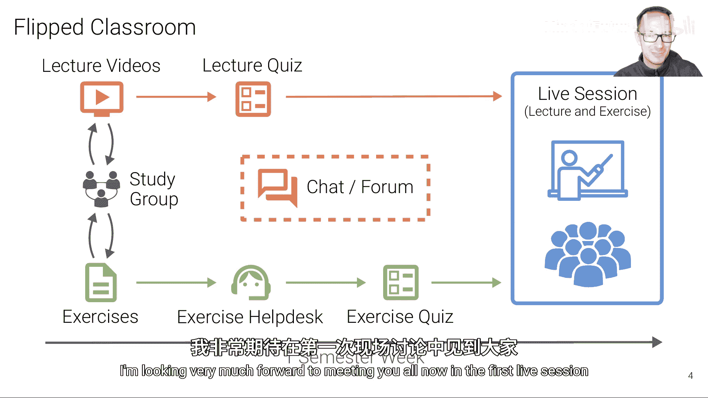

# 【图宾根大学】自动驾驶汽车课程 ML4340 p01 P01 Lecture 1.1 (Introduction - Organization) -BV16FP2ePEYc_p1-

Welcome to selflf driving cars。A lecture at the University of Toubingen。

My name is Andrea Gaigga and I'm excited to be your lecturer for this class。

Self driving has always been a human dream， as we can see here on this illustration from the 1950s。

However。It's still not achieved， and we won't understand what is the state of the arts in self driving and what are the remaining challenges for self driving to become possible in the future。

My group also does research on self drivingriv systems。

And I want to show you quickly one of our results that we obtained。

Through an end to endtrain system that just sees。Images and human demonstrations。

 And afterwards is able to drive in this。Simulator called Kala that you can see in the following William。

🎼。

🎼，🎼，🎼，🎼，This course is taught as a so called， flipped classroom。What does that mean？

In a flipped classroom， we provide to you the lecture we use and the exercises beforehand。

And you watch the videos and work on the exercises。 And then we discuss。

All of the content of this lecture together in the physical life sessions， where we all reconvene。

Together with all the other students。And discuss together。In particular。

 we provide videos beforehand via YouTube。And。In order to increase self motivation and self。

Provide a means of self assessment， but also to。Analyse which tasks have been。

 or which parts of the lecture have been difficult and which have been easy。

 We provide a multiple choice lecture vis that you can fill in。

 You will also earn some bonus points for the exam through participation in these lecture visits。

And they'll help us to adjust the live sessions to your need。At the same time。

 we also recommend you to form study groups with your peers to discuss lecture materials。

As well as the exercises。In addition， we provide a online exercise help desk where the TAs are at your disposal。

They help you with anything。Any question that you might have that's related to the exercises。

And similar to the。Lectures， we also provide multiple choice quizzes for the exercises， where again。

 you have a mean， you have means for self assessment。But also。

 you can earn bonus points for the final exam。And then during the entire study week。

 we provide rapid feedback through our chat or forum that's available online。Now。

 typical semester week looks as follows you watch the videos。You start working on the exercises。

Get in touch with your study group or ask questions in the chat。那 knew。Um。Complete the lecture quiz。

 and the exercise quiz。And bring all your questions with you into the live sessions。

That's all I wanted to say。I'm looking very much forward to meeting you all now in the first live session。

😊。

See you there。