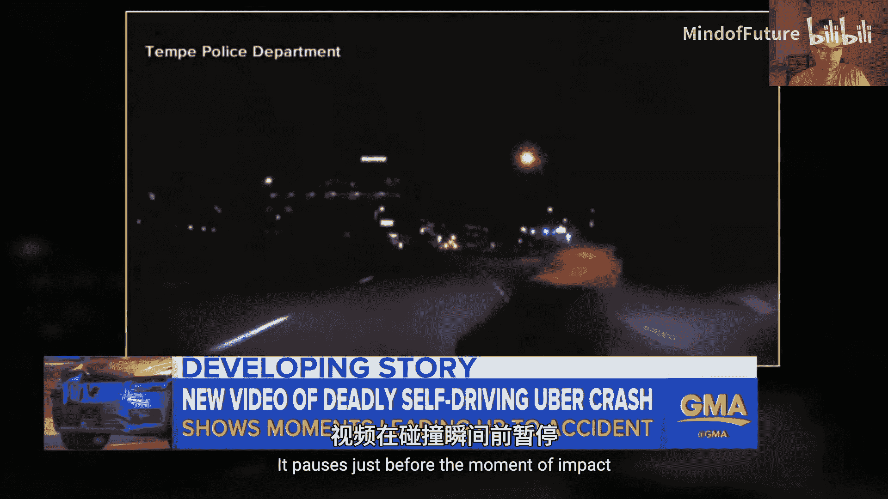
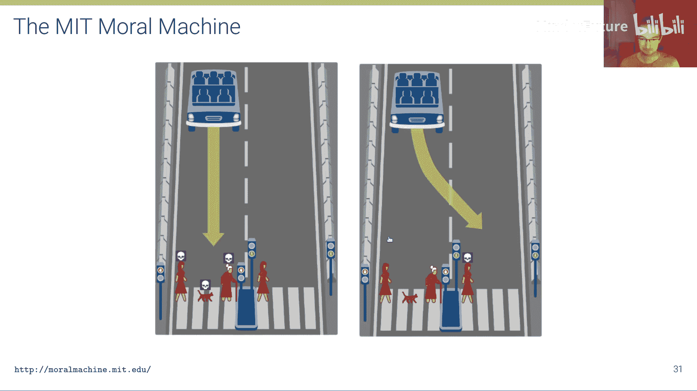

# 【图宾根大学】自动驾驶汽车课程 ML4340 p02 P02 Lecture 1.2 (Introduction - Introduction) -BV16FP2ePEYc_p2-

Why are we not sitting in self driving vehicles today day already。What makes self driving so hard。

Over the last 70 years， humanity has achieved incredible things。We've put man on the moon， among sts。

But over the last 70 years， we haven't made machines drive people around。

So what makes this problem so hard。Let's have a look at the challenges involved in self driving。

 But before we go there， let's first ask ourselves why we actually want。To have self driving。

 why is self driving a beneficial technology？To understand the primary cause。

 the primary reason that people often name。Let's have a look at the at a map of road fatalities in 2017。

 worldwide。What you can see on this map color coded is the number of road fatalities。With darker。

 meaning more fatalities per cap capita。And to summarize this map in just a few concrete numbers。

In 2017 alone， there have been more than 32，000 road fatalities in the US。

There have been more than 3000 road fatalities in Germany。

And there have been more than 1 million road fatalities worldwide。These numbers are huge。

And if we could make just a small difference on these numbers， this would have a large impact。

The main factors for these fatalities include speeding。Intxiination。Or distraction amongst others。

And all of these factors could be addressed with self driving vehicles。So clearly。

 one benefit of self driving would be to lower the risk of accidents or maybe to eliminate accidents entirely in the distance future。

Another big benefit of self driving would be to provide mobility for elderly and people with disabilities。

For example， in the US，45% of people with disabilities still work。These people have to get to work。

 and they have to get to work in an affordable and safe way。

 and self driving could provide just that。Another reason for self driving。

 another potential benefit of self driving would be a decrease in pollution。That ultimately。

 leads to more healthy environment。For example， if we would have self driving at scale。

 there would be less need for cars because cars would be more frequently occupied。

So we would have to produce less cars。Also。It would be much easier to mitigate traffic jams。

 because cars could。嗯。Act in a synchronized manner and thereby effectively reducing distance while avoiding traffic jam。

And there is， of course also the benefit of car sharing and carpoing， where maybe in the future。

 we don't have to own a car anymore， but we can just call a car at any location at any time which gets us from any point A to any point B。

And that car could， in some optimal manner， on the way to our target destination。

Pick up other people if there is still vacancy。Inight。And this car could drive us not only to work。

Or to our leisure activities。 But it could also drive us to vacation。

 And we can book any kind of car。 We don't need to have a big car。 if we have a family。

 we can just book a big car for a vacation and we can have a small car if we want to drive to work。

To illustrate this a little bit more。This reduction in the number of cars。

 which is a big argument for self driving。95% of the time，95%。A regular car is parked on average。

 This means only 5 per cent of the time a car does something useful。

 namely carrying the passenger from A to B。From a logistics standpoint， this is， of course。

 a nightmare， right95% of the time a car is just sitting there。And getting more rusty。

And not being productive。 So if we would have self driving， nobody would have to own a car。

 but we could just call the car and all cars would be operating at all times unless they would have to be in a workshop。

Until theyre at the end of their lifetimes。So this would be much more efficient and therefore also more environmentally friendly。

And this has of course， been realized by many。As you know， over the last 10 years。

 and there has been tremendous。Industrial interest。

 because it seemed like we're just at the step of making。Self driving a reality。

 given the increase in compute， given the faster computers， larger memory， better algorithms。

 and the revolution in artificial intelligence。It was。嗯。Very tempting。

To believe that within just a few years now， we can actually make this make self driving vehicle a reality。

 And heres an example of a commercial from Uber， which was。Badcast in 2018。

Look close enough and you'll see it's all around you。On your kitchen counter。Under your feet。

Behind closed doors。And in your hands。You see， advanced technology was part of your daily routine long before requesting this ride。

ie So what seems like the road less traveled is actually when Uber has been on for over a million miles now。

Today， we have hundreds of self driving vehicles out in the world。And they're pretty hard to miss。

First you'll notice the 360 degree system of cameras， lasers。

 and radar that scan the environment and make sure the vehicle is aware of everything around it。

Like the stop sign up ahead。That woman crossing the street。And the cyclists coming up behind them。

Then there's Ryan， he's what we call a vehicle operator and he's here to make sure the vehicle does exactly what it's supposed to do。

But before Ryan could hit the road， he had to hit the books Today we will be talking about how this self driving vehicle classifiedifies objects He's one of hundreds of vehicle operators who've passed test after test in the classroom。

And out on the track。These tests teach operators and vehicles to expect the unexpected。

Like swinging car doors。Pedestrians。And unusual roadways。Once they know every inch of this track。

 the vehicles head out to collect data for our team of map makers who verify each lane line。

 road sign， and traffic light in the vehicle's path。Then we update the software to match。

Every new build makes these vehicles even smarter， which will lead to fewer collisions and more lives saved in the future。

No matter their surroundings， these vehicles never get distracted， they don't text。

 multitask or get sleepy while driving。🎼They stay focused on the road ahead。

 When we actually have a new release and build that we're going to go and push out car bringinging self driving vehicles to the public is a collective passion for everyone here。

 Together， we're paving the way to safer roads and more accessible cities。 All right， here you go。

 Thanks， have a good day。 So every time you request a ride。 It's with all of us。😊，🎼。

However， as you might know。Also in 2018， there was another big news on Uber self driving。

Now to new video showing what happened just moments before that deadly uber crash involving a self driving car abc's di theseo has a story。

This dash cam video shows the horrifying seconds before self driving uber hit and killed a pedestrian in arizona。

Tempe police released two videos Wednesday。 One filming outside the car shows 49 year old Elaine Hersberg crossing the road with her bicycle。

 It pauses just before the moment of impact。 another camera filming inside the car shows a human safety driver seated in the front。

 Our investigation did not show at this time that there were significant signs of the vehicle slowing down。

 Then there's Ryan。 He's what we call a vehicle operator。 The Volvo SUV。

 part of Uber's self driving test fleet， is always equipped with a human safety driver behind the wheel。

 but experts say the car's autonomous mode should have detected Hersburg。

 These vehicles are trained to see pedestrians to see cyclists to see red lights。

 And so it's really unclear what went wrong here。

So。As you can see， there is significant challenges and risks involved in self driving。

Self driving is hard。And one thing that makes it particularly hard is that human performance was overly。

嗯。Underestimated when tackling this problem。What is the performance of a human driver？

If we look at the statistics， a human driver produces a fatality。Produces a。A a human loss。

About every 100 million driven miles。That's an error rate to improve on。

In the context of self driving of 0。000001%。Now， if we talk about computer vision。

People typically get excited if they performance。Their accuracy is at 99%。

But clearly 99% is not enough to solve this problem。This is one of the main challenges， But。

 of course， there is very specific challenges involved in this problem。 First of all。

 the vehicle has to drive and under every condition， a full self driving vehicle。

 which is called level 5 self driving。 We'll come to that。 has to drive。Anywhere。Everywhere。

 under any condition， for example。嗯。When the snow falls。In heavy rain at night， at day， et cetera。

 in unstructured roads and parking lots where lane markings are missing。

In the context of other pedestrians， which might exhibit erratic behavior。

In the context of reflections on the road， which cause mirroring artifacts for the cameras。And also。

 it has to handle dynamic scenes with often very quick dynamic。Dynamics happening。

 fast moving objects crossing the road。You must handle rare and unseen events。

 This is also one of the main challenges。It's easy to collect the data set。

 but it's hard to capture all the corner cases in the dataset set。

 When you collect the self driving data set， you're mostly collecting data from the same driving condition。

 driving straight。On a highway， but that's not very interesting。

 what's interesting and what's important to solve are the rare conditions。And in particular。

 the ones that we can't anticipate， so we need our models to generalize very well。

But machine learning models are not very good yet at generalizing very well。

 generalizing as robustly as humans do。Then of course。呃。

Path planning and control is also not as straightforward as just keeping the lane on the highway。

 because when we have to get onto a highway， we have to merge。

 we have to negotiate with our vehicles。 There's a lot of。

Inter ancientent communication happening here that a self driving vehicle has to replicate in order to have a chance to actually merge onto a heavily trafficked highway。

 for example。There's ethical questions as well， what is a good behavior。

 what should a car do in certain circumstances？And there's， of course。

 also legal questions that need to be resolved。Here's an example of a unstructured environment。

Think about a self driving vehicle that recognizes objects。And that has a rough idea of the road。

 recognizes traffic lanes， lane markings and such。But now here is is an example of downtown Paris。

 And you can see how。How unstructured。🎼The traffic situation can become。And of course。

 if you want to realize 100% self thriving， you also have to realize such conditions and you have to realize them robustly。

🎼Every time under every condition。Here's。One slide on ethics。And it's about the。

Famous trolley problem。 It's actually an old problem from 1915， had nothing to do with cars。

 It was a。嗯。Theoretical question。In and it was called trolley problem because there was a trolley。

 a train that was going on a track。 and there was a switch here。

 could switch from one track to the other。 And there was an operator。There was。

I had to make a choice， similar to。The control and planning mechanism in a self driving car has to make a choice。

What to do in the next situation。So here' is the experiment， the Ford experiment。

 It's a For experiment。 You observe a train that will kill five people on the rail tracks if it continues straight。

So you are this operator， you see that train， you see these people。

Now you have the option to pull a lever to redirect the train to another trackre。However。

 on this other track。The train will kill one。Of person different from these five on that alternate track。

What is your decision， What will you do。So this is some kind of ethical question。

 there's a lot of discussion， a lot of debate on this trolley problem because it's a little bit of a thought provoking and artificial thought experiment。

 but it's still a valid。Question to ask。What is the correct ethical decision。This can be translated。

 of course， to the self- drivingiv scenario and this has been famously done by a team of students at MIT called the Mor machineine。

 you can go to that website and create new scenarios and ask people what they would do in these cases So here's two of these scenarios they will find。

There's a car going down the road and it can decide it cannot stop anymore， it's too fast。

And I can decide to either continue or to swerve to the ever lane。But it will， in any case。

 it will kill someone。If it continues， it will kill free people。

 it will kill in this particular scenario， a women。Are a cat。And an elderly person。Who are crossing。

Thezebra strip。I add a red light。Who are on their own doing a mistake。

Or you can serve and save these free lives， but then kill another person。 Now， in this case。

 it's only a single person。That is crossing thezebra strip at a green light。

What is the right choice in this case？

🎼Welcome to the Mor Machine， a platform for gathering a human perspective on moral decisions made by machine intelligence such as self-driving cars We show you moral dilemmas where a driverless car must choose the lesser of two evils。

 such as killing two passengers or five pedestrians。😊。

🎼As an outside observer you judge which outcome you think is more acceptable you can then see how your responses compare with other people if you're feeling creative you can also design your own scenarios for you and others to view。

 share and discuss。😊，🎼Moral Machine is a project by the Scalable Cooper Group at the MIT Media Lab。

 help us learn how to make machines moral。😊。

